# 【加州大学圣地亚哥分校】使用Python进行数据科学中的概率与统计--Probability-and-Statistics-in-Data-Science-p30-07-02-03-独立性--BV1gJFDzkEPg_p30-

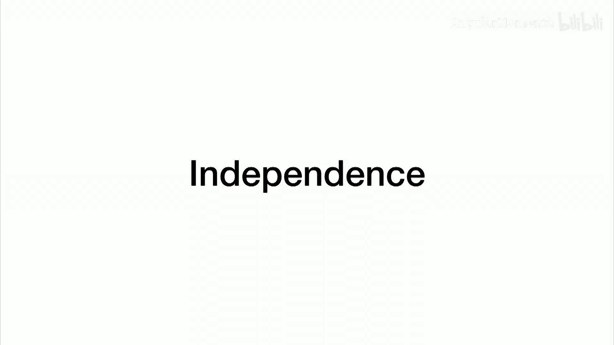

Hello again everyone in the last video we talked about conditional probability and what we would like to discuss now is independence。

So intuitively speaking， we want to say that two events inF are independent。

 which we denote using this symbol here， if the occurrence of one of them does not change the probability of the other occurring。

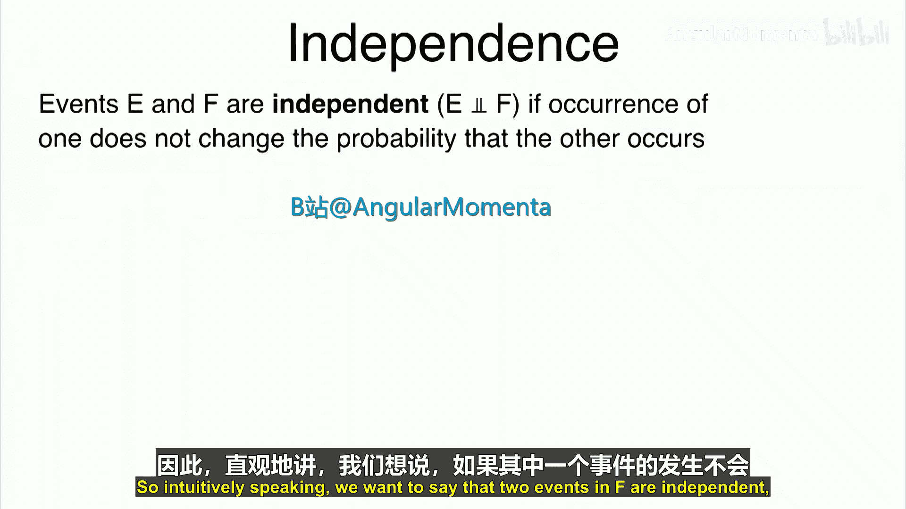

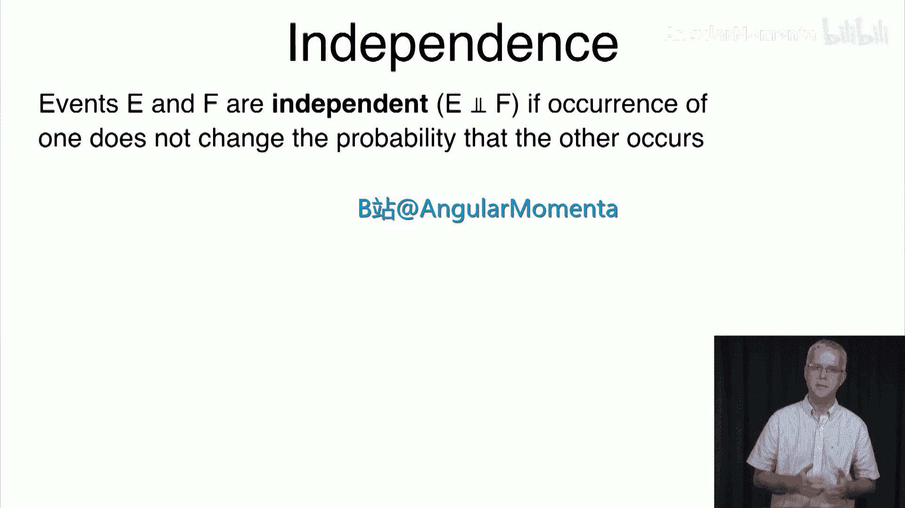

Now， a little more formally， we would like to say that E andF are independent if the probability of F given E。

 namely the probability that F happens， given that E has happened， is the same as P of F。

 it doesn't change from not knowing E that E happened。

Now visually we can interpret it as follows so first of all P of f is the fraction of omega that is f right that's our definition of the probability of an event it's what fraction of times out of all of omega happening F will happen and P of f given E is according to our definition that we have in the last video is the probability of the intersection of f divided by the probability of E so looking at the Ven diagram P of F is the area。

 this red area here relative to the area of the whole space and P P of f given E is the probability of this intersection here。

 it's probably of this pink space here relative to the area of all of E here。

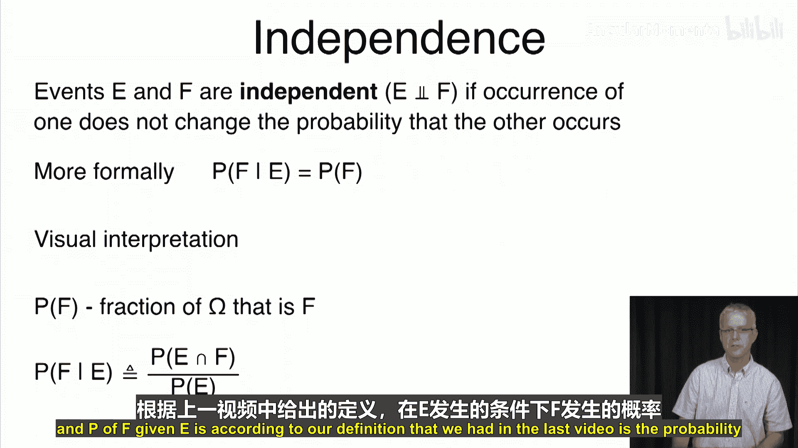

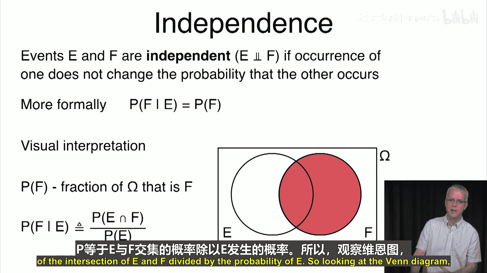

So that's what p of P of f given E is and now if the events are independent。

 if p of f is equal to p of f given E， that means that a fraction of time that f happens out of the whole sample space omega is the same as the fraction here of the intersection given all of E so that's visually what independence means for us the fraction that f is of the whole space is the same as the fraction of the intersection out of E so if node that E happens the probability that f will also happen is this fraction and that is the same as the original fraction of f out of all of omega so that's what independence means for us now so the definition that we have just said said that probability that f and E and independent if P of f。

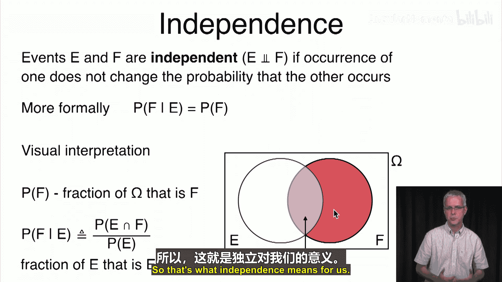

Is equal to P of F given E， which was by definition was P of E in the intersection F divided by P of E。

it's a good definition and it conveys our intuition， but there are two small issues with it。

 One is that it's asymmetric。 We want to say that E and f are independent whereas this definition is not symmetric it talks about P of f given E not P of E not p of E given x not p of E given f so that's one issue The second one is that P of f given e is not defined when p of e is0 because we would be dividing by0。

 so it doesn't apply to events which probability E is0 so we want to resolve these two small issues and formally we'll say that EN f are independent if p of E intersection f is p of e times p of f so it's essentially the same definition as we had is just that we move P of E to the numerator here so we get that P of E times p of f is equal to P of E intersection f and if that happens then we say that E and f are statistically independent or independent。

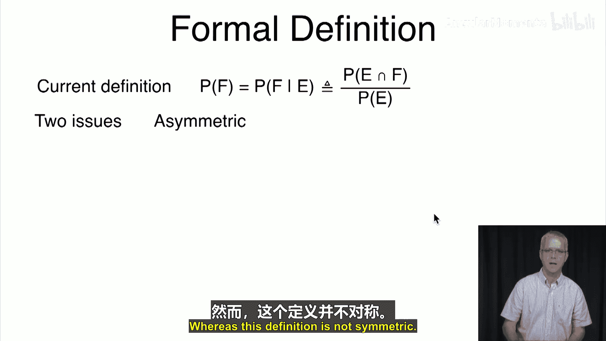

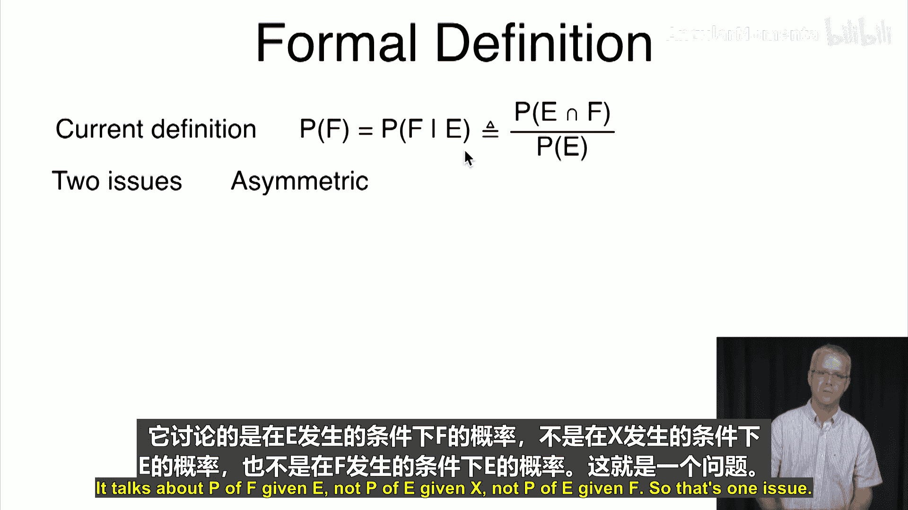

Okay。Now。This， you can easily see that it applies when the probability of e or the probability of f is 0。

 in fact it will say that if the probability of E or f is0， then they are independent。

 which makes sense because for example， if E has zero probability。

That means that it will never happens。 And if I told you that F happened。

 then still E will not happen because it never happen。 So so the probability of E doesn't change。

 it was 0 and it will remain 0。 and likewise if P of f is 0。

 so it applies when the probability are 0 and also it's symmetric。

 you can see that this definition is symmetric and E and f So if f is is independent of E then e is independent of f and that's the way you would like it to be。

Right， and it also implies the earlier definition because if this is true and p of f e is nonze then you can just normalize by P of E and you'll get the original definition it's just a slightly more general So let's consider dependent and independent events for a die so we'll look at three events first that the number we get is a prime and that means that we got the value which is 2。

3 or 5 happens for probability 3 over6， which is one half or the event where the value we get is odd namely135 again probability 12 and the third event is that the number we got is a square namely one or4 and that happens for 2 over6 which is one thirdd we'd like to see which of these events are dependent and which of the pairs are independent。

 So to do that we need to consider the probability of the intersection and the product of the probabilities So let's first look at prime and odd so。

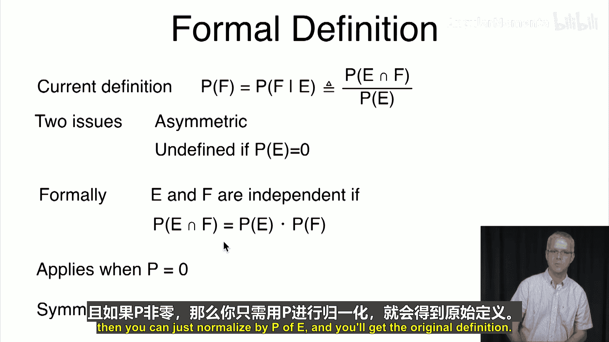

The intersection of prime and odd is the set3 and5。

 those are the only numbers that are both prime and odd between 1 and6。

 and their probability is2 over 6， which is one3。So the probability of the intersection of prime andode is one3 on the other hand。

 the product of the probability of prime and odd well prime has probability12 because the are three numbers and all this probability 12 because again the three numbers so the product those probability is going to be12 times12 which is a quarter and because one quarter is not equal to13 these two events are dependent。

Similarly， if you look at prime n square。Then their intersection is the empty set and the pro is therefore for0。

 not the empty set， but0。 On the other hand， the product of the probabilities is  one half times one third。

 which is 16， so16 is different from0。 so these two events are independent。

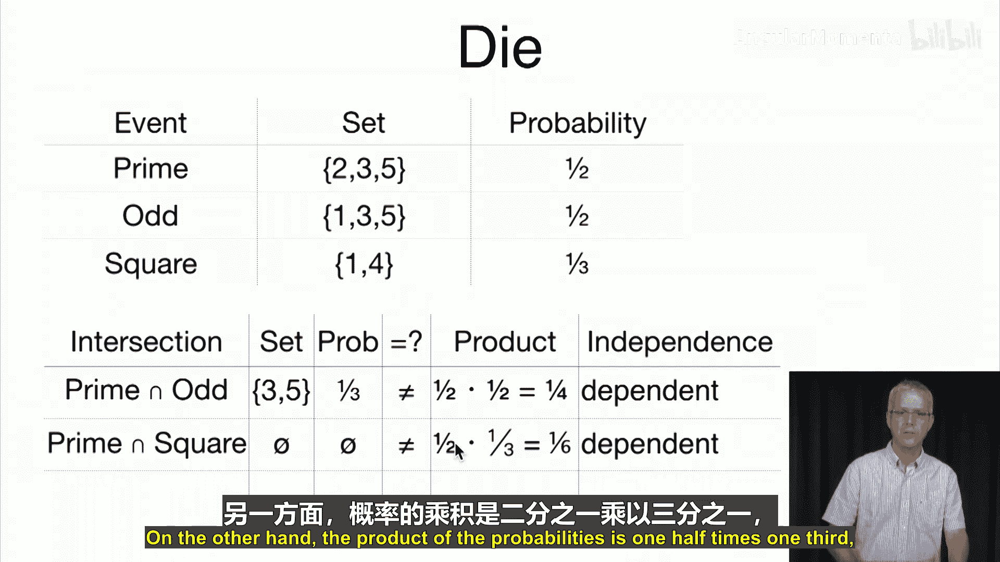

And if we look at the last pair odd and square， then their intersection is one because the only number between  one and6 that is both odd and a perfect square is one。

 so the probability of the intersection is therefore16。

While if you look at the product of the probabilities。

 the probability of odd is1 half and the probability of a square is13d。

 the product is 16 and that tells us that these two probabilities。

 the probability of the intersection and the product of probabilities are the same and therefore odd n square are independent Now that doesn't mean that odd is somehow related to square or not it just means that given the probabilitybabil is give to odds n square。

 it I told you that the outcome is odd， it will not change your probability that the value is a square it's still going to be one third。

And if I told you that the value is square， namely one of4。

 it is not going to change your estimate of the probability that it is odd it was half before because it was1。

3 or five out of six values and now we know that it's one of four because the square and the probability it's odd is again1 half。

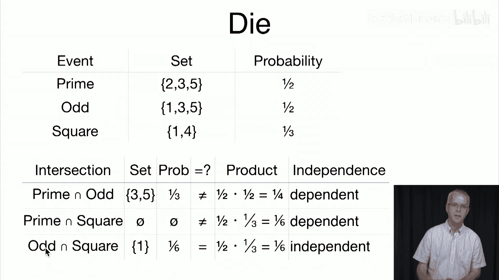

Finally， let's look at one more example coin， let's look at I again three events， first of all， H1。

 the first coin is heads， namely we get H heads and then something else that happens probably1 half。

Second event is H2， namely the second coin is heads and the other two we don't care that again happens probably one half。

And the third event is that we get exactly two hands in our row。

 name we either get HH tails or tails Hh。And that happens for 2 over 8， which is a quarter。

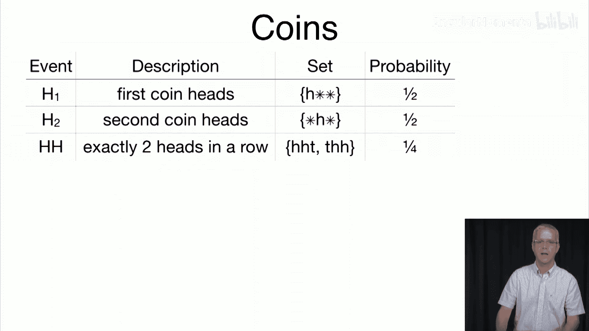

And now we want to see which of these three events are dependent or independent。

 so if we look at H1 intersection H2， that's the event that both the first and second coin ahead。

 that happens for B one quarter。And if you look at the product of H1 and H2。

 the probability is a half times half， which is a quarter。

 so get that the probability of the intersection is the product of the probabilities。

 and therefore the events are independent。If you look at H2 intersection with HH with two heads in a row。

 that's exactly the event that we get H heads， tails or tails， heads heads。

So the probability of that event is a quarter。And。We see that the product of property is H2 has property 12 headset and 2 hs in a quarter。

 so the product is 18， so these are dependent， namely if I told you that H2 happens。

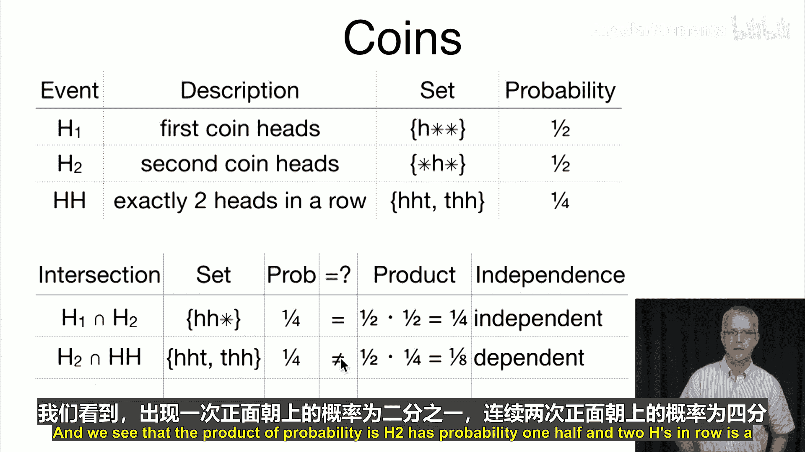

That changes your estimate about whether you'll get two heads in a row because beforehand。

 the probability of Eds heads was one quarter and now it's going to be one half as you can see。

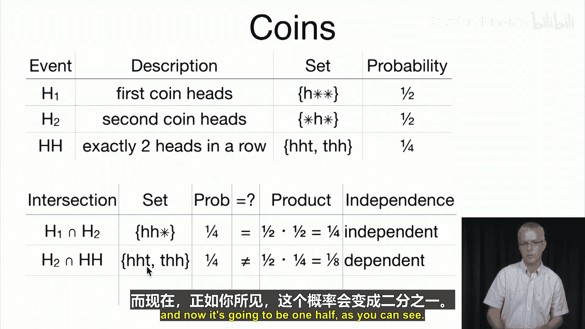

And。Finally， let's look at H1， namely the first is heads and then HH。

The intersection of these two events is just headsets tails because we need to have H the first time and then two heads in a row exactly so it's H H tails。

 that probability is18。 It's one outcome out of8。 And if we look at the probability of H1 of heads the first heads which is half times the probability of two heads in a row which is one quarter we get18 And so these values are equal and therefore these two events are independent。

 So what we can see is that these events to be dependent or independent is statistical phenomenon we're just looking at the probabilitybabilities and seeing whether the probability change or not and that's our measure of when probabilitybilities are dependent or independent。

 So so with that we're going to。

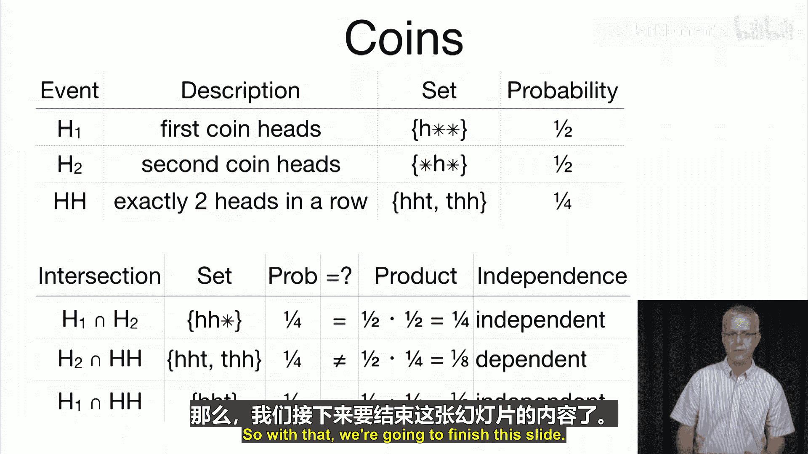

Fin this slide then we talked about independence and next time we'll talk about baseroll。

