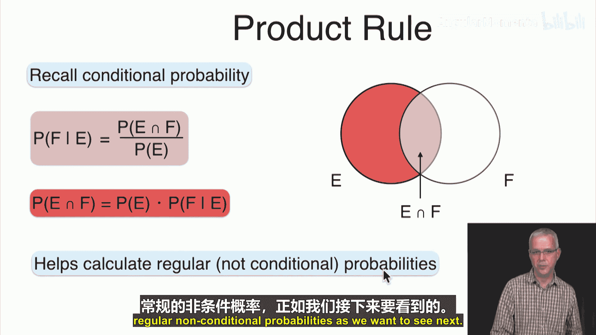
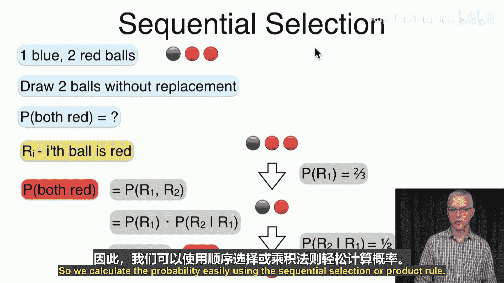
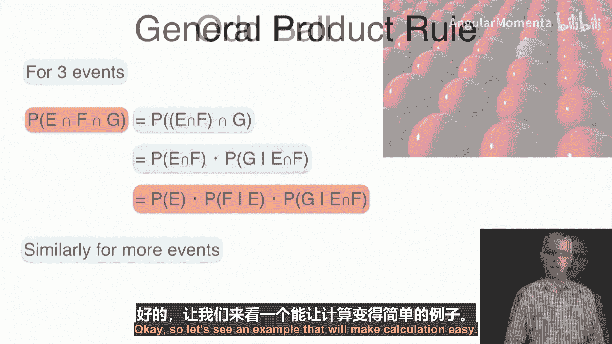
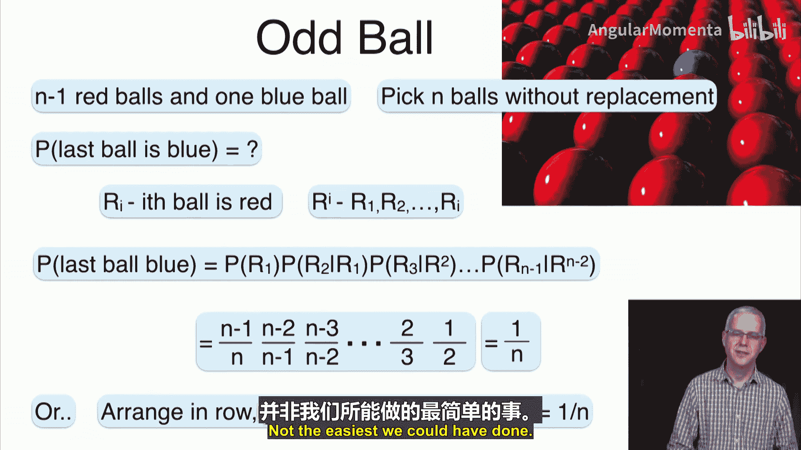
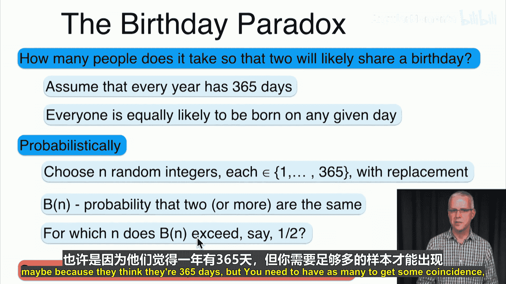
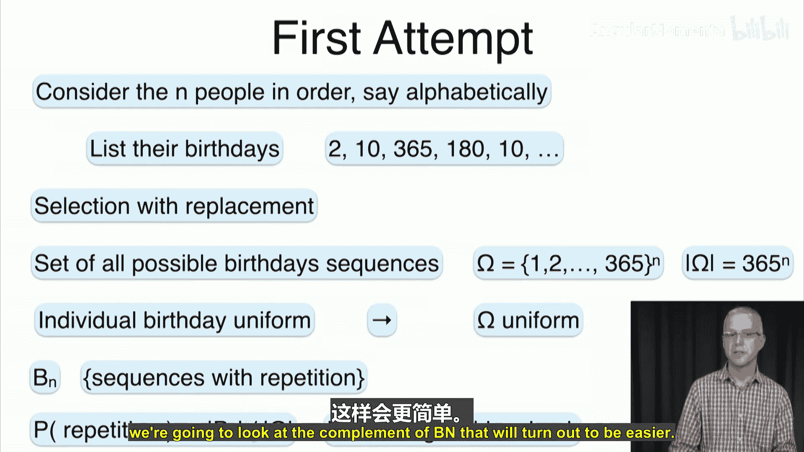
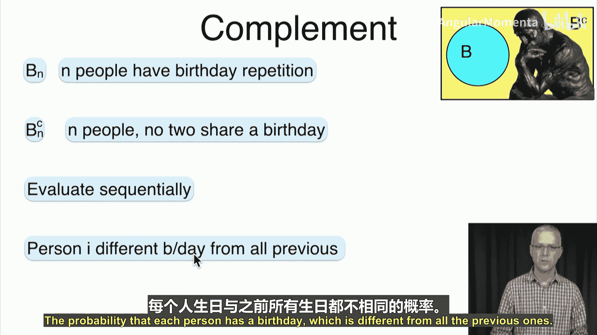
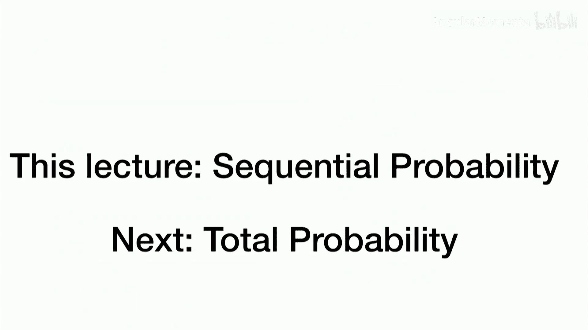

# 【加州大学圣地亚哥分校】使用Python进行数据科学中的概率与统计--Probability-and-Statistics-in-Data-Science-p31-07-03-03-序列概率--BV1gJFDzkEPg_p31-

Hello and welcome back so in this lecture we want to talk about sequential probability and we'll start with the product rule so recall the results for conditional probability it says that the probability of event F occurs given event that event E has occurred is the probability of E intersection F divide the probability of E and piicctorally we see it here we assume that event E here occurred and we ask what is the probability of F。

The f occurs so for F occur to occur， given that E we know has occurred。

 so we must be in this intersection were only interested intersection F and we ask what is the probability that we're here。

 given that we know we are in this pinkish circle so that's going to be the probability inside this area divided by12 probability which is the probability of intersection f divided the probability of E so we can just rearrange things and we can write therefore that the probability of intersection F is the probability of E times the probability of f given E and that simply is the product or says if you have two events what's the probability that both of them happen E and F so first E has to happen。

And then F has2 happened given E， so it's just the product E， the probability that T happens。

 and then times the probability that f happens given that T happened。Okay。

 and so this simple rule actually helps us calculate use conditional probilities to calculate regular noncondal probabilities。

 as we want to see next。

Okay so let's look at this case of sequential selection so imagine that you have one blue ball and two red balls like that and we're going to draw two balls without replacement and we ask what is the probability that both of those two balls are going to be red so let our eye be the probability that the I ball that we draw is red so our one is the probability that the first ball we draw is red and our two is the probability that the second ball we draws are red。

So the probability that both are red， which is what we're interested in。

 is the probability that r1 and R2 are both red， so the probability that probability of r1 and r2。

 both of them are right。And that we by the product rule。

 we can write it is the probability that our R1， the probability first is red times probably the second red。

 given that the first is right。 Okay， so we just need to calculate these two properties。

 So what is the probability that the first one is red。 So we have one blue and two red ball。

 So the probability that the first one is red is obviously just two third。

ick we have two more two twice as many options to pick red than blue okay and once we pick the red。

 we are interested in the probability of that the second one is red given that the first one red。

 but if the first one is red then that means that we are left with one blue and one red and in in that case given the first one is red we are left with this and then the probability the next one is red is just going to be what one half so coming back here it's the so the probability that both red is the probability the first one is red which we calculated here to be two thirds。

So enough that this will be left with one so it's probably the first one is red。

 it's two3s times probably the second is red given the first one is red， which is one half。

 so it's two3s times1 half or one3。Okay， so we calculate the probability easily using the sequential selection or product rule。

Right now this protocol can be generalized so let's see what happens for more than just two events。

 so if you have three events you can write then the probability of E intersection f intersection G is the probability of intersection F intersection G but the probability of intersection F you can write as so it can write as probability of intersection f times the probability of G given the intersection but the probability of intersection f you can write as p of e times p of f given e and then times the probability of G given the intersection so it's this product so its we first E has to happen and then F has to be happened given the T happened and then G has to happen given that both for them have happened so this is the protocol for three events and you can also generalize it to more events。

So let's see an example that will make calculation easy。

 so let's consider the case of a whole bunch of red balls and one odd blue ball so specifically we have n minus1 red balls and one blue ball and we are going to pick n we're going to pick all the balls so we have n balls all together pick all of them without replacement name one of the other without putting duck and we ask what is the probability that the last ball we pick is blue。

Okay， so let our subscript eye be the event that the I ball is red okay so our one is the event that the first ball is red and so on and let our superscript eye be the event that the our one happen in our two up to eye and name the first eyeballs are all red。

 so that's our superscript eye。So the probability that the last ball is blue。

 which is what we are asking about is the probability that all the first n minus1 balls are red because we have n minus1 balls。

 red balls and one blue ball so the probability the last one is blue is probably that our one is red and two is I'm sorry the first ball is red and the second ball is red all the way up to the n minus first ball is red。

And that by the product rule we can write as the probability of r1。

 that the first one is red Time the probability that the second one is red。

 given that the first one is right， times is the probability that the third one is red。

 given that the first two are read and so on up to the probability that the n minus first ball is read。

 given that the previous n。N-2 balls were all right。 Okay， so this we can calculate because the。

 what is the probability of our one， The first one is right。

 Well we have n balls and out of them n -1 are right。 So that probability is going to be n -1 over n。

And then once if the first one is red， we take it out。

 then we'll be left with n minus2 red balls and one blue ball so the probability that the next one is going to be red is going to be n -2 divided by n -1。

And then after we take out another red ball， we'll have n minus3 red balls because we had n minus1 to begin with。

 we subtracted two。And the total number of balls is n minus2 because we start with n subtractor 2 so the probability the next one is red is n -3 over n minus2 and so on up to two times3 and then in the end for the n minus first ball will left with two balls of which one of them is red and that's times1 half and you can see that you get some very nice cancellations here and minus-1 cancel is here and minus-2 cancel here and minus-3 will cancel the three will cancel the two will cancel and what we'll be left with is just1 over n。

So we see that the product rule allowed us to calculate the probability that the last one is blue very easily。

But is it really very easily Well you could have done it also in a different way you can just say okay I have the balls like imagine imagine the balls arranged in a row okay and so what is the probability that the last one will be blue is the probability that the last one will pick is the blue is just the probability that the blue ball ends up at the very end of the row and since it has and different locations to be in the probability that it's the last one is just one over n which is what we got so the product rule was nice but maybe not as easy as we could have done not the easy as we could have done。

All right okay so I want to look at another application of the product room maybe a little more interesting or maybe even more interesting and imagine that you have people at a party and you ask how many people would it take so that two will likely share a birthday so how large should this party be so that it's likely maybe more than half for that two people in the party have the same birthday so we're going to assume that every year has 365 days。

 no leap years and so on and that everyone is equally likely to be born on any given day so everyone is equally likely to born on the first day of or second day and so on so publicically what are we're asking about we say choose n random integers each from one to1 to 365 we choose them with replacement because people could potentially have the same birthday we choose n of them and we ask。

Will at BN be the probability that two or more people have I'm sorry two or more of these integers that we chose are the same？

And we ask for which and how many people will be the probability that we have two that are the same exceeds say half that would mean for us are likely to be likely。

 so it's the probability that two shows birthdays at least half okay so when people are told apparently some of them think that this number should be roughly 365。

Maybe because they think theyre 365 days， but you need to have as many to get some coincidence。

 but in fact the answer is much smaller。

So first attempt we could consider N people in order。

 say alphabetically just take the people in some order and then list the birthday so maybe the first one was born on the second day of the year 10 day of the year。

 the last day of the year and so on and so this is selection with replacement like you see here1 we selected twice so we can consider the set of all possible birthday sequences okay and so call it this is our sample space omega so these are the set of all possible birthday sequences。

 the numbers from one up to 365 race to the N， the n quotion power of this so these are all possible sequences and the size of this sample spaces as we know is 365 race to the end。

Now we can because we assume that the individual birthdays are uniform。

 then also this implies that this space is uniform， every sequence that we get of n values。

 for example， this sequence is equal likely to any other sequence because all birthday dayss are uniform a uniform is selected。

 okay so fullette BN。Be the set of sequences that have some repetition in them。

 for example this the 10 is apparent twice， then what we need the probability that we get an element in Bn。

 the probability to get repetition is just the size of Bn。

 we need to see how many sequences of length n over 365 have repetition。

 and we need to divided by omega。Okay， but calculating this is not。

Super easy so is a little involved so what we do is instead of calculating I should say calculating directly Bn is a little involved so what we do is what we have done many times and we're going to look instead of B we're going to look at the complement of Bn that will turn out to be easier so again using we're thinking out outside the circle and we' can complement of Bn so Bn is the set of where you have N people share a birthday or have a birthday repetition and the complement of Bn be the set the event that you have N people and know to share birthday so we evaluate the probability we use the product rule to evaluate this probability sequentially of the first person second person and so on and so what we want to see is what is the probability that second person is birthday is different from the first one because we're looking at no repetition and then the third birthday person has a different from the previous two and so on so that's what we're going to look at the probability that each person has a birthday which is different from all the previous。

Previous ones Okay， so the calculation is as follows so we have end people and the probability that know to show birthday is going to be the probability that the second one is different from the first that's going to be the second one is 364 birthday to be born in。

 you 365。In times probability the third one will differ from the previous two given that previous two have different birthdays。

 so if the previous two have different birthdays they already take two birthdays and it needs to be oh she needs to be born in one of the 365 minus-2。

 one of the 363 out of 365 possible birthdays， so what we do see is we'll get each one will get here 364 times 363 times 362 and so on。

 each of them is divided by 365。And the last one that well have is365 minus n minus1 or basically 65 minus n plus1。

When we take the parenthees out because you have n minus1 people beforehand and the birth then needs to be one which is different from what we had before okay。

So we want to calculate this probability and we can use a small approximation。

 so first of all we can write it as the product of 1 minus i over 365 I going from 1 up to n minus1 and then we can use an approximation that 1 minus x is less than equal to e to the minus x you can kind of visualize it1 minus x falls and e to the minus x stays above it and so this is less than equal to the product of e to the minus I to the 365。

 this is 1 minus x this is e to the minus x。And this product is going to give us the exponent or e to the minus this summation of1 over the 365 summation I going from 1 up to n minus1 summation of I。

Okay， and as we know， the summation is n times n minus1 over2。

So we're summing 1 plus2 up to n minus1， so we have n minus1 terms， the average is n over 2。

So this gives us e to the minus n times n minus1 over 2 and again divide by 365。

 which is almost the same as e to the minus n square over 2 times 365。

So if we want this probability to be half so this what we're asking when is this probability going to be this is the probability of the complement so we want this probability to be less than a half so works in the right direction so here so if one this probability to be less than equal to half then or in this case we want equal to half then what we must have so we must have that minus n square over 2 365 is equal to line of 0。

5。So I'm taking log on natural log on both sides， so line of the left side here is line of 0。

5 which is minus La2 okay so we can cancel the minuses and we get therefore that n is going to be well you can it's going to be this value which you could also write is two times36 to5 times line2。

 it's the same。 and when you calculate it， it's 22。494。And。In fact， if you calculate the exact value。

 it's going to be the value for which this quantity is going to cross a half。

 it's almost exactly the same and which means that we can get 23 people then the probability that the probability that they will not show a birthday which is what calculated here will be less than a half and a half and the probability that there will share a birthday will therefore begin to equal to half and you can see it in this graph here。

 this is a probability that you get a birth and we get to 23， this probability crosses a half。

 and if you look at the notebooks that we have for you， the Jupyter notebooks。

 you can see how to calculate this probabilities for any given number of it。All。

 so in this lecture we talked about sequential probability and next we'll talk about total probability。

See you that。