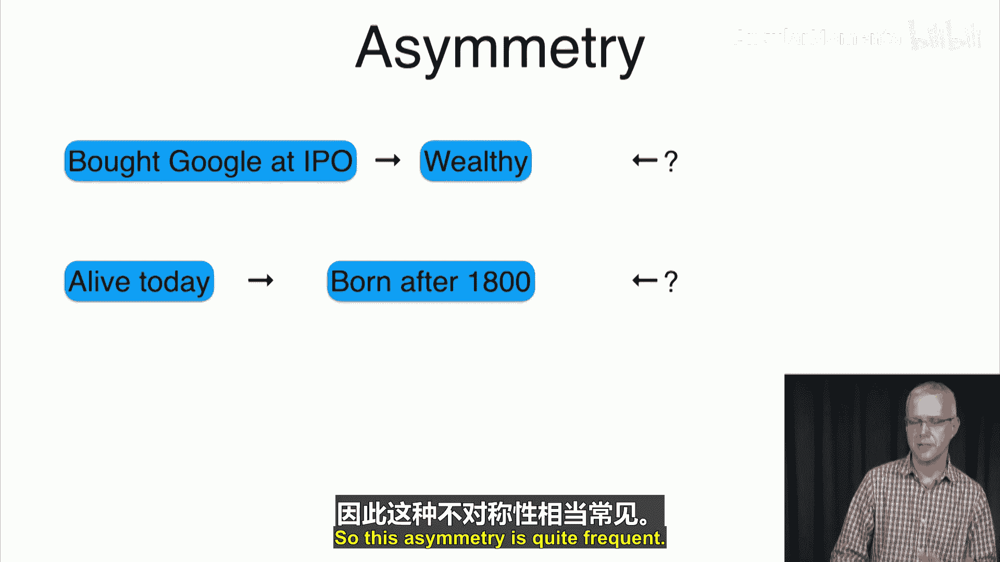
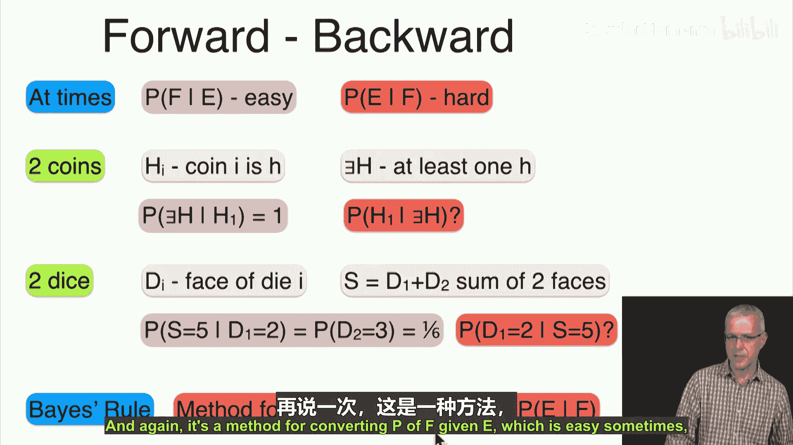
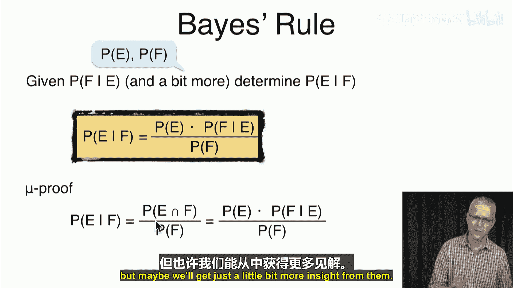
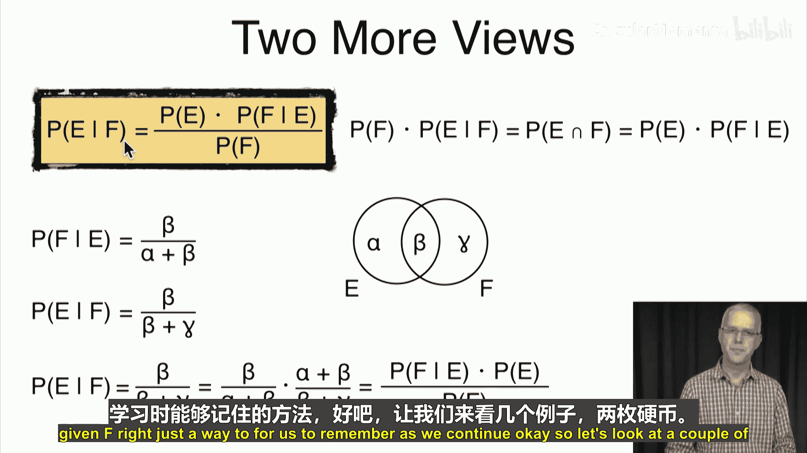
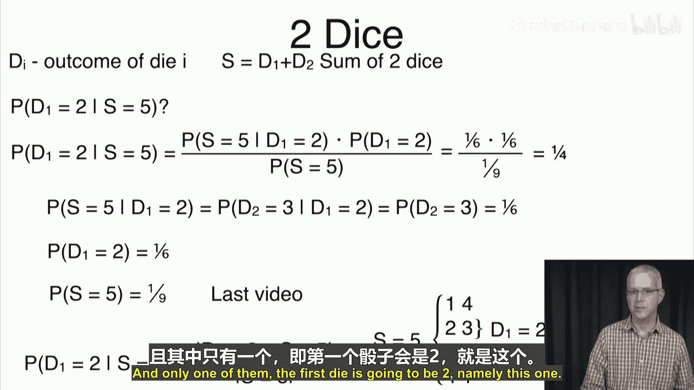
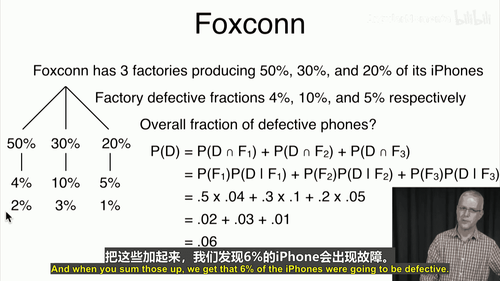
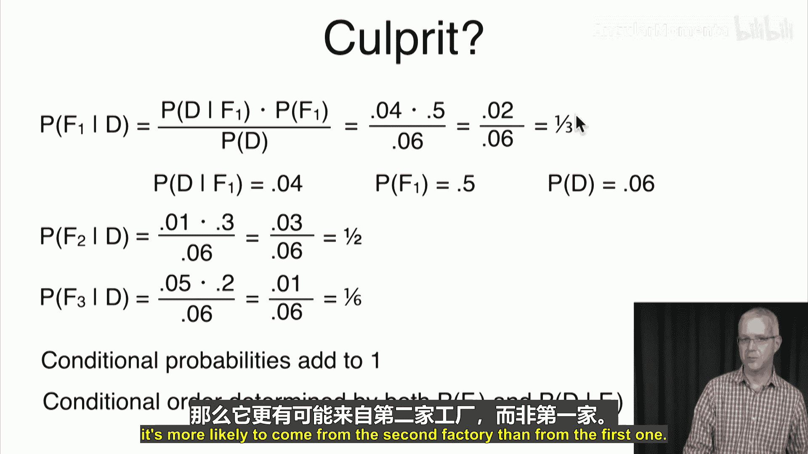
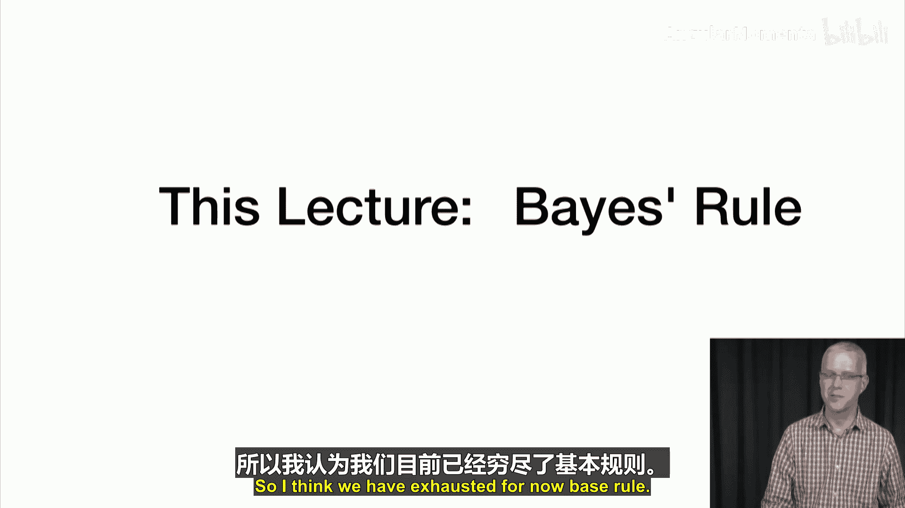

# 【加州大学圣地亚哥分校】使用Python进行数据科学中的概率与统计--Probability-and-Statistics-in-Data-Science-p32-07-05-04-贝叶斯定理--BV1gJFDzkEPg_p32-

Hello and welcome back so we've talked about total probability in the last lecture and now we're going to talk about base rule。

 also known as backwards running。So let's start so often theres asymmetry between events。

 for example， in the event that you bought Google when it went public that was a very happy event。

 you probably are quite wealthy now okay so if you bought Google went public then it's very likely that we are wealthy probably is close to one but what about the opposite。

 suppose you are very wealthy， what is the probability that we bought Google at DO it's not clear because maybe you are wealthy from another reason。

Or if you are alive today， then most likely you're born after 1800。But how about the reverse。

 how about you born after 1800， what's the probability that well you are alive today but someone who was born after 1800 is alive today。

 we don't know because that someone could have been born in 1800 or 1801 or they could have been born last year so again it's not easy to know so this asymmetry is quite frequent and so that's what we want to address now we want to be able to move from forward to backward calculation so sometimes calculating the probability of F given E is easy。

But calcoing probably if E given F is hard and we'll give a couple of examples。

 perhaps not surprisingly there'll be the same examples that we gave in the last lecture we did that so we can use the results that we got so imagine that you have two coins and we'll let H be the event that coin I is heads so H1 is the event that the first coin turns up heads for example。

And we let exist H be the event that you have at least one head okay。

Then calculating the probability of exist heads given H1 is easy because if the first coin is heads。

 then we know that exists head so this is easy， but how about the reverse calculating probability that the first coin is one given that exists heads。

 maybe that's not so easy。Or let's look at the two dice example that we considered last time。

 so I will let DI if you remember be the outcome of。Of the role of dii so it's the phase for dis。

 of example D1 is the outcome for the first dice， the first di。

And we'll let S be the sum of d1 and D2 of the two phases that we observe so we can see that the probability for example。

 that the sum is5， given that the first die 2， that's the same as the probability the second die was 3 because then the sum will be 5 and probably the second die is 3 is 16。

so this one is easy， but conversely cc the probability the first dike turned up2。

 given the sum is5 is a little more difficult so this is the calculation we want to do and we're going to use base rule for that and again it's a method for converting p of f given e which is easy sometimes to p of e given f which is difficult sometimes so what is base rule it just is a method such that given probability of f given e which as we said is typically easy and a little bit more information which we'll describe in a second we can determine the probability of e given f which might be hard so let's see the exact formula it has the probability of e given f what we want is equal to the probability of f given e that we have times the probability of E divided by the probability of f。

So in other words we see that we need the probability of f given e and which is what we have and then we need also the probability of E and the probability of f so the little bit more here is the probability of E and the probability of f and given these three things probability of f given E and then two regular probabilitybilities are not even conditional probil we can find the reverse probability probability of E given f。

So let's give a very simple proof of this， a micro proof if you want。

 so the probability of a given F。As we have seen many times。

 is just the probability of the intersection divided by the probability of F。

 and then we use the product rule and we can write this as the probability of F。

sorry you can write this as the probability of e times the probability of f given E developed by probability of F。

 and this gives us a way to calculate the probability of E given f from the probability of f given E。

So again， the probability of e given f is the probability of the intersection divided probability of f or the intersection we can just write this probability of E times the probability of f given e。

and then we get that so because this rule is so important。

 I'm going to give two more proofs of this of this very simple proof and clearly they going to be almost the same but maybe we'll get just a little bit more insight from them So here are the two views and again they're not drastically different but hopefully we'll give us just slightly more insight so here again is the formula probability of e given f is the probability of E times the probability of f given E which at this point we have divided f So one way another way to prove this is to start with use the product rule twice so we can start with the probability of the intersection intersection f symmetric so we can write it in two different ways we can write is the probability of E times the probability of f given E。

Or we cannot write it as the probability of f times the probability of e given f and once we have it。

 we can just rearrange and say that the probability of E given F。

 that's what we're interested in is this product of the two probabilities。

Divided by the probability of f iss what we have here。

 and another way that's slightly more geometric is to right here the event R E here is this alpha plus beta and the event f which is beta plus gamma is sum of those two probabilities。

 then we can see that the probability of f given E Once it's probability of F given E So we know that we are here in this region and we ask what is the probability that we have f in beta So it's going to be beta divided by alpha plus beta。

And we can ask what is the probability of e given f。

 So now we're looking at the probability that are that we are here given that we are on the right side。

 So it's the probability of this intersection divided by beta plus gamma。

 So it's beta divided by beta plus gamma。 So the assumption we're making is that we know the probability of f given e namely we know beta divided by alpha plus beta this divided by that。

 and we want to find beta divided by beta plus gamma So it's very clear what what we want to do。

 we want to take this value and want to multiply it by alpha plus beta and then divide by beta plus gamma。

 so multiply by alpha plus beta is we're going to multiply it by p of e That's this one here and divide by beta plus gamma is going to divide by beta plus gamma which is p of f。

 so that is what we do so let's just just write it down。

 So p of e given f which is what we want is we want beta divided byta by beta plus gamma That's what we want but we have beta divided by alpha plus beta So we take beta。

Divide by alpha plus beta multiplly by alpha plus beta， divide by beta plus gamma。

 So this quantity here is P of F given e。And this quantity here is P of E and this one is P of F。

 So hopefully between these three proofs we can see why it's true and just this one way to kind of remember what to do if you want to calculate probability of E given f。

 start with probability of f given E and then what you do is multiply by P of E if to cancel and then divide by P of F to get the probability of E given f because when you multiply those you get the intersection。

 divide by f you get the probability of E given f。

Just a way to for remember as we continue。So let's look at a couple of examples， first two coins。

 so man word that H is the event that coin I heads and exist H is the event that at least one coin is head。

So we are interested in probabilityity that the first coin is heads， given that exists heads。

 that's the more difficult direction。Okay， so we can。

I can write it using base rule it's the so this probability is can write it as the probability of exist H given h1 it's the opposite of this and then we need to cancel the h1 and divide by P of h P of exist H so it's that now the probability of exist H given h1 is one because if the first coin is one then exist H and then we need to multiply probability ifs let's just see what it is so the probability of exist H given h1 is1 the probability of h1 is half and what is the probability of exist H we have two coins。

 the probability that we'll get at least one h is three quarters。Okay。

 and we saw that actually in the last video， so now we just need to plug in the numbers so we get its one times1 half divided by three4。

 which is23。So。😔，In other words， given that exist H the probability that the first one is heads base rule tells us two thirds。

 hopefully that's what I said and the reason is quite simple we know that if exists heads that then the probability is are head tail tellss heads or heads heads and the probability that that the first one is heads is in two out of those three okay I don't think I rotate it here okay it did write it here so the probability that the first one is heads given exist H exist heads is the probability of the intersection divide probability of exists heads and this is the sequence we know that exist heads so we know that in one of the top three and we're asking what is the probability the first one is heads is the probability that are in one of these two and that's going to be two a third。

Allright next let's look at two dice di is the outcome of dii and s is the sum of the two dice so we're asking what is the probability that the first die is 2 given that the sum is 5 so we can write it using base rule as the probability that the sum is 5 given that the first one is2 name the opposite of this and we need to cancel this or multiply real probability of d1 is 2 and then we need to divide by this so we get the condition right so we divide by probability that s is5 and this quantity are easy to calculate the probability that s sum is 5 given the first one is 2 is probably the second one is3。

Given the first one is2， and that's what we'll do， the second one is R3。

 which is 16 because the dice are independent。The probability that the first die is 2 is 1，6。

 and the probability that the sum is 5 we calculated in the last video and we saw that it's 19。

So therefore we can plug in and we can say that this probability is going to be 16 times 16 divided by 19th and that value is 1 over 4 and if you want to see why the probability another reason y and another way to see it takes one quarter and the probability the first die is 2 given the sum is 5 is the sum of all possibility where where so this is the sum of all possibility where the first die is 2 and the sum is 5 divided by the total number of possibility when the sum is 5。

And this， these are the possibilities where the sum is 5，1，4，2，3，3，2 and 4，1。

 So there are four possibilities here and how many of them is the first die2 is just this one。

 so the。There are four possibilities，4 in the sum is5 and in only one of them。

 the first die is going to be two， namely this one。

 so the probability is going to be just one out of four。

And finally， let's look at the iPhone。 So suppose， so just to remind ourselves， iPhone 10 is made。

 I shouldn't call it Foxcon because。Because we're talking about the bad iPhone。

Maybe the other companies and it's a good product okay so just to remind ourselves。

 we assume that there are three factories that produce half of the iPhones。

 30% of the iPhones and one fifth of the iPhones and there are defective rates of 4% 10%5% respectively and what we calculated in the previous video is the probability that an iPhone will be defective is the sum of 50% times 4% it is 2% of the bad iPhones are made here and plus 30% times then 10% which is 3% made here plus 20% times one over 20 which is 1% made here and when you sum those up we get the 6% of the iPhones were going to be defective and what we want to ask now is suppose you buy an iPhone and it does have a green line what is the given that it is defect factive has a green line。

 what is the probability that it's made by the first factory so we can use base and right it's the probability of the effectiveive given the first factory times the probability of the first factory that was made by the。

Cance here， divide by the probability of D and we need to calculate these probilities。

 so the probability of defect' given the first factory that was that was 4 percent as this was given to us。

The probability of the first factor is 50% that was also given to us and probability of the effective is the 6% that we calculated in the previous slide over the previous lecture so we can just now plug this in and we get that it's going to be 0。

4 times 0。5 divided by 0。6， which is the same as 0。2 divided by 0。6， which is 13。

And we can simulately calculate the probability that it's made by the second factory given it's defective and this is going to be the same the probability of defective again is going to be 0。

6 and then we calculate the probability of defective given first factory which was 1% times 30% that are made by the first factory and this gives us 0。

3 divided by 0。06。Which is one half， and the。嗯。Then we can do。

The probability of the third first of the third factory given defect factive。

 we need to calculate the probability of defect factive given the third factory。

 which we were told is 5% times the probability of the third factory which is 20% divided by the probability of the factorive which is again 6% the same。

 And so when we do that we get16。 So couple of observation is that this probability is at to1 So given that it's defective if you look at the probability that is made by the first one factor factor is one third second factor is1 half and third one is 16。

 the add to1 so that's one observation the other observation is that。

Even though the first factory makes 50% of the phone。

 the second factory makes 30% of the phone and the second and the third factory makes 20% of the phone so this one makes much many more iPhone。

 the probability if the phone is defective， the probability that it comes from this factory is actually smaller then the probability comes from the second one so conditional order is the order of the conditional probability is determined not just by by which factory makes small phones。

 but also the probability that the phone is is defective so here for example so I think I have a small typeer here。

 this should have been not 0。01 but just 0。1 it was 10% that's an in point。

 difference so it's 10% probability that the second factory makes it defective so because this probability is so high if the phone is defective it's more likely to come from the second factory than from the first one。

Okay， so with that we have used base rule to even find a probability that defective phone was made in a different iPhone was made in different places。

 so I think we've exhausted for now base rule and next time we're going to talk about random variables。

See you then。