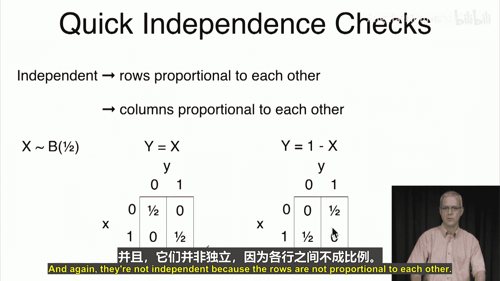

# 【加州大学圣地亚哥分校】使用Python进行数据科学中的概率与统计--Probability-and-Statistics-in-Data-Science-p33-08-07-03-双变量--BV1gJFDzkEPg_p33-

Hello again， everyone， so far we talked about single random variables and it's time to graduate too。

😊，So first by way of a little bit of introduction， while we're looking at two randomvers。

 experiments often have multiple observations， for example if we're interested in the weather on a given day。

 then we probably would like to know in the temperature and what's the likelihood of precipitation and these two things are correlated they have some relation between each other or if we would like to know how the economy will do next month then we would like to maybe have a prediction of both the unemployment rate and the inflation rate and again these are two different random variabless that interact with each other and we want to learn them。

Or if we are looking at a database table， then for example。

 maybe every row corresponds to an employee and we have a few columns， for example。

 a corresponds to the normal years of experience and the salary， so these two variables。

 the experience and salary are somehow related and they are related for one thing is because for every row they correspond to the same person。

Okay if you are taking this class then as a student at2CD for example。

 then one might consider the number of classes you are taking this quarter as well as your GPA that you'll get and again there is some correlation between these two randomvers that we want to investigate together and of course if we take the biggest experiment of all the human experiment。

 then a person has many features like the cholesterol level， the location， the age， the genome plans。

 the profession， the happiness， the salary and so on。

 so don't worry we're not going to start studying all of this will begin by looking at perhaps the smallest possible periods of random variabless just two coins。

So let UNV be two benoully half random variables so theyre coin flips。

 and let's assume that they're independent of each other。

There are several ways in which we can indicate the distributions， we can first just write it out。

 we can say that the probability that U gets the value u and v gets the value small v is one quarter and will dennotice by the probability of U of V that's going to be our shorthand for probability the random variable U gets the value u and random variable v gets v。

 so says p of few of v and it's a quarter and this is true for all U and v and 01 okay so that's one way to indicate this or we can write a table that consists of all the proable values of U and V 00。

0110 and11 and then we can just write the probabilities。

 P of v where I'm using this notation which is one quarter for all of them。Or even better。

 we can take advantage of the structure of the problem where we have U and Vta two different random of variables so we can try them in a table where we write the values of you here vertically and the of V horizontally and in each apps in each cell in the table。

 we write the probability of U of V， so here all possible values of U V。

 all two times two or four of them have probability1 quarter。So we can use。

 for example this UNV to create several other examples to show us what two random variables look like。

 so let's say we take the mean and the max and again UN and V are but only half independent of each other so we can define x to be the minimum of U andV and y to be the maximum of UV。

 then again here' is the table of the possible values of U of V。And the mean and the max。

And what we can see is that the mean and max are going to be both0 and U and v are0 happens probability1 quarter and we can see that the mean and the max are going to be0 and1 respectively if one of U and v is0 and the other one is1 and both of these two are possibilities so that happens probability12 and the mean the max are going to be both1 if both U and v are1 and that happens probability1 quarter so again we can draw it as a table of x and y so we can write here x which is the mean of U and v and y which is the max of U and v they'll take the values0 and 1 and the probability that the mean is 0 and the max is 0 is one quarter from here it's a probability that both of0 probability the mean is0 and the max is 1 is1 half as we saw here it's a probability that one of them is0。

 one of U and v is 0 and the other one is1 one of these two valuess and the probability both are1 is a quarter。

That's when both x and both U and V are 1 and we can see that the probability that x is0 x is1 I'm sorry and y0 is 0 because the mean has to be larger than a max and here the mean is1 and the max is0 which cannot happen So this gives us another joint distribution on two run variables x and y here's another example。

 take x to be the product of U v and y to be the sum of U v。

 so now x takes two values because0 times1 can be the01 but y is the sum of two binary variables so it can be01 or2 and we can find the probability what is the probability that x is0 and y0 that happens if both x if both u and v are0 because for U plus v to be0 both of them have to be0 so that happens probably a quarter What is the probability that x is0 and y is1 that happens when because x is 0 that means that。

At least one of U and V is0 and because y is 1， that means that one of them is1 is the other one is0。

 so this is a sufficient condition and that happens probably half。Okay。

 and what is the probability that x is1 and y is 2， That's the probability that both of them are one。

 both of you in Vienna 1， that happens probably one quarter and we see that all other values of x and y will not happen。

 and to check， we can just see that these probilities to1， that means we have exhausted all possible。

Pears that can in fact， happen。Now let's look at another example， three coins， so suppose that U1。

 U2 and U3 will be nearly half run new variables again independent and we'll let x be u1 plus U2。

 that's the same as thinking that you rolled three fair coins and x is the number of heads amongst the first two。

And we're let y be u2 plus U3， so now we're letting y be the number of heads between amongst the last two coin flips。

 the second and the third so we can create again a table of all possible values of U1 and U2 and U3 in fact and then of x and y so if u1 U to U3 all0 then x and y are0 because this is the sum of the first two。

 this is the sum of second2 and we can continue for example here。

 this first two sum to 1 and the last two sum to1 so x and y are both1 and so on and if we create a table well see that x and y can take the values from0 to2 because amongst the first two locations we can have zero heads one head or two heads so0 and2 and likewise for y and all all probabilities are almost all probabilities are18 meaning。

They correspond to a single triple U1 U23 except if you consider x being1 and y being1。

 that means that we have two one， do we have a single one in the first two locations and a single one in the second in the last two locations that could come from two possibilities that could come from 01。

0， so we have a single one in the first two location and a single one in the last two locations or it could come from 101。

Again， a single one， the first two location and a single one in the last two locations。

 so that's why the probability of 11 is quarter and we can see that we cannot have0 and2 because that means that you have no ones in the first two locations。

 so we have00 here and then no matter what I u3 is the value for y is going to be the01 it cannot be2 so this is again another what's called a joint distribution on the values of x and y。

Okay so we can also consider instead of beernoli half general benoli P so if U is the the benoli P and v is beernoli Q again independent and x like we did before is the minimum U of V and y is the maximum of U V then these are the probabilities of U and V happening。

 For example， U and V or both one with probability P Q the both0 probability P had Q hat and what is the probability that the mean here is the probability that the mean is 01 and the max is 01。

 So for example， the mean is 1 and the max is 1 if both of U and V of1 which happens probably P Q and so on。

And at some point just okay enough with examples， what is the general form of a joint distribution。

 so a joint distribution for to run a variable x and y specifies the probability of every possible X Y pair and so we it's the probability that。

X is taking a value x and y it's taking the value for y which will abbreviate by pxy has to satisfy two things。

 first of all because it's a probability for every x and y must be positive and second if we sum of all possible values of x and y of the probability of x and y it has to be 1 and we can see that all the distributions that we have seen before satisfy that now the joint distribution is omnipotent in the sense that it tells us everything we want to know about the distribution of x and y it determines all probabilitybabilities of interest here is an example of joint pair x and y with these probability 0。

10。20。3 is 0。4 for x which is either 01 and y which is either 01 and if we ask for example what is the probability that x is at most y that's the probability that x is 0 and y 0 or x is 0 and y is 1 or x and y is1 is and y is 1 all these are exactly the value。

for which x is less than equal to1 and when we want to add those we can first draw add them a little more briefly like p of 00。

 p of 01， p of 11 and when we add them we add 0。1 02 and 0。4 0001 and11 and that gives us 0。

7 so that's the probability that x is less than equal to 1 and using something very similar to this we can calculate any property that you want of x and y because we're given the propertiesbabil of all possible values Now they are going to be a few properties there will be of interest to us more than others and we're going to look at some of them now。

So the first of these properties are the marginals。

 so the marginal of x is the probability that the random variable x takes a given value small x and by this rule of total probability it's this summation over all possible value for phi of the probability that random variable x takes the value x and the random variable y gets the value y now well sometimes abbreviate probability that x is x by just pxx where this x denotes the random variable x because we'll also have the probability of y。

 and when it's clear that we're talking about x， then we'll just write p of x。Similarly。

 the marginal of y is the probability， which we write as P of y or P underscore y of y is the probability that the random re variable y gets the value y。

 And again by the roof total probability that's going to be equal to the summation of px Y of all axis。

 Okay， let's see an example。 So here is our。Small probability distribution that we saw in the previous slide。

 and if we wanted to know the probability that x is0。

 so that's going to consist of the probability that x is 0 and y0。It's this probability here。

 plus the probability that x is 0 and y is 1。That's this probability here。

 So if we want to abbreviate， we can write p of 00 plus p of 01 and p of 00 is 0。1 p of 01 is 0。

2 so this is going to be 01 plus 。2 which is 0。3 so that's the probability for this joint distribution that x is 0 if you want to know the probability that y is 1 that was going to be 0。

2 plus 0。4 which is 0。6 and the probability that y 0 is 0。1 plus 0。3 is 0。

4 and you notice that the probability that y 0 is 0。4 the probability y is 1 is 0。

6 they have to add to 1 and indeed the they。All right， so this is 0。3， this is 0。7 and so on。

Now we can also consider conditionals so if we ask what is the probability of that the random x takes the value x given the random variable y gets the value y that's going to be p of x and y divided p of y by the rules that we have seen before for conditional probability and similarly the probability of y given x is the probability of x y divided by the probability of x so let's see what it means for our small distribution。

 so if we ask what is the probability that y is0 given that x is 0。

 that's going to be the probability that x is 0 and y0 divided by the probability that x is 0。

 but when we look at this table we see that probability to x is 0 is 0。

3 so therefore this is going to be and if have if we ask about y which well see in a second probability y0 for example is 0。

4 so that means that the probability of y being0 given x being 0 is the probability of 00 which is 0。

1 divided by 0。3 which is  one3。And if you ask what's the probability of y given is 1 given that x is 0。

 that's going to be the probability that x is0 and y is 1。

 the intersection of these two events divided by the probability of x is 0， which is going to be 0。2。

 probability that x 0 is 1 is y， divided by 0。3， which is 23。Okay。

 and if we ask what's the probability that x is0 given is given that。AY0。

 then that's going to be the probability of 00 divided by probability that y0。

 which as we saw here is 0。4， so this probability is 0。1 divided by 0。4。

 which is one quarter and if we ask what's the probability of x being1 given that y 0。

 we can do the same calculations we did here or we can observe that given that y 0 x can take two possible value 0 and1。

 they must have add to1 and therefore if the probability that x is 0 given that y 0 is one quarter。

 the probability that x is y given is one given that y 0 must be1 minus1 quarter which is three quarters。

All right， now a third property we want to look at is independence。

 so x and y are said to be independent and we write x independent of y like that if for every x and y。

 the probability of y given x is the same as the probability of y。

That means that after observing the value of x， we do not change our estimate of the distribution of y。

 So even if we observe any given value of x， the distribution of a y is going to be the same for every y。

And equivalently x and y independent， if the probability of x given y is the probability of x。

 mainly knowing the value of y does not change the distribution over x， or just like with event。

 we can write it as p of x y is p of x times p of y。

 and that's a little more robust because we don't need to considered conditional distributions when the probability of y0。

 so this is often the way we'll look at independence the joint probability is the product of the two marginalos。

So for our table， we can see that the probability of x， so if we look at this table， for example。

 0120。80。080。32 if we look at the marginal of p of x that is 06 and the marginal of y is 0。

4 I'm sorry the marginal of x for the first or 0。6 and for the second row is 0。

4 if we look at the marginal of y then for the first column 0。2 and for the second column is 0。

8 and we can verify that the elements。Of the pairs x comma Y are always the product of the row in the column so here it's 0。

6 times 0。2 which is 0。12 here it's 0。6 times 0。8 which is 0。

48 and so on so therefore this distribution is an independent distribution x and y are independent。

Now， if we look at this distribution， then again we can create the marginal。

 so for x the probability that x is at the first row is 0。3。

 the probability of x being the second row is 0。7，0。3 plus 0。

4 probability of y being in the first column is 0。4 and the second is 0。

6 and we can check that if we multiply the probability of this x and this y will give us 0。

12 but it's not equal to the joint probability of x and y which is 0。

1 so therefore this distribution does not reflect independent random variables so is not independent。

Okay so here's a quick way to check if a joint distribution is one of independent random variabless。

 so observe that if the two random variables are independent then the rows must be proportional to each other because the probability of y given x is going to be equal independent of x so therefore the rows must be proportional to each other and the columns must be proportional to each other so if for example x is distributed beno half and we let y equals x here's the joint distribution of x and y so x and y being0 happens probably half x and y being1 happens probably half so we see this is the joint distribution the rows are not proportional to each other because this is half0 and this is0 half so they're not proportional so so this distribution is not independent similarly if we let y be1 minus x we get this joint distribution and again they're not they're not independent。

Because the rows， they're not proportional to each other。

So with this we've introduced pairs of reno variables and in the next presentation we're going to start talking about expectation of different functions of pairszo reno variables。

 see you then。

