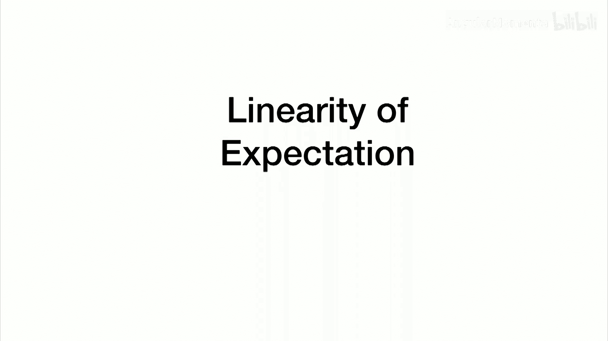
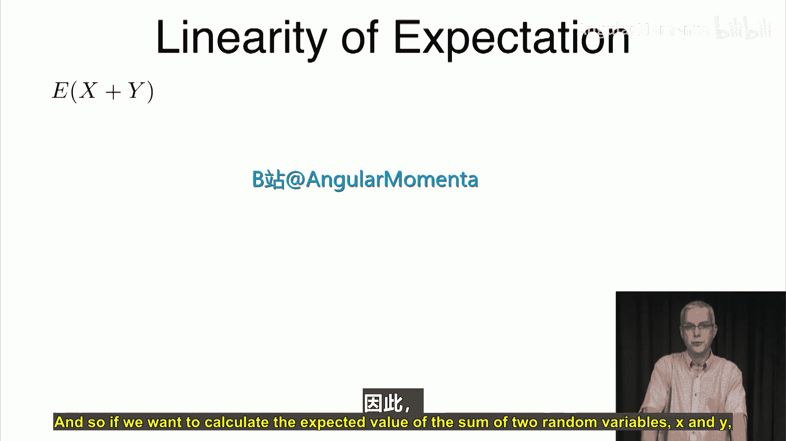
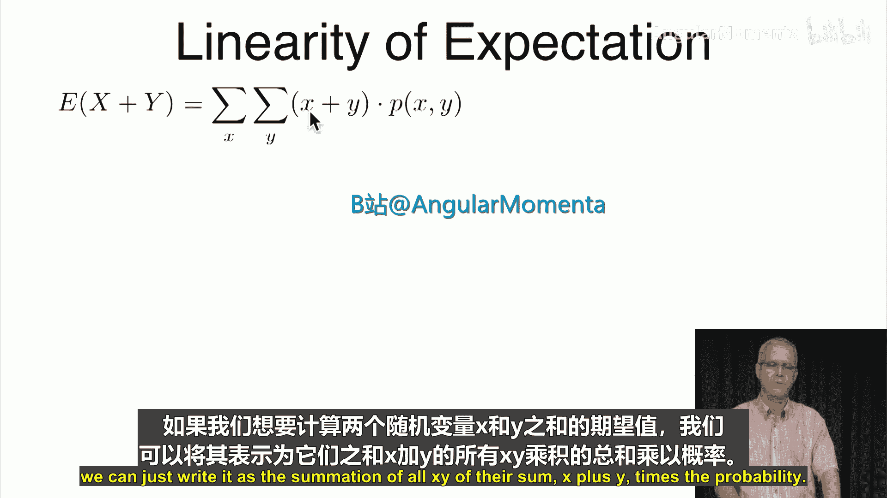
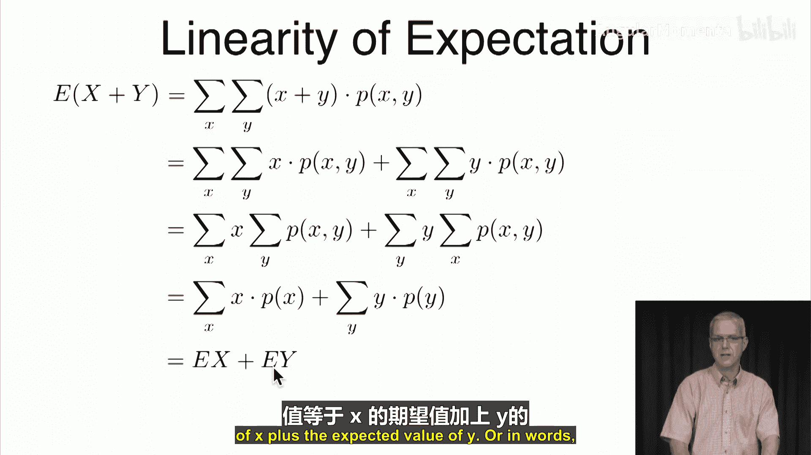
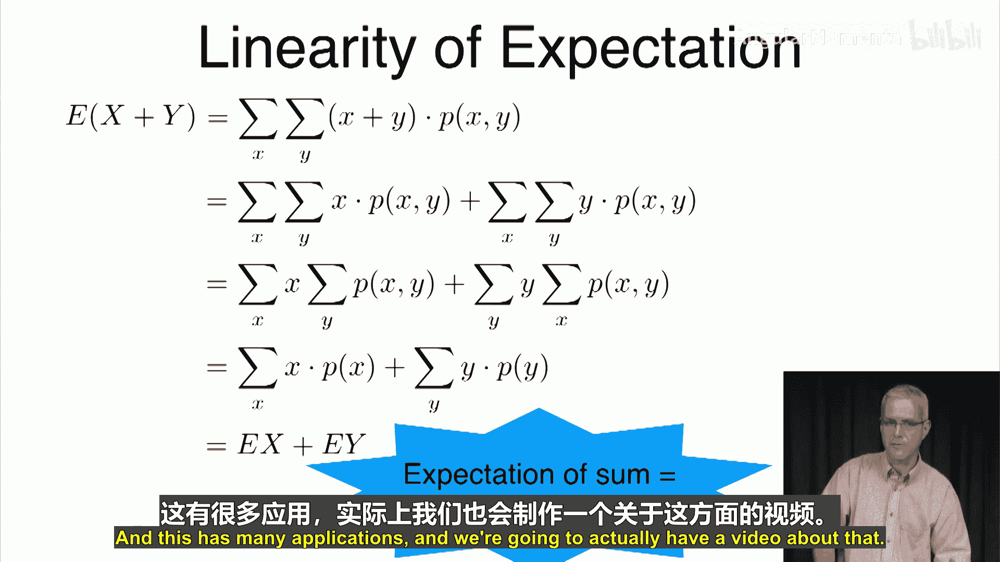
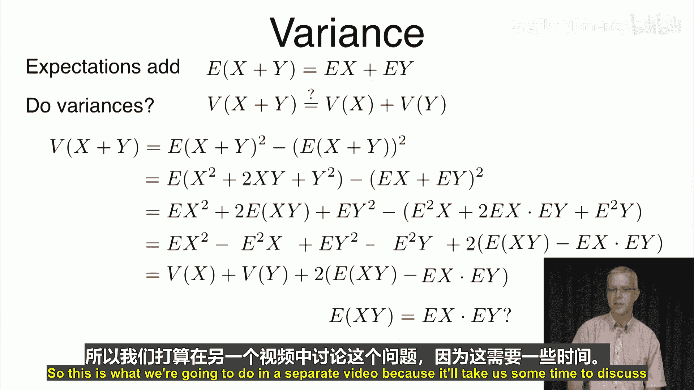

# 【加州大学圣地亚哥分校】使用Python进行数据科学中的概率与统计--Probability-and-Statistics-in-Data-Science-p34-08-08-03-期望的线性性质--BV1gJFDzkEPg_p34-

Today， I're going to talk about linearity of expectations。

And so if we want to calculate the expected value of the sum of2 random variables， x and y。

 we can just write it as the sum of all xy of their sum x plus y times the probability。

And that's going to be broken up if you want to the summation over x times p xy plus the summation of or y times pxy。

And then we can see that we can take x does not change with y so we can take it outside the y sum。

 so we get summation over x of this summation over y of pxy plus summation over y of y。

 which we took out and then inside we have summation over all x of pxy。

 where here we exchanged the order first and then took the y out。OkayNow when we sum over a pxy。

 then by the rule of total probability this will sum to p of x， so we get summation x p of x。

 and here we have summation of all x of pxy， this will sum to p of y。

 so this is going to give a summation of a y of y times the probability of y。

And this is nothing but the expected value of x and the second sum is the expected value of y。

 So what we see is that the expected value of x plus y is the expected value of x plus the expected value of y or in words we see that the expectation of the sum is the sum of the expectation。

 and this has many applications and we're going to actually have a video about that。

Now， of course the next natural thing to consider is whether the variance at is well。

 so the expectations at namely the expected value of x plus y is the expected value of x plus the expected value of y。

 and it's very natural to ask whether the variance is S as well namely is the variance of x plus y the same as the variance of x plus the variance of y。

Now to do that to figure if this is correct， let's just write the variance of the sum so the variance of x plus y is the expected value of x plus y y square minus the expected value of x plus y。

 the whole thing square right that's how the second formulation for the variance。

 it's the expected value of the random variable square minus the expected value of the random variable。

 the whole thing square。And so。This is the same as writing the expected value of when we square x plus y is the expected value of x square plus 2 x y plus y square。

 and here we have minus the expected value of x plus the expected value of y。

 the whole thing squared。And this we can open up， we can say this is the expected value of x square plus twice the expected value of xy plus the expected value of y squared。

inus and when we open this product， it's the expected value of x the whole thing square plus twice is the expected value of x times the expected value of y plus the expected value of y。

The whole quantity square。So we can regroup things and we get that this is the same as the expected value of x squared minus the expected the value of x squared。

Plus， the expected value of y square minus the square of the expected value of y。

Plus twice the expected value of xy minus twice the expected value of x times the expected value of y。

Now， the first two terms are the variance of x。And the next two terms are the variances of y。

 and what were left with is twice the expected value of xy minus the expected value of x times the expected value of y。

So the answer as to whether the variance of x plus y is equal to the variance of x plus the variance y depends on whether the expected value of xy equals to the expected value of x times the expected value of y so this is the question that we really probably should have asked before we saw that the expected value of x plus y is the sum of the expectation is the expectation of the product the product of the expectations namely do expectations and multiply so that is an even more basic questions than whether the variance has add and that's what we want to look at next so this is what we're going to do in a separate video because itll take us some time to discuss this。

So see you then。