# 【加州大学圣地亚哥分校】使用Python进行数据科学中的概率与统计--Probability-and-Statistics-in-Data-Science-p35-08-09-03-协方差--BV1gJFDzkEPg_p35-

Hello again everyone， today we're going to talk about covariance and the reason we're interested in covariance is because we ended the last presentation asking whether expectation multiply。

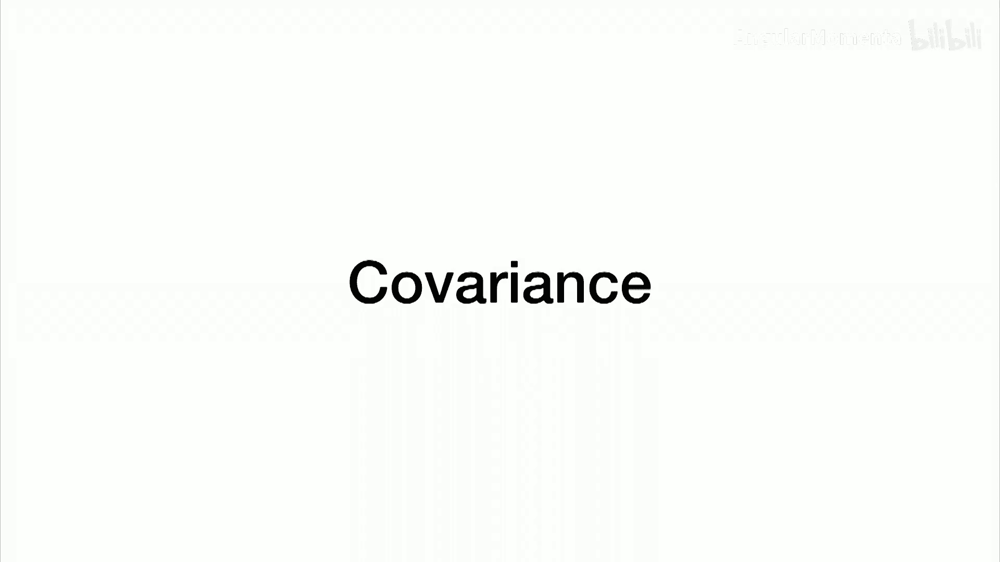

So the expected value of x times y is the summation of all possible values of x and y of the product times the probability。

And we wanted to know whether the expected value of xy is equal to the expected value of x times the expected value of y。

So let's look at a simple example that x be y， so we're looking at two interval variables that are always the same x and y and take the value minus1 with probability half and 1 with probability half。

So here is the joint distribution table， x and y takes the value minus11 and probably half both of them are minus1。

 probably half both of them are1， and if probably0， they're different， so they're always the same。

OkayNow notice that if we drew the marginalgenos， then we would see that the x is distributed uniformly it's minus1 probably half。

 it's plus one probably half and therefore its expectation is0 and y is the same as x so again it has the same distribution probably half it's minus1。

 probably half which is the sum here it's plus1， so again its expectation is also0 and therefore the expected value of x times the expected value of y is0 times 0 which is 0。

So this right hand side is 0。 let's consider the left hand side。

 What is the expected value of x times y， So the expected value of x times y because y equals x is the same as the expected value of x squared。

But x squared because x is a plus minus1 random variable， x square is always1。

 So we're looking at the expected value of 1， which is 1。

So that shows us that least for this random pair， the expected value of xy is not equal to the expected value of x times the expected value of y。

 so in other words expectations don't always multiply least in this case they do not so it's very natural to ask whether they satisfy some other relation。

 they don't multiply but maybe there's another relation that they satisfy。

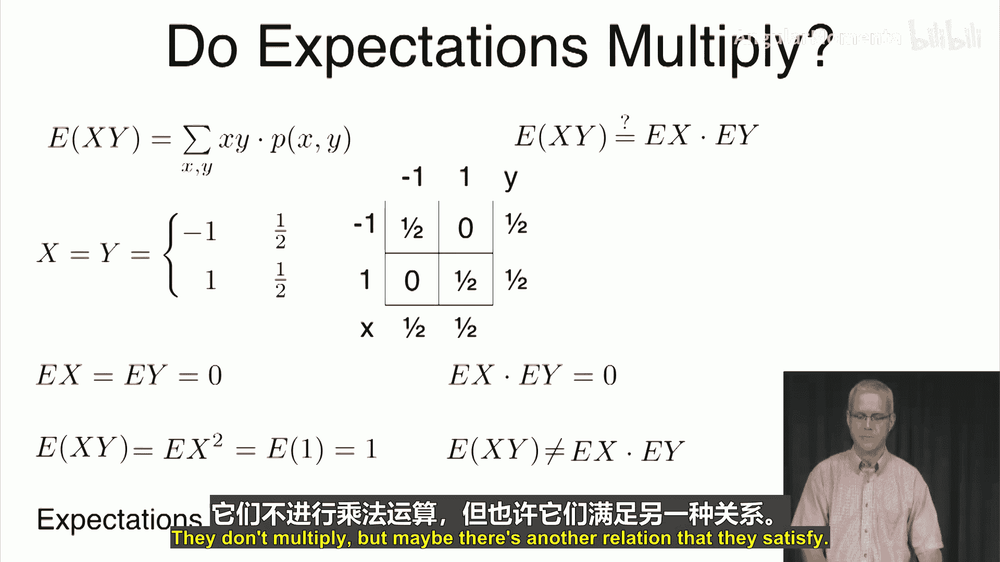

So unfortunately the answer is no， we're going to see that the expected value of the products could be anything。

 so specifically if you give me any alpha beta in gamma， any positive， negative， large small。

 you can find x and y that have the following expectations， the expected value of x will be alpha。

 the expected value of y will be beta and the expected value of x Y is going to be gamma。

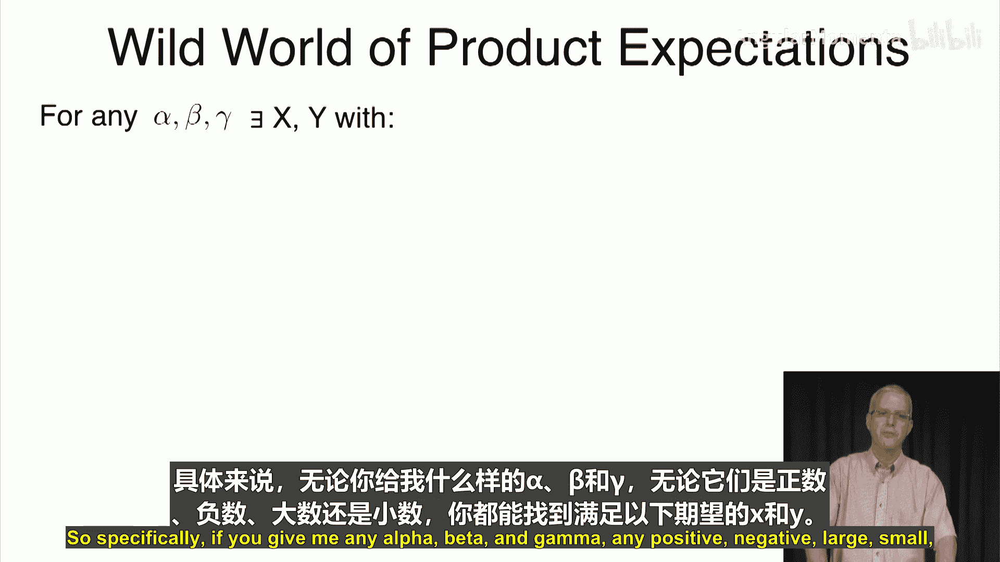

To see that， let's start with the same random variable that we considered before。

 except now we call them x prime and y prime because we're going to modify them to get the x and y that we want。

 so x prime and y prime are equal and they're going to be minus one of probably half and plus one probably half。

And that means that the expected value of x prime is equal to the expected value of y prime。

 which by symmetry here is 0， and the expected value of x prime y prime is the same as the expected value of x prime squared because x prime is equal to y prime。

 but x prime as we said earlier， is a plus minus1 random variable so x prime squared is always one so we have the expectation of1 which is1。

Okay，Now let's construct the random variable x and y that we want。

 so we'll let x be gamma minus alpha beta times x prime plus alpha。

And we'll let y be y prime plus beta。So what is the expected value of x？

So the expected value of x is going to be gamma minus alpha beta times the expected value of x prime with the expected value of x prime is0。

 and then plus alpha， so it's just going to be alpha and what is the expected value of y。

 the expected value of y is the expected value of y prime plus beta plus x but the expected value y prime is0。

 so expected value of y is beta。so we have what we wanted first to expect the value of x is alpha and expect the value of y is beta。

 Now what is the expected value of xy， the expected value of xy。

 we can just write what they are is the expected value of gamma minus alpha beta times x prime plus alpha times y plus beta。

OkayAnd there's a missing parenthsesis here。And。

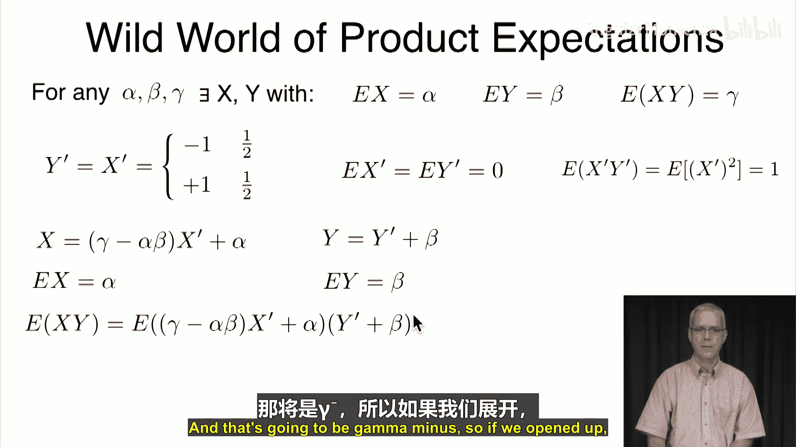

That's going to be gamma minus， so if we opened up。

 so you have gamma minus alpha beta times the expected value of x prime y prime okay。

Plus alpha times the expected value of y prime， Take this product and then when multiply by beta。

 we get plus gamma minus alpha beta times beta times the expected value of x prime plus alpha beta。

 but the expected value of x prime y prime is1 and the expected value of y prime is 0 and the expected value of x prime is 0。

 So what we get is gamma minus alpha plus beta plus alpha beta， which is just gamma。

 So the expected value of x y is gamma， So what we showed is that for any alpha beta and gamma that you come up with you can find2 or random variabless x and y such that one has the expected value of alpha the other one is the expected value of beta and the product has the expected value of gamma which could be infinitefinly larger essentially。

Okay， so。Natural question to ask is okay， fine we couldn't find some specific relation between them。

 there could be anything， but can we still say something about the expected value of Xy and to do that we need to introduce a covariance。

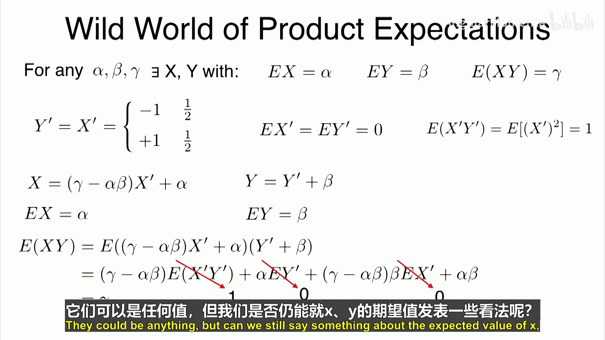

Now we want to study the expected value of xy and it's sufficient in fact easier to first understand zero mean random variables so what we're going to do is're to centralize x and y so we're going to take x and y and subtract their expectation and then we consider the product of the I'm sorry the expectation of the centralized product so what do we mean by that so if we have x and y we can subtract mu x so we'll get a new random variable whose mean is0 and subtract mu y from y so again a new random variable variable whose mean is zero again and we consider this expectation so this is called the covariance between x and y which is also thenoted by sigma xy。

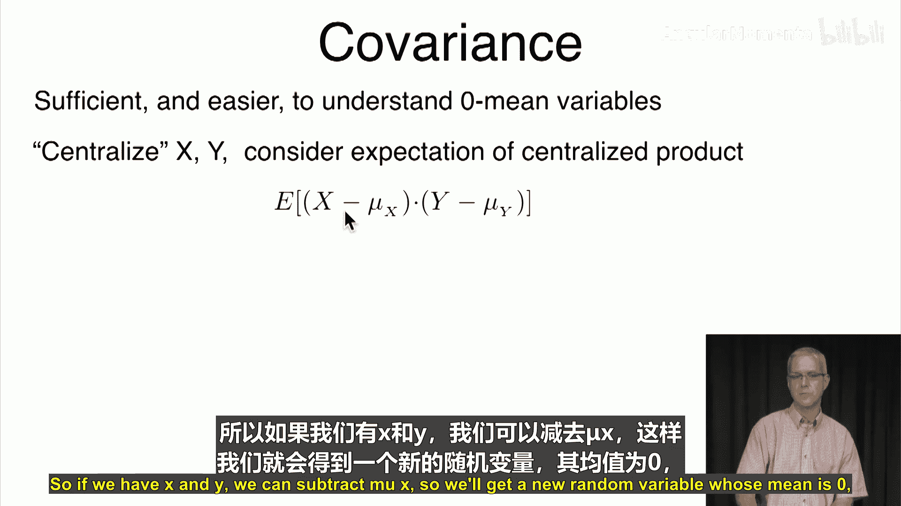

So in other words， there is covariance of x and y， which is thenoted by one of these forms is the expected value of x minus its mean times y minus itss mean and we can evaluate this It's going to be the expected value of xy minus the expected value of x times mu y minus the expected value of mu xy plus the expected value of mu x me y。

And that is going to be just the expected value of xy， and here mu y is a constant。

 so it's the expected of x times mu y minus mu x times the expected value of y plus mu x me y and expected error of x is mu x expected value of y is mu y。

 so we get that this is the expected value of x minus2 mu x mu y plus mu x me y。

 so it's the expected value of x y minus mu x mu y。Okay and if this seems a little complex。

 maybe just think of this case when x and y of  zero mean in which case is just the expected value of xy which is really the quantity we're trying to study。

 so if you understand it was zero mean random variables。

 you understand it for general random variabless because what we did was we just took the means out。

Okay， so we want to study the covariance because that will let us understand the expected value of Xy better。

And what the covariance represents as we'll see over time is the amount by which x and y vary together and you can see it here because it's the expected imagine that they have zero in。

 so if x and y are always the same， then you get some large value， if x when x is large。

 y is smaller you get a smaller value。

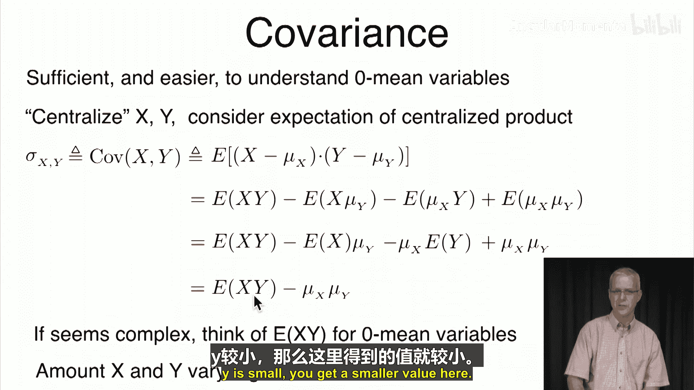

It is quite useful to normalize the covariance and when we do that。

 we get the correlation coefficient， which is defined as the covariance normalized by the standard deviation of x and the standard deviation of y。

It has several properties， including that the correlation coefficient with x of x with itself is 1 because the covariance of x with itself is the variance and we divide it by the variance。

And that gives us one the correlation coefficient of x with negative x is minus1 because the covariance of x with negative x is the negative of the variance of x。

The correlation coefficient of x and y is the same as the correlation coefficient of y and x。

 namely it's symmetric in x and y。And if you take the correlation coefficient of a times x plus B with c times y plus d。

 it's the sine of a times c times the correlation coefficient of x and y。

 where the sine of x is1 if x is positive， minus1 if x is negative and0 if it's zero and what that means is that if you take x and y and you multiply them both by the same number of the same signine。

 for example， both a and c are positive or both a and c are negative。

 then the correlation coefficient will not change it's just going to be1 times theele coefficient of x and Y。

 however， if you multiply x by positive number for example and y by a negative number。

 then the correlation coefficient will change s that's all this means。

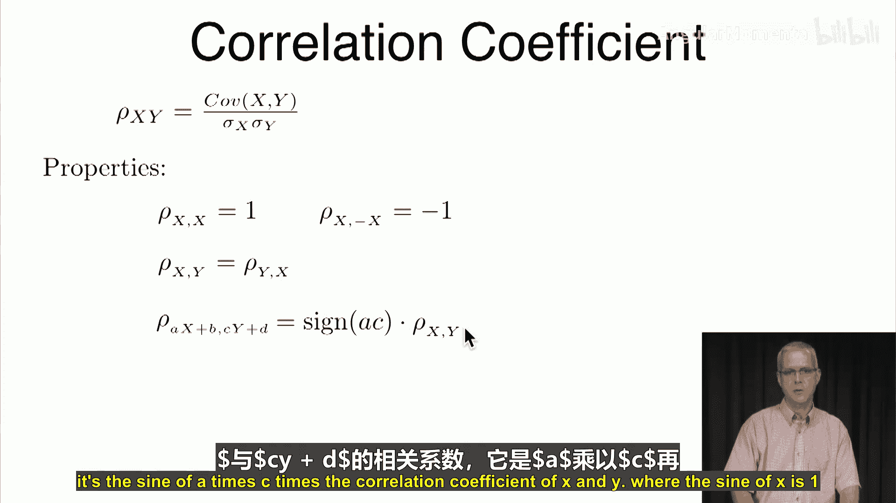

And the significance of correlation coefficient is that if x increases by standard deviation。

 then it tells us by how many standard deviations we expect of y we expect y to increase Okay and the last question that we may want to answer here is if we can get bounds on the correlation coefficient between x and y can it be arbitrary or not。

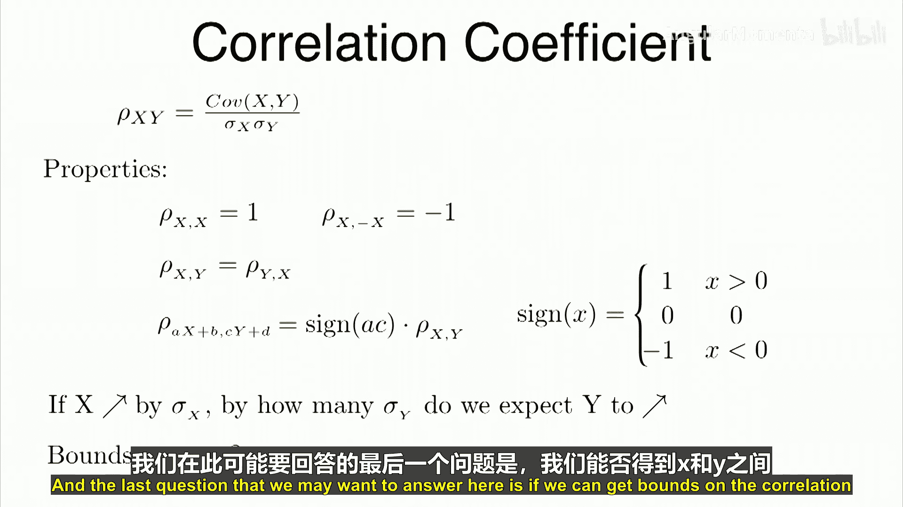

So for that we use the khewartz inequality， it says that the expected value of xy cannot take all possible values。

 namely it's bounded in absolute value by the squared of the expected value of x squared times the expected value of y squared。

To see that， notice that for any alpha， if we calculate the expected value of alpha x plus y。

 this whole thing square， it's going to be equal to alpha squared times the expected value of x squared。

Plus 2 alpha times the expected value of xy，2 alpha times the expected value of xy plus the expected value of y squared。

And this quantity is always no negative because this is the expectation of a。Square。

 which is the expectation of a non negative value。And so what we have here is we notice that the expected value of x square is a constant。

 it's some parameter of the distribution， and so are the expected value of xy and expected value of y squared。

 so we have three constants， expected value of x square。

 expected value of xy expectedd the value of y square， and then for any alpha that we take。

 then this quadratic equation， alpha alpha square times this quantity plus2 alpha times the expected value of xy plus y squares is always positive。

When is a quadratic positive for every value of its parameter， in this case alpha。

 when the discriminant is negative？So this true for all alphas of discriminant must be negative。

 and what is the discriminant here， it's the square of this constant minus4 times the product of these terms。

 so it's 4 times the expected value of xy square， minus4 times the expected value of x square times the expected value of y square and this has to be negative。

That means that the expected value of x squared has to be at most the expected value of x squared times the expected value of y square。

And expect the value of x y squared has to be at most that。And if we take the square root。

 then sorry， then we get the inequality that we wanted that the expected value of xy is at most the square root of the expected value of x squared times the square root of the expected value of y square so this because for inequality and we are now going to apply it to instead of x and y we're going to apply it it applies very x of y so we're going to apply it to x minus its's mean y times its mean So what we'll get is that the expected value of x minus its mean times y minus its mean is that most the square root of the expected value of x minus its mean square times the expected value of y minus its mean square。

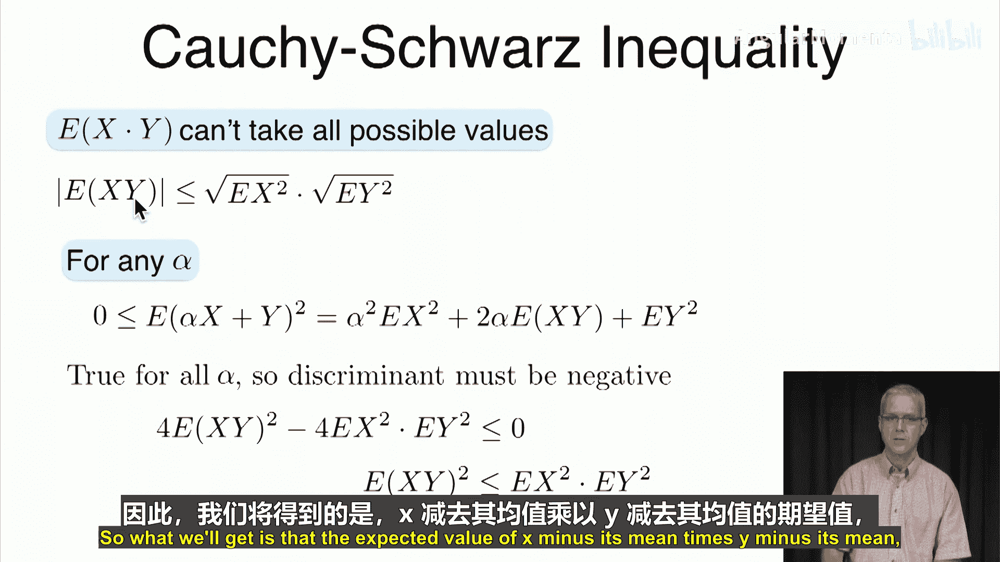

And namely， that means that。This is the covariance。

So it means that the absolute value of the covariance of x and y is at most standard deviation of x times the standard deviation of y。

 and if we normalize it by sigma x sigma y because the correlation coefficient of x and y is the covariance of x and y。

 this term divided by sigma x sigma y to tell us that the absolute value of rh is at most1。Okay。

 so this finishes the last property of the correlation coefficient we wanted to talk about and next times we'll see some examples。

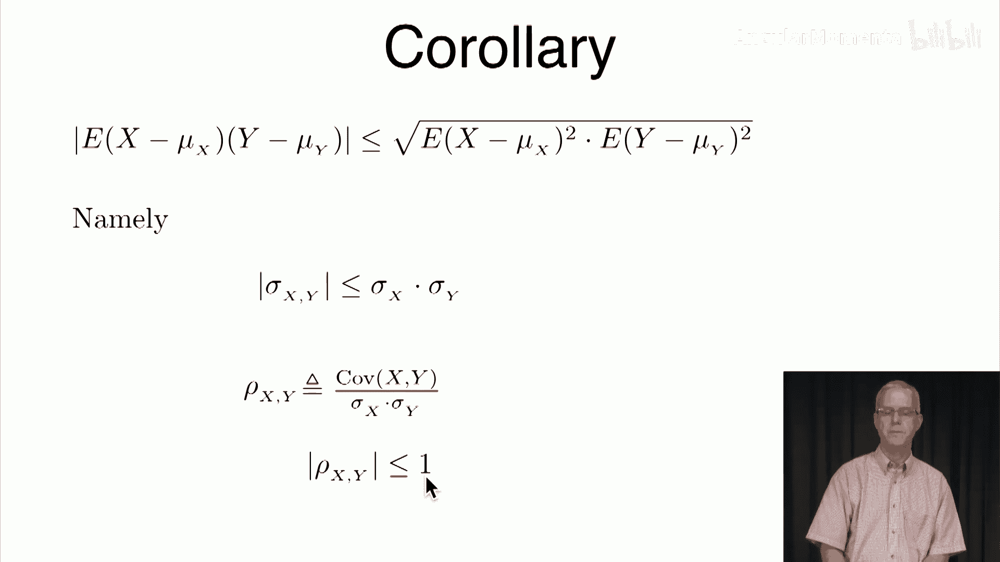

See that。