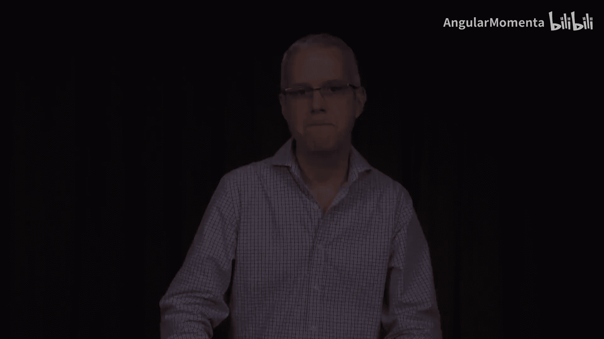

# 【加州大学圣地亚哥分校】使用Python进行数据科学中的概率与统计--Probability-and-Statistics-in-Data-Science-p36-09-01-03-分布族--BV1gJFDzkEPg_p36-

Hello and welcome back so we have introduced random variables and in this lecture I thought I'll just start and present what we're going to talk about next。

 so in reality the random variables that you see typically belong to certain families of distributions and as you can see in this slide are many distribution families but don't worry we're going to focus on the most natural and most important ones。

 those that are significant both theoretically and practically so we'll talk about very few and I'm going to quickly just tell you what we'll do for them in this very brief presentation。

So the distribution we'll talk about will be for the discrete distributions。

 we'll talk about the benolia distribution by normal distributions。

 Poson and geometric distributions， and then after that we'll introduce continuous distributions and then we'll discuss uniform。

 exponential and normal distributions。So and for each of those distributions。

 what we're going to do is we'll motivate them and discuss some applications。

 we'll provide a formulation for this distribution or distribution family。

 and then we'll visualize them well see what they look like and we'll provide some examples and then we'll describe some properties and typically we describe the mean。

 the variance and standard deviations and for some distributions we'll discuss other properties as well。

And then the notebooks that you have have some Python implementation so we can further plot the distributions and experiment with them and do certain other things and now so when we want to show that a certain function is a distribution we need to establish as we know two things we need to show that it's non- negative and we need to show that the values sum to one showing that the values are a negative is typically obvious and showing that sum to one takes a little more effort。

 so to make it maybe slightly less boring， we're going to borrower page from a company called Blanic。

 they make product which is fairly standard and uninteresting。

 it's a blender and so to attract more people to them they came up with a campaign that features their the founder Tom Dixon and in this it。

It's called Willie Bd and in this commercial。Tom Dixon， the founder。

 he takes different things and he checks whether they'll blend so for example here he checks whether a Nike shoe will blend or whether a garden rake will blend or whether an iPhone will blend or whether adjust in biber doll will blend and so on and typically the answer is the same and that is yes。

 these will blend so we're just going to try to slightly mimic this and we will ask when wants to see if things some to one we'll ask will it end okay and we'll see whether these things add or don't add to one。

Okay， so and we next we're going to start with the first collection distribution。

 which will be the Bernoli distribution， see you then。

