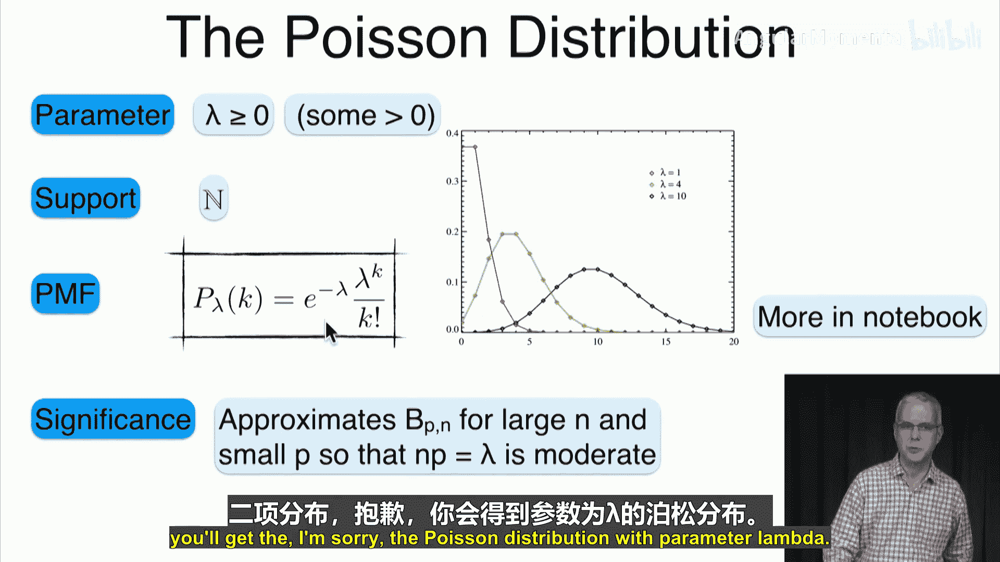
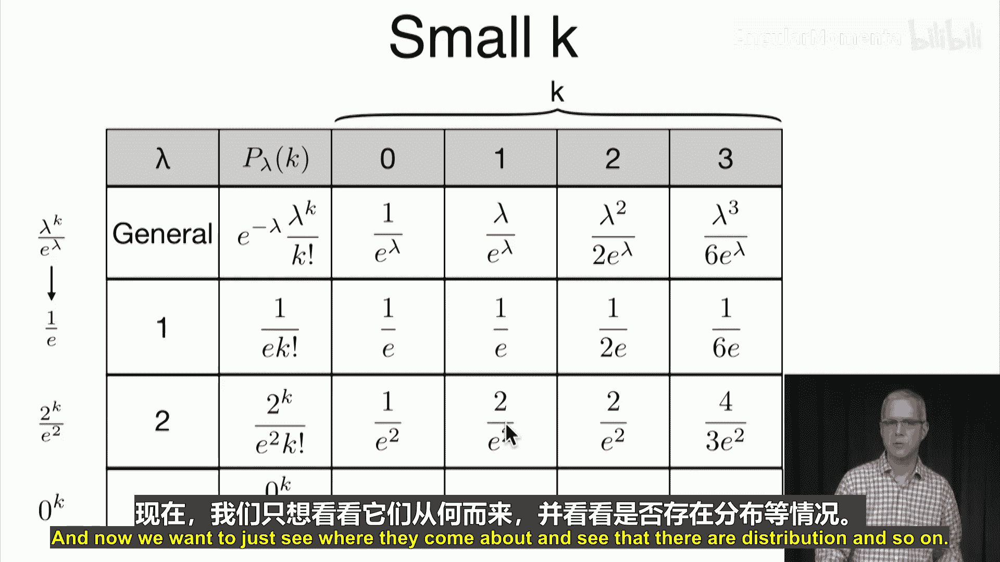
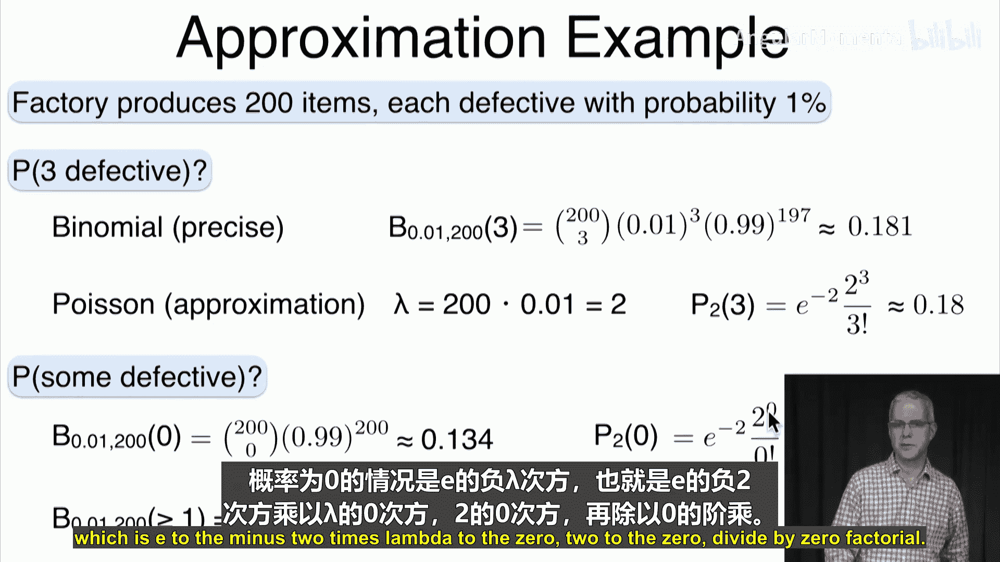
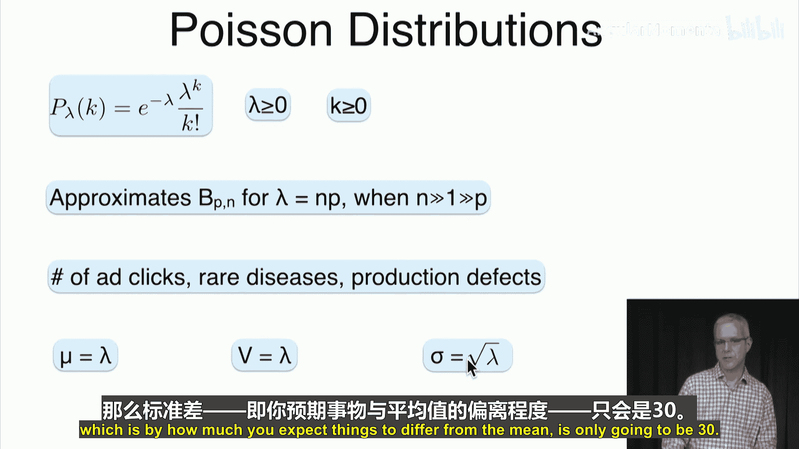

# 【加州大学圣地亚哥分校】使用Python进行数据科学中的概率与统计--Probability-and-Statistics-in-Data-Science-p37-09-04-03-泊松--BV1gJFDzkEPg_p37-

Hello and welcome back。In the last lecture， we discussed the binomial distribution。

 which as you remember was an extension of the Bnoulli distribution and now we want to discuss an extension of the binomal distribution。

 which is called the Poisson distribution。And we'll define the personson distribution。

 we'll talk about where it appears in applications， we'll motivate how it comes about。

 willll show how you derive it from the biormal distributions。

 and we'll find the mean and the standard deviation and we'll give a couple of examples。

So let's start so the Poisson distribution I is defined by a parameter which is called lambda。

 which is bigger than equal to0 and some people would say just we'll take lambda strictly bigger than zero。

And its support the set of values that it can take is the natural numbers。

 the integers from zero onoids。And its probability T mass function is defined by this formula。

 so this is the Poisson with parameter lambda of value k and the value K appears with probability e to the minus lambda lambda to the K divided by k factorial and it's going to show like graph like this。

 so this is shown for a different parametersters of lambda lambda equals 1 here in red。

and4 and 10 and you can see that it looks a little bit like a binomal distribution when Lada becomes large and in general it will go up up to the value of roughly lambda and then start going down and you can see a lot of more examples by playing with the notebook where you can actually define the parameter lambda and you can plot it and see how it behaves for any Lada in any range。

Okay so the Poisson binormal is important because it approximates the beernoulli distribution。

 benoulli PN when n is large and the number of sample is large and the probability is small such that the product pN and youll remember this was the expected value。

 the expected number of successes is the value that we call lambda n is moderate in other words if you have a biomal distribution where p is large and I'm sorry p is very small and n is very large and so that n times p is some mod number lambda then you'll get the you'll get I'm sorry the Poisson distribution with parameteral lambda。

All right， so what is distributed Poson， so as we said Pda Poisson Lada approximates the binomal distribution when you have many samples but with small probability and this occurs many times in life for example。

 if you count the number of people clicking an ad there are lots of people looking at the website but very few of them each person clicks on any given ad。

 very small probability so you get the domain of a Poisson distribution or the number of people respond to spam。

 spam is sent to lots of people but very few respond to it。

 so again the number of people respond is going to be distributed Poson。

 if you look at infections with rare diseases there are like billions of people in the world but each one is infected with a given disease with very small probability。

 so the number is distributed Poson there are many people in a city and each one does one one。

With very small probability and again you get a poisson distribution number of customers in a store so in San Diego there are over a million people but very few of them will visit any specific store at any given day so again the number of people given or visit the store is going to be Poisson if you take gallery purchases like the one we had in the title page here then you know quite a few people visit a gallery but each one is not very likely to purchase a painting and that's something that I've been curious about how do these people make a living know it looks like it's very erratic right I mean you'll make one sale you make a lot of money but then there'll be lots of people will not by how variable is their income for example and if you want an example of this you don't need to go very far just last week a painting that until recently was considered。

to be a fake sold for $450 million so if you look at a number of flight no shows。

 again every person is very unlikely to miss a flight but there are enough people on a plane again for some distribution number of typos in a page and the list goes on so because for some formula is maybe not so intuitive I want to go over it for small values of K and see what it is so the general formula3 is e to the minus lambda lambda to decay of a K factor。

Okay， and then。We if we have k which is equal to0， then we get here lambda to the0 which will be 1 and one vector which is 1 so it's just going to be one over e to the lambda。

 if we have k which is equal to 1， then we'll get e to the to the minus lambda times lambda。

So it's lambda divided by e to minus lambda， if you get k equals to 2。

 then you get lambda squared divided by2 factor， which is2 e to the lambda and for3 you get lambda cube。

 divided by3 f， so lambda cube divided by 6 and then divided again by e to the lambda。

 and will continue like that it will be lambda to decay K， divided by k factorial。

 and divided by e to the lambda。And now if you want to maybe look at specific values of Lada and again。

 let's look at some small values， so if Lada is equal to  one。

Then what we'll get here is that theres the are terms that depend on Lada name e to the minus lambda and lambda to the k。

 so lambda to the k divided by e to the lambda that is going to become just1 over e to them over E because lambda is1 and so now these terms will simplify and the probability is going to be one instead of lambda to the k divided by e to the lambda will just get1 over e so it's one over e if k factorial。

And so that's going to be when k is0， it's going to be 1 over e when k is 1 is again 1 over e because z vectorctor and 1 vectorctor of 1。

And then one over 2 E and then one over 6 E and so on。if lambda is equal to 2。

 then lambda to the k divided by e to lambda becomes 2 to the K divided by e square and are going to be2 to the k divided by e square。

 and then by k factorial， so it's just going to be for the probability that will get zero success at the k is going to be 0 is just going to be1 divided by a square。

 the probability of 1 is going to be 2 comes from2 to the 1 divided by e square and so on。

And then finally， if lambda is0， which as I mentioned some people don't even consider that。

 but if you do you'll get something very simple， then lambda to decay divided by e to the lambda just become e to the lambda becomes 1 and lambda to decay is 0 to decay。

 so it's 1 only when k is0 and0 otherwise， so that will just give us zero to decay divided by k2l which is 1。

Namly k equals0 has probability 1 and everything else has probability 0 right okay so these are the values and now we want to just see where they come about and see that their distribution and so on。

 So first let's see where this comes about and we'll see that this approximates the binomial。

So we're going to show that P Lada approximates the binomial Bernoulli Pn when lambda is p times n and n is very large and p is very small n much bigger than 1 and p much smaller than1。

So let's recall the formula for the biommal distribution with parameters PNN。

 the probability of case successes。It's going to be N choose k。

Times p to the K times Q to the n minus k。And we that Q here is just one minus p。

So we want to approximate it and want to approximate it in the case where lambda is p times n。

 in other words， p is lambda over n。Okay so we want to replace a P by lambda over n and Q by 1 minus lambda over n。

 so what we'll get it' n choose k。Lbed over into the key。

And then1 minus lamb over n that's Q to the n minus k。

And this we can write as n choose k is n to the K falling power。Divided by k vector。

 and then we have get lambda to the K divided by n to decay K。

 and here we can write this as one minus lambda over n to the n。

Divided by one man slammed over into decay key。Okay。

 so this is exactly the bi normalmal distribution just when we re parameterametized and instead of P。

 we wrote lambmbda overing。Okay so just let's just for a second remember this formula。

 we're going to write it again in on the next slide slightly modified。

 so this formula so what we're going to do is we're going to approximate it for some value k which is fixed and we also fix apologize for the table we fix lambda while we'll at n becomes become very large and P becomes very small okay so we're going to resume with this formula again。

So and we'll derive of courseson okay， so remember that by Bernoulli P& K。

 we could express it as lambda to decay K divided by K factorial。

Times n to the K falling power divided by n to the K。

And then times1 minus lambda over n to the n divided by one minus lamb over n to the king。

and we want to show then and here lambda is p times n and what we want to show that if we fix lambda and k and let n goes to infinity。

 necessarily p goes to0， then this will approach the Poisson distribution e to the minus lambda lambda to the K of a k vector。

Okay， so now we have several terms here， we have n to the K falling power divide by N to the K。

 that's one term。Here we don't need to worry about this term because K and Lada are fixed and in fact the appear here as well。

 as you can see， that's why we wrote them at the beginning。

So we don't need to worry about them and just we need to show that this whole term here becomes e to the minuslandda so the first time we need to worry about is n to decay falling power divide by n to decay。

And the second term is the numerator here， which is one minus s over n to the K the denominator to the K。

 and the last term， the third term is the numerator， which is one minus slump over n today。Okay。

 so let's see what happens to them so the first term we can write it as n well the denominator is just n times n times n k times and the numerator is n times n minus1 times n minus k plus 1。

Notice that n goes to infinity while k is fixed， so therefore this term is going to be one。

 this term will approach one and increases。And all the terms will approach one， including this term。

 because K is fixed and n goes to infinity。 So we have k terms。Each of them are approximating one。

 it's a fixed number of terms， namely K of them， each of them approximating one。

 and therefore the product， it's a product of a fixed number of terms， each of them approximate one。

 and the product will also approach one。Yeah。Now， so therefore， on this term here。We'll approach one。

So we don't need to work about that one。Next let's look at the denominator here。

 so it's one minus s slammed over into the king。So again， we have each term here。

 is going to approach one because Lada is fixed。And n goes to infinity。

 so this term will approach one， so you have the product of K terms。And each approaching one。

And therefore the product will approach one， just imagine if you have a product of two terms each approaching one。

 that product will approach one， similarly， if you have K terms， each approaching one。

 the product will approach one。And so this term also approaches one。

And we're left with just one last term here， one minus lambda over n to the n and what we want to show is that this will approach e to the minus lambda Now notice here that we have again a product of terms that approach1 because lambda is fixed n n goes to finty so we have a product of terms each of them approaches1 but now we have an increasing number of terms。

 so even though each approach is one we don't know if the power the product of all of those will also approach one because we're not multiplying more and more and more of them so what we need to observe is that so we have increasing a number of terms and each approaching1 and want to show and what we need to observe is that if you take one minus1 over m raised to the n that's e to the minus1 that's essentially the definition of e as you may recall it's1 plus1 over m to the M is e you can just as well take this one it's1 minus1 over M to the M approaches e to the minus1 and we want to use this and you can see what we have here。

Almost the same。 It's1 minus lambda over n to the n。 So to make it be essentially the same。

 we can rewrite this as 1 minus lamb over n to the lambda over n。Race to the lambda， so first of all。

 I'll observe that these are the same because here I'm dividing ver lambda and multiply ver lambda。

 and second observed that the term inside is if we take n over the lambda to be m。

Then we have1 minus1 over M raised to the M。 and that's when again， n over lambda it to be m。

 so get 1 minus1 over M to the M， which as we saw here approaches e to the 1。

So each the term inside will approach e to the minus1 and we have lambda which is a fixed number。

 so we have terms that approaching e to the minus1 race to the lambda。

 so e and minus1 raised to the lambda because again this term approaches e to the minus1 we have a fixed number here lambda so we'll approach this and that's just e to the minus lambda so going back here this numerator will approach e to the minus lambda and therefore the whole product。

 the Bernoulli pn of k will approach e to the minus lambda lambda to the k of a k vectorial。

Which is the Poson distribution。Right so that works。

So then we come to the question as to whether this is really a distribution and remember that the p lambda of k is e to the minus lambda lambda to the k of a k factorial。

And this holds for k begin equal to0 first you can see that it's all bigger than equal to 0 because this you have e to the sum number that's non negative and all these terms are non negative lambda is at least zero so every term here is bigger than equal to zero that checks and the big question is always will it add will it sum to1 Okay so that's what we're going calculate now so by the Tayloror expansion。

E to the lambda is the summation from k going from 0 to infinity of lambda to the k over a k factorial。

 so this is e to the lambda and what we have here is we're looking at the summation of p Lada of k summation of a k going from 0 to infinity and so we have here the summation of e to the minus lambda lambda to the K over a k factor。

 we can take e to the minus lambda out。So it's e to the minus Lada times the summation of lambda to the k over a k factor k going from 0 to infinity。

 and as we see from here， this term is exactly e to the lambda。

So it's e minus Lada times E to the Lada， which is1， and therefore it does add。

 so this is a distribution。こ。All right， so now that we know it's a distribution。

 we want to look at a couple of its features like what is its mean and the variance？And。As we said。

 Poisson Lada approximates the binomial Pn for lambda which is NP when n is much bigger than 1 and p is much less than 1 so therefore if you look at the Bernoulli PN then the mean is NP and the variance as we saw is NPq so now when we look at the poisson lambda then since lambda is NPp。

 we would expect the mean of the Poisson。To have because Poisson approximates lambda it becomes as close to Im sorry the poisson approximates the bi normalmal distribution。

 so the mean and the variance should approach these values。

 so the mean of the Poisson lambda should be roughly NPO should be namely lambda。

 so what we expect is this to be lambda and we expect the variance of the Poisson to be NPQ NP is lambda。

And then  Q is 1 minus P。So we can write it NP times 1 minus p， but 1 minus p approaches 0。

 so 1 minus p approaches 1， so this will approach NP which is lambda again。

 so we expect both the mean and the variance to be lambda okay but we need to verify this by calculation。

So first let's make an observation that will make our lives a little easier。

 and that is if you take the lambda to the k lambda to the k power and you defffright it with respect to lambda。

 then you get k times lambda to the K minus1。And you can write it as K over lambda times Lada to the K。

If you take the second derivative of language to decay。With respect to Lambda。

 then you're differentiating this and youll get k times k minus1 lambda to the k minus2。

Which again you can write， you can separate the Lada to this case here。

 so you can write it as k to the second falling power divided by lambda square root times lambda to decay K。

And if you continue and you take the Earth derivative of lambda to the k。

 then what you'll get here is you get k to the earth falling power times lambda to the k minus r k to the Earth falling power is have lambda to k minus r and you can rewrite it as k to the earth falling power divided by lambda to the r times lambda to the K so we can just rewrite it in the way we're going to use it which is going to move lambda to the k to。

To decide and what we're going to and then rearrange them so what we'll get is k to the Earth falling power times lambda to decay is going to be equal to lambda to the R here times the o derivative of lambda to decay K。

RightOkay so that's we're just going to rewrite this again in the next slide so going to consider what's called falling moments。

 so first of all just a reminder ourselves what we said that K to the earth falling power times Lada to decay is Lada to the other times to Earth derivative of Lada to decay。

And if x is distributed according to the Poisson Lada。

 then the expected value of x to the falling power is called a falling moment of the distribution。

 a moment is when you take x and raise it to some power and here we have falling power so we call it a falling power we' calculate the expectation and this is a small trick that will simplify the calculation of the expectation。

 both here and when we get to a geometric distribution in the next lecture。

So what is the expectation， it's going to be summation of k going from zero to infinity of k to the Earth。

Faling power times the probability of lambda probability of k So we're looking at the expected value of x to the earth falling power。

 falling power， remember that the expectation is summation of the values。

 which is k to the Earth falling power times the probability of k。

And we sum this for k going from zero to infinity， and that's what we want to calculate。

So we're just going to plug in the probability of k。

 so that's going to be summation over a k and I'm going to omit this range0 to infinity of k to the Earth polying power e to the minus lambda lambda to the k of a k vectorial。

Okay， and now we're going to use so I'm sorry， we're going to take e to the minus lambda out and then we'll get sumation of k to the forming power。

Times lambitude to decay divided by K factor。And you'll notice that we have K to do falling power lambda to decay K is the same term that we have here。

So this is going to be e to the minus lambda summation over k of instead of。

Instead of a K to r falling power lambda to the K， we're going to write lambda to the r times the earth derivative。

And then we also divide by K Victorctorial from here。Okay。

So now we can see that we can take Lada2 the R because Lada to r does not depend on k。

 so we can take it outside of the equation， so get e to the minus Lada Lada to d R。

 and then we take the summation inside the derivative。

 so we get the Earth derivative of summation over a k k going from0 to infinity of Lada to the K over a k vector。

But this summation we've seen before was just e to the Lada。So it's e to the minus lambda。

 lambda to the r times the Earth derivative of e to the lambda。

And very nicely the derivative of e to the lambda is again is still e to the lambda so we get that it's e to the minus lambda lambda to the e to de lambda or just lambda to the R so what we see is that when we calculate the expectation of the falling power x to the r falling power which is called the falling moment。

 then we get that for Poisson distribution has a very nice R formula the o falling moment is just lambda or is to the o power and it's a special case we can see that if we take the expected value of x that's the same as the expected value of x to the first moment first falling power。

So by this formula， it's just going to be Lada。And if we take the expected value of x times x minus1。

That's the expected value of x to the second following par。

 which going to this is just going to be equal to lambda squared。

So this is actually quite nice and quite simple and already gives us the expectation。

 so the expectation we get is the lambda and now we want to calculate the variance now notice that we almost have the variance because if we had the expected value of x squared。

Then we could take， we know that the variance was going to be the expected value of x squared minus the expected value of x squared。

 but we don't quite have the expected value of x squared。

 we have the expected value of x square minus x。But we can see from here how we're going to get that so again we have the expected value of x times x minus1 or expected value of x square minus x is lambda squared and we want to use these two formulas so let's see so the mean variance variance so the expected value of x is we just saw was the expected value of x to the first following power which is lambda and we also saw that the expected value of x times x minus1 was lambda square so now first let's calculate the expected value of x squared。

So speculative value of x squared is going to be the expectedant value of x square minus x plus x。

And this is x square root of x plus x， it's the x square value of x squared。

And according we just so this we can sumit the expected value of x times x minus 1 plus the expected value of x。

And that's Lada squared plus Lada。And now we can calculate the variance of x。

 which is the expected value of x squared minus the expectation squared。

OkayAnd the expected value of x square we calculate here is lambda square plus lambda and expected value of x is lambda。

 so this is going to be lambda square plus lambda minus lambda squared because we square in the expectation。

So this gives us just lambda so interestingly we see that for a poisson distribution。

 both the mean and the variance or lambda， both of them are lambda and therefore and the standard deviation is growth of lambda which is kind of interesting I think because it shows that the standard deviation so we calculated the expectation and we calculated the variance here and it shows that the standard deviation is small relative to the mean even if were thinking of galleries that sell once in a lifetime they cell you or they cell a painting or not once in lifetime。

 but maybe once a month， you see that actually。The variation is relatively small。

 it's just a square root of what they expect to make， so it's roughly concentrated around the mean。

 so it's quite a remarkable property。And by the way I should mention that in the notebooks you can also experiment and see how the poisson approximates the binomial you can see how close they come to each other and encourage you to look at that let's look at an example and see how close the poisson distribution approximates the binomial and again let me remind you that if you look at the notebook you can actually see it visually how this approximation works and how close the poisson becomes gets the binomial so in this example that we look at you have a factory that produces 200 items and each is defective with probability 1% and we want to know what is the probability that out of those 200 items it will be defective so first of all notice that we have here many items 200 so n is large and small probability of being defect only 1% so we hope we can hope that the poisson approximation will be fairly tight。

Okay so let's see so first we can calculate the precise probability because this is a binomal distribution when 200 items each is the effect of probability 1% presumably independently so the probability is going to be just the binomial with probability 0。

01 and 200 this evaluated at 3 so this is going to be 200 choose 3 number of ways of choosing the three items and then for each selection of three items。

 the three of them have to be bad that happens probability 1% cube and the remaining 197 have to be good and each of them is good probability 99% so it 0。

992197 and if you calculate it you'll see that it's roughly 01。1 up to 3 digits it's  it's 0。1。 0。

181。Next let's look at the Poisson approximation， so first we need to determine Lada and Lada is in this case we have 200 items each defective probability 1% so the expectation the expected number of value elements that you you that will be defective is2 so lambda is2 because as we saw for portson distribution Lada is just the mean just the expected number of elements that will be are faulting okay here it's2 so what is the probability of 3 so it's Poisson2 evaluated at 3 so it's e to the minus lambda lambda to decay。

So it's8 to the minus Lada， which is e to the minus2 and then Lada to decay in this case it's2 cube divided by k factor。

 namely3 factor， and we can evaluate this and this is 0。18。Again， so it's essentially 0。

1 and 0 so up to the so it's off by just one third digit Next let's see what is the probability that some are defective namely that one or more are defective so as we've seen before one way to calculate it's fair to calculate the probability that none are defective and then look at 1 minus that。

So the probability that none are defective will first calculate exactly it's binomial with probability 1% and 200 sample。

 and the probability of none effectiveive of0， that's going to be 200 to0， namely 1 times 0。

99 to the 200， namely all of them have to be good。And when you calculate that， that's roughly 0。134。

 that's the value up to three decimal points， and therefore the probability that somewhat effective is going to be 1 minus that。

 which is going to be 0。866。Now if you want to approximate。

 then do you look at the Poisson distribution and with parameter 2 because the mean is2 here as we calculated。

So Poson distribution mean2 probability of0 is e to the minus lambda。

 which is e to the minus2 times lambda to the0 to the0 divided by0 factorial and that's going to be just e to the minus 2 and that is 0。

135 so again it's almost the same up to it's just off by11。

Point and the third SL place。And if you calculate the probability of bigger and equal to  one is subtract 1 minus that and you get 0。

865 okay， so very， very close so you can see how good the personis approximation is for the binnol。

So to summarize， we talked about Poisson distributions。

 we said the formula is e to the minus lambda lambda to decay divided by k factor and that。

holds the Poisson distribution holds for lambda， which is bigger than0 and k。

 which is bigger than equal to0。And as we said， Lada is the parameter is also the mean of the distribution。

 so we said this approximates the Bernoli Pn for lambda which is n times p when n is very large and p is very small and again lambda is n times p。

And it refers it。There are many applications of this like number ofed clicks。

 number of rare diseases， number of production defects and so on。

 he said the mean of the Poisson distribution is lambda so it's parameterized by its mean the variance is also lambda and the is I'm sorry the standard deviation is square of lambda which as we said is actually fairly small compared to lambda you can might think that if you have a mean of 1000 then the standard deviation which is by how much you expect things to differ from the mean is only going to be 30 so to summarize we talked about Poisson distributions they're defined by。

Aqu by this formula so the poisson distribution parameter lambda and the parameter has to be at least zero。

 so is defined as p lambda of k is e to the minus lambda lambda to decay k over k factor and the values range over all integerous k which are at least zero and as we have said then we'll say in a second again。

 lambda here is the expectation of the poisson distribution。Okay。

 the personisson distribution approximates the Bernoulli distribution。With probability， success。

 probability P and n samples， when NPp is the expectation is lambda and n is very large and p is very small。

And Poisson distributions therefore appear in many applications， including a number ofed clicks。

 number of people have a rare disease， number of defective items， and so on。

 and we said the mean of the Poisson distribution is Lambda。

As we expect from the fact that it's n times p for the binomial。

 the variance is also lambda and the standard deviation is square root of lambda and we observe that the standard deviation is very small compared to lambda even though you notice that you have many。

 many trials and each one is a very small probability。

 youll see that somewhat remarkably the standard deviation is fairly small。

 so for example if you expect to have to have like1 thousand successes。

 then you'll be typically maybe off by something relatively close to 33， let's say。Okay。

 so it's a very small deviation， okay， and next time we're going to talk about geometric distributions。

See you then。