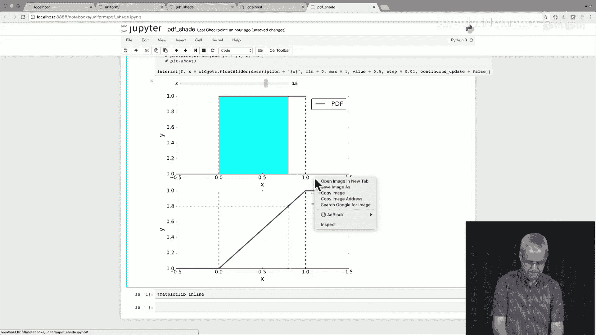
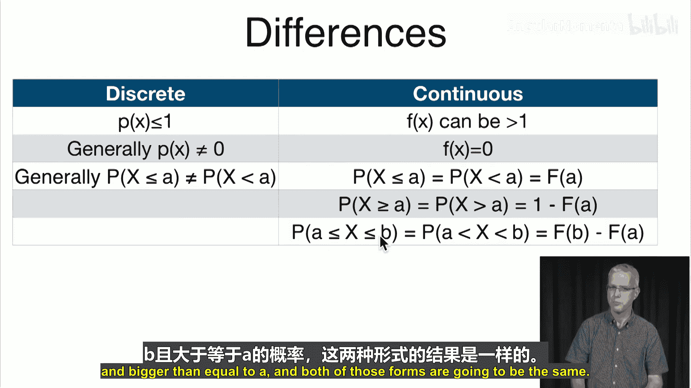
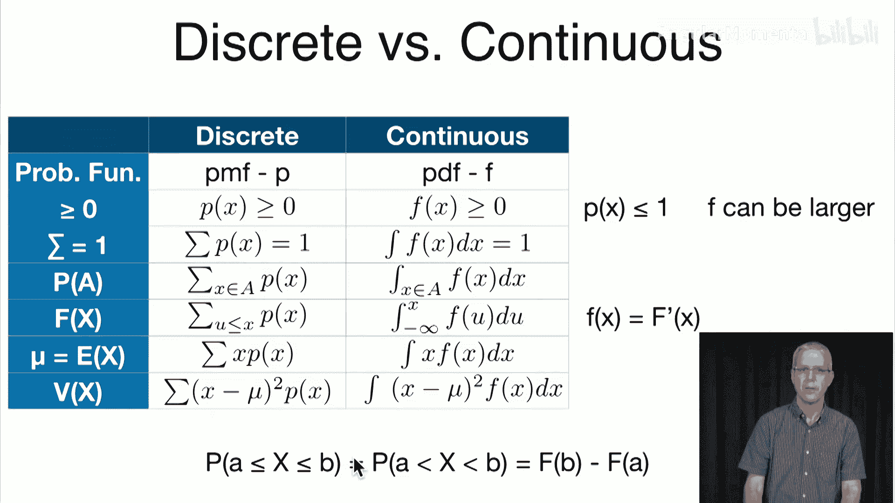
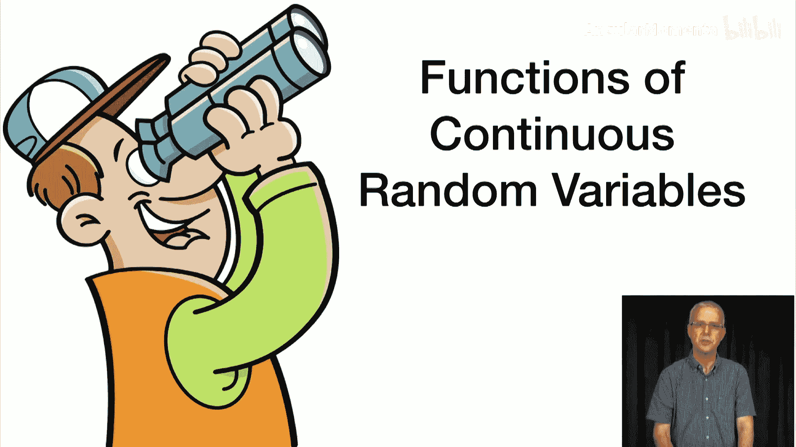

# 【加州大学圣地亚哥分校】使用Python进行数据科学中的概率与统计--Probability-and-Statistics-in-Data-Science-p38-10-01-03-连续分布--BV1gJFDzkEPg_p38-

Hello again， everyone。 Today， we're going to talk about continuous distributions and。😊。

When we move from discrete to continuous distribution。

 we'll observe that when we have discrete distributions we're considering countable number of values。

 namely finite or countably infinite， whereas for continuous distributions will have an uncountable number of values。

 typically things like intervals Now why are we looking at continuous distributions。

 because a lot of things in life are， for example， anything that has to do with physics like time。

 for example， the duration of a flight or duration of an Amazon delivery or for disease。

 God forbid or life。I is continuous， the length is continuous or anything that has to do with measuring space。

 for example， measuring the height of a person or the area of a storm that's a continuous random variable or if you consider mass like the weight of a pet as we saw or the weight of a cookie that the company produces again those are continuous random variables or temperature like the air temperature or the body temperature and so on there are many things that also nearly continuous but will view them as continuous。

 for example the cost of a stock or a house or pork bellies that people like to look at or rates like interest rates or exchange rates or unemployment rates。

 these things are not really continuous because everyone takes discrete values but because there' are so many of them you can view them as continuous。

Okay so。When we talk about continuous distribution。

 we'll talk about probability density functions which replace the discrete probability mass function that we used to see。

 so the probability density function of PDF is a function f of x which is non negative。

And it represents the relative likelihood of the value x and so you can draw it like this。

 f of x always no negative， and this is the relative likelihood that you will observe a value like x or number near rate and has to satisfy that the integral of f for minus infinity to infinity is 1。

And we call this the area under the curve， this is this area here。Now。

We can compare it to discrete distributions， so for discrete distribution。

 the probability function was the probability mass function of PF。

 and now we have probability density function， PDF。And both no negative。

P of x is bigger than equal to 0 and f of x is bigger than2 equal to 0 and they have to integrate of sum to 1。

 so for the case of discretere distribution the sum is 1 and for continuous distributions。

 the integral is 1。Now the probability of an event， a， let's say。

 under the discrete distribution was the summation of all elements x in the event of the probability。

 and likewise for continuous distributions， it's the integral over all x in a of the function f of x。

 the density。And typically we're interested in interval probabilities。

 namely the probability that x is in some range between A and B。

 and for that we'll look at the under the curve between the points A and B。

 or in other words the probability that x is less than equal to B minus the probability that x is less than equal to a。

 and that of course leads us to cumulative distribution functions， which well discuss next。

So the cumulative distribution function of CDf， as we call it is the probability that x the random variable x is less than or equal to the value x it's denoted by f of x this was true for discrete distributions and it's also the same definition here now for discrete distributions if you want to move from the probability function then that is the Pmf to the CDf then we just sum all the values that will less than or equal to x so f of x was equal to the summation of p of few when u is less than equal to x for continuous functions。

 f of x is going to be the integral for minus infinity to x of f of few D。

And if you want to go in reverse， if we have someone gives us the CDF capital F ofx。

 and you want to get the Pf， the probability functions function， then for discrete distribution。

P of x was f of x minus f of x star where x star is the element immediately preceding x and for continuous functions。

F of X， the PF probability density function is going to be the derivative of the CDF the of capital F we're going to see very soon。

so let's do a few examples， so the uniform distribution f of x is defined to be 1 for x between 0 and 1 and 0 otherwise and here we can see the function can see the graph and what that reflects is that every value of x is equal likely so if you draw a value on the line and every value of x likely is equal likely to come up。

So when we want to see whether it will sum or integrate。

 then the area under the curve is because this is a rectangle。

 is' just going to be the width which is  one times the height which is1。

 and that is going to be one。And we can also do it using integrals if you wanted to to。

 it's the integral from minusfinity to infinity of f of x dx， but below0 and above1， f of x is 1 is0。

 I， so we're just left with the integral from 0 to 1 of 1 dx， which is x between 1 and 0， which is 1。

Now， if you want to calculate the cumulative distribution function。

 then it's going to be0 whenever x is less than equal to 0 because it's the integral from minus infinity to x。

 which is less than 0 of 0。And then for x， which is between 0 and 1。

 it's the integral for minus 202 x of f of Udu。Wwhich ends up being just the integral from 0 to 1 because up till up to 0 f of u is0 0 to 1 of1 du。

 which is u between x and0 and that gives us x so if we want to draw it in a graph were looking at the area here from 0 to x and this is going to be and the function x which as you see here is increasing so if you want to see and if we consider the value for x which is bigger than1 then we're integrating again from that point on0 so it stays at1。

 so if you want to see a demonstration we can go to this example here。And。Whatch we have is。

So here we have F of x， the PDFf， and here we have the integral， so if x is half。

 then the value is going to be half as well， and if we move x we make it smaller。

 for example here make it 0。23， then we're integrating this F from 0 to 0。23。

 we' are looking at the area of this rectangle， which is going to be again 0。23。

And if we make looking at x， which is larger， for example， zero point。eight。

Then we're looking at the area of this rectangle， which is 0。8 and the CDf is going to be， again 0。8。

Okay。

And going back to the presentation， so we calculated the CDf of the uniform distribution like that。

 and now you can observe that if you take the derivative of the CDF， the derivative of capital F。

So capital f of x in the region between 0 and 1 is x。

 if we take the derivative it's going to give us 1， which is back to f of x。

 which is the same as f of x in this region and the same would hold in other regions2 because let's say we're looking below  zero。

 then capital F is0， take the derivative we get 0 which is the value of f in that region and if you take x which is bigger than1 here then the derivative is 0 corresponding to f being 0 again。

Okay so let's look at another distribution， the triangle distribution where f of x is 2 x for x between 0 and 1 and0 otherwise。

 and here is the graph between 0 and 1， it f of x is 2 x， so f of00， f of 1 is 2。

 and outside this region it's 0。And we want to check whether this is a distribution。

 We need to see whether the integral is1 and the area under the curve we can again see it without any integrals。

 we can see that it's a triangle， so it's the width。

 which is one times the height which is2 divided by 2。And that gives us one。

 or if we want to integrate f of x from minus infin to infinity。

 it's just going to be the integral from 0 to 1 of 2x dx， and that integrals x square between0 and 1。

 which gives us1。Okay， now if you look at the cumulative distribution function。

 f of x capital F of x， it's0 for x， which is below zero because up to here， F of x， the P was0。

And so integrating0， we get0 and if we look at the region between0 and 1。

 we get the integral from minus and 52 x of F of few du is the same as just the integral from 0 to 2 x of 2 U du。

 which is0 square between x and 0 which is x squared。

And this region here and if we look at x which is bigger than 1。

 then the function will continue to be 1， so it stays fine。And again。

 if we took the derivative of the CDF， it's a derivative of x squared gives us2 x， which is f of x。

 it's back to f of x here， and again this holds for x between0 and 1。

 but the same would hold in other regions because then the CDF is constant so we take the derivative will get0。

Al now the distribution Sw seems too far so far， this two distribution uniform and triangle had support which was between0 and 1。

 but you can get take larger supports even infinite so let's look at a power law example so take f of x which is one over x square for x which is bigger than1 this is call it power law because the F of x。

 the Pdf behaves like a power of x in this case1 over x square and the distribution is0 for x which is less than1 and this is shown here in the graph。

Now， the。To check if the integral is1， we need to take the integral of f of x minusfinity to infinity and that's going to be just the integral from 1 to infinity of 1 over u squared the U。

 the integral of 1 over u squared is negative 1 over u。

 so when we differentiate this we get 1 over u square between1 and infinity。

 plug in u which is infinity we get0 and subtract minus1。We'll get plus one。And for the CDf。

 F of x is going to be 0 for x which is less than 1。

 it's the integral from 1 up to x of 1 over u square。Whi is the PDF du。

 which is minus1 over u between 1 and x， which is 1 if we plug in this the lower end limit here。

 so it's minus minus-1 which is 1 and then minus1 over x。For any x which is bigger than 1。

 and we can see that as x goes to infinity， f of u is going to be equal to 1。

And if we take the derivative， then it's going to be the derivative of 1 minus1 over x。

 which is again 1 over x square， the same thing as the SF itself and again this will also hold this effects bigger than 1。

 but the same will hold if x is less than 1。Now what is the probability of an interval。

 so for a uniform distribution， if we look at the interval between A and B where a is less than B and theyre both between 0 and 1。

 then the probability that x is between A and B is you can calculate it as the a under the curve which is going to be minus a times 1。

Times 1， which is the height， which is b minus a， or we can look at the integral from a to B of f of x dx。

 which is the integral from a to B of 1 dx， and that's going to be x between B and a。

Which is B minus a。Or we look， we can just calculate F of B minus F of a， which is B minus a。

 So all these methods give us the same thing。 Okay this is a picture shows the functions and we calculated this area here between A and B。

But if we look at an interval that starts maybe in this region between 0 and 1 and ends to the right of1。

 so for example going from 0。6 to 1。3， that's the same as the probability of being x being between 。

6 and 1 because above1 is 0 probability and that using calculation that we have done before is 1 minus 0。

6 which is 0。4 or another way to do it is to see that we can always write the probability of x being in some interval as being f of the upper limit minus f of the lower limit which f of the upper limit in this case is1 minus 0。

6 which is 0。4。And for the parlor， if we have A and B， which are bigger than1。

 then the probability that x is between A and b is f of b minus f of a and f of b is 1 over a square as we saw and f of a is。

I'm sorry F of b was 1 minus b squared and f of a was 1 minus1 over a square。

 and so when you subtract them， you get this value。

Now we talked about the similarities between discrete suite and continuous probabilities。

 there are also some differences。So for discrete distribution。

 p of x the probability of any element is always at most one and for continuous f of x can be bigger than1。

 that is not a contradiction because f is just the density。

 so but if you look at the area under the curve for every region that has to be less than equal to1。

 but f of x can be bigger than1， for discrete distribution generally speaking the probability of an element can be nonze。

 so it can define an element whose probability is nonze。

 but for continuous distribution the density of any x the probability of x is0。

It's not f but the probability of x。And generally for discrete distribution。

 the probability that x is less than equal to a can be different from the probability that x is less than a。

But for continuous distributions， the probability that x is less than equal to a is equal to the probability that x is less than a。

Because the probability that x will be equal to a is0， and both of them are equal to f of a。

And similarly， the probability that x is bigger than equal to a is the probability that x is bigger than a。

 which is 1 minus f of a。And the probability that x is between A and B with possible equal is the same as the probability that x is strictly between A and B and both of them know f of b minus f of a so when we write the probability of intervals。

 sometimes we'll write them as probability of x strictly between A and B or less than equal to B and bigger than equal to a and。

Both of those forms are going to be the same。Now we can also consider the expectation of a random variables like we did for the discrete case。

 so for the discrete case， the expected value was the summation of x times px and for continuous it's going to be just the integral of x times f of x dx we're missing in x here apologize x times f of x dx。

And。As for discrete distributions， it's going to be the average of many samples and some properties of the expectations are that if the support set is between A and B。

Then the expected value of x is also going to be a number which is between A and B and symmetry is that if for some alpha f of alpha plus x is f of alpha minus x for x。

 you can see in this graph here， so we have alpha and for every x that you take f of alpha plus x and f of alpha minus x are equal So you see here they have the same height。

 then the expected value of x is going to be alpha because it's equal likely to be x away is x below x above an x below and therefore an average it's going to be alpha。

Okay， so let's do a couple of examples， if you take the uniform distribution。

 the expected value of x is the integral from minus infinity to infinity of x times f of x dx。

 which is the integral from0 to 1 because f of x is positive only in between0 and1 of x times 1。Dx。

And that's going to be x squared over 2 between0 and 1。

 which is going to be12 and that corresponds to the fact that the uniform distribution is symmetric around half and therefore the expected value is 12 if we take the triangle distribution。

 the expected value of x is the integral from 0 to 1 of x。Dx， and this should actually be 2x。

 and that's going to be 2 x cubed divided by 3 between0 and 1， which is23。

And if you take a power law， then the expected value of x is the integral from  one to infinity of x times1 over x squared dx。

 and that's the integral of between one and infinity of1 over x dx。

 and that's la x between one of infinity and that's going to be infinity and that corresponds to the fact that x has such a long tail that if you take。

Keep taking values that expected， the average actually going to be above any given number。Okay。

 and later we'll see power laws with finite expectations。

Now the variance is the expected value of the variable minus its mean squared。

And that's going to be for discrete distribution was summation of p of x times x minus mu square。

 and here it's going to be by the definition of expectation。

 it's going to be the integral of f of x times x minus mu， the whole thing squared dx。

And for discrete distribution we saw that the variance。

 which is the expected value of x minus mu square， it can also be expressed as the expected value of x square minus the expected value of x。

Squared and theenting holds here。It also continuous distribution as well， because as for discrete。

 they expect the value of x minus mu。Squared is the integral of x minus mu square times f of x dx。

 and we can open up with the integral of x square minus2 x mu plus mu square times f of x dx。

 which is the integral of x square f of x minus2。inus twice the integral of x mu dx。

 and we can take2 mu outside we so gives us twice mu the integral of x times f of x dx plus mu squared。

And that's going to be the expected value of x square minus2 mu square plus mu squared。

Which is the expected value of x minus mu squared。And if we want to do a couple of examples for uniform distributions。

嗯。The uniform example that we had to expect the value of x squared is the integral from 0 to 1 of x squared d x。

Which is x cubed over 3 between 0 and 1， which is 13。And therefore。

 the variance of x is the expected value of x squared。

 which is13 minus the expected value of x squared。And expected the value of x was1 half。

 so it's one/3 minus1 quarter， which is one over 12。

And the standard deviation is the square root of that， which is1 over2 square root of 3。

 the square root of 1 over 12。For the triangle distribution。

 the expected the value of x squared is the integral from 0 to 1 of x squared times 2 xdx。

Which is1 half。 and so here we have2 x cube and so the integral is going to be。2 over 4。

 which is 1 half x to the4 between 0 and 1。And that's going to give us1 half。

 and therefore the variance is the expected value of x squared minus the expected value of x。

Square which is1 minus the expected value of x we saw was 23， so 1 half minus23 square。

 which is 1 half minus4 over minus4 over 9， which is 9 over 18 minus8 over 18， which is 1 over 18。

K understand deviation is square root of 1 over 18， which is 1 over3 square root of 2。

Now let's see summarize the continuous distribution and the differences from discrete distributions。

 so for discrete distributions， the probability functions was a PF probability mass function。

 which we denote by P， and for continuous distributions we're looking at the density。

 the probability density function， which we denote by F。Both have to be equal to0。

 so for discrete square distribution P of x is non negative and for continuous distributions。

 the density is not negative。And we note that for discrete distributions。

 P of x has to be less than equal to1 because the elements have to sum to1。

 so every element has to have probability which is less than1。

 but here f of x can be actually anything that is non negative so long as the integral of F is 1。

Both have two sum to one， so discrete distribution。

 the values to sum to one for continuous distribution， they need to integrate to one。

The probability of an element for the grid distribution was the summation of all elements in the event a of the probability and for continuous distribution。

 the integral over the event has to be is the probability of this event。For。

If you look at the CDF F of x， then for discrete distribution。

 it was the summation of all elements U that are less than x of the probability and for continuous distribution is the integral of F of U between minus infinity and x。

And we notice for continuous distributions， we also have the identity that F ofX the PDF is the derivative of the CTF。

And the expected value of x for discrete distribution was summation of x times p of x and for continuous distribution is the integral of x times f of x dx。

 and the variance it was a summation of x minus mu squared times p of x and for continuous distribution is the integral of x minus mu squared times f of x dx。

and the last thing I want to mention is， as we said was that for continuous distributions。

 the probability that x is between A and B where we allow x to be equal to A and B is the same as the probability that x is strictly between A and B and both of them are equal to f of b minus f of a。

 so we'll sometimes destroy probability that x is strictly bigger than a or bigger than equal to a and they'll both mean the same。

Okay， so with that， we're done with the introduction to continuous distributions and what we want to do next is talk about functions of continuous random variables。

Thank you。