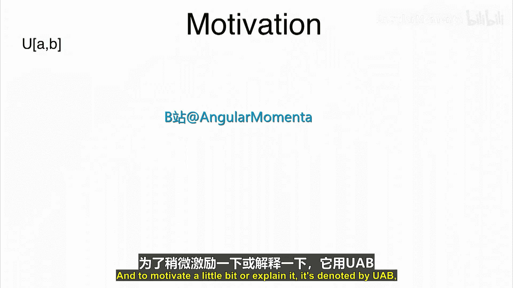
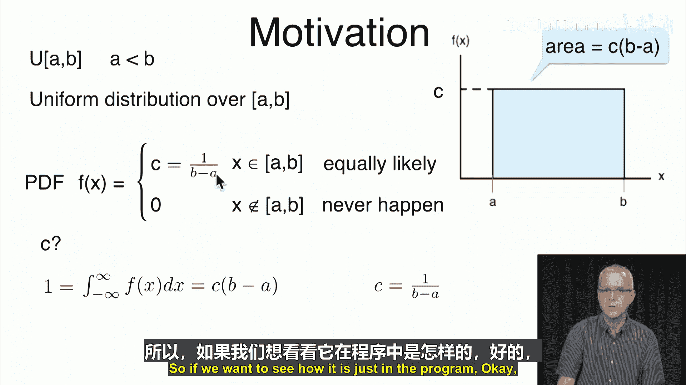
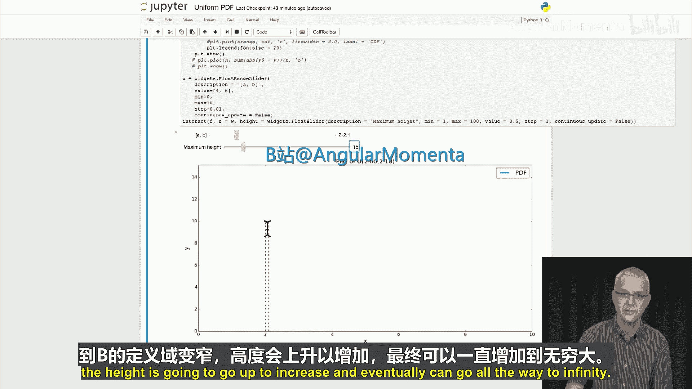
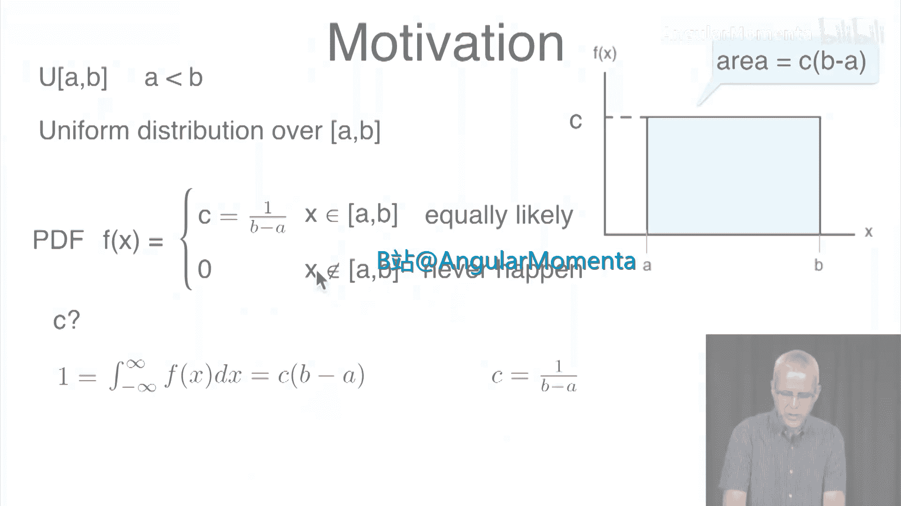
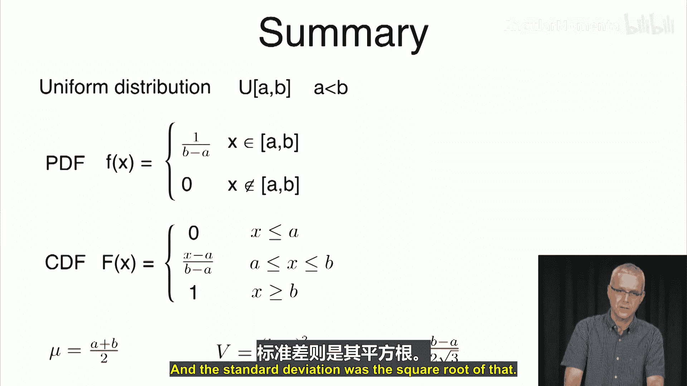

# 【加州大学圣地亚哥分校】使用Python进行数据科学中的概率与统计--Probability-and-Statistics-in-Data-Science-p39-10-03-03-均匀分布--BV1gJFDzkEPg_p39-

Hello again everyone， today we'll start talking about continuous distributions and the first distribution that we'll discuss will be the uniform distribution and to motivate a little bit to explain it it's denoted by UAB that's for a which is less than B that's the uniform distribution over this interval A to B and if x is in this interval effects is between A and B。

 then the probability effects is the same it's equal to all values in this interval and for values effects outside the interval the probability is going to be zero they'll never happen so what is the probability density function。

 the PDF it's going to be C inside the interval and outside the interval it's going to be zero and we can see it on the graph here between A and B there's a constant density of probability and outside the interval the probability is zero。

And the question of course is what is this constant C and so we know that for this to be a distribution when we integrate from minus infinity to infinity density fX it should be1 but this integral is only this integral in between A and B and it's only this interval and in this region the area is c times b minus a。

 so this integral is going to be c times b minus a just the area underneath the curve here and that。

Tell us because C times b minus a should be1 that this constant C is1 over b minus a so going back here。

 what is the PDF it's going to be inside the interval it's going to be one over b minus a and outside it's going to be zero so if we want to see how it is just in a program so heres the code that is available for you to use and if you run it。

Then what you'll get is。That is you'll get that and you can see here we have a uniform distribution between four and6 in this case and because the length of the interval is 2。

6 minus4， the height is about a half and I can change it for example if instead of four to 6。

 I change it to maybe4。To 8。Sorry，4，2，8。tThen the interval is going to be twice as wide。

 but it's going to be half as high， so it's always going to be such that the width times the height is going to be one here the width is4 the height is a quarter if you make the width very small for example。

 if you make it go from，Two to 2。1。tThen we'll see that it's here and we also see that because we limit the height to1 here now the width is 0。

1 so the height should be 10 so this is not sufficient so we need to enlarge the maximum height here。

 can make it instead of one we can make it maybe 15 or something like that。

So you can make at 15 and then you will see the interval it goes to one so as the interval becomes narrower。

 as the domain A to B becomes narrower， the height is going to go up to increase and eventually can go all the way to infinity。

All right， okay， so let's go back to the slides。

So this is the PDF and what we want to check is that this is indeed a distribution。

You need to check two things， one is that it's non negative and it's very clear because it's zero here and here it's positive and the integral is so this okay and that the integral equals 1 and that is done actually by our choice of C we made sure that the integral is going to be 1 so that is okay case1。

So when does the uniform distribution happen， the uniform distribution is so simple。

 you think it might happen a lot， but in fact it doesn't happen in so often although it does happen。

 so for example if you go to catch a bus or a train。

 then assuming that the departure times or maybe evenly distributed then if you look at how many minutes after the hour that's going to be some random number that is uniformly distributed between between one and 60。

 and correspondingly look for the wait time for your bus。

 maybe you arrive maybe the bus leave uniform intervals and so you arrive at random points or the amount of time you'll have to wait for the bus leaves is again going to be uniformly distributed。

 if you look at a location of an defect on it on electrical chip， that's often considered to be。

Uniformly distributed， a location of a molecule in space， uniformly distributed and are some more。

Okay， so what is the cumulative distribution function of the uniform。

 so we need to look at f of x capital F ofx， which is the integral of f u from minus infinity to x。

And we are going to break it by regions so here is f of x and we're going to look at what happens when x is less than a。

 when x is between a and B and when x is larger than B。

 so if x is less than equal to a name it's someplace here。

 then we have the integral for minus infinity to x of0 because before xf is0 of0 du and that's going to be0 and in particular so if we draw x here then we see that f draw it in red it's going to be0 up to here and in particular if we look at this point f of a capital f of a is going to be 0。

So the cumulative distribution function evaluated at the point A is0 because everything until then the density was0 okay now if we look at the range between A and B。

Then that's going to be a point someplace here。And the value is going to be the cumulative distribution function is going to be f of a。

 the integral up to a plus the integral from a to x of the density function。

 which is in the range1 over B minus a D。But F of a we saw was zero。

Here we saw before there was0 and this integral here is going to be the shaded region here underneath the under curve。

 so it's this light blue area here and what is its area。

 the width is x minus a and the height is1 of a b minus a so the area is going to be x minus a divided by b minus a。

And in particular， so if well evaluate this at the very last point of this region at B。

 then we get that it's going to be b minus a divided by me minus a which is1。

 so that tells us that f of B， the cumulative distribution function at B is1 and the curve is going to be the red line connecting those two points。

 it's going to be that。And then if we look at F of x。Beyond me。

So we look at what happens for x bigger than b， namely x is here， then it's going to be f of b。

 plus the integral from b to x of0 because the PDF is again zero here of0 to U and f of b we said was 1 and this integral is0。

 so it's going to be1。Therefore， this function will continue like that。 So this。

 the red line is the CF of the uniform distribution。So to see a little more interactively。

 let's go to Python。Here again is the program that you could use and if we run it。

 we'll get the following。So here。iss a uniform distribution。

 the PDF and the cumulative distribution function， you see here。

 so you can see it started at zero and goes to one SA ranges from A to B and then stays at one and if we change the distribution。

 for example， if we change the range， make it。From let's say， from zero to。From zero to 10。

And then this is the uniform distribution and will range from  zero to 1 at that point if we make it much smaller。

 for example， from zero。0 from0 to 0。5。Like that， then the distribution。

 because the height the width is a half， the height is going to be2 which is not sufficient。

 so we're going to enlarge。The range here， make it two， I make it three maybe。So here is the PDF。

 the density function， and here's the cumulative distribution functions goes from zero to1 and states at one。

Okay now given the CDF we can calculate interval probabilities fairly easily， so if for example。

 if alpha and beta are between a and B like that， so here we have a and then alpha and beta and B then if we consider the interval between alpha and beta and we ask what is its probability it name what's the probability of this interval here and notice that we are looking at for example the open interval on the left and closed on the right and that's because it really doesn't matter because as we know for continuous distribution individual points make no difference so we could have taken the closed interval from here to here or open interval they would all be the same all of them the probability is going to be f of beta minus f of alpha。

Again， f of beta in this case is going to be beta minus alpha divided by b minus alpha。

 and f of alpha is going to be alpha minus a。A apologize。

 this was beta minus a divided by b minus a and f of alpha is going to be alpha minus a divided again by b minus a and it' is going to give us b minus alpha beta minus alpha divided by b minus a and we can also see it in this picture here because the total area is b minus a it's uniform over that and we're asking what's the probability that falls in this region so it's going to be the length of this interval divided by the total length so it's beta minus alpha divided by b minus a。

And if you look at the interval from beta to infinity so it's the region that goes from here till infinity。

 then that probability is going to be f of infinity minus f of beta and f of infinity is 1 and f of beta is beta minus alpha divided by b minus a。

 sorry beta minus a divided by b minus a。And that's going to be just b minus beta。

Divided by B minusa。And again， we can see it from here because we're looking at the interval from beta to infinity。

 but everything outside is zero probability， so we're just asking what's the probability of this interval here from beta to B。

 its length is b minus beta out of the whole length which is b minus a。

 so the probability because everything is uniform， the probability is b minus beta divided by b minus a。

And if you look at the probability of an individual element alpha， for example， just this point here。

 then it's going to be f of alphaalpha minus f of alpha。

 which is0 because individual elements have zero probability。

So next let's look at the mean and the variance of the uniform distribution。

 so first let's consider a slightly simpler case， let's look at the uniform distribution between 0 and 1。

So what is the expected value of x is the integral of x， and then in this range f of x is just 1。

And because b minus a is1。So it's the integral of x dx。

 and that's just x square over 2 between1 and0 which is half。

 it's clearly not surprising we have a uniform distribution between 0 and 1。

 the expected value is just the middle， which is a half。What is the expected value of x squared。

 it's the integral of x squared between0 and 1 and again it's because f of x is1。

 so it's this integral which is x cube over 3 between 1 and0， which is 13。And what is the variance。

 it's the expected value of x squared minus the expected value of x squared。

And that's going to be one third minus a quarter， which is1 over 12。

And what is the standard deviation， it's the square of that which is one of a2 squared of 3 which is roughly 0。

29， so again this kind of makes sense because the mean is a half and we're looking at see how far we're going to be from a half。

 we're going to be somewhere between 0 and a half from a half。

 the average of 0 and half is a quarter， but because we're looking at the expected value of x square or the different square it's going to tilt it a little bit away from0 so instead of a quarter we get 0。

29 on the average。嗯。And finally， we want to see what happens not just for the uniform distribution between0 and1。

 but for a general uniform distribution， so let Y be distributed uniformly between A and B。Then。

Y is equal to b minus a times x plus a， as we have seen before。

 and you can observe that when x is equal to0。Y is going to be。

 this is going to be 0 and y is going to be a， and when x is going to be equal to 1。

 this is going to be b minus a plus a so it's going to be B， so as x ranges from 0 to 1 uniformly。

 this will range from a to B uniformly。Okay，Now the expected value of y is the expected value。

 therefore of b minus a times the expectation of x plus a by the linearity of expectation。

that's going to be and because they expected the value of x is a half。

 that's going to be b minus a over 2 plus a， which is a plus b over 2 again what we would have expected because it's a uniform distribution between a and B。

 the average is going to be just the mean point between them a plus b over2 and what is the variance of y so the variance of b minus a times x plus a。

which as we know is going to be adding a constant as we have seen does not change the variance and when we multiply a random variable by some constant the variance changes by this constant square so it's going to be b minus a square times the variance of x and remember that the variance of x was1 over 12 so this is going to be b minus a square divided by 12 and the standard deviation is going to be just a square root of that which is 0。

9 to9 times the difference between B and A so this is the variance of the uniform distribution so to summarize we discussed the uniform distribution denoted by UabB for a less and b the PD was a constant1 over b minus a for x in the interval between a and B and0 outside that interval and this cumulative distribution function was0 up to a and then it went up linear from 0 to 1 when x was equal to B。

And was status 1 beyond B， and the mean was a plus b over 2。

 the variance was the different square divided by 12 and the standard deviation was the square root of that。

Okay， and what are we going to do next， we're going to discuss the exponential distribution。

笑定。