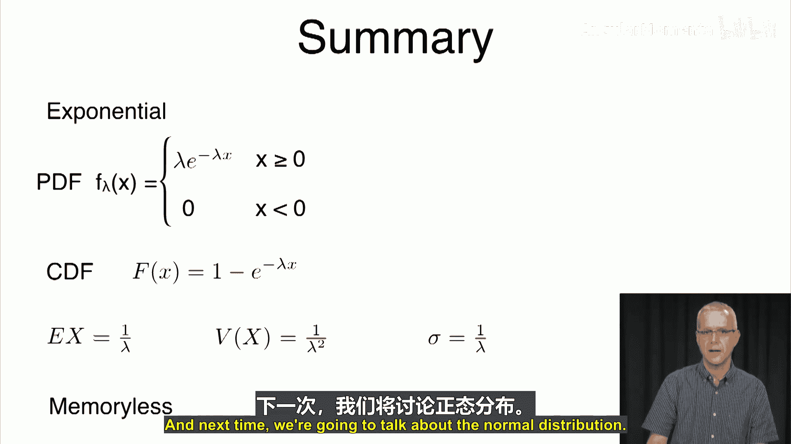
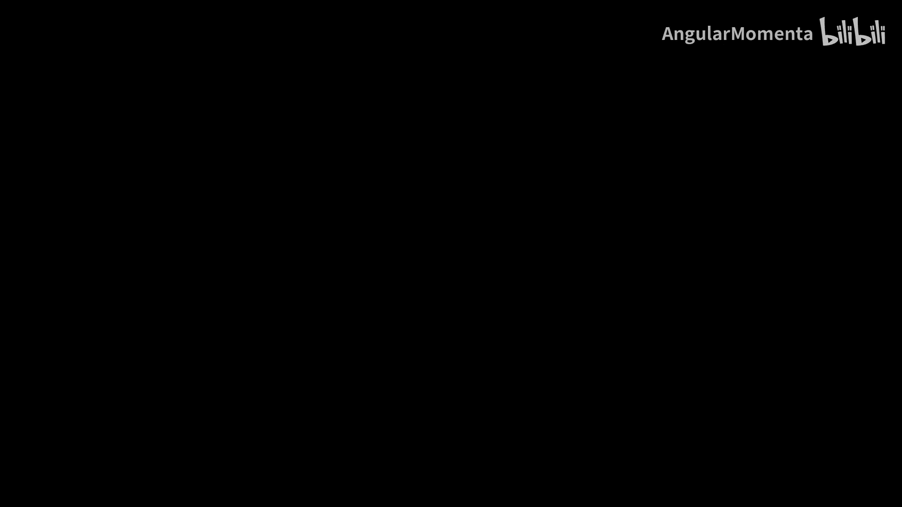

# 【加州大学圣地亚哥分校】使用Python进行数据科学中的概率与统计--Probability-and-Statistics-in-Data-Science-p40-10-04-03-指数分布--BV1gJFDzkEPg_p40-

Hello again， everyone。In this video we're going to talk about the exponential distribution and we're going to start。

 so the exponential distribution extends the geometric distribution to continuous values。For Lada。

 which is bigger than 0， the density function is defined to be lambda times e to the minus lambda x for all x。

 which is non negative。And zero if x is negative， and so here is the density function drawn like that。

 it's Lada e to the minus lambda x。So when x is equal to 0。

 it's going to be lambda in this case it's lambda shown as1。

 but if you want to show different values of lambda then we can go to Python again。

So here is the code for drawing the exponential function in Python。

 which again you can use whenever you would like and to do that we just run the code。And here。

And you can see that。It falls with excess one would expect and here Lada is 0。

5 if I'm going to change Lada to from 0。5 to 1， then two things will happen。

 one is that slope become the slope will become faster because the expon grows and also to compensate for that the initial value will increase。

So you'll get that， it starts from one instead of from 0。5 if I change it to 5。

It will start at five and drop more sharply and you can of course if you change it conversely。

 if you can change it， if you change it to， let's a 0。2。And we'll start at 0。2。

 but drone grow down more slowly and to see more of it， you can just increase lambda max。

You can cyclingling that。All right， okay， all right， so going back to the slides。Okay。

 cool or pick up from the slides that right，So we'll pick up actually from here。😔。

So if you want to check that it's a distribution， we need to check that it's not negative and clearly this was defined to be non negative。

It's good and to check that the integral is one， we need to integrate e to lambda e to the minus lambda x from0 to infinity。

 the integral of lambda e to the minus lambda x is the negative of e to the minus lambda x。

 we'll use it a few times in this lecture。And we need to evaluate it between infinity and 0 at infinity we get zero and at0。

 we get 1。And so it's going to be 0 minus negative 1。

 which is 1 and that shows that the integral is  one and this is a distribution。Okay， now many。😊。

Randdom things in life are geometric and if they happen at low enough resolution then they become exponential。

 so for example the duration of a phone call， if you assume that every time you'll equally likely to stop at any given time and this point becomes more and smaller then you get an exponential distribution so the duration of a phone call is often model is exponential。

 wait time when you call an airline， the time time you call and they put you on hold till the answer。

 again if you assume that every time the probability that will stop the call is going to be the same。

 then that's going to be exponential， the lifetime of your car often view this exponential。

 the time between accidents that you have exponential distribution and so on。Next。

 let's look at the cumulative distribution function。

 so first if you want to evaluate the probability that x is bigger than equal to value of a。

 where without loss of Jity we're going to assume that a is positive。

 it's going to be the integral from a to infinity of the PDF lambda e to the minus lambda x and as we said before we're going to use this integral of several times it's the integral of lambda e to the minus lambda x is negative e to the minus lambda x。

 valued between infinity and a at infinity it's0 at a is e to the minus lambda a。

 so we get that the difference is going to be just e to the minus lambda。

Now the cumulative distribution function is the opposite of this it's the probability that x is less than equal to a。

 it's going to be1 minus the probability of x being bigger than a。

 so it's just1 minus e to the minus lambda a， so we see that if we evaluate it zero you get 1 minus1 which is 0 and evaluate it infinity you get1 minus0 which is1 and in between it's going to go grow exponentially。

All right， so for example， if you want to calculate the probability that x is between A and B。

Or x is strictly between a and B， those two are going to be the same。

 and it's going to be f of b minus f of a， which is 1 minus e to the minus lambda b。

 minus1 minus e to the minus lambda a， so it's going to be e to the minus lambda a。

 minus a to the minus lambda B。And。To see the expectation of the exponential function。

 we need to calculate the integral from 0 to infinity of x times lambda e to the minus lambda x and we're going to do this by parts by letting UBx。

And v be lambda e to the minus lambda x dv is lambda e to the minus lambda x dx， so then D is 1。

 and v is e to the minus lambda x negative。And we need to evaluate UVv minus the integral of VDU。

Which is going to be。UV is going to be x times e to the minus lambda x between0 and infinity and VD du is 1。

And v is the integral of Lada e to the minus Lada x， as we said， using it again。

 so it's going to be the integral of e to the minus lambda x where the minus change to plus because of this negative sign here。

And it's going to be this integral e to the minus lambda x at infinity gives us 0 and at 0。

 this x gives us 0。 So the first part is 0。 and then we have here evaluated。嗯。

When we take this integral， we get the integral of e to the minus lambda x is minus 1 over a lambda a to the minus lambda x。

And we need to evaluate between0 and infinity， and this gives us one end gives us0 to the other end0 gives us one over a lambda。

 so we get one over a lambda。Okay， so the expected value of this distribution is one over the lambda。

And as lambda increases， the line falls more sharply and therefore the expected value will decrease。

Okay now what is the variance again we're going to calculate first the expected value of x square and then subtract the expected value of x。

 that quantity square， so the expected value of x square is the integral of x square lambda e to the minus lambda x dx。

 again integration by part u is x square dv is lambda e to the minus lambda x dx。

 then D is 2 x dx and v is again the negative of e to the minus lambda x and what we want to calculate therefore is instead of the integral of U dv which we have we're going to calculate Uv minus the integral of vDu。

 now Uv is going to be x squared。Times negative e to the minus lambda x。

 so it's this quantity here evaluated between0 and infinity and then we need to subtract the integral of vdu now D is 2 x and V is e to the minus lambda x with a negative sign which turns this into positive and so now remember that。

嗯。The expected value of x was the integral from 0 to to infinity of x times times the density function。

 so x times lambda e to the minus lambda xdx and that we saw in the previous slide was1 over lambda so we evaluate this then the first term will give us zero because at infinity this term is0 and at zero this term is 0 so it's going to be0 and here what we have is instead of the difference between this and the expectation is that here we had lambda originally and now we have two。

 so it's two over lambda times the expected value of x。

 we divide by lambda to get1 and multiply by two to get this term。

And that gives us just two over lambda squared。And now the variance is going to be the expected value of x squared minus the expected value of x squared。

 so this is2 of a lambda square minus1 of a lambda squared。

which is one of a lambda squared and the standard deviation therefore is one of a lambda。

 so what we see is the standard deviation is one of a lambda， which is the same as the expectation。

And again， as Islamda increases， the line flows more sharply and and the standard deviation decreases。

One very interesting property of exponential distributions is that they are memoryless。

So if x is distributed exponentially with parameter lambda and let A and B be non negativeg values。

 then we can be interested in the probability that x is bigger than a plus B given that x is bigger than equal to a for example。

 suppose that phone call length are distributed exponentially and I tell you that the call has lasted at least a seconds so after a seconds it has not ended and ask you what is the probability that it will last more than a plus b seconds namely what's the probability that will ask will last b seconds beyond that a that it has lasted so far so we can evaluate that。

 we know it's the probability that x is bigger than a plus B and x is bigger than equal to a divided by the probability that x is bigger than equal to a but the probability that x is bigger than a plus B and it's bigger than a is just the probability that's bigger than a plus B。

So it's the probability that x is bigger than a plus b divided by the probability that x is bigger than a。

And we can evaluate this， the probability' is bigger than a plus b is e to the minus lambda a plus b。

 we calculated before divided by e to the minus lambda a。

 and when we divide we get that it's e to the minus lambda B。

 which is exactly the same as the probability that x is bigger than equal to B。

 so interestingly the probability that this funal was going to last b seconds。

 if we asked you about at beginning is exactly the same as the probability that if we B more seconds。

 if it lasted at least a。So the fact that we have talked for a seconds so far does not change the probability that the call will last more than B more second。

 that doesn't matter， it doesn't matter if we talk one second， two seconds， two hours。

 the probability will talk for another B seconds it stays the same。

And this does not apply just to the probability that x is going to be bigger than a plus b。

 but clearly also to the probability that x is going to be less than a plus b。

 given that it's lasted a seconds because that's just one minus the probability of x being bigger than a plus B。

 which is minus the probability that x is bigger than equal to B。

And that's going to be the probability that x is less than B so the probability that it will last fewer than b seconds。

 given it it lasted a is the same as the probability that it lasts fewer than b seconds from the beginning so the fact that it lasted a seconds does not change that distribution and similarly it's not going to change the density so if you ask you what is the density what is the。

Margnal probability that it will end at exactly a per plus B。

 given it lasted a is exactly as the density of that it will end exactly B seconds。

 so the fact that lasted a seconds。Does not change the distribution afterwards。

 it's the same as it started from the beginning and that's why we call this distribution meless so here is one somewhat interesting implication of memoryless distributions。

So here in California people like to drive a lot， I don't know if they like， but they do。

You know somewhat regularly they need to go to the DMV。

 the Department of Motor Vehicles and imagine that you go there and there are two clerks and each has an exponential service time which is exponential parameter Lada and again service times are typically considered to be exponential maybe because you know the fact that you have been talking to the clerk for a while on the one hand you think it might make it more likely that you'll end soon but maybe the problem is more difficult and it's longer and it's not an unusual assumption a common assumption that service time is exponential now。

Imagine that when you arrive and this seems to be very typical you arrive。

 one person is already in line so you're not too happy and furthermore， while you wait。

 someone else cuts in the line in front of you and that makes you even less happy。

And so at this point， there are two people in front of you and maybe at some point later。

 one click becomes available and then starts serving the first person， the one was there beforehand。

 and then before this first person finishes，AndThe other the other clerk starts in the second person。

 the bad person jumped in front of you， so at this point the first person is still being served and the second person starts getting served again now notice that if these bad events did not happen if all of you came in the same time maybe it should have been then and each one got served randomly then the probability that you'd finished last is going to be one third by symmetry because there are three of you and one question that you might be interested in is given though those two events happened given that there was a person in front of you and then another person cut ahead of you。

 what is now the probability that you'll finished last is it still onet is clearly it should be at least that but how much bigger should it be？

So let's evaluate that So let A be the time that the first person who was there just before you finishes。

 let B be the time that the person cut in front of you。

 the bad person finishes and let's see be the time that you finish now we can calculate the probability for example that a will finish first B will finish second and youll finish last then that probability will depend on what we assume about the service for example。

 if the service is fixed time So let's say that every person gets out for exactly 10 minutes then because a started first he'll get finished first because B started second theyll finish second youll finish last so the probability that this will be the order is going to be one but the service time is exponential and we wonder what is the probability of。

A finishing before B， before the second person and the second before EU okay。

So let's write all possibilities， so all possible audios are ABC， AC CBB， BAC。

 all the way out to CBA， and you notice that the last two in the last two you finished first and that will never happen because for you to start even one of A andB must finish so you cannot start before at least one of them finish so the probability that you finish before both of them finish is zero。

Okay， so this happened with zero probability and we're interested in the probability of the other four orders。

Now in the probability of a less than B， less than C。

 the probability that you're finish in the order that you've started， we can write it as。

Probably that A finishes before B。Times the probability that B finishes before C B finishes before you。

 given that A finished before B。Now the probability that A finishes before B notice that A started first。

 but when B started A was still being served， and because the distribution is memory。

 the fact that A was served for some time does not matter and they have equal distribution from that point on to finish and therefore the probability that A will finish before B by symmetry is going to be12。

Furthermoreoo ormore。If A finished before B。😡，And when A finished B was still being served and you start getting served at the point at that point。

 so the fact that B had been served for a while at that point makes no difference and from that point on you and person B have the same probability of finishing at any given time。

 so by symmetry the probability that person B will finish before you is going to be again one half。

Okay， so therefore the probability that A will finish before B and B will finish before C is a quarter。

Okay。We can also consider the last probability here that we don't know。

 the probability that the bad person will finish before you and you will finish before the first person。

 even though actually the first person A is the first person。Started first and you started last。

 Okay， so this probability， the probability that the better first person finishes than you and then the first person is the probability that B finishes before a times the probability that。

You will finish before a given that B finished before a now the probability that B will finish before a is again one half because even though B started after a because B。

 when B started getting served， a was still being served by the meless nature of this distribution。

 though，Finish first with equal probability， so the probability B will finish first is1 half。Now。

 given that B finished before a， but you starting getting served before A finished so now。

U and A have equal probability of finishing first so that again is probability half。

 so the probability that of this order that B will finish the U and then a is again1 half times1 half which is a quarter。

 so we get that this has one quarter and similarly everything else is probability one quarter。

So all these orders have equal probability， which is one quarter， what does that mean？So。

If all three of you were served randomly， as we said then the probability that you finished last was going to be one third by symmetry。

If there was a fixed servant time， then the probability that you finished last would be want and we were interested in seeing what's the probability to finish last if the service time is exponential so under exponential。

 in fact any memal is distribution service time，What we get is these propertiesbil of orders。

So notice that you'll never finish first right because some one of them will always finish before you so you'll never finish first but all other orders where you don't finish first are equal likely all of them have probability one quarter okay so therefore the probability that you'll finish last is the probability of these two events either A B and then C or B A and then C and these two probabilitybil have these two events of probability one quarter plus one quarter which is one half so the probability that you finish last in this case is one half it's only slightly larger than the one third if you're being served。

Randomly， even though there was one person who came before you and then one person who jumped the line。

 so the conclusion of this is then when these things happen， maybe relax a little bit， don't worry。

 it just a slightly larger probability that you'll finish last。Okay， thanks so to summarize。

 we talked about the exponential distribution， the PDF was lambda e to the minus lambda x for x。

 which is not negative and 0 for x which is negative。

 the cumulative distribution function was 1 minus e to the minus lambda x。

The expected value was one over lambda and the variance was over lambda square and the standard deviation was one over lambda again and we said that this distribution is me meaning that it doesn't matter how much you have waited for something to happen if x is bigger than a given value for example bigger than 10。

 the distribution from that point on is the same as the distribution from starting from zero and we saw some consequences of that and next time we're going to talk about the normal distribution see you then。

