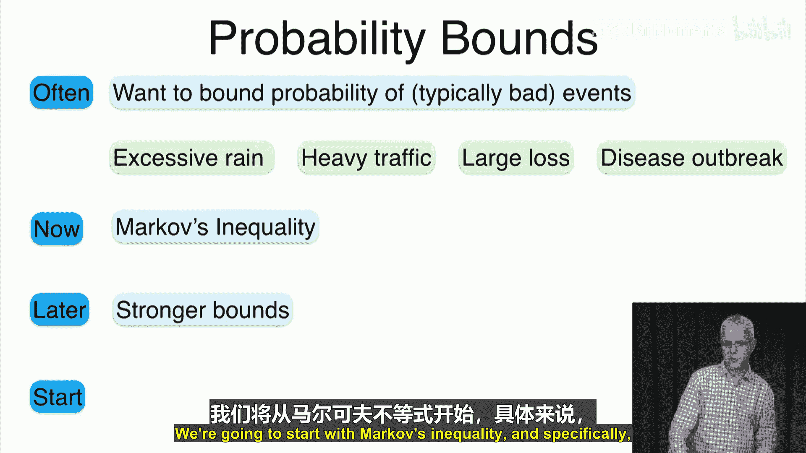
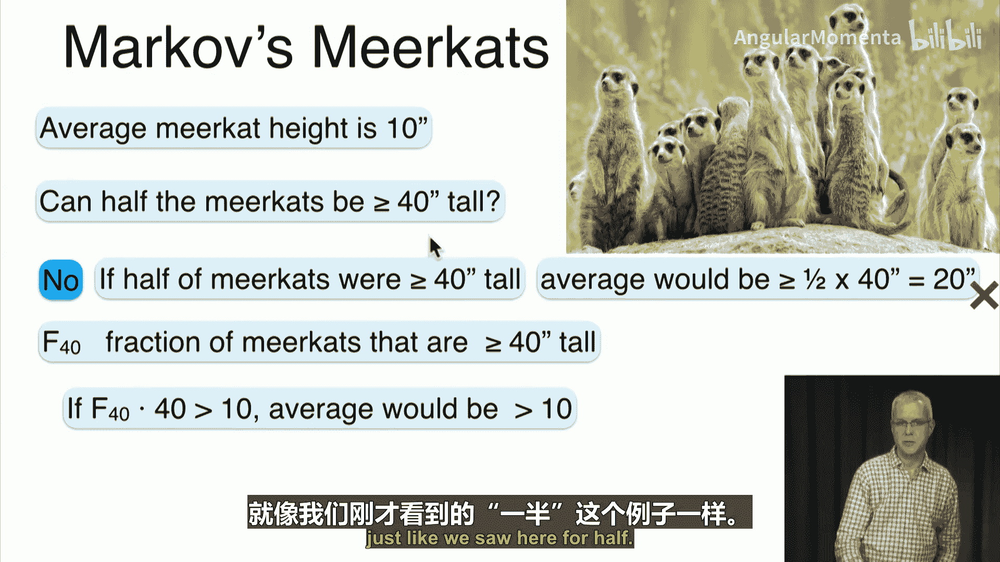
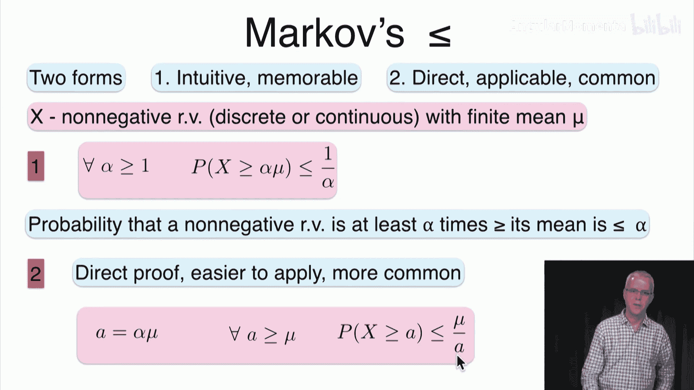
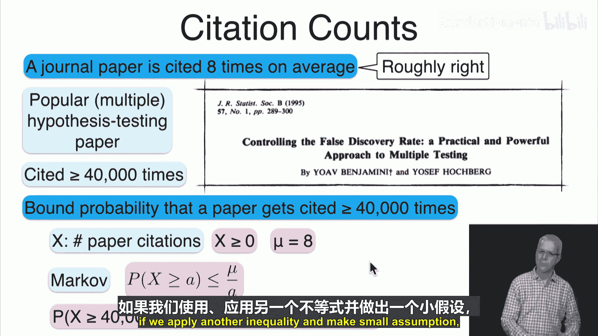
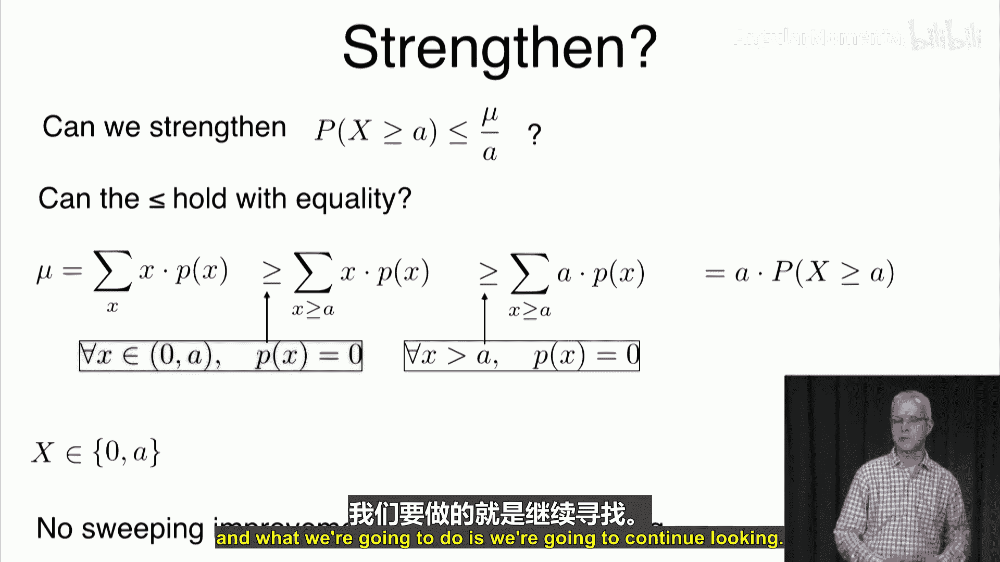

# 【加州大学圣地亚哥分校】使用Python进行数据科学中的概率与统计--Probability-and-Statistics-in-Data-Science-p41-11-01-03-马尔可夫不等式--BV1gJFDzkEPg_p41-

Hello and welcome back In this set of lectures， we're going to talk about inequalities that are related to probability distributions。

 and we'll start with the。You might want to think of it as the mother of all such inequalities it's named after Andre Malkov shown here who was a Russian mathematician active at the beginning of the 20th century and we're going to motivate his inequality provide a little bit of intuition。

 then formalize the inequality prove show an example and then discuss possible extensions so let's start so why do we care about inequalities often we want to bound probabilities of events typically there'll be bad events。

 for example we want to guarantee that or assure that the probability of excessive rain is small or the probability of heavy traffic is not that high or the probability that the company will incur a large loss is contained。

Or the probability of disease outbreak is small， we want to say that these bad events have small probabilities okay and so what we're going to do now is we're going to describe Markov's inequality which as I just mentioned is the foundation of many of the inequalities we encounter laters this inequality is not so strong and lecture will describe stronger bounds but we're going to start with Markov's inequality and specifically will give a little bit of intuition about it。

So。Let's consider moco of his mucas though shown here。

Each of them is a height which of course is a non negative number and let's assume that the average mu cut height is 10 inches。

 so I have a question can half the mu cuts have a height which is at least 40 inches。

 can half of them be at least 40 inches tall？Clearly the answer is no because if half the mu cuts were more than 40 inches tall then just by looking at these half。

 just they alone will account for an average which is at least 20 even if all the other mus were  zero inches tall then the average would be at least 20 and if the other mucas are more than 0 then the average would be bigger than 20 so the answer is no because if half the mus were more than 40 inches tall。

 then the average would be at least half times 40 which is 20 inches and we're told the average is in fact only 10 inches so this is impossible so therefore we see that if you want to find what's the highest fraction of mucas that can be bigger to equal to 40 inches don't let call it f 40 fraction of mus 40 inches or taller then we see that if at 40 times 40 take this fraction multiplied by 40 if this number is bigger than 10 then the average would。

bigger than 10 as well just like we saw here for half and therefore f 40 again。

 the fraction of make that are over 40 inches tall times 40 must be less than equal to 10 or F 40 this fraction must be at most 10 over 40。

 which is one quarter。

Okay。And if you want， we can solve it for general mean mu here the mean was 10。

 but for general mean mu， we can say that f of four times mu。

 the fraction of mirror cuts that are new that are at least four times mu inches tall。Times form you。

That has to be at most mut because if it's bigger than mut， then the average will be larger than me。

Okay， so form F Form the fraction formula tall times form mu is at most mu。

 and then we can move Form to the other side， and we get that F for mu is at most one quarter。 Okay。

 just like we got here。 So this will be true in general and F 7 mu it will be at most 17 and so on。

 Okay， So if you understand this， this milk cut calculation， then you understand markov inequality。

 in other words， this is markovs inequality。In the。Okay so now to describe it a little more formally。

 there are two forms， one which is intuitive and more memorable。

 it's based on what we have just said now and the second one is more direct and is more easily applicable and therefore a little more common to see so the one that we just describe now says that if x is a non- negative random of variable can be discrete or continuous with finite mean mu then first formulation for alpha bigger than1。

 the probability that x is bigger than alpha mu is less than equal to one over alpha like we said before the probability that x was bigger than form mu was less than equal to1 fourth。

 the probability that x will be bigger than10 mu will be less than equal to 110 and so on so this to me that's the easier one to remember it says that the probability that non negativeative runover variable is at least alpha times its mean。

Is it most alpha？Now the second formulation， both of them apply to non negative variable with finite mean mu that applies both of them。

 but the second formulation， it provides for a more direct proof which we'll do in a second and is easier to apply and therefore it's a little more common。

 it says that if we let here， if we let alpha mu this quantity， if we call it a。

Then alpha bigger than equal to 1 means that because a is alpha mu and alpha is equal to 1。

 it means that a is bigger than mu， so for all a bigger than equal to mu。

 the probability that x is bigger than a bigger than alpha mu。Okay。

 so that's the same probability that x is bigger than a or alpha mu is should be less than equal to1 over alpha。

 but from here we see that one over alpha is mu over a so it's less than equal to mu over a。

 So for all a which is bigger than the mean， the probability that x is bigger than a is its most mu divided by this a。

 So for example， if the mean is 10。And a is 20， the probability that x is bigger than 20 will be bigger than equal to 10 over 20。

 which is1 half if again the mean is 10 and a is 40 the probability that x is bigger than 40 will be at most 10 divided by 40 which is one quarter and you can see maybe why this is a little easier to apply because typically someone ask us just what is the probability that x is bigger than some number so it can just plug this in and he plug mu and a and get the answer。

Right， so let's see how we would prove it， so we want to show that the probability that x is bigger than a is at most mu over a。

And you notice we're provingrov the second formulation， which is equivalent to the first。

And we'll prove it for this great or a variable， but the percent proof works for continuous just replace the summation by an integral。

Right， so the mean， as we know， is going to be sumation of x of x times px。

OkayAnd so here if this is x and p of x， then it's the sum of x times with p of x here it's so continues。

 but you can think of it discreteed mod matter， so it's a of x times p of x of all values of x。

And this is going to be bigger than equal than the sum， the same sum。

 but when we sum on a partial value remember we have given some value a only on x that are bigger than equal to a。

 so if this is a， we only sum from this point onwards to the right x times px。Okay。

 so instead of summing everything were summing for all x。

 which is bigger than or equal to h just summing here。

 that's bigger than equal to this whole sum and now this on the other hand。

 we can if we replace here x by a。So here in this region x is bigger than a， so if we replace x by a。

 then the sum will be smaller so that's what we did here instead of looking at summation Xpx。

 we are looking at summation of Apx and because x is bigger than equal to a only summing from here on。

 then when we replace x by a， were making this summation smaller。Okay。

And now we can take a out and here we'll have summation of all x be equal to a of px。

And this clearly just the probability that x is bigger than equal to a。

 So this is a times the probability that x is bigger and equal to a。So what we get is that mu。

Is bigger than equal to a times the probability that x is bigger than equal to a。

 and therefore the probability that x is bigger than equal to a is less than equal to mu over a。

 which is what's written。Okay， so this is a very simple proof of Markovs inequality and it's deceptively simple because as we said。

 we're going to use it to prove much stronger results later。Okay。

 so let's see an example citation count， so a journal paper is cited eight times on average。

 this number is actually roughly right， that's the original citation that a journal paper gets。

But some paper gets significantly more citation than this and for example here's a popular paper on hypothesis testing that we're going to discuss very soon。

 this paper on controlling the false discovery rate and this particular paper has over 40。

000 citations， more than many more than the eight average number of citations。

And so what we want to do is we want to bound the probability that a paper gets cited at least 40。

000 times like this paper。So here we'll let x be the number of paper citations。

 the number of citations that a paper gets。And notice that x is no negative so we can apply markovs inequality。

 we're told that the mean the expectation mu is 8 so by Markovs inequality we see that the probability that x is bigger than equal to a is it most mu over a notice that we're using the second formulation because we just want to see what's the probability that x is bigger than 4000 so it's useful to just have a here and then we just need to plug in mu and a so this is going to be the probability that x is bigger than equal to 40000 is at most mu divided by 40 k but mu we're told is8。

Okay here and so this is 0。02%。 Okay， so Markovs inequality tells us that the probability that a people will get cited so many times is that most。

150th of 1%。And even though this looks strong， as we'll see later if we apply another inequality and make small assumption and we can see we can get even better pounds。

Right so so now a couple of questions once we see such a simple inequality is we wonder whether we can generalize it。

 so question is can markov inequality be generalized and what that means is can we relax the condition for and can it be strengthened so generalized we mean that we want to relax the condition so we can wonder whether we can remove the non- negativegative assumption。

 so we're assuming that x is big and equal to se， can we remove it and have the equality still hold。

And the answer is no， if x can be negative， then the probability that x is bigger than equal to a can be close to 1 for any A。

 and the reason is simple， so here let's say is0 and here is a any number， if x can be negative。

 we can a have probability which is close to 1。Okay， and yet put a small probability here at a very。

 very large negative number， so like minus almost infinity， and we can make the mean be anything。🤢。

So we can make that way we can make the probability that x is bigger than equal to a be as close to one as we want。

 so here is how you specifically do it so let。For x equal to a we like the probability of A B1 minus epsilon。

 so we put probability 1 minus epsilon here。And then at a point。

 mu minus 1 minus epsilon a divided by epsilon。So notice this probability as epsilon becomes close to zero。

 this probability of a becomes close to1， and this becomes this could potentially become very negative。

 right because mu minus a could be negative and then we divide by epsilon。

 which is a very large number。Then we put probability epson there， and if we calculate the mean。

 you can see that what is the mean we'll get one from here from a we'll get1 minus epson times a。

And from the other point， we'll get the epsilon will cancel with epsilon denominator。

 we'll get mu minus1 minus epson of array， so the1 minus epsilon tab I will cancel and we'll get the expected values is mu。

And yet the probability that x is bigger than equal to a is the probability of a， which。

 as we said is very close to one。So that shows that we can set。We can have a anything we want。

 we just need to make this other value be sufficiently negative and then the probability of a will be close to1 and the mean will will still be new。

So we cannot remove the non negativity that won't work。

Right the other question is can we strengthen namely Markovs inequality says the probability that x is beginning equal to a is at most mu over a and you may ask。

 can we maybe we can prove that the probability that x is beginning equal to a is at most half of that or one third of that and again the answer is no and to see that so。

We are going to show that this inequality can hold with equality and if we can hold with equality。

 we will not be able to prove that it's less than equal to half that if you can prove that you can find a distribution such as the probability of x bigger equal to a is equal to muu v。

 we will not be able to show that it's less than equal to muu overva a over 2 and so on。

OkaySo to show that we are going to take advantage of the very simple proof that we had which is rewritten here and notice that we have two inequalities here and here and we can show that these inequalities can hold with equality so let's look at the first inequality here so observe that here what we did was here we have the sum of all x and we have the sum of all x that are bigger than equal to a and therefore this quantity here is smaller because we're not summing on elements that are between0 and a but if between0 and a for all x between 0 and a。

 the probability of x is 0， then we'll get equality here。

Because these two sums will be the same here we sum of all x。

And here we some x bigger than equal to a， but what we omitted， the probability of x was 0。

 so the sum was0。So if all x between 0 and a， the probability x is0， weve got the equality here。

Let's see here can we get equality in this one now the difference between this term and this one is that both of them were summing over x with bigger than equal to a and here we multiplied by x and here multiplied by a。

 but if for all x which is strictly bigger than a p of x was0 then we would not be reducing any terms because any term here for x bigger than a had p of x which is0 so this would hold with equality also so in other words if x is nonze only for0。

And for a。Then we got equality。Then we get equality here and here。

 and then we get the probability that x is bigger and equal to a is equal to mu of v。And therefore。

Moov's inequality can hold with equality and we cannot strengthen it。Right。

So there are no sweeping improvements and what we're going to do is we're going to continue looking and how will we look well let's look at the strengths and weaknesses of outcomesovs inequality so let's start with the strengths one good thing about it is it applies to only non- negative random variables it doesn't matter what a distribution is the inequality applies。

And the second， and therefore， it means that it can always be used。

 We don't need to worry about whether this distribute this。

And at specific properties the distribution needs to hold。Second。

 third strong thing is that it can be used to derive other inequalities， for example。

 Chebyshaev and Markov inequality and we'll go and talk about them in the next couple of lectures。

On the other hand， weaknesses， well the first weakness is actually the same as the strength that it applies to all nonneg random variables and that means that it's limited to inequalities the toll for all distributions so we cannot expect it to be stronger than the result we get for the weakest result we can get for all distributions okay so what we're going to do in the future is if we want to strengthen it is we need to add assumptions say let's assume that the distribution satisfy certain properties and then we can prove stronger results。

so to summarize， we talked about Markovs inequality， we motivated。

 give some intuition using Moovs mucas， and then we formulated it。

 in fact we gave two formulations and we proved it。

 showed an example and we talked about possible extensions。

 those we cannot have as we showed and those we might be able to have。

And what we're going to do next time， we'll talk about Chebyev's inequality。See you then。

