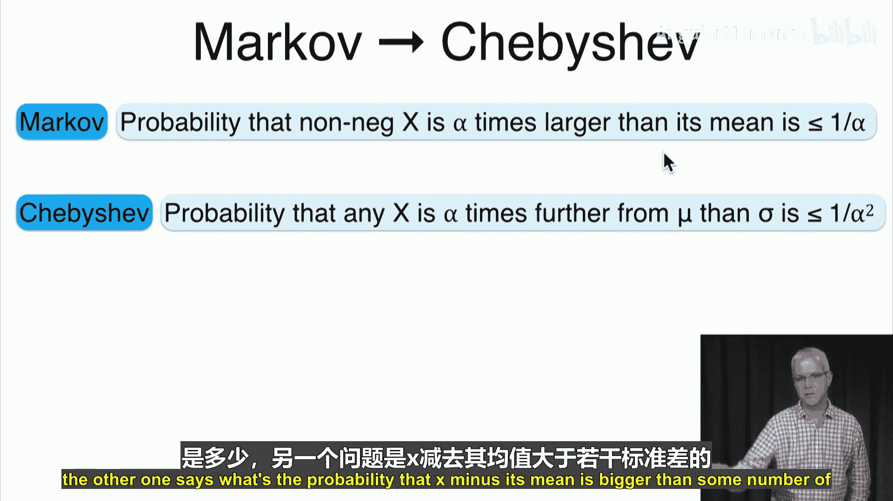
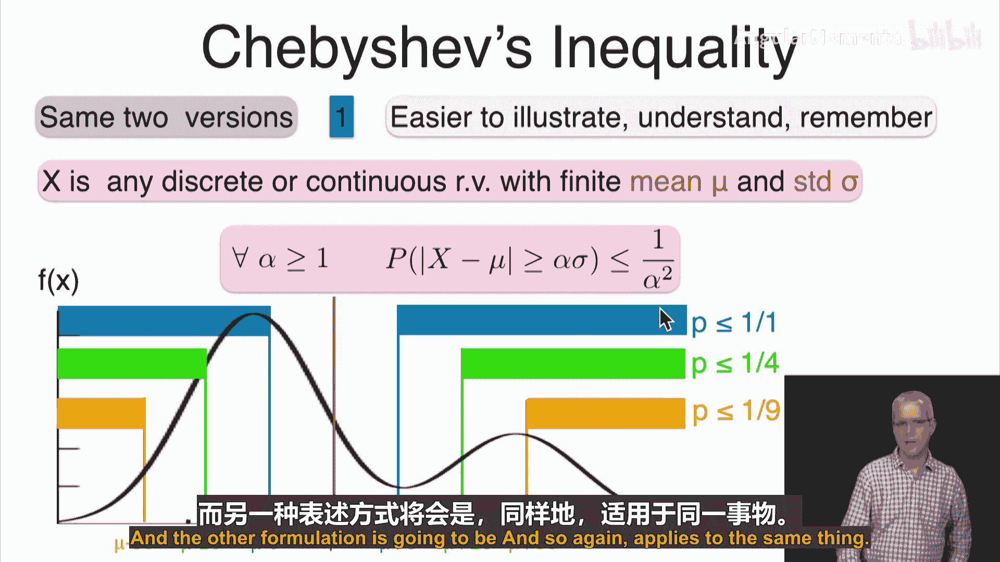
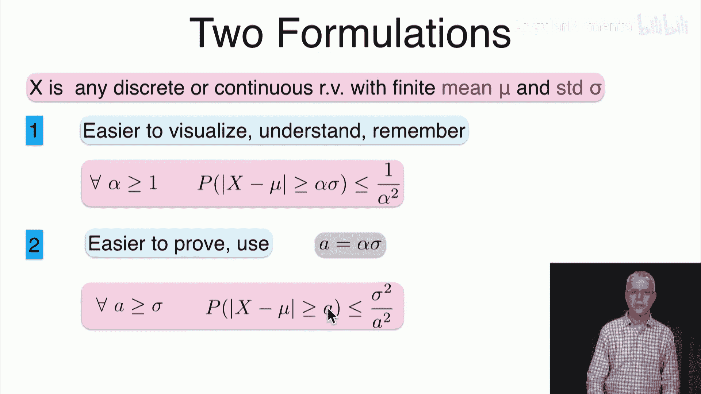
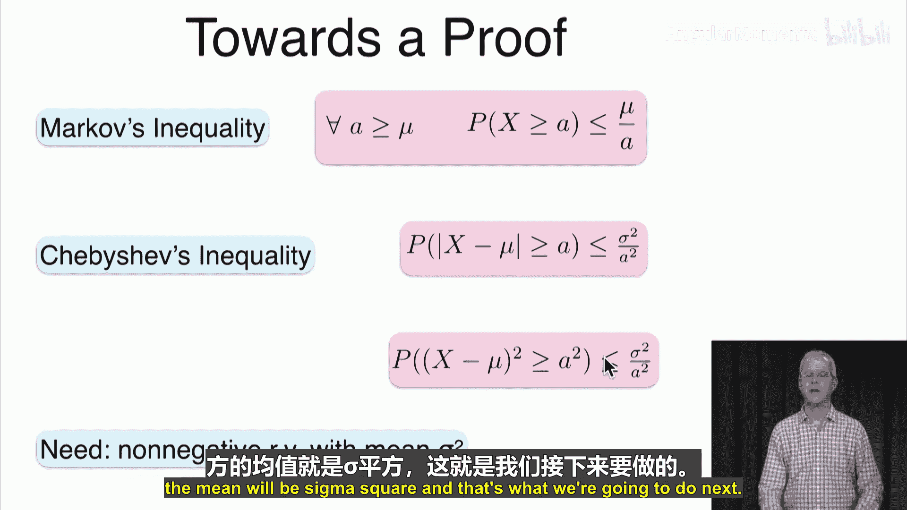
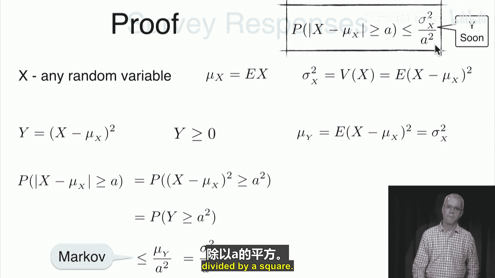
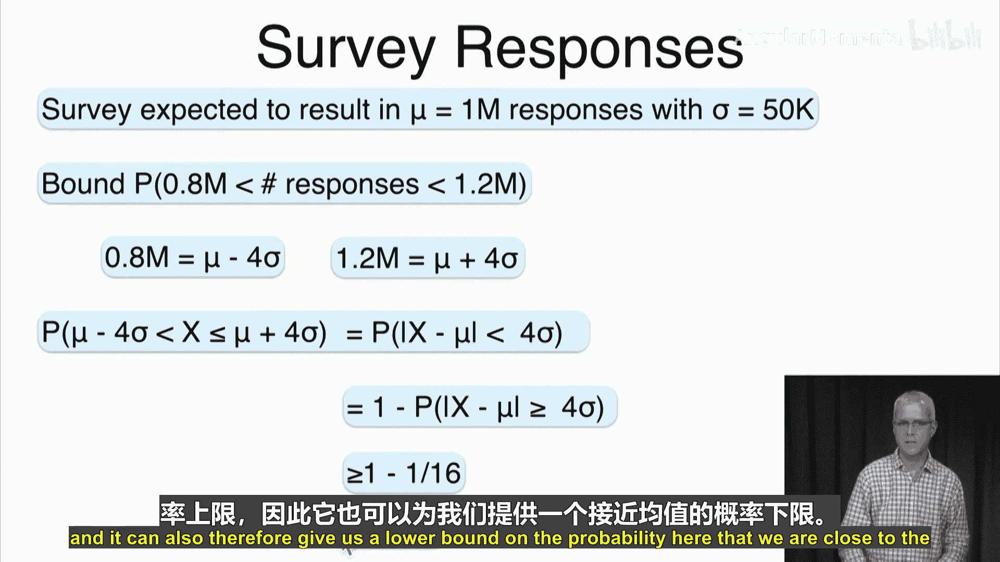
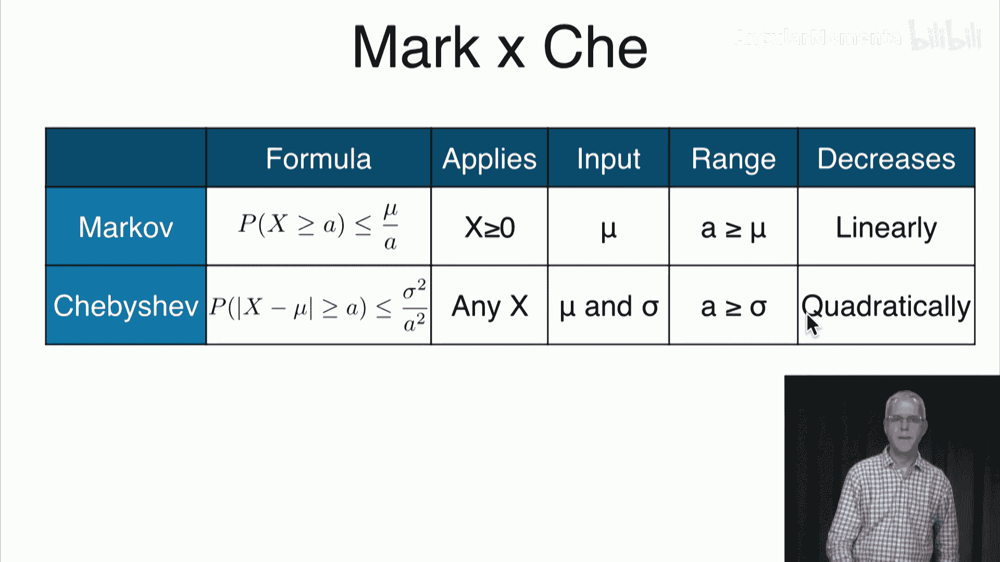

# 【加州大学圣地亚哥分校】使用Python进行数据科学中的概率与统计--Probability-and-Statistics-in-Data-Science-p42-11-02-03-切比雪夫不等式--BV1gJFDzkEPg_p42-

Hello， and welcome back。In the last。Lecture we talked about Malov's inequality and as we said then it's the basis of many other inequalities and today we're going to talk about one of these。

 which is Chebyev's inequality。 Chebichev was actually Markov's advisor， so how end up using。

An inequality that follows from Markovs inequality students inequality I'll leave it up to you to look up all right so let's start so we're going to discuss a little bit of im motivation and intuition for that and then we'll formulate it I'll provide a proof give a couple of examples actually and let's start so so first how do we move from Markov to chbyshipev of what's the difference between them so Markov's inequality tells us that the probability of a non- negative random variable is the probability that the probability that a non negative random variable is alpha time larger than its mean is at most one over alpha。

And so in other words， it relates to the probability that a non negative random variable is larger than its mean to how much it's larger than mean and chbu sheev's inequality will apply to any random variable and will bound the probability that it's alpha times further from its mean by one over alpha square。

 so one of them says what's the probability that x is larger than its mean。

 the other one says what's the probability that x minus its mean is bigger than some number times number of standard deviations。

So let's let's see what it says， so again， just like with Markov's inequality here to the two versions。

 one which is easier to illustrate and therefore understand and remember。

 it says that if x is any discrete or continuous random variable with finite mean mu and standard deviation signal。

Then fall alpha bigger than1， the probability that the difference between x and its mean。

In absolute value is bigger than alpha standard deviations。Is at most one over alpha squared？

Okay so let's let's illustrate it so here is the distribution of our verbal it could be discrete or continuous so this is x and this is f of x and let's say that the mean is here。

 let's say this is the mean mu so we're going to look at mu plus minus as a number of standard deviations so first let's look at mu plus minus one standard deviation so what this will say is that the probability that x minus mu is bigger than if alpha here is 1 than one standard deviation is at most one over alpha square or1 over one square or1 so it says the probability that we are。

Here that we are away from the mean by more than one standard deviation is at most one。 Okay。

 that's not so interesting because we know that any probability is at most one。

 It gets a little more interesting when we look at two standard deviations and more。

 So now if we look at two standard deviations。 So this probability is at most one。

 Now let's look at the two standard deviation。 So looking at the mean plus two standard deviation and the mean minus two standard deviations and what chbyev's inequality will do is it will tell us the probability that we are either。

Les it below mu minus2 standard deviation or above mu plus2 standard deviations， in other words。

 we're more than two standard deviations away from this mean。

 probability that we' in one of those green areas。Because we're looking at two standard deviations。

 we're looking at probability x minus mu is at most2 sigma。

 and that's going to be at most one over two square， which is one quarter。

And if we look at three standard deviations shown here。

 it will say that the probability that we are more than three standard deviations away。

 namely here or here， that probability is at most one over three square or one over9。

So this is what shebbbyshipev's inequality says and again this is the way that at least I remember it。

 it says the probability that we are most alpha standard deviations， I'm sorry。

 at least alpha standard deviations away from the mean。Is it most one of alpha square？Okay。

And the other formulation is going to be and so again applies to the same。

 so x is any discrete or continuous strainno variable with finite min mu and standard deviation sigma。

Then the first formulation that we just described is this。And the second formulation。

 which is easier to prove and also to apply sets just like we did before。

 called this value alpha sigma calls it a。And then it says that if alpha is bigger than one。

 that means that a is at least sigma because a is alpha sigma and a is bigger than equal 1。

 so a is at least sigma says the probability that x minus being absolute value is at least a which is alpha sigma is at most it should be one over alpha squared but alpha is a over sigma。

 so one over alpha squared is r sigma square over a squared because one over alpha sigma over a one over alpha square is sigma square over a squared。

So in both cases， you see that as if alpha increases。As you expect。

 this pound decreases and like what' here of looking at the probability further away from the mean。

And then that probability decreases like that。And again。

 this is easier to use because typically we'll be interesting in just fine what's the probability that x differs from its mean by at least some number。

 and we can just plug this number here。Okay all right okay so how do we prove this result so first let's remind ourselves of Malov's inequality it said that the probability that x is bigger than equal to a is at most mu over a okay and here is chbyev's inequality here says the probability that x differs from its mean by more than a is it most sigma square over a square so when you look at it they look very very similar we have the probability that something is bigger and than equal to a。

II at most something divided by a so to make it even more similar。

 what we can do is say that the probability that x minus mu is bigger than equal to a is the same as the probability that x minus mu square square both sides here is bigger than equal to a squared。

 this probability is the same as this probability exactly。Okay， so bar this the same。Okay。

 so probability that x minus me is bigger than equal to a is the same as the probability that x minus squared is bigger than equal to x squared and here let's not forget we have an absolute value。

So now when we look at the inequality， it looks even closer to Markovs inequality because we have the probabilities that some random variable which is no negative。

 is bigger than some value， is at most sigma squared divided by this value。

 just like here the probability that x is bigger than a。

Was at most the mean divided by a here at the probability that something again non negative is bigger and than equal to x squared it most something divided by a squared。

 So if you want to make this precise what we need to do is we just need to find a random variable that is non negative and the mean sigma squared。

 the mean sigma squared then here we'll have me。So we're looking again for a random variable。

 hopefully in form of x minus mu of square， no negative with mean which is sigma square and clearly x minus muux square。

 the mean will be sigma square and that's what we're going to do next。

So again， we want to prove that the probability that x minus s mu in absolute value is being equal to a is at most sigma x squared divided by a and notice that I wrote here is sigma x rather than sigma because and also here weve got rot mu x and that's because very soon we're going to introduce another variable which will be y so we want to make sure we distinguish between them。

Okay。So x is anywhere in variable。And it mean R UX is the expected value of x。

And its variance sigma x square， the variance of x is just。

 as always the expected the value of x minus mu x squared okay。

 so let's just remember that so now let's define y to be x minus mu x square is quantity that we have here。

And then y we can see is bigger than equal to0 because it's a square and also what is the mean of y is the expected value of x minus mu x squared。

Which by definition is sigma x squared， so we defined based on x， we define a new randomver y。

 namely the difference between x and its mean squared。

 so this new inver because it's square is non negative and its mean is exactly the variance of x。

Okay， so now we can apply Markovs inequality because we can set the probability that x minus of sx is beginning equal to0。

 which is what we want about。iss the same as the probability that x mu yo square is bigger than equal to a squared。

And now x minus s mu x squared is our random variable y。

 so it's the probability that y is bigger than equal to a squared。

And now y is not negative and it's minus sigma x squared。

 so we can apply macroovs inequality that's going to be equal to what the mean y divided by x squared。

But the mean y is sigma x squared。So this is sigma squared divided by a squared。

 so got that the probability that x minus minus its mean is beginning to equal to a is at most。

The variance of x divided by a squared， which is really what we want to prove。So again。

 you can see that with Malov's inequality， we could have a very simple proof for Chevev's inequality。

So again says the probability that x differs from its mean by at least a。

Is it most the of x divided by S square so for our second example let's look at survey responses。

 so imagine that you're conducting a survey and based on past experience。

 you know that the mean is going to be 1 million and the standard deviation is going to be 50，000。

Then we want to find to bound the probability that the number of response you will get will be between 800。

000 and 1。2 million。 so we want to know what's the probability get roughly。You know。

 the expected number of responses notice that in the previous example we bounded the probability that you're away from the mean and here we're bounding the probability that you're close to the mean。

 but still we were able to use Chebusha inality。Okay， so。So notice that the slow limit here 0。

8 million is the mean minus4 sigma， 1 million minus 4 times 50，000800000， and the upper limit 1。

2 million is the mean plus 4 sigma so what we are looking at is the probability that x is。

Between mu minus4 sigma and mu plus4 sigma， this apology should be strict inequality。

So this is the probability that x minus mu is less than4 sigma。Okay。

Now we want to use Malovs inequality and so we're going to express it as the probability that this is bigger than equal to4 sigma we know probability that x minus mu is bigger than equal to4 sigma is the complement of this event。

 so this is going to be one minus the probability that x minus mu is bigger than equal to 4 sigma。

But the probability that x minus mu is bigger than equal to 4 sigma is at most one over four square1 over 16。

 so therefore this is at least1 minus1 over 16 so this is bigger than equal to 1 minus1 over 16 again the probability of this event that we are more than4 sigma away is at most one over 16 so we are subtracting for one a number that is at most one over 16 and therefore we're getting a number which is at least one minus1 over 16 which is 15 over 16 square so now we see that chby shape's inequality beforehand told us give us give us an upper bound on the probability that we are far from the mean and it can also therefore give us a lower bound on the probability here that we are close to the mean。

So before we finish let's go over some differences between Malov and Chabyev's inequalities。

 so Malovv's inequality says the probability that x is bigger than equal to a is at most the mean divided by a and it applies to random variables that are no negative。

 x is always bigger than equal to a and the information we need to get a bound is the mean。

And the range for which this inequality is useful is for a， which is at least the mean。

And the reason is because if a is less than the mean。

 then this will tell us that some probability is less than a number which is bigger than one in that we already knew。

 so we need a to be bigger than the mean so that this number will be 1 or less。Okay。

 so it says the bounds are probably to x is bigger than equal to a when a clearly needs to be bigger than the mean。

and it decreases linearly with a。Now chbbby shift's inequality says that the probability that the difference between x and its mean is bigger than a is at most the variance of x divided by a square。

 it applies to any random variable x。And the input that we need a urine sigma。

 we need the mean and we need sigma， and the range that theF p is when a is bigger than equal to sigma。

 the standard deviation because if a is less than sigma。

 then we get the probability is less than equal to a number which is larger than one。

 which again is meaningless。And on the other hand， this now decreases like 1 over a squared。

 so it decreases quadraly with a， which is faster， much faster than1 over a and that's why we got better results in the previous example。

 so to summarize， we talked about chbyshift's in， we gave some motivation， a little bit of intuition。

 we formalized it in two different ways， we proved it using Markovs inequality。

 we gave a couple of examples。

And next time we're going to talk about another application of。

In fact of Chaboev's inequality and therefore Malov's inequality。

 and that's the weak law of large numbers。笑的。