# 【加州大学圣地亚哥分校】使用Python进行数据科学中的概率与统计--Probability-and-Statistics-in-Data-Science-p44-11-04-03-矩生成函数--BV1gJFDzkEPg_p44-

Hello and welcome back We have so far talked about Malovs and shebiev's inequality and we want to move to more sophisticated and stronger inequalities but before we do that I want to spend this lecture preparing preparing the background for the stronger inequalities so we're going to talk about the moment generating functions so first we'll describe what moments are we've mentioned the before we'll say a little more about them now we'll define a single function that determines all of them it's called a moment generating function or MGF we'll define it。

 we'll give some examples and we'll describe some of its properties。So what a moment？

Moments are expectations of powers of x， for example， the expectation of x is the first moment。

 the expectation of x square is the second moment， third moment and so on。

 sometimes they' are called raw moments to distinguish them from central moment which are the moments when you subtract the mean。

 for example the expected value of x minus mu raised to the n is the n central moment。

And as we can see the moments generate determine the mean so the expected of x is the mean。

 the expected of x square minus the expected of x square is going to be the variance so they determine the mean the variance and many other distribution properties and what we're going to do now is describe one general method that determines all the moments okay so perhaps not surprisingly it's called the moment generating function or MGF and what it does is it maps a random variable x to a real function M and by real function I mean function M from real to reals。

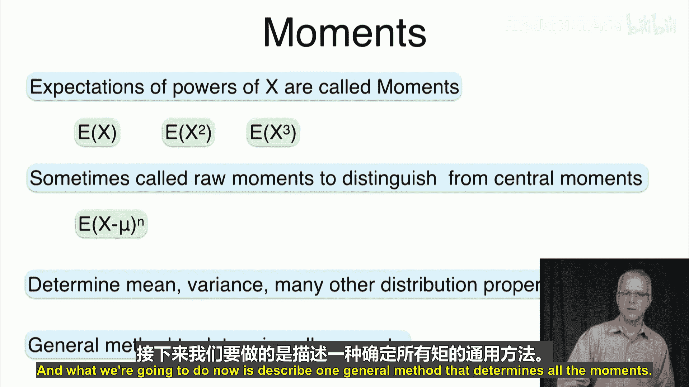

So more specifically， we define the generating function of x， which will also denote by MT for short。

 is defined to be the expected value of e to the Tx。

which is this applies both to discrete and continuous distribution。

 so if it's a discrete distribution， the expected value of Tx is sum of p of x e to the Tx as we know。

 and if the distribution is continuous， then the expected value of Tx again as we know is the integral of f of x e to the Tx dx。

Okay and you notice that the moment generating function mx is actually determined by the distribution by P or by F。

 so we could have called it m sub P or m sub F， but it's standard to call it by x to don x because we can then refer to m of 2x of x plus y and so on。

 and so we're going to go over this first for discrete distributions and then for continuous distributions。

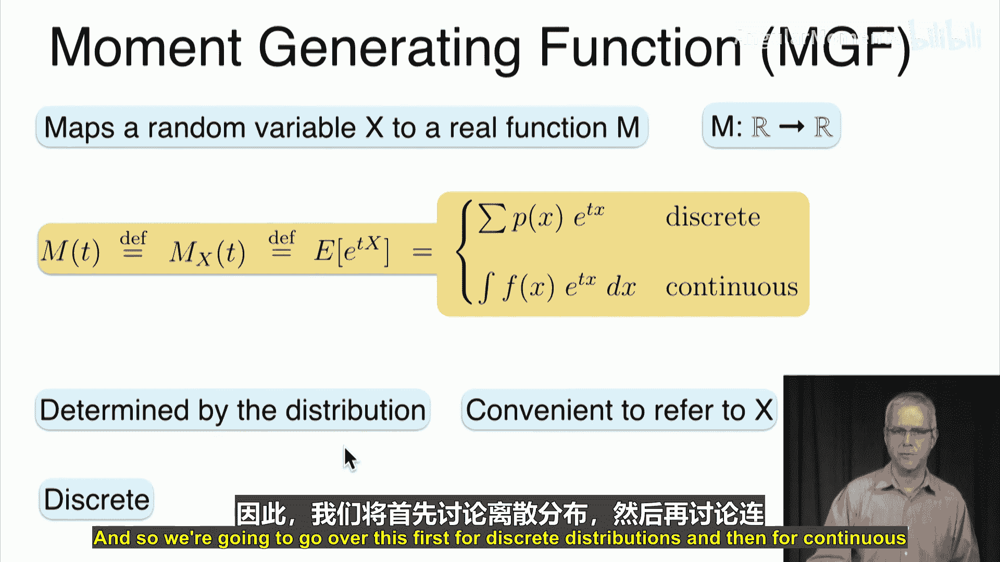

So let's start with the squ distribution with very few values and the fewest number of values possible is one value so we have a random variable it's constant so x is just c for example x is 5 or 7 and so on so what is the moment generating function m of T it's the expectedant value of e to the Tx which is summation of p of x e to the Tx and in this case x will take only one value。

 which is c so it's going to be p of c is going to be1 times e to the Tc so it's e to the Tc or which you can also write it e to the C and you notice it's not so surprising because we're looking at the expected value of e to the Tx x is a constant so e to the Tx is just e to the Tc is a constant its expectation is again e to the Tc or e to the cs rule right and so for example if we're looking at the constant 1。

 then the moment generating function is。to be e to the t。

 which is drawn here and if x is a constant minus2。

 then the moment generating function and minus2 of t is going to be e to the minus2 T e to the city where c is minus2 e to the minus2 T and as you can see the moment generating function is always non negative and at0 its' value at 1 is 1 willll come back to this properties just want to point them out here。

Okay， so moving from one value to two values， if we have two arbitrary values， so for C1 and C2。

 C1 happens probability P1。And C2 happens for ability P2， not C2， p2， and P1 plus P2 have to add to1。

Then the moment generating function， which is the expected value of e to the Tx is going to be p1 times e to the c1 t right it's p1 times e to the c1 t plus p e to the c2 T and here if p if the two values are1 and minus1 c1 and c2 or1 minus1 h happens is probably1 half then the moment generating function will be1 half e to the minus t plus 1 half e to the t which looks like that again a negative and at0 it1。

And of course we have two value variables that are our favorites。

 those are the sorry the benoular random variables， they have value 0 and 1。

 and so if x is distributed benoli p then p1， the probability of 1 is p and p0 is 1 minus p。

 then mt is going to be1 minus p times e to the t times 0。

 that's e to the tx when x is 0 plus p times e to the t1 here x is 1 and so it's equal to 1 minus p。

This is1， so it's1 minus p plus R p times e to the T and1 minus p again comes because we have summation of px e to the T x。

 but here x is 0。 So this becomes a constant。 This just becomes1 minus P and then plus e to the T。

Right good okay so now that we have seen some very simple examples of moment generating functions。

 let's look at some of the properties and as we said the positive mt is the expected value of e to the Tx E to the t E to the any number is bigger than 0 so the expected value of a positive number of positive random variable is also going to be positive so it's always going to be bigger than 0 and furthermore if you plug in m of 0。

 then you get e to the 0 x， which is e to the0 and expected value of e to the0 is one。

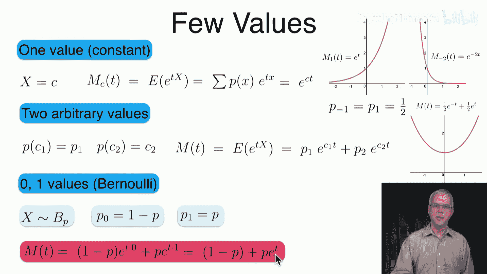

So these are two simple properties， we're going to see some more interesting properties now。

 so translation and scaling。So first translation， if you take a random variable x and you move it to x plus B。

 then what is the new moment generating function， so mx plus b of T is the expected value by definition of E to the Tx。

 but now x is x plus b to the Tx plus B， which you can write it is the expected value of e to the Tx times e to the Tb。

Now E to the TBb is a constant， we can take it outside the expectation。

 so it's e to the TBb times the expectation of e to the Tx。

 but the expectation of e to the Tx is just the moment generating function of x。

 so it's e to the TBb times the moment generating function of x so in other words if we translate x if we add to it B。

 then the generating function it just gets multiplied by e to the TBB。Okay。

And we'll do an example at the end of this slide。If we scale。

 that means we take x and we multiply it by a constant， let's say a。

 then what is the moment generating function of the new random variable Ax by definition。

 it's the expected value of e to the T times the new random variable which is ax and which can write it as the expected value of e to the a times Tx。

Right which we can write as this is the moment generating function of x at the point at because the moment generating function of x is the expected value of E to the Tx and here we're evaluating A so it's a moment generating function of x at A。

 So in other words if we take x and multiplied by a constant A。

 then the new moment generating function is the same as the all just evaluated instead of a T at a times t。

And now we can combine these two properties so if we have both translation and scaling。

 namely x becomes ax plus B， then what is the new moment generating function of ax plus B well we can apply to these two operations sequentially。

 so first its going to be we see we can take ax and we add B so it's going to be the moment generating function of AX times e to the BT because we just took aX and we translate by B so multiply by E to B like that。

and then we need to calculate the moment generating function of a。

 and that we saw here is the moment generating function of x evaluated at。

 so it's going to be e to the Bt times the moment generating function of x evaluated at。

So that's the general rule and let's see an example。

 so we know that if we have a constant random variable C。

 then the moment generating function is e to the city。Now let's both translate and scale C。

 So instead of C， we're going to look at AC plus B， just like we did here ax plus B。

 except now x is a constant C so what is the moment generating function of AC plus B Well if we by using this formula it's going to be E to the BT times the moment generating function of C evaluated A0 like this but the moment generating function of C at A0 is just E to the C times80 so it's e to the BT times E to the C8 that happens to be an animal so which we can write as e to the we can take T out so we get AC plus B times T。

Okay。So and this， of course， we would have known because this is a new constant AC plus B and the moment generating function is just going to be e to this。

To this new constant， AC plus B times t， and we just showed that you can get it also by translation scaling。

All okay so we now talked about operations in a single random variable now let's see what happens to two random variables。

 so first addition， so we'm going to consider independent variables and will'll show that the moment generating function of the sum of independent variable is the product of the moment generating functions。

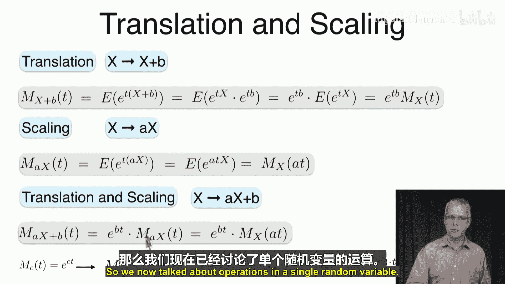

Specifically， if you take two variables， x and y and are independent。

 then we'll show that the moment generating function of x plus y is the product more of the moment generating function of x times the moment generating function of y so let's just show it it's very simple。

 the moment generating function of x plus y T is the expected value of e to the T times x plus y。

 that's a definition of the moment generating function which is e to the Tx times e to the Ty right。

Here， but now notice that these x and y are independent， therefore the powers are independent。

 and the expectation of a product of independent variables is the product of the expectations。

So this is the expectation of e to the Tx with e to an expectation of e to the ty。

 but the expectation of e to the Tx is the moment generating function of x and this is the moment generating function of y so its the moment its just like we said the moment function of x multiplied by the moment generating function of y so we see that we have a very nice property if you take two independent random variables you add them the moment generating function gets multiplied。

And it generalizes to n variables the same proof if x1 up to x and are all independent of each other。

 and define x to be the sum。Then the moment generating function of the sum is just going to be the product of all the moment generating functions of the individual。

Rin of variables。And if you take the average， if you define x average， so again。

 x1 up to x are independent and define x average to be just their arithmetic average。

Then the moment generating function is the moment generating function of these。

 but what happens is we then divide by n。So we just get the product so you can write it as。

The problem that I'm sorry the moment generating function of x1 over n plus x2 over n up to xn over n and each one by the property we had before is just the moment generated function of Xi the evaluated t over n and then we just take the product so we see that here。

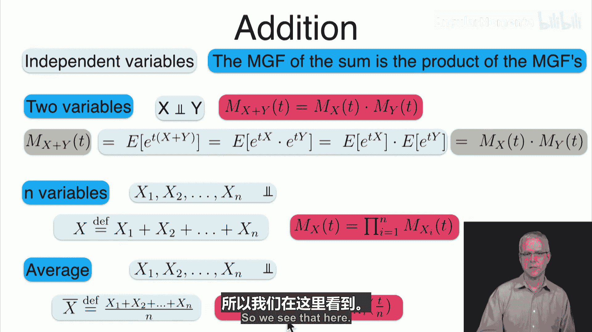

Okay， alright， and now。The main property of moment generating function。

 as we said is that it can help us generate all the moments。

 so as we said the expected value of x and is the moment of x so sometimes called and and row moment of x and the moment as well should see the moment generating function determines or generates all moments of x and so once you have it then you can find all the moments so you need to maybe work a little a little bit to get the moment generating function but once you do it everything becomes relatively easy and sometimes you do need to work hard and in fact this is the lecture in which we're going to work hard but in the next two lectures we're going to benefit from this and we'll be able to derive very strong bounds on the values of random variables。

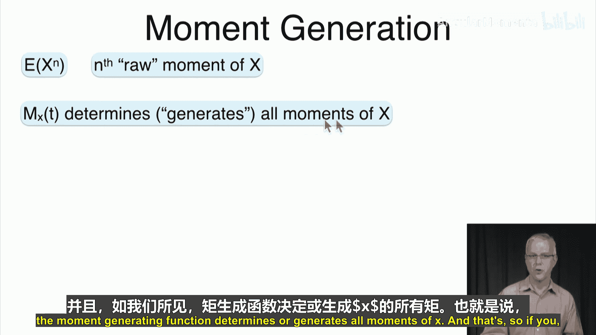

So。So what that would mean， what do we mean by saying that the moment generating function determines all moments of x。

 it means that the expected value of x， which is the first moment， is just the derivative of the MGF。

Evalu at zero， the expected value of x squared is the second derivative of the MGf， evaluated0。

 and more generally the expected value of xn is the n derivative of the MGf。Of x evaluated at0。

 So to see why observe that the MGf of x is just the expected value of T。

X and now remember the expected I'm sorry remember that e to the y is1 plus y over1 factorctorial plus y square over two factorctorial and so on this is the Tayloror expansion Y cube over3 fctor so what we have here is the same but just y we're placed by Tx so that's going to be the expected value of1 plus tx divided by one factorctoral plus t x squared divided by two factoral。

 which I'm writing is t square times x squared divided by2 fctoral plus tx cube which I'm writing is t cube by x cube divided by3 factoral and so on and by the linearity of expectation this is going to be1 plus and the fact that d are constants。

 it's going to be 1 plus t over1 factorctoral times the expected value of x plus t square over two factorctoral times the expected value of x square and so on and when you write it like this you can see that the mgf actually hides all the expectation。

 all the moments， the expected value of x the expected value of x squared and so on。

SoAll we want to do is just recover them and the way we recover them is we're going to take derivatives when we take and then let plug in t equal to 0。

 so for example if we don't take any derivative and plug t equals 0。

 all these will disappear because we have T T squared t cube。

 they'll all disappear and will be left with one， which is the expected value effects to the0。

If we take one derivative1 will go away， this will become1， just e to x， and here we'll get 2 t。

 we'll get terms with t in them， such that when we plug t equal to 0， they'll all disappear。

And if we take the second， so we'll be left with the expectedative value effects。

 if we take the second derivative， well this will go away。

 this will go away because we're taking two derivatives of t。

And this will come first will become 2 t and then we differentiate again， we'll come 2。

 we'll cancel with 2， and we'll just get the expected value of x square and all the remaining terms because we have higher powers of Rt like t cube and so on will take the second derivative。

 there'll be t in them factors of t。 So when plug t equals to0。

 they'll become0 and we'll just have the expected value of x square。

So let's just see it in a slightly different way for the first and second moment because this is the main feature of moment generating function which is why we're defining it how we'll use it in the next lectures so just to make sure that we understand it a little better。

 let's do the first two moments and see what happens so if we take the derivative of the MGF just wait in here D to the T of the expected value e to the Tx what we can spell it out。

 it's d to the DT of the expected value v to the Tx sumation of px E to the Tx which we can exchange the order of summation and derivative so it's summation of x times the derivative of px e to the Tx which is same as we can write pX takes the PX outside so it's summation of px times the derivative。

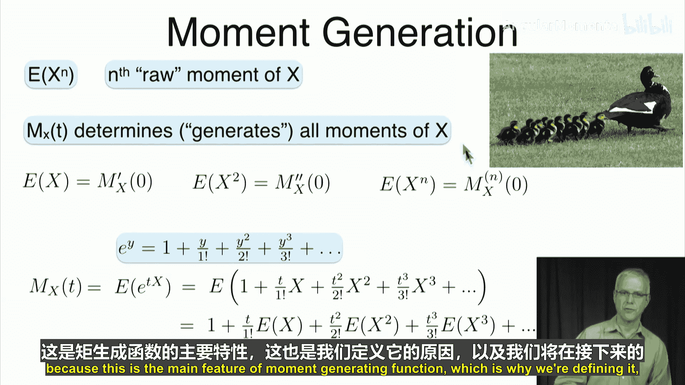

of e to the Tx， which is just the expected value of the derivative of e to the Tx。

 but what is that that we're just differentiating e to the Tx and Ts our variable x is a constant here。

 so it's the expected value of x types e to the Tx。Now plug in t equal to0。

 then we get the expected value of x times e to the0。Which is just the expected value effects。

And if we take the second derivative， it's the derivative of the first derivative here of the MGF。

Which is the derivative of the expected value of x e to the Tx。 which again。

 we can replace the expectation with the derivative as we have done here。

 it's the expected of d to the t of x e to the Tx， and this is just going to again were differentiateiating with respect to T so x is a constant for us。

 so it's going to be x squared times e to the Tx。And now we're plugging in t equal to0。

 so we get expected value of x squared times e to the0， which is the expected value of x squared。

 so we see that the second derivative of the MGF evaluated0 is the second moment。

Right and generally for any n which is at leastio， if you take the n derivative of the MGf。

 it will be the expected value of x to the n to the xt just like here。And evaluated the zero。

 and have to expect the value of x today。

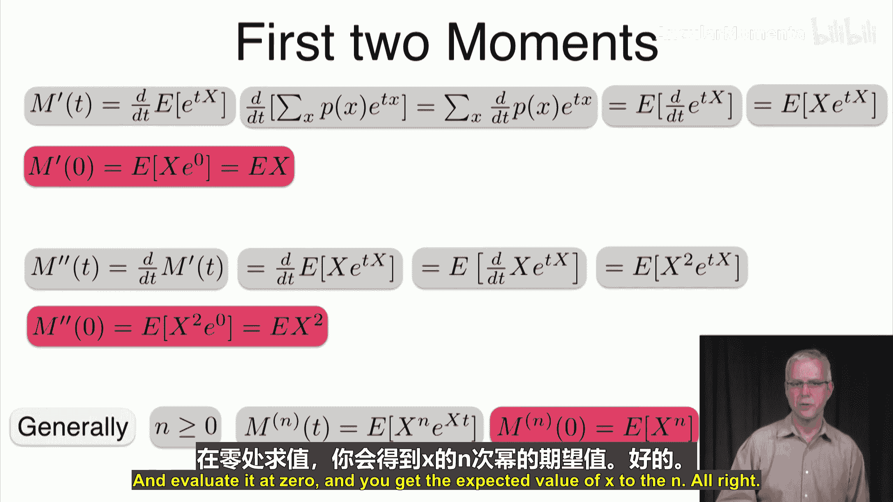

All right。So now let's calculate now the MGf of more general or more complicated。

Distributions and we'll also evaluate and see that we get the they will'll get the moment。

 so let's first look at the bi distribution BPN p is between 0 and 1 and n is bigger than equal to0 it's an integer and you recall the the probability of k is n choose k P to the K times 1 minus p to the n minus k。

And we're going to show that the MGf of the bi normalmal distribution is 1 plus p e to the t 1 raised to the n。

So。So the moment generating function of T is the expected value of e to the Tx。

which is sum of P of K e to the TK。Which is summation of P of k is just entries k， P to the K。

1 minus p to the n minus k times e to the Tk。And we can just write it as we can take here p to the K and e to the Tk。

 you can combine them to get p times e to the t raised to the K， everything else stays the same。

And what are we going to use now？Well we have sumation of interest k。

 something to the K and some and something else to the n minus k。 we're going to use the。

Binomial theorem that says that a plus b to the n is summation of entries k A to the K B to the n minus k。

 So here this is a。And this is B。 So what we'll get is PE E T plus 1 minus P raised to the n。

Which we can write like this as 1 plus p e to the t minus1 raised today。

Okay so this is the MGF of the binomial distribution and just to see。

 let's just see that we can recover the first moment to expected the value of x。

 so let's just remember that this is the moment generating function1 plus p E to the t minus1 raised to the n。

So if we take the derivative， we get that it's n。So we had one we had。

This is what we have1 minus p plus Pt raised to the n， we take derivative。

 we get n times this value raised to the n minus1 instead of n times the internal derivative of P E to the t。

 and that's just going to give us p times e to the t。行。AndSo now we want to evaluate it at 0。

 so a t equals to0， so what we get here is n， and then here we get p times e to the0 plus1 minus p。

And this will give us p plus 1 minus p which is this1，1 to the n minus1 is this 1。

 and then we get here p times a to the 0 which is again1。

 so we get n times 1 times p times 1 which is np so we see that if we take the first derivative evaluated at0。

 we get the expected value of x and it could continue and take now the second derivative and evaluated at 0 and youll get the expected value of x squared and so on and if you want it's not that hard to do that so next let's look at the poisson distribution。

So the Poisson distribution P Lada for lambda bigger than0 is defined by e to the minus lambda lambda to decay over the k vectorial。

And the moment generating function， we're going to show it e to the lambda times e to the t minus1。

Okay， so let's calculate the moment generating function at T is the expected value of e to the Tx。

 which is the summation of p probability of k times e to the Tk。

which is summation of e to the minus lambda Lada to decay over k factor like this times e to the Tk。

which we have here lambda to the K and e to the T K。

 so we can write here as a mentioned and we can now replace this by lambda e to the T。Race to the K。

 So now you see this looks almost like a Poisson distribution。 Okay。

 because they have summation of e to the minus something times something to the K over a k factor。

 The only thing is that this minus something is not the same as this one。

 So what we do is we can write it as we can multiply it by E。By e to this value。

 e to the lambda e to the T。E to lambda e to the t minus lambda and so and what we'll get here is e to the minus lambda et T okay because when you multiply this by this。

 then the e to lambda E T will cancel and get e to the minus lambda which you have here。Okay。

And now what you have is that here you have e to the minus some value lambda8 and you get the same value here。

 So now this is a Poisson distribution and with sum to1 and what you'll be left with is e to the lambda 8 minus-1。

Okay。Like that， Okay， so we want to show all right， okay so。

Now you recall that the biommal distribution converges to the Poisson。

 so you may ask whether the MGF of the biommal distribution will converge to the Poisson and indeed it does and we'll show it in a few slides。

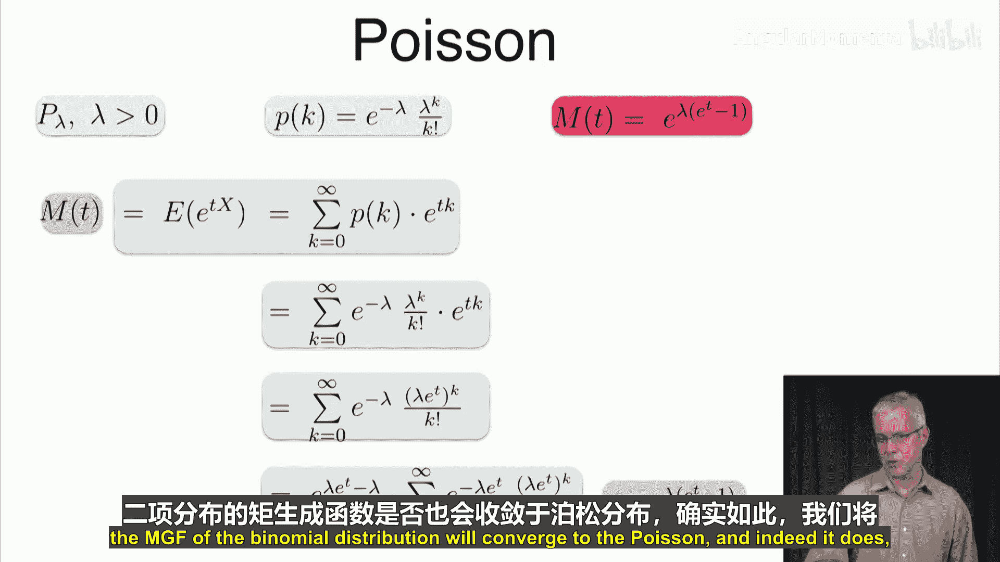

Okay， next let's look at the continuous distribution， the normal distribution。

 so if you have the standard normal distribution， normal01。

 then the distribution function is one of a squared of2 pi e to the minus x squared over 2 f of x。

 and we're going to show that the moment generating function is e to the t squared over 2。

So what is it， it's the expected value of e to the Tx。

Wwhich is the integral for minus infinity to infinity of a to the Tx f of x dx。

 and I'm going to just instead of the integral minus infinity to infinity。

 I'm going to omit the limit and just write the integral。

So it's going to be the integral of e to the Tx times the Pdf e1 over squared of 2 pi e to the minus x square over 2。

Okay and now we can combine the exponents so and take the one over squared of 2 pi out。

 so it's one over a squared of 2 pi times the exponent and what we have minus x squared over 2 plus tx。

 which is what we have here and this looks awfully close to s square。

 so we're going to complete the square here。And we do it by subtracting t square over x。

 so we have e to the minus x square minus 2 tx， and then we have minus t square over 2。

 which becomes plus so it's e to the minus x minus t square over 2 because we have minus t square and then we have to add the t square plus t square over 2。

So it's the one over square of two pi times this exponent。

E to the t square over 2 does not depend on x so we take it out。

 so it's e to the t square over 2 times1 over squared of 2 pi。

 the integral of the exponent of minus x minus t square over 2 tx。

 and this of course is the integral of the standard normal distributions so this integrates to 1。

 so gives this e to the t square over 2。And what if the this normal distribution is not standardized。

 not is abnormal， so to speak， so standard normal we just saw these normal01。

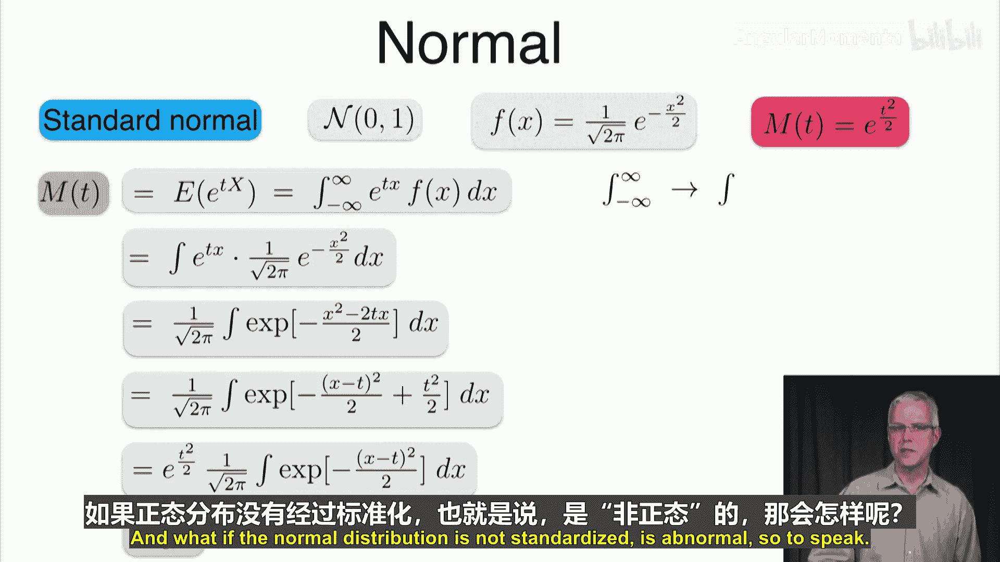

TheMGf is e to the t square over 2， and for general normal distributions。

 x is normal with mean mu and variance sigma squared。

 we won show that the MGf is e to the mu 2 plus sigma squared t squared over 2。Okay， so x。

 you can write a sigma Z plus mu。Because x is the menu and R variance sigma squared。

And then the Mgf of x is therefore the Mgf of Az plus B。This was the standard norm。

And we had a formula for the moment generating function of translation and scaling。

 and we saw that the moment generating function of Az plus B through slides ago was e to the BT times the moment generating function evaluated at A times t。

Okay， so we can just do that， so here B is mu。Okay， so， so here be is mu。

 So it's e to the muie and and a is sigma So we have times E times e to the sigma square t squared over。

2， because we have at okay and a is sigma so it's so we just plug in here。

 sorry we just plug in here instead of T， we write sigma t okay， so sigma square t squared over2。

 which is the same as e to the mue plus sigma square t squared over 2。Okay。

 which is what we want to show。All right， so so now we have found the moment generating functions of essentially all the distributions that we'll need and you can check that if you wanted。

 for example， here you could take the derivative of this function and evaluate it at t equal to zero and you'll get the expected value of x which is mu and if you took the second derivative and evaluate it at0 get the expected value of x square and so on。

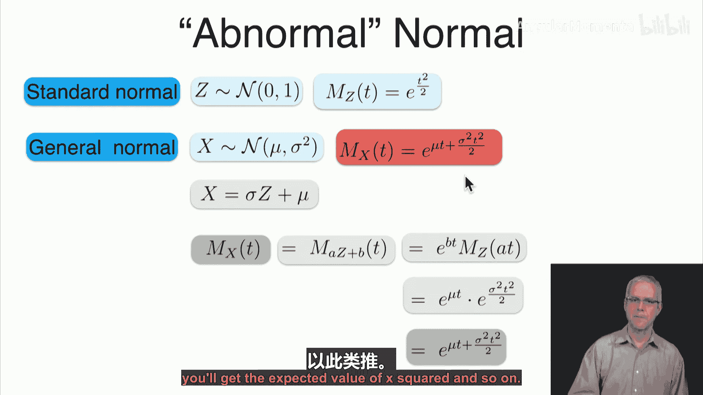

So then let me just speak， mention a few more general properties of moment generating functions。

 I'll mention them informally first is that if x and y have the same moment generating function。

 then they have the same distribution。So not only if they have the same distribution。

 clearly they have the same MGF， but the converse also holds， namely if they have the same MGF。

 then they also have this essentially the same distribution。

 they could be off by finite if they're continuous they could be off by some countable number of points。

 but otherwise they should be the same。And also you can invert the moment generating function to observe to obtain x because of this property because if x and y。

Are different they have different generated MGfs if， so you can invert the MGF to get x。

 and again this is an informal statement because you can get up x up to like few points that you may be off。

And finally， if you have a sequence of random variables。

 Xn and the moment generating function converges to some moment generating function of random variable x。

 then the distribution Fxn will converge to the distribution F of x。

Right so with and just for the last property， I just want to show an example of this a sequence of random variable variables that converge to x and showed that the same holds for both the distribution and the moment generating function so let's look at Poson by no by normalmal distribution Bpn of k。

 this is the probability is n k p to the k minus p to the n minus k and poisson distribution distribution e to the minus lambda lambda over k to over k vectorial now for the and we know that we' have actually shown that if you take the distribution with P which is lambda over n and n values so that pn is lambda then as n increases this will this will converge to p lambda to this value here Now if you look at the moment generating function。

 we saw that the moment generating function of the binomal。

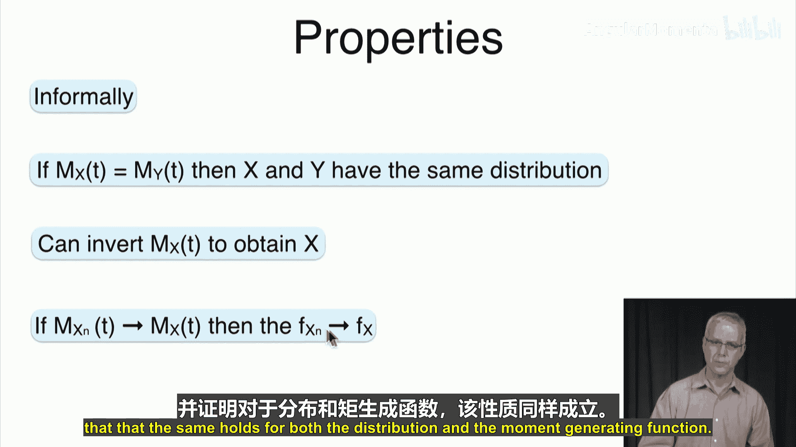

For PN N is 1 plus P E to the。E to the t minus-1。 the whole thing raised to the n and we also saw that the moment generating function of the poisson is e to the lambda e to the t minus-1。

 So a very natural question to ask is if if these distributions the bi normalmal distribution converge to the poisson is it also true that the moment generating functions of the bin will converge to the moment generating function of the poisson is it true that the moment generating function of by normal parameter lambda over n and n we converge to the moment generating function of the poisson parameter lambda and that is indeed the case and we'll see it right now so recall that the definition of E is 1 plus1 over n to the n as n goes to infinity and if we have one plus a over n raised to the n we can write it as1 plus a over n to the n over a raised to the a so we divide and multiply by a Now here the internal part is just what we had here it's1 plus1 over some quantity n over a raised to that。

Quality N of A。 so the internal part will converge to E and a is just a constant。

 So what we'll get here is E today。Okay， and using this property。

 we see we can evaluate this take the moment generating function of the binnoal1 plus。

P E to the t -1， but just plug in p， which is lambda over n。

 So one plus lambda over n times E T e to the t minus1 raised to the n and what we have here is just one plus some quantity。

Over n raised to the n， which is what we have here1 plus a over n raised to the n。

 and as we saw here it will converge to e to， so this will converge to e to this quantity。

 which is lambda times e to the t minus1。And that is exactly the moment generating function of the Poson lambda e to the lambda times e to the t minus1。

 so we see that the moment generating function of the binomial will converge the moment generating function of the poisson So with that we talked about the moment generating function。

 we describe what moments are， we said that a single function can determine all of them and that's the moment generating function or MGf。

 we define it， we give some examples we describe some of its properties and next time talk about the chain of lamb。

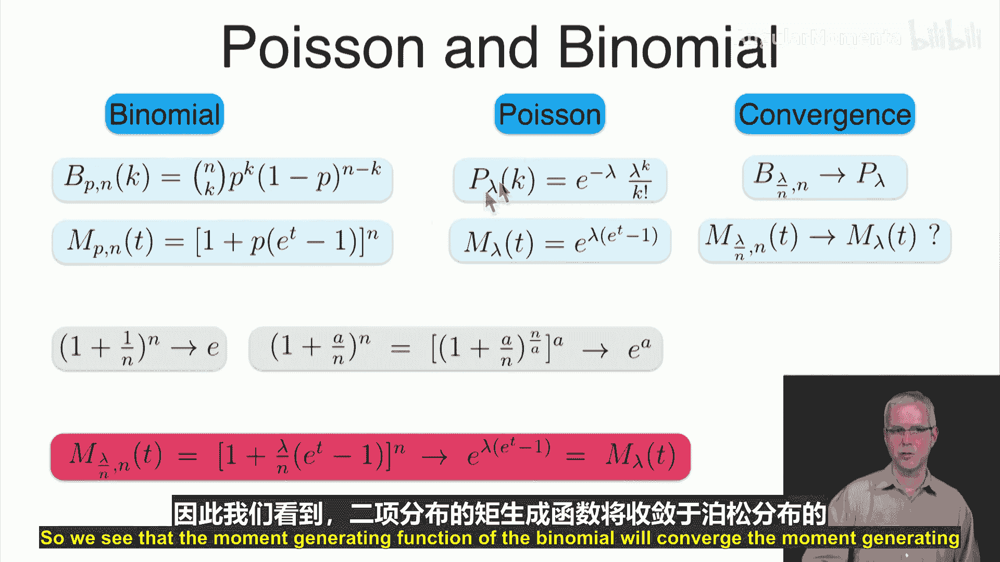

笑定。