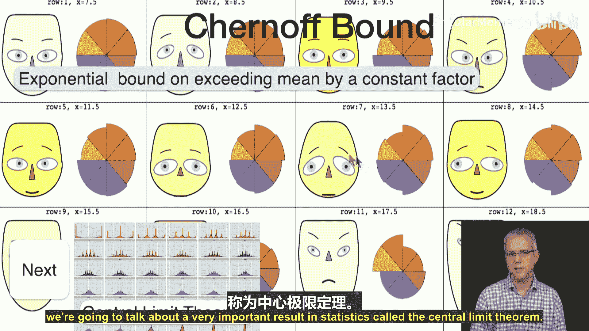

# 【加州大学圣地亚哥分校】使用Python进行数据科学中的概率与统计--Probability-and-Statistics-in-Data-Science-p45-11-05-03-切尔诺夫--BV1gJFDzkEPg_p45-

Hello and welcome back In previous lectures we talked about the Moov inequality and the Chebyev inequalities。

 both of them bound the probability that an element is far away from its mean and what we want to do in this lecture is talk about a significantly stronger bound called the Cherernov Bo the bound is named after Heman Chernoff who finally get to someone who is still with us today is born in 1923 is na4 years old。

And。And here's a statistician。😊，He worked at Illinois at Stanford。

 MIT in Harvard and is well known for taking a broad views of statistics and for example。

 he said that years ago statistician might have claimed that sta deals with the processing of data。

 but today's statistician we likely say that statistics is concerned with decisions in the face of uncertainty。

 and he definitely worked on different aspects of this issue， today we'll talk about one。

 which is the churn of Bo， and interestingly enough， we have talked about Markco。

And Chebiheev so when the churnov bound came around people thought should be spelled churnov like the other two。

 but well you now they've spelled it correctly and another thing that is well known for the churn of faces that we saw in the title slide and what he said was that if you want to display high dimensional data say data in you know I don't know maybe seven。

 eight dimensions it's impossible to display so one way to do it is he thought is represent it as features of a face because we are all familiar with faces and so we might be able to to understand the different dimensions and so you represent the data is for example the height and the width and the angle of different features like the eyes or the nose and the mouse of the face and that way you can represent different dimensions this for example representation was done by statistician called Steve Wang and。

represented baseball managers based on their performance and you can see here the performance。

 the features that correspond to each performance that was measured and how it's reflected by the height and the width and the angle and so on。

 and this is taken from an article about that in the New York Times。All right， so。

So back to slightly less interesting churn of bound so again we have a random variable x which is the distributed renewalnoulli with probability of success p and we have n samples so the mean is going to be p times n as we know and we want to bound the probability that x is bigger than one plus delta times the mean so for example maybe delta is 0。

1 so well want to bound the probability that x is bigger than 1。

1 times the mean now we have seen couple of bounds to do that but the somewhat weak for example if we look at the mark mark of inequality we'll say that this probability is at most1 over 1 plus delta so if delta is 1 will be at most1 over 1。

1 which is maybe 0。45 or something like that and so it's going to stay constant when n increases。

If you look at Chebychev's inequality， it will decrease but will decrease linearly with n。

 but we know that as the number of samples that we take increases the probability that will be bigger than 1。

1 times the mean should actually decrease fast or fairly fast and what churn of bound will show is that it decreases exponentially fast。

Okay。So and to prove it we'll again use Markovs inequality。

 we'll just use it in a different way so just likeev chbychev's inequality use Markovs inequality by square thing。

 squaring things to get a better bound will actually exponentiate things so notice that for every a and every T which is bigger than equal to0。

 x is bigger than equal to a if and only if t times x is bigger than t times a I'm just multiplying both sides by T and if I exponent both sides then that's if and only if e to the Tx is bigger than e to the T。

 so here there is no probability involved we just say that x is bigger than equal to a only if e to the Tx is bigger than e to the T for all T which is non negativegative。

Now。Therefore， the probability that x is bigger than equal to a is going to be equal to the probability that e to the Tx is bigger than equal to e to the TA。

And now we can apply Malovs inequality and we'll say see that that's at most the expectation of e to the Tx divided by e to the T that's the Malov inequality that we had probably that some renewable variable say y is bigger than equal to some value is that most the expectation of y divided by the value。

 and here we have the expectation of Tx。A divideiv by to the T。

And so so what we see is that the main feature that we need to evaluate here is just the expectation of Tx because then that will give us the bound that we want and that's what we're going to do in the next few slide we're going to evaluate it then we're going to bound its value and then we're going to incorporate in here and then we're going to simplify the result so we'll have a few slides like four or five slides about this but hopefully at the end we'll see a proof that we know how to prove this fairly strong bound that we'll get so first we need to evaluate the expectation of e to the Tx and doing that is exactly the same as the moment generating function that we saw so if you remember what we didnt we can actually skip the slide but I want to have this presentation be self-con so we're going to go over this again。

So x is distributed at the beernoulli RpN， and then we can view x asation of Bernoulli it x is bin noial PN。

 can view x seation of n Bernoulli random variablexi。

 where hxi is Bernoulli P and they're independent。And therefore the expected value of e to the Tx is the expected value of the summation of t times the summation of X。

 and we put the T inside， so it's the expected value of E to the summation of Txi。

Okay and now the Xs are so it's the expected value we can write it as the product of e to the Txi right E to the summation is the product of the E to the Txis。

 and because the Xs are independent the E to the Txi are also independent and therefore the expectation of the product is the product of the expectation so this will give us the product of the expectation of e to the T X okay and this is what we want to evaluate it now。

 so the expectation of。E to the Txi is， as we know it's just the probability that X is 0 times e to the t0 plus the probability that X is 1 times e to the T1。

And the probabilityity that X I 0 is 1 minus p。 and we multipplly it by P E to the T。

 and then we have plus P here hiding a little bit to the right plus P times E to the。

Plus P E to the DMm here。And therefore， we can just replace this by 1 minus p plus p E to the T raised to the nth power。

Okay。So expectation of e to the Txi is 1 minus p plus p to the T。

 which we have here and raise it to the n power。Okay。

 and therefore we can now get that the expected value of e to the Tx is equal to 1 minus p plus p to the t。

 that's the expectation of hxi raised to the n power okay so this is the expectation of e to the Tx and that's exactly what we calculated for the moment generating function for the bi normalmal coefficients I'm sorry for the binormal distribution。

And now what we would like to do is we would like to bound this value okay。

So we just showed that the expectation of e to the Tx is 1 minus p plus p to the t raised to the n power。

 and we want to bound it， so notice that  one minus p plus p e to the t。

We can write as we can take the P out， so we get one plus。P times e to the t minus1。

But what we have here is one plus some value which maybe we would call x and we know that1 plus x is less than equal to e to the x。

 you can see it by just trying the function1 plus x here in blue when e to the x e to the x is larger or you can see it by writing e to the x S1 plus x plus x over 2 and so on and that's going to be bigger than equal than just1 plus x and therefore1 plus x is less than e to the x。

So what we have here is one plus this quantity， it's going to be less than equal to this to that quantity。

 which is e to the p times e to the t minus1。Okay and so now we have this quantity raised to the n。

 so it's going to be less than equal therefore， each to the p times e to the t minus1 race to the n power。

Now E to the A raised to the B' is， e to the A B， so this is going to be e to the P and P。

Get an inside NP times e to the t -1 and NP we have a binomial distribution so NP is just mu so this is e to the mu times e to the t minus1 so we get that the expected value of e to the Tx the moment generating function of the binomial coefficient sorry biomial distribution Eval T is at most e to the mu times e to the t minus1 Okay so this is what we'll just write here。

The expectation of e to the Tx is at most e to the mu times e to the t minus1 okay remember we wanted to bound this to get to so we can plug it in in the markov inequality Okay so okay。

 so this let's look at this and we are going to what we're going to do is going to optimize over t。

So actually， I'm sorry before that， let's incorporate Markovs inequality and then we optimize so x is distributed bi noial Pn。

And we saw that for all a and for all t， which is bigger than equal to0。

 the probability that x is bigger than equal to a is the same as probability of e to the Tx is bigger than equal to T because x is bigger than a is the same as e to the tx bigger than e to the T and using moovs inequality that's at most the expectation of e to the Tx divided by e to the T that we saw in the first slide when we of the proof and now what we have shown is that the expected value of e to the Tx is at most e to the mu。

Times e to the t minus1， that's what we have just shown and so we're going to combine this with that and get the probability that x is bigger than equal to a is at most this value e to the mu e to the t minus1 divided by e to the T。

Okay and we can just write it slightly more nicely first actually we're going to evaluate this for a which is 1 plus delta times v。

 for example 1。1 times times the mean and so on， so if we plug it in we get the probability and this is for delta which is bigger than equal to  zero。

So we get it for all t begin then equal to 0 like this。

 the probability that x is bigger than 1 plus delta mu and remember one plus delta mu is just a is going to be at most e to the mu times e to the t minus1 divided by so this is the same and now instead of a we are writing  one plus delta mu so we have divided by e to the mu times 1 plus delta t so1 plus delta mu times t from here。

Okay， and this way can express slightly more nicely as E to the mu。Times e to the t minus1。

 minus t times 1 plus delta。Okay and now this is true for all T。

 so what we can do is we can optimize over t and get the best bound we can by choosing a T that will minimize this exponent。

 can make it this most。Okay so this one for next， so just repeating we have seen that for all t bigger than equal to 0 the probability x is bigger than1 plus delta times mu is e to mu times this quantity e to the t minus1 minus t times1 plus delta which you want to optimize over t so want to find a t that will minimize f of T。

 which is this quantity here e to the t minus1 minus t times 1 plus delta。

Okay and how do we minimize we just take the derivative with respect to T。

 Well actually first let's maybe plot this So it looks like this， this is for one value of delta。

 but we'll look the same for anyelta delta that you choose So this is f of this is f of T as a function of T and we want to find the t that will minimize this value of someplace here Okay so。

And you can see that why this is all right to。T minus1 minus t times1 plus delta like that。And。

And so。We take the derivative。And we get that the derivative is going to be e to the T。From here。

 and then minus1 plus delta we equ to0。And so this gives us e to the T， which is  one plus delta。

Or in other words， we get that t is La of 1 plus delta and if you want to check that it's the minimum。

 not a maximum， you either can view it from the picture here take a second derivative and you see here it'll just get e to the t this will disappear。

 which is begin equal to zero， so this is a local minimum。In fact。

 the global wind because there's only one solution so now we can just plug it in here and we get that the probability that x is bigger than 1 plus delta mu is e to this quantity e to the mu times e to the t minus1 minus t times 1 plus delta but very nicely e to the t1 plus delta so we get here 1 plus delta minus1 which is delta okay that's right so it's e to this gives us delta and this gives us t which is la of 1 plus delta so you get minus1 plus delta times la of 1 plus delta。

Okay， so this is the lowest value when we optimize over all Ts。

And what we want to do next is just evaluate this and simplify this quantity so this is essentially the bound we just want to write it in a slightly nicer way。

 so we do the final simplification so this is what we wrote the probability that x is bigger than1 plus the delta times the mu is at most e to the mu times delta minus1 plus delta n of 1 plus delta。

Okay， and now we want to simplify this， so if you're going to use the following inequality that la of 1 plus delta is bigger than x divided by 1 plus x over 2 for x。

 which is non negative okay so this is we're going to apply it here at La of 1 plus delta。

And to show this you can just take and here you can see because this is going to be linen of 1 plus x and this is one over this is x over 1 plus x over 2。

 you can see from here or you can prove it so we define f of x to be the left hand side minus the right hand side and then again we take derivative and we show that this is bigger than equal to0 for x bigger than equal to0 so first observe that at0 it is0 because f of0 is la of 1 minus minus0 over 1 and line of 1 is 0 so this is0 and we also show that the derivative is not negative so f the derivative is1 over 1 plus x minus this derivative which are what here。

Okay， and when you evaluate it， it gives you it's a little bit behind the picture。

 but you can see that it's no negative。And then。Okay。

 and that tells us that f of x is beginning to equal for all x， which is acl zero。

 and now when we we can just replace， therefore， we can replace none of what we have is  one plus delta。

L linen of 1 plus delta here， so delta minus 1 plus delta line of 1 plus delta is going to be less than equal。

 we have delta and then we have 1 plus delta， but instead of line of 1+ delta。

rite Dlta of over  one plus delta over 2 because here we see that it's smaller。

 so if we subtract a smaller number we'll get a bigger difference。And then when we open this up。

 we get take deelta out， so we get1 minus。1 plus delta over one plus delta over two okay and then multiply everything here by two。

 So you get here2 plus delta and here we have one plus one plus delta。

 So we have here2 plus delta and here we get。So we have Delta outside and we have two plus Delta。

And minus-2 minus-2 delta and the two cancels and we get minus delta square over 2 plus delta。

 so you can just check that this calculation is correct and when we we can then go back here and say that this therefore we showed that this expression here is bigger than minus delta square with 2 plus delta so this is going to be bigger than I'm sorry this is going to be。

Less than equal to e to the minus delta squared over 2 plus delta times me。And observe that。

A couple things， first of all deelta we can think of as being a small number so can maybe just ignore this for a second so it'll behave like e to the minus delta squared over2 mu and mu here。

 so mu is n times p so delta is for us a constant for example try and calculate the probability that were 1。

1 away from the mean delta is 0。1 so this is some constant and then mu is np so as n increases will go down exponentially within n。

So what we got there for is that x if x is berulli Pn and delta is bigger and equal to0 then the probability that x is bigger than the mean by a 1 plus delta is e to the minus delta square over  two plus delta mu and again mu is NPp so this will go down exponentially in n and you can also prove the other direction that the probability that x is less than equal to 1 minus delta times the mean is at most e to the minus delta square over2 times mu in the proof is essentially the same and fact it's a little simpler sorry it's a little simpler as here you just get 2 rather than two plus delta so let's look at an example of taking a poll and finding the probability that the result will be incorrect so imagine that you have a population where 47% vote D and you take you poll 6000 people which is not a very large number as far as poll square and and let x be the number of people。

Voted for D。And so x is roughly distributed binomial with success probability 0。47 and which is 6。

000。🤢，It will be exactly binomial if you can pull the same person multiple times if you just pick a person and then pick another person could be the same and so on。

 they will be exactly that， but in reality it has more。

Because you will not pull the same person twice， it will not be exactly that it will have elements of the hypergemetric distribution coming in。

So now you'll be wrong if x is bigger if you'll get the result wrong。

 if x is going to be bigger than 50% of the number that you sample。

 because the actual number is 47 and you'll be wrong if the number that you'll get is more than 50% of the samples。

 which may happen because it's a random sample or if you get more than 3000。

And we want to bound this property。So what we see here is because x is distributed binomial with probability P and 6。

000， then mu， the expected number of people that you sample that will vote D is n times p。

 which is 6000 times 0。47， which is 2820。嗯哼。And now we are trying to find a probability that x is bigger than 3000。

And so were trying to find what is delta such that 3000 is going to be1 plus delta times mu because we can find the probability that x is going to be bigger than equal and 1 plus delta times me。

 so if 3000 is 1 plus delta times mu and mu is 20820 and 1+ delta is 3000 divided by 20820。

Which we can calculate， but we can also observe that we got 3000 by 6000 times。5 and 282820。

 which is the mean by 6000 times 0。47。 So 6000 will cancel。 and we get that this is 50 divide by47。

 which is roughly 1。0638。 Okay so this is the probability that the ratio that you get is。

The number that you get is bigger than the mean by this ratio of 50 over 47 because 47 is the mean and 50 is what you're worried about。

 so this is the ratio that we are concerned about 1。06。And this means that delta is roughly 0。0628。

Okay。😊，So now notice by the way， that if you try to use Malovs inequality。

 then you get one plus delta is 1。06， you'll say what is the probability that x is bigger than its mean by a fact of 1。

06 is going to be at most one divided by 1。06， which is a number like 90 some percent。

And so now the probability that you're wrong if use the churn of bound is the probability that x is bigger and equal to 3000。

 or in other words the probability that x is bigger and equal to 1 plus delta times mu。

 which as we have seen is at most e to the minus delta square over 2 plus delta times mu。

 and now delta we calculated to be roughly 0。606 to8。So when you plug it in。

 you get that this probability is a fairly low probability， it's roughly 0。38%。So you get a result。

 which is much， much stronger than the markov inequality and chbyishev inequality。Okay。

 so in other words， we talked about the churn of bound。

 which is an exponential bound on exceeding the mean by a constant factor。

 and we actually proved it and show how you might use it。

And next time we're going to talk about a very important result in statistics called the central limit Theor。

Seeing。

