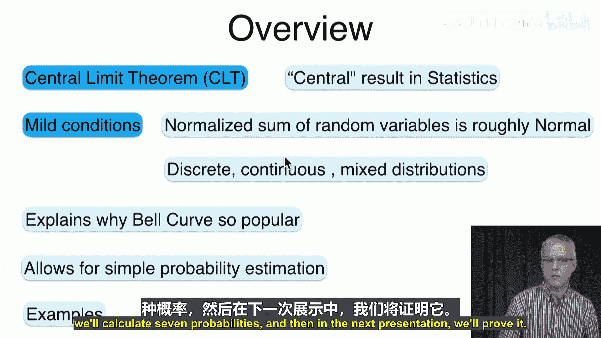
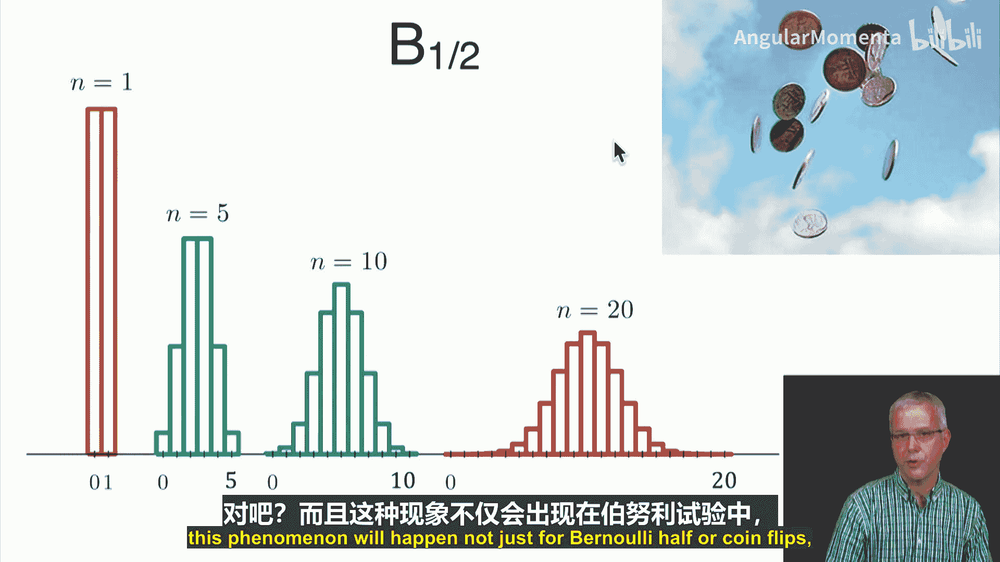
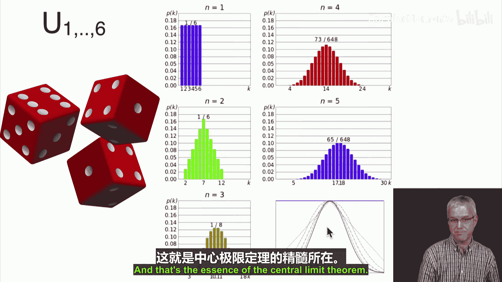
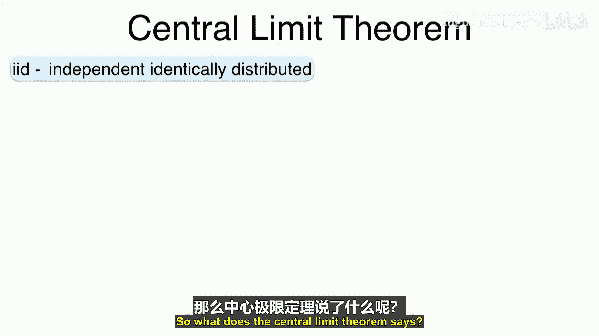
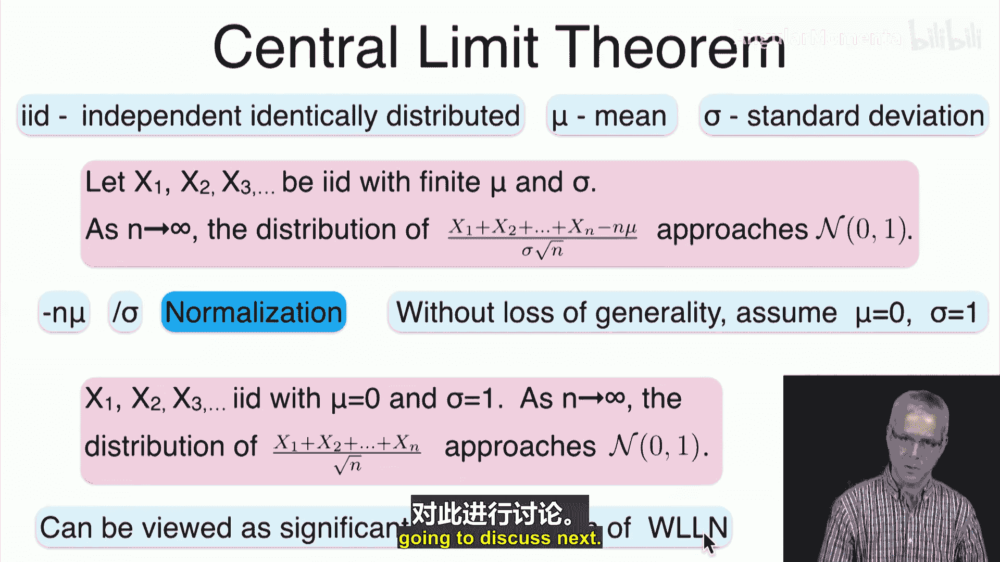
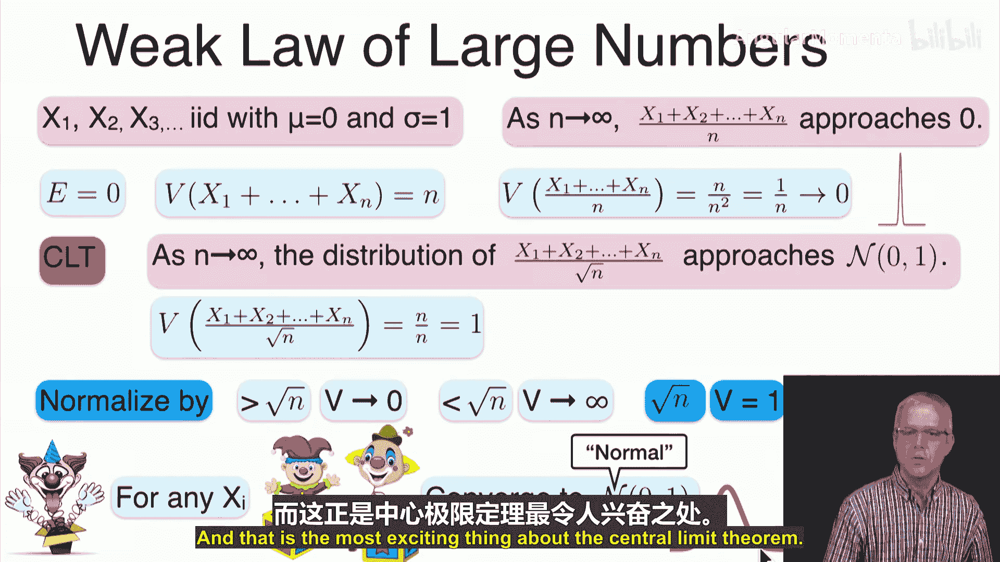
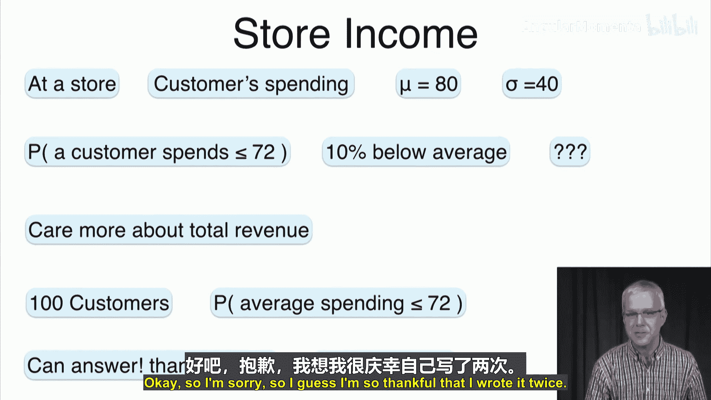
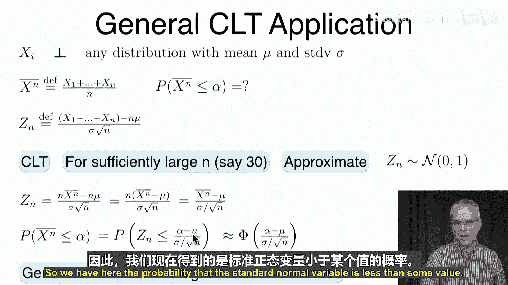
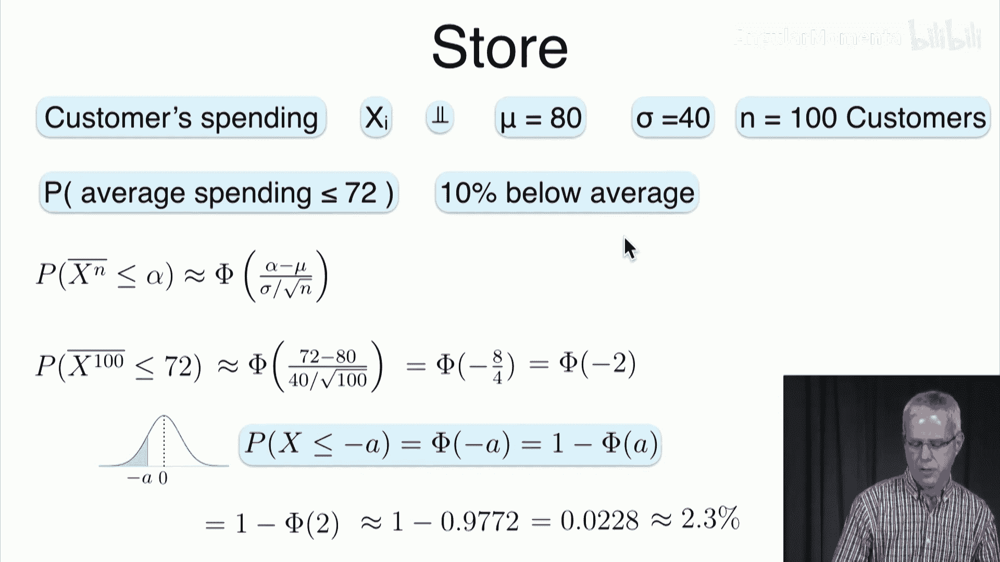

# 【加州大学圣地亚哥分校】使用Python进行数据科学中的概率与统计--Probability-and-Statistics-in-Data-Science-p46-11-06-03-文化语言学理论--BV1gJFDzkEPg_p46-

Hello and welcome back now that we have talked about several bounds on probability。

 we're ready to talk about one of the most important results in probability and statistics。

 the central limit theorem。So its a little bit of an overview。

 the central limit theorem which you abbreviate asclLT is one of the quote unquote central results in statistics its as that under very mild conditions the normalized sum of random variables is roughly normally distributed and this applies to all types of distributions that can be discrete。

 continuous or mixed distributions and this also explains why the bell curve is so popular and why we observe it in so many applications and it also allows as we're going to see for simple probability estimation of many events when we don't know the underlying distribution and what we're going to do is we're going to start with some examples now and we'll calculate we'll describe the central limit theorem we'll calculate certain probilities and then in the next presentation will prove it。

All right so first let's assume that we flip coins so our randomver is benoly half so if we flip a single coin here n is equal to one one coin then we get two possible values0 and1 and each one happens probably half that clearly does not look like a Gaussian now if we flip the coin five times and we see how many ones we got we'll get something that looks like this like the green histogram here and you can see that the highest probabilities for getting two or3 and then the smaller probabilities are for0 and for five0 heads and five heads and so on and if we flip the coin 10 times it will look more like a triangle like that the number of heads is going to range from zero here to 10 with five being the most likely and if we flip the coin 20 times the number of heads will range from0 to 20 and now this starts looking like a Gaussian。

And this phenomenon will happen not just for Bernoulli half or coin flips。

 it will happen for almost any distribution， so here is another one。

 say we roll a die or dice so if we roll a single die。

 then we have a uniform distribution between one and6， if we roll two dice and with sum the values。

 then the sum is going to go first the lowest value could be is21 plus1。

 the highest value is 12 and we' roll just two dis it looks like that and three dice it will go from3 to three times 6 which is 18 and we' look like this and like that for。

If we look four dice and five dice and eventually it will look more and more like a Gaussian and you see here that already for five dice it looks pretty much like a Gaussian。

 so it converges to a Gaussian very quickly and that's essence of the central limit there and these two examples for discrete distributions the same also holds if you have a continuous distribution here are three examples of continuous distributions。

 they're very different， this is uniform this looks like this it's not unal it has two bumps here and this one is very skewed。

 this one is not skewed at all but if you repeat it five times then this will look like that and you sum the values。

Then the uniform will look like this for the sum and for this one will get that and so on if you sum 30 times then you see that all of them look essentially Gaussian and effectively people say that if you have 30 repetitions then you can pretty much assume it's Gaussian there's no guarantee depends on a distribution but for most reasonable distributions you can see here there are many after 30 adding 30 independent samples you'll get something that is pretty much Gausian so and this holds not just for discrete or continuous distribution also holds for mixed distributions and here you can see very mixed distribution you have two spikes here at the end and then continuous distribution in between and when you go one sample two samples you see you'll get the middle value will be a little higher because you add this one plus this one yet this will come from getting this one first and。

One second or the left one second and the right one first。

 you'll get distribution and you can see here that when you go to like 30 or so then we'll start looking very much like a Gausian。

OkayAll right， so so what is the central limit theorem says it says that if you have so first of all we call that IID stands for independent and identically distributed and muux stands for the mean and sigma stands for the standard deviation and it says that if x1 x to x3 R and so on。

 we have a sequence of IID namely independent random variables。

 all of them have the same distribution， but we don't care what the distribution is we just care that this distribution has a finite mean and a finite standard deviation。

 which is denote by sigma。

Then as the number of samples that we take and goes to infinity。

 if we take this sum and we normalize it， you will say in a second how。

 then this normalized sum will approach a normal distribution with mean zero and standard deviation 1。

 and how do we normalize it in it pretty much almost the way you would expect it's essentially the way you would expect。

First of all， each of those Xs has mean mu， so we want it to have mean zero then we subtract mu from each random variable and we center it so we subtract n mu from the total and then each one has a standard deviation sigma so we also normalized by sigma we have done these things before and the only thing that is maybe slightly unintuitive although as we'll see in a second it makes a lot of sense is we don't divide by n but we divide by square root of n。

And when you divide by squared of， then it will approach normal with mean0 and standard deviation 1 and again we can already see it。

 we'll say it again later but just to observe it here， we take the sum， each one has mean mu。

 we added n variable so they'll have mean n mu so we subtract that n mu to get mean0 and then if we look at the variance。

 each one has variance sigma square。So when we add them up，'ll because they're independent。

 the variance will be n times sigma square and therefore we want to normalize。

 so we're normalize by the root of that， which is sigma times square rootta n。

 and we're going to say that in a second。Okay， so this is what we need to remember， take all of them。

 subtract the mean normalized by sigma and by standard deviation square of n we get something that is roughly normal01 as we have seen in the examples before。

Now notice as we said that subtracting n mu and also dividing by sigma is just to normalize for the mean and the standard deviation so these are just basic normalization so without loss of general we can just assume that we have random variables with mean0 and standard deviation 1 and that will make this expression look a little nicer and so we can talk about it a little more easily so what we have is that x1 x2 x3 or IID with mean0 and standard deviation1 as the number of sample go to infinity increases to infinity the distribution of now x1 up to xn we don't need to subtract the mean because the mean is0 normalize by square of n because sigma is1 approaches normal01 and as we saw in the many examples that we showed before typically the n that you'll need to get something which is close to normal is maybe 30。

Okay， and this can be viewed as a significant realization of the weak law large numbers as we're going to discuss next。

， so let's remind ourselves about the weak of large numbers。

It says that if you take ID random variables x1 x2x3。

 they have the same distribution that they're independent of each other with mean0 and sigma 1 it's more general but I'lying it to mean 0 and 01 and standard deviation 1 just so we can compare to the version we ended up with in the previous slide then as the number of sample increases if you normalize x1 up to x and normalize by n。

 it will approach 0 and so recall this means the probability that approaches 1。

 if you take any value， let's say 0。1， the sum will be less than 0。

1 with probability that will approach that will be approach 1 so this average approach 0 and the probability that you're off by any amount will also go to 0 the probability that you'll be as close to 0x1 will go to1。

All right。To see why this is so we proved it。 But again， as a reminder。

 the expected value of here if each X0， So the expected value of the sum is also 0。

 And how about the variance， the variance of the sum because each of them because they're independent and each of them has variance 1。

 the variance of the sum X1 up to x n is going to be n and therefore the variance of the normalized sum when we normalize by n is going to be n from this sum and now we need to divide by n square because the variance of。

A times x is a square times the variance of x， so we normalize by n square and the variance will become1 over n which approaches 0。

 So as the number of samples increases this and increases， it will look more and more like a spike。

 we have a zero probability that approaches one。Okay。

 now when we look at a central limit theorem on the other hand。😊。

Then we're not considering normalizing by n， but normalizing by square root of n。

 just a different normalization， and the central limit says that as n goes to infinity。

 this random verbal will approach normal with mean zero n variance 1。And so first of all。

 let's look at the variance of this as we went over this on the first slide。

 we just want to do it a little more。Rgorously， so the variance of we're looking at the variance of x1 plus xn divided by squared of n。

 the variance of the sum as we saw here is n， now we divide by squared of n。

 so we'll get divided by n， which is n squared of n squared and this will give us one。Okay。

 so now we have that this random variable will have mean0。 I see that before and variance  one。

 So that's okay。 and that maybe is。Not so surprising and just observe that we normalize zero by square root of n if we normalize by something which is significantly bigger than square root of n for example n to the three quarters then we'll be dividing here by a number which is bigger than n and the variance will go to zero just like it did here when we normalize by n if we normalize by a number that's significantly less than square root of n for example n to the one quarter significantly less than and then the variance will go to infinity because we'll have here the variance of the sum is n and we will divide by something smaller than n go infinity。

 what we have a sweet spot which is when we normalize by square root of n the variance is exactly one so that's one very nice thing but it's not everything the real surprise is that for any X if you take any distribution on the X it doesn't matter which distribution you start with no matter how crazy it can look like this or like that or that the distribution could be。

Any crazy distribution you start with， then it will converge to n01 and note that n for normal。

 which is rather boring， so you can start with any distribution you like and you'll end up。

 no matter how exciting it is， you'll end up with this very boring normal distribution and that is the most exciting thing about the central limit there。

Okay， so。

OkaySo so what I want to do now is I want to give you an example and now it's the holiday season。

 people are buying things and selling things and thought I'll give you an example about the store income。

 but as you're going to see this example is very generic。

 in fact we're going to state it in a general form which shows how powerful the central limit theorem is。

So suppose that you have a store， you own a store， and you observe that a customer。

 when the customer comes to the store because you've owned it for some time， on average。

 they spend $80 at the store and the standard deviation is $40 okay。

So this is true for any if any customer comes in and look what is the probability。

 what is the average amount they'll spend it's going to be 80 and you look at the standardvation it's going to be 40 now suppose you're worried about the probability that a customer spends less than $72。

 namely 10% less than what is the average what can we say about that so this is 10% below and the answer is that we don't know the distribution of the spending of the customer right it can follow any distribution you know so long as it mean is 80 and the standardvation is 40 because we don't know the distribution if you want to prove things like this then we the only things we use is maybe we could be using the churn of bond which will not give us a very strong result so we really don't know I'm sorry Chebyshaev's bond really don't know how to bond this well。

But most likely we don't care about specific spending of one customer what is probably that one customer less than $72。

 we care about more about the total revenue at the store so imagine that for example that on any given day we have 100 customers and so we might care about the probability that our revenue for the day will fall by 10% and that's equivalent to saying that the probability the average customer less spends less than $72 the average of this among this 100 customers because if the average spends less than $72 that means that in total they spent less than $7200 which is 10% less than what you're used to care on the average and so this question we can answer and we can do it thanks to the central limit MS reency。

Okay， so I'm sorry， so I guess I'm so thankful that I wrote it twice。

All right， okay， so let's see how we would generally apply this central limit theorem and I phrased it here in the most general form and we can then apply to the store example or any other example。

 so in a general application or typical application maybe one has you can have sequence of Xs and the independent and they can follow any distribution with mean mu and standard deviation sigma。

 so you have a sequence of Xs， follow any distribution， mean mu and standard deviation sigma。

And we can define the average these of n samples to be x1 plus xn normalized by n。

 so this is the average in our store example that's the average amount that the customers spend。

And we're interested in the probability that this average among the ens samples is attmost alpha。

Okay。So what we can do is we can take the central limit approach and we can define Zn to be the sum minus n mu divided by sigma times square of n remember this is our general formulation the sum minus n mu we normalize before the mean and then we willize for the standard deviation and divide by square of n and remember we know the mean and we know the standard deviation and we also know what n is so we can calculate this。

Okay， and so this we can write。So by the central limit theorem。

 it says that for sufficiently large n and as we said typically a 30 is enough to get close。

 then we can approximate then by the normal random variable and mean and mean I'm sorry with the standard normal random variable which has mean zero and variance 1。

OkaySo so let's just calculate it， so Zn can write it as x1 plus xn。

 it can write it n times the average and we subtract n mu and we normalize by sigma times square root of n so we can take the n out and that's going to be n times the average minus mu normalized by sigma times square rootta n and then n in square root of n is a little bit of cancellation there and we can write the average minus mu divided by sigma over square root of n right because we took n here to the denominator okay so the average minus mu divided by sigma over square rootd of n that's zn and what we can then say is that the probability that that the average is less than a that's what we are interested in。

Or less than alpha， we can just plug it in。 So if x averages less than alpha。

 this is the probability。This is the same as the probabilityity that Zn is less than alpha for the average minus mu divided by sigma over Scotofn。

And now remember that Zn is distributed roughly normal 01 and because this is roughly normal 01。

 this behaves like phi， which is the CDf， the cumulative distribution function of the normal randomver evaluated alpha minus mu divided by sigma over squared of n and I'll go over this again in the next slide just in case you forgot。

 but let's just。Believe it for now weve talked about before so and what you can observe here is that what happens here we to get z from the average we just took the average we subtracted mu which makes sense because the average of the XN is something that is related to the mean and we subtract mu we get something that has mean zero and then we normalizedize by sigma over squared of n as we start to get random variable that distributed normal01 and this we can just look at the table or calculate and get the answer for so this gives us a general formula for the average of random variables so as you remember from the store for eachxi we couldn't say what is the probability that it was bigger than something the only thing we could do is maybe use chbycheev's inequality or something like that which would not give us a strong answer but now it doesn't matter what a distribution is if we detect sum of 30 variables then whatever the original distribution was this sum will behave。

After small normalization we have roughly like normal and then we can use the normal approximation to get the probabil So before we go back to the store I just want to remind us about this phi so we have here the probability that the standard normal variable is less than some value and we said this is phi of this value so here is just a reminder so if x is distributed normal01 we define phi of x the cumulative of distribution function to be the integral of minus infinity to x of the probability of x of f of x this is normal so it's one over squared of2 pi e to the minus y squared d y up to x。

And while there's no normal formula for this， this。

We can use either table or computer and we call these values when it's normalized by Z and this is called these Z values are listed in what's known as the Z table and the values of p of x are given by this table here and what we're going to use in the next slide looking ahead a little bit is we're looking at a phi of 2。

0 which is the probability that a normal random variable will be at most two standard deviation。

Will be less than equal to two standard deviations below its mean， so this is the mean。

 this is two standard deviation above the mean and we're looking at the probability that it's at most two standard deviation below that value。

 mean plus 2 standard deviation and that value is according to the table is 0。

9772 so let's just remember that。Okay， so going back to our store example。

 remember that we can look at the customer spending XI and we assume that there independent of each other。

 the mean spending is $80， the standard deviation is 40 and we assume that the 100 customers。

And we asked about the probability that the average spending was less than equal to 72 so this was a question that if we asked for an individual customer。

 we could not solve or not solve effectively but if we look at the average spending or equivalently the total spending of the 100 customers as we're going see we can give a pretty good answer for so and this corresponds to falling 10% below the average income for that day for the store。

Because 72 from 80。All， so what we saw in the previous two slides before is that the probability that the average is less than9 equal to alpha is going to be at most phi the CDf of the standard normal distribution evaluated alpha。

 this is the value after we subtract the mean mu and normalized by the standard deviation so normalized by sigma divide by square root of n。

Okay and then we can just plug we have all these values here and we will normally have it for any problem we are asking for。

 so in our case n is 100 and alpha is 72 and then we have mu in sigma so that's going to be phi of 72 minus 80 the mean divided by the original standard deviation which is 40 divided by squared of 100。

And that's phi of minus， this is minus8， and this is divided by 4， so it's phi of minus2。

And maybe before we evaluate p of minus-2 we just want to observe so this is how much we are away from the mean it's 72 minus 8 so 72 minus80 so it's minus8 and we normalize by sigma of and the sigma we're normalizing is the sigma of this neuro verbal which is the average and what it is it's so we need divide that so the original standard deviation is 40 and now what we're doing is we're dividing by the square root of the number of people that we have because that effectively what that does is it changes the standard deviation from 40 to 40 divided by the squared which in this case is 40 divided by 10 which is 4 original standard deviation of an individual customer is 40 and now when we look at the sum we see that it's 40 divided by squared root of 100 to get this value。

And so it's4， Okay， so now we need to evaluate phi of minus2。

And so what we need to evaluate is this blue or can area here to the left and as we had seen before。

 the probability that x is less than equal to minus a is phi of minus a that's by definition and phi of minus a this value here phi of minus a is going to be equal to phi of plus a like the area here which in turn is1 minus phi of a so this is one minus phi of a so in this case phi of minus2 is 1 minus phi of2 the the area here to the left is1 minus the area to the left of this。

2 here， so 1 minus p of 2 and p of 2 as we saw before and previous slide was 0。

9772 so this gives us 0。0228 which is roughly 2。3% so that means that if you have100 customers and with this value of standard deviation the probability that you'll below 10% is only 2。

3% which is pretty low I would say。And so maybe you don't need to worry about and all this is thanks to the central limit clear and of course this is because the standard deviation was 40。

 which is pretty high， but once you take 100 customers and you look at the average you'll be normalizing by square root of 100 to relate it to the normal distribution and that will give you just standard deviation 4。

OkayAll right， so what we see is that going far beyond the weak law large numbers。

 we could now create a distribution and see how things behave the distribution of the values of the sum are going to be and now we can provide pretty strong balance for them。

Okay so and this we applied it here to the store example。

 but you can apply of course to many examples you just need to remember this formula that the probability that the average of n samples is going to be less than alpha。

 you can write it as phi of alpha minus mu divided by sigma divided by a square of n and then you can just apply this formula to many things so long as you just have ID distributions。

 you know the mean。And you know， there stun deviation。

You you're in good shape okay so with that we describe the central limit theorem and we give a general way that you could apply it and also how you apply it to a specific example and what we want to do next is prove the central theorem central limit theorem see you then。

