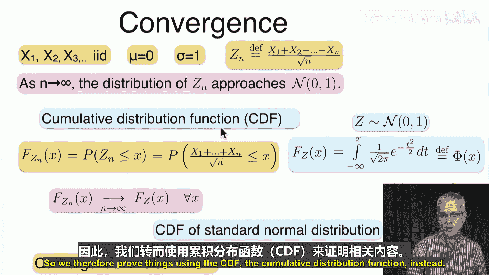
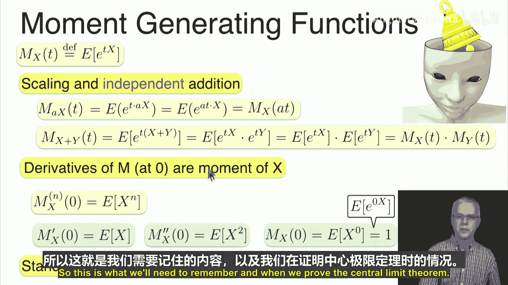
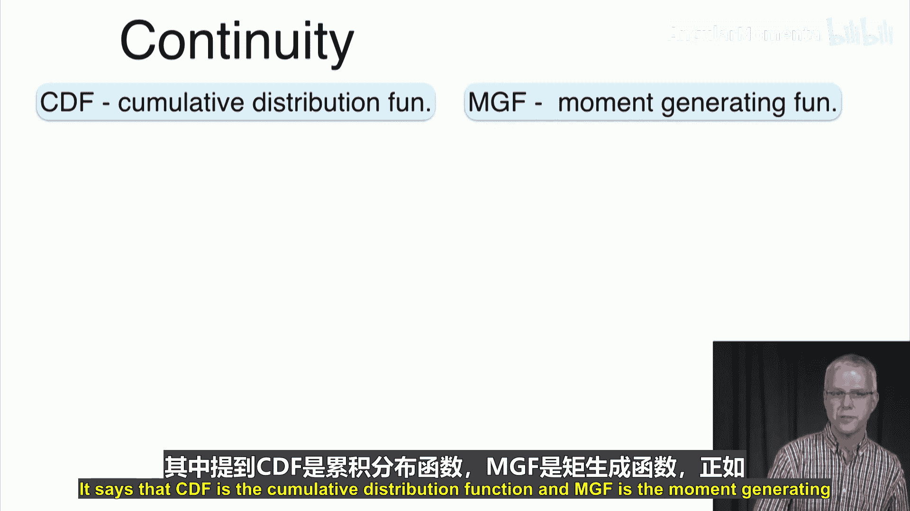
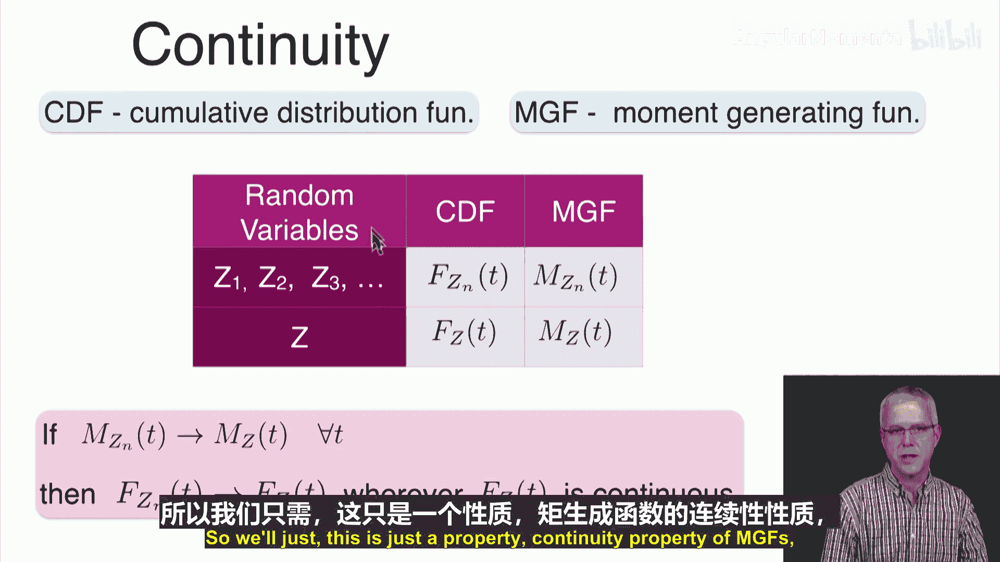
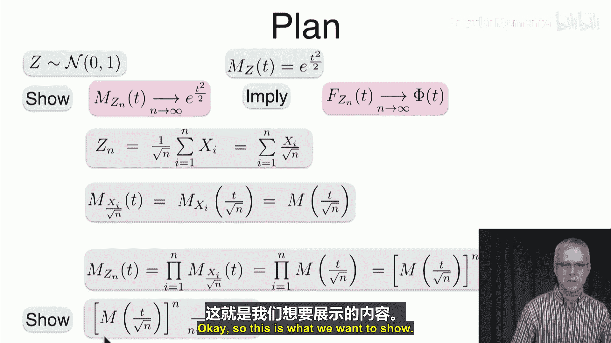
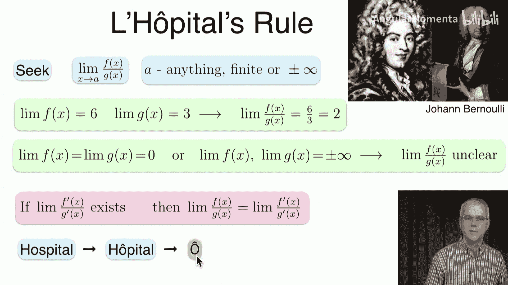
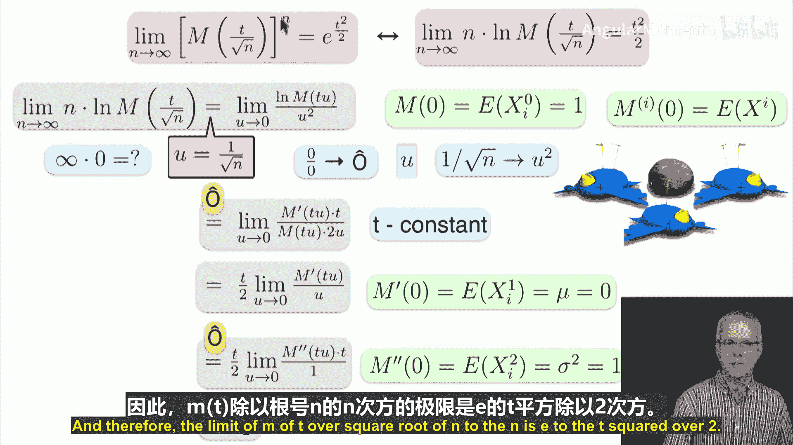
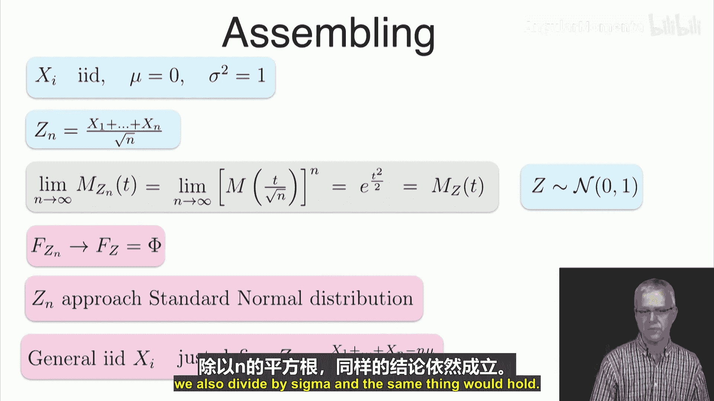
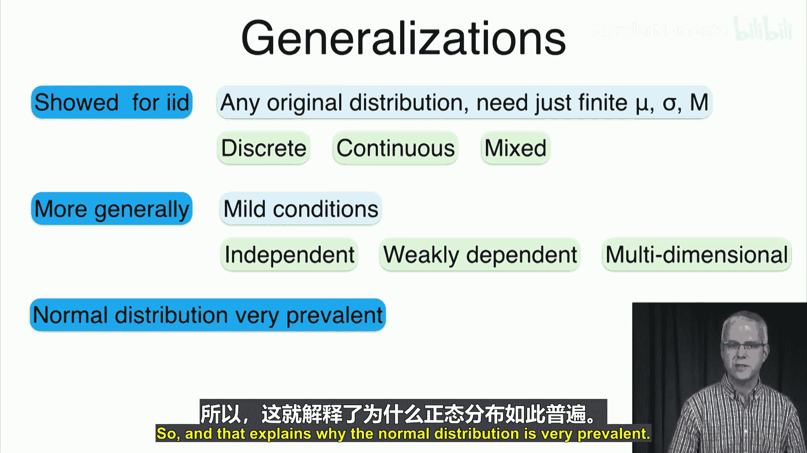

# 【加州大学圣地亚哥分校】使用Python进行数据科学中的概率与统计--Probability-and-Statistics-in-Data-Science-p47-11-07-03-证明--BV1gJFDzkEPg_p47-

Hello and welcome back in the previous presentation we described the central Li theorem and now we would like to prove it。

So the way we'll prove it is by showing that if you take a sum of random variables， normalize them。

 then they converge to the normal distribution and more formally we're going to describe it here。

 so we have random variables that ID x1x2 x3 and they have mean mu I mean mu which is0 and standard deviation sigma which we assume with our loss of original is 1。

And what we're going to do is we're going to define Zn to be x1 plus x2 up to Xn divided by square root of n。

 so this if you remember， is the normalization that we have for the central limit theorem。

And what we're going to show is that as the number of sample increases。

 increases the distribution of Zm of this normalized sum where again we normalize n by n。

 if we normalize by n， we'll just get the mean which is0。

 which we normalize by square of n now get something that has some distribution。

And this will approach normal with mean zero and standard deviation one。

or an equivalent variance1 and the way we'll prove it is we'll consider the cumulative distribution function。

 the CDf of Zn and of the normal distribution so the cumulative distribution function of Zn F zn of x is the probability that Zn is less than equal to x。

And that's the probability that if you take the x， the n random variabless， x1 up to xn。

 normalized by squared of n is less than equal to squared of x。

 so that's the cumulative distribution of the Zn of the sum， normalized sum。AndOn the other hand。

 we want to compare it to the normal distribution， so if z is distributed normal。

 then the cumulative distribution of z is the probability that z is less than equal to x。

And because these no is standard normal， it's one over squared of 2 pi e to the minus t squared over 2。

Integrated from t going from minus infinity to x。So that's a normal distribution and what we want to show and this。

 as we said before， is called phi of x， and what we want to show is that Fz n of x。

 so the cumulative distribution of ZN as the number of sample increases。

Approaches the cumulative distribution of Z。And that's true forx。And so in other words。

 it converges to the CDF of the standard normal distribution and this type of convergence is called converggeence in distribution。

 if so show that if you take a sequence of randomver。

 you look at the CDF and show that the CDF converges to some other CDF that will say that this is ZN will converge to Z in this case in distribution and notice that we do it via the cumulative distribution function and not the actual probability distribution function because。

Especially when you talk about continuous distribution。

 the PDF can have like small values like spikes at any particular point。

 like I say at one could have value some different value。

 but that will not affect the probability because it's a point it has。Zero mass。

 so we don't care so we therefore approve things using the C of the cumulative distribution function instead。

All right。And the way we'll do it is using the moment generating functions why because we have a sum。

 we're looking at normalized sum and whenever we have a sum， we know that the MGF。

 the moment generated function we have in a very nice way。

 so we're going to use that and so just remind ourselves or ring a small bell about what we had seen before。

If you have a random variable x， then its moment generating function a function of is a function as the name says。

 and its value at t is the expected value of e to the Tx so the moment generatedative function of x evaluated a real number t is the expected value of e to the Tx and we saw several properties of moment generating functions for example scaling and independent addition so if you have a render variable x and you multiply it by a and you wonder what is the moment generating function of the MGf of a times x its by definition is the expected value of T times ax。

And you can just rearrange things here， so it's the expected value of 8 times x。

 and that's just the moment generating function of x evaluated at0。

So this' is the moon generated function of x divided evaluated at 80。Similarly。

 if you have x and y and x is y are independent， like I wrote here， if x and y is independent。

 then the moment generating function of x plus y evaluated T is the expected value of e to the t times x plus y and this we can write as its the exponent of a sum which becomes the product of the exponent exponent so it's the expected value of e to the tx times e to the ty but now x and y we're assuming are independent。

And so e to the Tx and e to the Ty are also independent and therefore the uncorrelated and therefore the expected value of the product is the product of the expected values。

 so it's the expected value of e to the Tx times the expected value of e to the Ty and this is the moment generating function of x evaluated T times the moment value of generating function of y evaluated to T。

Okay and then another property that we saw was the derivative of the mGf evaluated0 or the moments or moments of x so in other words if you take the moment generating function of x and differentiate it n time and evaluate0 then the value is going to be the expected value of x to then or the n moment of x and so for example we would say that if you take。

The moment generating function of x differentiate once evaluated zero。

 there will be the expected value of x。If you differentiate the mGf twice and evaluate it at0。

 that will be the expected value of x square and so on and in particular if you take the mGf itself。

 mx of0， then that's differentiating the mGf0 times or taking that's going to be the expected value of x to the0 but x to the0 is1 so this will be1 and agrees with our this equation here about derivative and the moment but you can of course this one you could also see directly because the mGf of x at0 is nothing but the expected value of e to the0 times x。

 which is the expected value of e to the0 which is1。And finally。

 just want to remind ourselves that if you take the standard normal distribution。

 if z is distributed normal 01， then its MGf is just e to the t square over 2 so this is what we'll need to remember and when we prove the central limitor。

So。We're going to use the following result which we' are not going to prove。

 but it makes a lot of sense， it says that CDF is the cumulative distribution function and MGF is the moment generating function that as we used。

 so if you have a sequence of random variables。

Z1 z2 z3， and let Fzn of T denote their CDf， this CDf of Zn。

And let Mzn of T denote the moment generating function of Zn evaluated in T。

 and then if you have another n variable Z with CDf。FZ and Mgf MZ。

Then it says that you had continuity， you have continuity。

 which makes sense that if the moment generating function。

Of the ZNs convertver to the converge to the moment generating function of Z。

 If the Mgf of Z N converge to the Mgf of Z at N T。 So we have this sequence of random variables。

 the moment generating functions are converge to the moment generating function of Z。

 then then also these。Random variabless z1 to Zn， the cumulative distribution function will converge to the cumulative distribution function of Z。

 so the cumulative function distribution function， cf of Zn。

At point T we'll converge to the CDf of z at point T。

 and that is true whenever fz of T is continuous， if CDf of z is not continuous at some point。

 then we don't have a guarantee， but if it's continuous， then we'll get this convergence。

So we' this is just a property， continuity property of MGFs and we're just going to use it。

So what is the plan so called the z is normal01 and its momentgenrative function is e to the t square over2 as we saw。

 and what we are going to show is that if we find take the ZNs that we defined before。

As this normalized xN， then will show that their moment generating function will converge to e to the t square over2。

 which is the moment generating function of z， and this will imply that the。

CumCFs of the ZN will converge to the Cf of the normal standard normal distribution。

 which we denote by 50。Okay， so Zn is1 over squared of n times summation of X。

 the sum normalized by squared of n， okay， we can write it as the summation of X over squared of n。

And therefore， we get and， and。Okay so that's one thing and then the MGf of X over squared of n of T by scaling is going to be the moment generating function of each Xi evaluating instead of T at T over squared of n。

 that's the other property that we saw we multiplied by one over a squared of n here。Okay。

 and we'll just for simplicity， we'll just denote it by M， we'll just omit the x sub I。

 so it's called by m of t over scrotopin。Okay，Then what we get here is that the moment generating function of ZN。

 it's going to be because it's here we have a sum of moment generating functions and each X is are independent。

 so it's going to be the product of the moment generating function of X over square of n。

Which is by this， it's the product of the moment generating of Xi。E evaluated t over squared of。

 and that's just each X has the same distribution， so that's just the moment generating function of t over a square of n raised to the n power。

And what we want to show is that this moment generating function mzn。

 which is just this n power converges to e to the t square over 2， if we show that。

 then we'll be done because we will show that the moment generating function of the ZN converges。

To the moment generating function of the normal， and therefore the ZN will converge the normal。Okay。

 so this is what we want to show。

So and before we do that， just a quick reminder about Lopiita'sur。

 and by the it's named after Gm Lopiital but many people think that it's due to Johann Bnoulli。

 who was Lopiital's math instructor in some respect。

 and they had a peculiar agreement where Lopial paid him son sum of money every year and Johann Bernoulli had to tell him about his results before he revealed it to anyone else。

And subsequently Lopiital wrote a book in which she used many of those results。

 and Johann Bnoulli is the brother of Jacob Bnoulli。

 whom we had mentioned from the Bernoulli Rino variables。Right。

 so so what we are interested often and we will be here is in the limit of Fx over JX and I know many of you know it。

 I just want to make sure that。Some selfcontain just remind you of that and so so we're looking at the limit of fx over Gx or x goes to some value a and a could be anything could be finite could be plus infinity or minus infinity so if these f and G have some value limits that are nonze and not infinity so for example limbm of fx is6 and limb of Gx is 3 then then the limit of the ratio is just going to be the ratio of the limits which is6 over 3 in this case is two。

But if the limit。Of f and g are both0， or the limit of f and the limit of G are plus minus infinity。

 and then what well have here is the ratio of0 over 0 or infinity over infinity and these are less defined。

 and so this limit of f over g is not clear， and Lopialro says that if the limit of the derivatives of f and g exists。

 the limit of f prime over g prime exists， then the limit of f over G exists and it's also the same。

This is what well use and Lopiital's name used to be spelled in fact Lopiital's time the way he used to spend spell it was hospital but the s was not pronounced。

 so now in subsequently in French they omitted the S and they write it like this Lopiital but to commemorate the missing S will denote the Lopiitals rule by this with the characterroat on top the exxon same complex so so what we want to show as you recall is we want to show that if we take the momentgene function of t over squared of n raise it to the n power then s n goes to infinity it's going to be e to the t squared over2。

And whenever we have power， it's easier to look， take the logarithm and convert it to showing that the limit of n times the logarithm of m over M of t over square root of n is the logarithm of this is line of t square over of e to the t square over 2 which is just t square over2。

 so this is what we want to show the limit of n times the moment generating function of t over square root of n is t square over 2。

All right。So we're going to evaluate it。 So what we have here is the limb of n times the line of the moment genetic function and。

Recallled that the moment generating function when we take the derivative evaluated0。

 we get the moment the if moment， so in particular here the moment generating function evaluated at0 is the expected value of X to the0 as we saw which and this is the expected value 1 so it's  one okay so what we have here is that。

We have line of t over square root of n and t is some constant and squared n is going to increase so this m of tn is going to go to m of0。

 so it's going to go to1 and we take it the line so we'll go to0 so what we have here is we have something which is in infinity times 0 and we don't know what it is so want to evaluate it how we're going to use do it of course we want to apply lopitas will so what we're going to do is we're going to define u to be1 over square root of n here and then this will become the limb of instead of n going to infinity you will go to01 over infinity which is 0 instead of n we get one over u square n is one over u square and here on top we have m of t times 0 so so when we did that we killed actually three birds in one stone first of all instead of having infinity times 0 and now we have0 over0 this couldverges to0 line of1 is0 and u。

square is0 so we have0 over0 we can use lopiitals that's one thing and the other thing is that we kind of like wrote n we just inverted it so we can think that we wrote it as U so it gives us the impression we can differentiate maybe and in fact we can because we can just look continue this this function and just look at it as continuous function and actually once you invert it and you look at it you can look at this and you can see lopiital here kind of like smoking a little bit like that but we're going to ignore that and the third thing that we did is that we placed one over square of n which is going to be difficult to differentiate by U square which is a lot easier to differentiate。

So so what we can do is we have this limit， which is0 over0。

 we'm going to apply Lopiitals rule and t recall is a constant here。

 so this is going to give us the limit as you goes to0 of the derivative of M of T。

 that's going to be M prime of T times the internal derivative which is t。

And then because we have the lungn， it's going to be1 over m of T and then times the M prime okay。

 so we have one over MTU from the lungn and then derivative of few square which is2 U。

And now this we can because t again is a constant we can take t over2 outside and we get the limit as U goes to infinity of and also m of t as we saw here go as U goes to0 we'll go to m of 0 which is1 so this is just1 so we get the limit of m prime of t divided by u multily by t over2 and now m prime of0 is the expected the value of x to the1 because we have the first derivative so x to the1 first moment and this is just the mean of hxi which we assume is0 so m prime of0 0 so this will also go to will 0 to 0 because t is going to go to 0 so we have0 over 0 so again we're going to apply lopial0 and we get t over 2 times the derivative here which is the second derivative of t and then we multiply by t again normalized by1。

And now observe that if we take the second derivative of the MGf， it's the second moment。

 the expected value of x square， which is sigma square because mu is 0 and sigma square with assume was 1。

 So this will become1 and therefore this will give us t square over two So what we showed is that。

The limit of n times la of the moment generating function is t squared over 2。

 which is what we want to show and therefore the limit of m of t over squared of n to the n is e to the t square over2 it's what we want to show so just to conclude let's assemble things so we said that X is or II means0 and variance 1 and we defined xzn to be the normalizedize sum normalized by squared of n。

And then what we said that if we calculate the limit of the MGf of Zn。

 then that was equal to the limit of the MGf of eachxi。

 which we denoted by m of t and t over squared of n， and we showed that no matter what M is。

 this the not and matter for any M， namely for anyxi， this went to e to the t square over 2。

 which is the moment generating function of z of the standard normal distribution。Okay。

 this is the standard normal distribution， so we show that the limit of the moment generating function of the ZN converges to the moment generating function of the standard normal distribution and therefore the cumulative。

Distribution found Cf of Z N converges to the Cf of Z。

 which is the fee fee the the Cf of the standard normal distribution。 So we've shown that the。

That the Z Ns these averages converge to to the normal distribution in probability。

 I'm sorry in distribution。 So Z N approaches now a normal distribution。

 and this converges is in distribution。All right， so this was for random variabless that were and that 10 means0 and standard deviation1。

 okay， but if we looked at any mean mu and any standard deviation sigma square。

 then instead of this z， we would just normalize and we subtract n mu and divide instead of divide by square of n。

 we also divide by sigma and the same thing would hold。

All right so by this we have proven the central limit theorem which as we said。

 is the cornerstone of a lot of results in statistics and is why the normal distribution is so important and I just want to say that you can further generalize the central limit theorem so we showed it for IID。

With any original distribution of the X so long as they had finite mean mu and standard deviation and moment generating function if the distribution at that。

 then we have proved it but you can and this applies to discrete distributions continuous and mixed distribution any distribution one so it's already very general but you can generate it even further you can show that under mild condition。

 the distributions don't have to be identically distributed。

 it suffices that the independent so that would suffice to get a very similar version of the central limit theorem or even if they have some weekly dependence。

 then you can also prove the central limit theorem or if the distribution is not one dimension once we have looked at but multidimensal then you also get central limit theorem which is very similar to what we showed and that explains why the normal distribution is very。

And with this， we have proven the central limit theorem and what we're going to do next is we to look at further statistical properties and how to estimate them。

See youだ。