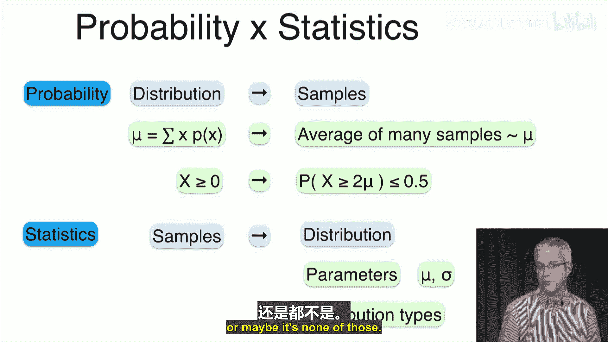
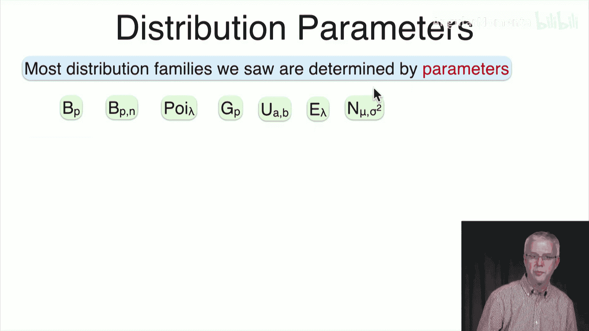
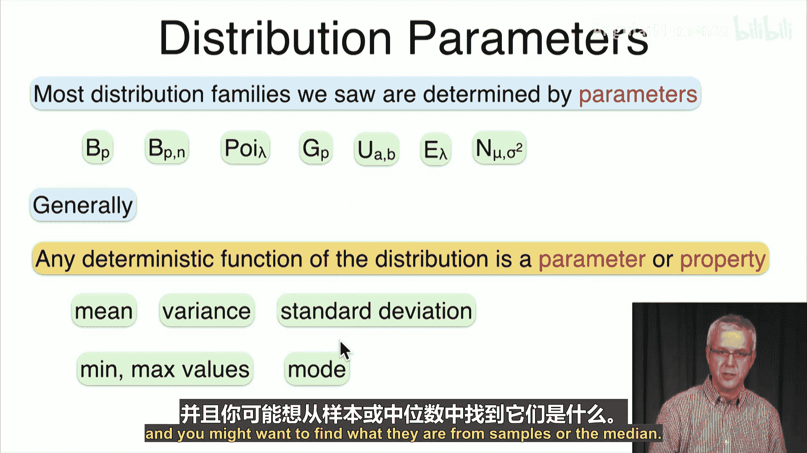
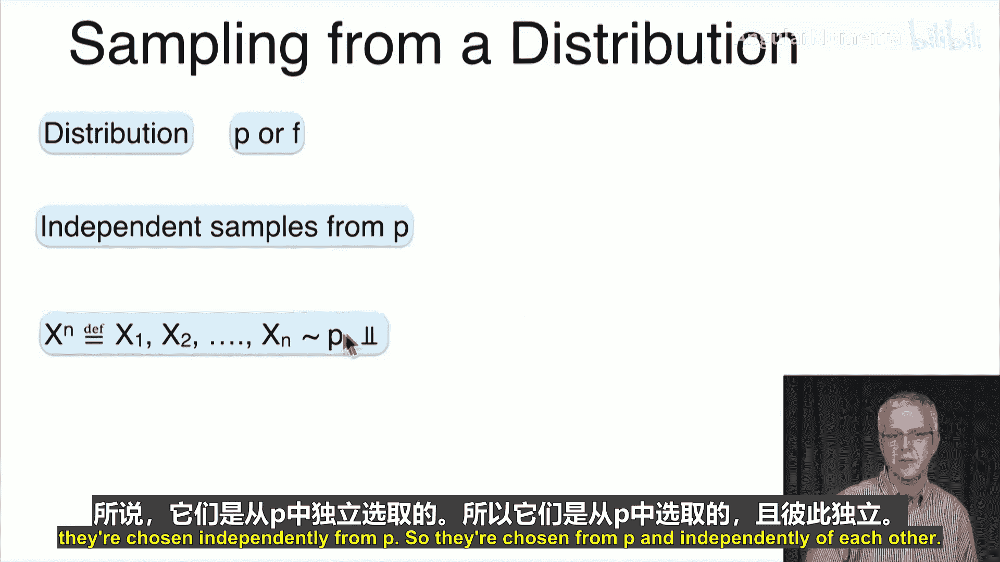
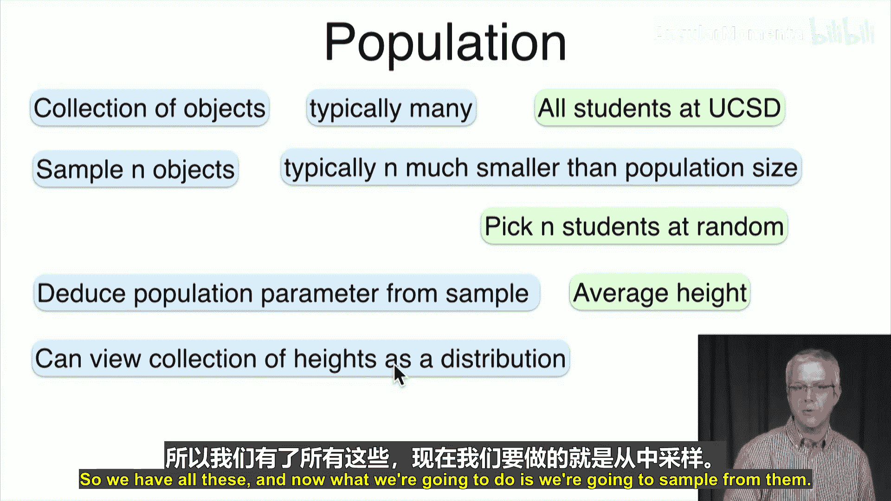
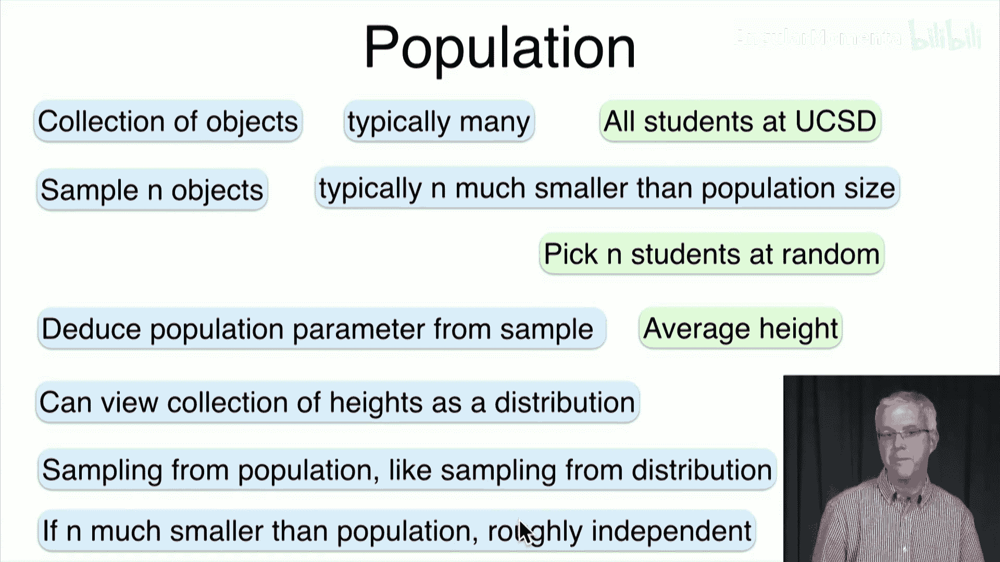
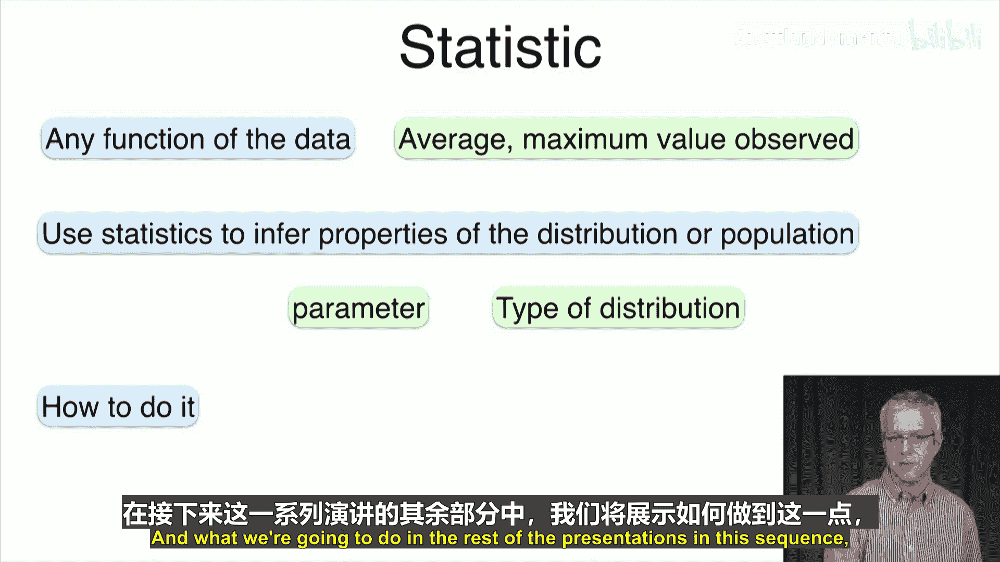

# 【加州大学圣地亚哥分校】使用Python进行数据科学中的概率与统计--Probability-and-Statistics-in-Data-Science-p48-12-01-03-统计学--BV1gJFDzkEPg_p48-

Hello and welcome back。So far we talked about probability where everything was designed by us like we said okay this is a uniform distribution it behaves exactly in that way。

 or this is a geometric distribution or binomial， everything was very clean and very precise and behave exactly the way we wanted it and now we're going to move to the real world where things are not exactly the way they are planned。

 they look a little different， they behave a little differently。

 sometimes not what we expect or not even what we want， but still we need to deal with them。

 so that's what we're going to do in the statistics part of this course。So in some sense。

 probability and statistics are somewhat of opposites of each other in probabilityability。

 as we said， we assume some distribution， we come up with it and and then we take samples and we say here are the properties of the samples that we take。

 for example， we have a distribution we can define the mean mu to be the summation of x times p of x。

And then we say that if we take many samples， then the average value is going to be roughly me。

Or if we have a distribution over values that are non negative so there are variable will be non negative。

 then as we saw for markovs inequality， the probability that will get a value which is bigger than twice the mean that we calculated here is at most half。

And in statistics it's， as we said a little bit of the opposite。

 we get samples and from the samples we want to deduce properties of the distribution or maybe what the distribution is。

 so we want to deduce some parameters of the distribution， for example。

 the mean or the standard deviation， or we want to say what type of distribution it is。

 is it Gausian， is it geometric， or maybe it's none of those？

So。The first thing we're going to do is we're going to look at estimating distribution parameters。

 so most distribution families that we saw are determined by parameters， for example。

 if we have benoulli distribution it's determined by the success probability P if we have a bi normal distribution it's determined by the same P and also the number of samples that we take if we have personisson distribution。

 it's determined by the parameter lambda which is the mean and so on if we have a geometric or uniform or exponential or normal distribution。

 all of them are determined by parameter so these are distribution parameters。

 but you can view parameters more generally to be any deterministic function of the distribution。

and sometimes these are called properties okay so for example。

 you can say that the mean if you have a distribution， for example， bionial Pn。

 then the mean is a parameter of the distribution， in this case it's p times1。

Or the variance of the distribution here it's going to be NPQ。

 that's something that's determined by the distribution。

 and so it's a parameter of the distribution or the standard deviation。

Or it can take the mean max values， for example if youre geometric distribution。

 then the smallest value， the mean value is the smallest value that has positive probability。

 which will be one and the maximum value will be infinity。Okay， or we can look at the mode。

 which is the value that test the highest probability。 all of these are determined by。

The distribution and of interest and you might want to find what they are from samples or the media okay so the way we do it is by sampling from the distribution。

 so a distribution could be the discrete in which case we call it P。

 its a probability mass function or distribution could be continuous in which case we have a probability density function F。

And then we're going to take independent samples from P or form F。

 and we denote these samples by x superscript n it's short for x1， x2 up to Xn， which as we said。

 they' chosen independently from P， so they're chosen from P and independently of each other。

And from these samples we want to deduce properties of the distribution or instead of looking at distribution。

 what we often want to do is look at populations so population is a collection of objects。

 typically many of them， for example we can take all students at UCD that's a population of students or all patients in a hospital。

 that's a population and we want to deduce properties of this population so what we do is we sample n objects from this collection of objects and typically n is much smaller than the population size so we don't want to take all students at UCD but want to take a small sample call number N and from that sample we want to deduce properties of the population as a whole case so in this case we pick for example N students at random and we want to as we said to deduce population parameter from the samples。

 for example， maybe we want to deduce the average height of all students at UC。

By just sampling10 of them。And so we can view- so this might look like it's a different problem because here we have a physical population that we are sampling from。

 it might look like it's a different problem from estimating parameters of a distribution。

 by in fact， we can view it as the same。So we can view for example if we're looking at the heights。

 we can view the collection of heights as a distribution so we have maybe a person's height is you know five foot or five foot one and another person's height is five feet and so on so we have all these and now we're going to do is're going to sample from them so a sample from the population is like sampling from this distribution that has so many so many people with given height and so many people with another height and so on so we're just sampling from them uniformly from this collection okay and there's a small difference between this and this sampling that we had in the previous slide in the sense that before there were ID and here if we're sampling from the population then we're picking a set of people and these people going to be distinct so it's not exactly ID for example if you have a population of size two and you pick two of them you know that are different and you couldn't pick the same person twice but in。

What we're going to look at and the number of samples that we pick is much smaller than the population size and in that case the probability of repeats if you pick them independently will be fairly small so we can view what we have is roughly independent so under this assumption that and the sample size is much smaller than the population。

Then the selection， even though we're selecting without a will be very similar to selecting with replacements because the probability that we'll get repeats is small。

 if you get repeats， there will be very few of them。

Okay， so with this assumption， we can therefore assume that we have the same problem of estimating。

Prameterters of population is estimating parameters of distribution。So when we have a sample。

 then we're going to look at a sample and we're going to look at functions of the data。

 for example the average of all the values that we get from the data or the maximum value that we observe and any function of the data is going to be called statistic and what we want to do is we want to use the statistics to for properties of the distribution or the population。

 so I want to look for example， the average or maximum value that we observed in our sample。

 and from these things we want to deduce some properties the distribution or the population and for example we may want to deduce the parameter like the mean of of the distribution or the maximum of all the elements in the population and so on。

 or we may want to deduce the type of distribution that's in effect。

And what we're going to do in the rest of the presentations in the sequence is see how to do this and how to do this well。

And so this was just a brief introduction to what we're going to discuss in the next presentations and next we're going to talk about this possibly the simplest bomb。

 which is estimating the mean of a distribution and so that's what we'rell do next time and see you then。

