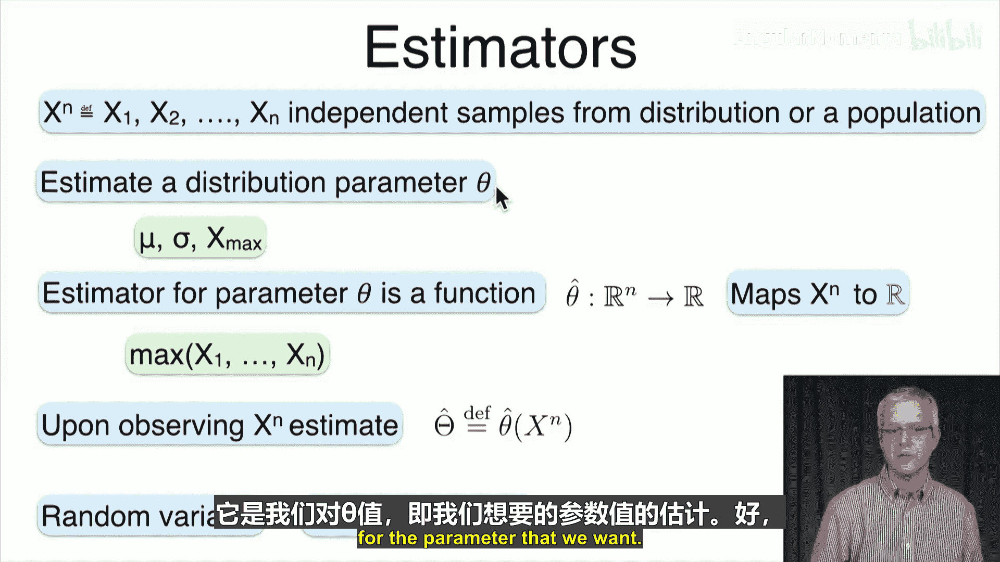
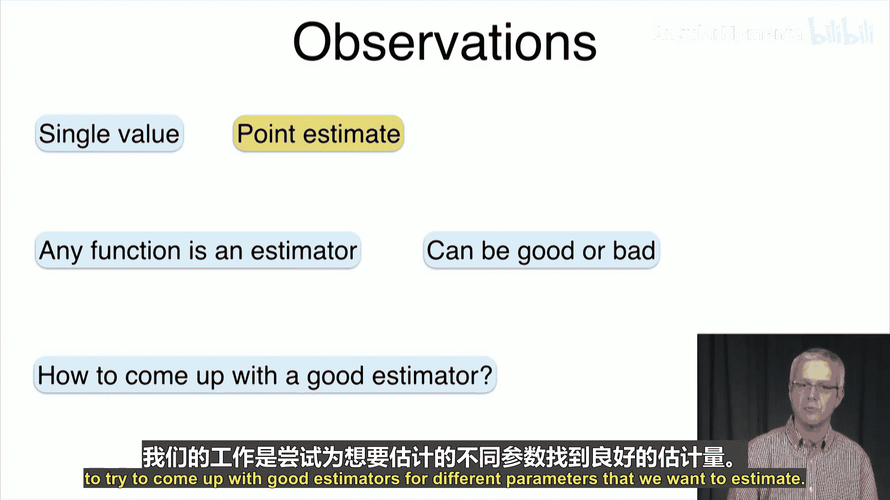
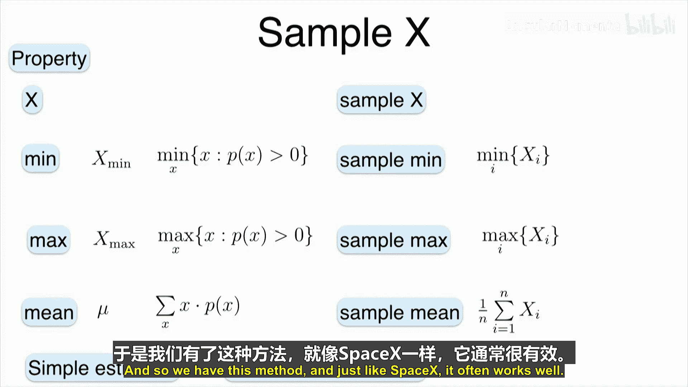
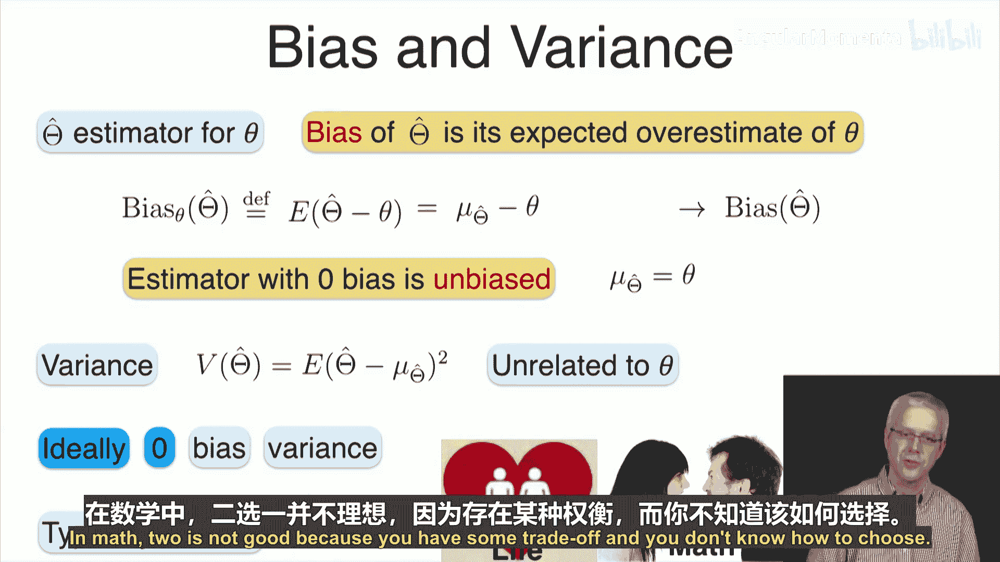
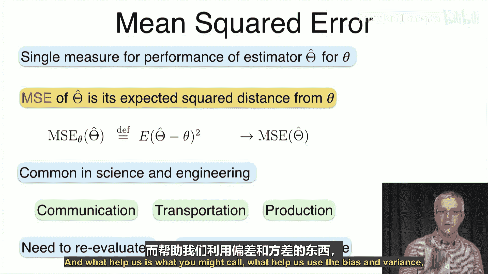
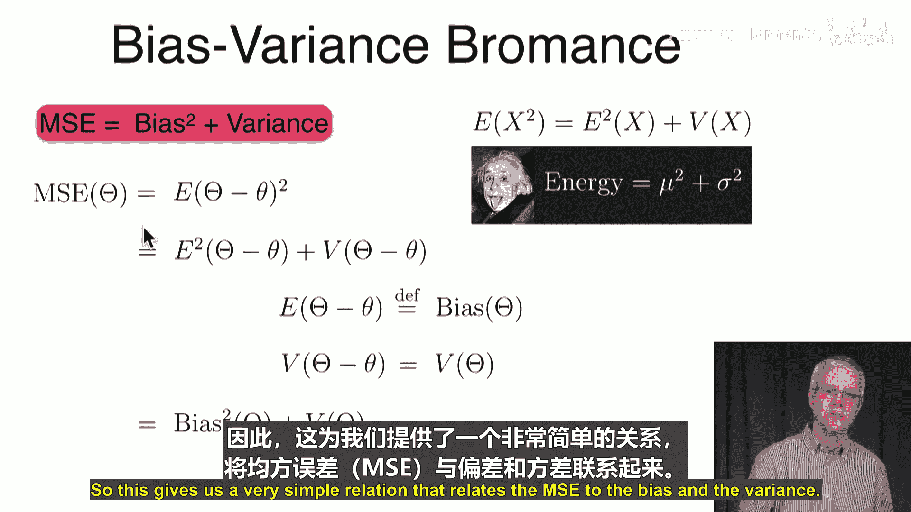
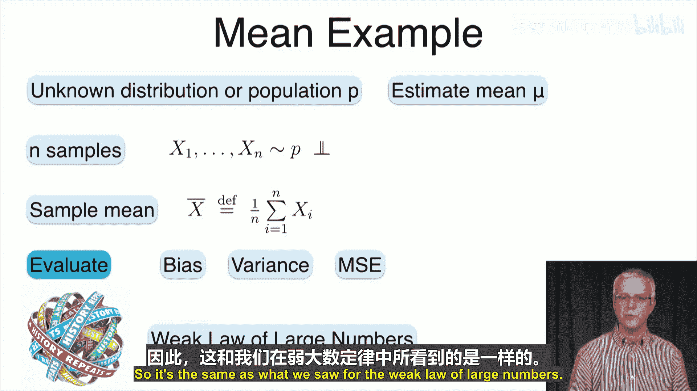
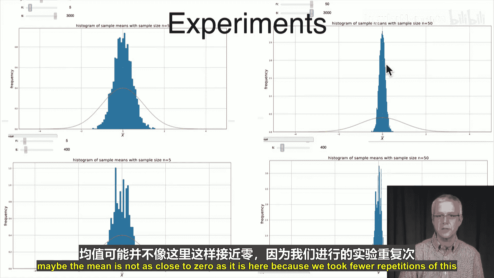
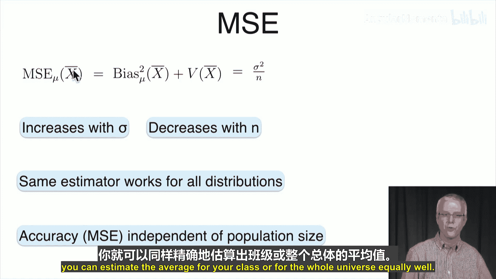

# 【加州大学圣地亚哥分校】使用Python进行数据科学中的概率与统计--Probability-and-Statistics-in-Data-Science-p49-12-02-03-均值与方差--BV1gJFDzkEPg_p49-

Hello and welcome back。 So now that we know what we're going to do we're going to start by looking at estimating the first property and so we're going to talk about parameter estimation and we'll also have a mean example right so。

So first we if I want to talk about estimation we need to say what estimators are。

 so as we know we have we're taking a sample which is a sequence x1 up to xn of independent samples from the distribution or population and we denot it by x superscript then just the sequence of all n samples and from the sequence we want to estimate a distribution parameter theta。

 for example theta could be the mean or the maximum value in the distribution of the population and so on。

 so mean or standard deviation or the maximum maximum largest value largest value that has probability or the largest value that appears in the population。

And we do it by using an estimator， an estimator for a parameter theta is just a function。

 theta hat that takes our n samples and mapped them to some real number which is the value of the parameter so it just maps xN to the sequence of n values to a number which is the value of the parameter。

 for example， we could take the maximum if we took n samples to get x1 up to xn。

 we can take the maximum value that we observed。Or we can take the average。

 so any of those is an estimator it just maps the observations to some value。

And upon observing a sequence xn， we're going to estimate the value of the parameter by looking this function theta theta hat and applying it to Xn and we're going to call this theta theta hat capital theta 8 because this you observe is now a random variable so this is the random variable。

 which is a deterministic function of Xn and we're going to do some examples very shortly。

So basically we observe XN and then we apply this deter function， for example。

 the maximum four of that and we get a random estimate by which we call theta hat。

 so theta hat is a very variable and it is our estimate for the value of theta for the。

A parameterrameter that we want。

So just a couple of exization， you can see that we're observing a single value。

 namely for every sequence xN we get we just apply this function so we get a single value。

 let's say 3。5 and this kind of estimator is therefore called a point est supposed to giving an interval saying that there's a range of possibilities and also note that any function could be an estimator we can take the product of the values you observe the maximum the sum any of them is an estimator now how well does it do when trying to estimate a specific parameter differs so it can be either good or bad and our job is of course to try to come up with good estimators for different parameters that we want to estimate。

So how are we going to do it Well we're going to take a page from Ellan Musk here has experience in opening many companies including for example Tesla or spaceX which launches rockets into space and often successful and so we're going to do the same we're going to have sample X which is a very simple technique that will let us come up with an estimator for any parameter that we want and like Ellan Musk's SpaceX often it will work well so let's look at this sample X so we're going to have a property let's call it property X and based on that we'll get sample X which is going to be an estimator so take for example the minimum so let's say we want to find the minimum x min which is just the small。

x that has positive ro so for example， if the distribution is normal。

 then mean x mean is minus infinity， but if the distribution is uniform from5 to7， then x mean is 5。

Then what we're going to do is we're going to apply the same thing to the sample so we're called it the sample mean we're just going to look at all the values that we observe and we'll say that our estimator is the smallest of those values so if we observed the values 53 and9 then the sample mean the sample is 53 and9 and the sample mean is going to be3 or if were looking at the maximum of all possible values of the distribution or population call it x max is just the max over x of all elements x was probably positive so for example if we take uniform from7 to9 then the highest possible values is 9 and then we're going to just have sample x in this case called be the sample max which is just the maximum of the values that you observed so for example if the distribution was from 5 to9 and we got the values or7 to 9 and we' got the values 7。

1 7。8 and 8。F then the sample maximum is going to be 8。4。

Or if we want to estimate the mean of the distribution which as we know we did not by mu that's just sum of x times px then what we're going to do isre going to do the same thing for the sample that we have so we're going to look at a sample mean which is just the average of all the values that we observe so if the values we observe for example one3 and5 then one plus3 plus5 is9 and the average is three so the sample mean in this case is going to be 3 so what we did here is we saw that a simple way to come up with an estimator for any property if you give us a property we just look at the same property we' just apply it to the sample and so this is our sample x method。

 sample could be a sample mean sample max sample average and so on and so we have this method and just like spacex it often works for so so down。

We have described different estimators。 The question is which one you know。

Are we going to use so we have a property and can have several estimators， we describe one of them。

 the the sample X method， but you can come up with other estimators and so we want to evaluate the quantity of an estimator for a parameter。

And I willll describe first two related values， bias and variance and then another one that encompasses both of them。

 it's called the mean squared error Okay so first what are the bias and variance。

 so if theta hat is an estimator for theta and you call the theta is the parameter we want to estimate。

 for example the mean and theta hat is our est which is based on the sample that we observe。

Then the bias of theta hat is it's expected overest of theta， for example。

 if the mean is 4 and the expected value of our estimator is 5。

 then the bias is going to be 5 minus4 which is1， so just written here。

 the bias of the est theta hat， which is a random variable for the parameter theta。

 which just the expected value of theta hat minus theta。

 which is the same as the expected value of theta hat or its mean mu theta hat minus theta。

And if the parameter we're trying to estimate is clear， for example。

 if we are talking like for five slides about the mean。

 then we're not going to write theta I' just write which is the parameter we' just write the bias of the estimator that we and if the estimator has zero biased then it's called unbiased and that would mean that mu that the mean of our estimator is exactly theta that this difference is0 or that the mean of the estimator is exactly theta。

Now the variance of an estimator is just the name says it's just the variance of estimator。

 which is the expected value of the estimator theta hat minus its mean square。

and notice that this variance is defined just for the estimator has nothing to do with what we're trying to estimate theta It's unrelated to theta and ideally we would want an estimator which has zero mean andm sorry zero bias and zero variance if we have an estimator that has zero bias that means that it's mean is just theta and if has zero variance。

 it means that it's a constant so that means that we have an estimator that always give us the value of theta it's hard to get an estimator like this it can only get that for distributions that are constant。

So typically there'll be some trade off between the bias that we get and the variance that we get。

And now so this is all good and the only thing is that as we see we have now two measures。

 one is the bias and one is the variance and while in life two is good in math2 is not good because you have some tradeoff and you don't know how to choose so we want to define like a single estimator and a single evaluation measure for the estimator and the one we'll use is the mean squared error which is a single measure for the performance of an estimator theta hat for a parameter theta。

And it's abbreviated MSE and the mean square error of theta hat is just its expected square distance from theta。

So the MSE， we did not like this， it's the MSE of the estimator for the parameter， okay。

 this is the expected value of the estimator minus the parameter squared。

And if the parameter we're trying to estimate is clear， then we just deote it by the MSC of data。

And this is common in science engineering， for example。

 when people design communication systems or transportation systems or production facilities。

 they often use this parameter they want to design something and we want to minimize the mean square error so they have some target and they want to minimize this different square and so one natural question is whether if we want to do this we need to do something。

 we talked about bias andvari where we need to do something which is completely new and luckily no because we can relate this to the bias in the variance of the of the estimator and what help us is what you might call what help us use the variance of variance is what you might call the bias variance pro which is that the mean square error is the bias square plus the variance。

And to see that， recall that the variance of a random variable x is the expected value of x squared minus the expected value of x squared。

 so the variance of x is E of x squared minus e of x squared， which we can write like this。

 the expected value of x squared is is the mean squared plus the variance and if you want。

 you can think of it as maybe you know the。The propoliistic version of a physical truth。

 so in physics we know that the energy is E， the energy is m square and here we can think of the expected value of x squares。

 the energy of x， and so we have the energy of a random variable is its mean square is mu square plus sigma squared instead of the m times c square。

All right，So let's so what we want to show is that the MSE is equal to the bio squared plus the variance and to do that let's look at the MSC of theta I omitted here theta had just wrote that this Theta is the expected value of theta minus minus minus the parameter squared so we have if called theta。

The theta， the estimate minus the parameter， we call it x。

 then we have here the expected value of x squared and this is going to be equal to the expected value of the difference squared plus the variance of the difference from here but the expected value of the difference is just the bias。

And the variance is just the variance。Okay， the variance of what we define to be the variance of theta。

Because what we do here is we subtract theta， which is a constant and we subtract the constant。

 we don't change the variance and when we combine those we see that what we get here is just the bias squared plus the variance。

So this gives us a very simple relation that relates to the MC to the bias and theverse。

Allright， so what is our mean example that we're going to give well it's probably not so surprising its just the mean。

 so suppose we have an unknown distribution our population called it P and we want to estimate the mean mu okay so we're going to take n samples x1 up to xN and the distributor according to P and the independent of each other。

And what we're going to use is the sample X method that we said in this case is a sample me。

And what is the sample mean， we take all our samples and samples， we add them up。

 normalize them by n， and we call it our me。And what we want to do is we want to evaluate the bias。

 the bias， and the mean square error of this estimator。And。

If things will look a little familiar you have a sense of dejevo there is a good reason because we have actually done this before。

 so when we talked about the weak law large numbers。

 we said that if you take a bunch of samples and take their average we saw what the mean was we saw the standard deviation was and that's exactly what we're going to do again here。

 except we're just looking in the context of a sample。

 but the calculations are going to be exactly the same so it's the same as what we saw for the weak lo large numbers。

Okay so first let's evaluate the bias of the sample mean so sample mean as we said。

 is just the average of our n samples and what is its expected value。

 expected value is just the expected value of this average and by the linearity of expectation。

 we can take one over n outside of the expectation。

And also take the summation outside of the expectation。

 so it's going to be one over n times the summation of the expectation of X。

Now observe that h X was chosen according to P， so the expected value of hxii is the expected value of P。

 which is mu。Even though we don't know what mu is， we're trying to evaluate it。

 but the expected value of the X is mu， and so what we have here is n times mu divided by m。

 which is just mu。So what we get is that the expected value of the sample mean x hat is just a mu。

 which is the average of the mean of the whole distribution or the mean of the population。

 it's kind of nice so as if we take a sample calculate the average and its expectation is exactly the value of the parameter that we are seeking and therefore the bias。

Of the sample mean is just the expected value of。this the is just the expected value of our estimate minus mu。

 what were trying to estimate， but this is just going to be mu minus mu， which is0。

 so in other words， we see that the sample mean is an unbiased estimator for the distribution。Okay。

Next， we're going to look at the variance of the sample mean。

So the variance of the sample mean is the variance of this average okay？

And now recall that our samples are independent now if we're sampling from distribution。

 they're they're really independent， sampling from population。

 we assume that we are taking few samples so they are effectively independent of each other because we don't get repetitions。

And so first of all， we know that the variance of a constant times or random variable is the constant square times the variance。

 so one over n comes out as one over n square， and now we're going to use the independence。

And yet it's1 over square times the summation of the variance of thexi because the samples were assume independent。

And so but the variance of hxi x check I is a sample from the distribution which has standard deviation sigma of variance sigma square。

 which is unknown to us， but it is still the variance。

 so we get one over n times the summation of 1 up to n of sigma square。

 so sigma square will get multiplied by n and then divided by n square。

 so we get that the variance of the sample mean is sigma square over n。which is kind of nice。

 it says that once we take the sample mean， then the variance of our mean is going to go down within。

And the standard deviation therefore is going to be the square of this。

 which is sigma divided by square of， so we see that both of them increase with the original standard deviation of standard deviation of the distribution of population。

 they increase when sigma increases， but they decrease with n so if we keep increasing n then eventually these values will become smaller and smaller。

So now we calculate both the bias and the variance of the sample mean。

 we can therefore calculate the mean square row， but before we do that。

 I want to show you a couple of experiments。So these experiments you can find in the notebook for this lecture and you can play with different values using the sliders。

 so here what we have is a Gaussian underlying Gaussian distribution with mean zero and standard deviation1 and we're going to select samples from this distribution in this case we're selecting five samples。

 sample of size5 and we're going to calculate the average and and we see what we get and now if we did that once then you'll just get a single spike but we won't see what happens on average so we'll repeat this process in this case 3000 times。

And what you see is that you see the distribution that you get for the sample mean and you can see that its expected value is roughly zero what we expect to get and you see you see the variance of the sample mean which is pretty wide and that's because because we only took five samples now if instead of taking a sample of size 5 we take a sample of size in this case 50 and you can see that the sample mean becomes much more narrow and that's because its standard deviation or its variance decreases like sigma square n and we get a better estimate。

 but still in both cases， the expected value is essentially zero because that's what the expected value should be now this was done。

Repeing this 3000 times if instead we repeated it only 400 times。

 then you'll see that the results are going to be a little more sketchy。

 it's less clear what's happening and also now when we look at the average while the expected value is still zero because we are taking fewer sample is most statistical variability and maybe the expected value is not exactly zero in this case or further from zero than it was above and here again we taking more samples then we see that it behaves more focused but again maybe the mean is not as close to zero it here because we took fewer repetitions of this experiment。

Okay， and finally the MSE， so the MSE of the sample mean is the bias square plus the variance and the biases we saw with0 and the variance we saw with sigma square over n。

 so this gives a sigma squared over n and as we said before。

It increases with the original standard deviation of the distribution but decreases the number of samples that we take increases and a couple of nice things about this is that this estimator that we have the the sample mean works for any distribution we don't care what the distribution is if it's Gaussian and if it's normal it continues if it's discrete this sample mean works for all distribution。

 that's one thing it's interesting and the second thing is that the accuracy and we get here。

 namely the mean square error it depends on the sigma or n but does not depend on the population size。

 so for example if you're looking at if trying to estimate the average size of people in your class or people in your school or people in the whole country。

 that one matter， the only thing that would matter for your accuracy of estimator is just what is the standard deviation which presumably the same。

No matter what， whether you're looking at small class or large collection of people which is the number of samples that you took。

 so if you took 100 samples you can estimate the average for your class or for the whole universe equally well。

Okay all right， so with that we talked about what parameter estimation is。

 we describe what it means to have an estimator， how you evaluate an estimator using the bias。

 the variance and the mean square error we describe a general technique for creating estimator which is looking at the sample x or for example sample mean and so on and we evaluated this sample mean for estimating the mean mu of a distribution so this is what we want to say about about the mean and what we want to do in next time isest the variance of a distribution see you then。

