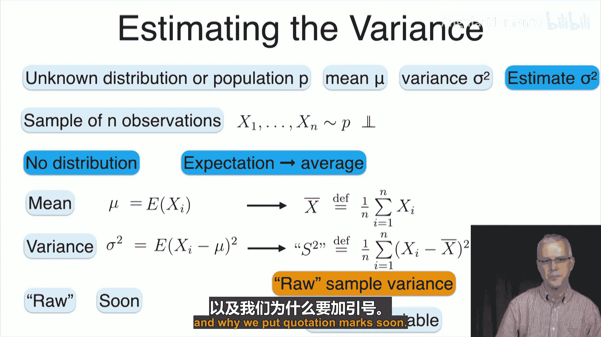
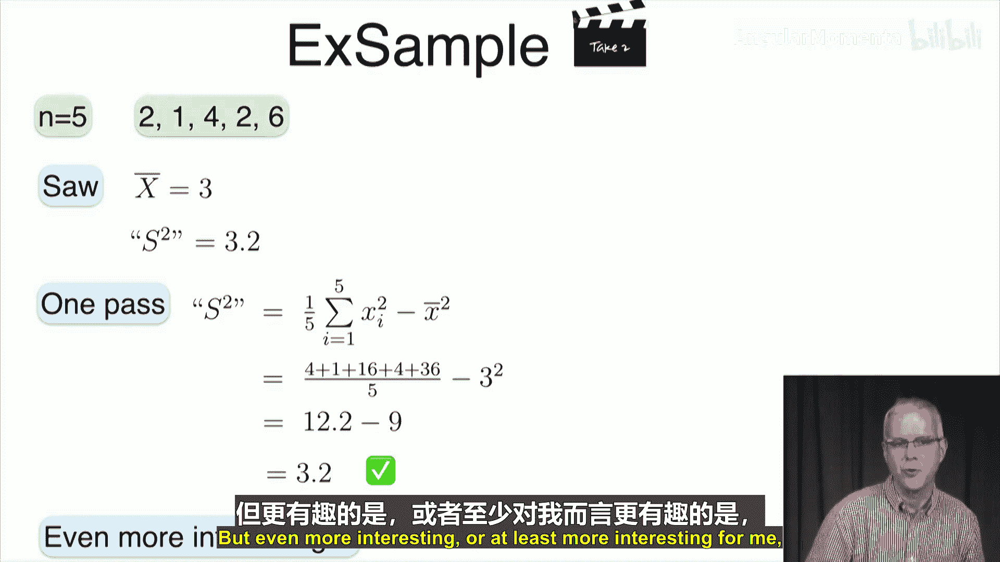
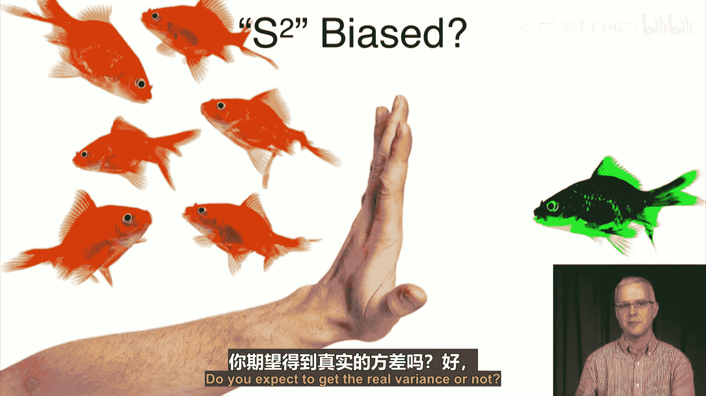
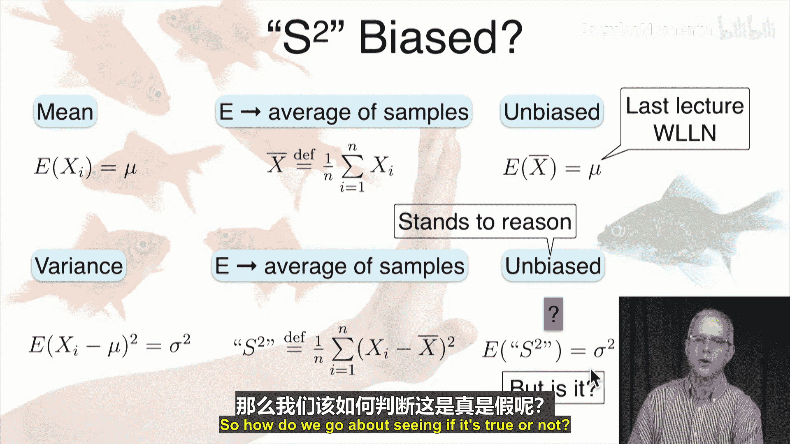
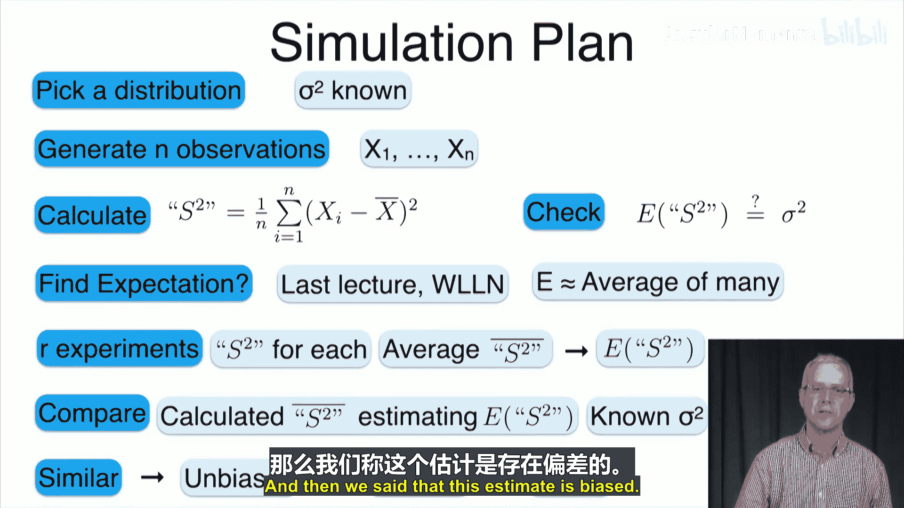
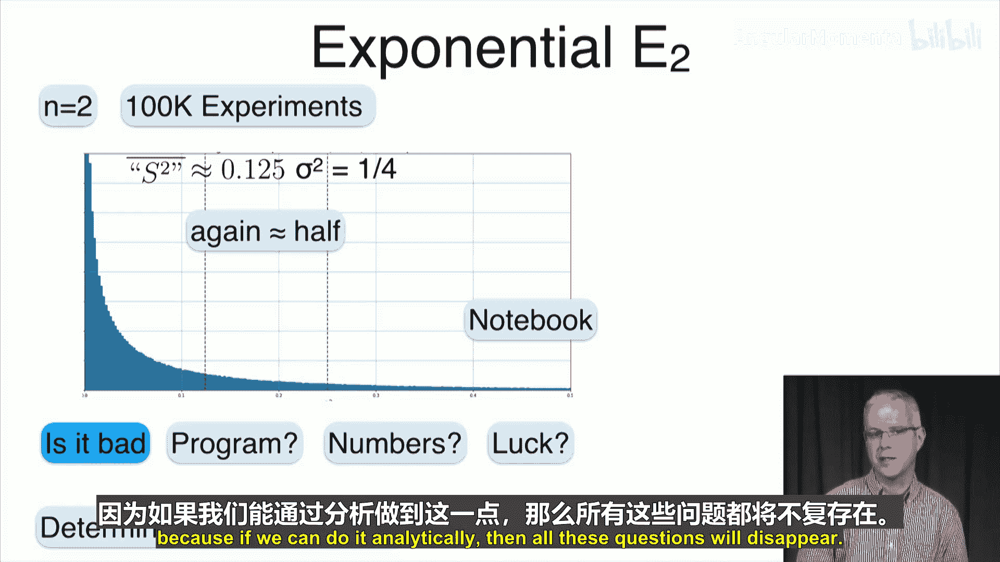
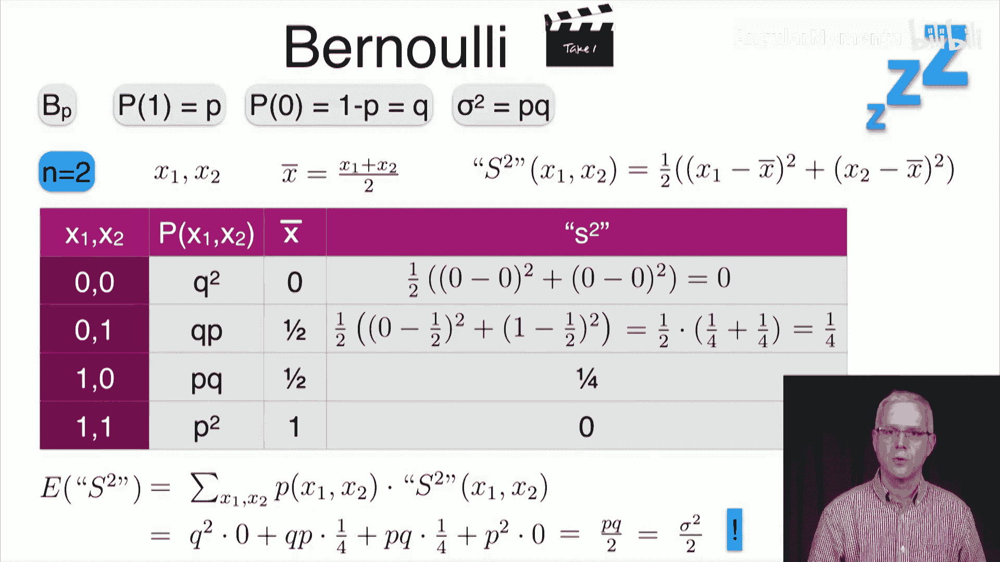
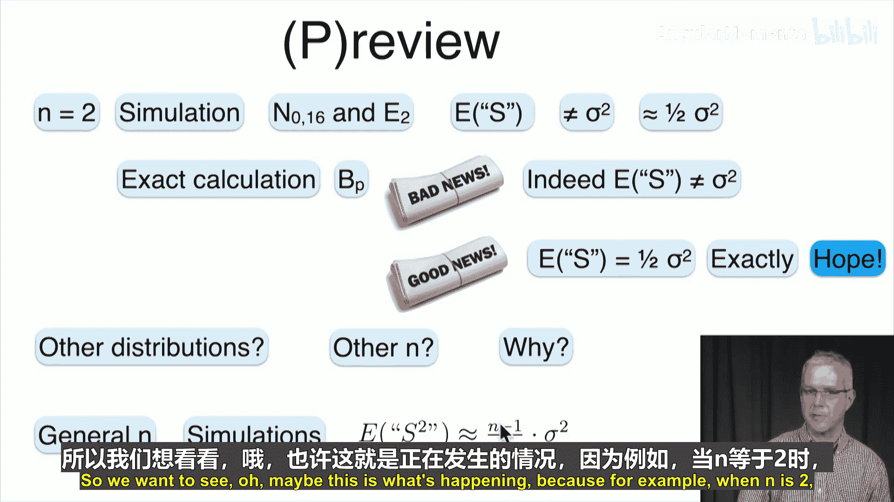

# 【加州大学圣地亚哥分校】使用Python进行数据科学中的概率与统计--Probability-and-Statistics-in-Data-Science-p50-12-03-03-方差估计--BV1gJFDzkEPg_p50-

Hello and welcome back Last time we saw how to estimate the mean of a distribution and now we're going to talk about the next most natural parameter which is the and see how to estimate that and we're going to follow one of the early data scientists Shelock Hols and try to show that you can do it in a way that's almost elementary。

So we're going to define a natural estimator and we're going to see two ways of calculating it and then we'll check whether it's biased and we'll uncover a small mystery that will actually resolve in the next lecture。

So first， how do we estimate the bias， so we have an unknown distribution of population which we call P it's unknown and it has a mean mu which we don't know and a variance sigma squared that we don't know in the last lecture we saw how to estimate the mean and now we want to see how to estimate the variance。

So what do we do， we're going to sample take a sample of n observations from this distribution x1 up to xn。

 each of them is distributed according to p and they're all independent of each other and because we don't know the distribution P then we cannot calculate the mean by just looking at the summation of pp of x times x or something that we cannot do that but instead we're going to learn it from the sample so we're going to do that by replacing expectation by the average。

 because we know that the expectation is really proxy for the average of many samples。

 so for the mean we know that the expected value of eachxi is mu is the distribution mean and therefore what we did was we took a bunch of samples and we calculated the sample mean which was summation of X normalized by the number of samples。

Now， for the variance。Oerve that the expected value of xo i minus mu square is the distribution variance。

 but we don't have access to the probability distribution。

 so what we do is again we take a number of samples and we calculate this instead of the sample mean and we calculate the sample variance。

Wwhich is just the summation of Xi minus the mean squared and we take the average at them up and take normalize we take the average and this is what we call the sample variance right so it's just the average of the values of x1 minus mu squared and notice that we don't know what mu is so replacing mu by the sample average。

And notice that this I will call it the raw sample variance and we put raw in quotation marks just like this and we're going to see soon y and also notice that this is a random variable just like x average was the random variable。

 the raw sample variance is also a random variables if we take variable if we take another sample。

 you get a different value and this is our estimate for the distribution variance and we'll see why we call it raw especially with quotation and why we put quotation marks soon。

So let's show how to calculate this sample variance and we'll do it using a sample example。

 we call it x sample。Okay， so and we're going to。To do this a few times when we modify different things slightly。

 so this is going to be our first take， but well have eventually we'll have three of them。

 including next lecture。So so let's say we have a sample of five observations。

 so n is 5 and let's say the sample is 2，1，4，2，6， so what is the sample average it's going to be one fifth of the sum of all the values that we saw。

And so we have two1 plus four plus2 and6 and 6 plus4 is 10， two and2 is 5， so I have 15。Over five。

 which is three， so this is our sample average。And this is our estimate for the mean of the distribution。

Now what is the sample variance or raw sample variance we put in quotation mark as we said。

 it's going to be the average of each X， its sample minus the sample mean squared okay and then we take the average so what is it so the sample mean was two was so3 so 2 minus-3 is minus-1 squared you get1。

1 minus3 is minus2 square root you get4。4 minus-3 is1， squared is1，2 minus-3 is -1， squared is 1。

6 minus-3 is 3， squared is9， so we add them up normalizedize by 5。

 and we see that it's going to be what what 9 plus 1 is 10，4 plus 1 is 5 and plus1 so is 16 over 5。

 which is 3。2。Okay， so this is our estimated variance。Now notice the analogy of what we do here。

 so this is our estimate for the variance and remember the difference is what is just the expected value of x minus mu squared and this is exactly what we're doing here we have x minus what we think is mu squared and we want to find expectation so we just add a few values that normalizedize by the number of values that we added but for difference we had another way of calculating it。

 which was instead of doing this there was a slightly easier way which was the expected value of x squared minus mu squared。

So it's reasonable to assume that we'll have a similar formula here and indeed we have there's a similar way of calculating the sample variance that we're going to show now okay so call it a onepa calculation。

 so I'm going to replace summation from i going for one to N just abbreviate it by just summation just to remove all this external notation。

So let's say we're looking at summation of Xi minus the average of the x's square and this summation is from1 up to n。

 I'm just not writing it so we can just open up the square。

 so it's going to be summation of Xi square minus2 Xi times。X average plus x average squared。

And now we can write， we can break out the sum， so it's the summation of the Xi square minus we have the summation of 2xi X hat。

 but O x bar sorry but notice that x bar does not depend on I so we can take it outside of the summation so it becomes 2xi to x x bar times summation of X。

 and then here we have plus summation of X bar square。now the summation of X。

As we know x is just n times the average x n times x average。

 because x average is the sum divided by n。So we can replace this by n times x average。

 so we get the disis sumation of X square minus2 x average times n x average。

 so 2 n x average square。Plus， this is x average added n times plus nx average square。

So now these cancel， one of them at least cancels， so we get sum of X square minus nx average square。

So this is we simplified this a little bit。 Okay so now if we go back to the sample variance。

It's going to be one over n times this sum that we calculated here。

So we just need to normalize this by n， so it's going to give us just one over n times sum X and this n will cancel with the one over n minus x average square。

 so this is another way of calculating the sample average and this allows us to do the calculation one pass y because we can just go over all the samples for each sample we add X square for each sample we to discount for here we just add x the Xs and we normalize by n when we're done and then this one we normalize by n and we square and then we subtract。

So we have two ways of calculating the。The sample variance， this one is a little more intuitive。

 it's the average of the difference between the X and the sample mean and it's also the one that is therefore we're going to use improves arguments and this one has fewer subtractions because we only subtracted the end。

And's easier to calculate and you can do it in one pass。So let's go back to our sample example。

 in was five， the samples were two， one，4，2，6。And what we saw was that the average was  three and the sample variance was 3。

2 and let's calculate it now one pass and see if we get the same answer。

So one pass we we need to look at the summation of the X square normalized by 5。

 and then we subtract the average square。So the summation of Xi square is just 4 plus 1 plus 16 plus 4 plus 36。

Can again， it's easy。 and then we subtract the average square， the average is three。

Squared and this is what 40 here and then plus 20 here， 60 and then plus 161 divided by 5。

 so it's 61 divided5 is 12。2 minus9， which is 3。2， luckily there's same we got before。All right。

 so it works。So we saw how to calculate， but even more interesting or at least more interesting for me。

Is。The question where there。S2 is biased。So we have an estimate for the variance。Is it unbiased。

 Does it do you expect to get the real variance or not。

Okay， so let's see， so for the mean， the expected value of each sample X was mu。And we as we said。

 we replaced the expectation by average of samples because this was actually our definition of of expectation。

 if you recall， which is's what the average of samples should be。

 and so when we want to calculate mu we which was the expected value of Xa we just took many samples and took the average so we defined the sample average to be the average of the samples and we saw it was unbiased。

 they expected the value of this of this。Sle average was the distribution average。

And we saw it last lecture and we also saw it when we talked about the weekly law large numbers and it's a very basic fact that we use use all the time。

Now for the variance， the sigma squared the variance is just the expected value of X minus mu square this is our definition of the variance and again we want to calculate this expectation so it's very natural to just take many samples and for each one we calculate X minus the mean and square it and then we take the average we hope to get sigma square so this was our definition we take X minus the x minus the mean square it at the map and normalizedize by n and we don't know what mu is so we replace it by the sample average and we know that as we take more samples it will converge to the right value。

So it stands to reason。That this will also be unbiased， right。

 namely that the expected value of the sample of errors will be sigma squared。Okay。But。Is it？

We don't have a proof right。 here we proved it。 and here we don't know。

So how do we go about seeing if it's true or not， so we're going to take a page or at least a quote from Sherlock Coms and this is a real quote。

 this is from a study in Scarlet and he said long long time ago he told us that we don't have data yet。

And it's a capital mistake to theorize to assume that we get an unbiased estimator when you don't have all the evidence and he continued and this again。

 is a real court， he said because it biases the judgment。

 so doing that will give us a biased judgment。So we want to see whether S2， they are。

Sampple variance is biased or not。And Shel Coms when he want to get more data he would take his magnifying glass and look around。

 but now this is you know 21st century and it's magnifying glass we use simulations to get more data or more evidence as see it says so this is our simulation plan are we want to see whether the expected value of the sample variances is the distribution variances。

 so we're going to pick a distribution and we're going to pick a distribution where we know the variances so we can compare what we get to the variances that we know。

And then we're going to generate n observations x1 up to xn。

 and we're going to calculate the sample variance。 So we first calculate the sample mean and then for each。

Observation we subtract the mean square root and take the average of the squared。

And then we want to check whether the expected value of this s square of this sample variance is the distribution variance and again the distribution variance。

 because we pick it， we know what it is。But how do we find the expected value of this sample variance。

 right， Because if we take just one。Sle， then we get one value。

 we don't know what the sample variance but the expected value of the sample variance is okay so but we know from last lecture and also from the we of large numbers that we would want to find the expected value of a random variable we just repeat this random variable many times and we take the average so what we're going to do so the expectation is just the average of many repetitions。

So independent repetitions。 So what we do is we're going to perform our experiments。

 so each one of those is an experiment， we're going or going and get our such samples。

And its sample consists of annual observationsations。

 and we calculate the sample variance for each of those experiments or for each of those samples。

And then we're going to take the average of the many sample variances that we get。Okay， and this。

Sample average of this average of all the sample variances will converge to the expected value of the sample variance this we know because we took many sample variances。

 we took the average， we will converge to the expected value of the sample variance。

And so then what we're going to do is we're going to compare our average over the many experiment of the sample variances。

 the average sample variance， which is our estimate for the expected value of the sample variance。

 we're going to compare that to the real variance which we know。And if they're close。

 then we say that this estimator is unbiased and if they're very different。

 then we say that this estimator is biased。

So we're going to do this for two distributions， first we take a normal distribution with xine and variance 16。

Okay and we're going to calculate the sample variance which is written here。

 we've said it the difference between the samples and the mean squared average of all observations。

 and we're going to do it for simplicity for n equals to2 so each experiment will just consist of two observations。

And we're going to do it for 100，000 experiments and then take the average。So this is the average。

 it's going to be just the average of all the sample variances that we can get from each experiment。

 we average over 100，000 experiments， this is hopefully roughly the expected value of the sample variance。

And the question is whether the expected value of the sample variance is the variance of the distribution。

 in this case the variance of distribution is 16。Okay， so here is the result of the 100。

000 experiments， this is the histogram showing how many times we got every sample variance。

 so we get the histogram here。For the different sample variances that we got each time。

And what we show here in the green line is the real variance of the distribution， which is 16。

And we show here in the red line is the average， just the arithmetic average of all the experiments。

 all the sample variances that we got in each of those experiments， 100，000 experiments。

 and it's this value here， and its if you look here I know efficiency， but this is the average。

 it's roughly eight。So'll notice it's roughly half of what it should be， and it's very far actually。

All right， and if you want to experiment more and try this or change some parameters。

 it's in the notebook and you can experiment。So this is one experiment， didn't work out too well。

 we got that the expected value of the sample variance was roughly half of the actual variance。

So let's try a different distribution， let's die exponential with parametermeter2。And again。

 we take two samples。In each I'm sorry we get each sample will consist of two observations and we repeat we take 100000 such samples or 100000 experiments。

 each one consists of two observations so again this is now the histogram of the sample variances that we got and this here in green is the distribution variance which is one over the parameters squared for exponential so it the variance is one over four that's the real variance but when we take the average。

Of all the experiments， this of all the sample variances， we get roughly 0。125， which is roughly 18。

 So again， roughly 1 half。And again， this is in the notebook so can you can try so the question we've God is why do we get such a different is it bad because it's a bad program maybe we are off by a factor of two。

Somewhere or maybe the numbers are that maybe we shouldn't have done n equal to 2 or maybe not 100 k but a million or something。

 or maybere just not lucky and these values were very lucky so to do that we won' to see whether we can determine the exact difference because if we can do it analytically then won all these questions will disappear。

so we're going to do it and maybe naturally we're going to do it for the simplest random variable that we know。

 the benoular random variable and again this example will also repeat so this is our first repetition。

 but we'll do it again later on。😊，Okay and actually a little warning it's this is a little long。

 a little sleep inducing， so just so be aware， but it's only just one slide so hopefully we you know we can keep awake through it it's just this one slide so so we have benolipe。

And the probability of1 is minus Sp。 The probability of0 is1 minus speed， which we didote by Q。

And the variance is the speed time scale。And that's sigma square and we're doing it for we're taking samples that consist of two observations so the observations are going to be x1 and x2。

And the average is going to be just。Well the average x1 plus x2 over 2。

And the sample variance of x1 and x2， I'm just putting x1 x2 just so we know what are the values is is we saw what it is iss just the average。

 so in this case it's1 over 2。Types the difference between the samples and the mean。

 so it's x1 minus x average square plus x2 minus x average square。

 we add those up and take the average。So we're going to do that。

 and then we're going to calculate the expectation So x1 and x2 because。

ThePs benoulli x1 and x2 can take just value0 and1 and'm going to see。

 And here we're going to write the probability of x1 x2 and here we write the average。

 which is just the average of x1 x2 and then we're going to write the。This sample variance。

 which will be a small calculation here。 Okay， So if x1 x2 is 0 and 0。

 then the probability is just Q times Q。 Q is the probability of 0。 So it's Q square。

 And what is the average of the the sample average is this 0。And what is the sample variance。

 so what we need to do is we need to take each for each sample。

 we need to take the difference between the sample and the average， square it and take the average。

 so it's going to be1 half times0 minus0 square plus this0 minus0 square， which is0。

Let's let's next take 01， what is the probability， it's Q for0 and then P for1， so it's QP。

And the average now is a little more interesting is a half。

And what is the sample variance for this sample， it's just the average of the difference between the values here and their average。

 so it's going to be1 half times0 minus a half squared。Plus1 minus a half。

 this one minus a half squared。So it's one half， and this gives us a quarter plus a quarter。

 so it's half times a quarter plus a quarter， which is just a quarter。

So this is the sample variance when the sample is 01 it's just the average of the difference between the values and domain domain squared。

And for 10， the probability is sub Qp Pq， but it's the same， the average is again1 half。

And the sample variance is again， one quarter， it's the same calculation。And for 11。

 the probability is p square， the average is 1。And the sample variance is0 because we're subtracting one from one。

So now we want to calculate the expected value of this sample variance。

So what is the expected value of the sample variance is just we need to go over all those probabilities on xy on x1 x2 of the probability times the sample average that we get okay so what is it so it's going to be with probability Q square it's going to be the sample variance is 0。

 so Q square times 0 probability pq。Or QP， the sample average is one quarter。

 So it's on here plus p Q， the sample average is again one quarter plus p squared it's 0。

And when we add them up， so the Qs where in P square do not contribute and what we get here is we get PQ over 2。

But Pq is the variance， so you get that it's the variance over2 so now what did we do。

 we took this simple example of beernoulular randomver， we took we want to estimate the variance。

 which is PQ， we took two samples。And then we we were able to calculate the expected the value of the sample variance。

 That's what we did here and got stuff getting sigma square P Q。 we got。😊，P you over two。

 namely thes over2。So， but the next thing is we got it exactly。

Okay so let's do a combined review of what we have done in preview of what we're going to do so for M which is2 we did simulation so notice that both the simulations and the calculation it was for a sample of 2 observation so we did a simulation with normal 016 and exponential parameter 2 and for both of them we that the expected value of a missing S square here of the sample variance of S square code so this is the raw sample variance missing S square 2 here。

Was not equal to the distribution variance。In fact， it was roughly half of it。

And then we did the exact calculation for a single family for just the simplest， the mononial。

 I'm sorry the beulli distribution， Benulli P， and then we got some bad news。

 first of all we saw that indeed if we thought that we are unlucky here。

 no indeed the expected value of the sample variance again a'm missing square here so this should be a square is not equal to the real variance to the distribution variance。

 that's a bad news but the good news was that it's half of sigma square always so it's exactly half of sigma square for allp。

So。I think it's good news because it tells us that something interesting is going on。

 it's not like it's 0。51。49， but it's for everyVP， it's exactly half of sigma square and here also probably it was exactly half of sigma square so when you get something that there's hope that maybe you can actually see what's happening and prove things and know how to deal with it。

OkaySo so the questions that we would have in mind is what happens to other distributions。

 not be nuulli P or all these is it going to be the same and what happens to other n if this was for the simplest case where take n is equal to 2 every sample consists of just true observations。

 what the sample consists of three observations of four and the other question we want to answer is why do we get here exactly half of sigma squared and what would we get for other n and so on。

Okay， and so we want to do it for general land。And we want to do and。

And if you do some simulations you can run simulations and if you do it。

 you'll see that just like here we got roughly half what you get if you do simulations you get roughly n minus1 over n times sigma squared。

 so we want to see， oh maybe this is what's happening because for example when n is2。

 you get1 over 2 which is1 half which is what we got here so to summarize we looked at the natural estimator。

 which was just one over n times the sum of the differences of the samples from the mean squared。

Just average。And we call it the raw sample variance。

 and we saw two ways of calculating this the regular way and the two pass and the one pass。

And then we asked whether it's biased and we did a simulation and analytically for just beerulli distributions and we saw that the expected value for beerulli was half sigma square and in general it's going to be n minus-1 over n。

Telling you a little bit and what we're going to do next time is we're going to derive an unbiased estimator for the variance and we're going to analyzing see you then。

