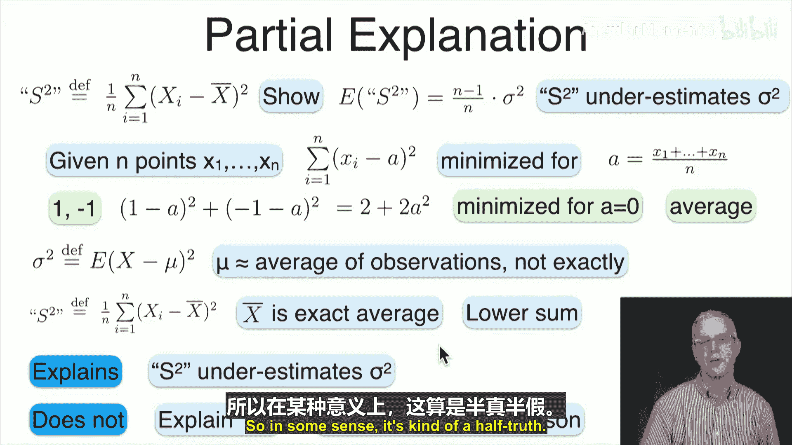
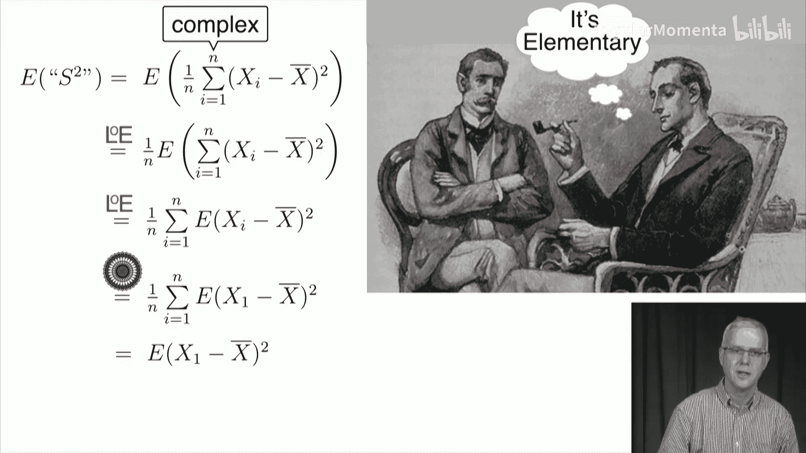
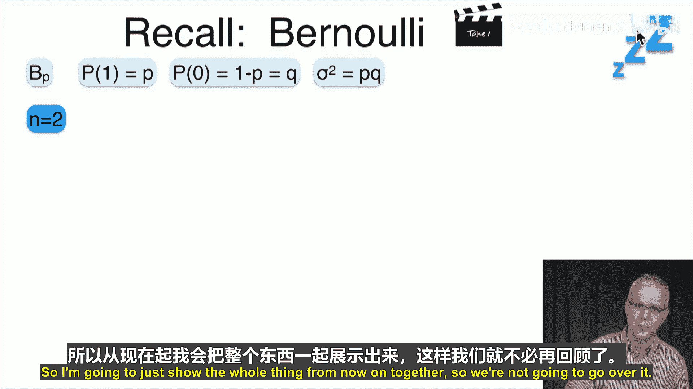
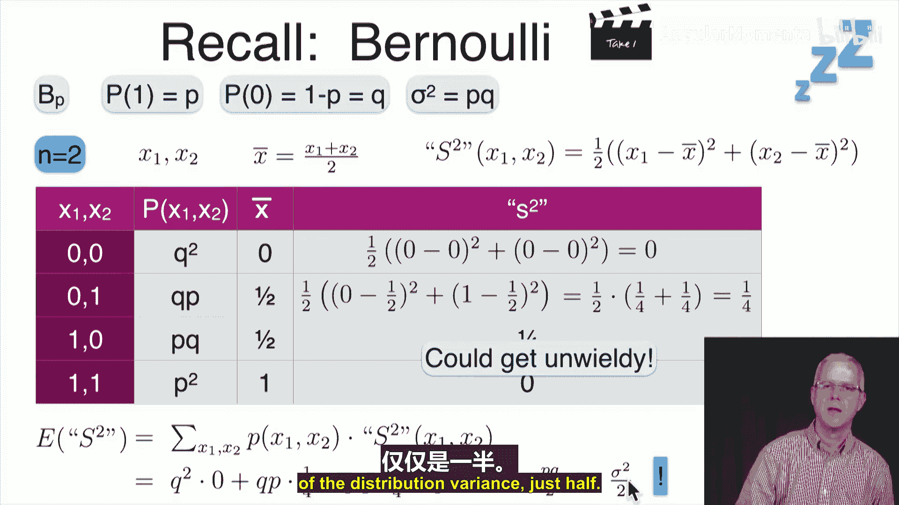
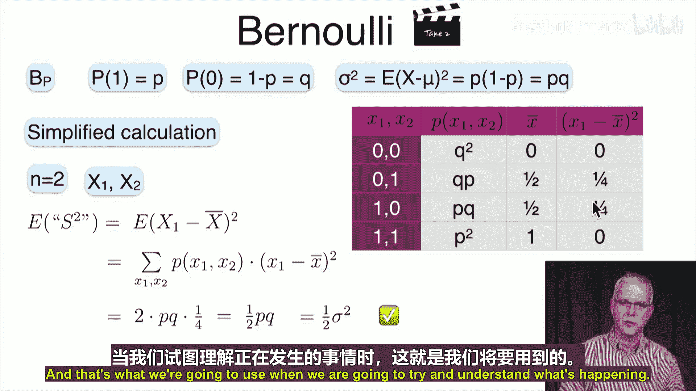
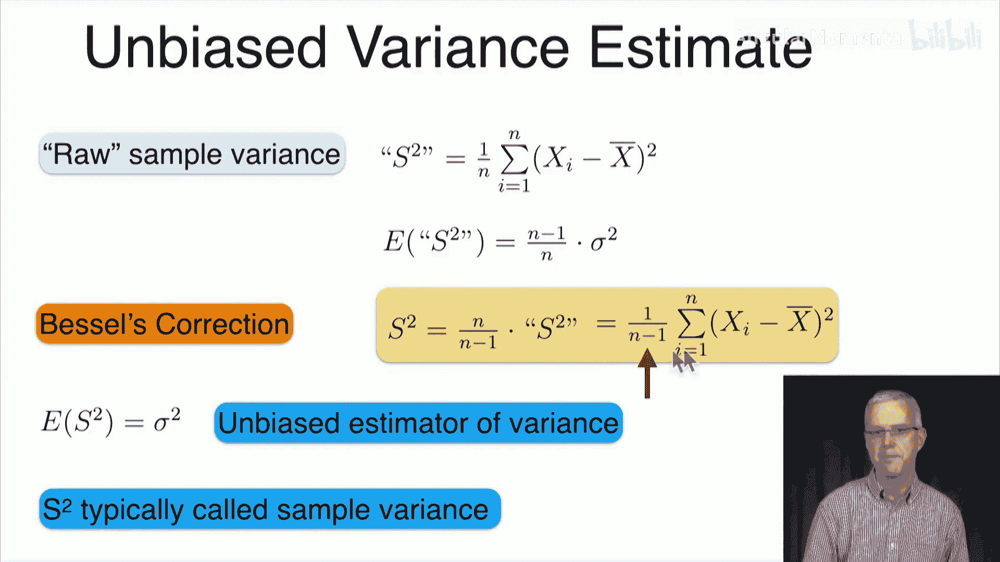
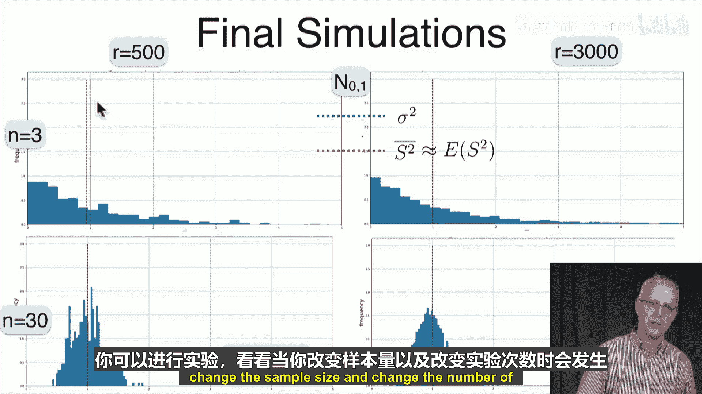

# 【加州大学圣地亚哥分校】使用Python进行数据科学中的概率与统计--Probability-and-Statistics-in-Data-Science-p51-12-04-03-无偏估计--BV1gJFDzkEPg_p51-

Hello and welcome back last time we discussed estimating the variance and today we're going to talk about unbiased estimation of the variance and we're going to resolve the mystery of the missing man。

So what we're going to do is're going to evaluate the bias of the estimator the raw estimator that we described last time。

 and we're going to understand its behavior a little better and then we'll describe it an unbiased estimator and doing that will resolve the mystery that we have and we also dispel a half truth。

Okay， so let's start so what is in the mystery so just tie small repetition。

 remember that the sample mean which we denote by x bar is just the average of the sample values。

1 over n times the summation of the X， the samples。

 and you may also recall that the expected value of the sample mean is exactly mu。

 which is the distribution population average mean。

 and therefore the sample mean is an unbiased estimator of the distribution mean。

Now when we looked at the variance instead of the mean。

 then we defined the quote unquote raw sample variance to be which we denoted by s square quote。

 n s square is because weestimating sigma square and the quote is because it's kind of raw。

 we defined to be the average of the difference between the sample and the sample mean square。

 so its summation of the sample values minus the sample mean square sumd over all。Samples。

 and then we normalize by the number of samples。And then as we saw we were in a couple of experiments and we saw that the expected value of this sample variance was roughly from the experiments was roughly n minus1 over n times sigma square or we saw it for n equals to2 was half sigma square and we also calculated it for simple example。

 and therefore therefore this raw sample variance is biased。

 it doesn't its expectation is not sigma square， but something that's smaller than sigma square。

And so that leads to a small mystery in the sense that if you take 10 people like 10 men or 10 women and if you want to find a mean then what you do is you just add the heights so here you add the heights and then you normalize by the number of people in this case by 10 and normalize by 10 but if you want to calculate the variance of the heights。

 not the mean of the heights， then again you add the heights like here okay and you normalize again。

 but instead of but in order to get the right value instead of normalizing by 10 you need to normalize by some other number by 9 so you get something that will instead of giving you something which is n minus1 over n will give you actually the right value and so the question is why that is so and if it's so and so what we're going to show is that first we're going to show that indeed the expected value of this。

Of this estimator。Of S square is n minus-1 over n times sigma square， so this is correct。

 it's not roughly correct or correct just for the newly distribution it's always true and then we'll also try to see why this is so and how to fix it。

All right， so let's start and again we're going to start by giving a partial explanation of why the raw sample mean underestimates the variance。

 so the raw sample mean again is1 over n times the summation of the difference between the values。

 the samples and the mean squared。And as we said， we're going to show that its expected value is n minus1 over n times sigma square。

 so if the sample is of size 2 then then this sample mean I'm sorry sample variance will give you half of sigma square if you architect three samples it will give you two thirds of sigma square and so on and we want to see so in other words it underestimates the variance and we want to see y so one partial explanation is as follows so observe that if you're given npoint x1 up to x n and you're interested in。

And in the summation of X those points minus some fixed value a square。

 So looking at summation of Xi minus a squared， then you want to sum over all I from1 up to n。

 then this quantity is minimized for which a。Well， it will be minimized for a。

 which is the average of all the Xi。Okay， so a is the sum of the X divide domain， for example。

 if you take two points1 and minus1 and you want to minimize in this case。

1 minus a plus minus1 minus a。Then we can just solve it。

 is going this one will give us1 minus2a plus a square。

 and this will give us 1 plus 2a plus a square， so the 2A will cancel and will be left with 2 plus 2 a square。

And if you want to minimize this， you'll clearly choose this point A to B 0。

So the minimized for a which is0， and as you can see， a equals 0 is the average between 1 and minus1。

And this will always be true if you take not just two points but any number of points and you want to minimize the summation of Xi minus some fixed value。

 the squared and sum over all the points， then the minimum is going to be when this point that you subtract is just the average of all of them it also makes sense。

Okay， so now let's go back to our example and see why the sample variance underestimated the real variance。

So the real vnes S square is just the expected value of x minus mu right that's our definition and you notice that mu is roughly the average of the samples right because mu is the means so the average of the sample and if you took lots of samples。

 the average will be exactly mu， but if you take two samples or three samples。

 the average will not be exactly mu one of them may be mu plus 3 and other one may be mu minus 3。

2 something like that so the average will be roughly mu but not exactly mu。Okay， on the other hand。

 when you calculate the sample variance here， then we're subtracting x average。

 which is exactly the average of all the samples， so we're subtracting x average。

hi is the exact average of all the samples， so when we do that by what we said here。

 this will minimize the summation of the squares。So this will therefore give a lower sum than what the distribution may want to give。

Right so this explains why S square underestimate sigma square because this sum is going to be a little smaller than some when you subtract the expectation。

 which is not the exact average， but what it does not explain is why do we give does not explain why we get n minus1 over n a factor of n minus1 over n and always get a factor of n minus1 over n。

And also， as we're going to see， it does not capture the whole reason for why we get this。

 it's only half of the reason， so in some sense it's kind of a half truth and we'll get to that as well。

Allright so to show that and let's go back to Sherlock and as he would do let's show that something or at least let's show something that is elementary so were try and calculate the expected the value of the sample variance here and the sample variance was defined again to be the one over n times the summation of the differences between the samples and the sample mean and as you can see and then we take the expectation of cases and you can see this is a complex example if n is 10 we need to take this differences squared them at 10 numbers it's rather complex so we want to simplify it a little bit。

So first of all， notice that  one over n is a constant， so by the linearity of expectation。

 we can take it outside of the expectation and get that this is one over n times the expected value of what's left。

And then notice again that you have your expected value of this sum。

 so again by the linear of expectations， we can take the sum out and we'll get 1 over n times the summation of the expected value of X minus the sample average sample mean squared so we just took here we took one over n out and here we took the summation out。

 but now notice that there's a little bit of symmetry going on because the X's or IDD。

 each of them is generated according to the same distribution。

 so there's no reason why the expected value of x1 minus the sample mean will different from the expected value of x2 minus the sample mean or x3。

 so all these expectation， the expected value of each X minus the sample mean squared。

 they're all going to be the same。Okay so we can replace all of them by just the expected value for x1。

 so it's just1 over n times the summation of the expected value of x1 minus the sample mean squared。

So that's just why we observe because all of them are the same behave the same。

 so what we have now is we have the same value， this expectation while this expected square distance of x1 from the sample mean squared this expected value we just edit n time to itself and then normalize by n so we can just cancel and this is just the expected value of x1 minus the sample mean squared so as we can see we start with something which was a little complex。

 got to something which is a little nicer and it's also intuitive right because here we have just the average of all all the values all the distance is squared。

 but each of them behaves the same。 So we're just taking the first one that's what we did so it's intuitive and it's simple or as Sherlock would say it's elementary and there's another advantage to this simplification and that is that it makes it easier to understand what's going on because we don't need to think of as sum we can just think of。

A single random variable x1， and therefore is there to explain why we get this factor of n minus1 again。

so that's we're going to the next but before that let's just see how we can use this simplification to simplify the example that we did before so remember we had in last lecture we saw the example of beernoulli randomvers and we said we had beernoulli P so the probability of 1 p the probability of0 was1 minus p which we didoteed by Q and therefore the variance sigma square was p times1 minus p or p timesq okay and we evaluated what happens when we take a sample of two observations and if you recall was a little subpific so it's still a little subpific so we're going to I'm going to just show the whole thing from that one together so we're not going go over it but this was the calculation and the one thing that I want to remind you is that this calculation here and calculated a square we had to look at the summation。

 the long summation， this case summation of two values which was a little long and if we took。

Samples will be longer and if it was not Brnoulli， but anything else it would be longer still so it can get quite quite unwieldy but whatever it is we use it to show that the expected value of the sample variance was half of the distribution variance just half so now we want to do it using the simplified approach so this is take2 the same example so again we have Brnoulli P and we do the simplified calculation again n equals 2 so we have x1 and x2 or the two random variables we observe and the expected value of the sample variance S square is as we saw by the simplification is just the expected value of x1 minus the sample average square so we just need to look at this and so we need to look at summation of all x1 x2 times of the probability of x1 x2 times。

This the difference of x1 minus the x average And so here here is the table to have x1 x2。

 here is going to be the probability， here is the average of x1 x2， and here is x1。

 the first element minus the average squared。 So if x1 x2 of both 0。

 that happens probability Q square。 So the average of the x is 0。

 and x1 minus the average is 0 minus0 which is 0。Okay， if x1 x2 is 0 and 1。

 that happens probably Q times p， the average of 0 and 1 is a half。

And therefore the difference between xx1 which is0 and a half is a half。

 but we square it we get one quarter likewise for10 probably pq。

 the average is a half the difference square is one minus a half which is a half square which is a quarter and 11 p square average one this squared this difference is0 so we can come and calculate the expectation it's going to be just get just from here it's going to be two times pq times one quarter which is pq over two which is sigma square over two which is the same as what we got before but we have this last column here。

 which is a lot simpler than the really wide column that we had before and that's what we're going to use when we are going to try and understand what's happening so it's simpler and it's easier to analyze so using the simplified formulation let's rephrase our question。

Okay， so we want to show that the expected value of the sample variance is n minus1 over n times sigma squared。

But we just showed that and you observe here that this is not so easy to understand because here we have one quantity which is expressed as a sum of a long thing anywhere you have something that looks completely different。

 it'd be a lot nicer if we had something on the left that looked a lot like what's on the right and that's what we can do now okay so we just showed that they expected the value of the sample pervari。

😊，We showed was the expected value of this long expression which we simplified to just the expected value of x1 minus the sample average square that's what we had shown so that's for the left side for the right side just observed that sigma square because x1 same x1 is distributed according to whatever we have only one distribution call it P then sigma square is just the expected value of x1 minus mu squared。

Okay， so sigma squared is the variance of this distribution。

 it says the expected value of x1 minus the mean squared。Okay， so what we instead of showing this。

 what we want to show is equivalently， we want to show that the expected value of x1 minus。

Average x squared。 So this becomes that is equal to n minus1 over n from here times instead of sigma square we write to expect the value of x1 minus mu squared。

 Okay， so this is a lot nicer， right， because this is symmetric， right。

 So we have here exactly the same expression almost exactly。

 We have the expected value of x1 minus x average。 And here we have the expected value of x1 minus mu。

 That's the only difference and shows the difference between what we want to to prove。

 And now we can relate them more easily。All right， so let's see how to phrase the partial argument。

 you can say maybe the simplistic argument that we had before。

 which you remember we said that this is smaller than the sum variance was smaller because we subtracted the exact average so we can rephrase it here and say that what we have here is that this expectation is smaller than this expectation。

s a bit smaller by this factor n minus smaller over n。

Because x hat here includes x1 and therefore it's closer to x1。

 so when we take this expected of this different square， it's going to be smaller。So again。

 the simplicityimplistic argument says that in fact it says the only reason why this is smaller is because x hat。

 or that's the only reason it gives， I should say， is that this x hat includes x1 and therefore it's closer to x1 and therefore this is going to be smaller and x1 minus mu is mu。

Theres no relation to x1 is just the average and it does not need to know what x1 is。

So it says that x x set includes x1， hence x is closer to x1， the newest to x1。Okay， so and again。

 notice that just like before， it's a same it doesn't explain why we get n minus1 over n and as we're going to see。

 it's not the whole story。All right， so we're going to first show show this equality for n equal to 2。

 so what we want to show is that the expected value when you have two samples x1 and x2。

 the expected value of x1 minus the average of the two sample is going to be here and is2 so it's going to be1 half1 over 2。

1 half times the expected value of x1 minus me squared notice that this is just the variance。Okay。

 so we'll first show it for n equal to 2， and then we're going to show it for general n。Okay。

 so again， for n equal to 2， we want to show that the expected value of x1 minus the sample mean squared is1 half the expected value of x1 minus mu squared。

 and this is just sigma squared。Over 2 this is the half so in order to show this So what we want to do is we want to relate the x1 minus x average to x1 minus mu as as we said。

 the difference or one difference is the x average includes x1 so in order to relate them we want to first decouple x1 from the average of the x so it's rather easy here we can write x1 minus the average of the x。

 so it's x1 minus x1 plus x2 over 2。 and then just this gives us x1 minus x1 over  two is just going give us x1 minus x2 over  two。

 right， because this becomes 2 x1 minus x1 is x1 and then minus x2 over 2。

So x1 minus the average is just x1 minus x2， the difference over 2。

So now we can write what we have here on the left， the expected value of x1 minus the average square。

Okay， we can just plug this in x1 minus x average， it's just the expected value of x1 minus x2。

Over two all things square and now this quantity here is just x1 minus x2 square divided by 4。

And by linearity of expectation， we can take four out。

 so this becomes one quarter times the expected value of x1 minus x2 squared。

Okay and now here's one observation， so x2 now the X sizes are independent。

 so x2 is independent of x1。So what we have here is the expected value of x1 minus x2。

 x2 has the same minus mu as does x average。And but x2 is not closer to to x1 than mu is。

 It's exactly we have， you know， it's again， random， so it's not any。

Sorry it's random so its not and it's independent of x1， so it's not any closer。 so if the argument。

 so if the argument was that the reason this was smaller was because x1 was x1 and x had were correlatedlate and then we x had was closer to x1 then mu then this argument does not work here because x2 is not necessarily closer to x1 than x than mu is so if this argument if this was the only reason then we could replace here x2 by mu because x2 is not closer to x1 than mu。

 so we would have gotten that this is equal to one quarter， the expected value of x1 minus mu。

Squared， but the expected value of x1 minus minus mu squared is just sigma squared。

 so this would give us sigma squared over 4。So if this argument was the whole thing that the only reason for this difference was that x hat includes x1 is closer to x1。

Then would if this was the whole story， then we would get that the expected value of x1 minus the mean square should not be1 half。

 but in fact should' be a quarter of the variance and that's not the case。

 And the reason it's not the case is so it's even small。

 The reason it's not the case is because it's not the whole story It is more to it than that and the more to it is that。

Here we have。We related the expected value of x1 minus the average to the expected value of x1 minus x2 then we had got a a factor1 quarter from that。

 but x2 is random， whereas mu is not random And when we look at the expectation of x1 minus some random value。

 it actually increases this expectation square。 So the randomness of x x to actually reverses some of the decrease we' weve got to decrease by factor of 4 and this will actually increase the variance by actually factor of 2。

 so it will reverse sum of it so what we're going to show is that the expected value of x1 minus x2 square。

 this quantity here is actually twice the expected value of x1 minus the average square。

 and once we have this second part， then it's easy to see that the expected value of x1 minus x average。

 this is what we want to evaluate。Okay， then by what we showed here， it's going to be one quarter。

They expected the value of x1 minus x2 squared。But this expected value of x1 minus x2 square is twice。

 so it's going to prototype times twice the expected value of x1 minus mu square。

And so we get here the two will cancel with part of the one quarter， so we get here。

 this is sigma square， sigma square over two so this is what we're going to show and by the way。

 to show this the only thing that we need to show we already show this part we only need to show this part here but just before we do that I want to observe again that what this shows is that we got one quarter we gained from the proximity of x hat to to x1 because x hat is closer than mu to x1 we got this one quarter and then we lost we lost fact of two so we got fact of for here improvement here and we got lost than effect of2 due to the randomness of x2 so when we related it to to mu so we have one quarter and then two so altogether we gained the fact of2 so the only thing we need to show is this part here that the expected value of x1 minus。

X2 squared is twice the expected value of x1 minus me squared。So that's what we're going to do now。

 so one show that the expected value of x1 minus x2 square is twice the expected value of x1 minus mu squared。

OkayNow here's a simple observation， if you look at x1 and minus x2。

 then its expectation is by the linearard of expectation is just mu minus mu because x1 next2 both distributed according to P。

So it's mean minus me which is 0， so x1 minus x2 has 0 me。Likewise， if you look at the right side。

 it expect the value of x1 minus mu， its expectation is also mu minus mu right because the expected the value of x1 is mu and we have a linear expectation。

 so this is also zero。😊，Okay， so we have。Here x1 minus x2 and x1 minus mu are two random variables with Xomi。

And for any zero mean random variable z， we know that the expected value of z square like we have here is just the variance of z right。

 because the variance of z is the expected value of z minus its mean squared， but the mean here is0。

 so the variance of z is the expected value of z square。

So what we have here is the variance of x1 minus x2。

 and what we have here is the variance of x1 minus mu。And notice the x1。

 the variance of x1 minus mu is the same as the variance of x1 and that's because both x1 minus x2 and x1 minus me both of them have a xome Okay so in other words。

 to show that the expected value of x1 minus x2 square is equal to twice the expected value of x1 minus mu squared to show this。

 we can prove the same result for the variances。And we can show that the variance of x1 minus x2。

Here is the same as the variance of x1 minus mu。When you subtract mu， which is a constant。

 doesn't change the variance， so it's twice the variance of x1， okay so that's what we want to show。

Allright， so but that's easy because the variance of x1 minus x2， while x1 and x2 are independent。

 so the variance of the difference order sum by independence is just the sum of the variances。

And now x1 and x2 are dependent distributed according to the same distribution P。

 so this is going to be just a variance of x1 plus variance of x1 again。

 so it's twice the variance of x1 and so we get that this variance is just twice the variance of x1 and we are done。

Okay so even though we are done， it may not quite look that way because we you know we have shown that we have done over a few slides。

 so I just want to combine everything into a single slide。

 see what we have what we did and then be convinced that indeed there okay so summary for n equal to 2 we want to calculate the expected value of the sample variance。

And by definitions， they expected the value of 1 over n summation of X minus x hat squared。

So we said this calculation here is too complicated for us。

 so we simplified it and we just use symmetry to show that this is just exactly the same as the expected value of x1 minus the average square。

 so we can just take one of those elements。 We don't need to average all of them。

 we show that now we and these two work for any n now we do it for n equal to2 we observed here that x1 minus x hat is just x1 minus x2 over2。

So we can just replace that here and so this is the expected value of x1 minus x2 over 2 squared and we use linearity of expectation to say that this is one quarter times the expected value of x1 minus x2 squared right because we have one quarter here when you square it and comes outside it。

Okay， so okay， so that now we notice that x1 minus x2 has zero in。And because at z mean。

 then the expectation of x1 minus x2 square is just the variance of x1 minus x2。

And then we use the fact that x1 x2 are independent to say that this is a quarter times the sum of the two variances。

And then we said that x1 and x2 are distributed according to the same distribution。

 so this is just in the IID they identically distributed， so this is twice the variance of x1。Okay。

 and so we get one quarter times twice in the variance of x y sigma squared。

 so you get one quarter times two sigma squared， which is sigma squared over2。

So you can see it's actually fairly simple okay we just describe it over a couple of slides to motivate each of those steps and also also to show what you gain from the fact that x that x average is closer to x1 then than mu and let's just repeat what that was this was we got one part here so we got one quarter factor we got the one quarter factor of4 improvement because x1 was closer to mu I'm sorry x average was closer to mu was closer I'm sorry was closer to x1 than mu was to x1 so x1。

I'm sorry， x average minus mu was closer than mute。I'm sorry。

 x average minus x1 was smaller than new minus x1 and because of that， when you write x average。

 then we get a factor of four here because x2， we can think of as just being mu。

And then on the other hand， when we do this replacement x2 and so x average is random。

 so we lost something， the variance of the difference， we added a the variance of x2。

 and were doing this we lost the factor of 2， so again the factor of  four， lost the factor of 2。

 we gain a factor of two when you combine all them。Okay。

 so this is summary for n equal to two and now we want to do the same thing for。

NN and you can see that we can just do it in one slide， it's going to be very simple， I hope okay。

 so for general N， we won't calculate the expected value of the sample variance。

It's the expected value of the average of the difference between the samples and the sample mean squared。

Okay， and then by symmetry we can show， in fact， we showed it in general。

 it's the expected value of x1 minus x average squared。

And now we need to do again we want to decouple， we want to relate this to see how much we gain by x average being close to x1 closer than the mu。

 So what we want to do is again decouple x1， get it out of x average so we can write x1 minus x average is x1 minus the average of x1 up to x n over n。

Okay， denominator is n， we get n x1 minus x1， so it's n minus1 xn， x1 minus all of these。Okay。

 and now we can write it as n1 over n， we can take that out and then we'll get x1 and then minus x2 plus xn divided by n minus1。

 can see if this n minus1 and cancel will get this over n。

So we got that x1 minus the average x is n minus over n。

Ts x1 minus this sum here and notice that this sum here here does not contain x1。

 so it's not closer to x1， than mu is on average， it does to behave the same as mu relative to x1。

It's not any closer to x1 than me is and so we can just plug this in so we can get that this is the expected value of n1 over n x1 minus the average of the remaining x all this squared and then I can use the linearity of expectation to get that this is we have here is squared so n1 over n will become n1 over n squared because we are squared and take it outside of the expectation so we get n1 over n squared times the expected value of x1 minus the average of all the other xs。

and this is squared so what we can see again， this now behaves。

 this is not closer to x1 than mu is on average， and so what we gained by having x hat which is closer to x1 is we gained a fact of n minus1 over 2。

So we gain the v factor of n n minus1 over2 because x set is closer to mu than x1 is。

And this is notice the square of what we eventually are going to get。So we getting more。

And now we observe that this x1， its expectation is mu and this average of the other Xs。

 their expectation， the expectation of the average is also mu， so this random of variable has0 mean。

 so this is n minus1 over n squared times the variance of this random variable x1 minus the average of the rest。

 and now we can use the independence of the Xi to say that this factor is the same。

 this is the variance of x1 plus the variance of the rest。

But now notice that this here we have a variance of the average of independent random variables and we know that when you take the average of the sum of independent R variables。

 the variance will just go down by linearly so if you take the average of。

5 independent render variable， the variance will go down by factor of 5 we've shown this before it's actually very easy。

 you just add the variances， so multiply it by the number of variables and then here you divide by the number of variables so that will come down as squared and altogether you'll just normalize by the number of variables so by the independence of the Xs and by the scaling of the variance。

We get that this is sigma squared and this is sigma squared divided by n1。

 again we're just normalizing by N1 because we're scaling the variance like that。

And now we can just write this as what as n， this is n over n minus1 times sigma squared right。

 we have n minus-1 the denominator， and then we get 1 plus n -1 is n。

And so what we see here is that we here we lost the effect of n over n minus1。

Because because of this the randomness here now x hat is is random Okay so we lost and now so we gained phi this factor n minus1 over n squared。

 we lost n over n minus1 cancels one of those factors and altogether we get the expected value of the sample variance is n minus1 over n times the distribution variance。

So this is the whole proof and we also understand where it's coming from and why the fact that X hat is closer is only half of the story。

 and in fact that by itself would give us a better improvement but we are subtracting a random number so we're losing some of what we gained so together we get n1。

So。So now that we calculated the expected value of the raw sample variance。

 we want to and we saw that it's biased， we want to correct this bias。

And so for the row sample variance， which was defined with that。

 we showed that the expectation was n minus1 over n times the real variance and we want to come up with an estimator that will be unbiased so its expectation would be sigma square and we can see from from this that there is something very simple we can do this is true for any distribution so it's always n minus1 over n so we can just multiply whatever we got here by n over n minus1 and cancel with this term and this is called the bessels correction so we define s square we remove the quotes we define s square。

Sple variance to be just n over n minus1 times the raw sample variance。

And that n minus n over n minus1 will castle with this so and this by the way is multiply this by n and divide by n minus1 we'll get1 over n minus1 times the summation of x I minus x square so in other words we add n n terms but we instead dividing by n we're dividing by n minus1 and that's our small mystery that we had why we're normalizing not by n but by n minus1' a mystery that any new student that learns how to estimate variance observes and most node say wonder why this is so and I think now hopefully we understand。

All okay so so this is the main thing to notice this is a little unintuitive but we know where it comes from okay and so what is the expectation of s square not the s quote is just going to be this the original expectation here but we multiplied by n over n minus1 so this word cancel so it's just the variance so we so S square is therefore an unbiased estimator for for the variance。

Okay，And typically when people talk about the sample variance， they'll refer to x square to this。

 not to the raw sample variance that we define here R is the term we're using。

 you can call it any other name。Allright okay so hopefully this is clear。

 we showed that for the raw sample variance it's expected the value was n minus1 over n times the variance and so we just multiply by n over n minus1 to cancel this effect and we got a new estimator was expected the value is exactly the variance and therefore it's unpasaced and when you want the formula and instead of normalable by n you normalize by。

N -1， because take 1 over n， multiply by n divided by n -1。

Right， so let's do a third example for the same sample example。Let's take。啊。Again。

 it's any we had five observations， there were two， one，426。

 and what we saw before is that the sample average was  three。

And when we calculated the raw variance sample variance， it was 3。2。

 and now we want to calculate the real sample variance， so what we need to do is take the same sum。

 but normalize instead of by n， we normalize by n minus-1。

So what do we get or we get here the average is  three so2 minus-3 is minus-1 and1 square is1 and here we have1 minus3 which is minus-2 square is4 and then one again and then I'm sorry yeah one again and then one again4 minus3 and2 minus1 and then 6 minus-3 is three so gives us nine calculation of course we have done before for the raw sample variance。

But the only difference is that even though we have five values that we're adding because we have five samples before we normalize by5。

 now we normalize by4 and we do that we get 16 over 4， which is 4。So therefore。

 our new sample variance。Is 4， not 3。2 and you can also see you get it by multiplying this by5 over 4 because divide by 4 get 。

8 times 5 we gives c4。And in general， you'll get the unbiased sample variance by multiplying by n over n minus1。

And this is an unbiased estimate of the variance。And just like for the raw sample variance。

 we had the one pass calculation， we can do the same thing here。

 the one pass calculation we had for the raw sample variance was one over n times summation Xi square。

 so it's the average of the square minus the square of the average。

And now we need to multiply this by n minus1 over n。Okay。

I'm sorry we need to I'm sorry we multiply this by n over n -1 Okay， so when we do that。

 we'll get this here because we can see that when imply this n over n 1 gives one over n -1 times the sum of the squares so that's what we have here and here we have n and for this part we'll have n over n minus-1 which is the same as what we have here n over n -1 so this is if you want to do a one plus calculation just calculating go over the data once each time you add the squares each time you take you add the values and you square this。

And subtract。All right， so let's finish by showing a simulation。

 so just to make sure that what we did is in the degrees with what we observe。

So we take a normal 01 standard normal distribution， we take three samples。

 and we repeat it 500 times。Here is the histogram of the sample of variances that we got now these are the real sample variances that are normalized by n1。

 this is the histogram of all the values that we got and this line here is sigma square which will be one variance and the red line is the average of the samples we got and they should be the same but they're not exactly the same so you wonder oh maybe what we did was incorrect or maybe it's because。

We just our the number of experiments that we had is not large enough to get the exact expectations so what we can do is we can change start repeating 500 times and can see it's roughly the same but not exactly the same so what we can do is instead of 500 times we can repeat the experiment 3000 times and when you do that you can see that indeed the average of all the samples is going to be the same as the of the distributions。

The average of all the sample variances and notice that what made this a little difference were two things one is we you know we took we repeated the experiments not too many times and the other one is our each sample just three observations so it's very small so there was a lot of noise in each so alternatively we can also increase the number of observation take an average when we calculate the sample variance based it on a sample of size 30 and once you do that even if you take 500 samples already you get something which is fairly close to the distribution variance and if you repeat it three0 sometimes we get even closer。

All right， so and again， this is in the notebook， you can experiment and see what happens when you change the sample size and change the number of experiments。

So let's summarize， we talked about unbiased estimation of the variance。

And what we did was we evaluated the variance， we understood its behavior and we came up with an unbiased estimator which used the besel correction。

 namely and it was instead of normalizing by n we normalizedize by n minus1。

sumation of X minus the sample average square， and this helped resolve the mystery of why we're normalizing by n minus1 and also dispel the half truth that the reason why we get this where we got the initial bias is because x hat was closer to x1。

That accounted for half of the reason， but on the whole reason。

 and next time we're going to talk about estimating the standard deviation， see you then。

