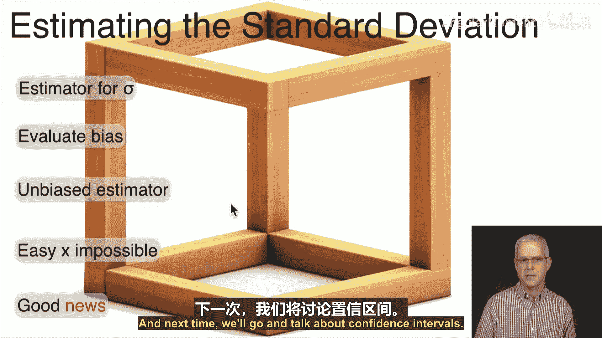
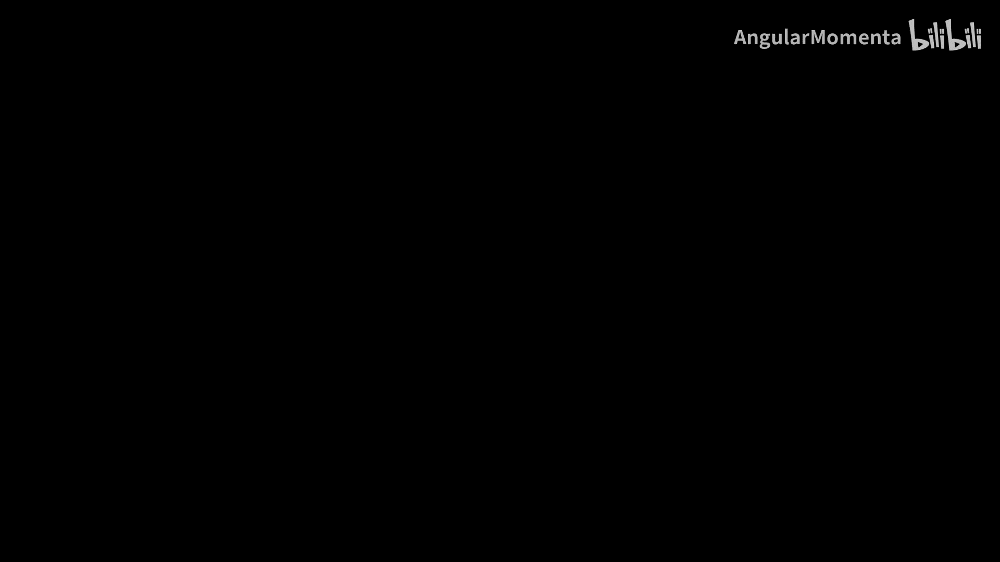

# 【加州大学圣地亚哥分校】使用Python进行数据科学中的概率与统计--Probability-and-Statistics-in-Data-Science-p52-12-05-03-标准差--BV1gJFDzkEPg_p52-

Hello and welcome back Last time we talked about estimating the variance and today we'll talk about the logical consequence estimating the standard deviation。

What we'll do is we'll first describe a simple estimator for the standard deviation for Sigma。

 we'll evaluate its bias， we'll discuss unbiased estimators for Sigma。

 and we'll also talk about a question that's maybe easy or impossible or both just like this cube。

And then we'll end with some good news。First estimating the standard deviation。

 So we last last lecture we presented a simple estimator of for the variance。 it was called S square。

 which was just the summation of the。The squares of the differences between the observations and the average。

 and the only interesting thing about it was that we normalizedize by n minus1 as we discussed and once we did that。

 then the expected value of s square。Was Sigma square， in other words。

 a square was an unbiased estimator for the variance， so this is a nice property to have。

And how do we come up with an estimator for sigma， well sigma is just the square root of the variance。

 so the very natural estimator is in fact， the standard。Stunner deviation estimator。

 the standard estimator for standard deviation is just the square root of the variance estimator。

 which is so it's the square root of S square root taking of course the positive square root。

 so it's just the positive square root of 1 over n minus1 times the summation of the squares of the differences between the observations and oing。

OkayAnd a very natural question to ask is how good is this estimator is this estimator biased or not in but before we do that let's just do a very simple example so we'll take the sample that we discussed when we considered the variance estimator so n was5 there were5 observations 21426 and what we saw was that the average was3 and that s square was1 over n minus1 n is5 times the sum of the squares of the differences between the elements and the mean so it was one because2 minus3 is minus1 square is 1 and then 1 minus3 is minus2 squares4 and so on so 1 plus4 plus 1 plus1 plus9 and we divide by4 which is n minus1 and that we showed was 4 and the only thing we need to do now is just take the square root of s square or the squared。

The four and now estimate for this standard deviation is just two。

And what we would like to see is whether this estimator isn unbiased or not。So。

This is our question and one thing to recall is that the expected value of s squared is the expected value of s。

The whole thing squared plus the variance of S and you remember that because our alternative definition for the variance was the expectation of the square minus the square of the expectation。

And because the variance is non negative， this is always bigger than or equal to the expected value of s square。

 and in fact it's almost always going to be strictly bigger because going you get equality if and only if the variance is0。

And the variance is0， if and only if s is a constant。 So in all other cases。

 we get thatstricting quality here and just rearranging。

 we see that the expected value of S square is less than equal to the expected value of。

S the expected value of S， this whole thing squared is less than or equal to the expected value of S squared。

And again， we saw it here， but another way to think about it is the expected value of S could。

 for example， be0。While a square is nonze enough for this expectation is going to be positive。

And now we know we have here the expected value of s square。

 but we know that S square is an unbiased variance estimator。

 and therefore this expectation is just sigma square。

Because it's unbiasedest for sigma square and now we can take square root on both sides and we get the expected value of s is less than equal to sigma and now and this shows that sigma is an underestimate I'm sorry S is an underestimate of sigma and that's because the only time we'll get equality is if sine is a constant namely when x is a constant in all other cases will get here strictly inequality so we get equality only when x is a constant in all other cases we see that S strictly underestimate sigma in the sense that it's expected value is strictly less than sigma。

And so if just maybe this was a little too simple， so let's look at the specific example where s strictly underestimate sigma。

 so here is an example， let's look at bernoulli p and again there will be many such examples any in fact anything you can think of where x is not a constant s will strongly to estimate sigma the only interesting part is find a simple example you can show it so take bernoulli p and the standard deviation is squared of p times 1 minus p which we call squared of pqq is1 minus p so let's say we take two observation and equals to2 a sample of size 2 and will' show that the expected value of s is strictly less than the standard deviation。

So the possible values are so x， so we get two samples we'll get x1 and x2 and they could take values 0 and 0 that happens probably Q square。

 and then the average of the two samples is0 and we're repeating what we have done for the variance。

 we're just adding a last column for S。And so therefore S squared。

 we're looking at the differences between those values and the mean。

 which is so it's difference between0 and0 which is 0， so S square is0 and therefore s is also0。

When x1 is 0 and x2 is 1， that happens probably we tip q times p。

And then the average of the excess is half。And S square is a half we saw it before。

 but just in case we have0 minus a half square right so it's 0 minus a half square plus 1 minus a half square and so that gives us one quarter plus one quarter is a half and we divide not by 2 which is n by but by1 because we divideiding by n minus1 so this gives us a half so S squared is a half and we saw it in the last lecture square as1 and therefore s is is the squared of that which is one over squared of2 and the same thing when we look at 10 and when we have 11 we again that s is0 so what is the expected value of s is justq squared times0 plus Qp times one over squared of 2 plus pq times one over squared of 2 plus p squared times0 and that's just going to be twice this value so2 over squared of2 is squared of 2 so this is just squared of2 times pq and we want to compare this is the expected value of s we want to compare it to the standard deviation。

which is squared of Pq， so here is a graph， this is squared of2 times pq。

 this is what the expected value of S。And this is the standard deviation and we see that this is always less than squared of pq。

 so the expected value of s is always less than squared of pq， which is sigma。

 so we can see that s always， except when PMNq are0 when x is a constant in all other cases we see that s underestimates the standard deviation。

Alright so a very natural question to ask okay this doesn't work so can we find another estimator for sigma which will be unbiased okay in other words。

 is there an unbiased estimator for sigma and just a quick observation if P the distribution is known then also the standard deviation is known so there's nothing to  estimate we don't need to come up with an estimator we just no sigma so the only significance of this question is we want to find an estimator that works for all distributions or p so in other words for all so if we look for example for the mean we saw that if we take the sample the sample mean it's always for any P it's an unbiased estimator the expected value of the sample mean was mu and likewise for the variance the expected value of the sample variance was was the variance itself so what we want to know if what we want to ask is is there an estimator sigma hat such that for all distribution P the expected value。

Of this estimate is exactly sigma for all distribution P。And the answer perhaps pricing answer is no。

 there is no general unbiased estimator for the standard deviation okay。

And so you may ask can how do we know that， how can we prove the impossible and so we can look at different proof techniques that exist and I found a web page which lists 36 of them let's go over a couple okay so here they are and I picked up a few okay so this one here says is proof by obvious it says that the proof is so clear that it needs to be does not need to be mentioned。

Here's another one it's proof by intimidation， I don't know if you can read。

 read it for you it says don't be stupid， of course it's true actually this one is particularly handy I may use it sometime。

This one says is approved by lack of sufficient time， it says because of the time constraints。

 I'll leave the proof to you。And here is proof by plagiarism， says as we see on page 289。

And this one is proof by eligibility， well you can read。

And I've actually been in this business for long enough that I know of a couple other proof techniques here are some proof by hand waving so you know like as you can see it's very clear and so on okay this is one and another one is proof by induction well it's distinct thing it holds for one。

 two and three so it must be true for any number。And which proof technique do you think we're going to use now？

Actually we'll use a coary of this proof by induction。

 it's proof by example you know you show it this is true for this trivial example so it must be true so we'll use this proof technique all right so we want to show that there is no unbiased estimator for sigma。

And what we'll show is that even for Berulli P， the class of Bernoulli distributions。

 know the simplest class， when Ps are known as we assume for this is a collection of distributions。

 we cannot find any unbiased estimator if we show that even for this small class there's no unbiased en and clearly there's no unbiased estimator for all distributions。

So and we'll show it for n equals to2 for when you take two samples。

 but a single proof works for any。Okay so the obvious question is how do we prove the impossible。

 how do we prove that there is no unbiased estimator and maybe you want to pause the video now and think about how would you go about it and it looks like a very difficult question but in fact will'll show that you can do it reasonably easily so select let sigma hat that be any estimator for Brno P so it's an estimator that given the samples to samples will give you an  estimate who's expected value is sigma so sigma hat of x1 x2 is the estimate of our est of sigma when observing x1 and x2。

And these are predetament constant if you give me the estimate of sigma hat。

 then if I give you x1 and x2， it will give you some values just like we saw in the example before。

 for example， say if x1 is 0 and x2 is 1， then the estimate for this standard deviation is one quarter or something。

Now the expected value of of our estimate of sigma is just the summation of x1 and x2 of the probability times the estimate when x1 and x2 are observed。

Okay， so we can write it out， it's the probability of 00 times our estimate when we see 00 plus the probability of 01 times our estimate then and so on。

Okay。And notice the sigma hats our constant， so once someone specifies the estimator they specify this constant。

Right so now a probability of 00 is1 minus p square and multiplied by this constant and then plus a probability of 01 is 1 minus p times p times our estimate for01 and then plus p times1 minus p times the estimate of 10 plus p square times estimate for11 and again these sigma hats our constant that someone give you like for example one quarter or one third and so on so when you look at it you see that what we have here is just a polynomial p right we have one minus p square times a quarter plus1 minus p times p times one third some number and so on okay so what we have here is a polynomial p。

Okay， on the other hand， sigmas we know is square root of p times 1 minus p and this is not a polynomial。

Okay， and therefore our estimate is a polynomial p。

 whereas the standard deviation is not a polynomial p， so therefore for some p。

 our the expected value which is our estimate， sorry。Is not equal to the standard deviation。Okay。

 so there must be some P for which our estimate the expected value of our estimate is not going to be equal to the standard deviation。

 so in other words we we showed how do we prove the impossible we proved it easily。

 we considered estimator for Bernoulli P we showed that for any estimator that anyone could come up with the expected。

Value of the estimate is a polynomial MP。And on the other hand。

 the standard deviation is squared of p times 11p， which is not a polynomial in p。

 and therefore we get that for some p the expected value of our estimate will not be the standard deviation。

And so therefore any estimator that anyone can come up with is not advised because for some value of P。

 the expected estimate is not going to be what we want to estimate。うせ。

And now so this was actually fairly easy， as you can see。

 and the only thing maybe that we didn't discuss is how do we know that if we have a polynomial in P？

Then another thing which is not a polynomial P， how do we know we cannot that this value cannot be exactly equal to a polynomial p。

 how do we know that square rootd of p times 1 minus p cannot be written as a polynomial in P？

And how do we show that so that's the only thing that we relied on and how do we show that well don't be stupid of course this is true so anyone knows that okay so we see that we cannot find an unbiased estimator for the standard deviation and the question is this the end of the world。

Not quite， there's actually good news and that is that bias is not so bad and if you don't believe that then just check the news channels like Fox News。

NBC News， CNN this should be ABC New here it's probably a sharp at some point and so and indeed the best estimator at least in terms of the mean square error that we discuss is often biased and furthermore the number of samples and increases so there will be a bias but as the number of sample increases our estimator for the standard deviation will actually converge to the standard deviation itself so even though it's not doesn't have exactly the right expectation it will converge the number of samples increases so this is called the consistent that our estimator in and increases will converge to the right value the estimate is called consistent so this is ABC news and so so just to summarize we discuss。

As an estimator for the standard deviation the the standard estimator as we said was just the square root of the variance estimator and we showed that this estimator is in fact biased it's underest on the standard deviation and then we asked whether one can find an unbiased estimator and we give a simple proof that shows that no such an estimator cannot exist and we ended with the good news that even though we cannot find an unbiased estimator we can find a pretty good estimator that's the one we have here and as the number of samples increases the estimator will give a sigma as close as we want so this is all I want to talk about the estimating the standard deviation and next time we'll go and talk about confidence intervals。

See you then。

