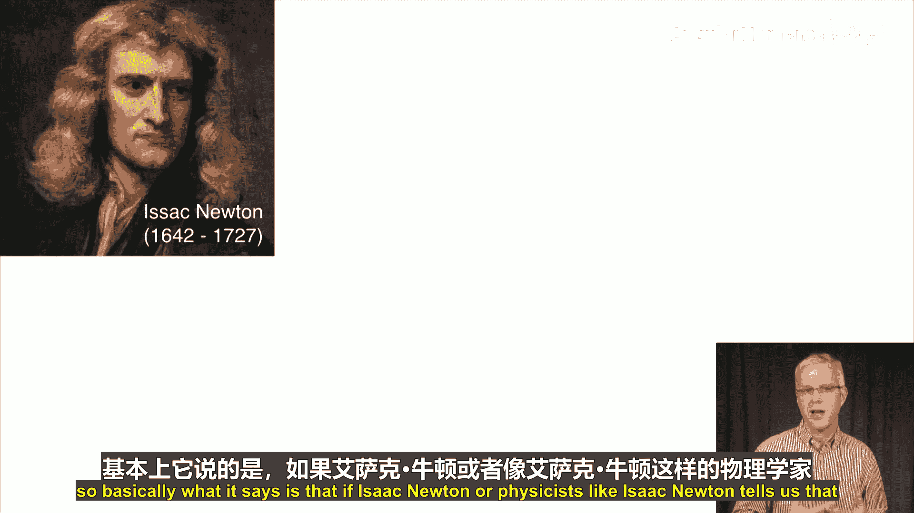
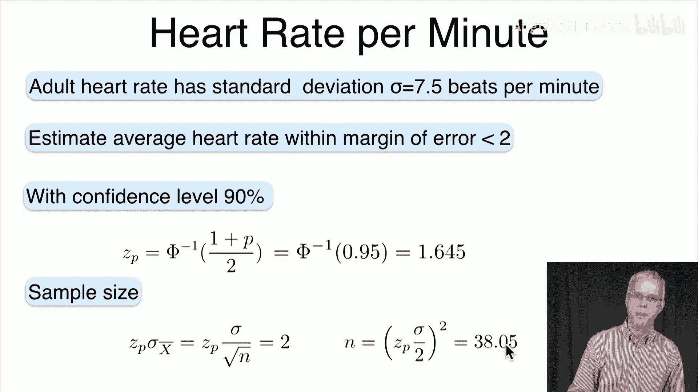

# 【加州大学圣地亚哥分校】使用Python进行数据科学中的概率与统计--Probability-and-Statistics-in-Data-Science-p53-12-06-04-均值置信区间--BV1gJFDzkEPg_p53-

Hello and welcome back。In the previous lectures we talked about parameter estimation and we try to do our best to find the value of parameter and now what we're going to do is maybe try to not do our best to find a particular value of the parameter but try to have a little more confident about what the value of the parameter roughly is okay so that's what we're going to discuss we're going to come up with an interval where we're pretty confident that with the parameter lies between the interval Okay so let's just go over this a little more precisely so we want to move from estimating specific one value of the interval of the parameter which we call a point estimate to estimating an interval that the parameter lies okay so。

Remember that we have a distribution or a population and we want to estimate the parameter of this distribution or the population and what we have done before was that we came up with what's called a point estimate。

 namely for example we estimate the mean to be 3。14 or we may estimated probability that a coin comes up heads the probability that it has to be 0。

48 and there's something really nice about this and that is that this estimate is precise。

But there's something not so nice about it and that this estimate is certainly wrong。

 we can almost guarantee that the mean that we estimate it is not exactly 3。

14 or the problem is not exactly 0。48 so once we do that we don't know exactly what we mean we give a value and we don't know exactly what it means okay it's kind of said because the value that we give is always wrong and we have no confidence about it we don't know how confident are this is the value in fact we know it's wrong or we near it and so on and so on so what we want to do in this lecture is we want to talk about confidence in the wrong which are going to kind of marry or put together these two issues one is we want to be precise but maybe not completely precise and then we want to do something that is going to be fairly accurate。

 we won't give it precise value but gives range that we have some。

Confidence about so what we want to do is reduce the precision and at the same time we want to increase the confidence of the answer that we have so the answer we' come up with if we look like something like with 95% confidence。

 which you can think of as probability if you want the mean mute parameter of distribution falls in this interval。

 not 3。14 but somewhere between 3。1 and 3。18。So this is a kind of result that we want to say it so give a range。

 and for the range we give some confidence， which again you can think of as being probability that the mean falls within this range。

So in order to understand it， let's go back to basics back to normal and remember that the central limit theorem says that if we take averages of anything essentially it's going to be roughly normally distributed and this will provide us the intuition to what we're going to do。

 in fact this intuition is so strong that it's almost everything that we're going to do if we understand that will be fine so just to remind ourselves about the central limit theorem again。

 so we have a sequence of n random variables， the independent and distributed essentially according to any distribution with some mean mu and standard deviation sigma that we don't need to know。

 but whatever they are， if we defined the sample mean to be the sum of the X's normalized by n so this is the sample mean。

And we can then define ZN to be we take。The end samples that we have and we。

kindind of normalizedize it a little bit so how do we normalize to do two things first of all we subtract n mu so we are subtracting the expected value of the sum which is n times mu so this difference will have zeroine and then it will some will still have sense standard deviation want to normalize standard deviation and to do that we normalize by sigma times square of n we explain it before and we'll explain it again but that's what we did just to in mind ourselves and once we do that then the central limit theorem tells us that for sufficiently large n when then sufficiently large n n we said typically people would say like maybe 30。

Then or more， then ZN， this normalized average is distributed roughly normal with mean zero because we subtracted the mean here and standard deviation1 because we normalized ZN by sigma times square root of n again we'll see this coming again and so in other words ZN is distributed roughly like a standard normal distribution。

 so it's roughly and this is a standard normal distribution。Right， okay。

So with that what we want to do first is do something fairly simple which is try to predict the standard normal random variable。

 so we have a standard normal variable namely z distributed normal with mean 0 and sigma 1 or variance 1 which you can write also as normal01 like that。

 and we want to just do something very simple one to predict the value of z。Okay。

 so someone tells you， I have a random variable。 It is normal more means zero standard deviation 1。

 I'm going to。Experiment take one value what is this value going to be what is the value of z going to be so if you want to give an estimate for just one value if you want to choose like a single value then most likely we'll say that z is0 y because if you look at this distribution the highest probability is for the value 0 so that's one reason zero has the highest probability also this is an unbiased estimate estimate because if we look at the value of z then the expected value is 0 so this is unbiased and if you want to minimize the mean square error it's also the right thing to do okay。

This is pretty much like estimating the mean of a distribution which in this case we estimate to0 and con consequently has suffers from the same drawbacks so on the one hand it's very precise just like before we said that zero that's really good on the other hand it's certainly wrong we will never be correct because the probability that z will get a value of 0 is exactly zero so this will never happen so what we want to do is instead of saying that z is going to be0。

 we want to say that z is going to be in some range so we want to give an interval and say that for example between minus a and a and say that z is going to be in this interval for minus a to a and now we know that the probability that z is between minus a and a phase positive number then this is going to be bigger than zero so we have some confidence that when we give this range for minus a2 a then we be right so in other words we're not for example trying to say that the temperature tomorrow will be0。

Exactly， you know。70 degrees， but we're going to say maybe it's going to be between 65 and 75。

 and then we have some probability of being correct。Okay。

 so the question is exactly what is this property？Okay so what is the probability that z falls between minus a and a Okay so to do that we just do a little bit of calculation which is going to hopefully serve as a review for estimating probability of Gaussian random variables so we're going to do that like I said mostly its going to be a review but software will be easy all right so we want to calculate the probability of an interval and our random variable z is distributed normal01 it's a standard。

Noble render variable。So we have some value， so we have let's say we have some value a。

 this quantity here shaded in blue is Mc call is denoted by phi of a， capital P of a。

 it's the probability that z is less than equal to a。

So what is the value of phi of a phi of a is also the cumulative distribution function。

 the cf of this random variable evaluated at a， and we can just calculate it to just the integral for minus infinity 2 a of the probability distribution function here。

 so it's the integral for minus infinity 2 a of e to the minus t squared over 2 divided by squared of 2 pi。

So this is this value and but remember we're trying to estimate the probability or to calculate the probability of an interval okay so if you want to calculate the probability that z is between minus na this here is the probability that z is less than equal to a but we want the probability z is between minus and a well we can write it so this is what we are trying what we are looking for we can write it as a difference between two value we can write it as this one the probability that z is less than equal to a minus the probability that z is less than equal to minus a minus this blue here here here okay so it's this area minus this one okay so let's just write it out so it's phi of a that's this value here。

 minus phi of minus a that's the probability that z is less than minus a。

Okay so this is what we are trying to evaluate okay now I'm going to appeal to symmetry and we said that by symmetry。

 well this we just keep as it is， but this one here is the same this area here on the left is the same as the area to the right by symmetry because the Gaussian distribution is symmetric so instead of looking at the probability that z is less than equal to minus a we're going to look at the probability that z is bigger than equal to a。

Okay and so now we can write it we can write what it is。

 so what it is is phi of a that stays the same and but we' are subtracting this probability here that z is bigger than equal to a which is1 minus the probability that z is to the left。

1 minus this so it's1 minus phi of a right this is this value here。

Okay so what we have here is baby algebra， so this gives us just2 pA minus1。

2 phi of a minus1 so we see that the probability so phi of phase is just the cumulative distribution function of these evaluated a and we see that the probability that we are within this interval is just twice phi of a minus1 and that's what we just showed here and we've seen this before as well so let's just remember this2 phi of a minus1 okay so now if you want to calculate this probability the only thing we need to do is evaluate phi of a and how do we do it again a review so how do you calculate phi of a so again there's no known formula so what we do is we use a couple things one of them is we use what's called the z table or the standard normal table which is shown here。

And the table entry shows just phi of a， the probability that we are less than equal to a。

 what we call here Z， so you can think of A as Z we're going to use both in fact。Okay so for example。

 if you try to evaluate p of1， so let's say this value here is0 and right here in the center and try to calculate the probability that z is less than equal to1。

 then you just look for it in the table so this is 1。0 and then we'll look at 1。

00 here because we're looking at just one if you want to look at 1。2 then we'll look at 1。

0 but instead of this column we'll look here this is 1。2。So sorry this is 1。02， if I want to do 1。2。

 apologize it's here and if you want to do 1。22， that will be this value here。Okay， all right。

 so what we see here is that field of  one is 0。8413。that's what we' got here。

 let's also remember this number for like a microsecond。Okay。

 and that's one way of doing it and another way to do it， of course。

 is using a program and what we're going to do is going to use Python and we'll just see Python gives us the same number of 0。

8。413 so in Python， if you want to calculate Phi of x。

 then what you do is in the side do stats module， you're going to import norm and use the norm do CDf function。

 cf of course is the cumulative distribution function okay so if you want to calculate for example p of1 that we did before。

Then what you do is you import from sippi。starts your import norm。And then you just call Nom。

cdf of1 and will give you not just 0。8413， but actually several more digits。

And if you want to calculate V of2 after you've already imported norm。

 then you just write norm c the F of 2 will' give you a 0。977 if it will increase and you give3。

 then you'll get this number is 0。998。So and you can get of course a N number1 All right so now we've seen how to calculate the probability of an interval so that it's2 phi of a minus1 and then we see how to calculate phi of a using norm do CDdf from here so so this will bring us back to the 689599。

7 rule so if we want to calculate the probability that z is between minus a and a thats as we said is going to be2 phi of a minus1 we saw that and now we're going to evaluate it for1 which is one standard deviation two standard deviation and three standard deviation so this is this probability here and if you calculate it for a which is equal to1 then you get two times 08。

413 that we had before minus1 that gives you 68。2% that's the 68 here。

If you evaluate it for a equals to 2， which says two standard deviation， it's 2 times 0。9772 minus1。

 which is 0。95。Here which is the 95%， in fact it's a little more as we observe but roughly speaking is 95% and for three a equals to3 or being within three standard deviation。

 it comes up to 0。9974 okay and what that says again is that the probability that we're going to be within one standard deviation here is 68%。

 the probability that will be within two standard deviation is 95% and the probability that will be within  three standard deviation is 99。

7% very high。Okay， all right。So what we did so far is someone gave us the interval minus a to a and we then found the probability that will fall inside and what we want to do now is I want to play a little jeopardy so instead of someone giving us the interval and we coming up with the probability。

Someone is going to give us the probability so they'll say I want you to be accurate with that probability and we'll need to come up with the interval。

 so they'll say I want you to be accurate for 95% and we'll need to come up with an interval that's sufficiently large that probably 95% were going to be inside that interval。

 so and the reason is because typically what we're given is we're giving desired probability。

 as we just said， of P， and we want to find some value a such that with probability T。

 this probability that we are given， we're going to be our Z is going to be inside this A。Okay， cool。

 so in other words again， we're given P and we're looking for the A such that this area here is going to be equal to is going to be equal to P。

All right， so what we saw was that P was which is the probability that z is between minus NA。

 we saw that that was twice phi of a minus 1 we've seen this just a little while ago and what that will tell us is that if you want to find so we can express phi of a in terms of p that will give us that phi of a is 1 plus p over 2。

Right so one move to the left so it's p plus 1 and then divide by2。

 so it's 1 plus p over 2 okay and I just want to show you just because it's a little crucial for us I just want to show you this in another way so we're looking for a such that the area between minus a and a is equal to P。

Okay， so if that's the case， then the area outside this here in blue is one minus speed。

And then by symmetry， this area here is 1 minus p over 2。And we can write。

We can write this area here s1 minus there to the left， so this area here is 1 minus this area。Okay。

 and。And therefore what we have here on the left is1 minus1 minus p over 2 because here this area here is1 minus p over 2。

 so this area here is 1 minus1 minus p over 2 but a little bit of tiny bit of algebra says that one minus1 minus p over 2 is actually equal to 1 plus p over2 because we have half and then this becomes plus p over 2。

Okay and but this area here on the left is just phi of a。

 so this says that phi of a again is1 plus p over 2 just the same as here。

So either way from before and then this algebra or here。

 you see the phi of a is 1 plus p over 2 and what we need。

 of course is someone is going to give us P。And we want to find the interval。

 so someone is giving a P and want to find a playing jopardy， we're looking in the inverse function。

 so a is going to be phi inverse of1 plus v over 2。

Okay so this is basic okay and so now what we want to show is how to calculate how do we calculate phi inverse okay so again you can look at the table。

 you can look on the right find the value of a that will give you the P that you want or p of a that you want or we can use Python so in Python we want to implement phi inverse of p。

 we use it using the function norm or the method norm do PPF of p and PPF stands for percent point function because well be given the value of P the a to the left or the percent to the left and we want to find the point。

We want to find the point that will give you this value。

 so we're given the area to the left and which is P and we want to find the value a such as the area to the left of it。

To the left of this point is this percentage。So it converts percentnta。

 the fraction of the distribution that's on the left to the point which has this fraction on its left。

All right， OK， so for example， if we want to find phi inverse of 0。95。

 then again we need to first import si from spi those stats。

 we need to import norm and then we write no the PP of 0。95 and that will give us this value of 1。

644。And if we want to find the inverse of 0。975。Then we again just write known PPF of 0。

975 and that tool tells us that we need to go to 1。

96 so namely we need to be two standard deviations。To the right of the mean。To get this， to get 0。

975 of the volume to our left and phi inverse of 0。99 will give us this value。Right。

So the common values of confidence that we be interested will be the most common one will be 95%。

 well we're going to show later 90 and 98%， but the most common is 95%。

 so we're looking for the value so we're looking for the value a。

 such the probability that will be between minus A and a that the standard Z。

 the standard normal rever will be between minus A and a will be 95%， so a。

 as we saw is inverse of 1 plus p over 2 where P is 0。95。Okay。

 so we're looking at phi inverse of 1 plus p over  two， in this case is phi inverse of 0。975。

Becauseuse。95， we take the average of。95 and  one。Take the average， this is 0。

975 looking at P inverse of that， and we saw in the previous slide that when you take the inverse of 0。

975， you get 1。9599。行。which is roughly 1。96 so that tells us that the probability that z will be between minus 1。

96 and 1。9 and plus 1。96 is a roughly 0。95 so now this should look familiar because。

This is part of the 868-95-99。7 rule because what this says is the probability that z is between 1。

96 and plus 1。96 is 0。95 and as we saw before we said that the probability that Z is within two standard deviation from its mean was 95% in fact we said was a little more and so what this shows us if 195%。

 it's actually will be 1。96 standard deviation from the mean not two standard deviations。

 but this is the 95 from this rule。So and so this again is a more precise version of what we said before。

 which was that the probability that Z is two standard deviation from the mean was 95%， in fact。

 the probability that Z is that moves 1。96 standard deviation is roughly 9。

5 okay so again we can do it not just for 95% we can calculate it for any value so if P we start with P。

 the probability that were interested in。That we want to be the confidence that we want that our value will be within this range。

 so thiss P。 then we first calculate one plus p over2。

And then we invert1 plus p over 2 and that will give us a okay so what we just saw is that p if p is 95%。

 then 1 plus p over 2 is 0。975 and then the number of standard deviations we need to of slacklack we need to give ourselves is 1。

96 standard deviations if we want to do 90%。Then 1 plus P over 2 is 95。95。

 and then we invert using again， a no PPF and we'll say that we need to be within 1。

645 standard deviations and if you want to do 98%，Be 998% confident then one plus P over2 is 0。99。

And then phi inverse of 0。99 is 2。056， which means that we need to choose a to be 20。56。

So as you can see， if we want to be more confident that we're inside the interval。

 we need to go further away， so we need to go if we want to be 90% sure， we just need to be 1。

6 standard deviations away， 95% sure we want to go 1。

96 standard deviations away 98% sure we need to go a little further to standard deviations away。Okay。

So。Okay， so this was what we did here was for standard normal distributions。

And general normal distributions are not very different。

So if x is distributed normal with a mini mu and variance sigma squared。

Which you can also again write is normal mu and Sigma square like this with parenthes。

Then we know that if we define z to be x minus s over sigma。

 so x minus mu make sure that the mean is0 and then divided by sigma makes sure that the standard deviation is 1。

 so this is going to be normal 01。St a normal distribution。

 so the probability that x is between mu plus some value a times sigma。

 so x is distributed with mu and sigma mean variance。

 so the probability that x is between mu minus some value a times sigma and mu plus this value a times sigma。

 we can subtract mu first， so it's the probability that x minus mu is between a sigma and minus a sigma。

And then we can divide by sigma， so it's the probability that x minus mu over sigma is between minus a and a。

And x minus mu over sigma， as we said here is z， so this is the probability that z is between minus a。

And if you don't like this， it's not much math， but if you't still don't like it。

 it's very easy to remember because what we have here is the probability that x between is at most a standard deviation from its mean。

 so x is between mu minus a sigma and its most mu plus a sigma。

 so x is at a standard deviation from its mean mu， and so this is what we have here。

And what we have here is the probability that z is within a standard deviation。

D variations from its mean and those two are the same right because we have Gaussian render variables and what determines is how many standard deviations you are away from your。

Okay， so in pictures， this will look we have x and z， are both normal distributions and this is Z。

It mean is  zero and you ask and standard deviation is 1。

 so we're asking to be a standard deviation away from the mean this is this value here and on the other hand if we have x。

 then x is mean mu and a standard deviation sigma so it will look like this。Okay， this is x。

 so now the mean is mu。Now we're asking what's the probability that we are within a standard deviation from its mean and these two areas should be the same。

 maybe they don't quite look this way， maybe they should be a little more flat。

 a little more shorter。But these two areas， if we drew， if we scale this。

If we kind of like squished it enough， they would have been the same。Okay， so let's do an example。

 so let's say that x is distributed normal with mean 1 and variance 4 then and let's say that we are looking for a such that the probability that will be between that x will be。

That x will be within a standard deviations from its mean is going to be 0。95。

So what we have here is muse one。And sigmas2。Okay， so we know that if we wanted Z。

 if we looked at a it's a normal standard normal re but Z。🤢，Then the publicly that it will be 1。96。

Away from0， 1。96 standard deviations away from ItM is 0。95， which is what we want。

And as we saw in the previous slide， that is the probability that x is between mu minus 1。9。

Six sigma and at most 1。96 sigma， why again， because this is the probability that Z I think we have a treatment。

 this is the probability that z is 1。96 standard deviations away from its mean and this is the same this is the probability that x is within 1。

96 standard deviations away from the mean mu plus minus 1。96 sigma， so this publicities are the same。

So all we need to do now is we just need to plug in these values for mu that we have for mu and sigma and mu is 1 and sigma is 2。

 so I get that this is the probability that x is between mu here is 1，1 minus2 times 1。96 which is。

us 2。92 and at most mu plus 1。96 sigma， which is at most mu is 1 and sigma is 2。

 so 1 plus you can think of it roughly as1 plus4， which is 5 and this is the precise value。Okay。

 so what we see is that if someone gives us P， which is 0。95。

 then we can say that with probability 95%。Will x will be between minus those 2。92 and 4。

92 and this is the idea that we want to implement， someone is going to give us some confidence and we will we find some range such that what we're looking for is going to be in the range with that probability。

Right， so this brings us back to confidence intervals。

 so we can apply confidence intervals to any parameters， any parameter。

 but the simplest and by far the most common are either the mean trying to estimate the mean for standard of a random variable or what's called a proportion P which is essentially the same you have。

 for example， a coin。Brnoulli coin probability P of being heads。

 you're trying to estimate what is P or you have some property like youre looking at the percentage of people are going to a property is the person maybe votes for a certain party and looking for the proportion of the people who vote for this party and that's the same as P which is really the same as the mean because you're looking if you' call the mean Brnoulli when the variable is P so these two are the same just different name this is most specific you're looking for。

Proport of the population that has property P but it's a special case of so these are by far the most popular parameters for which people look for consciousness interval and that's what we're going to do in this presentation Okay so basically we'll be given a sample of or consisting of n values X1 up to XN that we saw in observations。

And we want to find an interval that will contain mu。s that with probability。

 such as with a given probability， mu is going to be within within this interval okay and so I want to find it just because I didn't write want to say I want to find an interval that with some given probability will contain me。

Will contain the real meat。So first we're going to look at what happens when sigma。

 the standard deviation is known and then in the next lecture we'll look at sigma unknown。So first。

 let's see what is the distribution of the sample mean because we're trying to estimate the mean。

 let's look and we're trying to approximate it by the sample mean。

 let's see what the distribution of the sample mean is。So remember。

 as we said that by the central limit theorem， if we take x1 plus xn。

Subtract and mu so that this has zeromin and then normalized by sigma times square of n。

So it has then it has standard deviation1 then this will be roughly normal 01 that was the first slide now what we can do is we can multiply this we want to forget this we want to get this sample mean which is x1 plus xn divided by n so let's first multiply by sigma divide by square rootd of n sigma will cancel square root of n will become n so what this will give us is x1 plus xn minus n mu divided by n right because sigma disappear then this became n。

So now because we multiplied by sigma over square of n， the mean this had means 0。

 it gets multiplied by this number， but it stay0 therefore。

 and the variance gets multiplied by sigma square over n so we get that this value is distributed normal mean0 and variance sigma square of n。

Now so now what we want to do is we want to get rid of this subtraction so we going is what we're subtracting by we're subtracting by mu because n cancel。

 so we're going to add mu and when we add mu here what we get is that x1 plus xn and so on divide by n is this to it in normal and the variance doesn't change when we add a constant but the mean will change by mu so this will become the mean so what that tells us is that if we take a look at x1 plus xn over n is roughly normal with mean mu and and variance sigma square over n。

So and this is just the samplinging。So this tells us the sample mean distribution。

 if you look at the sample mean， this value is distributed normal with min mu and variance sigma square over n。

Now again this math is not too complicated， but if you just want to understand it intuitively you can as well so because x average is just the average。

 what does it have it' first of all it's roughly normal and that was the central limit theorem that's what he told us because it told us that this was normal and all we do is just take a normal multiplied by constant or' stay roughly normal add a constant was stay roughly normal。

 so the sample mean is going to be roughly normal we need to calculate its mean。

And it's standard deviation So first of all， it's mean。

What is the mean so the mean is going to be so apologize the mean is going to be mu right so and that's what I should have written here。

 in fact it's what I wrote here so the expected value of x is mu。

I should have written it's centered as either the distribution mean or the population mean。

So it's centered at new， which is， again， not surprising because we have。We're adding n variables。

 so when we do that the expectation is ns mu and then we divide by n， so is this mu。

And then the variance。When we do this so what will happen to the variance。

 the variance is going to be we're adding n things here。

 so the variance is going to be n times the individual variance。

 but we divide by n so the variance goes down a fact of n square so the variance is going to be the original variance sigma over n don't know if I wrote it yes perfect so the variance is going to be sigma square over n because we added。

Each of Xs has variance sigma square where the n of them， so it's n time sigma square。

 then we normalize by n， the variance goes is down a factor of n squared。

 so it's sigma square over n。And therefore， the standard deviation is squaret of this。

 which is sigma divided by square effect。cool now and this is by the way it's called standard error。

 I'm not emphasizing these terms because I think I just want you to understand the logic and maybe the math rather than terminology and another terminology that people use is the distribution of this sampleamine is called the sampling distribution of the samplingamine so the distribution of the statistic。

 the sampleamine is called the sampling distribution so this one is the stumble the distribution of the sampling but we don't need to worry about this。

Okay， so one thing that I want you to remember， though， is that when we take the average， then the。

Stard deviation of the sampleine of x bar is the original standard deviation divided by square of n this will' see a couple times coming up。

 so just remember that so if we had nonverbal with standard deviation sigma when we take the average of n of those the standard deviations go when go down by fact of square root of n so this is what we have here the standard deviation of the sample mean。

I sample is the standard deviation of the original？I'R a variable。

 but actually gets smaller because we're taking averages and it gets smaller by factor of square root of n。

Cool， so so the next thing and the only thing in fact that we have left is to do is to notice that proximity is reciprocals。

 obviously。Quite obvious and hopefully math will not confuse us so。

So what we have shown until now is that x is the average is going to be roughly neo mu because that's what we were saying the standard deviation is going to be centered at mu。

 the standard deviation is going to go down， so the average is likely going to be neo mu okay。

But what that tells us is that mu is going to be near x because if x is immune and mu is near X this is a reciprocal property。

 so we're just going to do some math to convince us of that。Maybe we don't treat any。

So what we'll know is that x is going to be。Betweenen mu minus a and mu plus a and what that tells us is that x minus mu。

 the absolute value of x minus mu is less than equal to a that if x is within a for mu then x minus2 the difference between them is at most a this shows us that this property is symmetric as we all know proximity is reciprocally symmetric and so this means that mu is going to be between x minus a and x plus a because x minus mu is a so that means that mu is between x minus。

Average axis this is the sample mean minus a and the sample mean plus a and what's happening here is this。

What we have been arguing for this in this lecture so far is we have argued that if we take the average。

 the sample average， sample mean， it's going to be in this interval it's going to be new。

Neal mu between mu minus n and plus A。And what we are showing here is by the same coin。

 the mean is going to be very close to the sample the got。

 we it' going to be between x minus say x plus a。 So let's show a couple of。Just examples。

 so here is the mean mu and here is mu minus n and mu plus a and here is x average and x average if it falls inside the mean here。

 so in this interval and because it's in this interval that means that if we took x average and we took minus n plus a。

 the mu is going to fall inside this range。So in other words， we can say that if。

If x falls within this red interval here that we had calculated before with probably 95%。

 it's also correct to say that the mean mu will fall within x。

 this is what we are going to observe plus minus a because these two things are the same and conversely if x does not fall。

In this region。Then a mu is not going to fall in this interval where we added plus in minus say so what we are saying is hopefully simpler than this equation and what we have shown before was that the sample mean is going to be distributed roughly should roughly here no one with mean mu and standard deviation sigma of a square of n that's the standard deviation of Xent。

Okay， so with high probability X hat is near mu here。

 and by the same token we can say that with high probability mu is new X hat。This is what theす。

Sorry about that。These are the same。

Okay so so basically what it says is that if Isaac Newton or physicist like Isaac Newton tells us that the apple。

 which hides behind my picture， there's an apple here behind me。

 trust me on that if the apple there it is， they tells that the apple doesn't fall far from a tree。

 the statisticians like Jersey Naman， who came up with confidence interval。

 what they say is that tree does not go far from the apple。

So if we calculated before and we saw that the apple is going to be very close to the tree。

 we're going to observe where the apple fell and we're going to know where the tree is。Okay。

 so let's look at confidence intervals there。What we have calculated is we said that with probability Tp。

 if Zp is going to be the value for the。That if someone gives us P， we're going to calculate the。

The value for the standard normal render variable such that such that with fo T P we're going to be the Z is going to be between minus Zp and plus Zp so with foTp therefore x hat is going to be Zp standard deviation for its means so it's going to be between new minus Zp times the standard deviation of x hat。

X bar sorry and mu plus Zp times the standard deviation of this sampling。

Because ZP again is the value that we had calculated before， it says that if you look at Z。

 the standard normal random variable， it's going to be from minus Zp to plus Zp with proTP。

And that's the same it's the probability that x is within ZP standard deviations from each means。

 so x is between mu minus Zp times this standard deviation of x x bar。

 x bar and mu plus the Zp times standard deviation of x bar but again by what we said before。

 x minus this means that x minus mu is at most Zp times the standard deviation of x apart。

 and this will mean that mu is going to be，Is going to be within x x bar minus Zp minus the same distance here。

 Zp times sigma， so here we're using the fact that sigma x bar is sigma with square root of n。So。

M is going to be between x minus Cp times sigma with squareta n and x v plus Zp times sigma with squareta n with photoP。

All right， so just to make sure。We given some probabilityp。

 we find ZP such that Z is between minus Zp and ZP and plusp with probabilityp。

So z is within this many standard deviation away， and that means that x bar is going to be within this many standard deviations away from its mean mean。

And now we're going to use the fact that if x is close to mu and mu is close to x by the same value。

 so mu is between x minus Zp times the standard deviation。

 which is sigma over a squared of n and x plus zp times the standard deviation。

 which is again sigma over a squared n。Okay so that's all the it3 so if you look at the notebook that we have for you you'll see a bunch of things。

 one of them is how to is an experiment here， so what we do is we take a random variable which in this case is normal or make things cleaner sorry。

And then we can change the sample size n。And we can change the number of experiments so that we get correct value and we see and the confidence interval here is 85%。

 So when you have confidence interval 85%， we calculate。

The interval here such that we expect the mean to be within this that much of the interval close to the sample mean。

 so here the distribution here's the distribution。I mean which is zero because just Gaussian distribution and what we do here is we take a sample and we calculate the sample mean and this is what we the value that we calculated before。

 which isigma times sigma times the value Zp。And divided by square of n。

And we do it so that the confidence level is 85%， this is P。

And what we do is we run this experiment and you see that 85% of the time。

 the mean mu is going to fall within this value Z times sigma divided squareotoen。

Away from the mean here， and that also means that the mean is going to fall within that distance from the sample mean。

So this happens all the green cases in all the red cases。

 our sample mean fell away from far away from the distribution mean by more than what we allow。

 so it's further away and therefore also the mean is not within our interval that we set away from。

The sample me okay so this happens 15% of the time。Right。

 so let's do a couple of examples just to make it maybe a little clearer。

 so suppose that the number of tweets is a random of a random Twitter user is a random variable with standard deviation 2。

And supposely we take a sample of 1121 users and find that the sample mean was 3。7。

 So the average of these 12121 users number of tweets they had。Per day。

 this is a number of tweets per day。Let's say it was 3。

7 daily tweets and so what we want to do is we want to find the 95% confidence interval for the distribution mean。

 so we know that the sample mean we took 121 users we see that the sample mean was 3。

7 for these 121 users and the question is what can we say about the actual mean of the distribution and want to find the 95% confidence interval for the distribution mean。

So first of all， what we do is we calculate ZP， which is inverse of 1 plus p over2。

 this is the value such that if you took a normal，Standard normal random variable Z then it will be within ZP away from0 ZP standard deviations it's the same case here in this case away from0 then the probability of that is going to be P so ZP is p inverse of 1 plus p over 2 and the P that we' are interested in is 95% so 1 plus p we've calculated a couple times1 plus p over 2 is going to be the average between 95 is 100 so it's 97。

5 so looking at p inverse of 0。975 and we found out that it's 1。

96 and this is roughly again our 68% 97。5% rule right so we need to go two standard deviation away。

So what this says is that the probability that Gaussian rhino variable is going to be two standard deviation away from its mean is roughly going to be 95%。

And。Okay now， so we want to construct the 95% confidence interval for the means so what we do is we take the sample mean。

And we say that the distribution mean is going to be between the sample mean that we observed。

 this is the 3。7。And plus minus。ZP， which is this value here that we found。

 but this is for the normal。Reuverable， but we need to not look at the normal。

 but we to look at the distribution of x bar because this is the value we calculated the mean for x bar。

 so we need to see what is the standard deviation of x bar of the sample mean。And notice by the way。

 that because we have 121 users， 121 is much larger than 30。

 then we can assume that the distribution is roughly Gaussian and this approximations are roughly correct。

Okay so probably 95% we're going to be within ZP， this is the value 1。

96 standard deviation in ways from the mean or the mean is going to be within the same value away from。

The distribution beam will be the same distance away from。From our sample in here X hat， so x bar。

 so we just need to plug in。 so x bar is 3。7。 so and this by the way it's called again the margin of error again I'm trying not to。

Overload you with terminology， but this values is the margin of error by how much we can be wrong and so this will just plug in and this will give us x bar minus z and then the standard deviation of the sample mean is going to be sigma divided by square of n。

So it's plus minus Zp times square root of n sigma square root of n and then we just x part the sample mean is 3。

7 and we plug in sigma which is 2 and n which is 121 so square root of n is 11 when calculate you get 3。

344 and 4。056 so just a couple of observation observations。

 so first of all the mean that we observed both 。3。7。If we had a point estimate。

 we will just say that the mean of the distribution is 3。7。

But that almost surely will not be correct on mean the mean of the population that's not going to be correct so instead we give a value that is centered at 3。

7 so it's this x bar plus minus something and so it's 3。

7 plus minus something and this something that we are adding a subtracting is called a margin of error which is ZP times the standard deviation of sample mean ZP we calculate to be 1。

96 that's how many standard deviations we want to be away and now we just need to calculate the standard deviation of this mean of 121 users and we told that for each user the standard deviation is 2 we're taking the average of 121 users so the standard deviation of the average is going to be the sigma which is 2 divided by square of 121 or 11 so it's 2 divided by 11。

Multiply by 1。96 and then and edit and subtract it from 3。

7 so this is what we have here notice also that we say with 95% confidence。

This is the interval we don't say 95% probability the difference between confidence probability is a little subtle and the reason we say confidence is because we did this experiment and the sample mean is either so we give an interval here。

 the distribution mean or the population mean is either inside this range or outside this range so it's either inside in which case the probability is zero or it's outside in which the probability that's inside is I'm sorry it's inside inside this range in which case the probability that's inside is one or it's outside in which probability's inside is zero。

 so we cannot say that the probability that the mean lies in here is some value 95%。

This is something we could have said that when we design this experiment。

 that will happen probably 95%， but now that we observed it。

It's not the probability probability either one or zero but what we can say is that the way we avoid this issue is we said that with 95% confidence the distribution mean lies in here that means that if you repeat this experiment many times 95% of the times the sample mean will be within the interval that we specify so again if you want to think of it as the probability but in fact it's kind of like retroactive probability we call it confidence so we designed this experiment so that  we repeated this experiment100 times then 95% of the time you will be correct and so we have 95% confidence that the mean is in this range。

So this is one example， now let's look at a slightly different example。

 so let's look at the heart rate which is defined， so heart rate is defined as a number of beats per minute。

 so we can think of just heart rate or number of beats per minute。Okay。

 so let's say that the adult heart rate has done the deviation， which is 74。5 bits per minute。

Okay so it's some number， but the standard deviation is 7。5 bits from in now again。

 typically will not know this value， but in this lecture， as we said。

 we assume that we know this standard deviation and next lecture we will see what to do when you don't know。

So what we want to do is rather than find someone gives us the confidence you want to find the interval。

 what we want to do here is we someone gives us。So someone gave us I'm sorry someone gave us in and we wanted to find the confidence interval what we want to do here is the opposite。

 someone is going to give us the confidence they want we want to find how many samples we need to take。

 so we want to estimate the heart rate within a margin of error which is at most too。

2 Bs per per minute， and the question is I want to do it with confidence level 90% and the question is how many samples do we need to take？

Okay。So first of all what we see here is that because we want the confidence level to be 90%。

 then so what we want to be is we want our answer to be within p inverse of 1 plus pp is going to be 90%。

 this is how many standard deviations away will be from the mean if this was a normal random variable so this is a P is going to be inverse of 0。

95， 90 plus 1。9 plus 1 over 2 which is 1。645， so what this tells us is that if we have a standard normal random variable。

 then it's going to be 1。645 away from the mean0 of 1。

645 standard deviations away from its mean with probably 90%。Now。

 and we're interested in the sample size， so what we want is。

We want the sample size when that gives us this and what we want is we want that the margin of error。

 how much we're going to be away from the mean to be at most 2。

 so we know that what we're going to estimate is going to estimate mean mu plus Zp times the sigma x x bar。

 which is Zp times sigma over squared of2 squared of n。

 and we want that to be 2 because if we do that， then our estimate is going to be xx bar。

 the sample average plus minus this value。Okay， and so if we make sure that this value is2。

 then with this probability or this confidence， or we're going to be at most2 away from the mean okay so we want Zp times sigma over squared of n to be2 and this tells us that n is just going to be ZP。

 we just move it here is Zp times sigma over 2 squared。And ZP we calculate it to be 1。645 sigma is 7。

5 and2 is the number one that we got here， so it's 38。

05 so want the sample size to be bigger than 38。05 so we can take it to be 39 for example。

So in other words， what we have done is we describe confidence intervals。

 where instead of estimate a particular value for a parameter like the mean point estimate。

 we gave an interval and we're pretty confident that we'll be in this interval and we describe how to do it and give a couple of examples。

And what we're going to do next time is we're going to talk about what happens when the standard division is not known。

C you then。