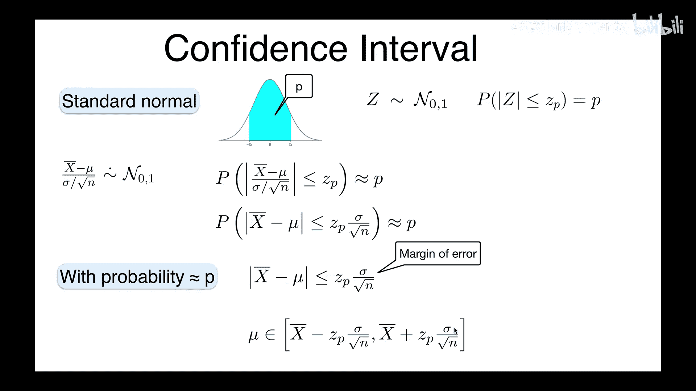
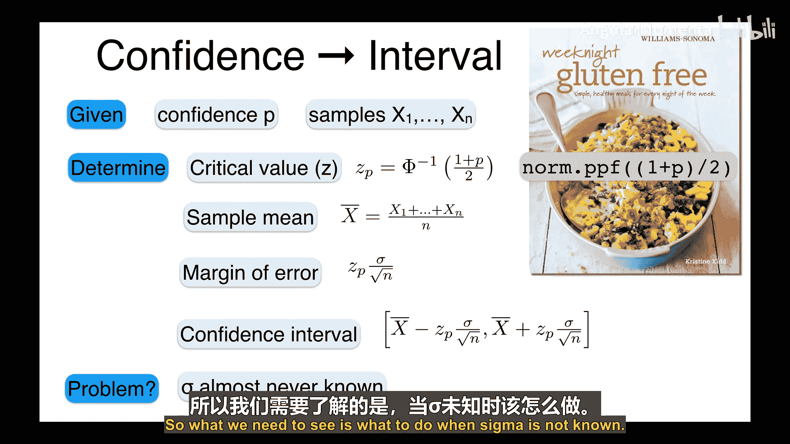
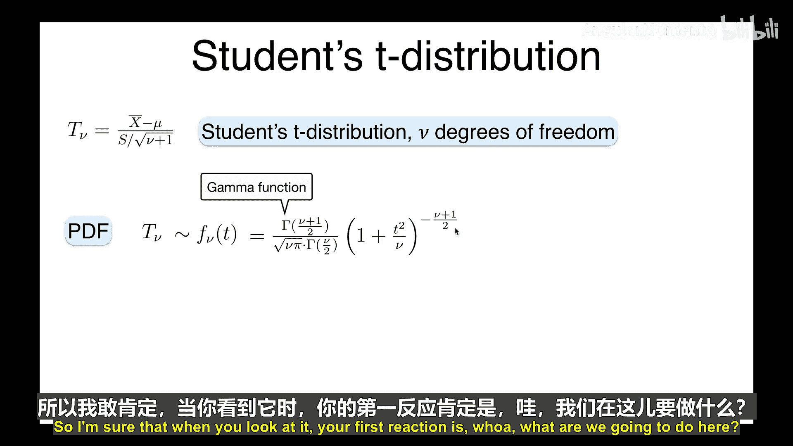
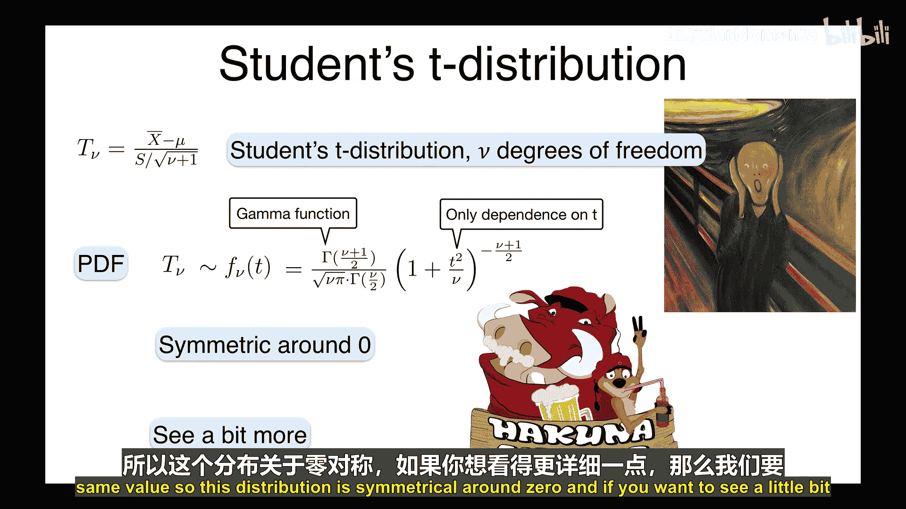
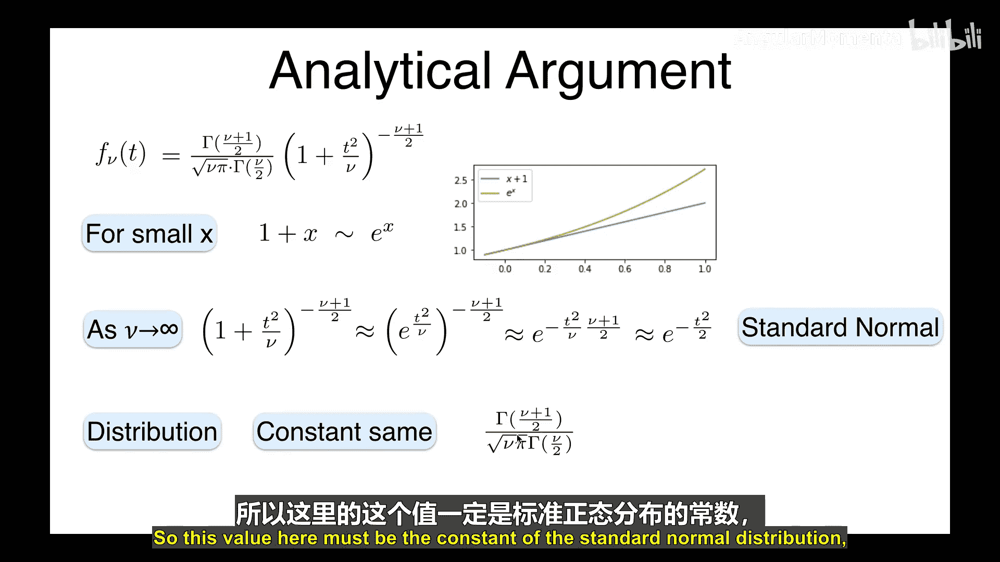
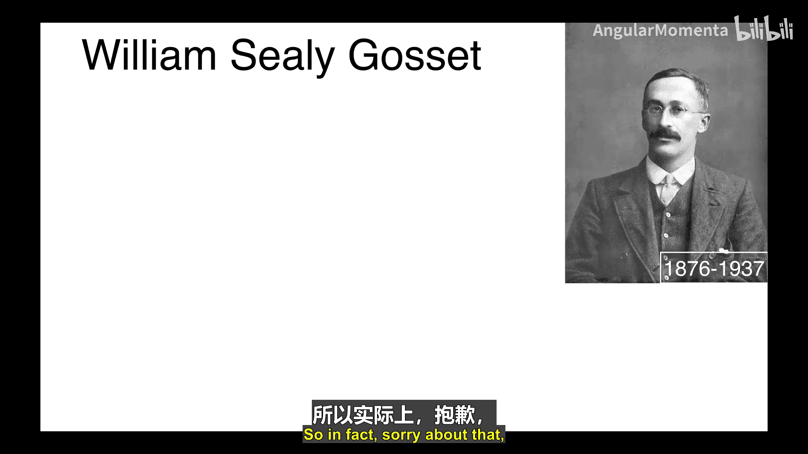
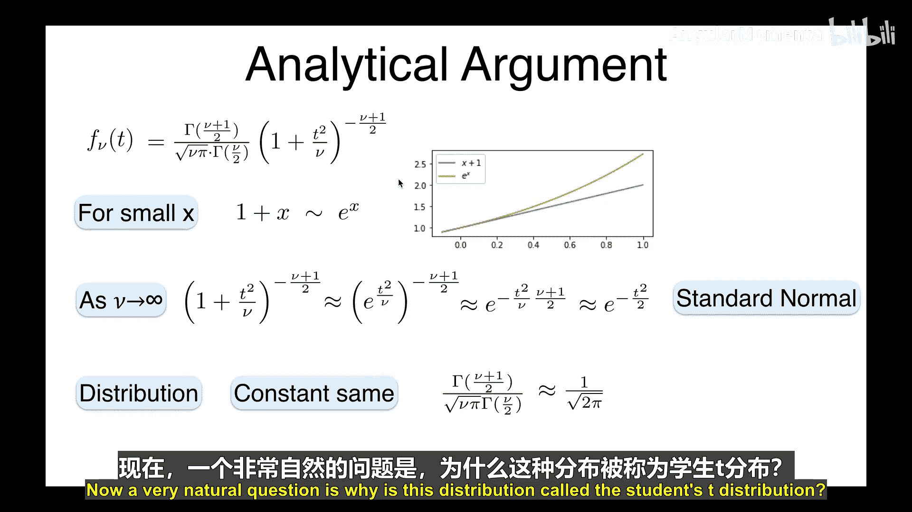
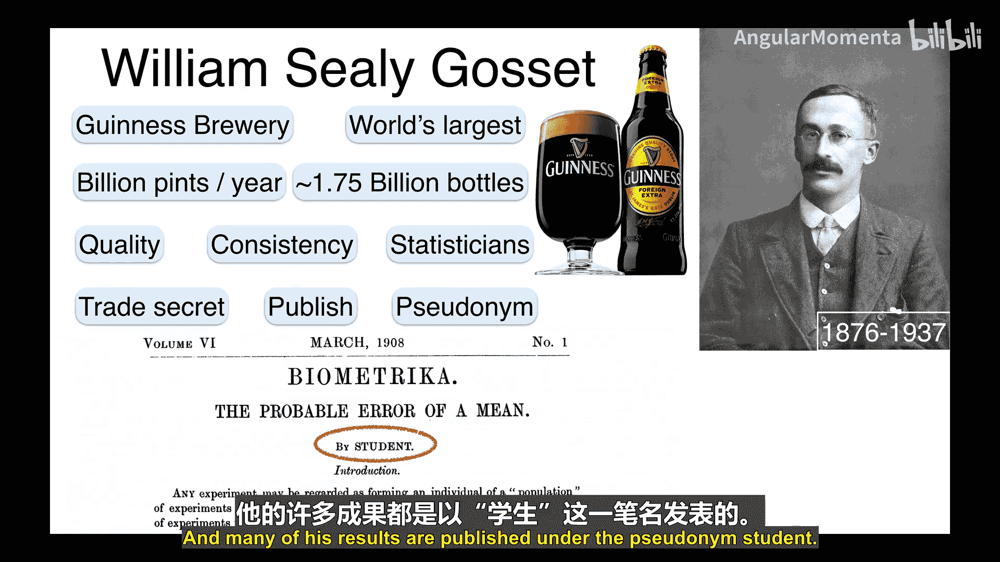
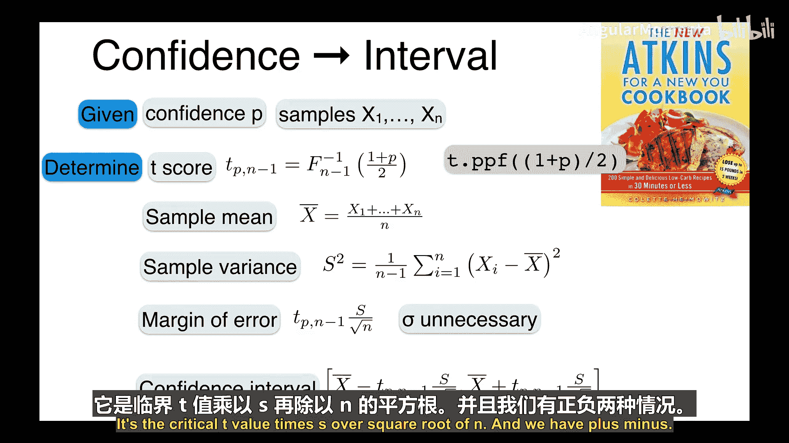
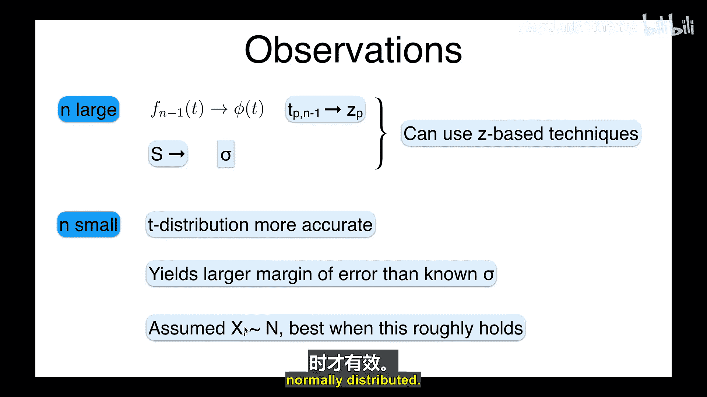

# 【加州大学圣地亚哥分校】使用Python进行数据科学中的概率与统计--Probability-and-Statistics-in-Data-Science-p54-12-07-04-总体标准差未知（第一部分）--BV1gJFDzkEPg_p54-

Hello and welcome back。In the last video， we talked about confidence intervals。

 but we assumed that Sigma was known as standard deviation。That of course， is almost never the case。

 so in this lecture we'll see how we can come up with a confidence interval when Sigma is not known。

And what we'll do first of course， is we'll need to estimate sigma。

 but we'll see that it gets slightly more involved and we will need to replace the normal distribution by a related distribution called the students T distribution and we'll provide a step by step instruction as to how to find out the confidence interval and we'll end with an example。

So let's start with the simplest case that we discussed last time， which is when sigma is known。

So in that case， we said that we can look at the standard normal distribution。

 normal with mean zero and standard deviation 1， shown here， and we said that if p is a probability。

 a number between 0 and 1， we can define zipP the critical。

Value to be the point such that the area between minus Zp and Zp is P shown here here is P is the area here and the point here is ZP such that this area is going to be P。

 so I beside it's sometimes called the critical point of the critical Z。

And if a random variable Z is distributed normal01。

 in other words if z is a standard normal random variable， then p。

 this value P is the probability that the absolute value of z will be less than Zp or in other words。

 the probability that z is between minus minus Zp and plusp。

So we can calculate P this probability by looking at the cf of Z and saying it's this value here to the left of Zp minus the cf of minus Zp。

 so we can write it as phi of Zp minus phi of minus Zp where phi is the cf of the standard normal distribution and as we have done several times。

 several times phi of minus zp， the area here to the left is by symmetry the same as the area here to the right。

 which is1 minus phi of Zp， so we can write it as phi of Zp minus1 minus phi of Zp that's this area here。

 and this is twice phi of Zp minus1。But what we are interested in is not find the error given Zp。

 but the opposite were given P and want to find Zp， the critical Z。

 So we've just invert this function。 So first we can write that p of Zp is 1 plus p over 2。

And then we just invert it and get that Zp is the inverse of 1 plus P2。

So let's do a very quick example， so if p is 0。9 and we're looking for of。 0。

9 and then it's going to be p inverse of 1 plus 0。9 over 2。

 notice that 1 plus 09 over 2 is just the average between 1 and 0。9， so it's fee inverse of 0。95。

And then we can just calculate it and we see that it's 1。645。

 and what that means is that the probability that Z。If z is standard normal renewable。

 then the probability of the z between minus1。645 and plus 1。4645 is 0。9 so if Zp is 1。645。

 the area between these1。645 and 1。645， this area is0。So the other thing we said was that。

When we take number of samples and calculate the sample mean it behaves roughly know what do we mean by that。

 if x1 x2 up to Xn or IID distributed according to some known distribution sigma。

 but unknown new that we're trying to figure， then if we take the sample min shown here。

It's the average of the n samples。Then first of all， we said that the mean of the sampling。

 the expected value of the sample is new is the distribution I mean going to see that。

 just notice that by linearity。Of expectation， the mean。

 the expected value or the mean of the sum is just going to be n times mean and divide by n。

 So cancels。 And we get that this is。The mean of x bar， the mean of the sample mean。Is new。

 In other words， the sample is an unbiasedest formula。And for the variance。

 we said that if you take the sum of n variables， the variance variances will add because they're independent。

 so the variance is going to be n times the variance of the distribution。And then we normalize by n。

 so the variance will go down by fact of n square， so altogether we get that the variance of the sample mean is sigma square over n。

And therefore， the standard deviation of the variance of the sample is sigma over a sc effect。Okay。

 this is something that we may want to remember because it comes welcoming and says that the standard deviation will go down as of the average will go down as。

Numb of sample increases well goes down by a small of growthot。

 this is sometimes called a standard error。So now notice that。X is。

 as we said as mean mu and standard deviation， which is sigma of x bar。

 which is sigma of a square of n， so if you want to normalize it。

 we'll be subtracting mu so it can take x minus mu and that this variable。

 this difference now has mean zero this de numerator and then if we divide it by the standard deviation of x bar。

 then we'll get random variable that have that has standard deviation1。

And we can also write it as x minus mu x bar minus mu。

 and then the standard deviation of the sample mean x bar is we just calculated here is sigma is squareified。

So this random variable now here has mean  zero and standard deviation 1， and furthermore。

 as we know by the central limit theorem， we know that this will behave roughly like normal 01 so thats for the。

嗯。Central limit and told us。Right， so we know that if we take x subtract mu and divide by signal with square of end。

 it will be roughly normal。All， so combine these two things together， what do we see， we get that。

If we have the standard normal distribution， then if we look at areas P。

 then if z is distributed normal 01， then the probability that z is between minus Zp and plus Ep Zp was defined as before。

 the probability is P right here。And we get that x minus mu divided by x bar， this supplement。

Divided by sigma risk of。Is roughly normal0。And therefore we get that， so see if z is normal 01。

 the probability that absolute value of z is less equal to zP。

 now x minus mu divide by sigma of eend then normalized。

The normalized sample mean is roughly normal01， so therefore the probability that its absolute value is less than equal to ZP and the probability that falls between minus Zp and ZP is therefore roughly P because it's roughly normal。

 suppose Z， which is exactly normal。And now we can just rearrange to move sigma with Sc and multiply by that on both sides。

 so we see that they probability that。The sample mean differs from the distribution name。

But most z times sigma is squared of n is roughly P。

And this we can write by saying that with probability here roughly P。

X minus mu in absolute value at most Zpy the critical value。Times the signalig with sc of。

Or in other words， and this is called this product here is the z times sigma of this square called the margin of error。

 or in other words， mu is going to be between x minus。

ZP times sig square effect and export the samplemin of zero plus the margin error of ZP times signal the squared effect。

And so this is just standard the way we do confidence interval when Sigma is not。

So how do we do it and let's give a small recipe here so we're given a confidence level P for example。

 95% and we're given samples and samples x1 up to xn and we want to determine the confidence interval so what do we do first we can find the critical value or the critical z which is Zp we call it its phi inverse of1 plus p over2。

And if you recall， P is just known that PPF percentile to point function。

 so we calculate it known that PPf of1 plus p over2 P when we were given。

And this is all at this stage。Okay and then we calculate the sample mean。

 which is just the average of all the n samples that we got。Then we calculate the margin of error。

 which is zippy， the value that we found here times sigma divided by square of n sigma we assume here is known and n is the number of samples that we have。

Okay， and then we construct the confidence interval， which is just the sample mean x bar。

Minus the confidence minus the margin of error and up to x bar plus the margin of error。

And so this is all we did， it's quite simple knowing issues that there is a small problem。

And what is it？Theue is that of course， that sigma is almost never known， so when we calculate it。

 we don't know what Sigma is， don't know how to model。

Okay so this assumption that we have here almost never applies。So what we need to do。

 see is what to do when sigma is not known。

So when s Sigma is not known， let's first assume that we have x1 up to xn and they're independent as they were before。

 and now let's assume that there are normal more with mean and standard deviation sigma。

 but this time that neither sigma no mu is not so we don't know new as before and but now we also don't know sigma and what we want to do is we want to to estimate。

Okay， so again， we defined the sample mean to be the average of the samples。And again。

 the expected value of the sample mean is just going to be the distribution mean。

 so this is an unbiased estimator for me。And the standard deviation of x bar。

 the standard deviation of the supplement is as we saw before， is sigma of square effect。Okay。

 now we can define x minus u， in fact， we did define x bar minus u divided by sigma x bar。

Which is the same as xo minus mute divided by sigma over squareotofen， even though we do no sigma。

 we can define defining that。 And as we saw， this is distributed roughly。

 So this is distributed with this dot signifying roughly normal 01。

And which is the standard loan distribution。Now of course， sigma is not known to us。

 so what we can do is we can try to estimate it。So we can define s squared to be1 over n minus1 n is the number of samples。

 transformation of X minus the mean squared， and you notice that this is what we call the sample of variance S except that it's beso corrected。

 we said and because it's be corrected， meaning we divide by n minus1 and not by n because it's be corrected。

 then it's unbiased so the mean of S。Expect the value of x squared is just sigma squared。

Okay it's an unbiased estimate of 4 the variance。And now we don't know Sigma。

 the standard deviation of。Of x bar， so instead of dividing by sigma over squared of n。

 world divide by our estimate for sigma， which is the square root of S square or S over square root of n。

So when we do that， so instead of calculating x minus mu divided by sigma over square of n。

 calculating x bar minus mu divided by s。Or a simple variance over a square of think actually as is the square of the sample variance。

Divide by square of thing when we do that we get something which is almost standard。

 so here we get something which is you know， could say maybe standard normal here it's something that is almost standard。

Because S is not exactly the same as sigma and it's all so S is roughly sigma but not exactly and this is also almost normal and that is because S is not a constant if this was a constant it will be normal but or approach normal and in fact in this case we assume that we start with normal random variable so it'd be exactly normal so this is roughly standard and roughly normal and that's because S is a random variable so we're dividing here by random variable not by constant。

Okay and in fact this will have so it's nearly a standard normal le variable but not exactly and this distribution has a name。

 it's called the student's T distribution okay and with in this particular case with n minus1 degrees of freedom where n。

And is the number that we divide by？So okay， what are the number of samples？

So let's talk about this distribution a little bit。

So the students did t distribution so as a result we call it t new and so we put we had before was we took this sample min subtracted hit min which is mu and divided by S divided and normalized by square of n and we're going to call n nu plus  one so t nu is this divided by square of nu plus  one and that's the student。

St distribution with new degrees of freedom。So the degrees of freedom is always one less than the number to 25。

Okay， and one can calculate the probability density function， the PDF of the student t distribution。

 and we're going to call it f me， that's the number of degrees of freedom of T。

And that's this formula here， it's the gamma function。

 so this is the gamma function of nu plus 1 over 2 divided by square of nu pi times the gamma function of nu over 2 times 1 plus t square over nu nu is again the number of degrees of freedomance parameter of the distribution。

1 plus t square over new raised to the minus nu plus 1 over 2。So I'm sure that when you look at it。

 your first reaction is， well， what we're going to do here looks very complicated and in some sense it's a little bit is but don't worry。

 things are fine we're going see we're going to need very little here and we're going to just clarify them slightly。

 so the first good thing that you see when you look at it for more than a second is that as a function is a parameter of the distribution。

But which is a function of T， you have a distribution parameterized by the number of degrees of freedom nu and whether it's a function of T T in this whole messy expression。

 T only appears here。Is just here， so it's actually a fairly simple。

 especially get one plus t square over new。And then raise it to some power multiplied by some constant。

 but it's just basically one plus this square written。Only new rise to some power。Okay。

 so that's one observation that there's just TPSs here and the second observation is that symmetric around zero because of that。

 if you plug in T or minus still get the same value， so this distribution is symmetrically around0。

And if you want to see a little bit more then what we want to do is maybe calculate it to and plot it。

 Okay so for that， we use Partyth， So there is for the T distribution， this students T distribution。

 there is an object called T。 It's in the spice spi dot stats module。

And to calculate the probability density function of t distribution。

 we just call T dopf probability density function of x and V are new here we new here is the number of degrees of freedom。

 so for example， if you want to calculate f3，This is the PDF of the t distribution with three degrees of freedom at 0。

1 then we just first of all import T so from sipi dot stats import t and then we call t。

 PDFdf evaluated in 1 in33 is the number of degrees of freedom and  one is the0 where we're evaluating it。

 it tells us that this value is 0。206 and so on。Okay so that's the value of the Pdf。

And with that we can plot the PDF。So here we show the PDFf of。If one。

And the student T distribution with one degree of three。And when you look at it， you see again。

 as we said， it's symmetric aroundze。It's also be shaped。And in fact， looks a lot like a Gaussian。

So this we can make you a little more precise。So first。

 let's look at the dependence of the distribution on me。So as new increases。

 the number of degrees of freedom increase。Then， F nu of T the。

The T distribution will approach the Gaussian distribution。To see that。

 here's a graph which you have in the notebook， so here we draw this is the value of x and this is P of x。

And this the blue line is the standard normal distribution and the red line is the T distribution here with1 degree of the。

if we increase the number of degrees of freedom from one to two。

 we'll see that the distribution becomes closer to the blue curve， closer to the Gaussian periods。

Two degrees of freedom。If you go to three degrees of freedom and get closer to their normal distribution。

 five degrees of freedom， 10 degrees of freedom， and 30 degrees of freedom is essentially identical。

So what we see is that as the number of degrees of freedom increase。

Increases the distribution becomes closer and closer to normal standard normal distribution。

 which is kind of logical because as you increase the number of samples N。

 then as you estimate of the standard deviation is going to become more and more concentrated more like a constant number one and two this constant is going to be sigma。

 it's going to be approximately the right value and once you do that see you'll observe that because of that you'll get that S is a constant once you divide by constant x minus me over s will become like x minus me of the sigma and that's the standard normal distribution So pro。

And you can see examples in the notebook， you can take this。This approximation。

 and you can play with different values of。free。Okay。

 so I want to also give you an analytical argument that shows why the T distribution converges to the normal distribution。

 so fnu of T which has this formula here and again as we said it looks scary but it's not because it just depends on T here so we want to see what happens to this when new increases。

So first of all， observe that if x is very small， then one plus x is roughly e to the x as you can see in this graph this is a graph of x plus1 in blue and e to the x with this。

And of course， e to the x and 1 plus x could be very large when x is very large， but when x is small。

Like here， somewhere between zero and 02。They're essentially the same。

And what we have here is we have one plus this square of V and we're going to increase V。

New the number of degrees of freedoms so this value will become very small when that happens。

 so when we have one plus t square over nu raised to the minus nu plus1 over 2。

 this value becomes very small， so it will roughly e to the t square of new raised of the minus nu plus 1 over 2。

And this become this is nothing but e to the T square over new times negative renewal plus 1 over2。

So it's e to the negative physical score over new times u plus1 over2 and now new is very large and the new plus1 is roughly the same as new so these cancel。

So we get that it's e to the minus t squared over two。

Which is great because this says that this value here depends on T like the standard normal distribution e to the minus t squared over 2。

And because so this is like the standard point， further， this is a distribution。Okay。

And so what we have here is we have constant times when new is large。

 we have constant levels e to the minus t square over 2。And therefore。

 this constant must be the same constant as it is for the standard normal distribution。Okay。

 so this value here must be the constant of the standard normal distribution。

 which is one of the square of2。

So in fact， sorry about that， so in fact this distribution when n becomes large。

 it's just one of a square of 2 pi e to the minus t square over  two or just the standard normal distribution。

Now， a very natural question is， why is this distribution called the students T distribution？

And in fact， it is named after William Sley Vasett。

Ld at the beginning of or worked mostly at the beginning of the 20th century。

And he was a chemist by training， but he was therefore employed by Veninus Burry， which at that time。

 this is early in 1900s。嗯。I was the world's largest brewery， they made a billion pins per year。

 that's roughly 1。75 billion barrels per year。So while the population world's population grew。

 it's not clear that the number of。Billboxs people drink as well。

And Guinness of course was interested about the quality of the beers they made because they made it in different places they wanted to assure that the quality was good and they could measure the quality in a quantitative way they also want to make sure that the product was consistent that different factories or breweries produced similar beer so someone get consistent experience and for that they did something which was radical at the time and that is the hired statistician employed statisticians and。

Goset became one of those statisticians。And to do that。

 he actually studied quite a bit of statistics， even went to Berkeley to work with Pearson to know more statistics。

And at some point， he wanted to publish his results， but。

Muginness viewed the statisticsistic's work as a trade secret。

 didn't want other brewies to know what they were doing， and so he could not publish his work。

And instead， he ended up publishing under pseudony and possibly because one of his first papers when he was visiting Peterarson。

 the name that he chose was student， so here is one of those papers， it's by student。

And many of his results are published。

Under the student student。So let's see what he did and you'll see it's very similar to what we have done at the beginning of this lecture so Tnu we is what we call the students T distribution with new degrees of freedom okay and this it' shown here。

 this is Fnu of T this is the PDF shown here。And if what we'll do is roughly the same。

 we'll define Tpnu， the critical value for new degrees of freedom and value p to be this value Tpnu such that the area between minus the critical value and plus the critical value Tpnu。

 this area here is P， namely the distribution is probably p inside。

So the probability of tium of this strand of variable。The probability that it's in this region。

 its absolute value is less than TPU， its probability isp。And now we can just like we did before。

 we can express P as this is this probability and it's the same as the probability that this。

The coenover tinium is between minuspenium and plastickin， and that is， as we had before is twice。

F of TPu this is the CDf of the student T distribution minus1。

 this is just like we have 42 p minus1 here it's2 f of TPu minus1。This is the CF team。

And we're interested in。In finding out what T is based on P， so we can write F as1 plus P over 2。

Like we did before， it's the average of 1 and。And f of Tpnu is that， and therefore Tpu。

 the critical value that we're interested in this value here is f inverse of1 plus period2。

For the distribution， the T distribution with new degrees of freedom。Okay。

 so let's see how to do it with Python， so first a cumulative distribution of a distribution。

 you can write it as T。 cdf cumulative distribution function。Of X。

 and this is for new degrees of freedom。So for example， if you want to calculate F3 of one。

The the C F of。Of F3， the t distribution with three degrees of freedom。

That you first need to import T from sipi。tts， and then it a T do cdf。T distribution， Cf。

Three degrees of freedom。And evaluated one that will give you 0。8 Okay， so it's not one。

But it's close to that。And if you want to calculate the inverse of the CDf。

 which is what we need is as we said before it's called the percent point function。

 so it's T dot PPPF of x and U and here again is the nu degrees of freedom。

 so to calculate f inverse F3 inverse of 0。95 what that means is that we look at the CDF of the t distribution with  three degrees of freedom。

And we want to find what value it's equal to cdf is equal to 0。95。And to do that。

 we write T dot PPF percent point function evaluated at 0。95 with  three degrees of freedom。

 and that gives us 2。5，33， something like that。So now to calculate the confidence interval。

So we have T distribution with new degrees of freedom。嗯。

And what we show here is when these are the critical values。T P。

 then the probability here is going to be P。And we。As we have said that。

 if not provening what said that x bar minus mu divided by s divided by square ofren is distributed according to the T sleep t distribution with n minus1 degrees of freedom。

 and again this remind just to remind ourselves is when the Xs themselves are normal random variables。

And so and this is called the T statistic， we take x， the x bar， the sample mean。

Subtract new and normalize。Then then as we saw， the probability that x minus3 divided by s sub a s frame it's probability that this is less than t。

Is equal to P。And therefore， the publicly the text money new is。

Nothings simple to T times we multiple as of a frame this probably is still P it's the same。

And so we basically repeated what we did before for when S sigma is not until when sigma is not known。

And just rewriting this， we see the Tp x minus mu are going to the everything。

The critical value from each other， TP and minus1 times a server square often。Okay， in other words。

 this is this is called the margin of error， the other words new the mean will fall somewhere between x bar。

The sample mean minus the margin of and x plus the margin affair。So so。Finally。

 here is our recipe for confidence intervals when sigma is not known。

 we're given a confidence P like we did before， and we're given samples x1 up to xn。

We want to determine the confidence in levels。 So what we do is we first determine the T score or the T except the T critical。

Point equiative a point T， which was f inverse with n minus 1 degrees of freedom1 plus P to 2。

Once we determine this critical point。TP and-1， and we do that， by the way， we're using T dot P。

So this is fverse at one plus field of it。So once we do that， we can calculate the sample mean。

 just is the average of the samples。And then we can copy the sample verse as square。

 which is1 over n minus1。Times the summation of the differences between the X's and the mean squared。

And then we can calculate the margin of error， which is。T。P is the critical team。Times S。

 which we just calculate square root of s square so S divide by square root of n。

And you notice here that we don't need sigma because we replaced it by S。

And then the confidence interval is just going to be the sample mean plus minus this margin of error。

 which is the Tp， it's the critical。T value times s of a square f and we have plus minuss。

So that's it and what we want to do next is do an example。

 so let's say that we want to find the confidence interval for the length of mature African elephant trams。

So let's say that you want to find the average length of an elephant's trunk， in this case。

 mature African elephant trunks。So you want to do that。

 then what would you do you would go out to the field and take some measurements of some trunks and let's say that you took eight measurements you found eight elephants。

 you took eight measurements， let's say they are 5。62， 6。07 and so on up to 5。48 feet。

Okay now what you want to do is you want to find a confidence interval for the length of the truck and trunk and let's say specifically you want to find a 95% confidence interval。

 so you want to find a immune such that if you did this experiment many times 95% of the time。

 youll come up with an interval that includes amU。So first。

 what you do is you find the critical T and remember the formula is we use。

The critical value t P with n -1 degrees of freedom is we look at the inverse cf or the percentile point function of the t distribution with n minus-1 degrees of freedom evaluated 1 plus p over 2 were p's 95% so that's F7 because we have8 measurements so we have 7 degrees of freedom inverse evaluated 0。

975 and when you do that that gives you 2。36-6 and to calculate this you use the T for the t distribution in PPF for the inverse of the CDF evaluated the 0。

975，7 degrees of freedom gives it this well so this is 2。3656。Then you calculate the sample mean。

 which is just the average of these values， so the sample mean in this case is 6。095。

Then you calculate the sample variance， which as you remember， you take each of those values。

 subtract the sample mean， square it。End them up and normalize by n minus1 by 7 nu by8 because we're using the vessel correction when you do that you get that S square is 0。

17 of5 and therefore S， the sample standard deviation is going to be 0。4130。

Then you calculate the margin of error， which is simply the critical T multiplied by our estimate of this standard deviation normalized by Sc。

 which is the number of samples that we take we do that get you get here T which we found to be 2。

36 times S， which is this number divided by Sc effect is 0。3。4，5，3。 And then finally。

 your confidence interval is just the sample mean plus minus。The margin of error。

 sur plus minus this value and standard 6。095。 So that gives you some a number sub values。

 which is 5。7497 up to 6。440。Okay， so that's all you。

Okay and I just want to end with just a few comments observations， so first of all。

 when n is large as we saw both using graphs and using analytical calculation。

 the distribution of the T distribution converges to the standard normal distribution。And therefore。

 the critical T value is with n minus1 degrees of freedom as n increases is going to converge to the critical z value。

We really did the same point。Also note that our estimate S of the standard deviation。

 this is the sample standard deviation will converge to sigma when you combine these two together you see that you can just use Z based techniques and just use just use S instead of sigma when you don't know Sigma。

 so just use your estimate and these two techniques in the limit as the number of cell increases itll give you the same value。

Also note that when any small S is often the case， and S was the case that Goset was concerned with。

 then the T distribution is more accurate and notice that it will yield a larger margin of error than when sigma is known。

 that's because you have more uncertainty。And last thing I want to say is that we assume that Xs are normal。

 If you go back in the slide， but in reality， of course。

 the samples are not necessarily going to be normal。 So the calculations that we did are valid。

Mostly when the samples that we take are roughly normally distributed。

So that let's summarize， we looked at confident intervals when sigma is not known。

 we said we need to estimate sigma， which is natural。

 but we also need to replace the standard normal distribution by the students tea distribution which was derived by William Gossett。

 as it was working for Guness trying to improve the production of B， as I see here。

 and we gave step by step instructions before calculating the confidence interval and an example。

Okay， so next time we're going to talk about hypothesis testing， see you then。

