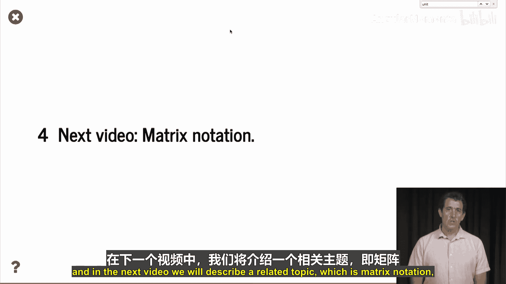

# 【加州大学圣地亚哥分校】使用Python进行数据科学中的概率与统计--Probability-and-Statistics-in-Data-Science-p55-14-01-02-线性代数回顾--BV1gJFDzkEPg_p55-

Hi， this week we're going to talk about regression。For that purpose。

 we need to use concepts from linear algebra。So hopefully you're familiar with concepts from linearar algebra。

 but in order to make sure this video is a short review。Okay so as I said， it's a review。

 it's not a course， it takes a whole course to teach linearar algebra。

 use it more as something to make sure that you know the required concepts so that you can understand regression。

If you really need to learn Lear algebra， there are many courses。

 one of my favorites is Gilbert Strang course on Lear algebrage。Which I'm giving you a pointer here。

Okay， so let's start。So the main concept in linear algebra is vectors。

And vectors represent many things， they can represent arrows。

 they can represent velocity and direction， they can represent locations in 3D space。

 and in fact they can represent many， many other things， as we shall see a little later。

So here is a two dimensional vector， okay， maybe hopefully most of you are familiar with that。

 it's like an arrow， it has a direction and a length and a tail and a head。Okay。

 so this is a representation of a two dimensional vector。Similarly。

 we can have a three dimensional vector that lives in three dimensional space。

And it similarly has a tail and a head and a length。

 but it lives in three dimensional rather than two dimensional space。

So we use some standard notation to represent vectors。And basically。

 we just write a little arrow above a letter to indicate that this letter represents a vector。

Vectctorors are grouped into dimensions okay so you have 2D vectors， 3D vectors and we'll see 4D。

 5D and 120 d as well okay。These vectors are members of a set and the set is denoted by r to the D。

 the real numbers to the D。So a 2D vector is simply corresponds to a list of。Two real numbers。

Like here， a is one over1 and pi， or B is minus 1。56 and 1。2。

A 3D vector corresponds to a vector in 3D space， and it can be represented by three numbers。

 as we see here。And then in general， a D dimensional vector is a member of r to the D and is represented by D real valued numbers。

So the way that we work with vectors in Python is we use arrays。

 this is a part of Python called Nmpy and it is very similar if you' are familiar with MATLB。Okay。

 so is here I'm defining two vectors。Victor 1 is 1 and 2 and vector 2 is minus1 and 1。

 and then I can print them and I see what they are。Okay。

 now when we're talking about vectors represented by N arrays。

 it's important to distinguish two types of dimension。

 the word dimension is used in two different meanings。The array， NP array 1，2，3。

4 defines a vector in r to the 4， so it's a four dimensional vector。However， the array itself。😊。

Is a one D， right， It is just a list of numbers。 So remember that a one D can represent vectors that are high dimensional。

The array 1，2，3，4 is a 2D array， so it basically consists of square or rectangle of numbers。

And the twod arrays also called the matrix， we'll talk about those later。

So here is I'm defining a two dimensional array and when it prints out。

 you see that Nai knows how to print it in a two dimensional way。So this is a two dimensional array。

And in terms of a vector， you can say that it's a four dimensional vector。

 but really you would talk about it as a matrix。Okay。So now， let's talk about how we can。

Visualized two dimensional vectors right so I already gave you a little bit of sketch figure。

 but you can do it in a systematic way。So here are a few examples of that。

So here I have three different vectors。These vectors， each vector is represented by an arrow。

And the coordinates of the arrow are the x。coordinateordinate and the y coordinate。

 so the horizontal coordinate is one here and the vertical coordinate is two and here the horizontal coordinate is zero while the vertical coordinate is minus2 okay so these are three vectors and I can draw them on the plane which is very useful to gain some intuition about how to use vectors。

Okay， so let's talk about some operations we can。Take on vectors。So。

Some of the operations that are very simple are。We can add two vectors。

 which means that we add the corresponding components， or we can multiply a vector by a number。

Or we can multiply the vector by a negative number， which is the same as inverting the vector okay。

 so these are the operations and you see here what are the results。

And here is a visualization of what it means to add two vectors。

So you have the black vector V2 and the red vector V1。And by adding them together。

 you're basically taking V2 and putting its origin on the end of V1 and looking at where it ends up。

 so this point here is V1 plus V2 which is represented the vector by the blue arrow。Okay， so that's。

That's Victor Ed。As it is visualized in two dimension。But you can do addition in any dimension。Okay。

To add two vectors， it's important that the two vectors would have the same dimension。

Here is a vector two dimensional and here's a vector that is three dimensional。

 and if I try to add them， I get an exception， the exception is because the two vectors have different dimensions。

 you can't add two vectors that have different dimensions。

And here is a visualization of multiplying a vector by a constant， in this case， a negative constant。

 so red is the vector v and minus 0。5 times v is the black vector here。

That it goes in the opposite direction and is half as long。Okay。

 the next operation that we're going to talk about is the inner product。

 this is an operation that takes two vectors and generates a number， just a scalar okay。

The way that you can compute it is basically you have several different ways that you can compute it。

 and one is by simply taking the dot product that's the operation in Ny。

 or here is the explicit way that you take the corresponding coordinates， you multiply them。

Coordinate zero by coordinate zero and coordinate one by coordinate one， and you sum the result。

And any one of those things will generate here the same operation because1 times minus1 is minus1 plus2 times1 is2。

 so you get one in any way that you calculate it， so the dot product of 1，2 and minus11 is one。

The next concept is the norm of a vector， so the norm of a vector is essentially what we talked about before。

 which is the magnitude or the length of the vector。

And the way to calculate it is to simply take the dot product of the vector with itself and then take the square root of the result。

Or you can think about it as summing the squares of all of the components and then taking the square root。

 which is basically pthor theorem。Okay so that gives you the length of the vector or the norm of the vector。

So here are several ways to calculate the norm of a vector。

 either take square root of the dot product or simply use the function norm in Ny。

So of special importance are vectors called unit vectors。

 which are vectors essentially that have length one。And。

Any vector that we have can be made into a unit vector or normalized in the following way。

 basically you take a vector V1 whose norm is not one。

And then you divide v1 by its norm and you get a new vector。

 a scaled version of V1 whose norm now is one， so these are unit vectors。Okay。

Proions are basically dot products with a unit vector。

 and those have a very nice geometric interpretation that will be useful when we continue。

Okay so here is two vectors， one of them is a unit vector and the other one is not a unit vector and we're basically just taking the dot product of the two vectors and then multiplying it by the unit vector。

 that's called a projection， so what do I mean by that。So here are our two vectors。

 U1 is the unit vector and V2 is a non unit vector， and we're taking the dot product of the two。

So what that corresponds to is first of all， the just the dot product itself corresponds to the length of this green arrow so if you think about this as a point and this here is a line。

 the projection of the point onto the line is the dot product。

Now if you take the dot product which is a number and you multiply it by the vector u1。

 then you actually get the green vector， which is called the projection so the projection of the vector V2 is a new vector。

 which is in direction of the unit vector and its length is the length of the projection。

 so basically this is how we can in a simple way take a point and project it onto a line。

So this gives us one component of what we need in order to represent our space。

The other one is orthogonality， so orthogonality is also based on dot product and basically two vectors are orthogonal if the dot product between the two of them is equal to zero okay。

So here is an example of that， you see the black vector is 22 and the red vector is minus 11 and their dot product is 0 and if we plot them we see that indeed the angle between them is 90 degrees。

 so 90 degrees and dot product equals zero are equivalent。

What this gets us to is what we call an orthoormal basis okay so now we basically using these unit vectors。

 we can define a representation of the space and we can do useful operations like rotations and so on。

Okay， so we say that a set of vectors U1 u up to UD in the space RD is an orthonormal basis if the following things are correct。

First of all， the vectors have to all be unit vectors， so their dot product with them has to be one。

And also。If you take any two vectors， any two different vectors。

 their dot product is zero so they're orthogonal， so that's why we call it an ortho normalmal basis because the vectors are normal and they are orthogonal to each other。

Okay one of the bases of this type is what we call the standard basis so the standard basis essentially is just a way of describing our standard coordinate system which we think about as x and y and z and so on okay so what it is is simply vector1 followed by all zeros and the second one is the vector zero and then one followed by all zeros and so on until the last vector is simply zeros and then the last the last component is1。

So if you take the dot product of a vector V with one of these standard basis vectors。

 then what comes out is simply the coordinate， the I coordinate of the vector V。Okay。

 so here is an example， we have the vector 5634 and we take the dot product with 0100。

 so obviously we get 6 which is the second component， okay so it's a very simple operation。

 but it lets us represent what we call our standard coordinate system as a basis。Okay。

The next and final thing that we want to do with the vectors。

Use them is to do reconstruction using an orthonormal basis okay， so an orthonormal basis。

 you can think about it as defining a coordinate system。

And it allows us to move between coordinate systems。Okay。

 so suppose we have an orthoormal basis U1 up to UD。

So we can use any such orthonmal basis to represent any vector V。And。Here is how we do it first。

The simplest part is that we take dot each one of the basis vectors and use it to project the vector V onto it。

Okay so we get all of these D projections and these are D numbers。

 which basically represent the vector in the coordinate system based on U1 up to UD。

And we can also reconstruct the vector， so basically regenerate the vector by combining these projections by simply taking the dot product v times u1 and then multiplying it by the vector U1 and then so on doing the same thing for all of the coordinates and we'll basically just end up with the same thing that we started with。

Okay， so if you represent a vector VT using the standard basis。

 it just gives you the standard representation， V1 up to VD。

Representing V using an orthonnormal basis that is different than this one is called a change of basis。

So we can visualize this change of basis in 2D in the following way。

So here what we have is a vector V， the blue vector。And。

It is originally represented in the standard coordinate system。

 so it's coefficient it corresponds to the vector。Where x is minus1 and y is minus2。

 so minus1 minus2。And then we want to rerepresent it in the basis described by these two vectors。

 U1 and u2， so these are this is an orthoormal basis just like the original one E1 e2 which is the standard basis and we want to represent the vector in this way and what we get is that basically we're projecting the vector onto u1 and u1 here and u2 and these are basically the components of the vector in the new basis。

 okay so the length of them is if we wanted to represent it as a number and if we take these two vectors and sum of them we basically recreate the original vector okay so this operation of change of basis is central operation in what we're going to do this week which is regression。

So。So this was the short review of linearar algebra and in the next video we will describe。

A related topic which is matrixtri notation， which allows us to quickly write down a large number of simple vector equations。

 so I'll see you then。

