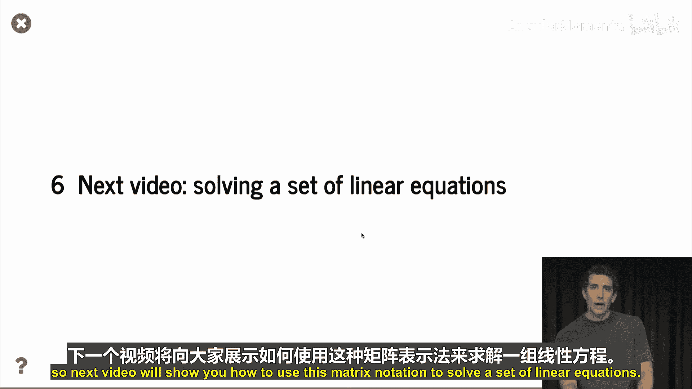

# 【加州大学圣地亚哥分校】使用Python进行数据科学中的概率与统计--Probability-and-Statistics-in-Data-Science-p56-14-02-02-矩阵_表示法__运算--BV1gJFDzkEPg_p56-

系。Today we're going to talk about matrices。Matrices are one of the most useful type of notation that we use in statistics and in numerical mathematics in general。

So what are matrices？A matrix is nothing but a square or rectangle of numbers。

 okay so you have rows going horizontally and columns going vertically and this matrix is called an M by n matrix if it has M rows and n columns。

Okay。So MatTLAB uses matrix notation heavily。And in Python。

 we can use very similar notation by using the library called Numpy， and that's what we'll do today。

So first， a very simple operation is transposing a matrix， so transposing a matrix。

 let's say this matrix a that has two columns and three rows。

The transpose of it has two rows and three columns。

 so basically we just reflect over the we exchange rows for columns and columns for rows and we get a new matrix that is2 by3 matrix。

And we denote that by A T。Which is transpose。So here is how this would be done in Nmpy。

 you have this matrix here that is a  two by3 matrix。And when you take the transpose of it。

 you get a three by two matrix。For the code itself， download the notebook。Okay， so。

What are vectors vectors in matrix notation can come in two flavors。

 either a column vector where all of the elements of the vector are written one above the other。

Or a row vector， which is the vector， all the elements in one row。

 okay so this is pretty simple and you'll see soon why we want to have these two different notations。

We can always think about vector as a matrix， it's just a very simple or skinny matrix。

 column vector is a D times 1 matrix and a row vector is a 1 times d。Matrix。

So we can think about a matrix as a collection of vectors and that's really where the power of matrix manipulation comes from so we have this matrix。

 it's a two by3 matrix。And we can think about it as three column vectors， this column vector。

 this column vector and this column vector。Okay， C1， C2， C3。

 and now the matrix is just a row of column vectors。Similarly。

 we can think about the matrix as a column of row vectors， so we have two row vectors， a11， a12， a13。

 and so on。And when we put them both in a column， we basically describe a again now as two row vectors。

Okay， so。Here is our matrix again a。And here is the operation of splitting a into three column vectors。

 Okay， so now we got columns， which is now。AndAnd a list of three column vectors。

And we can take these column vectors and put them together again with concatenate。

 and now we get the original matrix again and we can check for equality between the reconstructed matrix and the old matrix and see that all of the entries。

Are true。Okay， so let's start with some matrix and scalar operations Okay so a scalar is simply a single number and a matrix is a rectangle of number as we said and。

Taking a matrix and adding to it a scalar just means taking that same scalar and adding it to each one of the elements of the matrix。

Similarly， subtracting is subtracting from each one of the elements in the matrix。

And multiplying by a scalar is multiplying each element in the matrix。We can also define。Division。

 so we can take a divided by 5 and that's simply a times the number 1 fifth okay。

 so we multiply  one fifth each of the columns each of the elements of the matrix。

We cannot take5 divided by a that is not defined。Okay。

 now let's go on to talking about operations between matrices。

So first adding and subtracting matrices， if we have two matrices， they have to be of the same shape。

 so the same number of rows in the same number of columns。

 and then we can take the difference between them and that means that we take the difference of all the corresponding elements。

 so a11 minus B11， A12 minus B12 and so on。Now let's talk about matrix matrix products。

 that's where the real action is。So let's start with the skinny matrix， the vectors。

 okay so we have a vector 12，3 and another vector 110。

 and we know that the dot product of the two is 1 times 1 plus 2 times 1 plus 0 times0。Three times0。

Which is equal to 3 So how do we write that in matrix notation？There is。A convention。

It kind of seems like a strange convention， but you'll soon see that this convention lets us do very powerful things in a very small amount of notation。

Okay so what we have to have is that the first vector in the dot product is a row vector and the second is a column vector。

 that's the convention okay so row vector times column vector and the result is exactly the same as before。

So now let's see how that can generalize to other non skinkinny matrices。

 so suppose we want to multiply this matrix that is a 2 by 3 matrix by a column vector that has dimension 3。

What we do is we think about the matrix a as a column of two row vectors。

 so we have row vector 1 and row vector 2。And then we can multiply row vector 1 by c and row vector 2 by C and get the result。

 So that's what we do。 A times C is row vector1 times C above row vector 2 times C。

 which gives us these。Numbers， these， these sums。 and we at the end， we get a two。A two row。

 one column matrix。We can even generalize it further and talk about multiplying a matrix by another matrix。

Okay， so here we have a matrix， a with three rows and two columns。

And a matrix C with two rows and three columns。And we're going to want to take the product of A and C。

 so what we have to check is that the number of columns in a is equal to the number of rows in C。

So to compute the dot product， we think about a as a column of row vectors。

And about C as a row of column vectors。And now when we want to take the product of the matrix a times the matrix C。

 we take these this column vector times this row vectors。

 and that means that basically we are taking the first element here。

Dot product with the first element here， the first element here。

 dot product with the second element here， and so on。

We get this first row and then similarly with A2， we get the second row。And if you think about it。

 this is quite a lot of different operations。If you expand it completely。

 you get this big expression and so now you start to see why it is convenient to have matrix notation so we can just call this a times C。

So now that we have described how to multiply matrices and vectors。

 we want to redo what we did at the end of the last video。

 which was creating using an orthoormal matrix to change a basis。

So remember the definition of orthoormal basis， it's a set of D vectors that all have length one and are orthogonal to each other。

And here we're going to use a row notation to indicate each one。

And then we're going to combine all of these rows。Into a matrix， Okay。

 so here is our matrix where each row is one of the orthoormal basis vectors。

And what you see is that to check that this is an orthonormal basis vector is just enough to multiply u by u transpose。

And it required that the result is the unit vector， we didn't say it， what is the unit vector。

 we're going to check on that next time。Okay。So once we have this notation to do a change of basis for a vector v is simply to multiply V by u from the left。

And if we want to reconstruct the。In this new basis， we just write u times u transpose times v。

And as we know u times U transpose time Vs is the identity matrix， and so we get V again。Okay。

 so what is this identity matrix？The identity matrix is like the number one when we do regular multiplication。

 remember that if we take the number one and we multiply it by a， we get a。

And if we multiply a times 1， we also get a。So the matrix。

 the identity matrix has the same function as the number one， but in matrix multiplication。

 so if we multiply a times the identity matrix， it's equal to the identity matrix times a。

 it's equal to a。And what is this identity matrix， It's a pretty simple matrix。

 It's a matrix that has。First of all， it's a square matrix， and secondly。

 it's a matrix that has all zeros other than the elements that are along the diagonal that are all one。

And if you just go back to the definition of multiplication。

 you can check that indeed a times I is equal to i times a is equal to a。

 just simply from the definition of matrix multiplication。Okay。

 now we're going to talk about a more complicated operation。That will be useful in the next video。

 so that's inverting a matrix。So remember in multiplication。

 when we say that the inverse of a is 1 over a， we can also denote it by a to the minus1。嗯。

A to the minus1， then the property of a to the minus1 is that if you multiply a by a to the minus1 you get 1 so that's the general property of the inverse that if you take the element and you take the inverse of the element you multiply them you get 1。

And recall that not everything has an inverse， for instance zero does not have a multiplicative inverse。

 you can't multiply zero by anything to give you one。Okay， so some。Marices。

 some square matrices can do have a multiplicative inverse such that a times。

A inverse is equal to a inverse times a is equal to the identity matrix。

And if we want to find the inverse of a matrix， this is called inverting a matrix。And。

Here I give you the formula for invent inverting a two by two matrix。

 So this is a sufficiently small matrix that you can write the inverse explicitly。

 and what you see is that you're basically just moving the。Elements A22 and A11。

 you're exchanging them， and then you're taking the minus of the elements， a12 and A21。

And then you're dividing by this expression， and so that expression actually shows you when there would not be an inverse。

 basically when a11， a22 minus a12 a21 is equal to0， there is no inverse for the matrix。

So here is some Ny code to show taking inverse an inverse of a 2 by2 matrix， that is a random matrix。

And you see that here is the matrix C and here is the inverse of the matrix C。

And if you go to the notebook， you can check that the product。

 the dot product of C and C inverse is indeed the identity matrix。So as I said。

 not all matrices have an inverse。Those that don't have an inverse are called singular。

Singular matrices。So here is an example of a singular matrix。

 if the matrix that has 10 in the first row and 10 in the second row is singular and if I try to invert it I get an exception okay so I cannot invert this matrix。

 so just remember that not all matrices can be inverted。Okay。

 so next video will show you how to use this matrix notation to solve a set of linear equations。

谢0。