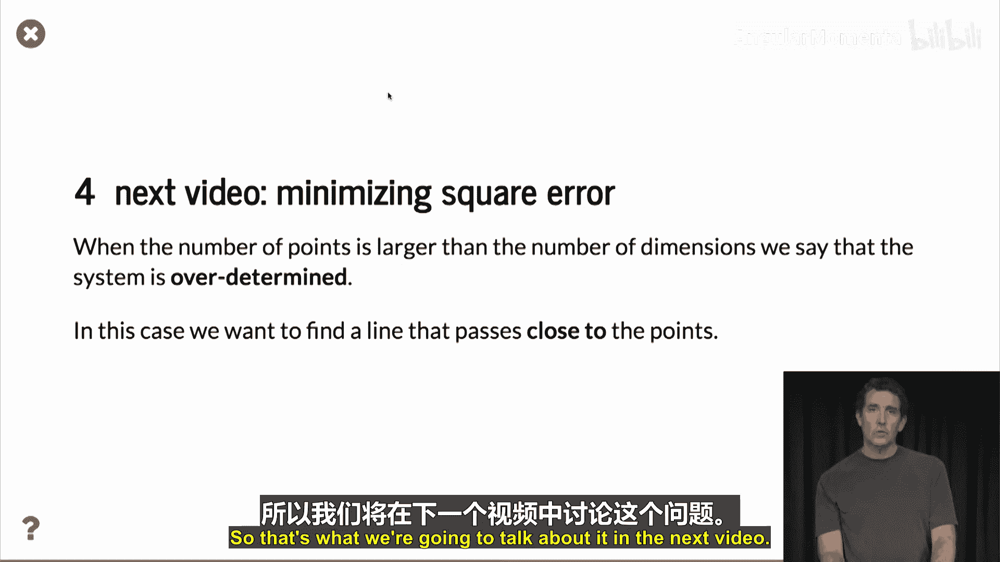

# 【加州大学圣地亚哥分校】使用Python进行数据科学中的概率与统计--Probability-and-Statistics-in-Data-Science-p57-14-03-02-求解线性方程组--BV1gJFDzkEPg_p57-

系い。Last time we talked about matrices and now we will see the first use of matrices for solving a system of linear equations。

Okay。So linear equations， the simplest case a linear equation of a system of linear equations is two equations with two unknowns。

 and that corresponds to finding a line that passes through two points so we're given two points in the plane minus1。

2 and11， and we want to find a line that passes through these points。So here is the picture。

 here is our plane， and this is line the 0。2 minus1， and this is the 0。11。

 and we want to find a line that would be a straight line going through these two points。

So any line other than the vertical line can be expressed using this expression y equals w 0。

Plusus w1 x， where w0 and w1 are some numbers and x and y are the points and along the line connecting these points W0 is the intercept with the y axis and y1 is the slope of the line。

So to identify the lines that passes through the two points we need to find the w0 and w1 that satisfy the two constraints determined by the two points so for the point minus12 if we write the expression we see that w0 minus w1 should be equal to 2 and for the11 we see that w0 plus w1 should be equal to 1 okay so these are two equations with two unknown nodes。

 probably you know how to solve this directly， but let's do it through matrices because that will generalize。

Okay， so we want to write these equations in Ma。In matrix form。

So here is the way that we can write it。 We can write the matrix 1 minus1。1，1 times the vector。

W0 w1 is equal to the vector 21。 if you basically write out the two dot products that correspond to the first row and the second row。

 you see that you get exactly the equations that we had before。

And now we can just represent this as a w times B， a times w equal B， if we basically call this a。

 this W and this B。 So this is what we do。 Okay， so a is called the matrix of coefficient。

B is the ordinate or dependent variable vector。And the parameter vector is w is this part that we don't know。

 So how can we find W？Okay。So。We want to find a w such that AW equal to B。Now， if a is invertible。

 so a is square， but if it is also invertible， which it is in this case。

 then we can multiply both sides by a to the minus1 and we get that。

A to the minus1 times AW is equal a to the minus1 times B。But that's also equal on the left here。

 it's equal to w because a to the minus1 times a is the identity matrix。

So here is how this looks when we use Nmpy。We have the matrix A and the vector column vector B。

And we want to find the inverse of a。 Okay， so inverse of a。

 we just use the command in of a and we find the inverse。

And then we check that it is indeed the inverse， so if we multiply a times the inverse of a。

 we get the identity matrix。And then the solution is inverse of a times B。

And so what we get here is that the solution is 1。5 minus 0。5。

 so that's the vector w that we need to use。Alternatively， we can just use。

The solve operation in Nmpai， and that will give us the solution directly。

Now that we have the vector w， we want to define the line that is represented by w， and as we said。

 this is simply w0 plus w1 times x， so we define a function。That。

ThatThat gives you the value y for every value of x， W is fixed here。

And what we see is that if we basically write F of minus1， it's 2 and f of 1 is 1。

 so indeed we see that the line goes through the two points we wanted it to go through。

And when we draw it， we can see that this is indeed the case。

 So we we found the line that goes through the two points that we。That that we were given。ok。

Now that was two points， but what about if we have more than two points？So in general。

 if you have more than two points on the two dimensional plane。

 there is no line that goes through these points。So heres an example。1，2 points that we had before。

 And here is a third point。 Now， this third point doesn't lie on the line connecting these two。

 So there is no line that would go through all of them。Still。

 many times we do want to solve problems that have more points than we have dimensions。

So when the number of points is larger than the number of dimensions。

 we say that the system is overdetered。That means that there is no line that goes exactly through the points。

 However， we do still want to find a line that passes close to the points。

 So that's what we're going to talk about it in the next video。 See you then。

