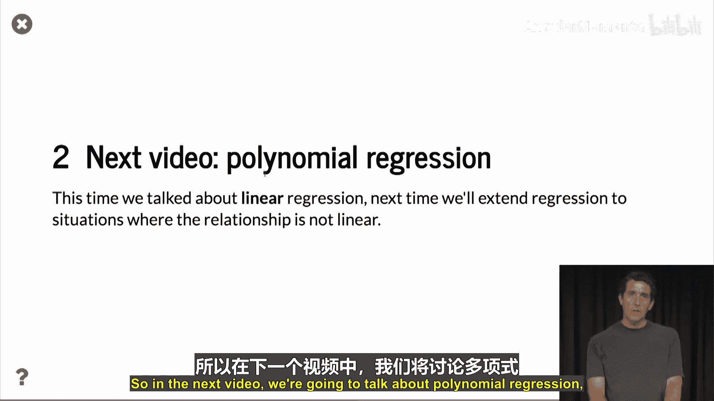

# 【加州大学圣地亚哥分校】使用Python进行数据科学中的概率与统计--Probability-and-Statistics-in-Data-Science-p58-14-04-02-线性回归--BV1gJFDzkEPg_p58-

系い。Last time we talked about finding a line that passes through two points on the plane。

And we raised the question at the end about what about having more than two points。

 can we find a line that passes close to these points。

 Okay so that's basically the idea of regression。And this video is going to introduce you to the notion of red regression and how we solve it using Nai。

So here's a small example， we have nine points on the plane defined by their Xy positions。

So here are points okay， so these are the points and clearly there is no single line that passes through all of these points。

 but also clearly there is a line that passes very close to all of them okay。

 this line that is tending upward。So how can we find that line？

So the line is going to be defined as before by a function of the form w0 plus w1 times x。

And we want to find W0 and W1。So previously， we saw how to find that when there are just two points。

 and so there is a line that passes exactly through the points and then it was just matrix inversion。

Here there is more than two points and the system is over constrained。

 there is no straight line that passes through all the points。So while they don't fall。

 there is no line that falls exactly on all of the points。

 we can find a line that will be close to the points。

 but we need to define somehow what we mean by close。

So what we are going to use is this idea of square difference okay so for every point X I Y I we're going to calculate the value of the line at that x and then take the difference from that and y which is the actual position of the point and square that why do we square it because we always want to be positive if we're not exactly at the point if we're exactly at the point we have zero so we want this cost the square cost to be function that is bigger and bigger the further you are from the point and our goal is to find a minimum。

So。This method of looking for minimizing the squared difference is called the least square method。

And we are going to look for the least square solution。Okay。

 so we're going to use matrix notation and we're going to use Npylin ag。

The library to find this optimal vector W that minimizes the square error。

So we're going to use the following matrices， first we're going to define a to be this matrix where there is one column that is just all ones and the second column is the x values。

And then we're going to have。Column vector that is all the y values。

 and then we're going to have a small column vector with just two values that is going to be the weights vector that we're looking for。

So now we can define the errors to be AW。Whi gives us the y vectors as measured by fx。

 as computed by fx minus y， that's the difference and that's now it's the difference vector。

And what we're interested is in the sum of the squares of the differences。

And that turns out to be exactly the square of the norm of D。 remember the norm is the length of D。

 we're looking for the W that will make D as short as possible。Okay。

 so how do we do this in Ny we define the vectors a and y， as I said。

 I'm just printing here a transposed and y transpoposedse so that they fit nicely in the slide。

And then we just call the function in Nmpy called least square。

 give it the matrix a and the vector y， and we're just interested in the parameters so we're going to take the first component。

Of the of the answer from this and that's the vector w。 And if we print out w。

 we see that it's 19 and 0。7166 and so on。 Okay， so this is w 0， the offset and this is the slope。

And if we now plot this line on the previous graph。

 we see that it is indeed like the line that we expected and the little green segments here represent the errors the differences so you see that for most of the points the difference is very small for some points the difference is significantly larger。

 but this is the line that would minimize the total of the square of the lengths of these。

Green lines。Okay， so that was a toy example just to show you how you do this kind of thing in a small number of examples where you can essentially see everything and it makes sense。

In real life we usually have not just9 or 10 or 20 points。

 we have a huge number of points and we want to find a line that passes through close to all of these points。

 so here is a real data。Which has 25，000 people， their height and their weight。

The height in inches and the weight in pounds。And。If we solve the least square for this data set。

 what we get is the following。Is this is these are our points， you see it's now a cloud of points。

 we have a huge number of points and the red line is the best line that passes through those points。

 so what this red line tells us is not surprisingly that as weight as the height increases the weight also tends to increase。

 but this is by no means explaining all of the variation in the weight for the same height you have a big variation in the weight of the person。

Okay， but this is what we would call the linear regression line。So。

To get a slightly more refined understanding of what this line tells us。

 it is useful to draw what is called the graph of averages。

So this is the graph of averages and basically what I've done is that I split the height into many ranges。

Of about one inch， I think。And。For each of these ranges， I found the the mean。

The mean value and that mean value is the red dot。So that is called the graph of averages。

And what you see from this graph of averages is that the tendency described by by the line that we found is actually wellre wellre the the points of the averages so the averages are indeed going increasing linearly so remember this black line we found it according by minimizing the square error for all of the points but it passes close to the center for these points and only in the edges where we have very few examples do we have significant deviation from that so so if we ignore these very very short or very tall people that are outliers we see that the linear graph is a good representation of the graph。

Averages。We'll see that in some other cases， this is not the case。

For every problem that we do in two dimensions like here from weight to from height to weight or vice versa。

 we have two regression lines， one is for to predict the weight from the height。

 so if I give you the height of the person I can find a function that is the straight line that will predict the weight。

But I can also do it the other way I can predict the height from the weight。Okay， so。

 and the two functions will not coincide。 So here is the result of doing that。

 You see this is a red line。 This red line is what we had the previous line for predicting the weight from the height。

 the black line is predicting the height from the weight。 So if you give me the。

The weight I will predict the height that is associated with it。

 So you see that these are two different lines depending on what it is that we're trying to predict and what we're using to predict it。

So in the next video， we're going to talk about polynomial regression。

And that is a case in which linear regression might not be good enough。

And we need to do something a little bit more sophisticated， so I'll see you then。

