# 【加州大学圣地亚哥分校】使用Python进行数据科学中的概率与统计--Probability-and-Statistics-in-Data-Science-p60-14-06-02-均值回归--BV1gJFDzkEPg_p60-

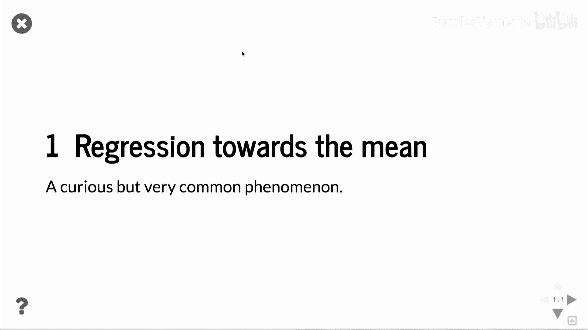

In this video I want to tell you about something that is an interesting and curious phenomenon。

 and it is something that shows that statistics can sometimes result in situations that are unintuitive and it's a very common thing。

 so it's worth knowing about。Okay， it's called regression to the mean。So here's an example。

 suppose students take a standard exam at two time points， maybe before and after a quarter。

And they get two grades。The grades are， let's say on a scale of 0 to 100。

 and the average grade is 70。Here is what tends to happen。

 supposeupp that the first grade that the student got is 97。

Then the second grade that the student gets is likely to be lower than 97。

And the opposite is also true if the first grade the student got is 55。

 then the second grade is likely to be higher than 55 so remember the mean is 70 and this is what we call regression to the mean because you're moving and the second case you're moving closer to the mean。

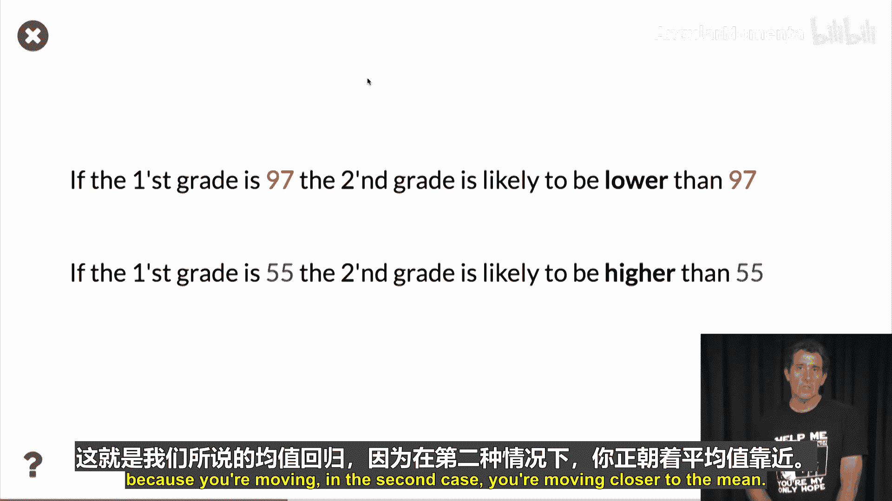

But the strange thing is that this has nothing to do with whether the student learned or not。Okay。

 it just happens even if the two grades are completely statistically independent。

And also it happens if you exchange grade 1 and grade2， so you say what is grade 1。

 given that in grade 2 you got 97， it will10 to be smaller than 97。

So it doesn't really tell us anything。It doesn't tell us that those students that were good initially became bad or those that were bad initially became good。

 it is just something that happens because of statistics。

 it doesn't tell us anything interesting and we can conclude anything from that。

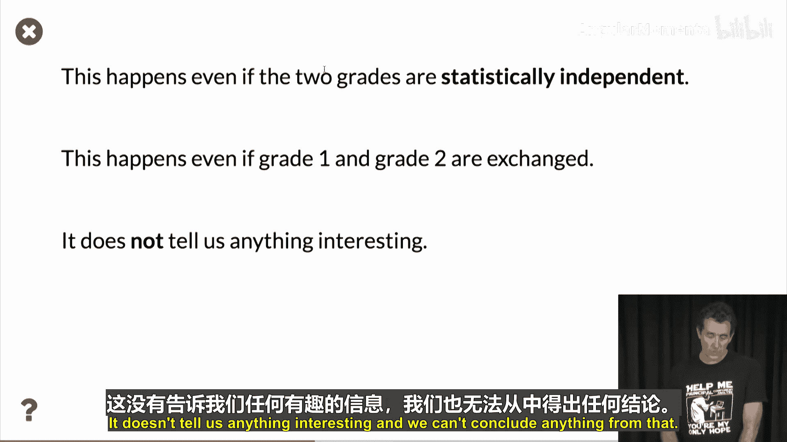

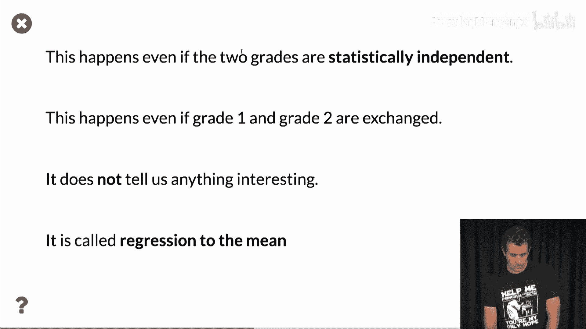

Okay， so here is one of the first works that showed this。

 it was a work comparing fathers and sons height， and it was done by Sir Francis Galelton in 1886。

 so quite a while ago。And basically， it says that extreme characteristics。

 let's say height in parents are not passed on completely to their offspring， Okay， so youd think。

Tall parents tend to have tall children， and it's true， but the children would tend to be less tall。

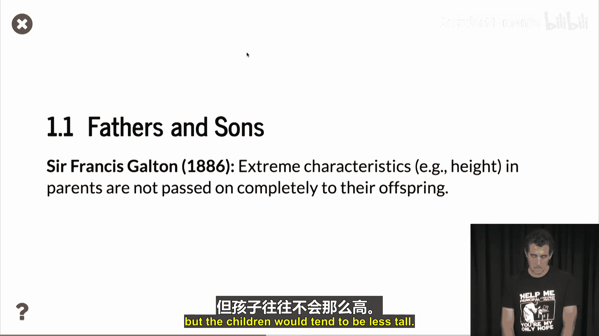

And so here is some data that was actually used to study this what you have on the x axis is the height of the father and what you have on the y axis is the height of the son。

 and what you see is that there is definitely relationship between them as the height of the father increases。

 the height of the son increases， but if you look at the actual values you see that the height of the parent can go from let's say。

 58 to 77。And the related sun height would just go from 63 to 72。

 so it's much closer to the mean height。

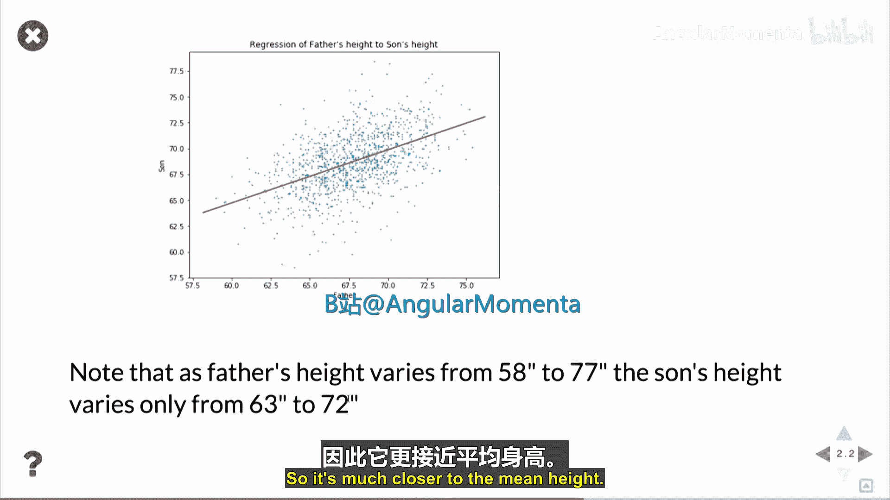

A different way to look at it that is useful is to look really at the difference okay。

 so instead of looking at the absolute value of the height of the sun。

 you look at what's the difference between the height of the sun and the height of the parent。

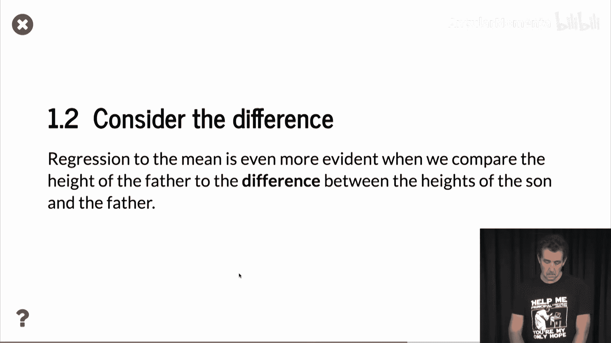

So you get this kind of plot so in this plot it is even more striking that the higher the parent is the big the shorter relatively to the parent the sun is okay and again that has nothing to do with whether there is like some kind of limitation in the genetics or so on。

 it's simply a result of regression to the mean that always happens even if things are completely independent。

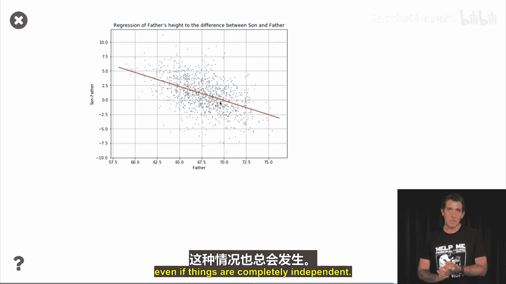

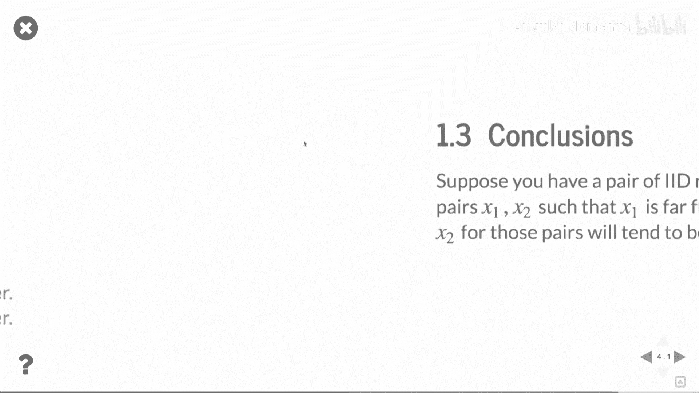

So this is the conclusion， supposeupp you have a pair of。

Independent and identically distributed random variables， x1 and x2。

 if you select pairs x1 x2 such that x1 is far from the mean of the distribution。

 then x2 for those pairs will tend to be closer to the mean。

And you can do the same if you choose x2 to be far from the mean。

 you'll get x1 is closer to the mean。

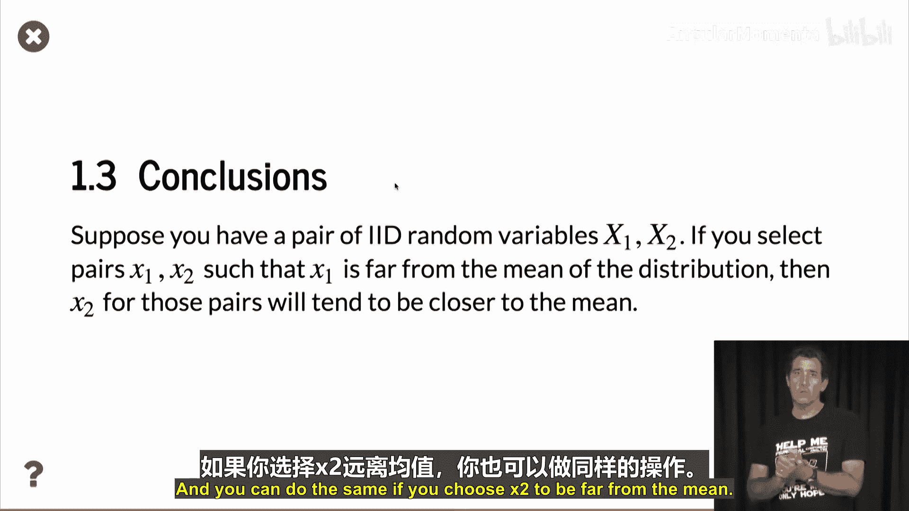

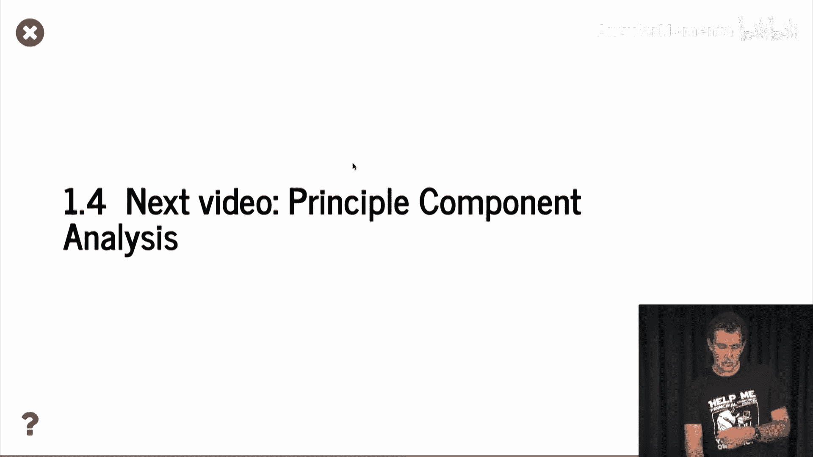

So next time we're going to talk about principal component analysis。

