# 【加州大学圣地亚哥分校】使用Python进行数据科学中的概率与统计--Probability-and-Statistics-in-Data-Science-p61-14-07-02-成分分析--BV1gJFDzkEPg_p61-

We are reaching the end of the topic of regression and the last thing I want to tell you about is a subject called principle components analysis。

 so the subject of principal component analysis to actually fully understand it。

 you need a good understanding of aenvectors， eenvalue， matrix decomposition and so on。

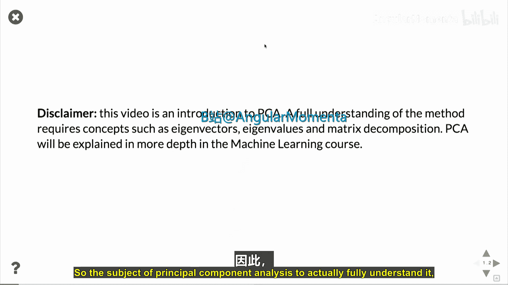

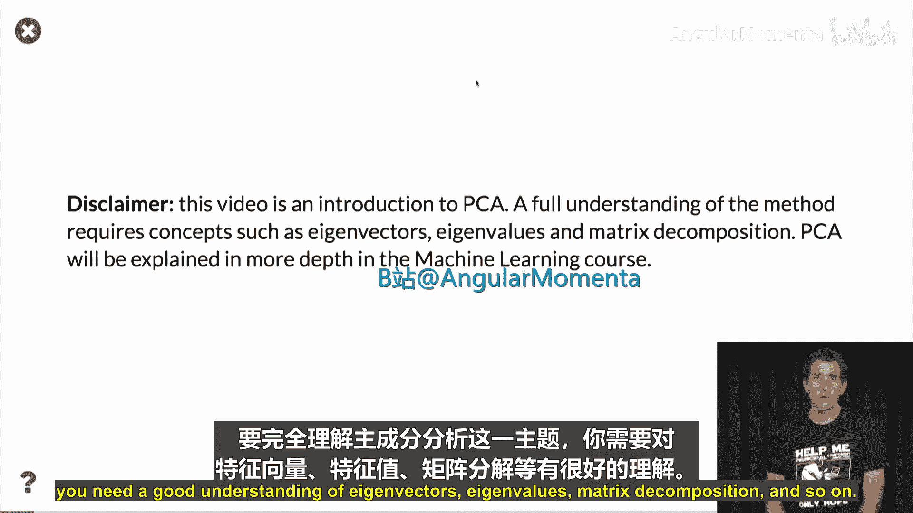

And I'm not going to provide those， I'm just going to give you a somewhat more superficial understanding that it still gives you some of the intuition about how PCA works。

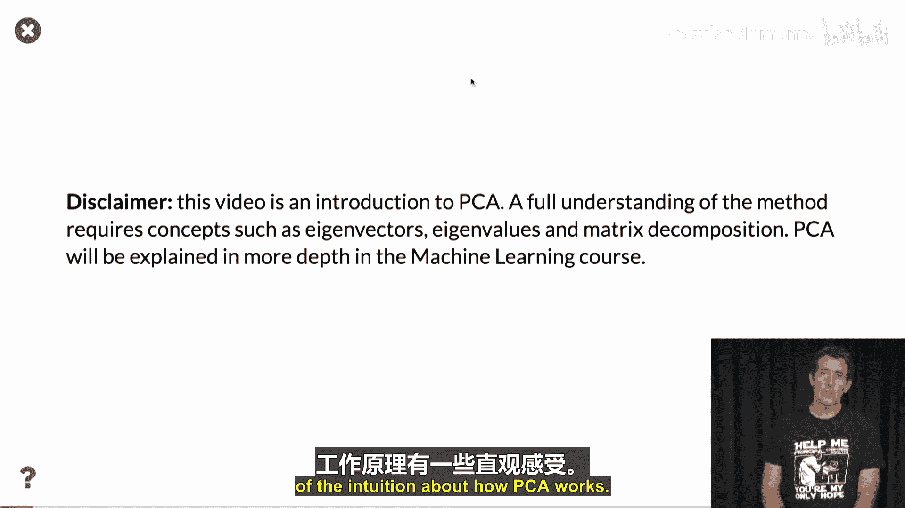

So let's start with a quick review of linear regression。Suppose we have nine points in the plane。

like that。And here is a plot of these points。And you see that they're not exactly on a straight line。

 but they kind of tend to go up from the left to the right。So y tends to increase as x increases。

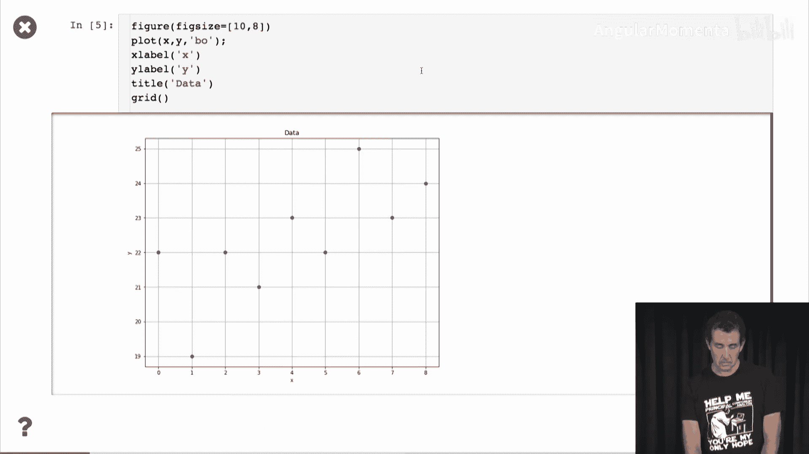

So we would like to find a line that would represent it and what we're going to do is look for a line with formula w0 plus w1 times x。

And the goal is really to find these two parameters， w0 and W1。

And this is actually very easy using Ny， we just use the least square function and we get the ws that we wanted。

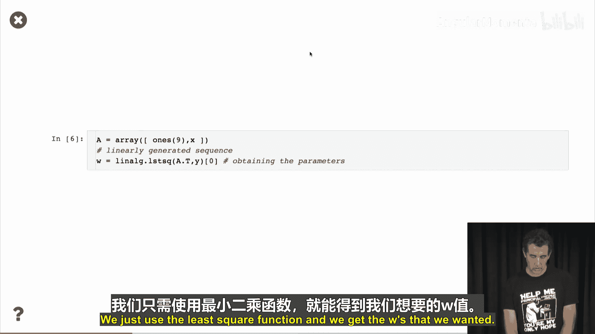

And when we plot them， we see this line and what I added here are the green lines that basically indicate the amount of error associated with each point and what we're trying to basically do is minimize the square of the lengths of these segments。

So in the regression problem， we looked at a function that predicts y from x and we saw that if we try to do the opposite。

 we predict x from y， we get actually a different function， a different line okay。

So it matters if we go this way or in the reverse。

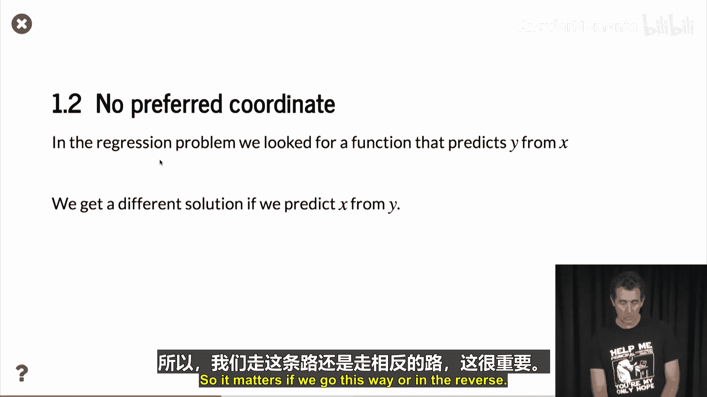

In general， we call this kind of problem in machine learning， we call it supervised learning， why。

 because the idea is that the output or the thing that we're trying to predict is labeled by some supervisor。

 somebody that knows what is the correct value of y。

 and then we're just trying to predict that value of y。Okay。

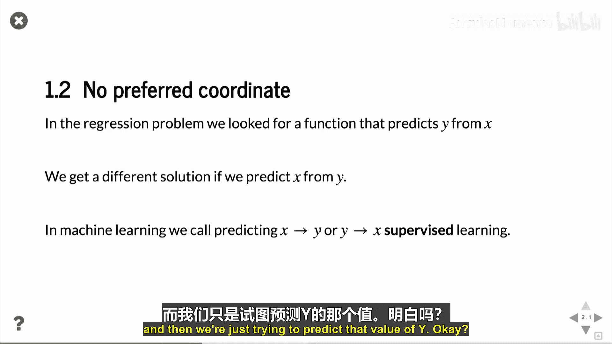

But we can also fit a line without deciding on a direction okay so we there is a way to fit a line to this data that doesn't have anything to do with whether we choose x or we choose y or we rotate the whole thing any way we want。

Okay， so this is called unsupervised learning because here we're just basically given data and nobody identifies a particular。

Component is something that we're trying to predict。

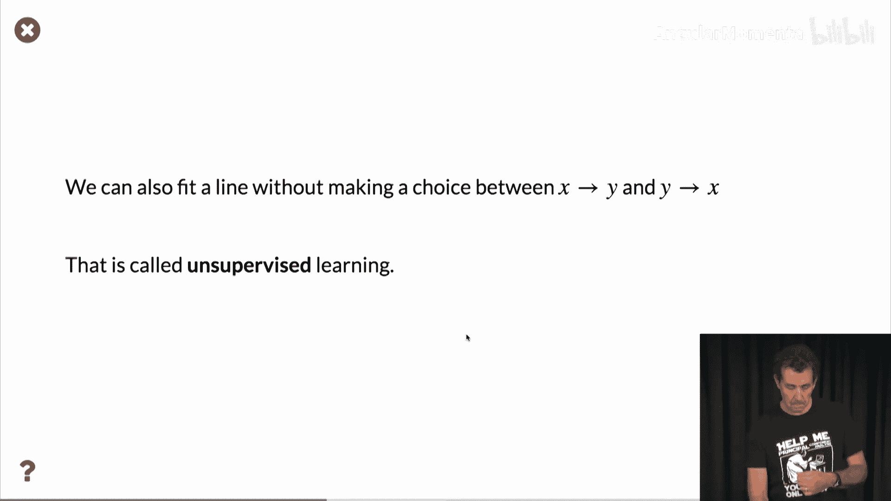

Okay， so if we want to do unsupervised learning for linear function using squared error。

 this is called PCA principle component analysis。Okay。

 so both principal component analysis and regression minimize the same loss function。

 the root means squared error， but the definitions of the error are different。

 as I'll show you in the next figure。Okay， so let me make this a little larger so you can see more clearly what we see here is the black line is the regression line。

And the error to the regression line are basically vertical these green vertical segments。

On the other hand， the red line is the PCA solution。

And the error for the PCA solution are not vertical。

 but basically they're orthogonal to the line itself so basically the error for this point is this blue line here。

And what we see is that when we try to minimize this kind of error。Then。Basically。

 you see that we get a different result okay， the red line is not the same as the black line。Okay。

 and importantly， if we think about rotating this coordinate system。

 we'll see that the regression result will change because we're changing the relationship between x and y。

 but the PCA result will not change。 It is somehow directly associated with the data and not with a coordinate system。

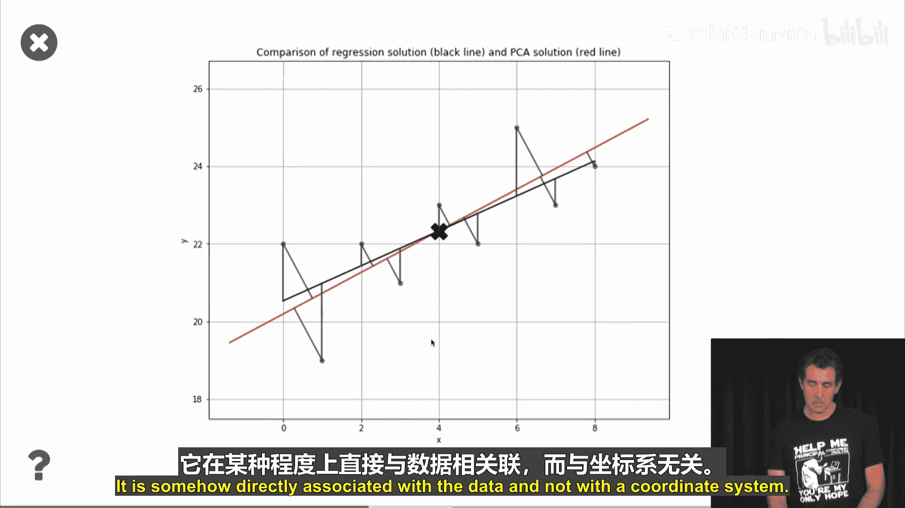

So again， errors for the black regression line correspond to the vertical green segment。

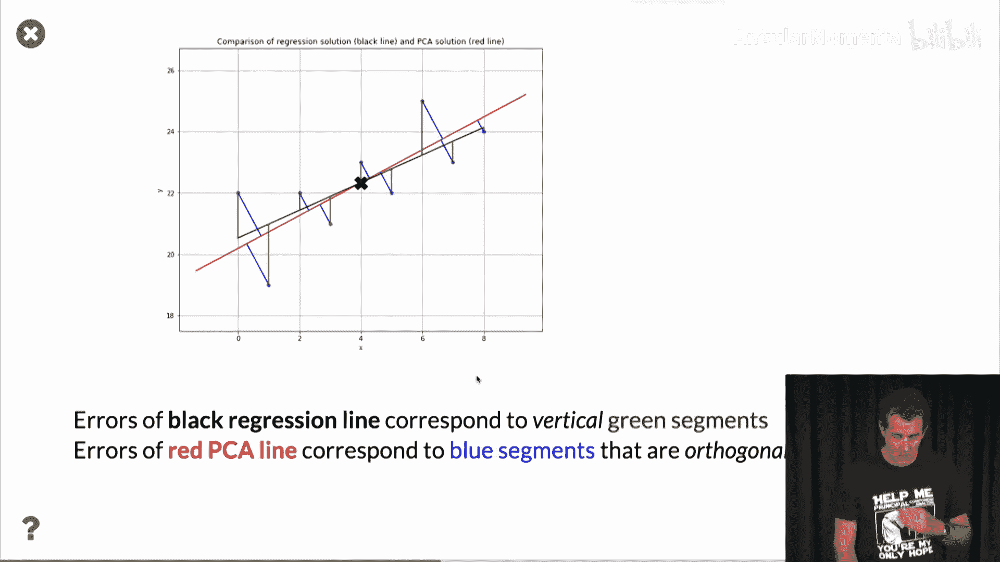

And errors for the red PCA line correspond to the blue segments that are orthogonal to the red line。

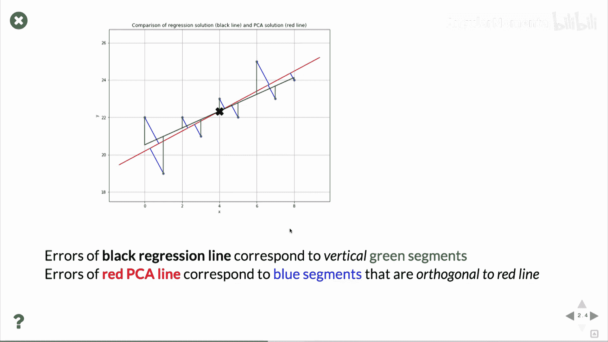

An alternative way to think about PCA is about maximizing variance。

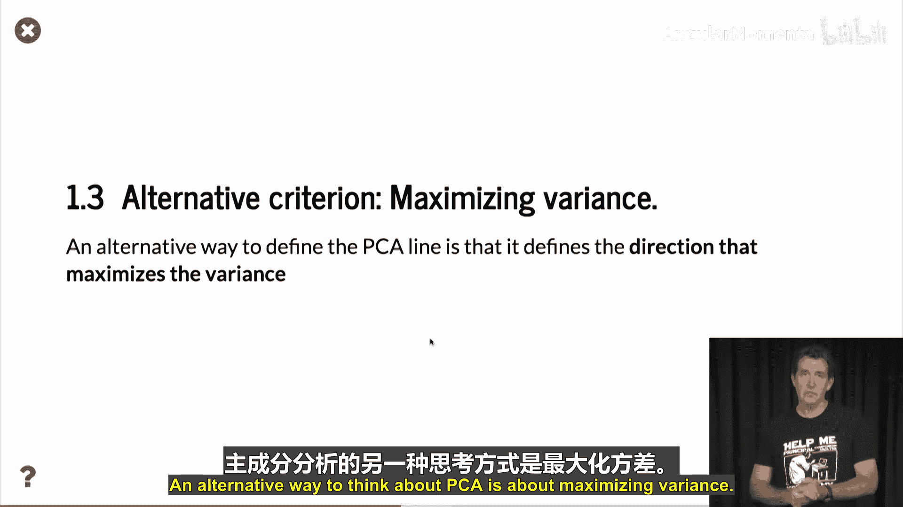

Okay。So suppose that we have a set of vectors x1 to xn。And then we take a unit vector U。

 if you remember from the linear algebra view， a unit vector that has length1。

 and we take the dot product of this U with each one of the vectors， then we get a number。

 and then we can calculate the mean of that number and the variance of the number and we're particularly interested in the variance。

 how much spread out is the data along this projection。

So here is one example we're projecting on this red line and we see that the points fall pretty far away from the mean。

On the other hand， if we use this direction， we see that the points fall closer。To the mean。Okay。

 so the points in this direction are more bunched together and the variance is smaller。

So suppose you consider all possible directions right in the two dimension case， it's very simple。

 it's all directions from zero to 360 degrees。And for each direction。

 we compute the standard deviation， so the square root of the variance。

And we put a point that distance away from the mean， from the origin point， which is the mean。Okay。

So the collection of all of these points， when we draw them out， will form an ellipse。

 something like this。Okay。So basically， if you go from this point and you project along this line。

 then。The standard deviation is big， and if you go orthogonal to that。

 the standard deviation is small okay？So this ellipse essentially represents all the information that exists in the variance of the projections。

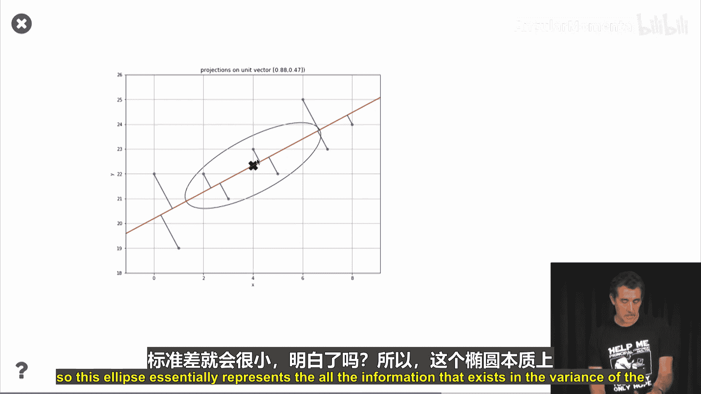

Okay， so。PCA relates to this picture in the following wave， the larger。

Access of the ellipse corresponds to the direction of maximum variance。

 and that is what's called the first eigenvector of the principal component analysis so that is the direction that gives you the maximumim variance。

The smaller axis of this ellipse corresponds to the direction of minimum variance。

 so that gives you the second eigenvector， which is orthogonal to the first one。

Okay so the nice thing with this is that it's not really restricted just to two dimensions。

 you can do it in very high dimensions and what you get is that the direction that gives you the highest variance is the first eigenve then the second direction is the second eigenve so the second direction in which you get maximum variance。

 but it is orthogonal to the first direction and so on you go down and basically that kind of describes a big ellipsoid in space that。

Basically represents somehow the distribution of the data。

So let's see a real life example of that right here just in two dimensions。

So we're going back to the data that has the weight and the height of 25，000 people。

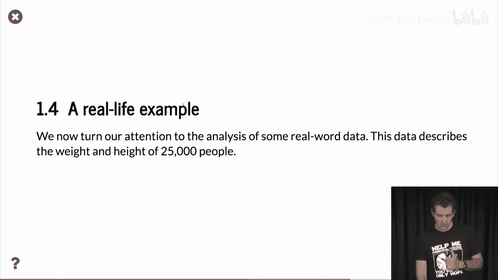

And here is the first component of the PCA analysis okay so this is the direction that most that gives you the highest variance when you project on it when you project the data on it。

 so it's pretty intuitive， this is the direction the data is most is most。

It's most distributed widely across this direction。Okay。So。

This way of looking at PCA provides one of the common ways to normalize data。

 normalizing data is very very useful because it puts some of the variation into some parameters and then leaves the rest of the variation to be studied so how do we use PCA to normalize data first we subtract the mean so by subtracting the mean we make the new mean zero。

And then we rotate the data so that the coordinates are the aenvectors。

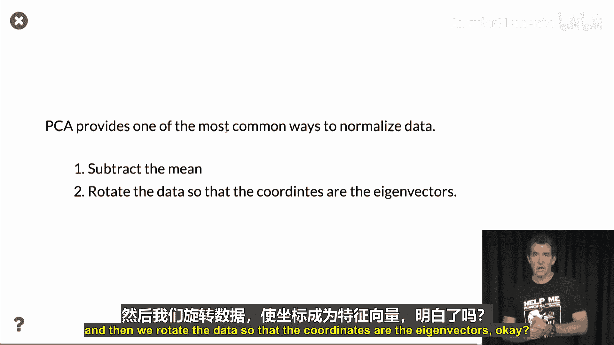

So this looks something like this if we have the original data here。

It is the mean is somewhere between in 125 and 70， we subtract the mean， so now the mean is 00。

 and then we rotate it so that the maximum variation is along the x axis and the smaller variation is along the y axis。

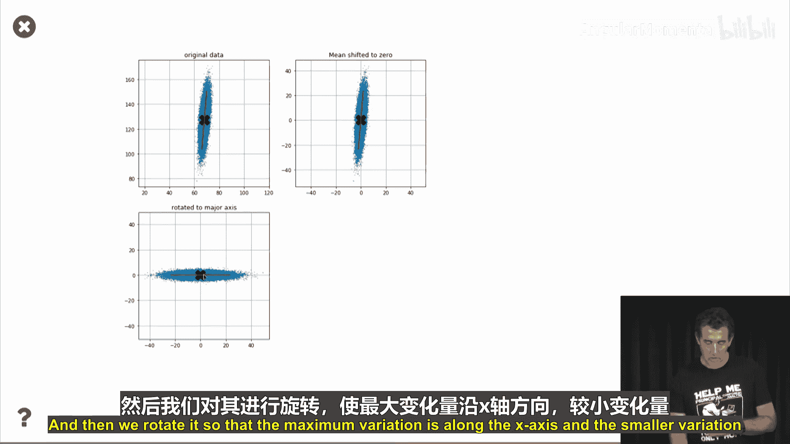

So this is something that is done quite a lot。

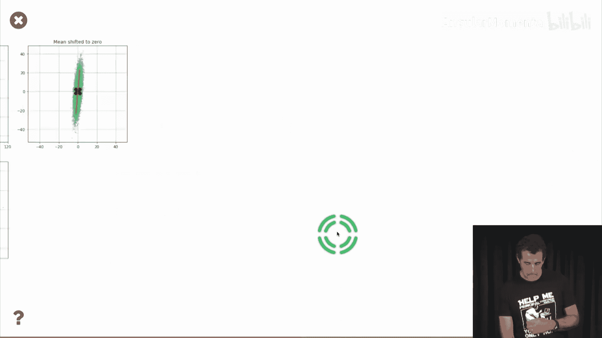

Okay， let's see another little application of PCA in computer vision。

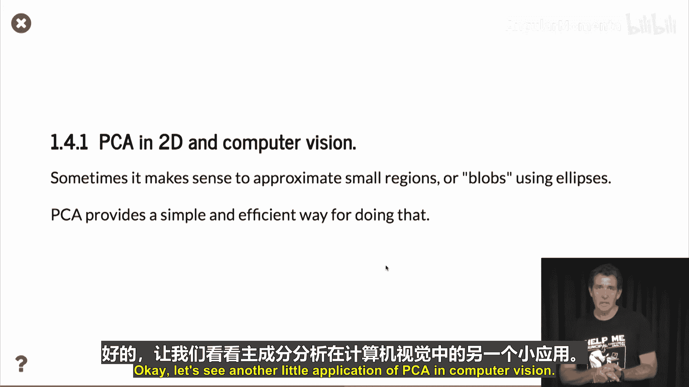

So here is a little picture of maybe a blob and an image。

 so it's a rectangle and let's say we want to somehow capture what is the size and orientation of this rectangle。

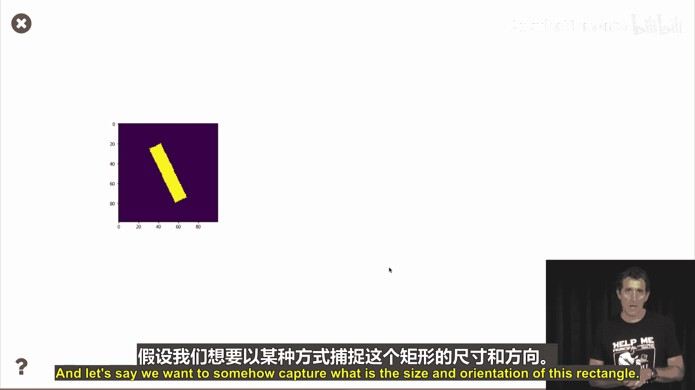

So we can basically map it to our PCA problem here all the pixels， those little blue dots。

 and if we do a PCA we find that the aenve is essentially in this direction and it has the standard deviation is about this。

 or this is actually some product of some constant factor over the standard deviation。

 but it tells us the data varies more that the direction of this blob is mostly in this direction and this is about its size。

And that would work for any shape doesn't really matter。

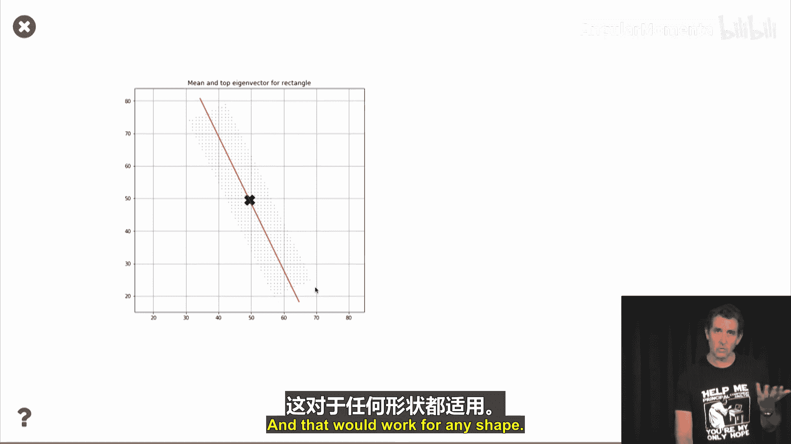

Okay， so to summarize， we talked about PCA and regression。

And they are both models for both ways to model data by minimizing root means squared error。O。

Regression is a supervised method， so you have to choose what thing you are trying to predict while principle component analysis is unsupervised method。

 so unsupervised method tend to be used before when you just get your raw data and you are trying to summarize it or somehow reduce its dimension so that you can do the supervised part more efficiently。

Both methods are based on linear algebra， and because of that they're very， very efficient methods。

 they' are far more efficient than methods that depend on gradient descent and so on。

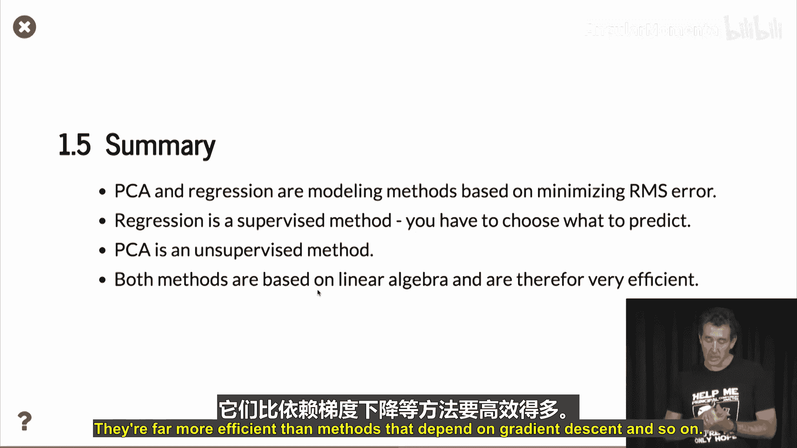

Okay， so this is the end of the regression topic， I hope you found it interesting and。

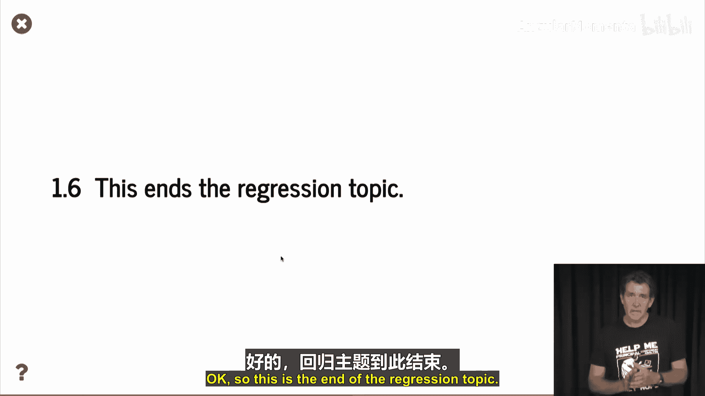

We'll continue next week。