# 【加州大学圣地亚哥分校】使用Python进行数据科学中的概率与统计--Probability-and-Statistics-in-Data-Science-p62-15-01-03-假设检验--BV1gJFDzkEPg_p62-

Hello and welcome back in the previous videos we talked about confidence interval and in this lecture we want to start talking about hypothesis testing。

 we'll introduce hypothesises which are just assumptions about parameters。

And we'll talk about simple and composite hypothesis。

 we'll talk about the N null and alternativetalative hypothesis。

 we'll talk about how to test an hypothesis and when do we accept or reject the null hypothesis。

Okay so first a small review leading to a preview， so so far we talked about parameter estimation。

 we discussed point estimates that estimated a particular value for a parameter and we talked about confidence intervals that gave us a whole range of possible values and one could continue that way but it would get a little repetitive。

 so instead we want to move to a new topic and we want to become the mythbusters。

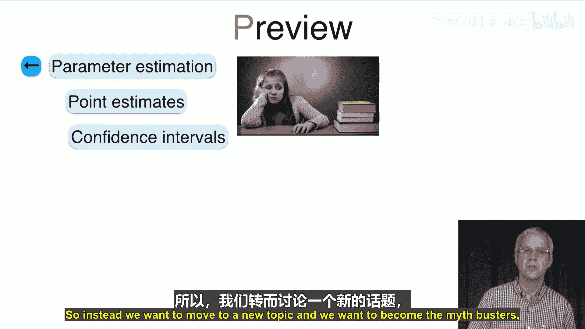

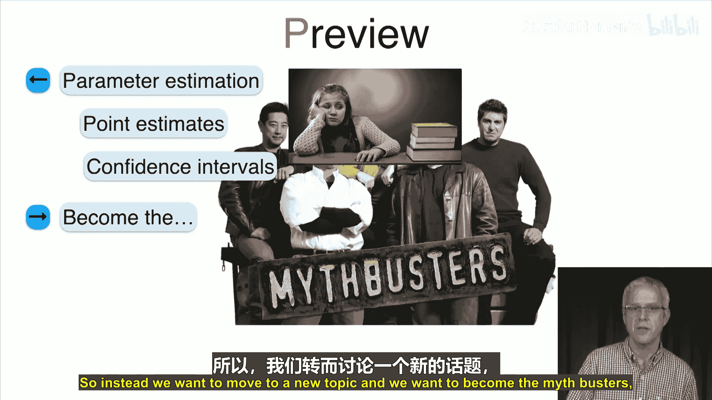

Except that we want to get great credit so we'll keep the myth busting a little secret and instead we'll call it apartesis testing。

 but really they're the same。

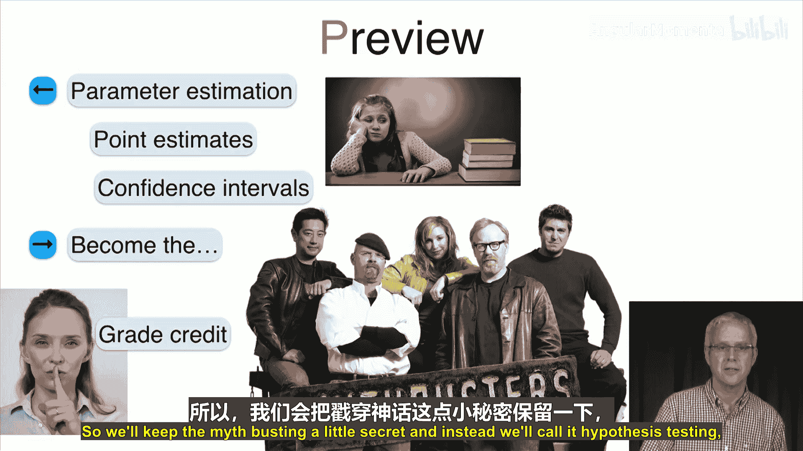

So what hypothesises hypothesises are assumptions or statements about parameters and as always the parameters could be a parameter for distribution。

 for example you have a Gaussian distribution and you make an assumption about the mean or the standard deviation or about a population you have a collection of individuals and you make some assumptions is about the average or the maximum value and so on so an examples could be that I have a coin and that the coin is biased so the probability of heads is not exactly half that's a hypothesis or we would like to say that for our entry level classes the average the average grade that we give is 3。

0 so maybe someone could make this the hypothesis that the average student GPA is less than 3。0。

Or Amazon might say that the average delivery time is two days and you might hypothesize that it's actually more than two days。

 or that people tweet more on weekend or that men play more video games than women on average。

 so all these are hypothesisses， some assumptions about either distribution or population and these assumptions could be true or not true。

So the different types of hypothesises， the simplest is called a simple hypothesis and thats the parameter takes a single specific value。

 for example， we may hypothesisthesize that the mean is exactly 4。

5 so that's a simple hypothesis hypothesisses that the mean is exactly 4。

5 or the standard deviation is exactly 2。4 so that's a simple hypothesis can also have composite hypothesis and those hypothesises where the parameter can take one of several values。

 so for example it could be that the mean is either 4。5 or 6。3。

 one of these two or it could be that the standard deviation is at least 4。5 and at most 6。

3 so that's a composite hypothesis about the standard deviation。

K or that the mean is bigger than the standard deviation。

Now for composite hypothesis you can have one sided hypothesis and those are things like the de mean is less than equal to 2。

3 or that the mean is bigger than 4。5 or there's a one sided it says that the parameter is on one side of some value given value or it could be two sided。

 for example the mean is less than 2。3 or bigger than 4。5 or the de mean is less than 2。

3 or bigger than 2。3 and of course this we can write as just as the mean is not equal to 2。

3 so these are two sided hypothesis。

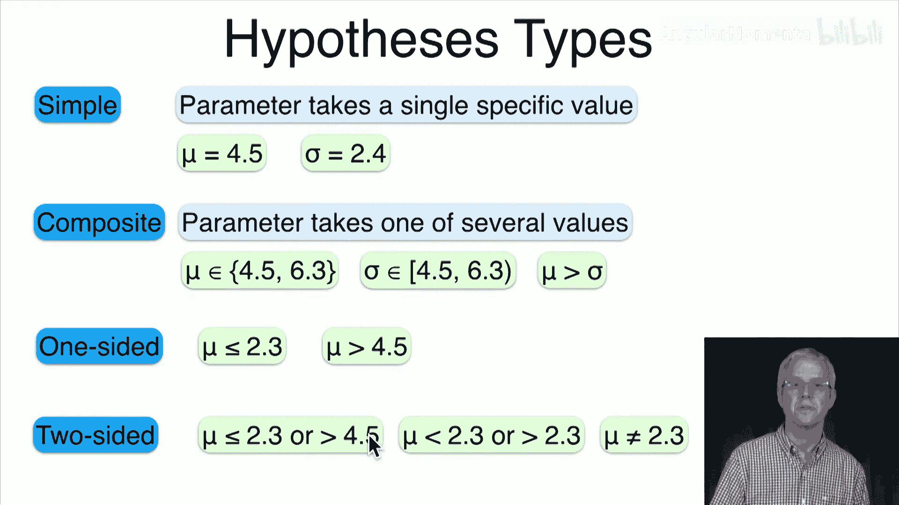

Okay， and now sometimes you have an assumption and hypothesis that you believe is true。

 so often there's an assumption they believe true， for example。

 might believe that this planet is round。And so we call such an hypothesisesis。

 the nu hypothesisis of the status quo hypothesises， and we deote it by H0。The complementary view。

 for example， that the earth is flat or that it have Earth has has a。

Is it shaped like a polygon or that it's a huge spinner those are called alternative hypothesis or research hypothesis and we deote them by H1 or H for alternative and often the alternative the alternative hypothesis is the complement of or a one- sided complement of the null hypothesis but that's not always the case so let's see a few examples and let's start with null hypothesis that are simple。

 namely that we assume it's a particular value so if we take a coin we could have an nu hypothesis that says that the coin is unbiased namely that the probability of heads is exactly 0。

5 so that's a simple hypothesis it assumes a single value for the probability of heads and the alternative hypothesis could be it could says the coin is biased。

 namely the probability of heads is not 0。5 so it's a complement of。

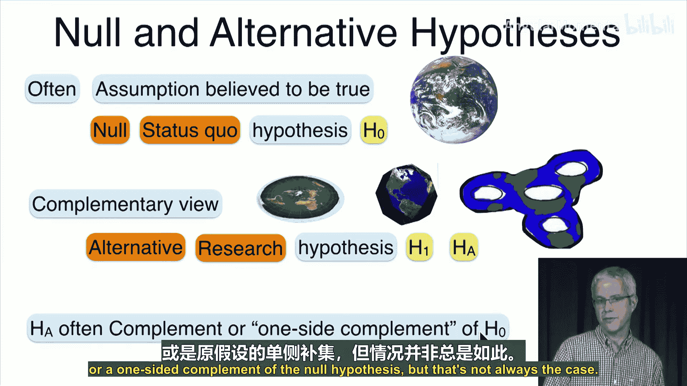

This hypothesis and this is a two sided alternative hypothesis right it says the probability heads either bigger than 0。

5 or less than 0。5， but not the same。Or we could have a one sided version that says that the heads are more likely。

 namely the problem of heads is strictly bigger than 0。

5 Okay so that's another possible alternative Okay and this is a one sided alternative Some people take the alternative hypothesisis to be always the complement of the null。

 but we're not going to be so strict。here's another more complex example。

 let's look at gender equality as applied to average GPA so we could take the average GPA of women and related to the average GPA of price so the nu hypothesis could say that have that men and women have the same average GPA and the alternative could say that they have different average GPAs and this would be a two sided saying that either a higher or lower average or it could be one sided could say that men's average GPA is higher than women's average GPA that's a one sided alternative hypothesis。

All right， and I just want to observe that this is not exactly as simple。

N hypothesis because this hypothesis is more complex it says that the average GP of men and of women are the same。

 so it's a collection of x comma x like 3。3 and 3。3 and so on but I just want to give you this as an example we could also have one sided nu hypothesis for example。

 if we look at smartphones and look at iPhones versus Android phones so an nu hypothesis could say that at least 60% of the population uses iOS uses iPhones so this is one sided nu hypothesis it says that the percentage of people who use iPhones is at least 60% and the alternative hypothesis in this case could be that just the complement that at most 60 at most 60% of phone users I use iOS or use iPhones and if you want something a little more complicated we could look at self-checkout。

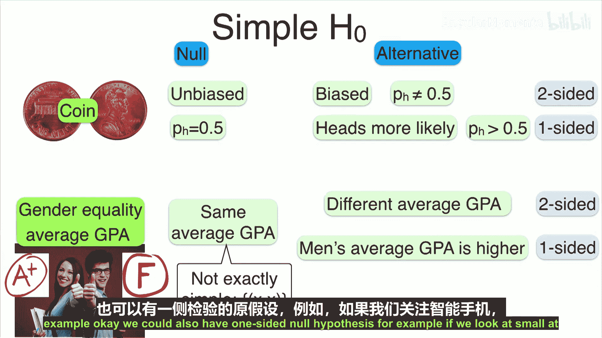

versus cashier checkout and now hypothesis could say that self checkout is faster。

 so it's faster to check out by yourself than to use a cashier and the alternative could say that the self checkout for example is slower and again this is not exactly this is not exactly what we called one sided because here we have two two values。

 one is the，Average time it takes to check out， self checkout。

 which is x let's say and the average time for cashier checkout which is y。

 so this is the collection of all X Y such that x is less than y for example。

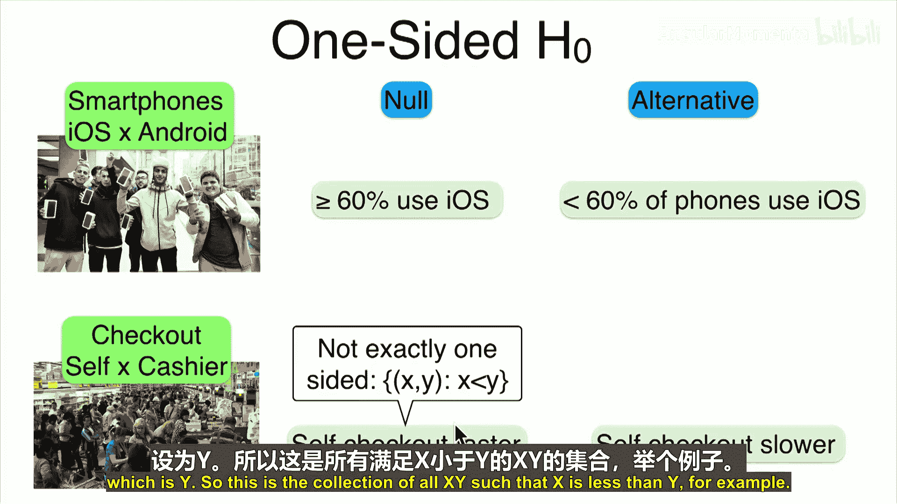

Okay， so now once you're given an hypothesis， you'd like to test whether it's true or not。

 And the question is how to do it。 So what you do， as you might expect is you design an experiment and you gather data and then you check whether the data is consistent with the null hypothesis and if it is consistent。

 then you do not reject the nu hypothesis， you said the nu hypothesis is true。

 And if it's inconsistent。 if the data is inconsistent with the null hypothesis。

 then you reject the null hypothesis in favor of the alternative。

or an equivalent way of saying it is you check if there is strong evidence for the alternative hypothesis and if there is a strong evidence for the alternative hypothesis。

 then you reject the null in favor of this alternative if there is not a strong evidence for the alternative。

 then you do not reject the null。Okay， and I want to give two analogies for for these tests as to get a little more and you can see that what we're doing here is we're being rather conservative in order to reject the now we need to have we need to have。

The data is inconsistent with with an hypothesis we need to have very strong evidence for the alternative。

 if the data is somewhat consistent with the now or if there is not strong evidence。

 then we are not going to reject the hypothesis okay and I want to give two analogies for that Okay first of all is testing like an aesis testing versus trials。

So in a test， as we just said， if we have strong evidence for the alternative hypothesises。

 then we reject the all in terms of the alternative。

 if we don't have strong evidence for the alternative。

 then we're being conservative we just do not reject now we just keep it okay and this is also done in the judicial system so if you have a trial then if you find very strong incriminating evidence。

 then you'll find the defendant guilty and if you don't find strong incriminating evidence then you find non-guilty okay so we can see here that in a sense。

Plays the role of the naite Partis because we we presume inence or unless we're given strong evidence to the country。

 we assume we're going to presume that the defendant is innocent okay。

 so we reject only with strong evidence in other words。

 we assume that the defendant is innocent and until proven guilty okay so that's one analogy。

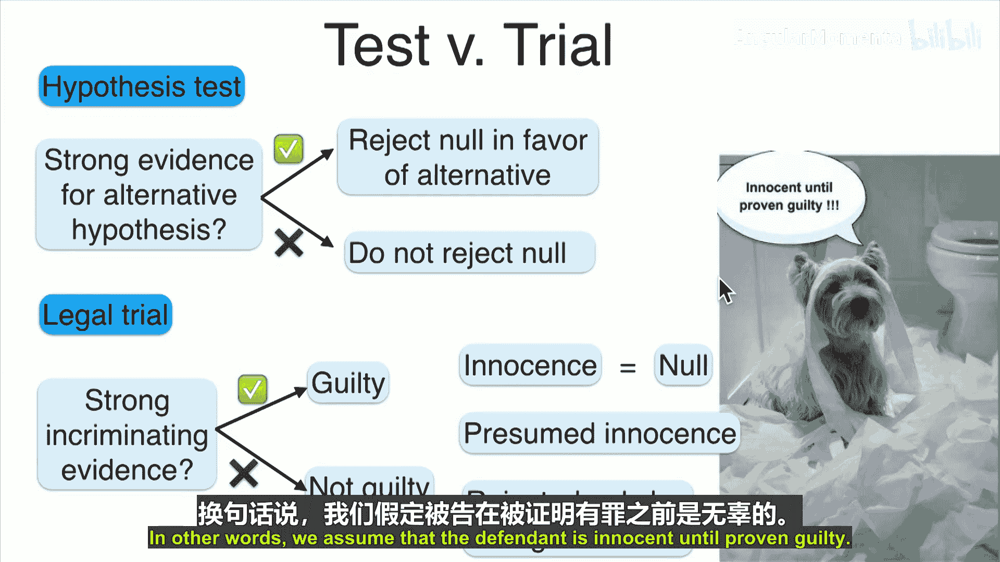

And the second one is the one we started with hypothesis versus myth so in an test again if we have strong evidence for the alternative then we'll reject the null in favor of the alternative and if we don't have strong evidence for the alternative then we will not reject the null and that's the same in myth busting because if there is strong evidence for the myth then we'll accept it and if there isn't strong they'll keep the default belief the status score okay and how do we check a myth of course what we do is we come up with a test and that's what we're going to do here as well so let's be slightly more precise about that so how do you test an hypothesis you design an experiment and we call it a test。

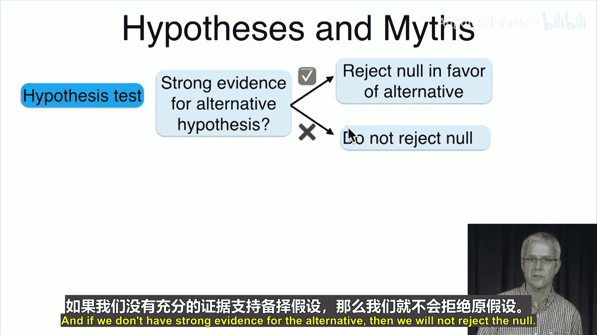

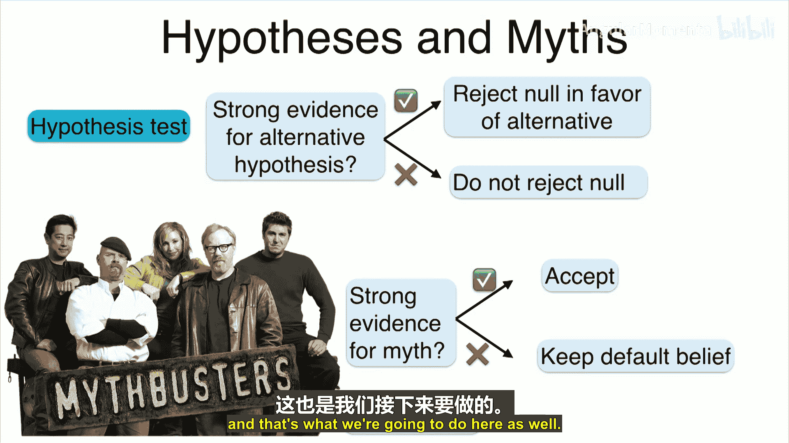

And then you define a numerical outcome for this experiment， it's not something that is vague。

 but some number， we will call it T for the value of the test。And it is called the test statistic。

 and hopefully it has something to do with the hypothesis， obviously。

And then what we can do is we look at the null hypothesis and we determine the distribution of the test statistic under the null hypothesis hypothesis。

And namely， we assume that the N hypothesis H0 holds and then we find the probability that the test statistic will get take any given value and of course we're going to do a couple examples very shortly。

Now we're going to observe the data and then we calculate the value T of the test statistics for this particular data see what the value of the statistic is for this data。

 and then we can calculate the probability under the null hypothesis of the statistic that we observe little T and the couple possibilities。

 if this probability is large， namely if the null hypothesis gives the specific outcome a large probability then we say that the data is consistent with the null hypothesis and we do not reject the null hypothesis we accept the null hypothesis H0。

On the other hand， if the probability that the null hypothesisesis gives the observation is small。

 and furthermore its T is towards the null hypothesis， as we're going to see。

 then we'll say that the null hypothesispo is inconsistent with the data and we reject the nullle hypothesis in terms of the alternative。

And what we're going to do is we're going to give two examples now intuitive examples and then in the next lecture we're going to find things more formal so two simple examples first。

 so first let's look at a coin bias and let's look at a one sided alternative hypothesis so the nu hypothesises is very natural it will say that the coin is unbiased。

Namely that the probability of heads is exactly half。And this is， as we know， this is a simple note。

 like it says the probability effects is is exactly one value， which is 0。5。

OkayNow the alternative hypothesis， we're going to say that the coin is biased towards heads。

 and the probability of heads is bigger than 0。5， so you can see this is a one sided alternative hypothesis。

Right now if you want to test this， then one thing can do is we can roll this coin 20 times。

 can flip it 20 times。And we can define a test statistic and very natural outcome here is going to be the number of heads we flip the coin 20 times we see how many heads we got let's denot it by x so that's a statistic for this test it's a numerical value related clearly to whether the probabilityative heads is 0。

5 or bigger than 0。5 and what we can do is we can draw the distribution of x under H0 under the nu hypothesis that the coin is unbiased so if the coin is unbiased then this is going to be the distribution of the number of heads it's going to go from 0 to 20 and distributed bin normallyally。

Okay， so intuitively speaking。If the coin is unbiased， if the probability is indeed half。

 we expect the number of heads to be roughly 10 because we flip the coin to many times so we expect it to be roughly 10 if it's going to be much larger than 10。

 then we might suspect that the coin is biased so for example might say intuitively that if x is bigger than equal to 16 if you got at least 16 head here then the probability of seeing that if the coin is unbiased is very small。

 so this is unlikely under the null hypothesis and it's more likely under the alternative hypothesis and therefore we might reject the nu hypothesis in terms of the alternative hypothesis。

On the other hand， so in this region maybe 16 or more heads。

 we're going to reject and say that we're rejecting our hypothesis except the alternative hypothesis which is the probability of head is bigger than 。

5 on the other hand， if the number of heads we get is less than 15， so that's the complement of that。

Okay so it's then maybe we will not reject the nu， so this is this range here and this range we're going to accept the null hypothesis。

Notice that because our alternative is one sided， namely the probability of heads is bigger than 0。5。

 even if we get these values again the probability of getting those is very small using the nu hypothesis。

 but we're not going to reject it for the alternative because the probability of getting that。

Given the public A is bigger than 0。5 is even smaller。So anything， let's say less than 15。

 we accept and everything bigger than 16， we reject an a hypothesis in favor of the alternative。

And let's look at related in a second example related， so again coin bias。

 but now two sided alternative， so again the null hypothesis is that the coin is unbiased。

 namely the probability of heads is 0。5。And again， it's a simple now。

 but now the alternative is going to be just the complement the coin is biased。

 only the probability of heads is not equal to 0。5 so that's a two sided alternative Again。

 a test could be the same flip the coin 20 times。And the statistic again could be the same number of heads。

 which we denote by x。And it has the same distribution as we saw before。No。But now again。

 intuitively， we might say that if the number of heads we got is between5 and 15 in this range。

 then we do not reject nu hypothesisesis and you accept it， so that the coin is unbiased。

In this region， but otherwise namely if the number of heads is either four at most 4 or at least 16。

Then we reject nu hypothesispo in the alternative that says that the coin is biased。

 either bigger than probability effects is bigger than half or less than half， but not exactly half。

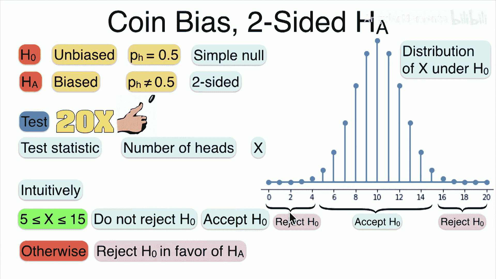

Right， so so just to summarize， we said that hypothesises are assumptions about parameters。

 we discussed simple and composite hypothesises， we discussed the null and alternative hypothesis。

 we discussed what the test is and when to accept and reject the null at least intuitively and next time we're going to formalize what it means to。

To come up with a test and we'll stop go and talk about P values。 See you then。

