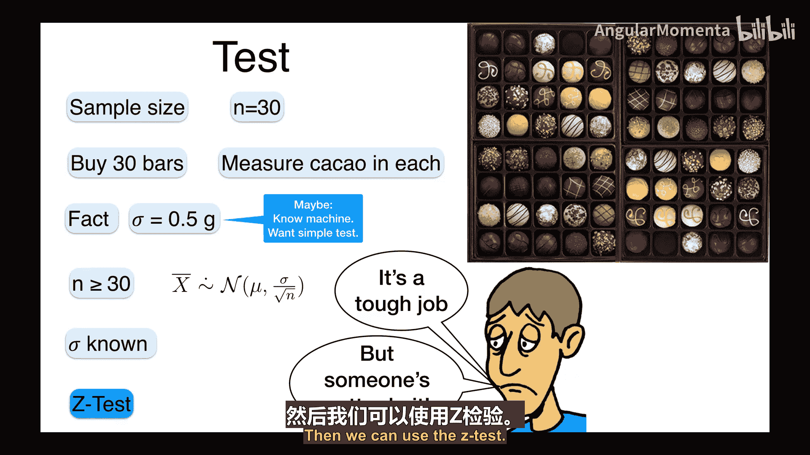
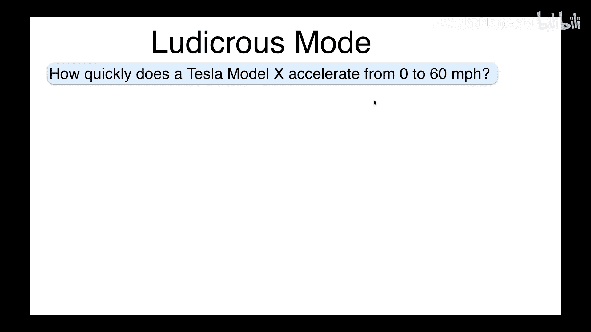
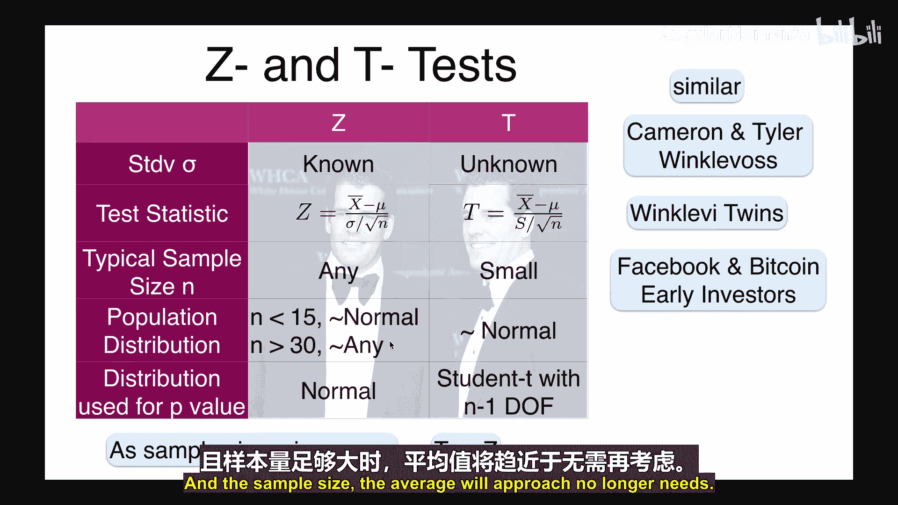

# 【加州大学圣地亚哥分校】使用Python进行数据科学中的概率与统计--Probability-and-Statistics-in-Data-Science-p63-15-04-04-假设检验-Z检验与T检验_第一部分--BV1gJFDzkEPg_p63-

Hello and welcome back。In the last lecture we discussed perhaps the original hypothesis test and what we would like to do now is talk about some more modern ones and specifically we'll talk about what happens when you have a normal or a near normal distribution and what happens when you know the standard deviation where we're going to use what's called a Z test and when you do not know the standard deviation and then we'll use a T test and we'll give a couple of examples。

So first let's motivate what we're going to do， so we have been talking mostly about tests for the mean and what we've done so far is we looked at distributions that are binomial or neobiomial and where we could calculate the probability under the null hypothesispo exactly and what we want to do now is look at distributions that are either normal or close to normal and where we can only calculate the distribution under the null hypothesispo。

 maybe only roughly approximately。And examples where this would come up is when we take the sample mean。

 so if we have a few samples and are distributed roughly normal we know that the sample mean will be roughly normal or if we take many where many is often considered to be at least 30 samples then under any distribution the sample mean will be distributed roughly normal and since we're talking about normal distributions then it makes sense to review the central limit theorems theorem and so remember that if you have n samples and the independent and distributed according to any fixed distribution with mean is mu and standard deviation in sigma。

 then we can define the sample mean which is just the average of the n samples and then the expectation of this sample mean is just the original mean mu and the reason is because when you take the sum the means will add so we'll get n times mu and when you normalize by n then n times。

M the mu you'll divide it by n and you'll just get the original mean。

 which makes sense that the mean of the sample will be the mean of each of those values that you are。

And if you look at the variance of the sample mean， then since the samples are independent。

Then the variances will add， so the variance of the sum will be n times sigma squared and then we normalize by n so the variance will go by a fact of n square。

 so the variance of the mean is sigma square over n。

 which makes sense that the variance will decrease because you're taking averages and therefore the standard deviation will be the square root of that。

 which would be the original standard deviation but goes down like one of a square root of n and the central limit theorem tells us that if you take n large and as we have been saying typically at least3 is considered large。

 then everything becomes more or less normal， and specifically the sample mean will be distributed roughly normal with whatever its means and whatever its variance is。

we actually know what the mean is， we just calculated it here。

 so it will be roughly normal with mean mu， because that's the mean of the average of the sample mean and with variance。

 which we calculated here again， which is sigma square over n。

So that's what the central limit theorem told us and what we want to do is we make a very small transformation for x because we want to make it always behaves roughly the same way。

 so we're going to convert it to a random variable that instead of having mean mu and variance sigma square of n。

 we're going to subtract first the mean mu， so if we take x the sample mean x bar minus mu in we distribute the normal with mean zero and variance sigma square over of n。

 and if we divide by the standard deviation， which is sigma a squared of n。

 then we'll get this quantity x bar the sample mean minus mu divided by sigma over squared of n is going to be distributed roughly normal with mean zero and variance 1 and you recall that we call a random variable like that。

 z which will。Rice to the name D test as we'll see in a second。

 and you notice that here we're going to divide by sigma with square of n and that's。For that。

 we need to assume that we no sigma。So now what would be a typical application。

 so we have an unknown distribution or population except that for some reason we know sigma and we'll relax this later。

 this is a very strong assumption that we know the standard deviation deviation will relax it later on and then the nu hypothesisesis will say that the mean of this distribution is mu or the mean is given number or say maybe nu hypothesis that the mean is 5。

 for example， and the alternative hypothesis will say for example。

 the mean is bigger than this number that we're given bigger than5 and we'll look at generalization of that later on。

So the test that will perform is we'll take an independent samples from this distribution on main。

X1 up to xn and we define the sample means we did before it's just the average of the n samples。

 and then we know that for n which is even moderately large， maybe bigger than equal to 30。

 then the nu hypothesispoesis would say that if we find z to be the average minus mu over sigma of a square of n and again sigma is known because we assume it's known the mu is the value that we are。

Suspecting the is the mean， then if define this it will be distributed roughly normal with mean zero and varianceence1。

Okay。And in particular， the mean is zero。And the alternative hypothesis would say since we subtracted mu。

 but the original mean is bigger than new， that distribution is still normal because we're just subtracting a number that doesn't bring us to zero。

 but the mean is bigger than zero okay so this is the alternative we want to test against under the nu hypothesis we have a normal01 distribution with mean0 and now the alternative hypothesis we have this quantity that we define will be again normal although we're not going to use that but with mean which is strictly positive and because we're going to check on the Z that we going to call the test that we have a Z test。

so what is the test， so the null hypothesis says mean that we have random variable z whose mean is mute that's our null hypothesis and its distribution is roughly normal01。

And the alternative a is will said that the mean of this randomver is positive。

And we're going to decide on the significant level， which we call alpha。

 it's the same as what we have before， typically 5% or 1%。

 and what alpha means is that we want to ensure that if the nupoesis is correct。

 if the distribution is normal01， then the probability that we accept the alternative is going to be at most alpha at most 5% or at most 1%。

 which we the recall makes the conservatives happy。So and this is the probability of Tpho error。

So just like before we can define the critical value Z alpha。

 which is the value that for which the probability that the z is bigger than this critical value。

 this probability is equal to alpha， so let's visualize it so we have here a normal distribution。

 this is under the null hypothesis so is under a sugar of written80。

 this is under the null hypothesis， which is normal01， and well define z alpha here。

 such that the probability detail probability， the probability that z is bigger than equal to z alpha。

 this probability is equal to alpha。And the test that will perform is well check if Z。

 the value that we get is bigger than this critical value that we calculate z alpha。

 then we'll accept the alternative hypothesis， so in this region we accept the alternative hypothesis and if z is less than this critical value。

 then we retain the null hypothesis so here we're going to retain the null hypothesis。

And what this ensures is that under the nu hypothesis， if this is indeed the distribution。

 then the probability that we accept the alternative hypothesis is the probability that，Well。

 this is our distribution and the probability that were here in this red region。

 it's probability that z that we get is bigger than equal to the alpha。

 but we chose Z alpha to be such that the probability that we are in this region is going to be exactly alpha。

Okay， so this probability is alpha。So this will guarantee what we wanted that the probability if the null hypothesis is in effect。

 then the probability that we declare alternative hypothesises is going to be more s。

 so this is why we define the critical value this way。

now what we can see is instead of calculating the alpha， we can also just use the P value of z。

 which is the probability that z is bigger than equal to z。

So this is just our definition of the P value of z probability that's z that under the null hypothesis。

 you get z， which is going to be equal normally distributed。

 it's probability that z is being equal to z。And if this p value。

 if this probability is less than alpha， what does it mean。

 it means that we're here somewhere to the right of z alpha because the probability that z is big and equal to this value is less than equal to alpha。

 so it's less than this way someplace here， so that means that z is bigger and equal to z alpha and we're going to accept the alternative hypothesis and conversely if we calculate the P value。

 the probability that under normal distribution we get a value which is bigger than z。

Then if conversely this is bigger than what we get is bigger than whatever this value that we set。

 5% or 1%， that means that we have here someplace here that' such a the probability that a normal distribution is bigger than us is going to be bigger than alpha so bigger than that so we must be here。

 that means that z is less than z alpha and that means we're here and so we're going to retain the nu hypothesis sorry can the nu hypothesis and the nice thing about it is that we can calculate the P value very easily because the probability that normal distribution standard normal distribution will bigger than equal to z is just maybe the probability that z begin equal z is just one minus p of z and this is we can just use a z table or just Python to calculate this so this is the probability that we're bigger than some value which is one minus the probability or less than some value which is one minus。

気？Good okay so now what we discussed now is what's called the one tail test and we're going to generalize it to a couple other tests。

 so I'm going to look at the nues， the alternative hypothesises。

 see what it is and define the test and look at the P values。

Our non hypothesis was that the mean is mu。And the alternative hypothesis was that the mean is bigger than you。

And here deltaative a is one sided， right， because when we're just。

To the right of mu and therefore the test that we'll use is what's called one tailed and it' because we are just checking if we're here。

 we have one tail here to the right。And the P value that we calculate is the probability that if you take a standard normal random variable。

 it's going to be bigger than equal to the value that we observe and see。

 so which is this probability。Now we could also consider again， nones is new。

 but now we can consider the case where the alternative of hypothesisesis is that the meaning is less than new。

Once again， this is a one sided alternative hypothesis and therefore the test well have is also going to be 12。

 but now what were just going to the P value is just going to be the probability that we're going to be to the left of some point。

It's going to be the probability that z is less than equal。

 that a standard random variable is less than what we observe。

And finally we can consider again the same nu hypothesis that the mean is min。

 but now we consider that the alternative is that the mean is just not equal to mu。

 so this is a two-sided alternative hypothesisesis and therefore we use a two-tailed test and what we're testing is if we're testing the probability that we're either to the left or the right of where we are so the P value of z is the probability that if you take a standard normal random variable。

 its absolute value is going to be bigger than equal to z our observed values here here when looking at the probability that normal more random variable will be either to the right of this value to the left of the negative。

Okay so this is what we're looking at and I also want to mention that the same exact same rules will work if the null hypothesis is not that we're exactly mu。

 but that we are less than equal to mu， so here instead of assuming that the mean is mu。

 we're assuming the mean is less than equal to mu and the alternative is that it's strictly bigger than mu and we can use exactly the same。

So let's do a few examples， but before we do them， just a small disclaimer。

 so we know that everything likely has been fake， fake news， fake news， fake news。

 and so on a lot of fake news， and so we just want to say that as far as our data is concerned。

It's for demonstration purposes only， so don't just quite go by it。

 but it's just we want to demonstrate the use of several hypothesis tests。

So first let's test the amount of cocoa in chocolate， so Tradedo Joe's sells a dark chocolate bar。

 which they say contains 85 gram cocoa。Here and in fact I'm sorry it's not Co over where they call it cacao so while this is not 85% is not quite as much as the li excellence bar that has 99% cacao。

 it's still a lot so 85% they say is cacao and so maybe you think oh maybe it's a little less。

so the non hypothesis is we taken by the word is that the mean is 85 grams。

And the alternative hypothesis is going to be that the mean is strictly less than 85 grams。

And we would like to test these ases with with I'm sorry，5% significance level。

Okay so the nu hypothesispo says that the mean weight of cacao in a bar is 85 gram and alternative is that the mean is actually strictly less than that。

 and what test is with 5% significance level。

Okay so what is the test so the sample size going to be we're going to take 30 chocolate bars so we buy 30 of those and we won measure the amount of cacao in each one so well there's not exactly blood bars but truffles but the As you get the idea and so we need to to take them and measure the amount of cacao in each and it is a tough job you know getting 30 chocolate bars you know and so on but someone has to do。

So， and we're going to assume a fact that the standard deviation is of the amount of cacao in each bar is half a gram。

Okay now this is really weird like how do we know it so maybe we know what the machine is being used to produce the chocolate or maybe which is a little more likely we just want a simple test so we're going to assume this now and later on we're going to relax this assumption Okay now because the number of。

The number of samples that we take is 30 is at least 30 then we can assume that and this is that the central limit they are kicking and the average weight is going to be distributed with normal mu and standard deviation sigma of a Scotifying but this is sigma。

And sigma， so because sigma ist known and because we have。

And distribution here n is bigger than equal to 30， so the distribution of X bar is roughly normal。

 then we can use the Z test。

So what is the Z test here， so any3， so we take 30 samples and maybe it's 84 remember that we the nu hypothesis says that's 85 grams。

 so we take 30 samples， maybe the weights of the cacaa 84， 83。2， 85。7 and so on。

 and the average turns out to be 84。83 so slightly below the 85。

The the null hypothesis course so under the null hypothesis。

 the mean is 85 gram and the standard deviation we assume is half a gram and so the z score is just the average that we get minus the hypothesisthesized mean mean divided by the new standard deviation standard deviation of the subamine。

 which is sigma over a square ofren calculated and so this is going to be distributed roughly no01。

And when you calculate this， youll get 84。83 minus 85。Divide by 0。5。

 this is our standard deviation normalized by square of 30， 30 is the number of samples。

 and that gives us minus 1。86 to3。Okay， so the alternative hypothesis says that mu is less than 85 gra。

 the mean is less。85 gra and so because we the alternative hypothesis is one sided。

 we perform one tail test。And we can calculate the P value， the P value is going to be。

 so this is under the nu hypothesis we have a normal distribution with min0， this one here。

 and the P value is the value to the left of the value we observed， which is。

The observed z value was minus 1。86。Okay， so it's this probability。 It's the probability that Z。

A standard normal distribution will be less than negative 1。

86 and we can easily calculate it to be so this is going to be just the fee， the CDf of minus 1。

86 under the normal distribution and we can calculate it because we just we import from this spi dot stats module we import stands for normal distribution and then we're just going to print non the normal distribution and the CDF evaluated minus 1。

86。And that gives us 0。03%， 0。03， sorry。So this is 0。03。

So this is roughly it says the the probability that the z value is going to be less than minus 1。

86 is roughly 3%。Okay so this is less than5 okay so what does that tell us tells us that under the Nll hypothesis which is that the mean amount of cacao is 85 gram and with our assumption that the standard deviation is 05 gram the probability that 30 bars will have average which is less than less than 84。

83， which is the average at weo is gras is roughly 3。3%。Now this is a low probability。

 so the simply means that the probability that will get what we observed or below is very low and it's below the significance level。

 so under the null hypothesis the probability that we will see it is low and therefore we reject the null hypothesis and accept the alternative hypothesis because if if the null hypothesis was in effect。

 we will see what we saw with probability which is less than 5%。Okay。

 so therefore we accept the alternative hypothesis essentially saying that the average mal contains is less than 85% around per cow。

 but I just wanted to keep in mind that。ThisThe data that we give you is just for demonstration purposes on if we did not really。

That's just%， right？And also， as we said， the same would hold if the nu hypothesis was that the mean was bigger than 85 gras would still do the same test and get the same conclusion。

Right。So now I want to do a two tail test， so the nu hypothesis is still the same with the mean is 85 gras。

 but now the alternative hypothesis is that the mean is。Not that it's less than 85 grams。

 just say it's different from 85 gram could be less than or bigger than 85 grams。

 so it's two cid alternative hypothesis。And again， we won test with 5% significance level。

 so the Z score is again the same is the average that we got to minus the hypothesized mean。

Divviided by sigma versus squaretaene， so it's again， it's exactly the same calculation， same values。

 so it's minus 1。86。And because this is a two sided alternative hypothesis。

 we're going to do a two sided。Test。And the P value is the probability that what we will observe is either less than minus 1。

86 or bigger than 1。86， and this is for the standardized value of the z value。

 so it's the probability that the absolute value of z is bigger than 1。86。Okay。

 and if you record we saw that this， so it's twice times the probability that。

The disease is less than 1。86， it's this plus that， so it's twice times a left area。

And youll remember that we saw that the probability of that we have here of this region is 3。

13% or 0。0。0313， so twice that is 0。6 to6 or 6。26%。And this number is bigger than 5%。

 so what we have we have that under the same non hypothesispo that the mean is 85 gram and the same standard deviation that we're assuming half a gram。

 and probability the 30 bones will happen average， which is either less than 84。 x3。

 which is what we saw or bigger than the。嗯。Mirror image on the other side of AT5 so this is  minus 0。

17 this is plus 0。17 a that will be that far from 85 is roughly 6。

26% twice what we' had seen before and this probability is larger than a significance level so we consider it to be reasonably high and therefore it is likely to happen or more than 5% likely to happen under the napo so we retained the Npo。

Okay。And so well retain x0 and maybe will retain the possibility that on average a chocolate bowl contains 85 gras of cocoa。

Okay cool so just want to clarify something about one versus two sided alternatives。

 so we looked at two very symbol cases except one was one sided the other one was two sided and these were the alternative hypothesises and we got we used the same significance level of 5% we got the same Z score which was minus1。

86 because it's the same data okay but for the one sided case we accepted the alternative hypothesises we said that the。

Chocolate bar is likely to have less than 85 one， but for the two sided case will be retained。

They did not hypothesis Okay， and the question is why why Mike got the same at the same significance level。

 the same Z score， Y in one case we accepted the alternative hypothesis and in the other we were。

Nll hypothesis okay and the answer is has to do with the P values。

 so the P value is the probability under the nu hypothesis of getting the observed value or one which is further towards the alternative hypothesis so if this P value is less than equal to 5% we said the probability that will see what we got is small and therefore we accept the alternative and if this P value is bigger than 5% we say that the probability of producing this value or something even more extreme is high under the nu hypothesis so we retain the nu hypothesis。

So let's see what happens here， so when we have a one sided alternative hypothesis。

Like as shown here and this is what we had and then the P value is the probability that a standard normal random variable will be smaller than minus1。

86 and this probability as we calculate it is roughly 3。13%。

Wwhich is less than 5% so we consider it to be a low probability so the probability that will be here is less than 5% which is low and therefore the probability that it's produced by the null hypothesis is low so the hypothesis that we're going to assume is the alternative hypothesis on the other hand if you consider two side of hypothesis then what we are really considering is this value we're considering the probability that we will be either here or here and the P value is the probability is that absolute value absolute value of z will be bigger than 1。

86 and this is twice this value is 6。26 and so it's larger than 5% so we consider to be relatively high probability and so the probability that under the null hypothesis will get this value is relatively high and therefore return the N null hypothesis so that's why in one case we rejected the null hypothesis and in the other case we kept。

So I also want to relate it to confidence interval loss。So under the nu hypothesis。

 the mean is mu and the alternative will use the two sided the alternative。

 the mean is not equal to mu and we are defined。The Z are standardized。

When variable to be the sample mean minus me normalized by the standard deviation that we assume known over square of n。

And this， if the significant level is 5%， then we'll accept the alternative hypothesis if when we look at this graph。

 so we have this graph or we have 95% here and 5% both on these sides and this is our critical value the alpha and if we have 95% here。

 then the critical value is going to be minus 1。96 because you remember that with。

2 standard deviation， the probability of being within two standard deviation is roughly 95% it's really minus 1。

96， so we'll accept each53 outside this region name if the observation that we get the observed Z is here or here。

Okay， now when we look at confidence in so this is when the absolute value of C is bigger than equal to 1。

96 now if we look at confidence in the overall and we look at the insights instead of 5% we're looking at 95% then in confidence interval be the observed value。

 the observed mean that we'll get minus the standard deviation which is what。

95% confidence interval in minus and Z of 95%。Multiplily by the appropriate normalized standard deviation。

Okay， and we've seen this before， so we'll get the the mean is。Outside the confidence in one。

And then we we get confidence interval around the supplement that we observe and the mean will not be in the confidence interval。

 and mu is not going to be here if and only if when we know when we transfer it to the standard。

normalormal distribution， so mean will translate0 and x bar will translate into z so if phenomenonon if0 is not in z it transfer the value of our sample mean minus0 of 95%095% is going to be this value here。

 1。96 because here when you consider confidence interval instead of considering the probability outside consider the probability inside which is in this case 95% so if andon if0 is not inside z。

 which is observed z value plus minus this level at 1。

95 so if phenomenonon if what we have here is we take z and it falls outside when we add take the confidence interval which is this value here。

0 does not belong to this confidence interval here。So it's if and on if。

 the absolute value of z again is bigger than 1。96。

so that's when if the absolute value of z is big than 1。96 then we'll get that mu。

 the mean is outside the confidence interval， so what we see is an analogy here between the two namely we accept the alternative hypothesis。

We we'll say that nano reports is not， in fact accepting alternative cores。

 if and only if the absolute value of Z is bigger than 1。96。

And if the absolute value of z is bigger than 1。96。

 it exactly means that mu is not in the confidence interval。

 which makes sense because if mu is not outside is not inside our confidence interval。

 if mu is outside our confidence interval， we don't think。

That what we observed was generated by this distribution。

So the final thing I want to do is look at unknown new。

So far we assume that we knew the standard deviation sigma。

 but admittedly that's a little artificial because most of the time we don't know what sigma is and that's what we would like to do today。

 so what if you want to test for the mean mu but we don't know the standard deviation sigma。

 what do we do then？So we go back to William Gossett， if you remember the student。

 and see what he said， he said， use the T distribution， the student T distribution。

 and so just let's remind ourselves， so x1， x2 up to xn are independent samples from a normal distribution with mean mu and standard deviation sigma。

And we define the sample mean as we did before， it's one over n times the summation of the elements。

 so it's just the average， and the sample variance， we define to be。

 we call it s squared and we define it to be the summation of the differences between the samples and the mean squared and we normalize not by n but by n minus1 because we're using the besal correction。

 which makes s squareed unbiased estimate of the variance。

And we can just like we did in the case of a Gaussian distribution。

 when we knew the standard deviation， we can define t and minus1 in this case to be the sample mean minus the average minus the expectation。

 normalized instead of by sigma of a squared of n， we now don't know sigma。

 so we no minus by s of a square root of n s is just a square root of this quantity。

And as we said before， this statistic T underscore n minus1 follows the student's T distribution。

 and we call it n minus1 because it has n minus1 degrees of freedom。So what is the t test。

 so as we just said it the test statistic follows the T distribution and so we could have two hypothesisses。

 another hypothesis is that the mean is mu， where mu is number that's given to us and the sample we take is a sample of size n where now n can be small。

 it's a good thing and but in order for what we said to be correct。

 then they have to be roughly normal so that's something we need to think about and what people do is sometimes they do a normality test test that the distribution of each sample is indeed close to normal and the test statistic as we said is going to be t which is the sample mean minus minus the mean mu that we are priortaizing divided by s which we can calculate normalizedize by of n。

ちな。And then under the nu hypothesisis， indeed， if indeed each XI is distributed normal or roughly normal。

 then Mt， the statistic is going to be distributed according to the student T distribution with n minus1 degrees of freedom。

So， okay， so we know what it is。And as before we can do exactly the same。

 we can calculate the P value I we did before， which is the probability that we fall beyond the point we see or。

Before the point we see， depending on what the alternative hypothesis。

 except that beforehand we used the standard normal distribution and now we're going to use the T distribution。

So let's see an example， ludicker mode， so suppose you wonder how quickly a Tesla Model X accelerates from  zero to 60 miles per hour。

Like that so Tesla says that it takes on average it takes at most four seconds to accelerate from this0 to 60 minus per pretty fast。

 so this is going to be our nu hypothesis， now our alternative hypothesis maybe that it takes more than four seconds okay and we want to test which is true whether it's less than equal to four seconds or more than four seconds with 5% significance level。

So we take any measurements。And in order to be able to do it。

 we're going to assume that acceleration time is roughly normal。

 whichs reasonable and now notice that in this case we don't know the standard deviation sigma。

 nobody tells us just its reasonable and also we're doing it for Tesla。

 so it makes sense that the test we' use is going to be a T test。

So what is the T test， so let's say the sample size is8， so we take eight measurements。

 the car and let's say these are the numbers， the amounts of time it took the car to accelerate to 60 miles per hour。

And in Python we can calculate the mean and the sample standard deviation。

 so we again we import nupi as NP， we define a sample。

 these are the values that we got and then if we do NP。

 mean it will give us the mean of the sample we can print it。

 and if we do NP of the verse I give the sample and the difference in the freedom so here we do n minus1。

 so we call it1 and that will tell us that the mean is 4。123。

The mean of these values and the R sample variance。

Which is if you remember is1 over minus1 times the sumation is 0。097 and so。

 so this is the sample mean and this is the sample variance okay now under the non hypothesis。

The distribution mean is4， the mean of the distribution is4， that was what Tesla told us。

And under the T test statistic， which is defined the average that we calculated minus the hypothesis。

So is mean， which is the mean we're assuming is correct。Normalized by s。

 which is the sample standard deviation， the square of this， normalized by square of n。

 that's going to be equal to 4。12 minus4 divided by the square of this quantity over a square of8。

And that's 1。1206， okay so that's our test statistic。And what is the P value。

 so the test statistic again， is in the sample。Mean minus the new that we assuming is an effect normalized by this sample standard deviation of a screen f and that we is calculated to be 1。

1206 and under the Nll hypothesis， it's distributed according to the student T distribution with seven degrees of freedom。

All right， and。Now the nu hypothesis says that the mean is at most four seconds。

 while the alternative hypothesis says the the mean is bigger or larger than four seconds。

 so what is the P value。Here we mean we heard it so here this test statistic is 1。

1206 and the P value because the alternative hypothesis is that the mean is bigger than something is the probability that we are more that we are either the value that we observed or more towards the alternative hypothesis。

 that's the probability。So it's going to be one tail and it's going to be the probability that we are that the value we get is the observation or more。

 so it's one minus the to the left， which is1 minus F7， the cumulative。Distribution of 7 of T。

And again， we can now import the。The T object for the t distribution。

 and we can print 1 minus t docdf， that's a cumulative distribution function at 1。

206 with 7 degrees of freedom， but we're interested in the P value which is the probability above this。

 so it's 1 minus that and gives us a 0。149， roughly 15%。

So this is the probability that will observe the value that we got。Or more。

Okay and this is 14% of 15% almost larger than 5%， so we see that under this nu hypothesispo that mu is less than equal to4 seconds。

 and the probability and with the S that we saw， the probability of observing at least the 4。1，2。

4 second average that we saw in the S square that we also calculated is roughly 15%。

OkayNow this exceeds， this is larger than our 5% significance level。

 so it says that the probability that will will observe what we saw or even more time is high so we can or more than the 5% so we attend in our hypothesis。

 we cannot exclude it。So the P value is bigger than 5% and therefore we retain them hypothesis。

And in other words， we retain the possibility that the 0 to 60 milespower acceleration is done in less than four seconds as it。

Okay， so now we've talked about ZTest and TAAT tests。

 so let's just see what how they they're similar and different and we'll see that they're actually quite similar。

 like Cameron T Winklevo， these are also they also known as the Wil Winklevi twins and the early investors in Facebook and Bitcoin。

And。very similarly， we have the Z test and the T test twins in terms of standard deviation sigma。

 so for the Z test we assume it's known because we normalize by it and for the T test we assume that it's unknown as it typically the case。

 the test statistic， so when sigma is known and use the Z test it's just the sample mean minus the hypothesized。

Mean divided by the standard deviation that we know normalized by square root of n。

 which we also know， and when the standard deviation is not known。

 then we just replaced it by the sample standard deviation S which we calculate and we call this statistic T。

And we can use the Z test for any sample of sizes。Under the assumption that x bar is roughly normal。

 we'll talk about that and we can use T， typically use T when the sample size is small and so what do we mean by under the assumption that x bar is roughly normal。

 so if n is small， let's say n less than 15， then the distribution of each sample that has to be roughly normal and if n is bigger than 30。

 then it can roughly say to holds for any distribution。Where for the T test。

 we need to assume that H XI is distributed roughly normal that has to be whole because otherwise we will not get the T distribution。

Okay and the distribution that we used to calculate the P value for the Z distribution is the normal distribution and for the t distribution is the student t distribution with m minus1 degrees of freedom and so this the differences between them and one thing to note is that as the sample size n increases then the T test will become closer to the Z test because this distribution is the student t distribution will approach the normal distribution and the sample size the average will approach normal n。

Okay so with that we talked about Z tests and T tests。

 we talked about distributions that are normal or near normal。

 and said that when standard deviation sigma is known， you use the Z test， when sigma is unknown。

 you use a T test， and we give several examples。

So what are we going to do next， well were almost done。

 so what we'll do is we're going to do a review of the material that we've covered。笑的。

