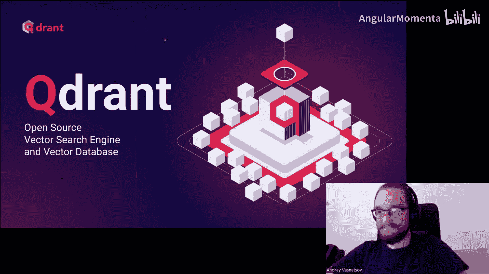
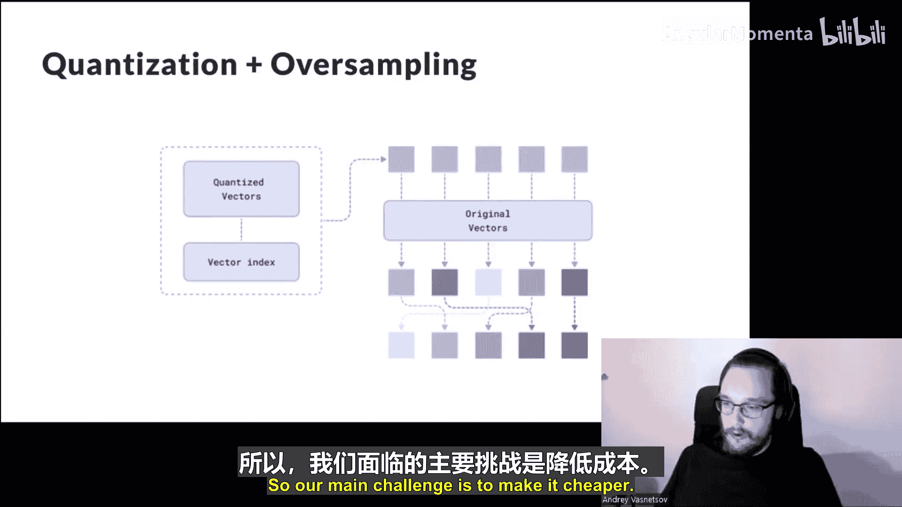

# 【卡内基梅隆大学】机器学习与数据库系列研讨会-｜-ML⇄DB-Seminar-Series-(Fall-2023)-p01-01-Qdrant：开源向量搜索引擎与向量数据库--BV1zpiWBHE5k_p1-

🎼The databases for Machine Learning and Machine Learning for databaseases Sear series at Carnegie Mellon University is recorded in front of a live studio audience。

😊，🎼Funding for this program is made possible by。🎼Ggle。🎼And from contributions from viewers like you。

🎼Thank you。Awesome guys， thanks to everyone coming It's a new semester so we're excited to have kickoff the new seminar series so this semester we're doing machine learning for databases and databases for machine learning in retrospect。

 maybe I should have call it for AI for databases because that's more buzzwordy but nevertheless the goal is to discuss various systems that are facilitating machine learning AI workloads and then using AI and machine learning to improve database systems so we're excited today to have Andre Vatoff who' is the CTO and cofoer of Quadrant one of the hot vector search engine vector databases in this space so he's here today to talk about the internals of their system so for people that are joining us for the first time the way we want to do this is that we don't want Andre to talk to himself for an hour in Zoom because that's not fun so if you have questions as we go along please unmute yourself say who you are and ask a question at any time want to be interactive for him and not just again speaking to the void for an hour and again we like to thank Google also too for sponsor。

again this semester so if you're not able to unmute yourself。

 you can send a message in chat and I'll try to stop and ask it okay。All right， Andre。

 thank you so much for kicking us off in the new semester。

 it's always a good turnout so the floor is yours， please go for it。Yep， thank you， Andy。

 and thank you for having here。

I'm Andre Passsinso， I'm cofounder and CTR at Quadrant。

 I started Quadrant as a bike project about three years ago basically to solve my own problems at my day job。

 which later turned into a dedicated company that's what I'm doing now for a full time。

O code in Qdant goes through my reviews， so you can assume I know it pretty well。嗯。

I work in the search related fields for already almost 10 years。

 I started my career as a preant engineer at a web scale search project much similar to what Google does。

 I was working on very low level components of the search engine like indexing and storage later I switched to more highle components like query parting and ranking。

I used a lot of machine learning in my job and at some point we started to use vector search in our projects and that's basically where I got the idea to build a search engine which is specialized on vector similarity。

So what is quadrant actually quadrant is。Viectctor similar to search engine or as our marketing department make me also call it a vector database。

 but personally I don't really like term vector database and prefer search engines as more accurate one and I hope in this presentation I will be able to explain why exactly I think so。

Qudrant is fully open source， it's distributed under Apache 2。0 license。

 we have more than 60 external contributors on GitHub and yeah please。

 you're welcome to contribute in Quad as well。Wdon is written in rustT as I think all system level software should be。

 but yeah that's a topic for another talk。As for this talk。

I propose to cover the following things first it's short but mandatory introduction into what vector search actually is。

And what quadrant plays like which quadrants plays in all of this industry。

 second is architectural overview of quadrant， how it works on a general level， general idea。

 and I also wanted to clear some terms before we go deeper into vector specifics。

 and the search topic is especially vector specifics。

 so what makes vector databases or the the search engines special。

 what challenges we faced and how we solve them and which technical decisions we made in this process。

Yeah， but let's start this first。Overview of what vector search is as an approach vector search is is not new。

 it was used by many big companies for quite a long time and principle didn't change much since then the basic idea is that you have some model or we also call it an enr typically it's a neural network it can convert some input data into a dense vector presentation and those vector representation or we also call them embeddings they have very interesting property。

A pair of vectors in vector space which are close to each other is usually corresponding to objects which are also similar in some sense。

 in case of texts， it could be a similarity of the meaning in case of images it can be visual similarity and so on and it's actually defined by the model which type of similarity we want to catch with disosmobas and also distance function between vectors is also defined by the model but in majority of use cases it just a simple do production between vectors。

So。Although this is not new。What is new is。How available those ready to use models become and tools around them have become to avoid audience。

 so now anybody can go and download a pretrain model and use it without any knowledge of machine learning。

So the next logical step actually is to bring this technology to production levels not just scientists but also engineers and software developers can work with it the next step is to provide the level of convenience and reliability as it exists in such familiar tools like text search engine like traditional databases and bring this convenience into into the vector search world and that's what actually we have we do in quadrant so let's now take a look at how quadrant actually achieve this。

Here is the top level overview of quadrant components。

Each level in this hierarchy is represents some special kind of isolation。

On the top level it's a collection collection logically isolates types of data between each other。

 it's similar to table in relational databases or collection of collections in document databases one like MongoDb。

 for example。After collection it goes the next step which is shas。

 Shas isolate subset of data between each other， it is guaranteed that ShaAR contain only non overlapping subset of records and sha can be moved between those shas can be replicated for higher availability and so on and finally is the lowest level of isolation is segment segment isolates index and data storage。

 so each segment is capable of performing all the same operations as a whole collection on its so on but just on a smaller subset of data。

And yeah， later I explain why exactly do the segments and how they work。But before that。

A bit more about top level so you may notice that on the top level coordinateinary architecture is pretty standard we have collections which contain shards shards can be replicated and moved around nus。

 we use Ra consensus protocol to keep track on this metadata like where collection is located where what is the null status。

 what is the collection configuration and so on so all of this metadata is stored in the distributed。

Con consensusens way。And it's also a pretty standard for many distributed systems。

And this is actually because qua is a typical example of a system built on base principles。

And base here stands for basically available of state eventual consistency。

 it is typically compared these ACI principles which are more common to relational databases so if you want to have an intuitive understanding of what is base and what is ACI you can think about Postg and Else so Postgre is a typical example of ACI database it very strict transactional guarantees it cares a lot about consistency of the data but the scalability of Postg is actually very limited it's basically up to the size of the single machine。

On the other hand， Else is a typical example of pace system。

 it is highly scalable but consistency guarantees are much weaker。

And that's actually why I prefer the term。Vectctor search engine rather than vector database and for systems like quadrant scalability and performance in my opinion is much more important than transactional consistency。

 so it should be treated as a search engine rather than database ideally I think it should not be even used as a primary storage of data。

 especially considering that the full update of vectors like due to for example。

 a new version of the model is just a common operation in vector database world so you need to avoid the whole database and create a new one just because your and quarters changed。

And it's something which never happens in traditional databases。嗯可以。Yeah。

 so what happens inside the sh is a bit more interesting process this talk because it actually have specifics related to vector search on the top level we see a pretty standard component right the headlock which is responsible for the fact that quod doesn't usually lose data once it's committed agains pretty standard component for any database what is not standard is the second level of data segregation inside a sh and the second level is segments。

So why do we need many segments in the first place。

 yeah why can't we put just all data into one segment and this it and there are actually reasons for this first reason is mutability。

And in quarant， we actually love immutable data structures this simple assumption that structure is only built once and then never extended actually opens room for many different optimizations data structure can become more compact we do not need to jump between different locations and memory therefore less khe misses all data is。

All data statistics is known in advance， so based on that we can perform various optimizations as well。

 like for example we can precompute histograms， we can precompute data distributions and so on。

 of course in this case we can also allocate the exact amount of memory we need so we don't need to worry about memory fragmentation as well。

Loading computable data structures is also much faster because you don't need to perform any kind of dissillization。

 you just copy a raw chunk of memory from this can it or you can even do memory mapping this even faster on top of that we can。

Further compress data using such techniques as delta encoding as variableable byte encoding and so on。

 and this total effect， total combined effect of this optimization can make immutable data structures。

 order of magnitude more efficient than mutable ones。Yeah， the second reason actually is。

Trade off between latency and support。And the reason for this is。

The concurrency of the single request。Is。Only efficient to a certain point and closer we are getting to low level index。

The less efficient concurrency becomes so that makes segment a natural unit of realization in Portland for example。

 if we are dealing with an application which requires a very low latency or a singular requests we can optimize CPU utilization by just assigning each CPU core with one segment in this way it will utilize as much CPU as possible in just one request on the other hand。

 if we have an application which is dealing with high throughput and it requires to make a lot of。

Pallllel request， we can have a single large segment and in this case it will maximize the output of the whole system by just serving each request on a dedicated core using the whole segment in read mold。

So we have a question from Rohan asking what is the segment size？呃，点。So。

what is the default then for you guys？Default is zero。If you don't have any data it's zero。

 if you put some data in there， it's growing。To the extent what we prefer to configure is not the size of segment。

 but how many segment do we want to have。On okay。And you can go as big as you want if you have enough resources。

So can so according to this logic suppose you have a number of segments what you're trying to say is that's the max there could be all storage utilized by one one segment itself that can happen it is possible yes。

 if if you want if your application is very read heavy if you have very low amount of。Right requests。

 and you prefer to。Maximize your。Like throughput， yes。

 it's possible to just join all data into one segment and ores。Okay， thank you。

Some else in next question， is there any advantage to having segments of different sizes within the same shard or collection？

Right。There is no advantage in this because we prefer to have like even distribution。

 but in practice it may happen because segments had joined。Like during the insertion of data。

 segment can be joined together and you always need to have at least one segment which is not immutable where we can put new information into。

So in practice， it's not happening， but we prefer to have them as even as possible。Any has questions？

Soone is the segment size in configable at runtime？Size no， the amount of segments yes。

Let's keep it going because let's get to the actual vector part。All right。Well。

 there is one slide about signal management， though so。I think it's。

We have a lot of segments within this heart and some of them are immutable others are。

Just used to insert a new data， but。How do we maintain the illusion。

For the user that actually is the whole collection is fully mutable and coordinaterant user actually can insert delete update any data at any time so ideally users should not even know that this segment exists it's pure internal thing and in order to solve this problem we need to actually solve two problems the first is how to update data inmutable data structure and second is how to even obtain the mutable data structure in first place so the first problem is solved by simply employing copy and write mechanism so whenever a user inserts a new data into what changes data in the mututable segment we just copy piece of data into a mututable segment mark it as a deleted in the old segment and everything works the second problem is a bit more complicated。

Because we need to perform long running optimizations on a segment。

 so index buildinging is quite long， that's why we need to keep this segment available for it。

En updates for the user at the same time we need to build index from。AndIn order to do it。

 we use so called a proxy segment， which is a special type of segment that wraps in one under one interface。

 the segment which is currently being optimized。It also holds a list of modifications it need to apply to resolve a conflict which is happening when you copy data from old segment into the new one it like special data structure which manages all this insertions and when optimization is done it just converts back into into just regular segment into pair of segments actually into optimized one and into a small copy and writing segment which just becomes a mutable segment。

Yeah， inside segment there are some bunch of abstract components。

 I intentionally not going to describe how exactly each of them works on a wall level instead I will focus on vector index。

Mainly and the reason for this is that the choice of concrete implementation is just depends on configuration。

 for example， vector storage we have at least three different implementations of vector storage in quadrant and it's quite possible that in the recent future we will add the fourth one and it's not really importantly quadrant works able to work with like any abstractstructions it can be just files it can be in memory storage and so on doesn't treat matter。

But this matter is。Vector index， and let's finally talk about the main component of the vector search。

The the index rub。Two main traits that distinguish vector search from traditional indexes like converted index or P3 or stuff like this。

 first it's approximate nature。It says that it does not guarantee that the result will be exact or even that the result will be the same for the same underlying data。

Vi the index multiple times because the result actually depends on the order in which you insert it into the index。

 So it's quite fundamental。 and the second is。That any vector。Can be result of any search request。

 In other words， any documents in your collection is somewhat similar to any other document in your collection。

 so it's impossible to draw a clear line between relevant and irrelevant documents。

Based solely on the vector similarities score。And of course， there are a lot of different approaches。

 how to implement factor index， but no matter which approach you choose。呃。All of them。

We'll have to deal with these properties I just described and actually it breaks many assumptions you made in a traditional database and therefore I believe it actually requires a special treatment and special dedicated architecture around it。

Importantant。We use so called HNSW index here， HNSW stands for hierarchical navigable small world。

But yes， it's pretty complicated name， but I will try to explain it in a very simplified version of it just to provide some intuition about how it works。

So internally， h SW appears as a proximity graph， that means that each vector is represented as an northern graph。

And those nodes are connected with。Some number of closest neighbors。

 so some number of other vectors in the database and search in the proximity graph is performed in greedy manner。

 meaning that on each step we choose the closest node to the target。

And then repeat the search step with this new selected node。

The process is repeated and tuine can no longer improve the distance between node and the target。

And of course， there are no guarantees that this search will result in the absolute closest sector。

 that's why it's called approximate， but we can control the precision and we can trade off precision and speed of the search by changing the beam size parameter of the search。

Yeah， but of course。H inW index brings its own challenges。First of all， building time。

Inertion of a new vector into the index is approximately two times more expensive than just searcharch index。

 and it's also very CPU intensive on its all。Therefore。

 if we do want to index and do not affect our other processes like if we do index and search at the same time。

 it's necessary to have a dedicated thread pool just for building index in the background。

 or ideally we might even want to move this index building process into another machine completely。

It means double U index is not only CPU intensive， but it also have a random data access pattern。

 that means that in every。This means it's very sensitive to the latency of the underlying storage。

And techniques like prefeching like block reading are not really efficient this decision is double that's why it's usually it requires a lot of run and it doesn't really work this disk and moreover it pattern is not only random。

 but it's also sequential remember we go from one node in a graph to another。

That means that we cannot。They cannot do efficient parallelization of the search and its performance is mostly limited by the latency of the storage rather than throughput。

To overcome these challenges whatdrant we do。A following theme。

 so a solution is to use a compressed memory representation of vectors。And use it to generate。

Selection of candidates。For instance， one of the latest addition to the quarant engine is binary quantization。

 it allows us to compress vector to a level where a single dimension is represented by just a single bit。

 which gives a total of 32 times compression for the vector and。On top of that。

 it allows us to use very fast CPU， like basically it allows us to compare vector in just two CPU instructions in bityor and Po count。

 and it works especially efficient with large vectors like the one which provided with open AI models。

 for example， where we have 10 and500 dimensions for a single vector。Yeah。

 after obtaining this list of candidate， we can record them using the original vector and return the final result to user and it's important to know that this recording process。

 unlike traversal of the units double graph be actually can be efficiently parallellyzed。

 as we already know all the offsets of the ideass of candidates so we can leverage here the synchronous IO and take advantage even of the soil network mounted disks with huge latency。

So you said it's rescoring， so like you take the quantized vectors。

And then then what do you do it against the original vectors again。

 right so we do search like we do usual search using its double using quantantas representation。

So it's very fast， very memory efficient。 And then after we obtain。let's say top 100 results。

 we do re scoring using original representation。We do need to fetch those 100 vectors from disk。

 but while we do this， we know all the offsets， so we just make a parallel request to disk withynchronous io。

 something like this and just get all the。All the original vectors pretty fast。

Yes you're compressing the vectors into the quantized form that makes the index look faster。

 but you still have to do the final comparison to see whether what the true ranking should be all right there's a bunch of questions in the chat so the first question is this equivalent to what disk A&N does？

嗯m。I don't know what that is， but assuming it， yeah， this scanon is a bit different so。

I don't think this can does any kind of quantization there are other。Implementation， which does。

So I don't think this approach is somewhat like revolutionary。

 but yeah it's parked into the box where you can use it without any additional configuration。

 you don't need to preize your data， your vectors， you just upload everything in quadrantum。

It just works out those books are quo and takes care of this quantization itself。

 it takes care about recording。And you get the result。

I see the next question will hold off to the end they ask you basically how many vectors can you put on a single box？

Well that's an arbitrary question， we'll come back to that later， keep going。Yeah， all right。

So another challenge。which is associated with H andSW is a requirement to combine web search with additional filtering conditions。

For example， you might want to search for some kind of item in a commercemer store and the price of this item should be less than $100。

And we want to search it on a specific location like near you find something near me stuff like this。

 so those additional conditions are really necessary for real world applications。

 but ven implementation of HSW or any other in an algorithm just doesn't have this。And。

In some publication， you might find that there are two ways。

To solve this problem it's either post filtering or prefiltering in post filtertering。

 it is suggested that we can perform a regular vector sewage and then apply filtering conditions later on top of the result and exclude those results that just do not match filtering criteria we might need to repeat this process several times until we obtain the required number of results。

Yeah， this approach is quite simple to implement， but unfortunately it's very inefficient。

 especially if the filtering condition is very strict or if it's correlated with vector similarities core itself。

So this approach basically risks to either turn this the whole search into linear scan or return incomplete results eventually another approach is。

Is other way around， it suggests， I mean I'm pre fielding。

 it suggests to generate a list of candidates and based on this list of candidates we can perform a vector search。

And the problem is this。Is that generating a list of candidates on so might be a very expensive operation？

Wororst case scenario it might require a check condition for half of the vectors in the collection and that can significantly increase a search latency onO so what we propose an approach that is used in quadrant we call in place filtering that means that filtering condition is check during the graft reversal it did require us to make some custom implementations。

 custom adjustments to hSW so we don't use vanilla implementation anymore we use a custom implementation quadrant but in this way we can ensure that we only need to check filtering condition。

Amount of times which actually needed to perform the search。And like it looks like a problem solved。

 but yeah， unfortunately not。The problem arises when the filtering condition is so stripped that the graph become disconnected。

 that means we can no longer find a path between the entry point in the graph and the section which actually contains the desired results。

And in mathematics， there is a whole field of study called percollation theory。

 which is dedicated to this special type of program。And for large random graphs。

 this theory actually gives a surprisingly simple equation that defines how many nodes should be removed from the graph to make it disconnected and equation is simply1 over k where k is the average number of connections per node inside the graph。

 in other words， let's say if we have 10 connections per node。After removing 90% of nodes。

 the graph will become disconnected。And yeah， let's see how it looks in practice。In practice。

 this plot shows the precision of the yach in relation to the fraction of vectors being filtered out。

And you can see that after a certain point the accuracy drops almost almost to zero and there are several experiments which demonstrates that this effect actually depends on number of connections per node。

 indeed it's very close to theory。So what we can do about it。Now to address this problem。

 we can leverage the fact that filters we want to apply。To the search are not actually random。

In most cases， these filters are based on some metadata or paywall associated with vectors。

 as you can remember we have a price next to an item and we know price in advance。呃。

We know and we not only know the price in advance， but we also know that what price is associated with which reactor on the index building stage。

 because we use immutable data structures。And what we can do。Is to build additional links。

That we can generate based on the existing pay values and possible filtering conditions。For example。

 if we have a pay is a keyword field。And we can build subgraph for each value of this field and then merge the subgraph。

For the keyword into the main one， and that's how we can create this additional links and these links will ensure that when we apply a filtering condition with this keyword。

 our graph will always stay connected。No matter how many how strict the search is。

 we can guarantee this and this approach， a quick clarifying question on the non vector components that metadata。

Is the search on that guarantee to be exact or is that also personson it？Yeah， if。

 if you' are talking。About this type of query。So it's a combination of vector search and filtering so you are performing approximate search within this condition。

 so it still stays approximate， but we can guarantee that the condition are。Like satisfied。

Got it so at a high level you're probably vectorizing those additional attributes itself and just creating a gigantic now vector stays the same we keep a payload next to the vector its stored in the quadrant we perform this search and on each step during the search we check the condition。

So we we don't go into those nodes which are filtered out。

So it sounds a little bit like post filtering right you'll still do approximate nearest neighbor search following the HNSW graph on the vector and only on the additional metadata you'll do an exact search。

 am I getting that right？not exactly， the difference with post filtering is that we apply it not after we generate candidates but during the search。

 so in this case we can guarantee that we will return exact amount of results we request。

And all of these results will satisfy the filtering condition because we restrain our search。

Procedure with with this condition and we do not。Let the search process go into areas where the condition is not satisfied。

Okay， thank you。Sorry， a quick follow up on that， I guess will quantization affect the filtering like will we accidentally filter？

Something that could have been satisfied if he had the uncompressed vector。No， no， conation is。

Only affecting the precision， it may affect the precision of vector search itself。

 floating is completely untouched。O。Thank you。😊，Any other questions so far？Okay。

So we were talking about。Building the additional links in the graph。嗯。And and yeah。

So the good side of this approach is that it doesn't actually increase search complexity。

 even so we increase the size of the graph， we can still perform the search only using the original links where it's needed and。

Utilize extra links only when original links are being filter out so the total complexity of the search is not affected we can index as many additional links as we want we can index many additional fields Yeah that's another point actually is it this approach is compatible with multiple fields being used for filtering in once because when we do that we。

Merge all the subgraphs into the main one， and we basically can de duplicateate。Links at this stage。

 so only a fraction of additional memory will be actually acquired for this and then yeah and such。

Search speed won won't be affected。what matters yeah。

 so Si as does quadrant to do any cardinality estimation that determine query plans or in place okay yes it does unfortunately I don't have slides for this。

 but I'm happy to answer those questions after the main topic。Awesome， thanks。

I had a quick question I was wondering if I had something like customer ID where I know like those things are always going to be like separated out is there anything would you recommend doing like different collections or theres something else to recommend filter top of that right it's it's the most frequently ask questions in our already Discor community by the way feel free to join it I answering questions there as well so what quarter can do。

Is to build HSW graph only based on payload so we can skip building the this whole main graph for all points and only build subgraphs for the specific user ideas in this case。

 we can still have。Search performance within user。Right it it all be very fast。

 we can still have full scan ability to close through the whole collection and at the same time we do not have to spend as much resources on building。

Reectctor index for all points altogether。So yeah， it's like solution which allows you to do。

Like semi segregation of data， they will be still stored in one collection。

 so no overhead for creating many collections and you are able to perform searches on a subset of your data。

And Andre， feel free to defer this question if you're going to talk about it later。

 are you going to describe what's the。Complexity of creating this HNSW index both as the number of records grow and as the dimensionality of each of the vector grows。

Right， so I will start from the last questionition。

Dimenssality of vector affects how fast you can compare a pair of vectors right so it is basically linear in this case if you have let's say1 thousand0 dimensions it will be two times slower than 500 dimensions。

complexityplexity of graph search itself。And the building of the graph is like there is no exact estimation for this。

 but you can say it's approximately a Gring。And the。

The process of indexing actually involves search so in order to insert a new data you need to first search for its neighbors and then perform like changes in the graph。

So overall， yes， it's quite expensive to build large indexes。It's why you。

That's why there are some optimization here that we are trying to do on this。As well。

 that's why you might want to have multiple shards and multiple segments。

To limit this overall size of the same and the other it's a good point。

And what I with what you just said， can these links across segments or sharks like not acrossrks but across segments No。

 no these links are isolated to one segment， one segment okay， got it thank you。

So what we do when we do a search。We basically ask each segment individually and then merge the result of the search engine similar approach which is used in or other even text search engine。

 it's prettyal thing。Yeah， but yeah， thank you for asking。

 Maybe it's not clear for or somebody who's not。Deep into this topic yeah so what what yeah oh sorry can I ask a question about searching across segments so I was wondering are the segments just random are they based on like some sort of spatial partition so points in the segments are likely to be close to each other or like how is that approached。

Right so and our implementation segments are completely random each time we insert the point to adjust。

Doose a coin and put it into first segment， which is appendable。

We do not do any kind of clustering inside。Mostly because the clustering actually depends on。

Type of vector， and it depends on model and we cannot make these assumptions in advance。

It might be a good approach if you're building like a dedicated system for some application where you know which encoing model you're going to do。

 but for general purpose， it's yeah， unfortunately not really working。Hi， sorry。

 how are these expected filtering conditions determined are they predetermined in a sort of like prepared guy fashion？

Yeah， so what we have in advance is we know what payload user uploaded into quadrantant alongs with the vector。

 so usually it's it's in a form of just JO document。And user can。Specifically， say， which fields。

Should be indexed。Like let's say we have a product like can ecommercemer store and we have a description。

 Vo text description， name， price and category tag， something like this。

 and it's usually only price and category tech are going to be used inside search。

Filtering conditions and that's why user can specify that those two fields should be indexed and once they are indexed we know that they should be included into this process of building additional links in H andW。

Co， thank you。Anything else？No，All right。So one important thing about this additional payload and associated。

嗯。Pilload indexes is the data type of payload does matter。But in most cases。

 it is possible to come up with a strategy to cover。

Filtering conditioning with the subgraph It's especially interesting where we are talking about。

 let's say numerical field where we don't have exactly a keyword which defines a strict subset of points but in this case we can for example what we do in quarant is we build subgraph for overlapping intervals we know that for some intervals which each interval covers how many points and we know this minimal threshold of how many points should be in graphs so we build overlapping intervals and we build this subgraphs。

 this additional links for those intervals and also we can do the same with let's say location data where we have a geocoors so lat long we encode it into into geoheshes and basically build。

嗯。There's additional graphs for overlapping Gahesh regions。And yeah， the result of this。Is it we。

Cose。The gap。嗯。Fing precision from two sides， from one side。

 we close the gap by introducing these additional links。And。From the other side。

 we increase the connectivity of the whole graph。And in most practical use cases。

 the drop of precision is not noticeable next to the fundamental approximate nature of H andSW itself。

 it is just like a noise。And no signal。Well， actually it's all topics say。

I have presentation for just for those who just joined is a short summary of what I try to cover。

 so first of all， vector search is only getting started。

 I believe that there are many more interesting use cases period beyond just tech search or memory for chatbots。

Second point is that quadrantin is a search engine and should be treated as such。

Architecture of search engine is fundamentally different from the architecture of databases。

 and it should be taken into consideration when you are designing your own application。And finally。

 Victor Serge。Index is a pretty specific component and it requires special treatment even for such usual operations as filtering。

So what is out of scope of this presentation， but I'm happy to answer questions about it and even beyond beyond the sta case。

 equity planning and payout indexes， how do we organize it inside Portland？

Interesting topic is dynamic search limit per segment。 So as I mentioned。

 we have multiple segments and。In order to get a whole search result we need to go into each segment and ask for some amount of results in each of them and then combine。

 but if we want to search for the very large limit it might be expensive to do we have some optimization for this and yeah more on quantization we currently support three versions of quantization is binary quantization the most recent one scholar quantization and product quantization we all of this。

Yeah， that would be all， thank you and we are happy to answer questions。

Also I will applaud behalf of everyone else if you have any questions can unmute yourself we have about nine minutes left。

 go for it。Maybe I'll ask a question。Andre that was a really nice talk。

 there are two different ways which people are going about putting vector search and data rich applications。

 one is where you start with some sort of a relational ch like PG vectors and you put it in Postgres。

The advantage there is that if your data application needs to search on these additional attributes。

 regular columns， you can get very deterministic semantics on the search for that type of metadata and of course the disadvantages on the vector search。

 you can't build these quote unquote global like indices like HNSW。

Do you have some thoughts on what kind of applications from your perspective fit which style of embedding vectors along with relational type of search。

 or you think this approach your way of doing it or or do you think there might be one way that basically captures everything thatll emerge？

So regarding Postsgs and relational databases its what I was talking about difference between base and the AC type of systems right so Postsgres as I mentioned is a typical AC database。

 it have very strict transaction guarantees， it have very strict consistency。

But the scalability of Postgres is very limited at the same time so in your application you should decide what is the most important thing you want to do with your vectors well probably vector search and the vector database is not a good choice if you're building some kind of bankinging system where you have money transfer right at the same time。

呃。Maybe elastic search。Andre meet from my question。

 if I have an application in which I need to do both relational search and vector search in the same application。

Well if you if you by relational search you mean some kind of joins not even joins imagine I have a big table。

 I want to search on different columns in different ways depending upon the user query and I've got a vector column that is part of that search so my search may involve finding everything where the student ID is in this range。

 the ages in this range and then there is some vector representation of maybe some descriptive stuff about them I also want to search on this I want to mix exact search and approximate search together in my end application Well yeah that's what exactly this filter queries are doing important。

And well， the answer for position is depends if you are satisfied with scalability。

Limits which is which exists in Posgres and in most cases， I think Posgres will do just a full sc。

If you try to combine these relational filters and semantic component。

So if you are satisfied with scalability of postg here， you can do that， but also I mentioned that。

Se changes are rarely the source of truth in your system。

 so what usually happens is you have your postgre。And you also have some additional indexing engines。

 you can have elastic sewage for text， you can have quadrant for vector sewage which do not hold like maybe even very up to date。

Data but they can perform specific types of queries very very fast and scalable。

And you can still have postg in your system as well， so it's not like excluding each other。Thank you。

😊，Avery， you want to ask a question？Yeah， chill so I was curious about this additional of additional of new links things like how do you decide how many new links to add and also in practice how much does this blow up the graph I was kind of curious if you have any predicate that is any attribute that's even relatively had like you know had00 values let's say you would end up adding a lot of。

😊，New edges， right in order to make it work？Yeah， so so to say he's he's hiding his name。

 but that's a mo Dspondi， the distinguished database his professor at University。I didn't just is AD。

All right。We allow users to configure this value， this number of additional links。

In the configuration of collections。But by default。

 we just use the same amount as the original graph have。Overall。

 it's not usually a big problem because as I mentioned， those links are being de duplicated。

 so if some links exist in original graph，It won't be explicitly added on top of this after the merge process。

That's the first thing second thing overall HSW you have a special heuristic which allows to exclude redundant nodes and its so on。

 so even if you try to configure HnSW you with let's say 1000 neighbors for each node。

 it won't actually build graph with 1000 neighbors because of this heuristic which will just prune redundancy yeah it's not included into my slides but it exists。

Yeah。Just for simplicity， I try to avoid this like very deep descriptions of which is double。Thanks。

Avery， want to go next？Yeah， sure， so I want to ask how do you think of like aSW plus con compared with this scale because as we all know like currently AA also have some virtually important filtering。

Sorry I didn't get the question maybe she's asking how does like your approach with H HNSW plus the quantization compare with Microsoft's disk A&N？

Yeah， all right， thanks。是。As far as I understand this canon implementation。

 it doesn't use quantization in the first place， so the idea of this can in is that you have a data structure。

Like similar to H W， but without any hierarchy， so it's。A plain guuff。

Much like I have on my slides here。And the difference is not exactly in how you search in this graph。

 but rather how you build it。 So Hs W assumes that when you insert a view point， you just。

Create a new links for this point。InIn the existing graph， but。Thisis kind and implementation。

 on the other hand。It works in other direction， it builds a fully connector graph then prune it。

I may be wrong here， but as I understood， this canin is something like this。

 this can doesn't use any kind of quantitization， doesn't have like in memory storage and actually if you think about it here。

 there is no limitation on like which kind of indexing algorithm we are going to use。

 we can use as quantitization plus over sampling thing with this can N approach as well。

 so it's something on top of vector indexes agnostic to vector index type。All right。

 Alessandra has a question。Yes well first of all， thank you for your talk。

 my question is from the point of view of a possible user of your application。

 so not too much technical in the details of the engine。I can get it for image and maybe text。

 but do you have experience with time series data， so maybe to check a similarity within time series and what are the challenges in this field if there are any。

Yeah， so。Well， in quadrant， we do not exactly work with embeddings。

Importantent assume that pendings are already made from some external model。

 so I would like the short answer to your question is if you have a model which can translate time series data into vector then it's going to work it's important as well a bit longer answer to this question is probably going involves like。

You're going to depend on what type of time series data you can you have and how can you work with it the most the common thing which is which I have experienced these and which is a bit closer to time series in just text is user events or user behavior patterns。

 so for example， if you have a history of user transactions in banking system or something like this。

 you can build a model which tries to predict next transaction and it can do this prediction through the vector bidding so basically you will have。

A model which can represent a series of actions。As a vectors。And。

And the event in this system will also be vector， so it's very close to for example。

 how word to V works， word to X tries to predict next word in the sentence in the same way we can train a model which can predict next event in the sequence so we can use this vectors from this model in quadrant in vector search。

Okay， thank you。One last question， so this is the question I'm going to ask all the speakers this semester。

In your opinion， what's the biggest unsolved problem you face in your system。

 like if you had a magic wand to fix one thing， what would that be？In our system。呃。

Making it cheaper to serve billion vectors' it's one thing like our milestone or engineering team I guess for the next year。

 So right now it's quite expensive。 you need to have even even with binary reization and stuff like this。

 you still need to have a lot of memory it have a lot of problems with this random access and so on so our main challenge is to make it chip。

