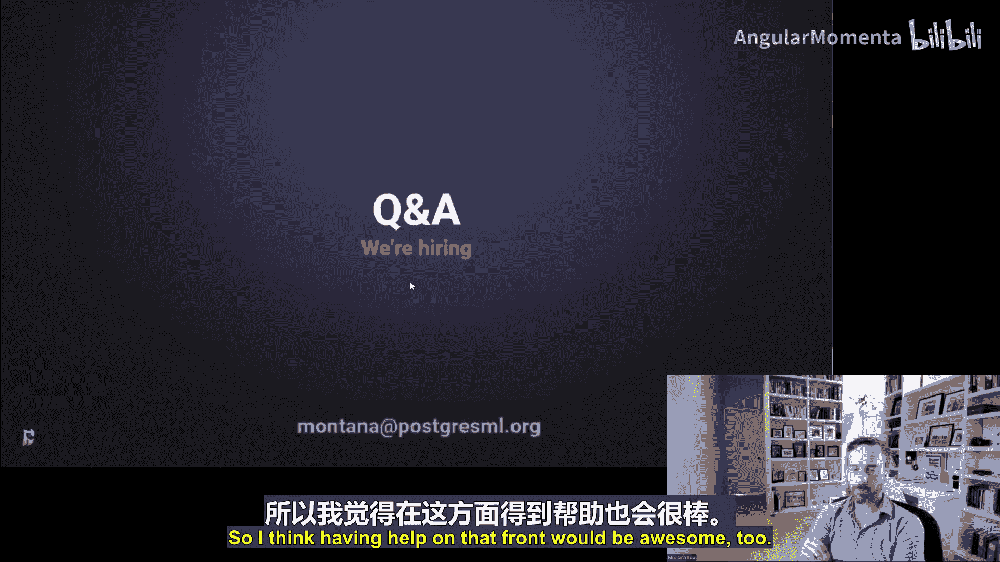

# 【卡内基梅隆大学】机器学习与数据库系列研讨会-｜-ML⇄DB-Seminar-Series-(Fall-2023)-p03-03-少即是多：PostgresML的简洁之道--BV1zpiWBHE5k_p3-

🎼The databases for Machine Learning and Machine Learning for databaseases Sear series at Carnegie Mellon University is recorded in front of a live studio audience。

😊，🎼Funding for this program is made possible by。🎼Ggle。🎼And from contributions from viewers like you。

🎼Thank you。Alli guys， let's get started we're excited today to have Montana Lo who's the cofounder and CEO CTO I forget CEO CEO that sucks I'm in the same boat yeah he's the CEO cofounder or Post SML it's a host of Postgres instances that also deeply integrated with ML frameworks since he's here to talk about what the stuff they've been doing and again as always if you have questions for Montana as he's giving us talk。

 please unmute yourself say who are and fire your question Adam and feel free to do this any time and that way he's not talking himself on zoom for an hour by which can get lonely So Montana。

 we appreciate you being here the floor is yours Thank you so much。😊。

Thanks for having me Andy I really appreciate it yeah as Andy said feel free to interrupt mell it'll probably improve the coherence of my words coming out of my mouth。

 but we'll dive right in。😊，I like to start with a recap of the whole talk。

 a summary so that you know like what we're actually going to talk about Zul In is one of my favorite movies。

 but the the reason you should care about Postgres ML in the way that we do things and the way that we use databases I think Andy was mentioning this a little bit before the talk is we're not we don't deeply change the internals of Postgres by using columnar storage or doing distributed compute or things like that most of our usage of Postgres is much more similar to application usage of Postgress but we move a lot of the important machine learning things into the database。

And the reason we do this is because it gives us more efficiency。

 more reliability and scalability in the database and when you look at compare it to a lot of the point solutions that you that Postgres ML is competitive with in the ML landscape it's a lot more capable because it's built on top of the entire Postgres ecosystem and foundation obviously Postgress is one of the most compatible piece of software every language in the world as bindings for it and can call into it so you don't have to worry about like is there a client or whatever and when we。

One of the big components of Postgres SaL is that it's part of the open source ecosystem and not just the Postgres's open source database。

 our extension is open source， but all of the models that we serve and there's lots of publicly accessible models and algorithm implementations。

 it's all open source end to end， so that means as an end user you have a lot more control over how the system is going to work。

嗯。It's also a very opinionated system there's a lot of like any application there's 101 ways to skin a cat。

 but PostgresML we've made decisions that work well together to give you a complete platform rather than having individual touch points like yes sure Pine cone is an excellent vector database。

 but I hope that you have bindings in your language for it。

 otherwise it might not work very well it's like if you're trying to ETL data from your data warehouse for example。

And finally， you know this project is really just fun for me and a bunch of the other people that work on it。

 it's you know we're we are fairly small project at this point and we have fairly new technology so that you know we don't have all the technical debt of some of the machine learning systems that I've worked on in the past and you know we'll enjoy it while it lasts。

So I'll dive right into some of the motivations for why we actually started thinking that it was a good idea to move some of these machine learning workloads deep into the database because I mean I'm sure Andy has had too many times in his life where somebodys added something to his one of the databases he's responsible for that's an obscene workload that should never that just takes the whole thing down and this is a very common refrain and so a lot of DBAs and for all of you who are taking a databases course。

 you know you'll need to protect the database from。

Unwarranted abuse and this happens all of the time。

But one very classical use case for a database in the world is the common web application architecture。

 you've got your software application up top and you've got your database and then of course it's connected to the internet and there's a couple important things here is that apps are stateless and the databases are responsible for maintaining all of the state in the system and persisting that long term。

But and because these things are connected to the internet。

 there's latency inherent in the system and so any of the latency introduced by separating the state and the statelessness is very small comparative latency inherent in crossing the continent of the world over a network connection。

When you， you look at like actually， this is this is great for your first。

Whatever prototype andVP everybody should start with something very simple like there a very simple architecture I would discourage anybody from getting overly complicated with their database or their application technology choices it's much more important to get something working quickly but when you talk about the scaling of the system like this。

 you often think like okay as soon as we get more users what we really will do is we'll scale the app because scaling staful processes is hard。

 but what inevitably happens if you're successful is that your app keeps scaling and every time you add more application workload that does increase your database workload and eventually you reach a point where your database is starting to get a little bit hot and so you start looking at ways like how can we remove database workload quick easy ways to do that are let's cache more stuff in the app and so your app starts to become staple over time as you pull database workloads out of。

Database and it gets more and more complicated and hopefully your application is or your business is very successful and you have this problem it's a great problem to have。

 but eventually。😊，The amount of state that you'll be managing in your app will continue to grow。

 but at the same time you're still going to be adding more and more load to your database until the point where you finally cave and you actually start Googling on like how do I actually scale a database and you'll realize that oh it's actually pretty easy with Postgres you just stand up a replica and there are so many workloads in the world they can be handled by read only nontransactal queries that are executed you know outside of the normal scope of things and so it's perfectly fine for those queries to go to a replica and they can be dealing with data that's one to maybe seconds。

 maybe days Da and so a lot of systems can be scaled pretty far this way just to give you some examples and I think Instacart was doing hundreds of millions of dollars in revenue before we got to the point of needing a replica I think FGma and Spotify or similar stories where they scaled these massive massive。

businesses on a single database basically and then they're like。

 oh what are we doing next oh okay apparently god that's easy but eventually you know Instacar went through the pandemic and they became a household name and that meant more and more app servers were required and you know the dreaded day came when we had to shard databases and when you have to shard databases。

😊，It gets pretty messy， you have like the application has to decide what goes where if any of these databases fails。

 which happens more and more frequently， you have to have failover logic。

 you're now managing a whole fleet of databases and it's like how do you operationalize database management it's not quite as simple as like oh we'll just spin up Kubernetes and we'll dockerize this stuff there are more considerations that you have to make when you're dealing with stateful systems？

And so。In the end you end up with a lot more database if you're successful and so this architecture you know there there was a huge backlash in the industry in the maybe ops in the web 2。

0 days and everyone was like hey， let's move to microservices and you know one way of thinking about or defining microservices is that you're trying to design a service that will never require that second database you know。

Replication is old， but it's not that old in terms of。

Functionality that's always been easily available to people and so。

There there's this idea that like oh we'll have we'll just have services and we'll just keep breaking up the application into smaller and smaller services and anytime our database gets too big we'll just break that database apart but this this actually gets pretty slow because you get more and more network latency and eventually what happens is。

In a clean service oriented architecture， an entire web request can be serviced by a single service and so like one easy example here is like maybe you have a metrics service and all of your user metrics that you're collecting from the client site data。

 all it is is single post request and just record some JSON about some event that happen somewhere and that can be that could go to one database table that's your events table that can be a standalone database it's very small to very self-contained。

But eventually you get cross cutting concerns one example of these cross cutting concerns is like the search system at Instacart and so when you think about like product search you type something into a form field it goes off and then you get a bunch of products displayed back to you。

 but the。The logic that occurs there involves multiple machine learning models it involves half a dozen microservices。

 you know if its closer to a dozen actually at the worst point。

 many of these have circular dependencies and they have their own statefulness and they become like these big app level things actually that start to have all the same problems that we had with our monolithic architecture。

And then you eventually have to figure out how you're going to shard or scale that final database one of the great things about microservice architectures that's also a terrible thing is that you know this frees up every team to choose their own database to be suited exactly to the purpose that they need and so in Instacart you know we were running Postgres but also Redis MemCash Cassandra Drruid Fredship。

 snowflake I'm forgetting several of them but I think if there was a major database that was popular in the last 10 years we were probably running it behind some microservice most of these many of these reform machine learning models as feature stores or model stores I mean you can call S3 a database if you want it's very important of SQLite of course SQL in S3 because why not。

That's the outer circle of hell right that's like I mean you have to you have to realize like yeah your defense into hell is like one level at a time and you're just like okay。

 I've got to get out of this circle where do I go next the only way I guess is down it's like at least you to say the big O word right oh oh yeah。

 thank thank God but no we had people who were like why don't we use my sQL because you know Postgy has vacuuming and I don't like that and I'd rather have anyway。

You can。Once you open the can of worms that is microservices。

 it's pretty hard to put it back in the box。Eventually we did to a large degree at Instacart。

 the way I think about you microservices is that like you thought it was hard to manage a sharded database system but it was a single kind of database。

 it is much， much more difficult to reason about what happens when for example。

 your MECash cluster goes down and now your or your service。

 it was depending on that is now backfilling MEMCash and how is it doing that。

 of course it's hitting your primary application database which then takes your primary application database down which then brings down the whole site but you thought you had microservices with database isolation and it's really really difficult to actually achieve that level of isolation when things get complicated。

Com。To give you an idea of how complicated things can get this is a chart created originally by Andrewreson Horowitz who's one of the big investors here in the valley for example they invested $100 million in Pine cone recently which is one of the hot new vector databases they are very in touch with what companies are doing and I've included a link in this graph to their original writeup and blog post where they presented this this is only a small you know expanded box in their much larger data infrastructure diagram。

 but it gives you a peek into what you need to actually build a machine learning model and a machine learning service。

And like when a request for search comes in and it's using a dozen models created by a dozen different data scientists。

 you'll notice that in each one of these boxes， there's always a handful of different competitive technologies that can be used for that function。

Inevitably your data scientists will all make different choices just like they did for their databases and if you don't have a really strong machine learning platform it's sort of solved all of these problems every single requests will go through a different microservice that's virtually an entirely new and different stack each one of those requests will take anywhere from 50 to 500 milliseconds。

 if you have a search system that you first has to be named in to do recognition and then it has to do a synonym detection and then it has to do query expansion and then it has to do its initial query and then it has to query for potential replacements for low stock items。

And all of these involve multiple models at one point at Instacart when we had all of these microservice that were Python based。

Our P90 query times for search were up around eight seconds to get through。And。

Sure that's P90 it only happens one in 10 times right except people do more than 10 searches on every visit so basically every customer was hitting at least one of these and when you make somebody wait you know eight nine。

 10 seconds during their shopping cart some significant portion will churn out or they'll just give up on whatever it was that they were looking for that time and search for something else and so if you don't just if you don't completely lose the customer you'll at least lose some fraction of sales。

And so I realized this talk's not about Instacar talk about your stuff but like was that eight second P90 was that like you flipped the switch on something new and it was just that slow or was oh no no no machine learning they always want to add like a little bit more data or a little bit more sophistication or one more microservice and so it's constantly like each microservice they add to add some new functionality it's like oh this one's only 50 milliseconds right but then when you've got dozens of them involved at the after years of iterative development on a search and recommendation system then all of a sudden the CEO of the company is like hey guys I was trying to search on my mobile and it was just timing out what's going on with your team。

I would say the other thing we noticed is some of this is auditton stuff when when the CFO or the CEO knows the name of the service or the name of the database that's a problem then like you that's when people you know people got you actually have a motivation actually fix it Yeah no it's definitely true and so I got to be a part of a task force that was tasked with like you're going to bring down search performance speeds and you're going to make this system better and that's actually where you know this talk is about PostgresM but a lot of the thinking for PostgresML came from those explorations and those learnings。

I mean， a lot of it was my fault too like you know when I got to Instacart I helped build the machine learning platform and I helped set up a lot of the data engineering principles and you know I。

A lot of serviceoriented architecture makes sense I don't want to bag on like microservices our terrible idea if you can like fully isolate something like I mentioned then it's actually great and should you should try to do that and it's a great way to break load out of your primary database without complicating your life too much but in the end if your business is as successful as something like Instacart is you will have database problems and so。

In the end， we moved to an architecture like the one I've got on the screen now where we did end up sharding Postgres and we ended up sharding multiple Postgres databases。

 but we're now Instacar is fronting all of their Postgress clusters with PGCAT so that it makes it much cleaner at the application layer so that can go through a proxy cooler like this that is shard aware and it can handle failure recovery and everything else。

And it。If。So if you know this is where you're going to end up。

 this is actually the desirable end state for your app where you're not having to cache so much at the application layer。

 but you can actually to remove database load， but you can actually handle scaling your database horizontally both with replicas and sharding and that it's actually not that horrendous and terrible of a process。

 and especially if it will save you from all of the other pain points that can be involved in microservices and having many different kinds of databases out there then I think this architecture is a pretty sweet spot to live in。

But the the really nice thing about this architecture。

Is it you don't have to start with it you can actually start with the original web app architecture of like you've got one app。

 you've got one database like you pick your app server。

 whether that's node or Python or Ruby or Java， pick your database a Postgres is a really good choice because it's so general purpose can handle so many workloads but just know that rather than having to like make your app really complicated you can just throw a puller in the middle of your databases。

 and you can keep that and you can scale out。And so I think companies that go this way in the future。

Will have a much better time there's something i've seen at a lot of startups is that that i've worked at is when we have all the engineering buttoned up really well and we have our architecture super clean and crisp and everything's properly refactored all of the time usually the business isn't doing very well and I think that's why you have all of the time to get all of your engineering right I think that if your business is really growing really quickly that there's so many urgent priorities for engineers to work on that there's very little time to go back and clean everything up and so if you don't have that pressure。

To move quickly then maybe your engineering will be okay but maybe your business won't and you know after sort of coming to that conclusion I decided well I'll just found an engineering specific company so engineering will be the whole business and we can make the engineering really good so that I can have my cake can eat it too because you know as a software engineer code cleanliness best practices strong principles are important to me sort of aesthetically。

But in the end， you have to be willing to do what needs to be done for the business。

 not necessarily for the or whatever idealistic engineering principles I happen to have。So don't。

So do you accept questions along the way， I joined late， so I Oh yes。Yes， okay。

 so just a question on the sharding， I was wondering not sure if you're aware of like systems like Coco GDB or UgaBte。

Would you consider those instead of sharding or would you prefer sharding over those systems that have the petitioning sort of speak in their schema building？

No I think that those can be great one anecdote I'll share as well is that you know we move to Elasticse that was one of our first projects of we had a Postgre catalog database holding all of our product data and so we that database was overloaded and falling over because we were treating it like a data warehouse not like a application database。

And one of the first projects was to move all of that data into elasticastic search confront it with a sharded Elasticsearch cluster。

 which was great for about five years， but we didn't have good enough control over the Elasticsearch sharding schema and algorithm and everything else to get where we needed to be and eventually we had to redo our sharding on Postgres where we can have more control over the end to end solution we escalated all the way up to the CTO of elastic and because of some of our needs that were' like。

 oh well yeah this says right here in our documentation you can you can't do crosssard joins those are always going to be slow and so if if and we don't have any indexing types that will help get you out of this jam that your business requires you to be in so long story for yes。

 there are lots of databases out there that we do the sharding for you all you have do is pick a key great if you can use those at some。

Point you may find that your needs get more complicated and and you have these cross cutting concerns。

And I think particularly with machine learning again。

 you find yourself where you end up in these cross cutting concerns where there's no single sharding key that will do it all for you and you have to reconsider。

 but yeah。IOne of the things I really like about Postgres is just how much control ultimately you can have over everything and if it's not built into Postgres itself。

 it's one of the most extensible databases out there。

Alway write your own extension to do the thing that you want。

So that that's actually a lot of where the motivation for Postgresm came from。 It was。

 it was a realization of if we have this horizontally scalable database and all of the。😊。

All of our machine learning data， like the scalability of these machine learning microservices。

 the hardest part was always scaling the feature store。

 the hardest part of engineering and the most complicated engineering was about getting the data from wherever it lived into the feature source so that it would be there in time to make the real time online prediction。

And and so trying to figure out you know how we simplified those systems inCAt we ended up replacing our Elasticsearch cluster with a system very similar to what I've shown you that is big Postgres charted thing and then we started moving all of our feature store data from various databases into this big charted cluster and we did this in the middle of COVID。

 I don't think that you had the business not been exploding。

 exploding in a very good way doubling every other week or something then we wouldn't have had the license to start making these huge engineering moves and having sort of all hands on deck of pulling everybody's favorite database out of their hands and saying like this is the one scalable system。

 your system is like quickly going down onto this load so the only option at that point was to build something like like we've shown。

And。At the end of the day， it was。Shockingly successful。 we went from a， for example。

 if you wanted to add some new data to the。Instacart catalog and a product manager was like oh。

 we want this feature， it would take literally the last one we did on lastastic search took three quarters of iteration so nine months。

Okay the product manager says they want this feature， they go to the catalog team。

 the catalog team that we're going to put that in Snowflake。

 and then we're going to figure out a way to let ETL that through Druid to do some feature computation and then we're going to go from Druid and just that dualastic search and then oh by the way we didn't get it in the right format that the search team needs it so we'll just start this whole like development cycle all over again and cross like three VPs of engineering and half a dozen engineering teams。

The coordination overhead there was terrible it's like oh wait we don't support your data type for timestamps let's use strings for timestamps throughout the whole system or whatever and so when we said everybody was going to put everything inside of Postgres we're going to anybody going to have any table that they want。

Then when we had issues， it's like， oh， we're just going to change the column type in Postgress that the two engineers can agree in a meeting and it takes an hour now instead of multiple weeks of like。

 oh， we've got to reconfigure our whatever service。系。Anyway。

 I feel like I've wandered a little bit away from this slide。

 if you don't buy all of the aal reasoning for simpler database architectures and how those will make your life better there' especially in terms of machine learning complexity there's this notion of data gravity that like the more data you get into a system。

😊，The more data it will also attract， the more applications will get built around it and again you'll have this snowballing problem of like unconstrained growth in the data layer。

But。In machine learning， you have a different option。

You know you can be running your model as if it were a stateless service and every time your model needs to make prediction you can go fetch data and pull the data up to the model or you can do what PostgresML does which is push the model down into the database into the data storage layer and then you're not pulling data out of the database to the application layer。

 you're just passing a pointer from Postgres shared buffers through the model and so there's no more data movement。

 but this does mean you have to redeploying models and so you're moving models instead of moving data。

And in my mind， this is fundamentally better and it's provably better because any model is always smaller。

 if it's a good model， it's always smaller than the data set that it's trained on and it's always going to be smaller than the data set that it will be used for prediction and it will always change less frequently than the data that it' being used to model。

 otherwise it's just not a good model if you have to constantly update your model then it hasn't generalized and you've really failed at the machine learning aspect。

If you build your model well。Then there will be fewer electrons involved in a PostgresM kind of process than would be in a microservice architecture process and yeah there's a question of like how much it does that actually matter aren't computers fast aren't networks fast isn't ML inherently slow？

And expensive anyway so are you optimizing the right thing and that's a really good question should always you know benchmark and optimize the right right thing there's another question of like a lot of Postgres ML thinking applies to classical machine learning。

You know， when the systems that we were building this for。

 we did have some deep learning models involved in our search services。At Instacart years ago。

 running like TensorFs 0。4 or whatever it was in production but。

The new the new world that everybody's really excited about is like vector databases and GPT4 and open AI and like can't you just make a call the open AI why do I need to consider anything else。

 but if you're even in the new world youre your open AI chat GPT model。

In the open source world where you're hosting this thing yourself， it's still a massive thing。

 it's still 70 gigabytes。Quite a bit。Quite it will break all of your traditional software application continuous integration deployment pipelines because most people aren't deploying 70 gigabyte Kubernetes containers so you're going to have to rethink your。

Your deployment system as it is and like how you actually manage these systems。

 but at the same time these models are still incredibly data hungry at inference time because you need to you need to go pull back not just one vector but but potentially hundreds of vectors you know people vector databases will do cosine similarity but cosine similarity is actually a really bad predictor of relevance compared to having a trained to model it is trained to predict the relevance and one of the things that。

It is catching on now is like oh I'll fetch 10 documents for my vector database by nearest's neighbor and then I'll feed that to a pruning model that will select the top two or three most relevant documents before I actually pass that on to my next generation model and so even in this new world of LLMs and vector databases。

Being able to have the data， whether it's vector data or traditional user data tabular data in the same process as the LLM。

 so even though LLMs are slow to run， you know， they're anywhere from 10 milliseconds to many seconds of runtime。

That data movement is still a considerable case or a considerable expense I've got some benchmarks we can show later in the talk。

 but this matters as much as ever that you really can load up your  lama in your database one time and that's a one- time data movement cost that will then save you from moving vector and keep in mind vectors are you know1 thousand4byte floats long that's 4 kilobytes it doesn't take like somebody wants to pull 100 vectors out of your Postgres database then they're talking about half a megabyte of data movement and then you're going to pull that into a python process which is going to blow it up to like 50 megabytes of Python data memory and then you're going to run it inside your model and it's just。

I mean， actually， you'll spend as much time in pandas in the data frames in the Python world as you will actually using their model and actually using your data。

And one of the really cool things is like you can see that this is a sequence of events that starts with the app and goes to the embedding model and then it goes。

Prormpt creation and then it goes to tech generation and then the response comes back to the app。

I should have had an entry arrow on this diagram starting with the app so you can see the actual whole loop。

What a request lifecycl looks like， but you can actually write a single Postgres query with multiple commentable extensions they can do the first。

You know， it can do a union between an embedding query and a normal SQL query as a CTE。

 and then it can actually have you know pushre strength and capnation or other UDFs to actually generate your prompt as a second CTE that can then be calling a pruning model as a third CTE and so you can just chain these common table expressions together until what you really have is like a full program of multiple steps。

Except that program instead of。executing across a web of Python microservices stizing and detherorializing the data at every single step。

 it all happens inside a single Postgres process。And so you you cut out so much network latency and when we actually look at the load on the database in these cases from serializing all of this data in and out。

 like Postgres load and query times actually drop because instead of having to send back you know halfM of。

Vectctorors on every single query。 They're， they're sending back like a。

10 kilobyte text string or something and so just like the data movement in and out of the entire system can drop significantly and and then you don't you've also like dropped off this huge web of microservices that are now nonexistent instead of massive GPU bills。

哦。No。I hope I've convinced you that this is at least an interesting idea。

 I was going to give you a little bit of an idea of like what Postgres ML actually is and for classical machine learning it's just these three functions。

 these are basically UDFs in that the extension provides Postgress machine learning is actually a very well definedfined process。

we have supervised and unsupervised learning， we have classification and regression。

These are all you know tasks that can be done with machine learning if you're not familiar these can all be provided as just parameters to a training function you can just say I want a classification model literally that's。

That's the task that's what it's going to do the problem formulation with machine learning is still I think hard and I think that's where most people get stumped like but once you can formulate your business problem as a machine learning。

 either classification or regression or now as a text generation cross problem for chat APT。

Then you're off to the races so Postgrel gives you the ability to train models。

 it gives you the ability to then you know strategically deploy those models like you would expect。

And finally， it gives you this predict call that you can now leverage that model given some new data that's been written to the database。

 or you can just pass you know Postgress accept parameters in queries。

 you can just pass the you don't even have to actually this was surprising to us that people were using PostgresM as just a modeled inferencefer service you know basically state list service。

 but they liked Postgres better than having like GRPC or some other HQP RE endpoint。

Because they trust Postgres to be able to serve responses reliably and they know how to manage Postgres as an existing piece of infrastructure。

There's， there's， I think this is more like the new school of vector databases and transformers that PostgresM also provides。

It's worth， I think， noting that and I'll talk about the technology that we use and how we build this stuff in a little while books。

The transformers stopped the hugging face transformer stuff it's still in Python。

 everything else is written in rust and so we have like good zero copy abstractions and a lot of places we can move data without having to actually copy it。

 but in the Python case we still do have to go through Python to access some of the latest LMs。

And those things are changing and coming out like every week。

 so it's pretty hard to nail them down and standardize them。

 but there's progress being made and I think we'll get back to a lower level implementation on this front in the future。

But given those six functions， you have a very comprehensive machine learning toolkit that you can solve a lot of problems with with everything in Postgrel。

This slide talks a little bit about。How we actually。嗯。Their memory inside of the Postgres process。

 If you， if you know Postgres very well。And then you know。

Shared buffers where Postgress pages data in and out from disk to RAM and that's configurable。

 but we store our models in Postgress tables and we store our feature data in Postgress tables and so that is naturally stored in shared buffers and so Postgres manages that global cash resource for us。

But each connection that's opened for Postgres， when you actually call one of these functions like predict or embed or transform that leverages a model that the actual pulling the model out of all of the weights out of shared buffers and instantiating it with whatever model inference library it needs to use。

 whether that's XG boost or psyic learn or Pytorch， we support all of those under the covers。

 your model gets cached in the connection。Because so many of these models run in Python and were originally conceived of in Python。

None of them are developed to be concurrent。support concurrent access。

 they all have some kind of a lock around their usage and so this actually works really well in the Postgres connection process memory model because because every connection is an independent process we can load as many copies into as many different connections and then it's Postgres connections that give you concurrent access to the model as many times as you need now this PGCt is also really important in this picture。

Because PGCAT allows us to keep that connection open， even when a client goes away。

 which preserves our model cache or what models were actually being used。

 we can also use Postgress roles， and so like if you want to isolate certain connections or throttle certain models and enforce queuing。

 you can do all of that with PGCAT and you can say that you know whatever user is using model X YZ。

 we're going limit them to one or two or 10 backend Postgress connections which limits their total usage and throughput in the system。

In there queue， and that'll leave the rest of your Postgres database available for your application workloads or your other modeling workloads that you might have。

😊，嗯。G is how big is usually a model。It varies wildly。

 but a linear regression model is like eight bytes。

 it's like two floats basically and you can actually do a lot like that。

 but like an XG boost model can be anywhere from like 10 k to a couple of megabytes XG boost really is state of the art for tabular data inference but like yeah。

It's on a connection for like a state of the art model for doing you know most of the search tasks is totally fine it's even even on like a tiny database。

 but when you get into LLMs， then you can be talking about like a you know Lama 70b is like 280 gigabytes if you're using the full precision。

Yeah， that's what I was getting at so like so every connection。

 every every pros worker has this own copy of a model sitting in memory and it's not is it in shared buffers。

So I mean because the model is persisted in a table。

 so if you want Walma 70b in Postgres ML get persisted in a table it's going to be a 280 gigabte well。

 you know there's a row data size limit in Postgres so we transparently split it up into multiple rows and then we stitch them back together when you load your model that becomes 280 gigabytes in shared buffers and then that actually you know well get actually copied into your connection specific model cache。

So then your connection will have a will need 280 gigabytes of workM yeah that's that's where I was getting at yeah so so much to the point for I understand not everyone's running the full llama thing we like at some point you need to dedupe that memory Yeah absolutely and I think that。

That will be part of the move away from python transformers to libraries like Ru farmers this is all very new stuff for us that we've just been you know extending in the last。

3 to six months and we've got a lot of work to do on this。

 but I think you're absolutely right and we want to get to a point where we can like share。

Beyond what people are doing in Python， where we can actually share the read only weights of these models。

And then we'll only need to allocate memory for the intermediate computation steps。

 there's still a lot of these buffers are still intermediate computation that have to be isolated and can't be concurrently accessed by multiple processes at the same time because they write to them for intermediate use but。

We can definitely do better there。Awesome， thanks。And where the GPU cache is also interesting in that regard。

Because we you can you're much more memory limited on GPUs and so I think this is where a lot of the motivation for us is coming from dedoping memory and and we're we have a serverless cloud offering right now where that。

Being able to offer people you know， a time slice of a GPU and a shared memory model across multiple connections。

Is is really important from because you know a lot of people experimenting with LLMs and transformers right now are hobbyists or enthusiasts or proumers on working on hobby projects they're not necessarily。

lararge corporations that have the budget to spend $5000 a month on a GPU in the cloud and so being able to reuse that multiple connections for PGCt is something that we're pretty excited about。

Because then we can charge people 60 or 70 bucks for their little embedding model。

 they've got a vector database with an embedding model that they can query many times an hour for their chatbod。

 but they they can't and they don't need to fully utilize the GPU either it' RAM or itss compute。

So yeah， I think expect to see more there。哦。And so we love benchmarks at PostgresMl。

In some ways I feel like we're just cheating because we don't have all of the network overhead and everybody else has network overhead we can say things like we're 10 times faster than open AI for embedding generation。

 but that's because you have to call open AI over the internet that you can't run open AI and your data center。

 the best you can do is like try to guess where Microsoft is hosting there things and then to put your app or whatever in the same data center but you're still subject to all kinds of queuing and whatever。

And lot of a lot of people think that like， oh， open AI is a clear leader and so like it's worth waiting for higher quality I want the best when it comes to these things。

 but it's not true。OpenhaI has lost pretty much every domain except for text generation。

 you know they used to be the leading image producer with Dolly2 and it's funny I say this because they've just come out with the integrated Dolly in G4 trying to get back to relevance against stable diffusion or against midjourney which really took it away from them they used to be really relevant when it came to embeddings and they had good embeddings but they're now ranked like 12 or 13th and they keep getting pushed down the leader board across like the metrics that we see。

And。I mean this isn a whole other interest and question of like is open source going to win or is closed source going to win will will open AI keep their their lead and will you always need an open AI integration or will we actually be able to run open source models in our database or in our localllma setup my money is on open source right I think that。

We've had multiple reports of like the whole Google we have no moat thing going on and like the fact that GP4 appears to just be a mixture of experts of GP 3。

5 and now GP 3。5 is losing def Falcon 180b and a lot of a lot of context of so I think like we might even see them lose text generation。

In the next three to six months unless of course they release GDPP5 we don't we don't owe they don't tell us。

 but I think I think it's going to be very competitive and very interesting and there's still a lot of other reasons to choose open source。

Other components that you can mix and match with text generation。嗯。

It's a similar story like if you use hugging face for your text generation dose these models。

And then you use Pine cone as your vector database。

 I mean PG vector added hierarchical navigable small worlds H andSW as an index type last month。

 Andrew Ka's been crushing it on that front。But even even with IVF flat， the it Im。

Faster to indexing， so it's still a relevant indexing type for vectors。

But even using IVF flat for query time， which is slower than H andSW and doesn't scale to its larger collections。

 we're significantly faster because you've eliminated two internet round trips。

 which are a lot slower than the 10 milliseconds it。

 takes to do an embedding generation in the sub milliseconds it takes to do a vector index lookup even with IVS flat。

嗯。So。You can go down the list and you can dig deeper here。But in my mind。

 I think that we have presented a pretty strong case for。You know。

 this terrifying concept of moving more workload into the database that it it's not just effective。

 it's also safe and it's also scalable and if you follow those architectural principles。

 it'll be a lot better in the long run。Oh yeah， it is important to note that like。

A lot I think SQL is awesome， I imagine everybody in this databases course also think SQL is awesome。

 but a lot of people only know Python or JavaScript or whatever language。

 and so we actually have another rust project where we generate Python bindings and we generate JavaScript bindings that encapsulate a lot of these common machine learning application paradigms and give you like three easy JavaScript functions you can call if you want to index documents and recall them from a vector index from your JavaScript app without having to actually write any SQL or know about an IVF lab index or anything like that。

And again， this means that like people who don't know anything about retrieval or anything I guess。

 can get the benefits of a much， much faster architectural。Yes。So like getting。

 I think I think we're coming up on time， we've got 10 minutes off， Andy， is that about right？

Yes yeah so i'll go through this pretty quickly you know we use PGx it is a rust extension management framework it is awesome like I love developing I never thought that I would love developing a Postgres extension but it's a pretty nice live it's all pretty well managed it's it's like writing any other rust out at this point。

I love the strongly typed rust application with the strongly typed database schema。

 having lived in a world of Ruby and Python and Elasticsearch and Cassandra that are all of these schema and typeless。

the runtime type whatever it's amazing it's amazing to see like I just add a new enum somewhere and then all of my rust match statements are broken and then I go fix that and the Ruskin compiler tells me I haven't take care of a bunch of other things and i'm like oh I've got to add this and like I don't really have to think through it anymore to add features there's enough of a framework in the application that if I just break the first thing by adding something to an enum it pretty much tells me everything I have to sell out。

So I'm pretty excited about that whole extension。These are some of the libraries that we use under the covers there's a lot going on to move more machine learning into rust in the rust community so I think this feels good to me but in the meantime we do call back into Python and there's a couple of reasons we want a good strong reference implementations people have been using PsyCI for 20 years they come in to PostgresML and they're like I want to see the exact same convergence and statistics that I was getting so we need to be able to at least give them that passout equivalence test before they can move onto a different implementation or different platform and they're used to。

So I'll stop there， open up to any questions that people might have。Awesome， thanks so much。

 I will applaud and have everyone here if you have any questions and then Krisoff if you want to go first？

Yeah， I have a question on PG vector， if I look across different vector databases。

 then they implement different similarity metrics and different indices。

Another single one has all of them。So I was wondering。

 do you have a sense of if PC vector wants to become compose superst of all these combinations so that I maybe avoid having to run two or three databases depending on the vector similarity search or index award？

So I think if you're。If you're running less than say 10 million vectors in your corpus。

 it doesn't matter。It's going to be whatever whatever there is going to be fast enough and also and that's for indexing whether're using IVF flat or H andSW or there's there's at least six that I think are out there right now a fairly popular PG vector like IVF flat is the one that's really fast to build the index but it has slightly worse query performance H andSW really slow to build the index but has much faster so you can pick which of those two extremes you want to live on it doesn't have all the ones in the middle。

But I think from my perspective that's good enough for like 98% of people and honestly anybody who has less than 10。

000 vectors doesn't need an index at all， you can you can just run the query and brute forestst and it'll come back in 10 milliseconds it's fine I mean I guess if you need sub 10 millisecond queries and sure put an index on it and then you'll you'll be bound by your inside data center query time which is going to be a millisecond to get between boxes。

I connect to your Postgres instance in terms of the operations like tosine similarity versus Manhattan distance。

Those don't really impact query or indexing speed that much as much as like the index type or network latency would。

wouldn't worry too much about that， what you should worry about is cosine all of those are very simple arithmetic distance functions between two vectors。

 but they all treat every single element of the vector as equally important to whatever is being measured and that's rarely the case。

And so what you actually want is you want to train a machine learning model using user feedback data to actually tell you how similar two vectors are and not rely on cosine distance or cosine similarity or the dot product or the Manhattan distance if you really want to improve that and the only way you can do that is if you can take know a thousand of these vectors and then run them through an XG boost model in the same memory space otherwise it's prohibitively expensive to pull  a thousand vectors out of your database feed them to an XG boost model but this is what we do at you know any modern search and recommendation system and then of course the CEO complains about how your search system is you can't possibly pull a thousand vectors out and so there's some negotiation and haggling that takes place of like what if we just pull 100 out or what if we just pull 50 out can I get some latency budget back for an X machine learning project but then。

When you're only looking at the top 50 instead of the top thousand0。

 like there's usually something in the long tail that might have been the product that the user was going to buy that X boostos would have been able to promote all the way to the top。

 but cosine distance won't find it so。You know， you just lose some percentage。Thanks。

I would to say we invited the PG vector guy to come give a talk and declined。

 so we have the neon guys are building PG embedding。

UAnd they'll be giving me a talk later in the semester。Other questions， go ahead start。

I was going to say， it's exciting to see， like multiple implementations take off here。Yes。

 any other questions from the audience？Okay， so I'll finish off by saying a question asking you know。

 I mentioned the memory Dduub issue what。And you guys also did a major sort of refactoring。

 sounds like from Python to post basic extensions。What's another sort of major system task on your horizon for the next you know one to two years that you guys want to undertake and if you want to go five years out by all means do it。

 but what' what's a major challenge do you think is sort of unsolved the space you're working in？

Well， I mean off of the top of my head columnar storage is actually really important for time series calculations。

 they've got goods there are good algorithms out there and timescale has already implemented it from Postgress but unfortunately their license wouldn't allow us to offer something like that。

 so I think coming up with an actual open source implementation for columnar storage that we can integrate with some of these time series predictions。

Would be good。 We do have a long road to go when it comes to。

addopting rust implementations for the latest LLMs and making sure that we can get back to a fully deduped memory storage。

 I think that that is what we'll consider 3。0 for PostgresM that'll be a big milestone achievement for us。

嗯。We've got probably 50 or 100 Github issues open right now， I think。

An enormous breadth of coverage that when you look at what's possible in machine learning。

 there are so many different algorithms or bells or whistles that people want。

That we are effectively competing with the entire Python ecosystem like as soon as Yandex releases cat boost people like oh it's the latest ingredient boosted trees can you do catooos too and it's like oh okay yeah we'll add that but it's a never ending fire hydrant so I think having help on that front would be awesome too。

