# 【卡内基梅隆大学】机器学习与数据库系列研讨会-｜-ML⇄DB-Seminar-Series-(Fall-2023)-p04-04-Weaviate：架构深度解析--BV1zpiWBHE5k_p4-

🎼The databases for Machine Learning and Machine Learning for databaseases Sear series at Carnegie Mellon University is recorded in front of a live studio audience。

😊，🎼Funding for this program is made possible by。🎼Ggle。🎼And from contributions from viewers like you。

🎼Thank you。All right， thanks everyone for coming to another episode of the database seminar series here at Carnegie Mellon University on ML for databases and databases for ML we're very happy to have ETN Diloer from weviiate to talk about their system and what they're working on so the goal here is for this to sort of be an interactive process we don't want ETN talking to just himself so if you've got a question feel free to unmute let us know your name tell us where you're calling from and fire the question and if you're not able to unmute feel free to just drop it in the chat and we will read that out loud as well and with that。

Atieian， sorry， I forgot to mention Atin is the cofounder and CTO of WV8 and with that thank you for being here and the floor is yours。

Awesome， thanks for having me Yeah， so want to tell you a bit more about Viate Viate the product。

 not the company， but maybe also start quickly with the company Viviate so we are a startup that's been around for about four and a half or so years now building the open source vector databaseate team is now around 50 people so grown quite a bit recently and we're doing all kinds of cool stuff that hopefully I can share with you today so most of this is gonna to be a tech deep dive so I try to make sure that we don't have like any kind of marketing slides or anything on there and really go into what I think or the cool concept I do have a small sort of higher levell introduction in the beginning just to sort paint the scene for you depending on on what your background is you may not even know what a vector database is for example so I want to give you the motivation of why the world needs a vector database but then dive right into the architecture in there when it's been quite。

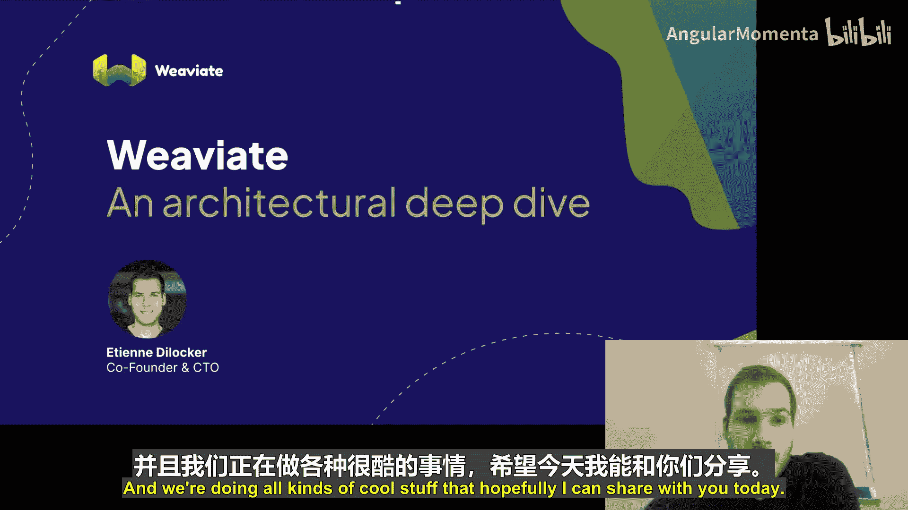

time on HNSW which is a specific vector index type then also talk about product quantization which is a super interesting topic in my opinions about compressing vectors or reducing the memory footprint that's needed for vectors and also talk a bit about multitenancy which is something that VV8 has a unique sallicia solution for and there the idea is like if your user space needs to be separated into different user spaces like how do you organize that in a way that it scales in there V8 can be quite helpful so these are kind of like the three deep dive topics because that's first start with why would you want to have a vector database at all。

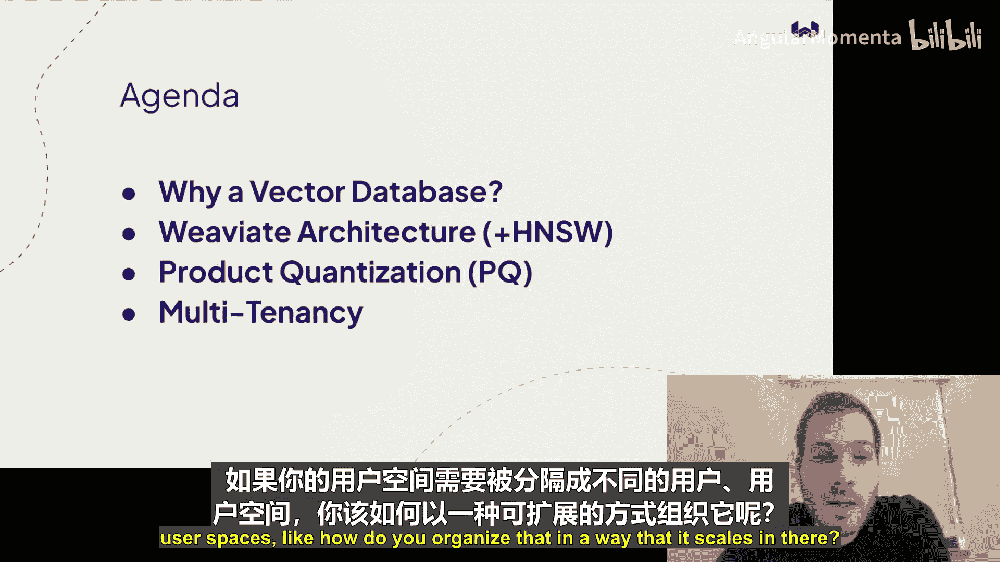

So for this slide what I put together is the so I may or may not have created that slide while flying on a Boeing 787 and that motivated me to just go for the Wikipedia I did pay for the Wii-fi and I could go for the Wikipedia article and this is the first paragraph of what comes up if you look for the Boeing 787 and then on the right you have a couple of keywords and as a human being you can probably immediately relate that these keywords are relevant for this kind of text so we have stuff like airplane airplane than a different spelling like the British way of spelling airplane and sort of also a bit more abstract terms like dreamliner specific to this model or 787 which kind of the number appears but not the words and it's easy for you as a human being to see that these are all related but for a traditional keywordbased search system this would be pretty hard because I think the only word actually that would match in there other than。

Dreamliner would be the wordairliner but not Air airplane and these kind of things and one way to overcome this is to not index keywords。

 but rather try and index the meaning behind keywords and that's a bit fuzzy at this point when we can make this a bit more specific by sort of placing the meaning behind these words and these sentences in a space and sort of imagining a 1500 dimensional vector space is super difficult but we could sort of imagine this as just a twodial space。

And for this something an example that I love using is a supermarket because in a supermarket you can kind of intuitively navigate in a supermarket by using the concept of similarity so if you would walk into this fictional supermarket I give the creative name whole floats you would walk in and you would see that on the left you would have sort of non-food items and on the right you would have food items and if you should probably say that as well if your goal is to find carrots in that supermarket then you probably immediately know that you don't have to look for carrots in the non-food section so it can kind of immediately discard half of the supermarket and if you go further in that supermarket you would find sort of in the bottom right of that illustration you would find the produce section and it first starts with fruit and then if you see maybe apples and on the other end you see potatoes over the island vegetable section then you know that the potatoes is closer to the carrots that you're looking for so you're kind of like going。

Closer in that direction and that's until you eventually find the carrot and that's kind of an oversimplified way of what we just talked about of these limitations rather than sort of the carrot sorry rather in the supermarket being organized alphabetically it is organized by these concepts and that's the idea of a vector space so if you use a vector embedding model it would put anything text or any other modality into that vector space and sort of placed it in that multidimensional space that have've super simplified by using this 2D map。

And that was kind of the whole starting idea。Four years ago when we started VV8 but since then stuff has happened most notably chatt sheetP came up and with chat sheet all of a sudden there was this this yeah sort new use case but also new problem mainly these large language models they tend to hallucinate so if you would ask chatt sheet right now does VV8 make use a elasticastic search it would actually say yes so I tried this on chat sheetP and that is a hallucininated answer it gives you a very confident answer saying is aPSS VVA uses elasticastic search as storage background blah。

 blah bh blah blah and that answer is wrong so that's if there's just one takeaway from this session and it VVA does not actually use elastic search in in its architecture。

One thing that you can do to fix this because as you can see from the screenshot is you can tell chatt。

 please try again， but this time base your answer on the following snippet that I copy paste it from the VVA documentation and then there's the snippet sort of telling you VA uses a custom storage engine blahh blah all these things and then chattP。

Sort of apologizes for the confusion and in the end Fuate the summary it says in summary Vva8 has its own custom storage engine optimized for working with vector embeddings and it does not rely on elasticastic search for storing and indexing so the good part is we could get chattT to provide the right answer the bad part and this is we kind of have to tell it the answer ourselves like we have to say like here is kind of the knowledge that that you need to answer the question and now to make that sort of to remove me manually having to copy paste the documentation what we can do is something called retrieve log manager generation which is basically a fancy way of saying retrieve the documents that contain the truth from some kind of knowledge base。

And put them into the context window of the model so that the model can create a better answer based on that context and this is。

Sort ofComp to the previous one it's a super super simple edition you just sort of put VV8 in the pipeline there as well and the vector embedding search that we talked about before that really helps in sort of understanding the question and mapping that to the right documents and then chat sheet PD can now say it can't actually read it because I have the zoom overlay on here let me move that for a second V8 would say VV8 has its own custom storage engine optimized for working with vector embeddings which is taken from the previous slide and what's cool about this is。

First of all we didn't have to retrain chat APD， we didn't have to do any kind of model training。

 we could on the fly adapt this simply by looping in the right context and we could also change this on the fly so a new document could appear tomorrow or we could remove a document for example。

 so if there was a document that we don't want to show for whatever reason we could sort ofeviate as a database and a database you can sort of do crowd operations and that gives you a way to sort of influence what the large language model would produce on the fly。

Now I can't switch slides anymore okay so we have an example app that's called verba which is a that's the golden rag Tver sounds a pun on rag and this this nice doggy in the image so this is kind of meant as a just take your own data and put it into Vviate and have a retriever logment generation kind of example。

And for this one the standard one comes with our own documentation。

 so to sort of prove my point I put the same question into verba asked that does BV8 make use of a elastic surge and verba luckily gave the right answer and B8 itself does not make use of elastic search qua a bit more more context around it so you kind of have the best of both worlds you have the model creating that nice answer that。

That yes sort of the generative part， but also you can base it on facts that you can control yourself and then you can change it on the flight。

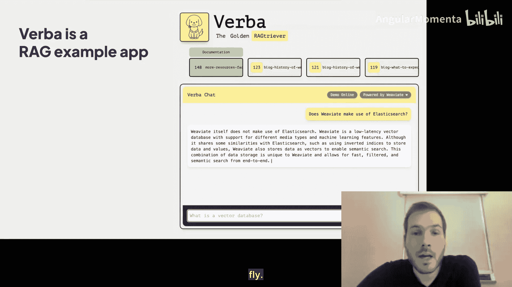

Yeah， so these are right now， I would say the main use case。

 there are plenty more use cases for vector similarity surge could be recommendations。

 it could be all kind of kind of other ones， but these are the biggest reasons that we see right now of people adopting BV8。

And yeah with that I would like to dive a bit deeper into Vivi's architecture so if anyone has any questions on the on the previous part before I switch topics。

 that would be your chance， but also of course we can we can talk about them later as well Vviate。

Uses collections and charts so small disclaimer here when I say collections。

 this is actually if you open up the VVA documentation right now you will come across the term classes this is something that we're currently renaming so we' got some feedback of like collection being the more intuitive way of describing things in the NosQL world。

And so in a BV8 setup， I use to setup here as a relatively broad term not to mean it's like a specific sort of single node setup or a cluster of BV's really just your BV8 setup in however way you would have it set and you could have sort of three collections here like article authors' event so basically it's like your from a user perspective like your way of creating similar to like a table or so in the SQL world。

Within a collection we have shards the purpose of shards is basically vector data or vector surge in general can be quite resource intense and later we'll focus on how to reduce that cost through product quantization。

 but if you have a data set that's too large to fit a single note and sharding is a way to basically split it up and have a slide on that in a second so one collection can comprise multiple shards。

And then within a chart we have essentially three parts， one is the vector index。

 I'm using HNSW here as sort of pretending that's the only option that's actually not true this is pluggable in VV8 but the like 99% of use cases that we see right now or we've done with HNW in the future there will probably be more there is also an object store so this is also very important N VVs architecture while it is vector native。

It's still a pretty decent key value store under the hood so there are no limitations around kind of objects that you could store with your data so if you retrieve something you don't have to let's say use a secondary system that stored your original object and then resolve that like where the vector search which is give you back your ID and then you have to go to that one but you can store the full object with reate as well。

And there is an inverted index that also uses an LSM store and this inverted index is actually to my knowledge is the only LSM store that actually sort of natively understands roaring bitmps so that's that's an optimization that we made for basically combining different filters doing like end operations or operation these kind of things efficiently and this all kind of lives together in that self-contained unit or sh and sort yeah works well together so for example。

 a quick clarification question and you could defer it if you're going to talk about it next。

Build this also if I have a collection of documents。

 let's say a whole bunch of PDFs that have OCR and I'm going to go store indices in it。

In the object store， what can I put in can I keep the OCR document in there too or what's the scope of what you would suggest people put into the story layer here Yes yes so typically what we see is you would put let's say you have a PDF as the raw source and let's maybe say the PDF also has images because the think images it makes it very interesting then what you could do is store basically the OCR text as just as chunk text so for example for hybrid search if you want to do sort both keyword matching or keyword scoring like Bm25 in combination with vector search then you actually need the text chunk but you could even do is store the raw input like the blob that is your PDF not sure if that's the best idea because if that gets a lot of data that probably makes more sense just put that into super cheap storage like cloud storage and just link it from BV but technically you could you could do it you could if you say like okay I'm okay with using。

SSD storage or so to store the raw blob in there， then you can store anything basically。

 but typically what we see is like a sort of semistructured JON or so where you would have maybe title and then the title paragraph and the paragraph or something like that and then the idea really from our perspective is we want to be able to serve。

A search request end to end so that you don't have to serve at search time just because you're missing some information that you have to query a second database system for。

Go it thank you this this may be something you're going to get to shortly。

 but but how do you how do you do sharding over these vector spaces like is it is it something。

Maybe you're going to get there， I'm just curious how you find like a sharding key。

Yeah let me let me go to the next slide I hope that hope that moves in the right direction so yeah so for sharding typically we shard on a specific key in sort of a two step approach where the key itself would match to a virtual shard and the virtual shard would match a physical shard and basically with consistent hashing where the idea is that if you ever change the number of shards to minimize the data movement and this is this is actually something that we don't have a feature for resharding yet because the。

In typically and especially with H and W like the cost of building the index is relatively high so rechararding on the fly is not something that we typically see people do but we have the general architecture in place so it's a similar to like dynamoddb or cassandra or something like that where if we would say like hey we want to change the number of shards on the fly we already have the mapping there to to reduce the amount of data movement to make sure that yeah basically only minimal amount would have to be moved other than thatards on it like randomly partition the data or do you shard in a more systematic way where you might be able to filter shards in a search query or do you have to search all the shards on every search query yeah so right now we just do a hash on the ID field so that's basically random but there is a second scenario so this is why this slide says sharding in a single tenancy situation there is a second scenario that we'll get to later for。

T tendencyancy where it's not using filters， but it's kind of kind of doing exactly what you're hinting at if you already know that part of your data is specific to a specific sh or to a specific node there's no need to search across all of them so in that case is actually different This right here is mainly for the idea where it's agnostic of specific filters where the idea is really you have a multibillion scale data set that's just too large to fit on a single node and you you sort of don't have any kind of。

Good criterium to narrow it down further so so just because the because of the nature of the query basically you know that you have to hit all charts anyway。

 so this is kind of for this case and then later in the multiten section we'll talk a bit more about the how to narrow the scope down based on the query。

嗯。Yeah， so let me see yeah so I mentioned HNSW， which is the hierarch or a hierarchical navigable small world is a mouthful。

 I struggle with it every time， which is a very common vector indexes see this a lot right now I think it's often used depending on what the perspective of the vendors either they use it as a positive signal to say hey it's a super fast and perform an index or if the vendor has something else they use it as a negative saying hey it's an index with a very high build cost so it's just engineering there are tradeoffs and HNSW makes one of those sort of tradeoffs。

On the one hand for it's an approximate index， so it gives up a bit of accuracy but you can still get to a very very high level of accuracy to gain a lot of performance and then the other tradeoff if you compare it so this is compared to an exact index where you would have to do like a brute force search and then if you compare it to other indexes like HNW tends to be very fast on the query side but relatively slow to build or relatively compute intensive to build。

And HNSW is a graph based index and as I mentioned in the intro like I want to focus a bit on this part because I think it's yeah it's nice to visualize and nice to understand sort of how you can use a graph to do an approximate nearest neighbor search and this graph as a proximity graph and the navigable small world part in the name is based on the concept that if you know someone who knows someone who knows someone with I think six or seven hops you can basically get to any person in the world so even if they're like completely globally distributed just by sort of using those graph connections you can navigate basically anywhere and this is the same idea in this proximity graph so don't think of this so much as like a two-dimensional vector but it two- dimensional as just the representation。

 think of this as no matter what the dimension between two points are as long as you have a distance metric so cosine similarity。

or doc product or something like that， you can represent this basically as a one dimensional yeah I don't want to say vector。

 but a one dimensional value is a scalar vector value basically that tells you if two points are closer to one another or further from one another。

And we can make use of this。To do a similarity search so what we've introduced in this new point here is the concept of a query vector and that's that green dot on the right and just visually you can immediately tell if I want to go for the top three nearest neighbors that's basically just a circle around that dot and that should be those three points on the left sorry on the right also what we've introduced is the concept of an entry point which is just for the sake of this demonstration just just assumes a randomly chosen point that we use every time to enter the graph and now what we have to do is as efficiently as possible get from our entry point to the query point to those three points that are highlighted in that circle。

And for this in sort of slightly oversimplified terms， what HNSW has is this following algorithm。

 the idea is that basically from ever from wherever you are。

 which in the beginning is your entry point， your goal or what you can do is evaluate the edges so these sort of outgoing edges and jump onto those new points and then for every point you can。

 since it's just the similarity comparison again to the query vector。

 you can do a calculation whether that new point brings us closer to where we want to go or whether that gets us farther away from it。

And using those calculations， you can actually pick the best point of your newly discovered set and make that the current candidate so you can see this is like a like a sort of almost recursive kind of algorithm。

And then another sort of helper is let's try not to score any point twice so we need to keep some sort of a list of what points we've already visited。

And our early exit condition or exit condition is basically when we can't improve the scores anymore by evaluating our neighbors。

 that's when we're done and I'll walk you through an example of that in a second just sort of to make it easier to understand the colors in the next slide we already saw the entry point。

 the curie vector and the sort of blue which is just points that were there in the beginning now I'm introducing two more colors。

 one is the gray one which is just this is a point that we already scored and visited in the past。

 but we discarded it。And then the light green is basically just to highlight what our current best candidates are。

So this is our the same graph as before， the only differences that have highlighted the edges that are available to us from that entry point。

So the idea is like right now we can evaluate those four other points and if we do that。

We can see that the graph now looks like this， so a lot has changed with just sort of one iteration。

Some of those points like the point on the left is smart gray we've discarded it because it didn't actually bring us any closer to where we want to go out of the other three points there' are basically all three that are green but one is also red because that's the closest so you can kind of think of them probably should have been like both green and red at the same time basically what that means is those three are currently our best sort of our closest matches which are already better than then the entry point and out of those three specifically the one that' that's highlighted in red this is our new candidate or new entry point so we can basically do the same thing again from that perspective which gives us two new edges so why just two why is there one edge in blue that's because it would point to a point that we've already visited so we're not going to follow thated because we know we already visited that so it only gives us two new options。

So if we repeat that。We move to that point， which is like。

 this is just trust me that this point is actually closer than the one in the bottom that's like very hard to see on the slide。

Same thing from here， we've actually only discovered one new edge because we're not going sort on the top left edge because that would just lead us to a point that before already discarded。

And then if we do that again。We can move to our current candidate here similar situation here。

 one of the edges actually points to something that we've already visited。

 but one edge gets us to a newer point， we will make that or a new entry point and then finally if we do do the same thing again we're now in the exit condition where we can't actually move any closer anymore because anything that's connected to our three possible candidates right now would not get us closer to where we want to go so if we would take the top green one and evaluate the edge of to the bottom left that would be farther away and similarly for the bottom green one we could only go left which was also bring us farther away from our our query so now what we've kind of done is like we've navigated this graph closer to our query vector and in this case we've actually identified the top three exact neighbors so that is something that's definitely possible。

But you can see that sort of roughly half of the graph is still blue and' that's our efficiency saving basically so if we had done a brute force search。

 we would have not have a graph at all and we would have just scored every single point in that data set compared to our query vector but because we were able to follow this graph we actually managed to not score half of them and this is of course a super small and small example which is for demonstration purposes。

 but as this graph grows， there is more and more that we can sort of not score and this is where the performance boost。

In HSW comes from let me just just because it's nice let me just go back and sort of do this again at at slightly higher speed so you can see it like almost like an like an animation of how we。

Traversing that graph until we find our results。So you mentioned these are approximate sort of sort of indexes like。

Are there parameters you tune here to adjust that or and sort of yes how bad can it get I guess like with with yeah these approximate structures Yeah you can sort of one thing that's super important for hSW and that's something that we actually ran into quite a bit in the beginning is you need a data set with a let's say useful distribution of where your data is at So if you would randomly generate vector embeddings just like a sort of random function you would have sort of all distances would be on average pretty much the same that would make for a horrible graph but if you use reallife data sets so for example。

Yeah just text or so that that tends to have these like natural clusters it will make for a way better distribution so that is something to keep in mind for this sort of graph to be efficient but then you also have parameters that you can tune so one thing that's sort of implicit in this graph is just the number of connections so it's kind of I think that the limit I think is for in this graph because no no one has more like no point is more than four outgoing connections。

Another parameter that you can tune that I sort of oversimplified in this is the candidate scope。

 so I've just pretended right now that we're looking for three results but I've also said that we're only ever looking at three candidates in real life that those are actually two different numbers so you would have the results number which an iniate is called the limit or typically it's just called the top K and then you have this parameter in Hs W that's called EF which is the sort of candidate window so it's quite common that you would maybe search for your top 10 results within EF of 128 and that would mean that you would have roughly 10x or 12x the number of results set in in your candidate set and that gives you an immediate sort of query time tradeoff between performance and accuracy because the larger you create the sort of temporary results set the more points you discover that you have to evaluate but also the more points you discover so the better or the more likely it。

that the search gets better and then another parameter that you can tune that I really didn't really talk about is so here I just pretended that the graph was already there。

 but of course there's also built phase to it and for the build phase you actually do a search on the graph to find out where to place a new node and there you use the same sort of the same EF parameter and that's called EF construction then where if you do a better search at build time you're more likely to place the node in the correct place which then in turn builds a better graph so that's another sort of query time versus buildtime kind of tradeoff that you can do and there on our website you can see all kinds of graphs so this is like or if you look at ANN benchmarks from Eric Bernhardtson he has this independent sort of scoring of different vector libraries and7 you will always find these graphs that showed the tradeoff between I think he uses throughput but the throughput is just a single。

reeddits or throughput is really just latency basically versus accuracy and then you get these like nice curves where like the top。

 either the top left or the top right corner would be the ideal scenario that nicely sort of visualizes that trade off。

One thing though， so so far， I have actually ignored one of the parts of Asiansia just drink some water my snack。

So。Everything that I have described right now other than the parameters。

 they're actually specific to HSW is more NSSW， which was the predecessor to HNSW so we haven't really talked about that hierarchy at all yet and this is on the next slide。

So。Look at this sort of 3D flattened 3D view of this 2D graph where I again highlighted a couple of points so the colors have different meanings right now really what they mean is those this is the yellow point the green point and the red point this is really just so you can find them again they no longer mean like entry point or query point or something because now what we can do is introduce。

A second layer and in this second layer and this is the reason for those colors。

 we actually have some of those points that also existed on a lower layer。

 we also have them now on a higher layer， but also where we don't have some of the other points。

And what that means is since we have fewer points on average， our edges are longer。

 which also means that if we move sort of if we navigate the top graph。

We're much more likely to cover more distance with a single hop so you can kind of think this and the query retrieval this I should probably also say the query retrieval goes top to bottom so you would start start on the top layer where you'd have very very few points and would go down to sort of see a down layer per layer as soon as you've exhausted one layer and this is why you need to have points that are present on both layer so you could go from in the top graph you could say like let's move to the yellow point and then you can't move any further to left because there's no better result so the yellow point would now become your entry point on the lower layer and in a sense like in my brain I think of this kind of like a binary search because like you eliminate a large portion of the search space on a higher level and then you go down on a lower level and do a more granular search to actually retrieve the kind of points because if the higher layer is missing some points then of course you can never discover them for retrieval。

So sort of similar to a skip list index yes， yes exactly exactly。

 I think skip list is probably the better example myer research yet。Okay。

 one other thing that is super interesting in HNSW that sort of when we first the HNW paper is older than VV so when we started this was something that we had to learn and was actually quite difficult but it's a super simple concept actually this is how do you know which are at the right edges and there's a heuristic in HNSW that。

That does that。And for this， let see， here we go。If we look at this。

 so this is another graph right now and right now this is focus sort of or this e centric。

 the view is centric of that red point right now so this is not meant to be the whole graph。

 this is just sort of I am the red point and I could be connected to all of these points。

And just intuitively， you would probably think this may not be the ideal graph because if every single one of those points。

Sort of has a pattern like this then everything is connected to everything which is great for connectivity but also doesn't actually give us any kind of performance boost anymore because like if evaluating the neighbors of a single point means evaluating the entire graph then it's just a brute force search so probably there is a better way and of course one thing to one way to move around this is just to limit the number of connections but if you limit them you want to keep sort the most valuable connections and what is heuristic does in simplifyimplified terms is basically at some point you cross the threshold of your connections so you'd have this is another tunable parameter in H is W which is called max connections or m short if you keep sort of during build time if you keep identifying your perfect neighbors and you keep adding connections at some point a note just runs out out of space for connections so let's say your M is 64 or in this case I don't know it's like 17 or something like that。

Once you cross that threshold， you don't want to say like okay。

 I'll never accept new connections again because then you can never connect to that neighbor instead what you want to do is prune them and the way that the pruning algorithm works is it sort of temporarily removes all of those connections and starts from scratch and starts connecting points again。

And for this one， sort of the four that are highlighted here。

They are from the perspective of that red point theyre pretty obvious connections because there is no way to identify those points through at different point so these points are the closest neighbors to the red point and they're not the closest neighbor to any other point that we already have so this sort goes up gradually so you could think of the site kind of know in a clockwise pattern or so。

And now the interesting thing is every other point on that graphic has a point that is already connected to the red point that is closer to it than to the red point so in other words it was a very complex way of saying。

From now on， we're only going to do second grade connections。

And all of a sudden we have something that resembles more a graph。

 so we've kind of taken all these points that are previously connected to the red point and pruned them in a way that if it makes more sense to connect through them or connect through an existing point to that red point then we're not going to connect them to the red point itself and this sort of helps a lot in reducing unnecessary connections because you can just rely on your neighbor to discover a point rather than than having to be connected to everyone directly and that also means that on average and it leads to longer connections because if you sort of surge scope is like like right now if the red point can have 17 connections right now it only has form so you have lots of space and if this is sort of a multidimensional space then it's not as crowded as this two-dimensional space so there's way more room to make a connection to the red point which over time leads to a better graph。

Okay， that oh let me see my slides not not loading， Okay， that was that was the H and SW part。

 which things is also kind of the。

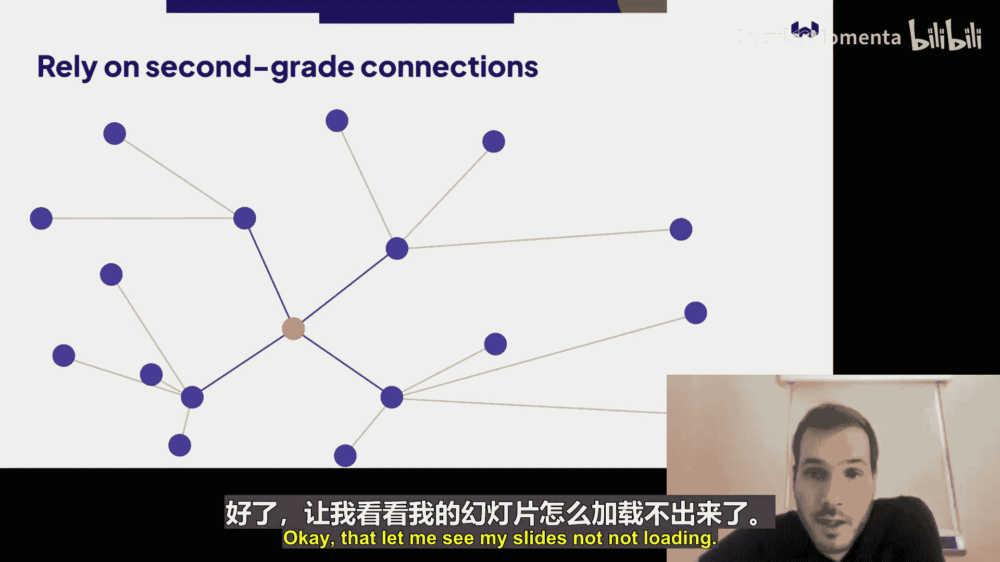

The yeah prerequisite to talk about product quantetization。

And you can switch topics any more questions on thatep。

 could you go back to the previous slide for a little more so every single data point that I'm looking at here is an object in the database is it correct like everyone would be like one one document Yeah you wouldn't necessarily like you could have documents that don't have a vector attached to them but this is every object that has a vector basically would you ever a consider constructing an artificial point just look kind of final center let's say that red point that you have there right now didn't exist is constructing an artificial point so that you have a very convenient neighbor something you've considered or that people do。

😊。

So super interesting point， I think not directly that we've considered this。

 what you can do is sort of if you think of filtering for example。

 like in filtering you remove some points， which means that your connectivity drops。

 then you can create these sort of edges again but I think typically what you would do is rather than creating artificial points。

 probably just create artificial edges like edges that wouldn't be part of the algorithm but you say like okay we have these like two distinct clusters and all that's missing is one edge to go from one cluster to the next and now they'd be connected again。

Oh， thank you。How frequently do you rebuild this indices as data gets added and deleted？

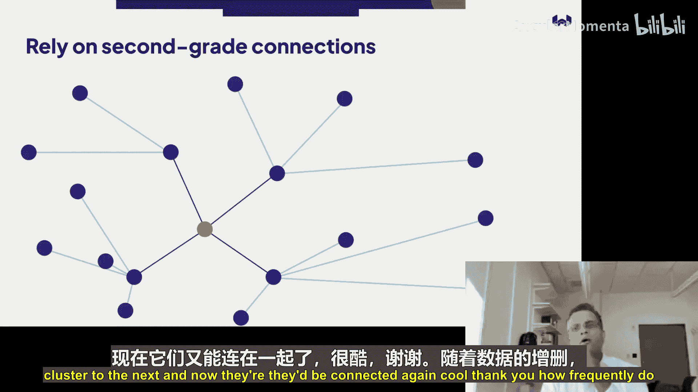

I don't know if you're going to talk about that oh yeah very very good question so my my slides are currently I don't know my slides are a bit slow to load whenever there's a there's a lot of color on this slide let me go back to that one so adding data。

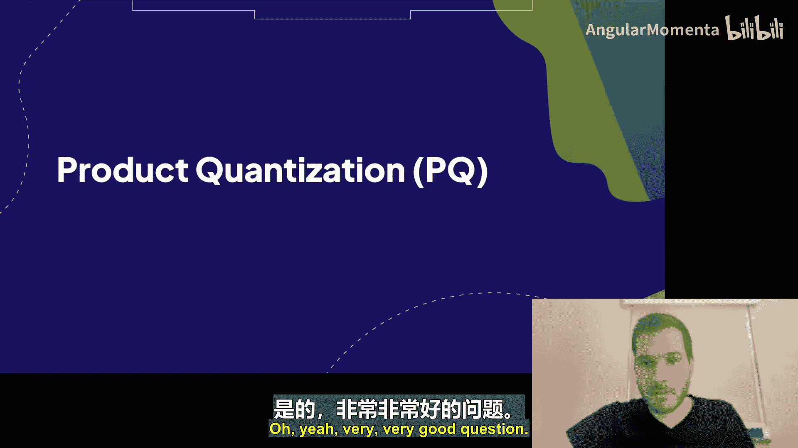

Kind of this happens on the flight like HNW is building a way where you never have a build phase and then a query phase。

But because the building phase is just searching and inserting。

 if you purely add data there's no maintenance that you would ever have to do like your graph would never degrade over time。

 this is a bit different when you add deletes so for deletes you have two options one option is you would sort of temporarily mark a point as deleted which would be sort of like a lookup list and then you know hey if if this point is marked as deleted。

 I can no longer include in the results set but I still need that point because if it would just remove it right now I could risk my graph no longer being connected so one option is basically this we wait for those tombstones to pile up and at some point we say we have 30% tombstones now it's inefficient because we have 30% of edges that don't help anymore let's rebuildilt the graph。

The other so is this makes a ton of sense if you have like bulk deletes or any other kind of event where all of a sudden you have a lot of deletes that you need to cover in a short period of time。

 the other approach and this is actually the one that we and inviiate or that we typically do iniate is to try to repair the graph so what we do is we iterate over points that are marked as delete it so so basically we do both so we use this this temporary list。

Just to make sure that the moment that the deletes comes in。

 that you start or you still serve the right queries by not including something that was marked as deleted。

 but also in the background we would iterate over that list and we would say like hey。

 if we remove that point right now， we're basically removing a connection from so if we take the red point as an example in this slide if we were to remove that point right now。

These other four clusters would no longer be connected so we then start sort of rebuilding and reassigning them to one another and that is a very costly process so it's kind of that if you do the bulk rebuilt that would be the more efficient process if you do on the fly rebuild it works kind of well if you have not too many delete so if if you just from user perspective like I don't know they upload like 80% of the uploads or inserts and maybe 10% are updates and 10% are delete or so and that happens over time then you can use your compute to sort of drag it out and repair it on the fly。

 which is also nice that you don't have ever have this like sort of big build face where you would then have to either work on a copy in the meantime or would have to sort market as read only in the meantime but you can sort of do this just as the regular process。

Thank you， and do you ever see applications or use or scenarios where if I just look at the vector database。

 forget about the actual data just the vector component of it。外地。

Among the number of edges that you have across all the layers is way more than the number of nodes。

 or do they tend to be roughly of the same order？Yeah。

 so this is controlled by the algorithm because it has that parameter to sort of keep the edges in check。

So you would audit typically， I mean the point that was last inserted probably has the fewest edges because it hasn't been able to be discovered by other points that were inserted yet。

 but overall the algorithm itself through this pruning and sort of starting this pruning whenever the edges become too much keeps that in check so you way I noticed that we're sort of a bit going a bit slower than it had anticipated so we're only starting into the new section right now are we still good for time or it should be yeah we've still got you know 17 minutes or so so I mean great tackle the product context because I think that's that's the next most interesting one。

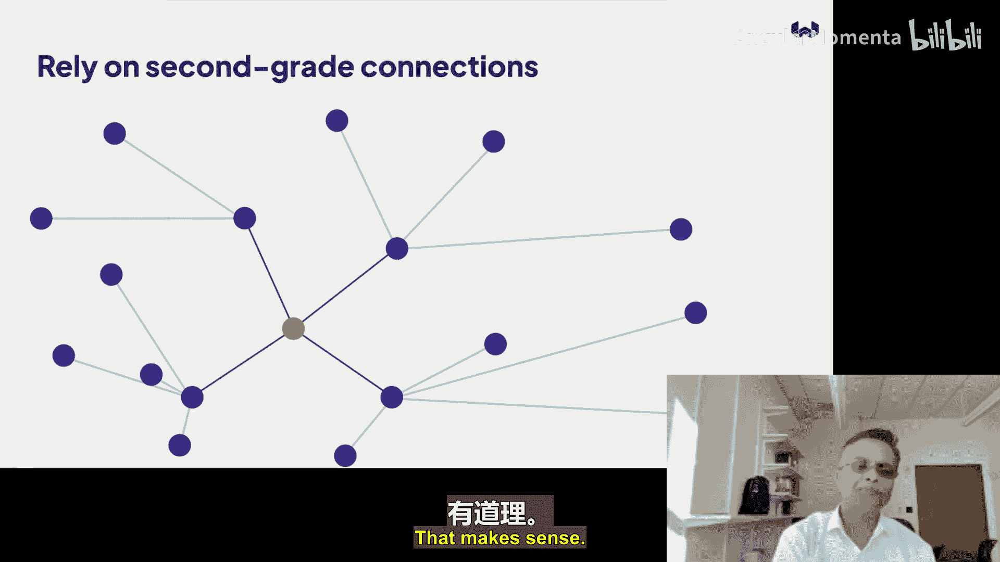

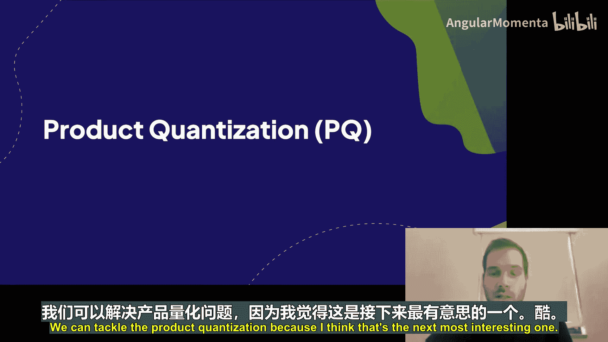

Co okay so so some motivation for what product quantization is and why would meet that here are three of the most common from from our perspective embedding models that we see right now the biggest one being open AIs Eda2 which has a dimension analogy of 1536 so that's typically you would assume or we assume these embeddings are float 32s so that's four bytes per dimension so just for a single embedding that's already6 kilobytes and therefore for a million of them that would be 6 GBabytes even more so for cohere have updated their new default embedding model which is now 4000 dimensions so that's sort of 16 kilobytes and 16 gigabytes respectively and then a sentence bird open source sentence bird model that's the best rank on the SBRT。

which is a website from Neil Res who sort of trained he works for a coherent now。

 but before that he trained open source sentence bird models and also has like accuracy benchmarks which is really really great to sort of figure out which works well in which domain and these kind of things and there we have 768 dimensions。

Wwhich sort of leads to yeah with a million embeddings to three gigabytes so this is just a million embeddings if you have a billion then those gigabytes turn into terabytes and that's kind of the point where you start thinking like if those vector embedding need to be a memory which is by the way also something that should probably be challenged but only have 17 minutes left so for now let's assume that they live in memory what can we do to reduce the memory of footprint of them and one thing that you can do is called product quantization and product quantization is another one of those where for us it was so hard to figure there's like there's been research for years but to me it was like if I felt it was never accessible so what I'm going to try to do in the next couple of minutes is try to make that knowledge accessible because the idea behind is actually not that complex so we have here is basically just a clustering so we decided to take or data or take a portion of our data。

And try to figure out what would be clusters in that data set that would kind of roughly represent the distribution of our vector。

 so this could be something like a K means algorithm， for example。

 that you could run on your data and then you would come up with these sort of white points that are the centroids of those clusters。

And then you see the colorful areas would basically be if it's within one of those areas。

 it would be closest to the centroid of that particular cell what you can do with this is you can assign。

Just some numbers for now to that cluster so it kind of went in a spiral pattern here's the01。

 two3 and then at some point I think it goes all the way up to 18 and since we started with zero that means we currently have 19 of those clusters。

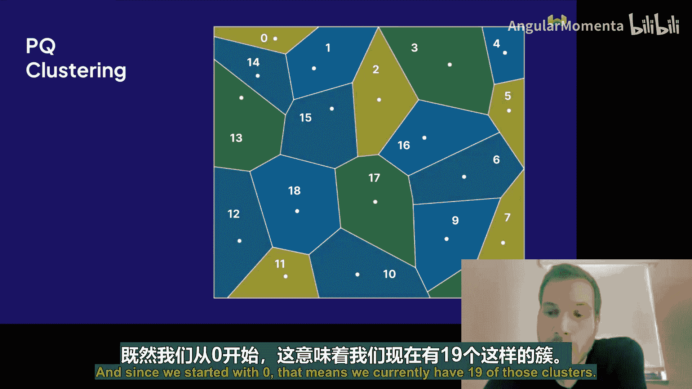

In reality you probably want a number that makes more sense than 19 so for example。

 if you use one byte that would be an unsigned inteter with8 bit so that would give you 256 options and that is if we think about the next step of what we want to do with those clusters that probably makes a lot of sense so in real life you wouldn't have 19 but you have。

 for example， to the eighth power options which would be 256。

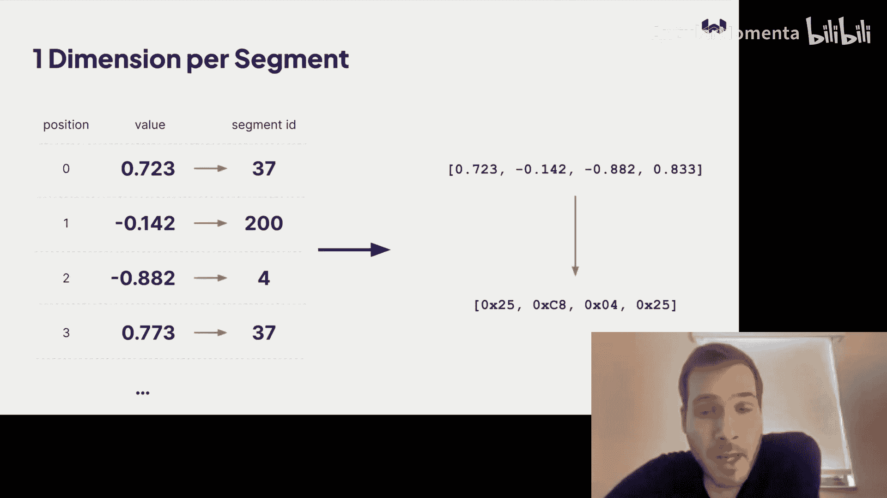

Now how does that help us so if we just pick every single vector and we say like hey。

 we assign every vector to one of those those clusters。

Then we just have 256 options so for a data set of millions or hundreds of millions of objects that's not a lot of diversity so we need kind of more than just 256 options and what the PQ algorithm does which I think is super smart let me see I already click next but the next slide is not loading so let me maybe try again okay what it does is it splits our continuous length vector into individual segments and then instead of assigning the whole vector to one of those clusters what we do is we assign each segment to that cluster。

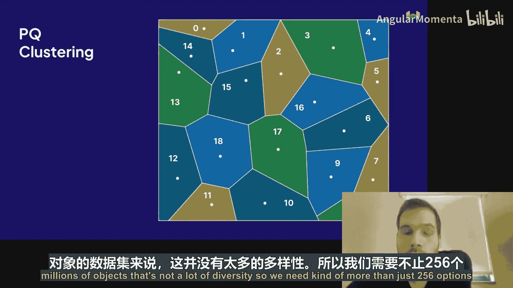

So with this sort of fictional fourdimenal vector here could be way longer but it's easier to fit it on slide if it's just four dimensions we would say for each of those segments and we have here just one dimension per segment which basically means every segment is just one float we do a similarity comparison using the same similarity metric that we would use so this could be like cosine similarity or dot product or something we use that to define what is the closest of those clusters and then that would be some kind of a number now you'll see why it made sense to encode this in something like a byte。

Because now we have one of those 256 options for each segment。

Wwhichch means that our fourdial vector which was four floats previously can now be represented by just four bytes。

 so even just by by using one dimension per segment we could kind of reduce this from yeah 32 bits to 8 bits per dimension while keeping the same dimensionality and obviously this is a lossy algorithm right like we're now using a byte to represent this information that previously was represented in a float so we lose some information but also we just gained 4x compression。

And we can take that one step further。By not saying a segment is just one dimension in our vector。

 we could say a segment is multiple dimensions in our vector so for my slide it was easiest to do just two in reality what we would see is like six or eight works really great on something like open AI embeddings and I would just do the exact same thing instead of doing a comparison on a single number。

What we would do is do a comparison on that like mini sub vector basically， so from position0 and1。

 we would compare that to position 0 and one off our 256 clusters。And then in this example。

 this would mean that 83 is the best segment and then same again for position2 and3 so now what we've done we got the 4x compression from using bytes instead of floats。

 but also we use two dimensions per segment so our final vector is now only half the length of the input vector so all of a sudden we now have8 x compression and again。

 same same sort of caveat as before because we're sort of putting more information in fewer bits we lose some accuracy。

And if this is all that you do。Now you see one of those sort of graphs where like the top left corner would be the ideal scenario that the bottom right sorry the x axis is query time in the y axis is accuracy so you'd want to have as little query time as possible in as high recall as possible and now you see if this is all you do and I need to move my zoom thing again because it's covering the legend you see the number of dimensions per segment and you can see if you just do it do the 4 x just the sort of float to byte it still fairly accurate but if you do two dimensions per segment or four or8 accuracy starts dropping very very rapidly。

And this is only on I think the SiF data set which is just 128 dimensional but it gets worse if you have higher dimensions so from this alone you could kind of argue that this is not really too usable because like 80 prints into accuracy or so is too low like typically what you would want is I don't know in the like high 90s。

 9798 or so is typically what users tend to be happy with。So what you can do is。

See new graphic you can simply fix this by overfeing a bit and great thing that we talked about tunable parameters in H andSW because what we do in H andSW just for to overcome the the inaccuracy of H andSw is we overfe so we talked about this EF parameter before where you would you would sort of keep 128 candidates even if you're only looking for the top 10 results and if you do that with PQ and then you use your candidate list which is still a tiny fraction compared to the entire data set but if you use those 128 candidates and now you load the。

The original uncompressed vector from disk and just within that top 128 you start reranking or rescoring based on the actual sort of distance you can actually get quite close to the accuracy that you had before so what you can see is here so so sorry this I took those two graphics from like two different block posts and they' they're kind of saying the same thing but in a slightly different format so in this one we actually have the accuracy of the x axis so further to the right is more accuracy and on the Y axis we have。

We have the throughput which I guess you can use a sort of a similar way because this is done single thread it so it's kind of similar to the latency so now actually the top right corner is the ideal scenario and what you can see is that for almost every sorry the question or。

No okay what you can see is that for every value that we have on the blue line。

 which is our uncompressed control compared to the red line。

 ignore the orange and the green for now for every value that we have we can actually find a point on that line where we have the same accuracy just at slightly slower throughput so if we take。

 for example， the 0。95 because I can use my mouse if you take the 0。95% or sorry the 0。

95 is 95% accuracy then we can say if you want 95% accuracy。

 you could either do that uncompressed with I don't know。

 320 or so QPS or QPS just queries per second so throughput measurement or you could use the compressed one and this was done with 6 dimensions per segment so that's a 24 x compression of the vector space you would get all those memory savings and all you would have to drop is to maybe 270 or so queries。

Second， so that's a pretty good trade off like you would， I don't know。

 lose like 20% or so throughput。But all of a sudden， you gained a lot of。Again。

 a lot of memory savings or reduced memory savings， yes question。Yeah。

 so you said the quantization that accuracy gets lower。

 but I kind of lost you what exactly overfeing and rescoring does to mitigate that。Yeah。

 so the idea is。Because you have these this compression you kind of add some distortion to the actual distances。

 so you're not comparing the real distance anymore but youre kind of comparing like approximate vectors so also that makes the distance comparison approximate and if you combine that with H andSW for navigating the graph it's actually still quite good like you can still navigate the graph with compressed vectors because sort of having a good enough thing is great to sort of get you in the right direction but then if you calculate if you just stop there because we had this distortion we were kind of so close but actually our true top 10 or maybe in I't know position 141819 or so so there're still within that slightly larger window that we retrieve but if we just cut it off after 10 we actually have I don't know the true position 1724 etc so what we do is we take that whole list which is。

In our case， 128 examples， which is still a tiny， tiny fraction of let's say this was done on of this actually was done on a million vectors this graphic right here。

 so having to load 128 vector embeddings from disk。

 which of course something that can also be optimized for and rescoring them sort of bruteforcing the true and nearest neighbors out of 128 is still a fraction of the computations that you would have to do if you had just taken that entire data set and sort of brute force it not just this is a fraction of the calculations。

 but also to even be able to brute force the entire data set。

 you would either have to have the entire data set in memory。

 which sort of means you also lose the memory savings。

 or you would have to sort of stream the entire data from disk which would make it way slower because now you're talking I don't know。

 16 gigabytes or so like even with a fast SSD just sort of streaming that you'd probably be disc bound before you would be CPU bound in that scenario。

Does that answer yes， thank you。W Martin are you able to unmute yep， I can。Okay。

 yeah there we go Okay two questions， but they're both related so'll ask at the same time first under the assumption that quantization is generally going to be data set dependent in some shape and so if you add or remove elements。

 the optimal quantization boundaries is going to change。

This also will now impact how much you want to over fetchtch， so two questions。

In your view or in weiateates in general， how do you feel about creating a huge overfetched boundary。

 so let's say you expect maybe the top 10 to always be in top 17， 25 etc ce。

 you just shoot for top 50 and you never have to rebuild the index。That's question one， question two。

 if you do start noticing I guess how would you track this deterioration of quality when you're like。

 okay， that has changed too much， we now have to recalculate our entire index so how do we balance all of these things with the constant evolution of the data。

Yeah great great question so maybe to start with the the first part is you do it is data set dependent that is that is correct and you do need some kind of a sample to to come up with a good quantization。

Model basically so what we see in practice is if someone has， let's say， a billion scale data set。

They would import a small fraction of that， so maybe a million or so objects and use that to fit the model for the entire data set。

And that is surprisingly often already enough so that that doesn't sort of take the data shift over time yet into account。

 but it just means like you don't actually need your full data set as long as you have sort of some diversity in the data so that you don't but like the worst thing that you could do is basically if you would let's say if your data was nicely evenly distributed across this 2D space。

 but somehow you would import in an order and you would first import all the points that are just close to the bottom left corner and then you would fit your PQ model based on the bottom left corner and then you would sort of import the rest that would be a pretty bad model but if you have。

Sort of sampled points that represent the entire space。

Then the only drift that you need to take care of is sort of。If the whole space drifts。

 which is less less likely so in practice。Just sort of overfeeting a bit more or sort of overfeting in general can go a pretty long way。

That's it。And then this is， I think your second question of how do you measure it？

That is a pretty difficult one to answer because with these sample data sets。

 it's super easy because you can just rootte force the true nearest neighbors one and then you can just compare your recall by just looking at。

Yeah your approximate ones words the real ones with real data that's a lot more more difficult so one one way to do it would be you could occasionally do like sampled brute force comparisons and just see like does your your recall drift over time and that could maybe be a good way to identify like okay now it's drifted too much and now we need to do something about it。

All right， yeah， that was fantastic， thank you for the insight。

Awesome thank you Okay i'm also noticing that we we're approaching time I think the PQ section is done I would have another section on multitenancy but I don't want to go like even even more over so this could be like I don't know follow up next semester or so if if yeah if everyone is happy with that。

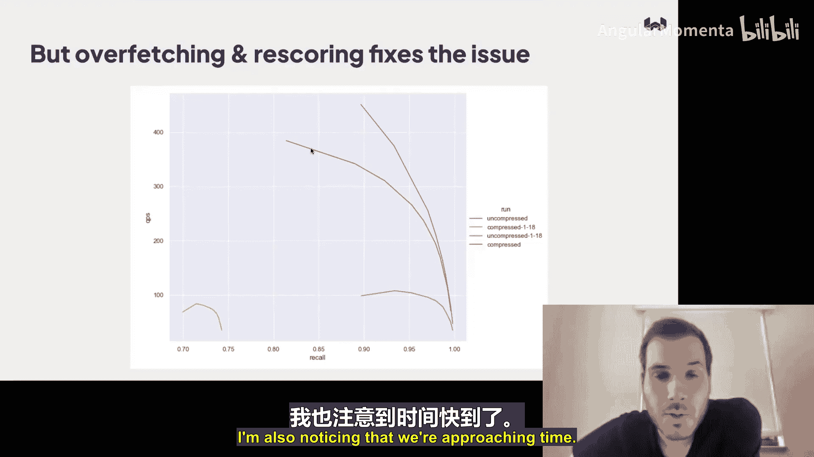

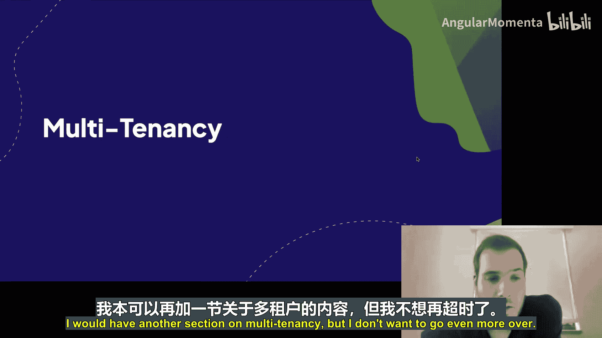

Yeah， I mean， we've got probably time for。One or two more questions from the audience if we've got if there's anyone else who wants to unmute。

Yeah I have a question ETn you guys are at the bleeding edge of seeing some of these emerging applications。

 does there a locus of application categories that tends to dominate what you're seeing is it like。

Text search reimagined with through the lens of vector search or is it all over the place I feel like both like it's on the it's all over the place where we see this like wild idea So so something like I had a question in a panel discussion get other day about agents where I said I'm super bullish about like autonomous agents not because I believe that we're there yet。

 but because the potential is so great because like whenever ever since I I first of us like what is what is these agents things like new thing that now popped up out out of nowhere now a new thing to sort of look into but once I sort of got the general idea of agents just being。

Any kind of automation that can replace sort of more complex human tasks I all of a sudden see use cases for agents everywhere right now so I don't know flight got canceled。

 you get off the plane help deskk has a long line because 300 people that on the plane allll need to go to the help desk I see like oh that's an agent problem in the future so that's what I mean with they're all over the place but at the same time when we're looking at sort of more moving into production we do see a pattern of so stuff like sort of aiding support is super common in the RA use case so search through my knowledge base and just have either a chatbod or if it's not supposed to be conversational than just a better search on yeah whatever the knowledge base documentation these kind of things document understanding I would say is also kind of in that direction of like we just have too much data for human to browse through and we need to sort。

Summarize it， but also identify what the interesting parts are。

 then retrieve stuff that's related to those interesting parts of where we quickly get into that vector search category and I would say out of the use cases that are moving in production。

 these would be the most common ones。Cool， thank you。

I'm going to ask one question we've asked through the seminar series this semester of sort of what what is。

From your perspective。Your biggest unsolved problem like if you could wave a magic wand and just solve one thing that's just really challenging your team do you have an example or an answer for that yeah so one thing that we see across the category right now is and you can even see its sort of in those graphs right here we're always talking about like throughput and accuracy tradeoffs I think no one right now has a good solution for people who say I don't actually have high throughput requirements but I have a massive data set but I only send like one query a day like I'm not going to pay the compute for supporting tens of thousands of queries per second if I send one query a day but I still want these insights into into the data set and then I think sort of the natural knowing datas and knowing what's happened in the space like I think that the natural progression to that would now be we need to talk about a separation of storage and compute kind of architecture to potentially go in that direction where you don't pay for idle infrastructure and that's。

I think harder with vector research because you have these like massive monolithic indexes。

But also this is something I think that to be able to really serve all use cases。

 we need to challenge that idea and I think we need to rethink and we're doing some cool research。

 I think right now to look into those use cases as well to make。

 in a sense that you could argue that it's just making vector search cheaper。

 but I think it's not just making because like compression for example makes it cheaper。

 but it's still an architecture that prefers low latency and high throughput。

 but I think there's so many interesting cases。That just have massive data set sizes and like sort of the more analytical use cases in nature。

 and I think analytical vector search， maybe to put it in a way is a super exciting topic is not solved yet。

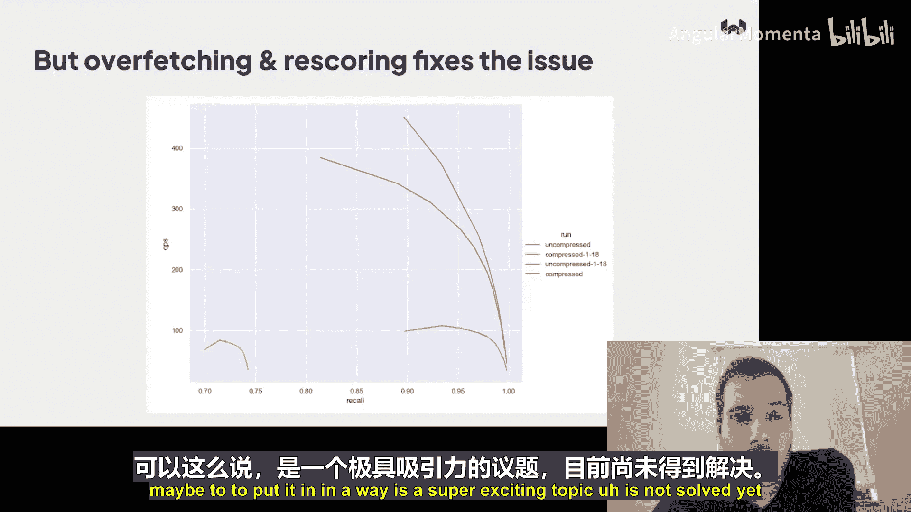