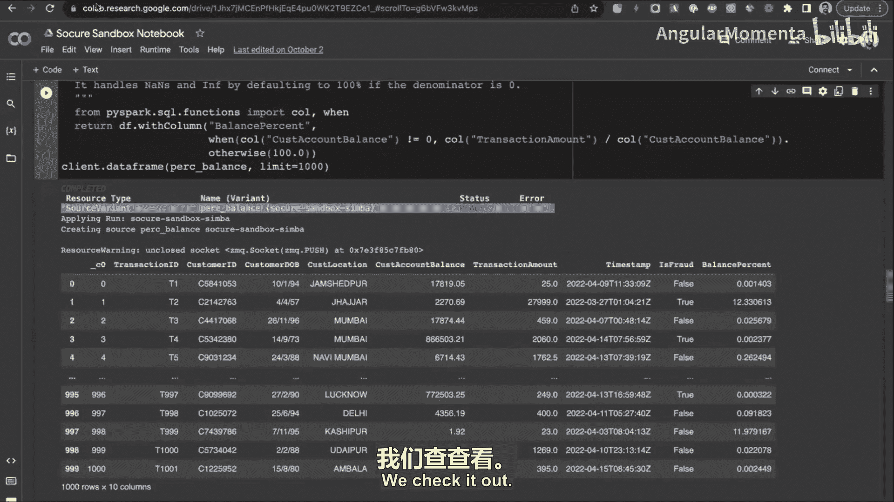
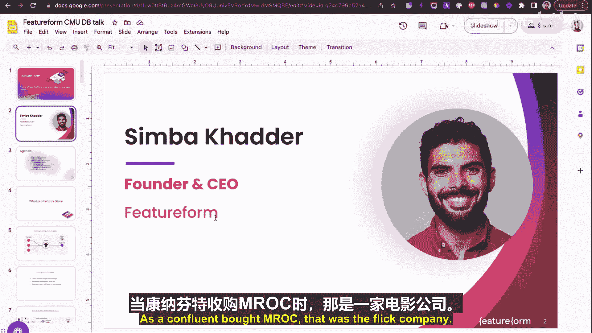

# 【卡内基梅隆大学】机器学习与数据库系列研讨会-｜-ML⇄DB-Seminar-Series-(Fall-2023)-p05-05-FeatureForm：特征存储架构与技术挑战--BV1zpiWBHE5k_p5-

🎼The databases for Machine Learning and Machine Learning for databaseases Sear series at Carnegie Mellon University is recorded in front of a live studio audience。

😊，🎼Funding for this program is made possible by。🎼Ggle。🎼And from contributions from viewers like you。

🎼Thank you。Okayi guys， welcome to another seminar from Car Man Datas Group today we're excited to have Simon Qdar he's the CEO and cofounder of feature Form。

 the virtual feature store company so he's here to tell us all about what a feature store actually is and how to build one that makes that can scale so as always if you have any questions for Siman is given this talk please unmute yourself and fire away at any time would this be a conversation for him and not talking by himself for an hour and with that Siman the Florur thank you so much for being here with us。

😊，Of course， yeah， thanks for having me Hey everyone。

So today I'm going to be talking about feature stores it's kind of one of those concepts that gets hyped up a lot。

 especially in MLOs and kind of ML infrastructure but。

Think there's kind of a fundamental what is this thing question to be answered and how do you build one so i'm going to really dive into that i'm going to dive into the different types of feature stores and really try to define what a feature store is I'm going to keep it more technical just for give an audience and i'm specifically going to highlight a few technical challenges that we had to overcome and how we overcame them specifically。

Feature like the way feature form is built， it looks more like an orchestrator and the thing about orchestrator is it's not typically like there's one。

Super hard problem to solve as much as it's kind of deaf by  a thousand0 paper cuts。

 there's like many， many， many problems to solve and how do you get all those things to work together and build an architecture that kind of scales to all the different possible use cases that people would expect to use some sort of orchestrator。

嗯m。And yeah I want to keep this interactive so I'm going talk about a lot of different things I'll leave spaces in between the sections and I would love to answer questions about anything I try to keep it in depth enough to give everyone good information and context if they want to keep going by also decide to leave it just one step above how deep I can get just so I can let you all choose where you want me to zoom in。

So I'll give a quick and myself， I'm Sba foundunder and CEO here at feature For。

 I this is my second company， I was at Google before， my background in software engineering。

 I worked on distributed systems。My last company I built a recommender system that powered about 100 million monthly active users and the law of the ML infrastructure that we built there actually became the foundation of what is now feature for。

So agenda today， we'll start with what is a feature store， start of the basics。

 whether we you know what is this thing， why is it useful， why is it exist。

 it's kind of whenever building a data system it's really I think people get really caught up in the tactful details and sometimes you can forget about what's the problem we're solving here anyway。

Three types of architectures， there's three different approaches that the kind of ecosystem has come to and how to solve this。

 we'm going to break all three of them down specifically talk about the architecture we took and why we took it。

I'm going to deep dive into four specific technical challenges， one is streaming and backfill。

 two materializations。Job state and orchestration， which is kind of more the architecture of what future form is。

And finally， monitoring concept drift。And I would be amiss if I didn't add just a small little section on LLMs and RAG。

 given the general hype in the space， but I know there's a lot of talks on vector Ds that already happened and that are going to happen。

 so I'll keep that part brief and really focus on the things that are unique to our system。Great。😊。

Well as a feature story。So。When I say feature， you can think of it not like a product feature。

 but rather like an input tool model or a signal。Some examples。

 you might have the user's favorite song in the last 30 days。

The stores as store' top selling item in the winter average price of all items in the catalog。

 these are all examples of features you can think of a model almost like a black box that takes inputs or signals。

And generates an output or a prediction。Now a lot of what data scientists do in practice and data scientists are end users。

 they are oftentimes feature engineering， which is the the。

Kind of constant iteration on signals to come up with better signals to build better models。

And the way they do that is they work in their notebooks， it' usually kind of a mess。

 they work with lots of different infrastructure， they create lots of day transformation which eventually becomes these signals。

These are common problems I'm not going to dive too deep into these is because they're a little less technical。

 but I just like to throw these in。So these are common kind of workflow problems that we see and I think it's just as building。

A system like this， I think it's really interesting to see a lot of companies got really。

Caught up in the technical parts of how do we make this thing performance and there's almost this higher level problem or workflow problem。

 which is often overlooked。And we spend a lot of the time thinking about what's the correct API。

 the correct workflow to really get the system to work seamlessly for a data scientist。

Some other things which may or may not look familiar。To you。Great。So final kind of。

The context before I really start diving into more of the tech and the technical details is that it's actually it's fighting data scientists I think there's sometimes a little bit of fighting to get them to agree that hey maybe you shouldn't be deploying notebooks in the production especially if you're a giant company and you know your whole recommender system depends on this notebook you put together I think for this audience I think will be very clear that you know that's not you should deploy things in the production so there's typically this fence between production and。

Call it like offline iteration。And what happens in practice of lot companies is that they will actually go and take these notebooks and essentially rebuild them from scratch。

Into what is the production workflow？And what happens to today data scientist's perspective is they'll come up with all of these features。

And。Then there's this huge blocker。How do I actually get this thing in the production？

The problem of getting things into production is a few parts。One is that。When you are experimenting。

 it's common to use a sample， it's common to use really unscalalable patterns， it use pandas。

 you want your laptop， but when you actually go to move features into production。

You start having to work with actual data systems， you start having to deal with streaming data。

 you start to deal with batch data， you start having to deal with on demand features。

 which are kind of like story procedures。And all this stuff fits together to build the signals at production time in a wave of this very low latency。

And。Yeah， is production grain， let's call it。So things that are not problems。

 things that we have kind of we don't solve， one is we're not trying to build a better Reddis。

 we're not trying to build a better spark。We don't really view that as the problem to be solved。

We're not trying to make everything streaming， stream processing is a specifically hard piece of this problem。

 which I'll get into。And then finally， I kind of view the name feature store as a misnomer。

 there's a whole category and every single cloud has a feature store。

But when you think of feature store， if you use feature in the way of defined it。

 you just think of as， oh， cool， a place to store features。In practice。

 or a feature store ends up looking and working or how we think of it rather， which I'll get into。

 we don't really think the problem that needs to be solved is a new type of database to store features。

The problem that we see， the way we think of it and the way we solve it is much more looks much more like an orchestrator。

It's taking your data infrastructure， your compute， whether it sparkar， your storage， like S three。

 any other pieces you use。And applying an application layer above it。

 which provides a single source of truth of resources you can define these things。

An easy way to collaborate for data scientists， monitoring and alerting and governance。

We need the ability to build every feature， every signal I create。

 I need to be able to use in training and in inference and that's a very hard problem。

 which I'll again break down soon。And finally， just having a nice declarative API to work with us and some sort of dashboard to really be able to understand what's happening。

 do monitoring， etcter。I think。The。The name feature form。

 like when we build features form internally， what we really wanted。Was terraform for features。

And so the name feature form is literally a it's not to terraform like I wish I had terraform for features so a lot of what you'll see in the architecture choices that we make。

May or may not remind you of terraform because in practice like a lot of what we're doing is very similar。

 the key difference being that terraformers bringing up infrastructure and we're bringing up essentially data pipelines。

Cool， any questions so far， that was more of the high level overview。I think we're good。

There's three types of feature stores， so I'm going to talk about the three kinds and the three architectures that companies have come up with。

One type of architecture is what I would call the literal feature store literal because it's literally where you store features this is the kind that you if you've ever used a feature store you are most likely to be familiar with。

The most probably the most widely used feature store that exists。

 which is actually changing pretty quickly is a product called Feast， which is an open source。

AWS SageMaker has a feature store， vertex has a feature store。

 Azure has its own feature store now Data breakricks has a feature store。All the cloud providers。

More or less copied feast because Feast at the time was one of the first feature stores and。

They view it as the most commonly used， it was the largest open source player。

 so they kind of dised it and built their own cloud provider around it。

The approach they took was to have the user build their own signals， iterate on them。

 and then finally store them in the feature store。The value here is that all the features。

Are unified for training and inference。For inference。

 you need to have the most recent value of a feature with very low latency serving， for example。

 if you're building a recommended system for a Spotify you're making a music recommendation。

 you might want to know the top song user listen to。In the last， I don't know。

 their favorite genre in the last 30 days。So you want to maintain up to date cash。

Of that value and that's what's stored in the infant store。On the other side。

 there's the kind of the training bit， the offline store sometimes it's referred to as， which is。

Where the training stuff lives and what makes that hard is that you need to maintain a historical log。

Of feature values because the feature values are constantly changing。

 but when you're training you're kind of rewinding time。And going to different things that happen。

 so maybe for example， you'll go through all of my spotpotifyly history。

You'll say simba listen to this song from the red hot chili peppers and what were you know these X feature values at that point in time so you actually have to remindwind time。

 build the features that they would have appeared at that point and then zip those together with the label to train the model what that looks like again you'。

Database people so the idea of a CDC will be very familiar to you so in practice what it looks like is you have a CDC and a materialized up to date version and the materialized version is inference store and the CDC kind of strain is offline store with the CDC you're much more focused on throughput you're much more focused on correctness but the inference store you're much more focused on latency。

The problem here。Is iteration。This works really well if your features don't change， but in practice。

 data science and machine learning is a very iterative process。And in that。

 youre constantly changing your transformations and because the features are being treated here as artifacts that come out of the transformation pipeline as opposed to being tied together。

 it kind of creates this disjointed feeling between both sides。In practice， if you look at Uber。

 if you look at Airbnb， Airbnb has a product called Zipline， Uber has a product called Michelangelo。

 theres multiple others， like Pinterest has Galax， Facebook has parts of FB learner。

Almost every internal feature store that you see at a large company is actually going to look like what we would call a physical feature store some people also call this a feature platform where you actually tie together the transformations and the storage。

And what that。The benefit there is that it。As you're iterating。

On transformations the transformation is deeply tied to the storage so rather than iterating on like kind of hey。

 I have this artifact that's stored I can really easily serve for training and inference it's as i'm iterating that artifact is automatically the maply being updated。

It also solves other sets of problems， which again。

 streaming and other things which I promise I'll get into momentarily。But I think the main。

Takeaway is like a lot of these companies have solved this problem of building。

 allowing data scientists to define features in a way that works in production and a way that can be used in training by allowing them to work in this kind of new type of database system。

 which is typically actually backed by more generic providers like Spark。

And allowing them to work in their own framework and having the framework be smart enough to automatically。

Fill the In store and offline store。Now， the part that feature form did was what we call the virtual feature store architecture and the virtual what it comes from is when we would go to。

Our users in the early days， especially。The idea of them actually rehousing their data onto a new platform that we owned was kind of an insurmountable thing for them because when you go to a company like。

 let's say， JP Morgan，And you tell them， hey， you have all of this data。

 you need to put all of it through our physical feature store。

It's going to be transformed and it's going to be stored there。And。嗯。

It's a hard sell it's a hard thing to convince a large company to do what we realize is that actually one most of these companies have something that looks more like a data mesh in the sense that it's heterogous infrastructure that is spread across many different teams。

And two that the main problems to be solved are much more of an orchestration and kind of an application layer problem。

 having a single advisor over this whole set of infrastructure as opposed to actually building a vendor Sp。

 which is what a lot of people set out to do。And so that's why we came to this approach of why don't we act more like an orchestrator and perform a lot of the kind of unique operations that exist for。

For feature stores， but apply them across whatever infrastructure they have now the con here is that we need to build infrastructure or interfaces rather that are generic enough to work so if you use Kafco or if you use P or if you use spark or use snowflake or use postgs or all three。

We need to be able to work in a unified way across that。

 maintain a level of performance that they would expect。

 at least in the same magnitude of what they would expect without feature forms。

 so we kind of have to act like a zero cost abstraction。

While performing all of this and because we don't own infrastructure。

 you can't really take full advantage of every single tweak you could do if you just were running on。

Kafka， Spark， whatever。Maybe you'll get into this， but like the。

So if you're not hosting the data itself， what does an orchestrator look like is it like a little Docker file that they run on their network and it phones home because instructions on what they do or is it air gap enough that it just runs by itself？

It's air gappped so it runs in Kubernetes we're Kubernetes native and I'll get into like the architecture we've taken more depth in a few slides it so be my last kind of overview slide of just the let's call it the ecosystem before I start getting into some of the technical problems but I so want to make sure you all kind of have context on what this thing is when I start talking about problems that we solve it's not kind of doesn't sound random but is there that's a great question i'm definitely going to dive into the architecture but its any other questions。

Thus far many？好。If you do， please feel free to interrupt and ask。Okay。Let's talk about one of the。

 I would say， probably one of the most challenging problems that future store companies face。

Which comes from streaming and backfill。So we talked to our production features and I'm really going to dive into the top left here。

 the streaming features。So streaming features have two things， let's say。

 a few aspects that make them unique。One。They are typically they can be pre processed what that means is。

Some features you would。Take， let's say。A user's comment and you chop it up in some way to remove the softwares or something。

That would happen at inference time so we call that on demand feature you wouldn't call that streaming feature because it's actually happening at the time of the request streaming features are typically things like。

Users favorite song or let's say the last five songs you to listen to that would be a streaming feature because you'd have a stream of data and you'd be constantly generating the value of the future。

 that value would be constantly changing and it' would be changing fast enough。

That doing it in batch like on an hourly cadence or a daily cadence would not work。

 it wouldn't really capture the value of that feature for things like last 30 days and those sorts of windows。

Though you could do the streaming and you could obviously argue that streaming is actually a superet of batch in practice it's not and that the tools don't make it much。

 much harder to actually do streaming as opposed to batch。That's not about why。First。

 it's important to understand the idea of point in time correctness。

The idea of point in time correctness works like this。If I have a feature。

 which is the last five items the user clicked on。I don't want to at every single time。

 let's say that this is an input to my Spotify recommendation。😡。

Think of how many recommendations Spotify does just for you when you open app。

If they were to go and query your historical values and do kind of a query at that point in time。

 chances are it would be far too slow， especially if you're doing anything more like taking some sort of aggregate。

It would be really expensive it would be very slow and in practice if it takes a long time for your recommended songs to pop up it will have a very direct effect on stickiness which will actually have a direct effect on revenue so there is kind of the whole business case of making this really quickly so in practice all of this stuff gets pre processcessed。

So that's one piece is that you need to have the point in time of the feature at inference time needs to be now。

 so maintaining that the other point in time correctness that's really important is historical correctness。

 which is that the way a model is trained。You have a set of labels。

 so let's say that I'll use the same example where or let's use a different example。

 let's use an example which is fraud。So I have a transaction which is fraudulent。

I'll name this as a label and let's say the user is user A。So label Y is true。

 this transaction is fraudulent。I might want to know。Let's say have a feature X。

 which maybe is how many items。Or what's the average？

Value of items that the user has bought in the past 30 days or last， you know。

 over the last five items， whatever。That feature is going to be constantly changing in value。

 but what I want to do is to be able to generate。嗯。😊。

The feature as it would have appeared at that point in time so again it's the idea of building almost like like a CDC stream like getting all the changes in feature values at the points in time that they changed and building a log of all those feature values over time so that I can zip them together with labels and build rows like training rows as they would have appeared because from a training perspective you want the model to almost be unaware if it's being trained or not being trained in the forward pass so you want to be able to give it features as if they would have appeared in production to really do training correctly。

Now。How people used to do this historically。Is they would actually build two separate pipelines。

Which is really， really errorprone， as you can imagine。

 where they would build a whole pipeline in batch， let's say we're using Sar and they would build these features。

And then。They would go hand out over to wall to a ML engineer who would take that。

Batch job and essentially convert it into a streaming job。There's a lot of problems that come up。

 but that one for example， is that sometimes those jobs might have， let's say。

 a seven day aggregation window。But your stream， if you're using something like Kafka。

 you might not have a attention period that is that long。

 so you have to wait at least even after rewriting the feature。

 you still have to wait n number of days before you actually have enough data to actually start outputting features。

Two is you might come up of this idea。You might train your model on it。

But your training set is kind of frozen in time。And you have this like new values that are constantly being generated that may be changing。

Maintaining that correctness， doing that monitoring just's kind of a set of problems that come onto that which i'll actually talk about later how we solve that。

 but I think in general it' just this idea of what would be amazing。And what？

Kind of one of the promises of feature stores is unifying that streaming and batch pipeline。

So that as a data scientist， I can build a feature and I can know。

 or I can essentially that feature is deployable， getting back to my old point。

 how do I deploy a feature when I define my feature in this framework。

It will work in batch and it will automatically kind of remain updated as new data comes in。嗯。

The final bit I should probably add is that in practice。

You could be iterating constantly on features like you might come up with 10 to 15 different types of features just over a few weeks span。

And you want in that time period。To be able to test all those things and no joked away Twitter like a few years ago released pretty much how they used to do it and what they would actually do is they would come up of 15 features。

They would deploy them or send them to number team to deploy they would wait like 60 days to receive back the training set so they could actually train their model and that's kind of the iteration cycle so if they would just like keep trying things over and over again and then 60 days later they would get back that experiment that they tried 60 days ago then they could finally test it and as you could imagine this has a huge effect on your ability to iterate especially if you find out that hey。

 this is a really good idea and all these other things I've been spending time on sort the last 60 days are now irrelevant because the first thing worked。

So how do we solve this problem let's get into like the technical details so like most things in distributed systems。

 the solution is a log。And the reason why the solution is a lot is a log has an interesting。嗯。

Kind of affect to it。That if you take a log， so a log just so I define what the log is a log is a。

You can think of it almost like a stack where there's a first event so everything kind of has a time period you canend only it's an append only operation on it everything historically is immutable it's like a ledger its another way to think of it。

And the cool thing about the law is that you can never change historical values。

What that means is is you can freeze a log at a point in time if I cut it before those two events come in。

Everything before then will never change。If you only read from the top。

As events come in and you ignore the previous bits， it looks like a string。

So it's almost like it works like a batch data set and a stream at the same time。

 depending on how you look at it。And that's kind of the trick。And it sounds simple。

 but again like I'm going to talk about how do you actually do this， which is a much harder problem。

 but the idea is more or less that when I generate a new feature，Especially one that's stateful。

I will run a batch job， I'll freeze the log。Best process to whole thing。

I will then stop my batch job， save the state， run a streaming job at the last event or as the last event I was coming in and I will continue to update my inference cash and maintain a log of or again like a CDC of all the feature values that I get created as this image shows that was I here and was here every single time there's kind of one possibility so historically when I built I built a few feature stores in my career and when I was able to own infrastructure which is not a luxury I have a feature form because we're virtual。

We actually use Pulsar。And the reason we use Pulsar is Pulsar has this neat characteristic that they separate out long term storage。

From the message broker。So they without getting， I guess。

 too deep into how Par works unless you don't want me to I' happy to。

The way it works is it kind of chops up。Streams as keep if you set infant Earth tension。

 it will build that log like I described。嗯。And what it will do is because it knows that the historical values are immutable。

Over time， it will kind of chop them off。Into a segment and it will actually offload that into S3 or GCS or HTFS or whatever you decide to back it upload。

And what that means is from Flink's perspective， if I on a fllinkt job。

It actually kind of looks like this perfect stream that has infinite retention。So when possible。

 which really the only， so my understanding is that confluence。Kafka。

 which is the kind of the paid kind of creatorator of Kafka， they have infinite retention now。

But open source Kafka does not and the reason that it does not and the reason why it doesn't work is in theory you could right you could set the parameter to be like so long that it essentially is infinite。

 but in practice the architecture of Kafka makes it such that the messages live on the same no as the broker。

And because the data or just stream size just grows indefinitely。

You would end up having to create a massive number of messages even if you don't or a massive number of notes。

 even if you don't actually have that much events going through the stream。

 so what you end up doing in practice which I'll show is that you kind of reverse engineer what Pulsar does natively to make this work。

But that's the trick the trick is more or less to treat a stream as a log。

 maintain infinite retention， treat any transformation you have to define your transformations in a way that they can be run both in batch and streaming and if you do that then what you can do is you can freeze a log run the batch job so if fl what I'll do is I'll in Pulsar I'll get the last message ID。

That I see。And I will run a big job because in practice' way more circle data than there is data coming in and I don't want this massive batch cluster running for when I'm just doing stream jobs or streaming events as they come in so I'll create this large cluster I'll process the frozen part of the log。

And then。What I'll do is I'll do this handoff to streaming。

Where in practice while I was doing that batch job。Um。New events will have come in。

That have notprocesed and will actually be in the log so i'll maintain a message ID I'll pass it to my streaming job my stream will go back in time find that event that first purple event and start its stream processing from there so that's kind of the trick there's this almost like really this dance that we have to coordinate across the batch and stream it's much more easy to see when we have to do it with Kafka because in here we can't pretend that Kafka is building an infinite log。

What we do here is as events go into Kafka。We will write them to S3。

So that we have a historical log of events。We will also process all incoming events into Fllinkk。

It can also be spark， I'm just using Flink and Spark and this example to create a differentiation between the streaming job and the batch job。

This is the kind of the steady state， so this is the state when the job is already like this is a feature that has already been created all I have to do is keep it up to date as new events come in。

Now， let's say as a data scientist， I'm like， hey， I have this idea for a new feature。

 which is I want to know， I'm again， let's say we're Spotify。

 I want to know the average beats per minute of a song you listen to。

Well now I have to run this big spark job to go through all the events that the users for every user to generate this feature value and also generate the feature value at different points of time。

 it's not just like the current values， but what they would have been after every listen。

Then I would do that handoff， like we talked about to coordinate to a streaming job because if I do deploy this thing in production。

 I need to maintain that feature value in different store。So that。

Lots of the reason why the feature store problem exists and why it's so hard is actually because of how this kind of。

Bymodal nature of training versus inference and this requirement of having historical feature values。

 This would all be resolved if。Theoretically， there was some way to build if Spark natively could do。

Streaming batch unification where I can build one job and run it across both modalities。

Then I would be done we wouldn't have to do this ourselves and there's been many approaches to this like for example。

 Apache beam has something called theputable do function。

 which is an approach of doing this in practice even though this is like a known problem and it's been kind of an open problem for a long time it remains unsolved。

And the best approaches like that really the approaches that most companies go with is actually just doing something that kind of looks like this just almost。

 I mean I built this and even building this it's kind of a hack like it works。

 but it's just what would be really nice is if something like sparks natively， but they don't。嗯。

Questions。Yeah， Simba， I have a quick question， this is Jgnesh Patel。

How big does a feature store get when you see in the larger end of the deployments。

 do they tend to be。They look a lot more like OLTP systems， small relatively small amounts of data。

 lots and lots of updates， queries on version numbers time。

Or do they tend to get much bigger they get huge this is actually maybe part of what makes it strange is if we go back to the architecture。

It's like that inference store。Is an OLTP system， but the offline store is an OLAP system。

But in practice， I need to make both of these things kind of。

 I have to maintain consistency across both of these systems and make it so I can define one transformation that is both used in the offline context for training。

 which is an inherently kind of asynchronous long-run job。

But I then need to be able to use that in a transactionally at in a production system。

 So it's both and the off everything I talked about with this kind of。Batch traininging。Like the。

Bat job more or less is run in an OLAP style context is a massive data set。

Where the streaming job like in practice， it still， I mean， depends on the size of the company。

 but it it looks much more like a typical production grade transactional system。So in the big bank。

 let's say on something important like fraud， are we talking terabytes or gigabytes in the feature store？

Larger than terabytes larger than terabytes got it because they're keeping a lot of versions going all the way back to be able to log and see what infferencing mechanism they might have used in the past because they cant age it till whatever is their policy right that's where the size of data goes up because you could travel so much more them back in time。

Yeah， so in practice what companies at that scale will often do is they will sample things。

 so we still have to process at all， but we might not put all of it into storage or they might actually do a hard cutoff or we don't care about events like they will never make an there's a generic cutoff in the window size which it will never be more I'll never train on data that's older than two years old。

And then you can ourselves we can just never we can just let that stuff it's almost like a TTL so there are many techniques that exist and even when they do process at all。

 the actual training step is very expensive， much more expensive oftentimes than the actual generating of the features。

And so even if you generate two years worth of features。

 you might actually do some sort of smart sampling and the other curation。

 so you only actually train on 5% of that data that is more like most likely to have an effect on。

On the model itself。Wait， then one more question related to that and you could defer it。

What's the definition of feature because it could mean something as simple as a measure or a metric to the entire code pipeline that generated that and if it's generated in Python then it's like what it's like the00 libraries that came with it。

How far does the definition of feature go and I'm guessing different people carried in different ways to it being just a value to actually being a reproducible code entity that connects to that value。

It's a really really great question and I think that's actually the fundamental difference between how we think of the problem versus how other feature stories think of the problem other feature stories would think of the problem as an inherently。

It's an artifact， it's the final row like the feature is the row of data and you for every feature it would not just be one row it would be kind of again like that CDC。

 it would be every value of the feature historically。I don't view it that way。

 I don't think that the correct way to view it， I think in practice a better abstraction is to define it as like you were describing like actually a pipeline。

And there is this kind of。Open question on where does the pipeline start， you know。

 like do we go all the way back to like the a kind of。

Initial stream of data that's coming from the client or do we start with something that looks more like a data mar like where do we live in that and in practice it really depends on the company some companies like for example linkedIn they have a whole data mark kind of very clean perfect data sets but the B to teams the analytics teams the data analyst they use。

But the data scientists work on ML purposely don't use that。

 and they actually prefer to have the full control all the way back from the strain so they can really make any feature they want because in practice。

Metrics analytics are a little bit simpler， for example， if you have a revenue metric。

Like you want there to be one revenue metric you know and you want it to be right whatever right means if you have 25 revenue metrics across the company。

 you would be， you know as a CFO， you might be a little concerned for your job but if you are data scientist doing M there may be many。

 many reasons to have $25 different versions of revenue because in practice with M features and signals they're kind of a means to an end they're not actually meant for human consumption they're meant for model consumption So if a feature with some weird cutoff like hey I'm going only take revenue of users who pay us more than $1000 a year that are in you know the US or Europe。

But also India and you know like you have this weird like cutoff that to a human it's like you would never you' would look at the description of this table and you'd like why would anyone use this。

 but to a model for some reason it might be the correct signal to make the model perform very well and one other thing you kind of touched on a bit which I didn't really get into but is a really really as another really core problem spaces。

I talked to a bank who， I asked them how many features you have in production and they said tens of thousands。

And it's a lot and I was like， okay， how many of those are like are those all actively used and their answer was we have no idea。

 but we don't know what we can and cannot turn off。And we don't want to see what breaks， I mean。

 the real way they would do it if it had you。Turn them off one by one and see who screams。嗯。

And there's some value here of obviously the lineage。

 but also the because we work on a higher level of abstraction。

We can decide what gets created and when we can decide what's worth caching and materializing and what's worth throwing away you know in practice。

 all of these we make it or we ask the user make technically they can。

Not do this if they don't want to just we don't， you know， you get undefined behavior。

 but we want all the transformations to be more or less pure functions。

 which means that every everything from the raw data forward in feature form should be fully reproducible。

And if you think of it that way， there's a few things that opens up one is that obviously we can turn off anything and put it back on at any time two。

 which is another really common thing is I mention a lot of times like features such as top thing user did in the last seven days it's not uncommon how the last seven days last 30 days last 90 days and in these sorts of situations we can actually be very smart about how we can process multiple features at once if we know that there's kind of just end number of window sizes so all those things come into play and again like we do a decent amount of the stuff are it's really obvious。

If we own the infrastructure， we could really like。you know。

 go into overdrive on this because we would own everything we would know everything。

 but we have to work with all of these vendors with very， very different needs。

 very different types of transformations and there's less things we can take advantage of。

Cool thank you， that was awesome， thanks for a great question。

Any other questions before I keep going？错。I'm going to touch on two parts and kind of。

Went back on floor whether I should join these or not。

 but i'm going to kind of end up joining them i'm just going to talk about the other side of this。

Which is everything I've talked about has been streaming with streaming。

 you're kind of constantly filling the online store。

 inference store as new data comes in from the stream。You're simultaneously maintaining， again。

 that log of historical feature values in the offline store。When you do batch。

 it's a little different because when batch you might be running on the schedule and typically what's going to happen or not typically what is going to happen is you're going to first。

Kind of in the OLAP style build that table into the offline store。

 but then you're going to want to materialize into the online store。

And that materialization problem is actually a very annoying。

Problem that a lot of the feature stores kind of struggle with。

The reason we struggle with it is especially if you don't own both like an R case or a virtual feature store。

 we don't get to decide what offline store people use what online survey used some offline stores are very easy to write to other online stores。

 some aren't for example。Snowflake Redis， so Snowflake is off store， Redis is online store， very。

 very common， probably second most common the most common being sparkark or Databricks of Redis that we see。

嗯。There is no native way to materialize data or copy a table from snowflake and tots。

So we have to fill that in a lot of feature form in practice was obviously the core orchestration problem。

A lot of what we do is kind of have all of these little。

Just a blue there's just all these things that add up and are really annoying this is what I mean about like the problem orchestration systems are is much less like one specific hard technical problem I would say the most close thing we have to that is the streaming problem I just talked about but a lot of what we solve is these kind of like things that are missing that people just have to kind of have to govern themselves and you end up with some insane。

Set the scripts that people have till I kind of make the stuff work what is what is that if you're going back what is the step four you have and that like what is that materialized is a bunch of upts are you just doing like copy into like what's like what does the materialization look like Yeah I mean the。

The problem， the actual problem to solve is I have。

A table of all the feature values over a set of time。

I want the most recent value of each of those features for each of those users or entities。

To be in the online store so that I can do a lookup and say hey。

 what was S's you know value of this feature or what is currently Sim's value for this feature so when I do a recommendation I kind of have this nice cache of prepros features I can use。

So that's a problem we solve how you actually solve it different companies and pros do in different ways like the way Fet does it is they just do a very kind of dumb just copy everything over up style Now when you're when we do it。

 we actually take the diF。Because in a funny way。The most expensive operation is actually the copying of data over network in terms of time。

And actually， the processing of the data in place in the offline store is not typically it's less so in practice what we end up doing is we actually maintain。

What was the last snapshot of the so we build a snapshot so we actually build a view in the offline store of what should be in the online store。

Then the first time we just copy it over， like more or less Ro for row。

 the second time we maintain the historical value， create a new value and we take a di。

And then we just copied the di。Over so we can do the minimal change to get the online store into the same state or the new state that it should be in。

嗯。So that's the approach that we take and the other approach sorry。

 is that that di is that done like server side or on the online store or you basically do that in your Kubernetes thing。

We actually do it in like snowplayake or Data breaks or whatever offline store we use。Okay。

And then all we do in the K job is we just do the copy and it's an embarrassingly parallel problem because it's just I need to run and operations on。

You know， I could just be on inserts so I can actually just break that up into。

A job and I can just copy those things over and I think。

Using Kubernetes in this way is something that's unique to us like being Kubernetes native and just really using Kubernetes not just as this thing runs our servers。

 but actually as this operating system for distributed systems or we can like。

Kind of spawn jobs and really just take full advantage of whatever infrastructure they give us whether it's on prem or it's you know in Google or both this is kind of a nice value prop we get。

All right， thanks。And then getting into maybe the more broad like what feature form look like？

There's a lot of different components， there's online serving， there's offline serving。

 there as an infrastructure provider， we have these worker pods and worker jobs that get created。

 you have the coordinator， metadata。You know， there's other pieces this is actually even out of date just looking at there's a few more pieces I've been added since。

 but really。The core and maybe the core architecture， which again。

 is kind of a let's call it a copy a bit of how terraform does things。

Is we treat the metadata as the source of truth， when you define things in feature form。

 you are creating your desired state。Feature forms saves that desired state。

And it all the state lives in ETCD or I guess this search is stateful， permefues is stateful。

 but in practice， like all the state that matters can be installed in ETCD and if you back up ETCD。

 you kind of back up that feature form cluster。And so， but how it works architecturally is。

We create this source of truth that is the metadata and the coordinator's job is just to take that source of truth。

 look at what actually exists in the world on infrastructure providers and try to make these things be in sync and if they can't。

You know， if it fails or the job fails or whatever， then let the user know， set up monitoring。

 set up alerting。So I think just that approach I think there's two common distributed systems approach one is treat everything like like usually the answer with a data system is like a log is usually an answer on almost everything like distributed systems it's funny how often using a log just comes up as a solution the other thing is immutability is your friend and so creating kind of this immutable。

Imutable in the sense of like you can change it， but you kind of going from one immutable state to another。

 makes these thingss much easier and makes things inherently Ipot and there's a lot of value in using that and you'll kind of I see and I constantly use those two kind of techniques and tactics over and over again in the systems I build。

Last thing I'll talk about is monitoring concept drift。So the idea of monitoring concept drift is。

This idea where when I train my feature。I might have had the distribution that looks like a blue distribution。

But when I'm doing inference。I might have a distribution but looks very different。

And so this concept is called feature drift。And。Actually maintaining this。

Kind of view and again it's that mixture of like kind of the more analytical offline store excuse me。

Stuff with the more production grade transactional stuff combining those maintaining transactionally like here's the current distribution of things while also having this historical use on a much bigger data set here was what we were trained on and then we have a set of I'm not going to have time to go into all these but we have different heuristics that we use on what we use when we use it etc but I would say。

This would be maybe the fourth really hard technical problem that people reach out to us to solving something that we have to solve ourselves is maintaining and building and coming up with the right heuristics it's all heuristics and end in fact for text data that we actually build our own models so we use embeddings we use other things to be able to actually figure out drift but how do you use because it's all heuristics and end right like how do you figure out the right heuristics and how do we do that in a way where someone can catch。

Feature drift before it becomes a problem There's actually a story from also from Twitter again a few many years ago now。

 probably four years ago where they missed revenue in a quarter and they actually missed revenue in the quarter because one of their feature values was set wrong and actually created like a 3% drop or something I'm making up the numbers but it was some relatively minimal drop and how the recommender system quality was but actually was something that made them missed a revenue target and they had to go in their public earnings statement and be like we missed our revenue targets because we had the wrong feature in our model。

 which just maybe I'll actually tie up on that which is you know keeping track of what you're doing and why it matters moving up and you'd be surprised at how often like there's almost at the rec line of site from like we hit our revenue targets because the feature store was good so yeah I'll I have more stuff but know。

Giving on time and it's gone a little over， but I'll pause there if there's any last questions or anything else I can jump into。

Yeah， maybe I can ask a question， but let me see if someone else has a hand on and if you have a question。

Now go for it and you want to share like a final conclusion slide go for it。Awesome， so Simba。

 awesome talk。As you look at the broader infrastructure and people are trying to fold in many of these feature stores into the broader infrastructure offering that they have and everyone's trying to offer a streaming platform plus an OLA platform and a data science platform。

What's the case to be made for an independent virtual feature store。

 I'm sure you get asked all the time。Yeah， great question。

 I think my theres two problems to be solved。And I've actually focused a lot of this talk on what I would call the processing problems。

Which is the part of Engine's love to solve， like this is like the stuff that。

 you know why we chose to be engineers。There's another set of problems which I didn't talk about because you'd be bored to death if I did which is how do we do governance。

 what's the right workflow， how do we get a team of data scientists to work together。

 what's the correct way to do versioning there's this instead of what I would call workflow problems it's almost like API design versus like I would say every company that exists it's actually kind of a quote from one of my mentors who ran some very very large database companies where he says that every data company solves one of two problems that either solve a hard technical problems。

Or if they solve a workflow problem， an example of a hard technical problem would be like snowflake。

Like the snowflake API is more or less an API that's existed for a long time。

 but they do it better arguably than everyone else and that's why I're successful。

The other set the problems where let's look at like terraform and hasing cord。Like it's not that。

You know， AWS couldn't technically build。Hashhicorp where they do seem unable to build a strong snowflake competitor。

The API problem is one， an extremely hard problem and two not a problem you can throw people at。

You can get five people to build a better API than you can have an 100% organ。

 the problem that we solve is actually fundamentally an API design problem and a workflow problem much more so than infrastructure problem and because of that we are just says in fact I would say we are more qualified to solve this problem and even a databricks would be because it's all we think about and two we it's very common that these types of problems are solved actually by open source vendors that have the standardized workflow and kind of built around that and where open source I didn't mention on the talk but feature forms is an open source product。

Got it， thank you， of course。I do I do better than to make any sort of a definitive statement in a room full of database people Roho's a student mine he's at Oracle he's fine another question from the audience。

😊，Hello。😊，Yes， go for。Yeah， so you mentioned you have a kind of a I understand that you try to have solving the data quality and by providing a feature store also providing a kind of a management our layer on top of it to customers you mentioned the for the telephone for desired state and also for the drift of it。

 And but how do you。How' kind of the story for the the how you defined state you mentioned about is a metadata layer and you mentioned how theized state and where does it work defined and in your future story yeah I didn't get into this I can do it real。

Like if I end this slideshow is it going to screw up your stuff Andy so I can just show a quick long as you don't stop sharing it's fine Okay cool so I'll show some code this real quick so how it works in practice is you're actually building like transformations。

And in these transformations you are defining。啊。诶。Like actually in this case it looks like pipar codes for batch but all you're doing is you're decorating your python transformations with feature form blocks and so feature form is actually more or less it's not trying to build a new transformation language we try to minimize as much as we kind of do that so you can continue to use the tools you love to use but we're doing is providing a framework above it so we really have taken that approach so the answer to the question which I think are heard which is how do you actually define these things is in Python and it'sterraform like in that in the end you call terraform or feature form apply and it will actually build these things you can interact in those data frames and。

Yeah， it's the short you can always look at again， it's open source products if you want to see more。

 you know， feel free to check it out。Thank you， we check it out。

哎， did you。Yeah， so I have a question about how you speak about how you have these like like you're at a higher abstraction level than maybe snowfl or something else and then you have data ingestion coming in from there and you have these transformations that performed on them。

 I'm trying to get an overall idea are these transformations performed each time you want to perform some sort of analysis or how exactly it does it to you？

Yeah， so for streaming they would be performed there's kind of the batch section which is performed once。

 which is kind of the backfill run and then there's the stream which is continues to be processed and the batch situation you're typically on set the schedule for some jobs depending on what the raw sources they actually want you to just run the entire thing from scratch each time on the schedule there is a way in the API to define kind of like an on update one where you could add for example。

 with SQL maybe you add a word clause and where timestamp is greater than the timestamp of the last run so if it is easy to define your transformation to be incremental then you would just run on the incremental new things as the schedule runs。

And in situations where you can't you just have I mean this in practice。

 you have to run all over again， this is actually kind of a。

Thing that DbT gets all a backlash on as of recent。

 which is that they create they can if you use it poorly create a huge snowflake bill because you're kind of just。

Almost running everything over again in the most expensive way possible， it's super easy。

 but you pay for it somewhere else。What kind of performance objectives do people typically we have or that kind of what kind of ways you're doing it yeah so we。

So people ask us all the time like what's the performance of feature form and the answer is we aim to be a zero cost abstraction。

So in practice are we like we're close， we try to be we definitely had a little bit of overhead especially at serving time。

 but in practice what we want to do is provide a framework which in the end maps to something that is very similar to what you would be running yourself。

 if not more optimize in some cases because we have all the context of what you plan to do in the end because you're in the end it's training or inference。

嗯。But yeah I mean in practice most of the heavy lifting is being offloaded anyway。

 most all what you're doing is more the metadata and orchestration， which is in practice not a very。

呃。Compute intensive problem， it's much more a。State metadata intensive problem。

Thank you very much Of course thanks we're short on time do you want to share quickly your slides and share the conclusion slide and i'll splice that in to the video likehen if you have if you have like contact info or i'm assuming you're hiring I am hiring I didn't really add a final slide and that's it'll I can take care of that later so。

😊，You have a it you have a unique view of what people infrastructure peoples are using and you listed a bunch of these different frameworks and everything。

 but in terms of like，You know， like Kafka versus Pulsar， what do you see more of？

Way more Kafka I think there was a time and this paints name because i'm like a big Psar opponent I think Pulsar is an amazing system。

 but in practice I think there was a window where Pulsar was gaining。

Hpe and speed and the kind of question was， can Kafka catch up to。Pulsar functional。

 I do think that Pulsar was the better system。Versus can Pulsar actually justify enough teams making the jump and I think that it's kind of been put to rest in my opinion and Kafka has come out victorious and I think that practice all the things that make Pulsar such a great system are kind of being backfilled into Kafka anyway so and and what about Flake versuserson's Park what do you see more of？

Much more。Spark in general， I think Databricks has just done such a fantastic job of kind of expanding the footprint of Spark I think Flink lacks there companies behind I assume actually some of them probably spoken here before。

 but there are many companies but I've kind of tried to take fllink to production there used to be one which is Vivea which was acquired of Alibaba and now there's like decodable and a few others because the conent people just bought the new one the new Flink company I forget what it's called that they bought less I didn't know that。

 but yeah it's like it feels like there's not been like a confluent Databricks equivalent for Flink or Par really there's always been startups。

 but I think because of that it's hard to get that sort of。

Buy in because it's such an expensive thing and for a big companies commit to but I do see a law flank so I will say there law of flank it's interesting that the ecosystem also in China versus in the US is quite different and there's a lot more fllink in China and Ver in the US as a percentage I'm not sure why but it's something I've noticed because Alibaba bought data artists thats probably definitely a part of it but I wonder if it predates that actually I wonder if there's some other reasons to it as a confluent bought EmR that was the flake company they bought it back in January Yeah yeah。

