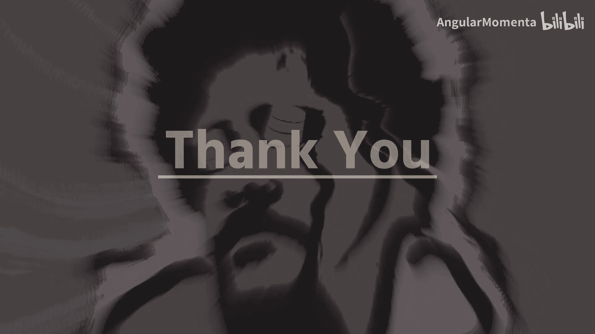
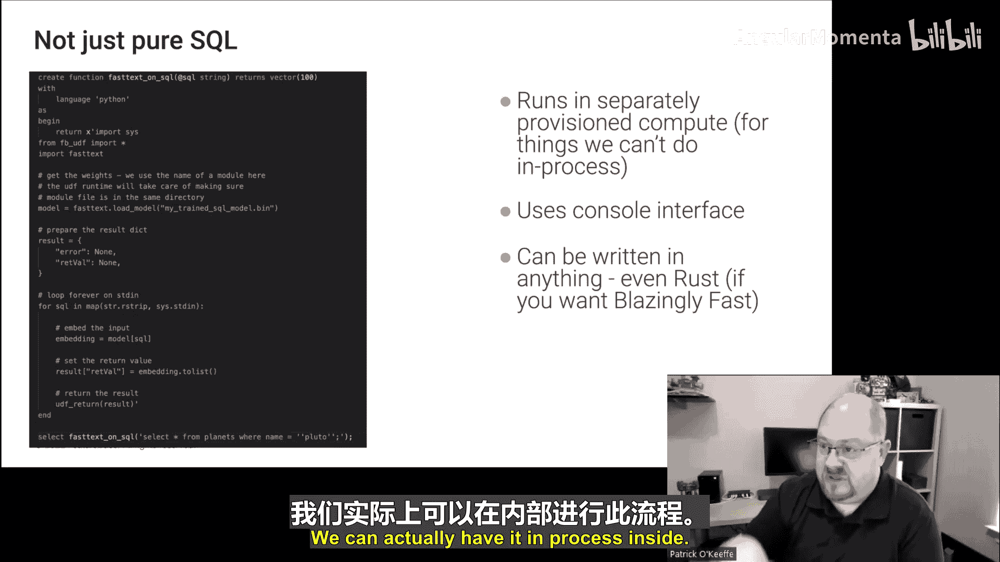

# 【卡内基梅隆大学】机器学习与数据库系列研讨会-｜-ML⇄DB-Seminar-Series-(Fall-2023)-p06-06-FeatureBase：深入解析--BV1zpiWBHE5k_p6-

🎼The databases for Machine Learning and Machine Learning for databaseases Sear series at Carnegie Mellon University is recorded in front of a live studio audience。

😊，🎼Funding for this program is made possible by。🎼Ggle。🎼And from contributions from viewers like you。

🎼Thank you。Welcome guys it's another seminar here at Connie Mellon。

 so we're excited today to have Pat O'keefe he's the senior vice president at featurebase the only bitmap database as we were discussing before the call so we're super excited for him today to talk about what is a bitmap What it has slipped up What is bitmap database and why that makes it special and different from everyone else So as always you have a question from Pat as he's giving this talk please unmute yourself and say who you are and feel free to do this any time that way Pat's not talking to himself for an hour on Zoom had Pat we appreciate you being here down in Texas the floor is yours go for it Thank you Andy thanks for having me and thanks everybody else for coming along to listen。

😊，P。I don't have it about me slide， but a little bit about me。

I come from an software engineering background， mostly in and around databases for most of my career。

 I used to work for Quest， software did a stint at Dell if you're aware of if you've been in and around the Oracle world and aware of a product called Toad for Oracle。

 I worked on that as an engineer and then eventually was a VP for the engineering team that built that。

So love me a database， so what is feature base？So I thought I'd just broadly cover like。

We'll break the talk into three sections if you like so and the first one is it's a database where bitmps are the primary storage mechanism。

 they're not the only storage mechanism， but the primary one。One of the things that。

That we always try to keep in mind as we build our product because we're a business is that if you're a database you know your product strategy probably should be make it easy to get data in make it easy to get value out of the data while it's in there and then make it easy to get the data out and so that's so we'll talk a little bit about that and then this idea and this probably shouldn't be a new idea to anybody who's been following this series but this idea particularly true in the ML and AI world right now of bringing the compute to the data and not taking the data to the compute。

And as Annie said， if anyone's got any questions here， I feel free to interrupt。

So let's talk about databases as or Bimps as databases。So at highest level。Feature base is a。

Coster database process we're written in Go length。

 in fact there is an open source version of featurebase if anybody's interested in sping the code。

 though for various business reasons which I will not go into on this talk。

 we haven't contributed back since April or so， but certainly feel free to go and have a look at featurebase DB/ featurebase is the Repo on GitHub。

Like I said， were clustered， the consensus mechanism is RAft or ED in our case。

And data is sha across nodes and you can do all the sort of things you'd normally expect。

 you can set up a replication factor so that the data exists on more than one node and reads can be serviced from any node that has that data。

And。嗯。Like I said， we shard across the nodes， the shard key is basically the bitmap offset in the table。

 which we call underscore ID。And transaction wise， the best way to think of feature base is we've come from like a heavily biased analytics background。

 so we're more base than acid。Though trending towards acid more and more over time。

 mostly because the use cases to which our customers tend to put us。

Cases where it's a large volume of data。They want to do fast segmentation type queries。

 so queries with a lot of filters。On pretty high carboninality sort of terms and they also want to keep it updated so this idea of like real time analytics because you want to participate in an ad auction or something and you want to do that as close to real time as possible。

Drilling down a little bit inside a node。Sort of again three layers here。

 there's a language layer sQL over the top， which is in fact relatively new。

 we used to have a language called PL or Pelosa query language referring to the old older version of both the product and the company。

It was very assem like， if you like and we found a lot of customers had difficulty with adoption trying to understand a way of querying which wasn't sort of familiar to them so we thought let's add a SQL layer let people reuse their industry knowledge。

There's a compute layer， so that's the thing that obviously executes career plans when they're when they're createdd and then there's a storage layer and and。

I've said that Bmps are the primary data storage mechanism， but not the only one。

 we broadly have two data stores underneath。And though we don't sort of talk about this quite so much publicly。

 but there's。A so called Be store and a so called tea store and the way to think about those is B store is roaring containers in bee trees。

So what we basically do is use the high order bits。Of the bitmap offset for a table。

Along with some other information as a key。Into the be tree and then once you get down to the leaf level in the bee tree。

 get you get either。The leaf level is big enough that we can store。

The RBF container in page or otherwise we'll do overflow pages and as it so happens a roaring containers default size is 8k so we just have multiple overflow containers or multiple overflow pages that contain roaring bitmap containers and that's basically how we。

How we access the data on that side。ThatWhat is the bitmap built on？

Record IDs are actually the values。In the B3。So think of the bitmap notionally as。

You have a bit list and an offset and so the offset is the number。

 so for example the way it's modeled is you have a table of users and it's underscore ID column or its key column is numeric the actual value is the offset into the bit list。

If it's a string value， we effectively just do dictionary compression。

 we go store the string in another B tree to generate the next number and then use that number as the offset。

Does that make sense？Yeah， makes sense。 What happens if there are a large number of values in that dictionary。

 so just about every string。Let's say in a string column that you're trying to put。

Into the bitmap is unique and you've got a billion roles do you do something special for cases like that or maybe you might talk about it and you could defer it Yeah so so I will talk about that that later that is one specific case for which you really do not want to store that stuff in a bitmap y y okay cool I wait for it thank you yeah and then and then the T store is basically as you'd expect it's it'ss on tus on pages in the Bre you know if you looked at the code and then probably looked at Postgres you'd see a haunting similarity。

mIn in the in the implementation， so when I call insert what do I land in the B store or the tea store or？

Yeah， it depends on the column story specifyifier。🤧But。

But it will always at least write to the existing bitmap in the B store。

And then go write the value using the bitmap offset key as the key in the T store。Okay。

So for any tub ignoring replication。Every attribute within that table will exist in only only one of those two stores right there's not like T stores a copy of everything yeah correct yeah we don't we don't we don't basically make a copy though you could semantically do that the application level if you wanted to got it and then it also sounded like you were saying you're restoring the you're using B plusries for the dictionary as well。

Yes， the current implementation we have under the hood for that is boltt Db。

 but are we're going to switch that to the。The T store implementation at some point in the mix。

Few months， mostly because Bt Db has a specific set of problems that we'd like to sidestep。

It's also dead too right like the guy it's not working on anymore okay there's be boltt Db。

 there's the revival of it， but yeah， I understand understand the point， yeah okay， sorry keep going。

Um。Okay， so so yeah， so I think two storage lights。

So let's talk about bitmps so for some of you this will be nothing new for others。

 it's worth going through this in a little bit of detail so bitmps。

A sortt of good at encoding relationships right so you have a thing and then either it's something happened or something exists or some membership of values or whatever。

And so we tend to think of that when we're storing the stuff is thinking of everything set as sets of something。

So if you if you think of a table like I've illustrated on the slide where you've got people and pages they've visited on the web or on your website。

 so you can see Fred's visited index and pricing。And Mary's visited index and careers when we basically encode that as a bitmap。

That page is visited becomes what we call in this case， a string set。

So it's a set that's got that dictionary compression mechanism in front of it to turn the string into a number。

And then each person。Each person gets an offset in the bitmap and then basically we have a different bit list for each of the values that we see in Page visit and so this set can get very very。

 very wide。And so this idea of a set of pages visited becomes a set of bit lists。

And then each of those bit lists。stored a series of war containers。Does that make sense？Yeah。

 this is basically Patils。Traditional bitmap right would you say is it different than that or it's pretty much exactly the same pretty similar got it of the most of the challenges that that we've had have been mean it's a very simple idea right most of the concerns are practical ones it's like okay so how do you then how do you then update this after the fact in a performance way and how do you how do you deal with the concept of null particularly as you move into a relational model and。

Empty sets and a whole you know， variety of other other sort of stuff at the periphery。

And yeah and will you talk about what data types you support。

 so obviously strings are a big part of it， but you support floating point numbers and the whole set of data types you see in SQL including daytime floats numeric。

Yes， so' I don't have a specific sort of slide or a table on that。

 but it it is it's pretty simple on the B store side。

Or the way to think about it is all storage types。With a couple of exceptions can be stored in either。

In either the T store or the beat mapap store。We have int。

 so 64 billion it is bit sliced and plus you can store it in the tea store we've got a scaled integer like a decimal number so it's also a bit sliced there's a timestamp。

Fnily enough， the internal representation of the timestamps are 64 bit integer。

 which is also a bit sliced。And we have two variants of a set， so this set。Or what we call ID set。

 which is a set of numbers。Which means you don't have to do the dictionary compression or we call it key translation step。

 there's a string set which gives you the key translation step。And。What am I missing seeing？

And' then there's what we call mutex variant of those。

 so it's a set that can only have one value at a time。

So if you go and update of it clears all the other bits and then sets the bit that you want。

So that example you talked about before of like a billion row table with a bunch of strings in it。

 that would be a string type， which internally we set as a muttex。

We also support obviously non bitmap strings in the Tbal store。

 we added vector support and we also have single and double in the tea store。

We may do a bit slice floating point。Um but。Our customers that's an interesting one too it has all the problems of like the high car Neli string only really good for range queries and。

And so， yeah， we don't yet have that one。Cool， thank you。Okay。

 so we talked about sets right so relationships so as it happens this is I used the term bit slices before。

 so this is the example of that so integers can be stored a as a set of bit places right so if you have in this case a 64 bit integer。

And you'll get 64 columns of 64 bit sets of bits each representing a big place。

And then each bid list is obviously I talked about a roaring bit map roars a very。U。

Interesting technique gives you all the benefits of compression。

 but you can still do bitwise operations on the compressed representation。And that's sort of。

Really what gives that's the core part that I think gives databases to do this。

 the latency edge on these types of queries is because you just do not have to shift anywhere near as much data to compute on like filter predicates and stuff like that。

And so you'll see。In this slide here， I'm serving two rows into table and I have two offsets one and two。

 and then the appropriate bits set in the bit lists。So why is this interesting well？

This makes range queries really fast。So if you think about a query where you have a table。

With his missing gets proron Cla。Oops， select ID from my table where age equals 18 and 35。

So I'm storing age as a 64 bit integer。The interesting part about that is we're storing ages right so so one of the things that we can do to feature base is when we create that table we can hint and say。

Hey， the min value of this is one or zero， if you like， and the max value is item 150 assuming that。

No human being within any timeframe that's meaningful will live longer than 150 years。

We only need eight bits for that， right？So whenever you do a query on that age column。

 the most cardinality you'll ever have to worry about is eight。And then。

Even better is if you're doing a range career between 18 and 35。

 you only need like you only need six bits to represent 35 so you can ignore。

Everything every bit list after six， and so you only need to read six bit lists or six sets of roaring bit maps and even at a billion rows。

 if that data is relatively sparse， that can be as only a few pages that you'll actually have to go read to calculate whether or not an offset。

Ms that filter filter condition。And so where this also becomes interesting is filter combinations can be fast。

 so if you think about my crew is still missing a fllause。

If you think about this where you've got an hand in the filter right so the output of expression one。

 which is between 180 and 35 is a bitmap of IDs matching expression one。

Expression two is a bitmap of IDs where the credit limit is greater than 5。

000 and intersecting the two is just a bit wise operation to get the matching IDs and bitwise operations we can vectorize with C。

 so that becomes very， very， very fast。So I saved Do and saved the budget compute time。嗯。

Where they're slow is that case that you talked about before。

 so I if I have an integer column like age and I want to do something like select distinct age。

It's got to read everything and then reconstruct all the values out of all the bit lists。Um。

And so so if you think about how that actually works。

 it's it's I starter scan down the down the ID list， like the offset list。So for each offset。

 go read。Bitplace 63 and then go read bitplace 62 and all the way down zero now now I have my number with a bunch of shift laughs and then go on to the next one and that's and then if you have to have a key translation step to get the string back。

The worst possible way to do it so。When I talk about this particular case。

 this is why we went to not not we went to the only bitmap database to， yeah。

 not all bitmaps all the time because sometimes you just want to store a string。

And in this particular case is one of those it's I want to do some filter conditions and I want to return the user's ID and email address and so I don't need to go spunking through a set of bit lists to do that I can just read the bys off the page in the tea store。

Similarly。Sometimes you want to store so question presumably presumably you can store sorry do you support like author table like if someone realizes oh yeah。

 I don't want to be actually maybe rephrase it the。

The decision of whether you want to be T store or the Bimap store that is something you expose or something that feature based does automatically it's something that we expose so you'll see here device user ID string max two store。

So I guess how often people realize that they're wrong that they shouldn't have done something that is a bit map maybe it goes back to my question before or like the people coming to you are more sophisticated because they realize they want feature base and therefore they know upfront they should make a decision make a decision about what the cardinality looks like so like。

Is it like the reconstruction cost is expensive， but most you'll get it right the first time。

 is there a way to think about it？Sometimes we've got some features in the。

In the we have a rules based， currently rules based。

Query optimizer we're heading rapidly towards a cost based one。

 there's a project going on right now around group buyers to do stuff like well。

 if you if you if you，If you know in a group by that you're going to hit that it's high carboninality so you basically get。

You get。It goes exponential very very quickly the high and you don't need much。

 so at that point what you are better off actually just doing the filter and then doing a scan and then pulling the whole set value out and then grouping by at a high level whereas and not turning it into into like a series of intersect operations under the hood。

The optimize is now smart enough where it'll say， yeah， you really shouldn't do this。

 you know maybe you want to consider making this a two store column。

And it'll warn you and you can then just do the insert select that to create the new column。Awesome。

 thanks。And then， you know， obviously this one， you can specify twople store and vector。

 but you can't store vectors in Bst store， so we just do a smart default。嗯。

So that's sort of the low level storage stuff。😊，I want to talk a little bit about sort of easy in。

 easy value， easy out。But if there's questions， let me know。So again。

 I did watch all the videos in this series up until this point and this is not the first time we've seen this chart either。

This is a horror nightmare。😊，It's interesting to me just industry wide， like how much of。

We've identified all this clearly because all these things had boxes。

 how much time we actually spend over here still。As an industry， astounds me。

Like you think we would have solved this problem by now。

 but no we haven't and I think a lot of the issue is is you sort of have to make a lot of decisions about how you can implement all of this before we can implement any of this。

嗯。And I think at intersection with all of the normal organizational challenges you have within companies just to get access to various data sets to do anything。

And so one of the things that we wanted to spend a lot of time with our customers was we just making ingest。

Like as easy as possible。And we went through an enormous amount of work on this when I first started the company we didn't have SQL at all and so we built a lot of this sort of stuff we took advantage of the fact that within each of the compute nodes sort of that's that slide from before there's an executor and a SQL layer and so we can do a bunch of stuff both on the node and in some cases。

Deploying additional compute as necessary to do stuff， this happens a lot our in our cloud variant。

 so you can see here there's a。There's a table I just created and we implemented a bulk insert statement。

 which has this idea of the ability to map data from a source format。

Declaratively and then same thing and transform during the same step。

And if you think of this as like effectively an execution graph， so you know。

 source target a map step and a transform step， we can also decompose this down into an execution graph that can be distributed and in fact do。

And in this particular case， this was from a demo I did ages ago。

 but basically this just takes some data out of a CSV file。Reads the text in generate UI ID column。

Puts the text in the vcha column and then embeds it with open AI。The problem， of course with this。

 this is you'll run， that's why it says rose limit 50 because you're going to run into open AIs throdling limits really fast if you do this。

Um， but this was just an example of a lot of the stuff that we built behind the scenes to make this like really。

 really easy for customers。And then with the thinking that once you have like a SQL layer to do like a language layer to do all this stuff。

 you can put a tooling layer on top。So。So you know once we have some command line tools， for example。

 that can pull data over Kafka queue and then format it into bulk inserts like this and then execute them against the circle。

啊。This is sort of another variant so that variant is like I have data in a file and I want to push it into the server this is some stuff which illustrates the idea of like being able to pull from the server or the compute。

Part if you like， because again， this type thing is basically just a table valued function which represents a remote query in this case into Redshift as pulling some product review data。

I can pass in a like a high watermark， so I can say give me the next 50 rows from this particular starting point。

And then this idea down the bottom of a pipeline， so something that can be like a schema object or an infrastructure object that can be created and managed separately from the database inside the infrar。

 but is still accessible via SQL to manage it。And then all this thing is doing is saying I'm going to move some data from a source to destination。

 so in this case every three minutes it seems I am going to insert into a product reviews table。

 the result of querying my product review data like my foreign table if you like。

 and then I'm going to do a batch apply and so that's that was the solution to the throtling problem so batch apply。

Bas。Does a。Does this function call but batches the rows up？

In a way that lets you call open AI with an array of text and get back an array of vectors and then it inserts them into the right spot。

And then you can start the pipeline by just again another SQL statement。

 stop it through a SQL statement you can go look at the system tables and look at the status of this thing running and so again it's this idea of making it really really easy to get data in and work with data and not let。

俄罗塞。嗯。All of the complexities overtake you because it's just a simple。

It lets you use SQL in our language that everyone knows how to use to do this stuff。

Bringing compute to the data。嗯。So。This was another variant of some stuff。know。

 that was obvious for customers that wanted to be to do this。This， is a， this is a contrived example。

But let's assume for a minute that I have。Some demographic data about crime in cities。

UAnd and I just want to， I'm a city planner， and I want to build a new city somewhere。

And I want to predict based on some demographic data， what the murder rate might be。

And so again this sort of query encapsulates a bunch of ideas that we have around doing this again from a SQL level。

 this is sort of not new you know we've seen this before， but it's sort of really important。

 I think back to wide bitmaps to matter to us that what it means is that if you think that oops。

Come back。If you think that。The way to。To define the training set is with a wear clause。

And if a wear clause is a bitap operation， it's very， very fast。

It means that I can pull the data off the disc。U， with a with a low latency query。

 push it into the training stuff in this case for a linear regression and save save off the。

Save off the。The the weights into a system table and I'm done and if I want to retrain I just do an alter model and it automatically does it with the same training set。

And so we don't have to run a query， pull the data out into a CSV， export the data。

 put it into a Python notebook， do the thing， get the numbers， put them back。

 do all that sort of stuff， and so again it becomes easy and again we're trying to do for our customers training and inference in the database or at least as close as we can get to the database。

Not possible in all cases。So I don't need if the cover is what is this paidtorrch or something custom so this in this particular implementation。

 I think this is just native Goling code。For linear regression。We link other stuff for other models。

 so I think you know XG boost and psyit learn and all that stuff right for us。

That stuff's possible right now， Golang has a specific set of challenges with sort of calling in native code that doesn't exist in other languages。

 so that's an issue we're sort of dealing with right now。I'll show you another example。

 let me come back to that in just one second this is basically the inference of other side of the program。

Another question I have actually quickly before to the next things like。

 so show you're showing this model create model， you have the pipeline one before and this all I mean this is all done to the SQL layer。

 which I like but。Is there anything because it's a bitmap that makes us better for this kind of MLL stuff like that because you guys know the bitmap store。

 like how does that help for this kind of stuff？So， so the answer is， the answer is。

I think it's it's degrees， I wouldn't say bitmas make it better。

 they make some of the queries that you want to do as part of this better。When。

There is some higher order stuff。There is some hard stuff around。

Some rag stuff that some other folks in our team internally are doing where where。

I'm not intimately familiar with it， but basically the gist is that they do PDF breakups so go in embed the PDF。

 go chunk it up， go and embed the chunks， look for key terms， go ask the machine learning model hey。

 what are the key terms out of this chunk of text and then basically get back a set of strings。

 so that's a string set？And then we go to store the string set in the bitmap and then one of the things that we do as part of the inference workflow before you repro the large language model is go find。

So it's a similarity search， but it uses Tanamoto on the string sets。

 so go find some like sets of ketones and then add those documents to the prompt as well。UOkay。

 which is really， really fast because you don't， there's no floating point involved in any of that。

Right right， that's helpful， thanks。So yeah， so here's inference。

 this syntax is going to change if you saw the Postg MLl stuff。That's a better way to do it。

This version here is not just pure SQL， so in this particular case this is just a UDF that calls out the Python。

Well， in this case， Python， it uses a。A sandbox that basically does。

Use standard in standard out to orchestrate executing external code so that that's Python。

 but it could be anything right could be。Bash or rust or or whatever。Um， and in this particular case。

 there's some， there's some stuff in the runtime that lets you do stuff。Oops。

 why is my thing jumping that lets you do stuff like low model and it'll work out that that name maps to some schema object that actually has。

That bin file stored somewhere where it could be loaded into this sandbox before it's executed。

And so this particular case， this was fast text， which we trained on a bunch of SQL then。

We just want to get embeddings back from SQL that we pass in。So that's another variant of again。

This idea of bringing compute as close as to the data as we can possibly get and as a lot of this stuff evolves。

We think we won't have to shell out as often on on this stuff， we can actually。

Have it in process inside。

Okay。And that's all I have。That's great I have a whole bunch of questions。

 so maybe I'll ask the first one， Andy unless you want to go first someone else on the call。😊。

You're the Bitmap expert to go for it。This are different questions in the bigger picture that you showed。

😊，showing how complex enterprise data ecosystem is with a query engine layer being just a small portion of it。

 you mentioned that your platform's written in go I'm guessing all the bit manipulation stuff is probably written in C and you've hooked it up through SCO what does that how do you make that go and all of this work fast with it are using some native go libraries that lets you do stuff like that I know there are roing map native go roaring bitmap libraries and stuff like that？

Yeah， so so the core storage engine is all。All native go。For for performance。

 we there's a tool called。Goat。I want to say。And basically what it does is。It's a tool that can take。

 we've done this recently for C stuff on floating point vector operations。

So what you do is you write the code in C， you write the function in C using。

Inics and then there's a post process on that which says okay。

 go generate assemmbler from this and then you turn that assemler into the plan9 assemler that the go compiler can understand and then you compile that into go code。

Thought it the second question is because we've been battling around with this and haven't quite solved this problem if I've got two tables。

😊，And doing a join across both of those。And those columns have high number of distinct values。

They're not going to be in a bit mapap form， but then a bit sliced form。

Do you do anything special when joining columns where both of them are in？Large， like 32。

40 bit sliced land。Yes， so。So in the executive level。

 we haven't quite pushed this up into the SQL level， yet， so in other words this。There's no。

 there's no。SQL plan operator so join operator that's aware that if my input is is a bit map and the other side is a bit map I can I can just do an I can just do it bit maps are fine if it's bit sliced so it's high cut that so bit maps are fine right those are easy but if it's。

A bit sliced columns as the join keys on both sides。Yes。

 again not in SQL but at lower level we if it's two bit maps and and it's an and or whatever the bit more operation depending on what you're trying to do so if it's a quality or range it'll it'll do it as a bit more operation oh sorry sorry I didn't ask the question correctly imagine I've got two tables and I'm doing a join and'm presuming your layer allows joins between different tables right yep and so what joint what's the join algorithm if the two joint keys are in a bit sliced form。

Oh， I see， yeah。So imagine I've got。You know。A date a date in one side and another date columns for high cardinality high list values and I'm doing a date equal to date。

And I need， you know on the underlying 64 bit date space even after bit stripping all the zeros at the head。

 I still have 40 bits of useful data， do you convert it into the tople store version and do join in that native representation space or do you do something fancy Yeah。

 no fancyness yet。On that， so it will even though the underlying storage mechanism is bit sliced for a join。

 at least right now， they are getting materialized back to integers and then whatever the whatever the the joint expression is。

 whatever the operator in the joint expression is just applied to the two numbers。Yeah。

 this is fascinating how far you are pushing it I love it one last question then I let others go same thing with aggregation if the group by column is。

😊，In a bit representation in bit sliced representation and their large number of。Group buy。

 I know you had alluded to that earlier。How do you do that type of aggregation when you're managing that group buy and a related portion is do you do anything special with the math so imagine i've got a sum of a star B and a' is in a bit mapap form the other is in a bit sliced form how do you mix and match expressions and then how do you deal with large number of grouping key values yeah so group grouping key values。

For a bit slot so it's basically the way to think about it is go do any filtering that you need to do first because then you eliminate as much as possible。

Then， then， then it's basically counterbitits。嗯。And so where the problem becomes is if it's grouped by this thing and this thing and this thing and the thing is a set。

 so it's not a mutex then then。If it's more than if there's a large percentage of the rows in the table that aren't eliminated by the filter。

 then you get sort of a combinatorial explosion of CPU time and so we're looking for better ways to do that right now because it's not。

The way we're doing it is not ideal。And then expressions， do you do native bit arithmetic for yeah？

And what do do with the two different columns， let's say A star B and A' is in up。

Both of them are in different formats so one might be bitmap， the other might be a bit sliced。

 you convert to something one of them into something and then of course if it's one of those both are in the same format and you can work out the map but if theyre formats what do you end up doing if the different formats think of it like a there'll be a tight coercion that goes along and then we just use native arithmetic on basically the materialized value。

Got it， awesome， thank you， I have so many questions but I'll see if others want to go I'll fire away。

😊，All right， everybody else， I have a question， go what。So I'm new to bit mapps。

 and I'm just curious。 Like， this idea sounds so awesome。 And it just seems like。😊。

Everybody should be doing it。 Why is not everybody doing it。

 If you could some give some context on that， I would love be。Yeah， so it's hard。And hard。

 I think for a a couple of different reasons one is。嗯。

We've talked a lot about like reducing query latency so not only just the fact that bitmaps are particularly well suited to some solving some of the query latency problems。

 if your data looks a certain way， the problems on the other side is updating so having to maintain a bitmap。

 so in other words， if you want to change if you have a table with a column in it that's a bit sliced in right so a timestamp。

Or an age。U when you when you want to go and update a value， so you know， update my table。

 set age equals age plus one。Where some condition right and even if it's one row。

 you basically got to。Go to the offset。In the bitmap。And then 63 times or 64 times I'm sorry。

 you have to go and basically write out 64 new bitmaps。嗯。Because you can't。

 you got you've got for that column， you've got a bit list。

That might have like a it could be notionally a billion bits long。

Right and so to change one row in the middle， you've got to write our whole new bit list now。

That's one of the reasons we do we store this stuff in a B treee because basically you might not have to write out the whole bit list。

 you can just write out a piece of the key space as a roaring container but you've still got to write the whole page each time for an update the minimum number of rights that you're going to do at least for us right now is like 64 pages。

Plus one for the exists。If if that changes because you might set that to null。

 so you've got to clear all the bits， then write the exists。嗯。And then if it's more rose than that。

 you're going to write a lot more pages and then depending and we use a copy at least for the B store today。

 we use a copy on right for the transaction lot like shadow pages for the right ahead log。So。

Multiply the number of pages we just wrote by two。And that's where it starts to become challenging and so there's you know we've put a lot of time in making that as efficient as we possibly can。

 but yeah it's not。It's not surprising to me that it's not a widespread technique。啊。Like I said。

 because it's hard。And then one more thing to add， I think on that so just the technical challenges implementing all that。

 I thinks there's some data modeling。TThings that I think people coming new to this stuff。

Wrap their heads around because you know， everyone that comes from relational wants to to denorize everything or normalize everything right so you know we have。

Don't store the data twice， but for us， if you're doing an events table。

Backed Bimaps are a way to encode relationships you want。Wide set columns。Right， surere put every。

Website you've ever visited into one row in one column。

And that's normal for us so there's an educational sort of thing around data modeling too that sometimes people take a little while to grow。

It's more about identifying the exact situation in which this will work better than others and usually people are not so good okay thank you and and then I think a lot a lot of our time has being spent trying to alleviate the user from having to do that and just making the smart decisions。

 you know where we can。Thank you very much。Question for Martin。All right， thanks for the talk。

 really interesting stuff hearinging from a Bimap expert。As a broad question。

 have you looked into because Professor Patels mentioned the bit slicing and we've got that form have you considered。

Somewhere more than a pure bit slice but still slicing up values and so maybe you've got 32 bit integers chopping into two halves of 16s or so。

 have you looked into any problems of that sort and that opens up a whole can of worms of different kinds of mutation problems of course。

 but just any broad thoughts on this。Yeah， off the top of my head， I mean one of the。

I think the answer is yes， one of the interesting things about timestamps and when you think about  querying them。

m is is people want to want to group around？Subs of things right so so like you'll have these you'll have these scalar functions which say here's a timetamp give me the give me the month。

Out of that。 and then， and then use that as a as a group by。Or in a group by expression。

 being able to do that natively so for the optimizer to say， aha，' doing you're doing a constant。

Like a constant expression on a timetamp that happens to be just pulling a component out of a timetamp。

 we know that the day is in these bits can we optimize that for you we've given that a lot of thought。

Aro to solve those sorts of of problems are basically doing partitioning of values on the fly so that the people don't have to say。

Here's my timestamp and here's my day column and so I have to do a bunch of pre compute and storage and then may have to maintain that after the fact。

I'm sure there are other examples that。They escape me right now。

NothingThe insight on the date is really great， thank you so much。有。By the way， Pat that was Martin。

 he's doing his PhD essentially in this whole alien and in trying to build all kinds of crazy bitmap store areas so he loves this space。

 so that's awesome to see you guys are pushing it to the edge。Right。

 another question from everybody else， so that was all I have a ton。

 I mean Jing National is probably another round too。All my first question is like。

 why share nothing and why not share disc？嗯。Youre you talking about costal level or I'd like the storage level the storage ladder and's that's how I was mistaken like look like you would like was it was it shared nothing or was it a shared disk architecture？

So right now we are。We are shared。Shared nothing。So。I got that right， yes。

 shared shared nothing in the cloud product， we are moving towards shared disc。Okay。

I mean it's like it was a legacy of being an onprem at some point yeah。

 pretty much I think I think ultimately ultimately certainly the goal is to is to not only move to shared disc but probably share b pool。

There's benefits for us to do that， even if we have to pay like a network。

Penalty every time we want to go to get a page out of the pool， we're going to go across the wire。

And one of the other things to note too is。T store represents the the。

Most up to date B pool implementation on B store like RBf， we still use MATAT。

And so we're sort of slowly migrating away from that and then making sure that we have unified B pool unified data file unified right aheadlong。

all of that sort of stuff， so if you like the strangler fig pattern way to refactor the B store storage layer and most of that's for performance。

We think we can probably halve the number of eyeOs we do on B store if we've moved where。

If we move to all the machinery that surrounds Tstort today。You're the。

You're the first person we've ever said they want to go shared memory。Uh。

 you can rely on like RDMA or Cxl or make it go faster or just。Just regular TCP。

don't we don't know yet it's just it's just an idea and it may well be it may well be。嗯。

I work used to work with oracles， that's why， okay。Yeah。

 it Iraq yeah rack's probably a reasonable model for thinking about like where we're start starting with。

Like I said， no firm decisions that we made， but certainly shared shared disc may be worth doing shared memory。

Y okay and then for you guys are you using like is it a custom roaring bitmap implementation or is it based on like an open source one and then have you ever found like its compression scheme to be insufficient for some for some data sets or some forth and therefore you have to make custom changes Yeah it's it's pretty it's pretty customized the most of the implementation out there are are 32 bit I think it our is now 48 bit。

嗯。And yes， there are some cases that we find。That will eat CPU like there's no tomorrow。

Once like once you trend towards every bit being set。嗯哼。😊，改了O。Interesting。

Do you know what like what percentage of the columns in for your feature based customers are using the Bitmap store。

 is it like up to 90% or is it somewhere 50 50？嗯。And then can you talk a little about you mentioned you're using SD in some cases。

 like is it， I'm assuming you're processing vectors at a time or batches or tuples and like is pretty much all the operators。

 all manipulations on the bit mapps themselves， does that always be vectorized？not all yet。

 but as time passes， our goal is to get to all of them。And is that。

 is that just engineering limitations you haven't got around to doing it or is there final No。

 wouldn just haven't got around to doing it yet？And you target AVX 512 or AVX2 AVX 256 more so most of our customers are running in in AWS and Azure and 512 for both of those providers is not there yet。

Yep， okay。国五。All right， so I'll pass the baton Dick Nsh if you want to go next。Yeah。

 I think that workload question was exactly where I was going to go was like。

A lot of your applications are probably data scienceency oriented trying to do ETL and other types of feature prep in SQL。

Is that that accurate or are people doing like warehousing workloads on your platform yeah most people aren't doing warehousing it's usually it's you。

Not quite true actually， let me rephrase that。😊，Most people are not doing traditional warehousing。

 like in other words， throw everything in the feature base and point power B or。

Bar or whatever at it and do ad hoc stuff no one's doing that and I don't and I don't think。

That would be the best way to use our stuff what what most people tend to to do is or what what what most people have in common is is that they're trying to do。

They're trying to feed a lot of changes in at the same time as do low latency queries out so and the nature of the queries tends to be small result sets。

So not mostly not big。Scans of stuff it's it's it's the sort of stuff if you think of like the traditional segmentation type use cases there's a lot of that sort of stuff。

 a lot of anomaly detection type driving anomaly detection type applications we have a customer who's doing。

Whos storing a bunch of fingerprints of binaries and then looking for patterns with CVEs and then saying if I have if I have like a vulnerability somewhere that's occurring in this fingerprint in this binary show me all the systems worldwide that have that binary on their system and do it form me in 40 milliseconds。

Yeah that makes sense so a lot of I like work that's what I was guessing on set value type attributes and that type of paymentment and set intersection type of stuff would go blazingly past on it last question then i'll stop I know we are running short on time do you do any。

Logical or physical horizontal partitioning of a table before doing any of the bit maps。Techniques。

 or do you treat the whole table as one？Big partition。The， the。

The way sharding works is that so you have the key space for basically Bimap offsets。Each table is。

When you create it， there's a number of partitions in the table and then there's a consistent hashing mechanism that works out which sh on which cluster node that that right goes to or that read comes from and basically that's so if you have a three node cluster or a five node cluster the shards will get basically equally distributed amongst all of those nodes。

And do you ever have to worry about updating an existing value or is the model just append only？

Or do you allow， updates， updates happen all the time？

Got it and how do you deal with that means a value move sets in a。Bitmap form， for example。

 yeah so so。It depends on how many values change， we tend to batch stuff up。

 so larger batches are better。We， we just。We just finished a whole bunch of work。嗯。

With around bulk insert， so if you hand if you hand bulk insert，'s a million。

 here's a million rows of CSv。UWhat what you don't want to do is give that straight to the storage and say。

 hey， go insert this because it'll generally tend to thrash a lot as it as it because you'll just get du rights all the time。

 it's like I'm going to write this page I'm going to write this page again and this page again because we're having to maintain a bitmaps if you can pre sort the keys。

And then and then give it to each sh and say here's here's a bunch of keys pre sorted then then that's way way way more efficient so we just did a bunch of work where。

At the front end of that bulk insert statement， we've taken all the rows。

 we press sort out into batches basically in our internal life format。

And then we hand the pre sort of stuff off to the shards and say here insert that and that's one of the ways in which we sort of make inserts go faster on tea store。

It's basically right a new row version。And you know and so your earlier comment you're trying to get closer to acid makes sense you probably have some sort of a snapshot isolation or some other the model like that right now yeah so every every request gets a transaction ID anything is's not committed it's not yet visible so it's sort of。

And that's on T store on B store it's a little bit looser， we have consistency at shard level。

 if but you can read uncommitted on another shard from B store。Again。

That has tended not to be as much of an issue with customers as what we thought it might be。

 just given the nature of the use cases that they're trying to solve for。Got it， Thank you。

You're welcome， Andy back to you， all right， any ask questions for anybody。

So my last question is going to be。Given that you guys are a know very specialized storage that looks way different than anyone else。

 is there anything？Beyond you know at that storage like Sion layer， it so not like SQL syntax stuff。

 is there anything that you've seen in another database system that you wish feature base like would implement like if you had a magic wand dating worry about engineering time you just proof we have it is there anything that you guys you wish you had。

I'm sure the reason I just can't think it up up my head。😊，No， that's why， I mean。

 you're in the weeds in your system it's like， you know， yeah， I mean。

 there's there's lots of stuff that we'd like to be able to do better。嗯。

Like like I think let me answer it this way I would love， I would love to have a way to。

To better let people take advantage of the strengths of this。

A bit maps in the context of a database like the way that we've sort of set out to do them and do them today。

Without having to write the rest of the database。Because that。Turns out databases are hard， yes。Yeah。

 of course， and then you're building a one that doesn't look like anything else into super yeah。

 okay， that's that's。