# 【卡内基梅隆大学】机器学习与数据库系列研讨会-｜-ML⇄DB-Seminar-Series-(Fall-2023)-p07-07-Lance：现代列式数据格式--BV1zpiWBHE5k_p7-

🎼The databases for Machine Learning and Machine Learning for databaseases Sear series at Carnegie Mellon University is recorded in front of a live studio audience。

😊，🎼Funding for this program is made possible by。🎼Ggle。🎼And from contributions from viewers like you。

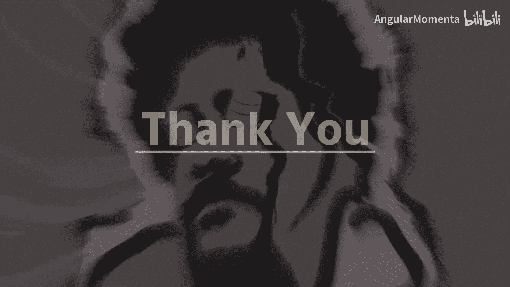

🎼Thank you。All right guys welcome back to another seminar here at Carney Mel University。

 We're excited today to have Changxi。 He is the co-founder and CEO is that correct co-founder and CT or sorry CEO of Lance they are building a new file format and aque execution engine on top of that to replace parque or which is super fascinating So course this is why we invited him to come and give a talk about this stuff because it it's super relevant these days So as always you have a question for Chang as he's giving a talk please unmute yourself say you are and ask your question and feel free to do this any time if you can't unmute yourself post in chat and we'll interrupt and again want to do this as Chang gives the talk that way he's not talking on himself for an hour in Zoom So Chang thank you so much for being here right now you're at MIT so we appreciate you calling in remotely from there。

😊，So the floor years is go for it。Thank you and thanks for having me thanks everyone for coming if you have questions please andy please interrupt me because i've got the i've got full screen on screen share so I I won't see the chat so feel free to just interrupt me at any time i'll take care of it yeah thank you。

😊，Okay， so today I want to talk to you about something we've been working on for roughly the past year。

 and that's a new columnar data format called Lance。And so。Quly about it myself， so my name is Chung。

 CEO and cofounder of LandCv as Andy said， I've been making data science and machine learning tooling for roughly two decades at this point。

 I was one of the original contributors to the pandas library way back like 10 years ago 13 years ago now know and then I was a CTO of Datapad with West McKinney the creator of pandas ended up at Clouddera through there。

 after that I was a VP of engineering at2BTV a streaming company and I basically really got into recommendation systems MLO's four recommendation systems and also experimentation。

So you know why are we doing this， I think when Andy invited me to this seminar。

 it was something I was really excited about because especially you know。

 ever since you know pandas I've been really interested in this data and ML or data science sort of marriage and especially at2V where I saw a lot of recommendation system both structured unstructured data。

 it was very exciting what。2 when their data systems and their machine learning fits really well together the tools that we get are much better and companies actually can be much better run you know the firsthand experience I had at2B was just how much difference a good experimentation platform for machine learning can make for a company I think when I started there we were maybe running you know one experiment per two months or something like that and I spent two years sort of making the data systems and for an analytics and the ML fit well together and in the end know I think and after two years we had sort of like 30 to 50 experiments on at all times in the company and it was amazing to see how much how much faster progress in iteration got。

However， the problem is that I call this like it requires a lot of couples counseling。

 both technical and non technicalchnical， so especially now with unstructured data I think one you know scale is off the charts data types are definitely weird workloads are much more complicated than before and then you know I say vector databases especially sort of we got we got sucked back into you know sort of early 2010s we'll see what I mean by in a second。

So you know with unstructured data like with tabular data like a floating point number is four just four bytes or maybe eight bytes if you got a double。

 but if you look on the MLDB seminar website that logo is 145 kilobytes many。

 many ordersismone of magnitude larger so what are you getting is like maybe the row count isn't even that huge but you're getting petabyte scale pretty easily nowadays。

 most startup companies if they're working with unstructured and multimodal data very easy to get multiterabyte scale for a small team that's already difficult to handle for certain teams that run popular generative AI applications for example。

 you get like 20 people and you have like several petabytes of data。

So what that means is for your whatever your data system is going to be object storage must be front and center and then all of the you consistency and performance issues that come with that right in addition now in addition to all of the types we're used to in tabular LA right now you have vector embeddings。

 images， audio video point clouds none of these things really fit into traditional database as well you've got various plugins into like Postgres and others but none of them like work all that very well at a native level right and most of this is because like databases and traditional formats。

As you probably all know they're not optimized for large blob storage。

 we're also missing lots of semantic types which turns out to be very important for building tools on top of these things if you if you're like BI tool analytics tool can't tell one binary column as an image versus another binary column as audio you're going be you're going have to do lots of type checking or just throw up your hands in different queries right and then on top of these semantic types then we're also missing all of these common transforms like for images you might want to。

Do shuffle and rotations and add noise and things like that。

 and it'd be really nice to be able to push those down into kind of the database lab would have native support for those。

And as a result of this， like workloads are a lot more complicated， right so。

AK is really not good enough for these things so in EDA for ML and also debugging it requires fast random access so you might run a filter and then that picks out like 10 random images throughout your data and you want to load that up for exploration or just looking at a bad case or something like that you need to to access those across your data very quickly and also for training you require fast shuffling especially as models get larger I think folks are finding that you know within batch shuffling sometimes might not be enough you might need like global shuffling or something like that and this also requires fast random access。

Um。And you know TF records and friends are also not good enough， they're pretty good for training。

 but like turns out we still need fastS OAP for filtering analytics and all of that that sort of selects the right data and visa into your GPU so we're TF records and sort of similar tensor like overly optimized overly focus on tensor formats tend to be missing this layer so and then third is reproducibility versioning tracking is even more important in ML where you might need to checkpoint models you might introduce some new data and find that like mysteriously your model scores are going down so we need a flexible table format to help track all of that right but you don't necessarily want to connect ptorch to a hive metastore just to have access to your data。

And the last thing is， you know。You know I think there are you there's something like 20 vector databases nowadays。

 but if you look across them， I call this we find vector databases a little bit retro what I mean is they look less like fullfledged databases and more like just you know wrappers around an index most of them don't offer the data management capabilities of a database or you know storage around that index it's kind of like a paying for a Bre index or something like that right so you know once you get the vector results。

 don't you're not going to serve vectors back to your users you're not going to show oh this 1536 dimensional vector is the document you want or the image that you want you have to then go somewhere else to actually fetch fetch the thing to actually serve back to your users right this is just kind of example why they don't look like fullfledged databases to me deployment also feels like。

You know， sort of early 2010s where you know， you had like capacity planning for a Hadoop cluster。

 you're choosing the instance types and you're choosing the the number of instances and like if you kind of look at your index wrong。

 you have to like you know reindex everything。And lastly there's no separation of compute storage again this becomes very very expensive at scale I think very early on in this year in generative AI。

 we thought that we didn't really need scale， everyone was running around with 10，000 vectors or 50。

000 vectors， but as people move applications into production and people get serious。

 we find that embedding volumes are actually becoming much larger and even if it's not maybe a single data might not not have huge amounts of vectors they might have lots and lots of small dataset sets that add up to a large number of vectors。

Right， so， but certainly。😊，Sorry， I don't know why my slides aren't advancing now。嗯。Okay。

 certainly you don't have to take my word for it you can take Andy's word for it so this is a chart that I stole from the recent paper that Andy wrote with West an empirical evaluation of columnar storage formats right so if you look at the timings using parquet and orRC for vector index search which is representative of a lot of machine learning workloads because it requires fast random takes right the the。

The timings are know very lacklutre， there are some interesting patterns here too where know the comparison between Parquet and orac are flipped on SSD versus S3 and that's kind of interesting as well。

So to solve these problems we kind of started a project called Lance about mid last year and NC++ and then we actually rewrote it at the very beginning of this year in rust。

 so the version that you're looking at is essentially about a little less than a year old right so Lance is both a file format that has dot LA files that is columnar storage that supports both fast scans and fast random random access and this is this is our analog for parquet but LNance is also a table format so you can group Lance files together into what we call Lance data sets Lance data sets has metadata that provides transactions that supports secondary indices。

On top of L files right so this is sort of an analog to iceberg or a more lightweight version of iceberg for machine learning。

So Lance is you know where does it fit in the stack Lance is a disk format obviously because it's an analog to parquet our main interface into the world is a patching arrow and you know。

I think given the background of folks here， you guys knowarrow is this sort of openstand for in memoryory representations and partly it's because you know it's an easy way for us to integrate into the ecosystem。

 we started out with just two people we now you know just over 10 and maybe like half maybe half with half the team working on the format。

But so resources are constrained and so witharrow it was a lot easier to integrate into the rest of the tooling ecosystem and then also it made migration super easy like converting to LA data set from other columnar formats is now literally like two lines of code。

Today I think you know Lance is used in a variety of different settings。

 so we started out in autonomous vehicles where you know autonomous vehicles companies restoring like petabyte scale data in Lance to use for large scale data mining so this would be something like you know in the Bay Bridge in San Francisco there was like accident Tesla had an accident where the algorithm applied the brakes when it wasn't supposed to cause I think like a fatality or something like that and I think as soon as that happened。

You know every single autonoous vehicles user we were working with like panic and said okay like go over like the petabytes of data that we have and find all instances where the model did something like that apply the brakes that wooden and with Ls it was much easier for them to essentially slap like an OAP style data mining query over these like very deeply nested vehicle sensor data right and then next was we some users that are using us to essentially be their datalink for generative AI training so these are multimodal generative AI for like image generation things like that so you're looking at you know like a petabyte of images for training analytics and debugging and also serving in like vector search right so this is sort of the last bucket of use cases for Ls today which is semantic search for both LLMs and traditional recommender systems。

And we've you know we've been serving like billion embeddings generated per version of the model。

And we can do this on a single node， and I'll show you in a second later。

 and it gives very low latency if you have a fast MEME drive。

All right so a couple of benchmarks so this is a sort of a more high levelve benchmark where we use Oxford pets which is like a data set with like you know maybe like 8000 really cute cats and dog pictures and we ran some computer vision focused workloads like computing the label distribution which is a value counts by class histogram of the area of the bounding boxes right and then and also to retrieve the inline image based on a filter and a row selection so the first two are essentially just scans over tabular data we're pretty much on par with parquet there for these scans and then the raw column here is basically just the raw data which is images and XML and text annotations and then the last one here is where retieving the images across the whole。

Data set comes into play after the filter， and we are you here we're about two orders of magnitude faster than perquet。

We also replicated the benchmarks in Andy and Wess's paper we added Lance to it and so for both scenarios on SSD and S3 glance is roughly is at least one order magnitude faster than the faster option of the two so here you can't really see it's about two milliseconds here to fetch the data and then here it's。

I think it's something like a thousand or a few hundred to effect from S3。

And this is on about 100 million rows from the Lyon 5B data set。

 so we're pretty happy with how perform Lance has been。

 but I think there are lots of new things to do。So Jen are you going to apply， this isation。

Are you going to talk about the root causes for why that was much faster I you did absolutely yeah。

 so we're going to dive in right now。Will you connect to what is？

The root cause for the performance difference in the previous slide to these techniques。

 or I don't know if it's going to be as crisp an answer as that。

Yeah so I think so we'll see we'll see when we dive in。

 but I think this is a great question so there are a couple of things there are a couple of things so one is on the one is on the encoding right and how the data is laid out and especially for parquet it sort of prohibits us from delivering fast random access on parquet the IO plan is also very different for LAs versus like typical scanner for parquet and orRC mostly because we want to support large blobs and then the layout the data set layout and indices don't play into this particular problem but I think it it has particularly nice features for machine learning as we'll see later awesome thank you cool any other questions before we'll dive in a details。

Cool， all right， so let's dig in。So one， as already mentioned。

 we try to design LAs to be good for both large scans and random random point queries right and want to support storing large blobs and there are some sort of counterintuitive things that you see in Ls versus traditional like OLA and columnar designs。

So the simple design principles here right is we want to make sure we don't stand more data than parquet or orRC and then we want to deliver constant time lookup for one row and then we can amortize any metadata overhead over many loups right and obviously you know parquet was designed what 22 is it 2010 2012。

Or something like that， right， 2011 2011， that's right。And so you know。

 storage storage technologies have changed a lot since then。

 so we wanted to revise a lot of the assumptions around like concurrency threading。

 block sizes and things like that to make you know more reasonable defaults too。

So the simplest will start with as sort of our plane encoder。

 so this is for your fixed size data types numeric types and also embedding vectors and tensors right so this is pretty simple constant direct access with offset computed and flight you know pretty easy to support both fast scans and。

And random access I think the important thing is also to support different tensor layouts so that way when you pull it out in memoryory you don't have to do an inmeory transpose before you can feed it into the GPU right and so for us one of the things that's missing from the data set right now is null support for the plane encoder so the plan is essentially to add this validity bitmap within within each block so it doesn't negatively impact our random access performance so that's the plane encoder pretty simple right and so next is the binary encoder where we have variable length strings bytes and this is where we would store like images point clouds and things like that and this is one of the biggest differences between Lance and parquet so if you're familiar with how parquets laid out right you get offset data offset data where things are interleaved so you have to read out the whole row group。

in order to figure out where a single row is right and so this is so that in the benchmarks where you see parquet form performing badly in like random takes and also you know fetching 10 images across the data。

 this is one of the primary reasons。And' it's greatly exaggerated if if your records size is big。

 you know， I think vector embedding， you know， like open air embeddings are。

 I would say like medium size， but like you know images for example。

 are much bigger and point clouds can be like you know， like you dozens of megabytes。

 which is kind of insane to read out like1 thousand00 or 10，000 of them。

Did youDid you consider putting any like a prefix or？

It was like a balloon filter or a sketch in the off array so like you know。

 instead of having to go you know dereence the the the the offset jump to the location then and then look at the see you have a match like for strings if you just had like the。

the first two characters or something like that， you could store that in a small number of bits and part of the offsets。

 and at least you get some filtering with how to having to decompress the rest of it。Right， right。

Yeah， I forgot， I think we went through a couple of choices on the encoders。

I forget why now we didn't end up doing that on top of parquet because tried we tried for months to try to make all this work on parquet。

 but I' if I remember I'll come back to this okay。I mean， it only helps for strings like images。

you have to see the whole image to think about what the hell's in it， right？

But for strings you could do this Yeah， yeah I think I think likely we were thinking about I think probably the the images was the reason because we were very focused on like computer vision in the very beginning。

 so we wanted this encoder to to sort of be general across these data types。And actually， so。

 so so people you're not really doing any filtering though when images right。

 it's just I want like you do some kind of matching on metadata。

You know with some kind of other column type then from that you take the off and figure okay。

 I want I want the the third image in this column and then you just jump this will figure out where it is right correct yeah y that okay。

Okay， yeah and so for Lance， we essentially store the offsets together and the data together right so you read out for a given block you read out the offsets all at once and then that gives you once you have the offsets you get constant time access and then basically you'd have to sort of hold the offsets of memory and or amortize that read time。

So we haven't we haven't implemented these， but like advanced encodings on the roadmap， right。

 run length encodings where you know， if you have lots of repeated data， you can you know。

 compress that using this encoding。Naturally， but also still support fast lookups。

And then variable encodings where you know each block can each chunk can essentially have its own encoding done right and so again we want to have these encodings to support like more compressed data but still support FA outcomess these are these are kind of on the roadmap right now。

We'll get to them， you know， maybe like early next year or something like that。Okay。

 so maybe let me take a pause here and maybe let me turn the question back to the audience like so we laid out the data differently and this data this difference in data layout allows us to deliver both fast scans and fast point queries。

 what is the tradeoff that we made here？Where's compression？Yeah。

Yeah so like it's much harder to it's much harder to implement compression because we can't do we can't we can't do like snappy or you know or any other sort of finallevel compression here right so so for us because we're focused on these like large blob data types。

 it actually makes sense so if you if you have a if you have a data type or if you have a data with like images and things like that your data set size is going to be dominated by that column and each column if we're storing the Jpeg bytes for example that's already compressed at the record level so then if you're looking at a data like that。

 the final data size isn't all that much different between lands versus like compressed parquet now if you only have tabular data。

Then like a compressed parquet will be noticeably smaller than a LA data set。

So that's basically a trade off and it doesn't like because of object storage。The additional。

 I think the additional cost isn't huge as long as you're not like storing it in all of it in MVME or something like that。

But but I think like this trade off will get smaller hopefully over time when we add more advanced encodings that will help reduce this gap I don't think we'll ever like completely eliminate it but。

I think it can be substantially reduced。All right so you know there's lots of like more details about encodings but in the interest of time talk about the next topic which is IO execution right so the thing that's different about large blobs is that we need late materialization we'll take a look at that in a second and then for you know modern storage systems I think it's much easier for us to actually flatten out the IO tree for much faster performance。

So if you look at a query like if you did on the top right here right select ID timestamp Liar cloud from data set where velocity is greater than 10 and tag equals error limit 10 offset 100 pretty common query that you'll see for in you know like autonomous vehicles shop right so the typical OLAP plan for this is we start at the bottom you scan all of the predicate and projection columns and then you run the filter on velocity and tag you take the limit and offset and then you project you select out just the projection columns now。

The problem here is that liddarR clouds can be quite large right so if you're scanning the lidDarR column in the beginning and then filtering it potentially you're reading out you know like youre I mean depending it certainly depends on the selectivity of your filter but but in a lot of these instances you're you're selecting out you're reading maybe like 10 to 100 times more data than you have to right so for large bbs and lands what we do is actually lay materialization where we' only scan the predicate columns and then we don't take the projection until the variant now。

This is only possible if your data format supports fast random access because this take operation at the end is at sort of a random rural IDs across your data set。

But typically this is， this， but this is another reason why it's a huge speed up for lands versus like park Ha or work。

I mean just to be very clear this late materialization is a limitation of parquet and orRC right this is right this is the column store stuff from 20 years ago right not everyone does this。

 but like yeah okay yep。And then second is you know nowadays people are either storing on like modern MVMEs or object storage right so MVMEs nowadays have very deep IOQs and then and also like object storage can support pretty insane amounts of like parallelism right so for us what we want to do is try to flatten out that IO trees so to have as few data dependencies between IO calls and instead try to issue a large amount of parallel IOos and this helps us sort of really optimize end to end performance for a lot of these calls like vector search and things like that。

Right and so I think the first two are sort of the big pieces in making lands really fast and then I think I want to talk about two things that make lands more interesting and more useful。

 one is this layout and so if you look at a L directory it is。

Is laid out in the following way so we have L files right so the directory is the table format right data data subdirectory slash you know Lance files these are all of the partitions in your data there's a latest dot manifest that points to the latest version and all previous versions your version history are stored in this in these manifests。

And then。We have a deletion file to support soft deletes and things like that so the idea is that for each version we have a manifest file that can point to index files and then it can point to multiple logical fragments which can be one or more actual data files with its own deletion file so what this allows us to do is kind of like iceberg is to allow appends to columnar data and you know schema evolution to a columnar data and things like that and it's stored right right there with the table。

This also helps us support really fast time travel， which is very important for machine learning。

 so it gives us the ability to you know you can append data and add remove columns without having to copy the original data and then go back in time and say give me that previous version and you know judging by the popularity of iceberg we know this is an important feature even for a tabular data but for machine learning is actually even more valuable because of the size of your data set right so if you got like a peabyte of images you know you don't you don't want to have to like copy the whole data set to just run an experiment to add a new column or you know if somebody screwed up and you need to roll back the last you know 10。

000 images of changes or something like that。Um。One thing and so yeah。

 so in LAs format we use this to also support like row level deletes and updates。

 one thing that we haven't implemented yet as on the roadmap for later。

 probably like second half of next year is a right write ahead log that can help us support like actual realtime fast updates for both the data in the index。

嗯。So yeah， so this is a more。This is a more sort of sort of simple visualization of sche evolution right so on the right here on the bottom you see V1 so let's say I wrote columns C1 and C2 into the data set in the first version and that got split into three fragments。

 F1F2 and F3 and then I'll add a column C3 in the second version and the orange or yellow files are the new column we only have to write that new column and the new manifest version will point to both the new files and the old ones and same thing for version3 where we both add and drop a column we notice that we never have to copy the old data and if we have to roll back in time like the C3 the column that we dropped is still there。

All right。And let me just check if there are any quick questions before move on to this last part in indices。

YeahI think we're good， okay， cool。U。So yeah， I think you know parquet had some mechanisms to be extended to support indices。

 but it didn't seem to like take off all that much and you know as we so we first tried to build secondary indices with parquet but because of the take limitations it was never really worth it in terms of performance for us tospend all the effort and so that was another reason why we designed Ls that way and we could add sort of indices along with the file format that actually makes a much better much bigger difference because we were in machine learning essentially the first index we built for our users was the like A&N search index。

And certainly extendtensible to other index types so we're working on scalar indices now to support fast filtering right so that goes with the an and search but it's essentially extensible and so one of the things that's interesting is you know I think you guys have probably already heard the basics on vector search I'm not going to cover it so what's different about Lance is that the lance index right so if you look at the bottom right here pretend this vector space is it represents our index the index will have pointers to the actual row IDds in in the data set so that you know when you do the search on the index you can then go back to the data and select a bunch of columns and so it's much more flexible in how how and what kind of data you can store in a vector database and also the。

Because of the format。We also made the Lance vector index disk backed as well。

 so right now the scaling sort of limitations for vector databases is having the index in memory and the also the inability to do separation of compute storage is also kind of coming from that same same problem and so Lance does sort of reimplements a lot of the same vector algorithms but making a disk back rather than memory backed。

And so this allows us to not just support vector search。

 but also integrate things like full text index， full text search index。

 and just plain SQL and scalar indices and things like that。

Did you have to do something different for？That architecture when you are putting it in NVmeE storage or were the algorithms pretty portable or did you have to do something special and build extra structures into the indexing？

嗯。I think we just had to be careful about about thinking about like laying out the data contiguously right because if we're if it's dis facted。

 it means we're reading data off disk a lot more and so to get to achieve sort of similar latencies as memory backed indices we have to be very careful but like。

Paraleization and how we read that data and how we part store the index data。 But overall the。

The algorithms remain the same like whether it's IVF or PQ， we haven't implemented HNSW。

 it's a little bit harder to have a disback version of that。

 we do have diskAN which it's a graph based index but just different from HNSW。Thank you。😊。

So on top of this right you know you guys are probably sick of hearing about you different vector databases already。

 but on top of this we're building what we call NCB for FaI retrieval right so this is so it's a little bit different in that it runs in process right so there's no server to manage use Pip and install like SQLite orductDBs it's lightweight but it's also powerful so you can search like a billion vectors in milliseconds on just on your laptop and you just need as long as you have a big enough hard drive I guess and so because of this we're like at least one order magnitude less expensive to scale and because of the column or format backing it's also way more flexible so you can do vector search you can do keyword search you can run no lab queries and all of that into that that's pretty impressive。

Billion vectors in milliseconds are you assuming that the vectors stay in memory in that case or is this when you're hitting disk and running at disk speed Yeah this is this is when we're hitting disk。

Got it do you have a caching that does something in between or you are purely going into to disk every time you you search yeah so we we do have we do have some cache so like parts of the you know parts of the index can be cache like certain certain partitions be will be cash and then they'll just get they'll just get evicted based on some caching rules so that like the memory pressure is actually very low when we do these searches garden and the partitions appear pure horizontal partitions right of the vectors or is it something else。

So the partitions are these are。Right so these don't require you to actually rewrite the data so maybe like when I say partition I don't mean I don't mean like like actual like a parquet partition of the data set itself。

 but I mean like partitions in vector space oh got it okay yeah。Yeah。

 so we're storing so the index is stored along like， you know。

 there's an index block for each cluster in the vector space。

 but it doesn't require you to rewrite the data in the LA format data set。

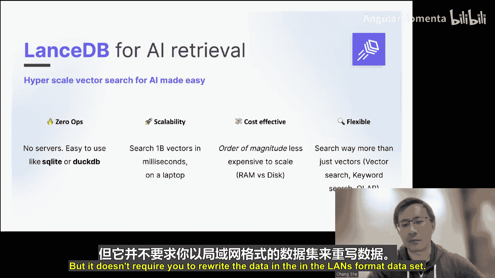

Just want to show you this like really small thing。

Right hopefully everyone can read the the font size here。

 so let's say if I import land CBbF Hi and solid it and i've got like a local file directory that I connect to as the as my you know quote unquote database right so i've got a table here that is。

You know， one billion right so you know it's a  one two。

34 five6789 a billion vectors if I let's say create if I just。Run a。Search。

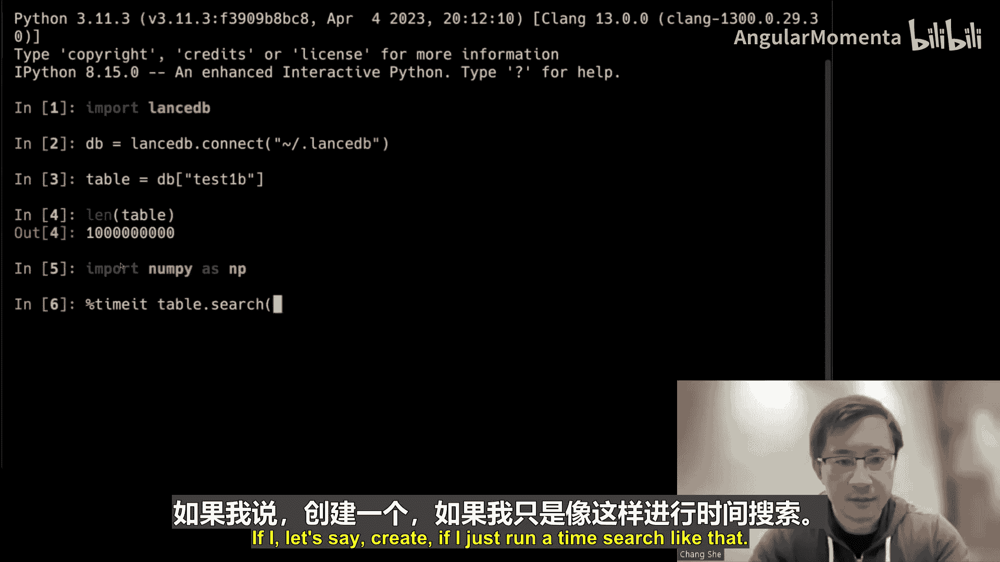

Like that so basically I'm generating a random vector each time and then in a loop and then I would say you know give me the the top 10 most similar vectors。

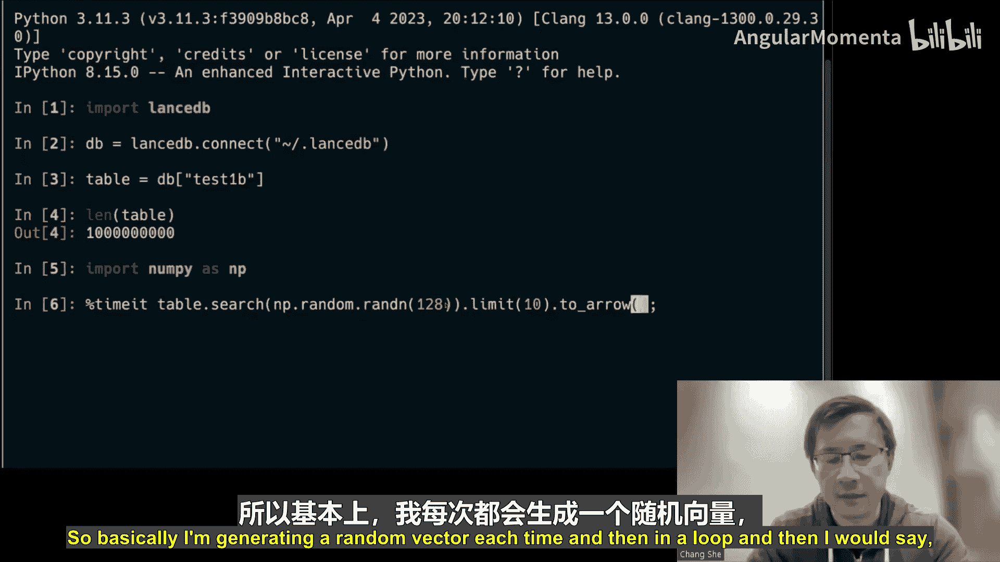

Right， so。If I run that and let's see right so you're looking at roughly three milliseconds per search over a billion vectors with pretty minimal standard deviation here。

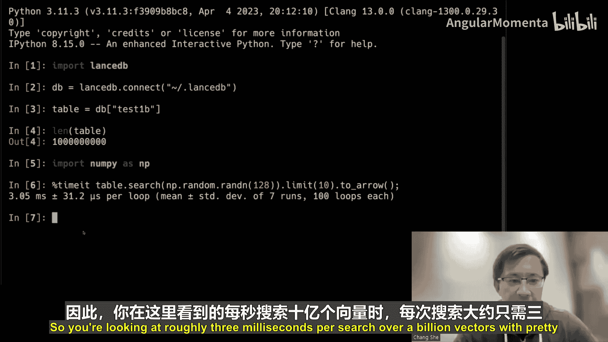

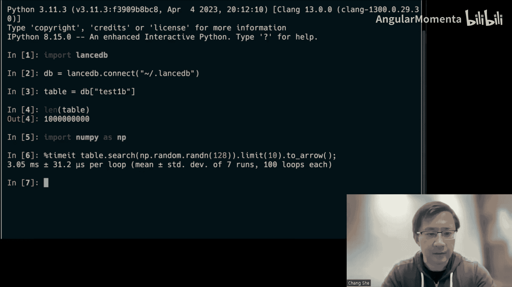

Okay， okay， so in that case， probably all the people was still sitting in the file system cache right。

 it never really kind of hit the disc perhaps， right？What do you mean？In that test that you just ran。

Oh you're you're thinking like yeah yeah it's not doing ios perhaps right at that time it's probably just getting so from the OS cache layer I mean we can do just do one query I guess I see I see no okay that's fine it go。

Yeah， okay。Yeah， I mean， there there is some there is some caching going on so， but like， you know。

 if we do， let's say if we just do time， I think that just does it once， right？I think。

Right so so yeah， so like that first time it's when it's reading the like the core index and the centros and everything from memory。

 so this is where you're looking at cold right but like the amount of data that you have to cache in memory is actually quite small。

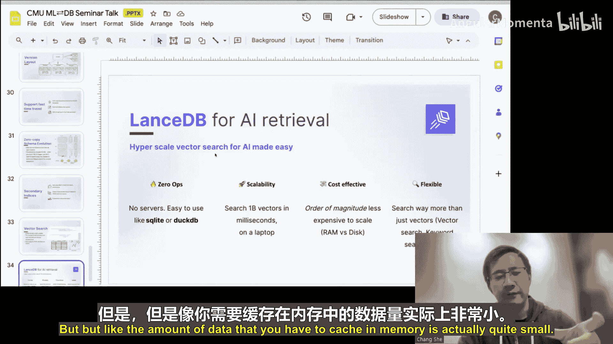

So here is what it looks like if I run it once。

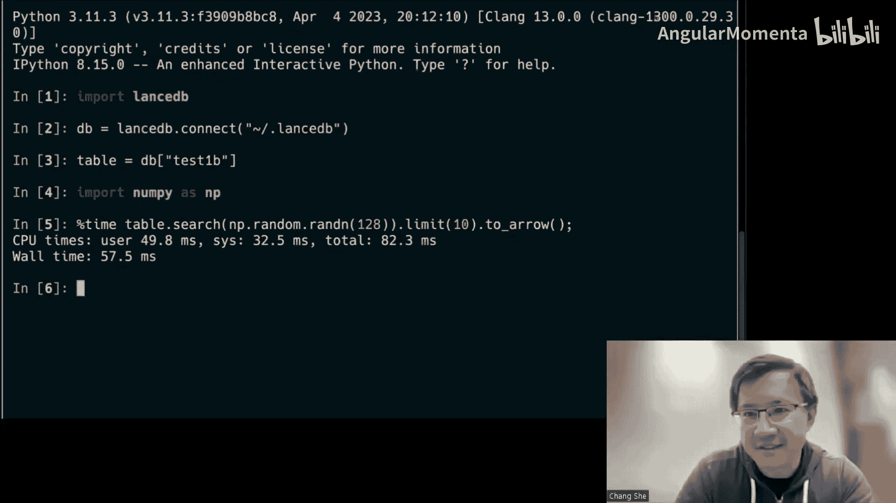

So that first time， because it needs to hit the disk to read the index。

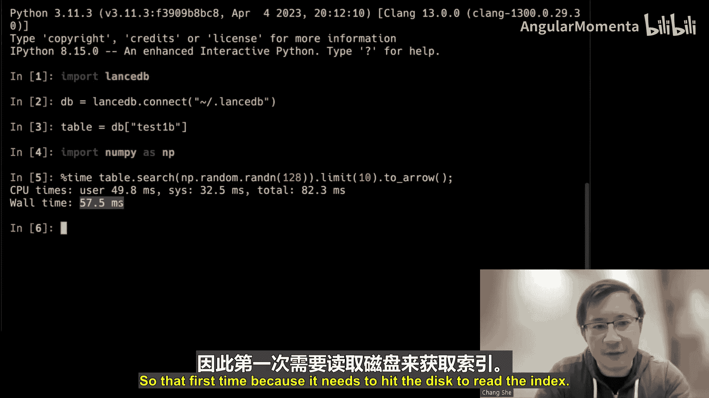

And some partitions， so that first time the cold is substantially slower。

 but then after that it becomes much faster。Right。So then like with with dis space。

 there is also like that cold star problem of caching things in memory or not。

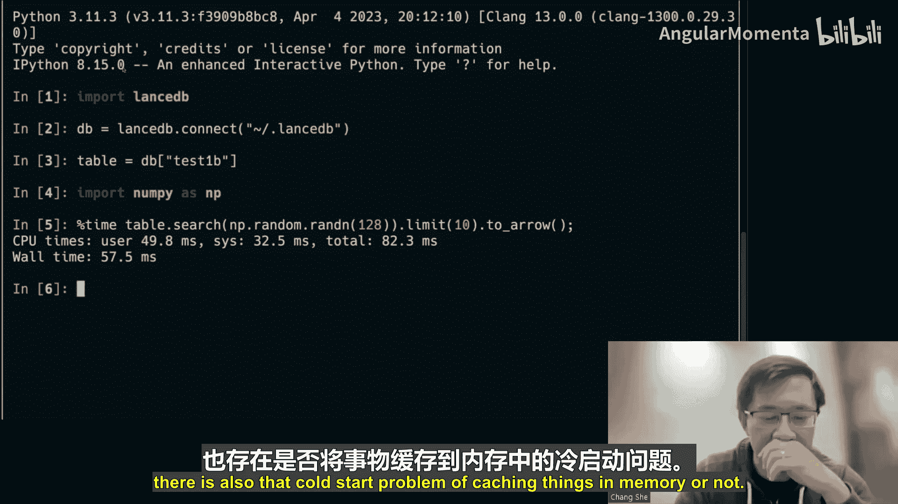

Great， thank you。Cool。Bed。Okay， so you know roadmap for the data format。

 we're currently working on like partition pruning stats。

 stats based pruning so like right now if you can use DDB with or you can use Lance data format with DDB but some of the predicate evaluation is still slower than what you would see with like parquet or delta because because of this and also because of other pushdowns right so you know with that we should see substantially faster predicate evaluation performance across the board will have more complete and all support so we support it for variable the binary encoder but not yet for the fixed width encoder。

So that's sort of table stakes right and the advanced encodings we talked about earlier like LRE and variable encoder and also thinking about like time series use cases with like Delta delta or gurilla compression。

 things like that。You know， we're working on scalar indices right now and then。

I think in the future we'll be looking at。Like things like data compression that can you know things like FSST or something like that that can also both compress and support fast lookups and then maybe I should learn how to count。

 but like last item is you know deeper ecosystem integration so that means like you know a spark data a native Spar data source or like having you know arrow and pandas or like DDB be able to work with L data sets natively rather than through just rather than through our likearrow our arrow interface。

You know， lastly， I to just want to say， you know， Lancea's team effort， you know， big thanks to La。

 who is my co foundunder and sort of the primary designer of the LNance format。

And then Will and Weston and Rok and Rob have all been making invaluable contributions to the data set in the past quarter or so and also many community contributors。

 I think land formatout would not be possible without them。

All right so that's it for the talk I hope it was interesting for you guys and it wasn wasn't you know things that you've guys already covered would love to get your feedback on the format itself you can find us on GitHub at LandanceCb/lashLance if you're interested in the vector database it's open source at you know LCb/lashLanceC and then we put together a bunch of examples called in a repo called vectordb recipes where you can build like chatbots to multimodal search applications to you know document search and things like that right？

So yeah， that's it you if you want to talk to us like we're on Twitter and LinkedIn as Lance C。

 and you can also join our Discord for sort of live support as you're playing around with Lance。

Okay awesome， I will cl on behalf of everyone， thank you so much。

 so open to the floor everybody has questions。😊，Yeah。

 I have a question maybe on the workload and a let others go， are you thinking， I know you're。

You have targeted SQL， targeted vector databases。You kind of see。

Applications that stress on both from where you're from the types of things that people are using landcho for。

 so just have to get your thoughts on what are the stress points in the applications that you're seeing。

When you say stress points what do you what do you mean specifically like the LiDAR example you gave you know obviously that came in from the IoT style domain and a lot of the stress point is very large data sets。

 it seemed like that was a stress point and mixing LiA cloud data along with other quote unquote metadata and then fast searches that are needed perhaps in real time so here is really yeah so I think it's a great question and here the stress points are really the complexity in the tool chain so it's in two places really one is if you look at recent examples from like Lama index and lane chain they talk about getting really high quality retrieval by using multiple recaller recallers and this could be like you have a vector retrieval recaller full text search recaller and then maybe like a SQL recaller and you can combine these results to get much better。

Retrieval results， but they but like at the top level these like top level libraries have to have this like logic of okay I need to connect to three different data store one for each type of recaller and then I need to figure out which types of queries go to which store and then。

And then fetchual results and somehow like sync them back up together right so whereas with Lance this just happens in one data store and you don't need to worry about like you know parsing the type of query and trying to figure that out you can just send it to LAC so that simplifies things a lot and then having the data and the metadata next to the vectors or your index also makes it easier you know down the road where you have to like fetch the actual assets to start it back to your users so I would say like those are the big stress points there。

Thank you。Yeah， its Chrisy， I have a quick question。

 sometimes you need to trial an error with data a lot。Before you say， okay。

 that's the data set I really want to deal with going forward and so there's lots of discussion and some tools that implementing branching and merging of data themselves。

Any plans on your side？So you can， so I think。With the versioning system that we have。

 it's pretty easy to implement branching already。Um，I've not seen。

I've not seen a lot of people that need to like merge data sets， if you will。

 like you definitely want to merge code。But like merging data sets hasn't been something that like I've seen that people want to do a lot。

 they definitely want to branch and manage different versions。

 which you can do today with with land versioning so that's sort of yeah。Okay， thank you。All right。

 someone in the chat is asking， what was the biggest motivation to rewrite and rust and how did that play out for you？

Oh yeah so this the biggest motivation was just productivity and so I think what happened was we started out writing C++ and then in December we were doing a little bit of a hack project to put together like a demo。

 a query system demo for like a prospective customer and we were like hey。

 it's you know it's Christmas let's give ourselves a little present。

 let's write and rust and through that project made us we had to rewrite。

Maybe like 10% of the repath for Lance to you know to hook into the Korean engine and we just found like a huge difference in how fast we were able to write in rust versus the C++ so that was number one and then number two that hooked us was like this rust safety and that you know it was。

We were a lot more confident to move very quickly and rest and make releases very quickly。

And you know， it versus like NC++， it was always sort of this like nagging anxiety ideas of like。

 okay， where is the next Se fault going to come from right and you don't you don't you don't feel I never felt like。

Good about releasing releasing new like super+OS binaries into the world and we just didn't have enough resources to like test it as well as say。

 you know， like the DDB folks have。嗯。All rightAny else， otherwise I'llll ask more questions。

Right my first question is what's the encoding scheme you guys are using for the the metadata like I think OrRC uses thrift parquets protobuff are you guys doing anything special there is it or you just using oh no we're using protobouffs pro okay and that was just for simplicity or yep for simplicity Okay yeah and also I think。

Yeah， simplicity and also I think the like schema evolution support。

Made it easier for us to like kind of modify like have quick iterations on the data format in the beginning without like breaking old data sets。

Got it， okay。Andrew， do you have a question？And he does not okay。Do you。

 do you guys compute any sketches or anything for？Like images， like， you know， for example。

If it's a high res image could like you know， a 100 by 100 pixel version of it or something like that。

 at least you potentially do initial filtering based on that and then decide whether you want to go look at the higher res image。

Right， we currently don't do that yet， I think a of those would be a lot of those would be forthcoming after we sort of sort out our likemantic semantic type support in the format。

Got it and then do you treat the mean presumably you're competing Zoo maps with like the the fixed length data？

Like a summarizations like min Max of columns and so forth so yeah so so the stas that stats work is ongoing right now so that will be happening。

And would that be stored within like the header of a row group or you think of that stored as a supplemental metadata？

So there's so there's like page level stats that will be stored with the fragment itself and then like the the like fragment metadata and data and column metadata will be stored can be stored externally so that right so for like object storage it'd be great to have that metadata stored elsewhere so that we can scan if more efficiently okay。

And this last one is sort of more of a philosophical question。

Why do you think it's a good idea to store？Like the vector index with the data。

 I guess maybe like if the index， if the indexes are versioned and maybe that's okay。

 but I'm picking like the use case of oh， you know I downloaded the new model of a hugging face and I want to now create a new know new embeddings for all my data like is that。

Is it just because everything's all together and it therefore makes it sort of from a software engineering standpoint easier to reason about it here's a directory of all the data for it。

Like yeah， so what was sort of the design philosophy behind that the motivation behind that idea right so the so yes。

 the index is versioned so that if you like if you。

If you like overwrite the data if you have a version where you overwrite the data set that essentially invalidates the index and you can regenerate it。

 but you can still roll back in time so you have like you can have a consistent index and data data state in version I think certainly having the two go together was ease of use for sort of query engines at the top level and users and then I think for and think like for us it was when encountered a lot of ML engineers just。

Having a tough time like managing the index separately from the data and then you know having to like sync up two or three different data stores because of that and it。

Kind of not only like makes their queries a lot slower so like end to end。

 but also makes their like pipelines a lot more brittle。Okay。

 awesome and then I guess unless if nobody else has a question，'ll ask sort of the last one。

And actually， you've kind of already answered it， but there's a。There's a， you know。

 I would ask like what what are the things you wish you had like LanceD or Lance the format had now that it doesn't have。

 but you already sort of listed out a roadmap， so maybe can you talk about like the big vision like where do you want Lance to be in five years？

Oh， that's a。Yeah， I mean that's a great question I think you know so my dream would be to make Lance super useful so that in five years if you're managing lots of multimodal data be an images to point clouds or videos or maybe some mix of like tabular data vectors and AI data sets that know the first thought on your mind would be okay I should be using Lance because it's really easy to use。

 it's sort of integrated into all the systems that you would use on a daily basis and you Ls would be of course like you know open source and hopefully it would be a standard where whether we are collaborating others or merg with other formats I think that would be the dream where we have sort of one replacement for like parquet and orRC in this new world where data is much more than just tabular。

Got it， okay。And actually， this one we can cut， but like， actually？

If you don't want to say anything publicly， what's the business model for this， right because it's？

It's plumbing and as you said， like you you wanted to be hooked in with someone's got something on Delta Lake。

 you can， you can suck it in there or like， you know， you know， if you have stuff on S3。

 you me the land format like what like what are you actually selling？

So right now we're working on a hosted service for the cloud vector database so that that's one commercialization。

 but there are lots of other applications around like compute and training and visualizations that can be built on top of this kind of infrastructure。

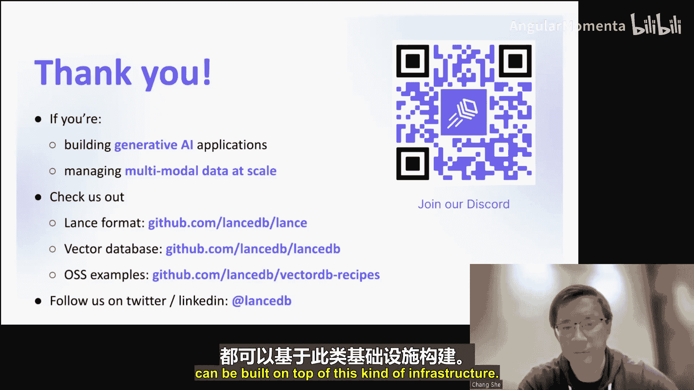