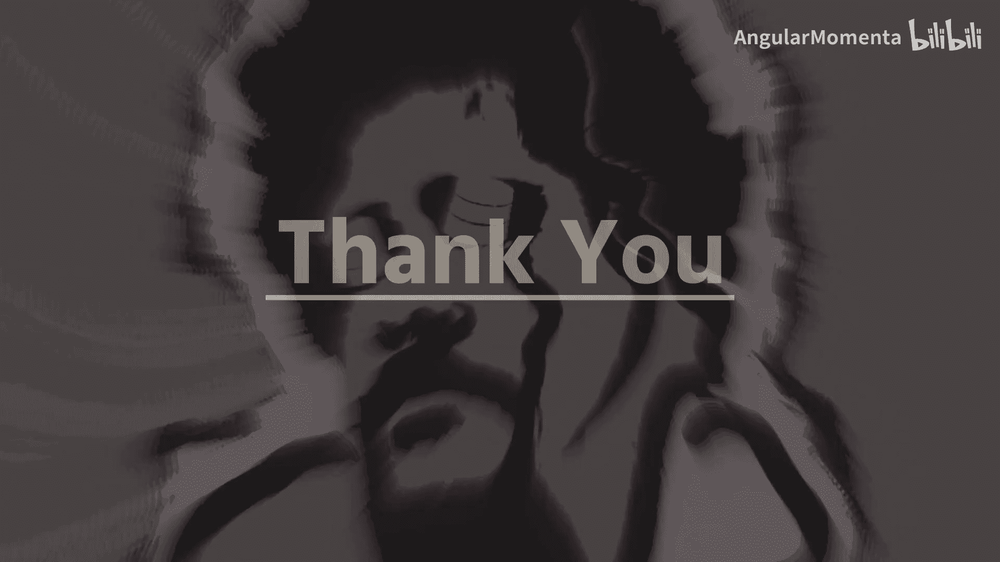
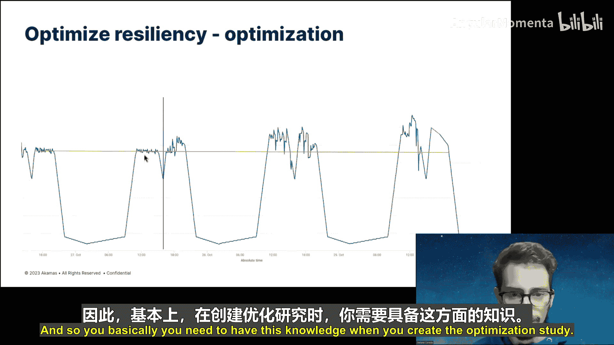

# 【卡内基梅隆大学】机器学习与数据库系列研讨会-｜-ML⇄DB-Seminar-Series-(Fall-2023)-p08-08-阿卡玛斯：自主性能优化--BV1zpiWBHE5k_p8-

🎼The databases for Machine Learning and Machine Learning for databaseases Sear series at Carnegie Mellon University is recorded in front of a live studio audience。

😊，🎼Funding for this program is made possible by。🎼Ggle。🎼And from contributions from viewers like you。

🎼Thank you。Welcome everyone we're here for another talk here at the Carnegie Mel University Data seminar series we're excited today to have Steano Chada he is a senior data scientist and at Akas which is an automated optimization platform his PhD dissertation at the Polytechnical Institute of Milan was based on Akas which then sponsor out as a startup so as always if you have any questions for Stefao as he's given the talk please'llmute yourself and say you are and feel free to do this any time that way he's not talking to himself for an hour in Zoom and with that Stefao the floor is yours thank you so much for being here I should also add you're in Italy right now you're actually outside Milan it's your five hours ahead so it's 9 PM but we appreciate you staying up late for us。

Thank you， thank you for having me here today and for the very kind introduction yes。

 I will talk to you about Akas which is a software for a performance autonomous performance optimization。

😊，And with this presentation， we will start by looking at what we mean by configurational to tuning so what is a configuration。

 why we should tune the configuration and what it means to tune it automatically。

 then we will explore as， we will see what it does， how it works。

 and how it differs from the automated tuning solutions。As we go on。

 we will make some practical examples using MySQL。And basically to demonstrate Akama's capabilities。

So let's start by looking at a configuration。We know that modern IT systems have a complex and multilay structure。

 and as an example we can have a look at the layers that allow the Cassandra database management system to work。

ガサならた人数わ。So this means that it runs inside the Java vehicle machine or the JVN。

The JVM in turn can be executed inside a Kubernetes or local container。

 or you can skip the container and go directly on top of the operating system， theuxux or Windows。

And at the bottom， you have the physical layer。And this can be either a physical machine where you run the database or a virtual machine in that case case。

 you will clearly have another layer for the physical machine。Now。

 each layer has a set of tunenable configuration parameters。

These are options that you can set in that particular software and they control the behavior of that software。

And by controlling the behavior， they have the shape the potential to shape the performance of your entire system。

 your database。As an example， we can start by looking at the machine layer。

 which is the bedrock of the IT infrastructure and so the choices that we make at this level have really far reaching consequences on the database performance。

诶。We can make different hardware choices or we can select different cloud instances。

 but basically the idea is that if you select a different physical disk。

 you have different input auto to performance so you will have a faster or lower database as a very simple example。

If we go up， we have the kernel and the kernel configuration impacts the system performance us as well。

 as prime examples， we can consider the file system or the settings of the CPU go or not。

The schedule of the CPU moving up in the stack， we can look at the JVM and the JVM settings play a really crucial role in the performance of the system since an configure the JVM will lead to an excessive time spent doing garbage collection and this has a really severe impact on the performance of the database。

Finally， we have the database itself and the database parameters are used to fine tune in the behavior of the database。

 so they are clearly are directing less on the performance of the system。Therefore。

 by configuration tuning， we mean the strategic selection of all of these parameters。

A teach layer of this。To optimize your system， your database。By opt。

 I mean optimizing a certain metric and this could be announ the throughput of the database。

 reducing the response time or improving the efficiency of your system。

 so basically to reduce the infrastruct cost。However。

 today is a complex IT landscaper achieving optimal performance through manual tuning。

Has become a formidable challenge。The reasons for these are manifold。

But it's essential to understand why traditional methods are no longer effective。First。

 the number of layers。It has expanded them。We we always have more obal layers in the system and inside each layer the number of available parameters have multiplied so the proliferation of parameters makes it increasingly unasable to manually fine two on each parameter basically because we have two many parameters to control。

Also the effect of many parameters is unclear or poorly documented。

 even when the documentation exists， it often lacks any insight into how a given setting might impact the performance of your system。

And so if you do a manual configuration tuning， you can just pick a certain value and see how it behaves。

AndTo make matters even more perplexing， the default value which are provided for many parameters are not always optimal and sometimes they are quite far from the optimal value as an example we can look at the middle figure in the slide and here we have the throughput of a database as a function of the cache size and you might expect that speaking with the default value for the cachehe size is a safe choice。

But counter intuitively。In this particular example。

 we have seen that both reducing and increasing the cache size led to performance improvement and this is a problem because if you're doing this experiment manually you don't have a a clear linear effect of the parameter so you really need to explore the。

The entire domain for the parameter and to basically see how you should set the the。Is valued。诶。

So this is not nice and finally we have an acceleration in the release cycle。

Basically the time between each releases each release is getting shorter and so there's no more time to do manual tuning before each release。

That's because IT teams are facing a race against the clock to keep up with evolving technology and the releases are so frequent that we can no longer do manual tuning。

So in this evolving landscape， the need for an auto and intelligent approach to configuration cuning becomes aant。

It's no longer feasible to rely on your manual efforts， The solution is in tools like Akas。

That can adapt， optimize and continually fine tune configurations for us。So let's now look at Akamas。

 clearly Akamas is an autoT andL and the idea is that it modifies the configuration of a system to meet some optimization work。

 this can be improving the service quality， reducing the cost。

 construction or increasing the service resilience， we can do many different things。

Our goal with AAMs is to create a machine learning power， the optimization platform。

 which supports as many applications and technologies as possible。

So Akas is not strictly a database tuner， we do not offer services like query schema optimization。

 we are not specialized in databases， however we do support some databases and so we can use AkaAs。

 we have use AkaAs to tune the configuration of the database。Also。

 we do support different layers of this stack so we can use Akas also to tune the operating system or the instance where a database is running。

So clearly Akas has some key capabilities which makes it different from other autounes and in my opinion the most important one is that it is a full stack autoter so it can simultaneously tune different layers of the AT stock。

Also we are technology agnostic， so we want to be as versatile as possible。

 we don't want to be constrained by any specific technology or platform。Now。

 tuning different layers of this stock is not only important to have more parameters to tunene。

And this to potentially extract more performance， but also to take advantage of some interdependencies between layers。

As a simple example， if you select a larger machine with more memory。

 you can give more memory to the database， so this example is simple。

 but there are more complex stuff that really when you tune multiple layers。

You can take advantage of。The second most important thing is that AkaAs is a goal driven auto tunea。

 there are some auto tunes which are strongly opinionated and they have an idea about how a specific application should perform instead with AkaAs the user sets the objective goal it can be again boosting the throughput in the response time or whatever function and when the user specifies a certain goal function。

 AkaMs will navigate the parameter space to find de configurationfiguration which optimizes that specific metric。

呃。fa can you talk about like what are you actually doing for that like assuming someone signs up says I want to optimize throughput。

 do you change what parameters you're going to tune do you change like do you change like what parameters you're going to tune do you change like how aggressive you're tuning things like what changes versus like throughput versus latency or cost well for the goal part depending on what you set as an objective then that will be the that we monitor during the optimization process so basically we have a machine learning models that maps the configuration that you apply to a specific scholar value。

 let's say and so these value depends on the function that you specify。However， for the second part。

 the second part， the next point which is the safety by safety。

 I mean that we have many different constraints on other performance metrics like service level objectives or maximum infrastructural cost and these constraints depend on what application we are tuning if we have some knowledge about that application。

Or actually on how we are tuning the application， but we will talk about this in a moment。诶。

And Bali this is a safety feature， I mean that basically during the optimization process。

 we make every effort to inspect these constraints and clearly at the end optimization we make sure that the final configuration aligns with the specified constraints。

The final point is that Akaas is a workload aware so we keep measuring the workload that comes into the system and we incorporate this information into the recommendation this is especially vital when we are tu work real environments。

 production environments。Where we are exposed to the real workload。

 which is noisy and it varies over time， so we must measure it and keep track of it。

So this actually brings me to the last point of the introduction， which are the two akamas flavors。

 let's say， so there are two ways in which you can use akamas。

The first one was our initial offering and it was designed to tune a replica system replica environment。

The idea here is that Takas clearly controls the configuration。

And also we control a load injection tool， this is a tool that creates a synthetic workload for the system and in this way we can compare different configurations because we are always testing against the same workload so we can easily compare different configurations。

In the second flavor， instead we tune real production environments。

 so here we work in the real world with the real system and the real workload。

 clearly there is no longer the load injection tool because we are exposed to the real load。

And here in this second flavor， it becomes paramount to respect the constraints that we were talking about earlier。

And also to move much in a smoother way because you don't want to make a broad changes in a production environment。

And also to take the workload into consideration because it's the real workload and we need to keep track of that。

走呃。We can now have a look at the first example where we see an optimization of MySQL where we assume that we are tuning directly rep of the system。

And so as an example set， we have used MySPL database。

ARing on top of youon to inside an Amazon El cloud machine。

We have used proitives to gather performance data， and we have used the bench base to create a synthetic load for mysQL。

So the first step of the tuning process consists in applying de configurationration to the system。

To do that， we offer some configs which are tailored for supportive technologies。

And this makes the configuration process really straightforward because you basically tell Akamas that you have a MySQL database and you boom machine need to give you some credentials。

 and then Akamas automatically knows which parameters are available。

 which are the most important parameters because we support that technology。

Which domains are feasible for the parameter？And more importantly。

 how to apply the parameters to the system。Clearlyly if a technology is not supported by AkaAs。

 we want to be a generic auto tuner so we try to make it fairly easy to integrate any new technology with AkaAs by providing some custom scripts。

 basically， however， in this example both my SQl I wound are supported technology so that was known to write custom scripts。

Notably also EC2 is supported by Akamas。But we have decided to not include it in this example。

Basically tuning this layer means to select which instance to use to run your database so if you switch the instance selection to migrate the database and these would make the example more complex。

 so we have decided idea to not do that。However， tu distance selection is a thing that we do quite often。

 most of our real optimization are with Java applications running inside Kubernetes。

 so if you have a container it's extremely easy to move it to another instance。Nonetheless。

 once the configuration is applied， we need to start the synthetic workload and for that we use the bench base。

We use a TPC sewer cloud with 100 warehouses and 50 terminals。

And we try to achieve the maximum outputput possible。

We let the test run for 20 minutes and during these 20 minutes we collect performance data using the promeus in this example we have used the nodeode exporter for the instance and the MySqL exporter for MySQqL that's just because promeus is really easy to set up and it made an nice example。

 but in reality we do support many other monitoring solutions。At the end of these 20 minutes。

 Akas collects the results from benchb and the matrix from Promeus。

Reading the output of Benbase is really straightforward because there's a nice CV file that you just import in Akas。

Auttoomatically， so it's straightforward whereas for promeus。

 we have mysQl and2 which are supporting technologies。

 so again Akas knows which metrics are important for these layers。

And how to query pros to get those metrics。With this information。

 we use the machine learning model to understand how the configuration behaves， basically。

 we get a new suggested configuration， we apply to the system， we run a new experiment。

 we get a new performance data， we update the model and we have a new configuration。

 so basically we go on itly。And then we can either stop the process manually if we have found a good configuration and we are happy with that result。

 or we can let AAs go on until we exhaust the optimization budget basically。Now with this example。

 we have run two studies， two optimization studies。The first one。

Focused on two very important parameters of my SQL the buffer put size and the lot capacity。

And by tuning these two parameters， we increased the maximum throughput by notable 65%。

 so from 130 operation per second requests per second to 220 requests per second。However。

 it's important to say that achieving this result was relatively straightforward because the default buffer pool size for MySQL is 128 megabyte which for this particular workload is really not enough and so in practice most database administrator would have opted for a larger buffer pool size。

And essentially they would have obtained the same result as the study。Now， clearly with AAs。

 you can tune many more parameters for my SQL。And here we have just done these two parameters to show what I told you at the beginning so that the default configurations are indeed suboptimal for many realistic workloads。

And you can achieve a。Substantial improvements， even with very simple optimization。

What version of IQL is this？The last one I don't remember eight Okay and then it says experiment 13。

 so it took you 13 iterations to achieve。Like like double performance。呃。correct， well。

 it's the last version of My SQl because I ran the experiment last week and。

Basically 13 experiment because that's the time that it took me to stop the optimization study。Okay。

 so the best result was that， but actually already from the federal For iteration。

 we were already up to 60%。Basically because you have this domain for the buffer pool side and whatever you do apart from making it it smaller but。

The majority of the domain is bigger than the default， so it's easy to increase the flowput here。Pat。

 awesome， thanks。Andで。This same result holds for other layers of the stock。

 so there are a lot of parameters which have some optimal default and we should tune them。

So from this configuration we run another experiment。

 so we start now from my superer configuration with a big buffer pool size and we add the 27 parameters from the inscale。

With these parameters， we are able to go up to 255。

 so basically this is a 15% improvement if we compare it to 220。

 but it's a 25% improvement if you compare it to 130， which is the original performance。

So basically of the entire performance improvement that you can obtain by tuning MySQL and new system。

 two thirds come from MySQL and one third comes from the operating system。

 so it's still a substantial improvement。え。え。Clearlyly tuning to MysQl database can be done by an expert human database administrator。

But during 27 Linux parameters is an entirely different story and it's much more complex and it involves very different skills。

弄で蓝色 that are的。Potential performance gain that you can achieve。

And actually at the end of the optimization process。Aas gives you some insights into。

Which parameters contributed the most into achieving the optimize score so in this example。

 clearly the two my parameters are the most important ones。But then in the third place。

 we have the latency of the CPU scheduler。And this is really interesting because this result is very different from what we have observed in the past when we run similar experiments and this parameter was not among the most important ones。

So this led us to dig deeper to understand what was going on and why this parameter has become important。

And was sorry sorry， are you are you computing that relevance like are you competing that like her like thing you're tuning or is it like precomped ahead of time like how how are you computing that？

This is computed by the machine learning model， basically it's linked to the relevance that the parameters have in the model。

And so it's based on the result of the optimization process。

Can you share with the model you're using？We use a lot of models。

 the core of the optimization is by optimization of Bsamp processes。

 so this is linked to the automatic relevance determination that you have in the kernel of the Bsamp process。

Got it awesome。But it's not that directly actually one of the thing that I would like to do is to introduce a final step in optimization where you actually compute the relevance by starting from the baseline and changing one parameter at a time to the optimal one and see actually which ones are the most important one。

あま。Okay， going back to the reason for this result， we have observed that version 5。

13 of the Linux kernel。More specifically， this commit here moved the parameters of the scheduler in this directory is kernel debug scheduler。

 so they were marked as debug parameters。Now， this commit didn't change the default value for the parameters。

But by changing the part that you need to use to update the parameters。

 it broke some user space tools like Ad UnND， which are used to update these values。

What happens basically is that when you boot Linux machine， the kernel sets a value。

 and then the distribution during the boot process sets another default。

 which they think works better for your particular use case。

And if you break the user space tool the distribution no longer updates the default values。

And so you are stuck with the default from the camera。We have observed these behavior with to 22。

4 and that 8。1。But whereby this behavior， I mean that the default value is different between one version of the distribution and another。

And actually this observation was not unique to us if you follow these links。

 you will see that actually VMware reported this bug。

And they have seen performance degradation up to three times due to this new default in the parameters of the scheduler。

So the point that I'm trying to make here is that stuff like these happens a lot。

 there are these undocumented performance regression where something in the system breaks。

 you have some external library that depends on some other library。

 somebody change something and something breaks in the system and you have a performance degradation basically。

So this highlights the importance of having tools like Achemas， first of all。

 because they help you to understand that you have a problem because suddenly the performance of your system is different from what it used to be。

And so you see that you have a problem， but also with AAs。

 you really don't need to understand why you have a problem because you can just repeat the hearing of your application and solve the issue。

 actually in this example we had to look at these because we wanted to understand why the parameter became important。

 but in reality we could have just kept the result given by AAs and had all the performance that we wanted。

So。Until now， our discussions have been based on the assumption that we have a replica of the real system and in this replica we can conveniently test and fine tune configurations。

However， the real world is。Really different。To be more precise。

 our assumption has been that we have a replic environment。

 which is a perfect replica of the real system。This is not the case for two reasons。

Sometimes a replica environment， a preproduct environment does not even exist。

 there is no preproduction environment。And most of the times when the pre production environment is available。

It's not a perfect rep of the real system。So clearly， if you have two different environments。

 they might require different optimal settings。 So if you run your experiments in。

P production environment and then you move the configuration to the real environment。

 you might end up having a bad performance。The second problem lies in the workload so far we have used the synthetic workload。

 we have used benchb to test a configuration。And again， clearly， if you use different workloads。

 you might end up obtaining different optimal configurations。

So you do need to create a synthetic workload， which is a really good approximation of the real workload。

Howeverhoever this again is very complex because first of all the real workload is noisy。

 but then the real workload also changes over time so it's always different from itself so you cannot replicate it because it's always different。

You can just create a good enough approximation of your workload。But in practical terms。

 replicating the real work conditions is a very complex endeavor。

Because you need to prepare the necessary test infrastructure and the work scenarios。

 these is resource intensive and really time consuming this often is not acceptable so to solve this issue we introduce the second flavor of Akamas which is called ACkama Live where we tune the production environments。

From the point of view of the AkaMs user， we want to make this as simple as creating a live optimization instead of an optimization study。

 however， being the surface we had to make several adjustments to the algorithm。

The most important consideration is to increase the emphasis that we place on。

Adding the specified cost during the optimization process。

 so we do not want to violate any safety costing。This is crucial to prevent any disruption to the production environments。

The second point， which is important is so for databases， it's clear that like you know。

 you don't turn off FSync for transaction commits because you know。

 nothing makes stick the disc for the other things you're tuning like the kernel parameters or the JVM。

 can you give it examples of other sort of safety constraints you have to put in place？Well。

 basically there are many different things that we do for safety。First of all。

 it's kind of what you were saying， so we restrict the domain of the parameters to make it safer。

We also have some new constraints between parameters。Like very simple example。

 if you are tuning a GM inside the container， you don't create the hip of the GM bigger than the memory of the container。

And then during the optimization process in live optimization。

 we further con the domain of a configuration so that the change in two different configuration is really smooth。

We don't want to change configuration ofrup。我说。There are the the constraints which are basically a constrain is a performance metric。

 which is an unknown function of the parameters。 so again。

 you can create a machine learning model to。Map is a dysfunction。

And you can try to create a configuration which is expected to satisfy that constraint。

And basically the safety is how much you want to stay。Far， how far do you want to stay from？

From the boundary of the contrain。And also a nice thing that you can do is play with the uncertainty of the model。

 so if your model for a constraint tells you that a configuration is really far from the boundary but the model is not sure about this prediction you don't try that configuration and you play it safe and you gather more data and so the optimization process will be slower but for sure it's safer。

So it sounds like you're maintaining multiple Bayesian optimization models。

 one for the target objective， like throughput or latency。

 but then also for like memory consumption and other things as well， right？Yes。

 it's not a ocean process， but the idea is that。Can you say what models you're using？啊所以 then。

A lot and we decide them dynamically depending on the matrix that we get to an ensemble method All right so whenez can you describe who comes up with the constraints and how do they do that I this the customer of Amas or how do you measure the completeness of all constraints？

Well， for our supportive technologies， there are some predefined constraints that are inserted when you select a specific。

The application。And also we have constraints that are cross layers， so if you select let's say again。

 theJVM and the Kubernetes container， you get a contrain that links DJVM hip with the container memory。

Then there are some constraints on the。Basically on the response time。

 which doesn't have to degrade with respect to the baseline line。

There are some constraints on the resource utilization， which are always beneficial。

And on top of that， the user can specify some other constraints。Actually。

 even the ones that are added by Akas in reality can be removed by the user if they want to。

 I don't know why they should， but。As a user， you can do whatever you want。 And then on top of that。

 we add some。Some syntactic sugar， let's say， to the creation of a study and some constraints are added automatically。

I hope that answer any question。嗯。Okay， so that's it for the constraints is for the workload。

 we said that we need to monitor the workload evolution。

And actually here there are two technicalities that we need to talk about。Basically， when you。

Design an auto tuner， you are creating something that chooses a configuration and this configuration should optimize as an unknown function of the parameter and the workro。

And you also need to be safe。So you can control the configuration， you cannot control the workload。

 and so you need to decide which sort workload you want to consider basically you might have the night where the system is doing nothing or the day where the system is doing a lot of work。

And for these you have two orthogonal decisions to make。

 you can opt for a local safety where basically the auto tuner will give you a configuration that is expected to be safe only for the current workload and instead global safety where the configuration is expected to be safe for all the possible workloads。

The same decision can be made about the optimization so you can decide to have a configuration which optimizes the score。

on for the current workload so you are basically chasing the workload and the auto tune will keep changing the configuration to keep up with the workload evolution and you will always have the best performing configuration。

Or you can choose for an average optimization， so in this case you want to create an auto tuner which will find a single configuration which will not be the best one under all the possible work condition。

 but it's kind of an average configuration， it's the best tradeoff that you can make to optimize this score under all the values working conditions for your system。

Now， when we started working on Akamas live， we tried to create an auto tune for the chase behavior。

So to keep changing the configuration。Actually， what we have seen is that。

All of our users prefer the simplicity and the stability of a single and changing configuration so we have switched to the global safety and average optimization scenario and that's what we will see now clearly to do all of these you need to have some components in the system that track the water evolution and do some。

Some clustering and forecasting。Okay， so with that， we can move to the second example。

 which is a live optimization of Mysql。And here we have kept the same system to run the example。

However， we modified de configurationfiguration of bench base。

The most important thing is that we are no longer striving for the maximum throughput。

 but we are using a workload pattern that we will see in a moment， so the workload varies over time。

And also benchbase is no longer connected to Akamas， so we keep making queries to MySQL。

 even when Akamas is not running， there is no connection between Akamas and benchbase。

 so clearly this is not a production environment with a production workload but it is a good approximation because the workload varies over time and it's not connected to the tuning tool。

As for the optimization loop， the only thing that Akama has to do is to update the configuration which is the same as before。

 then we wait for a certain amount of time and we gather the performance matrix so basically there is no connection with bench B now。

When we apply the configurationfiguration， we can do two different things depending on how you set up AAs。

Basically， you can decide to have an automatic approval where AkaMs proceeds to implement the suggested changes without any human intervention。

Or you can opt for a manual approval step in this case。

 AAs provides the user with the opportunity to manually review and modify the configuration。

Before applying it to the system。This ensures that human expertise remain an integral part of the decision making process。

Also， we offered the option to propose the new configuration to an external configuration management tool that the user already has in place。

And then we wait for the configuration to be deployed to the system before measuring the new performance。

Clearly， his level of controller is critical in live production environments because the user has to remain in the loop because configuration changes can significantly impact the performance of the system。

Especially in the first iterations of tuning where the user has to gain some trust in Akamas。

 so they want to remain a part of the loop and check what AkaMs is doing。

As for the workload pattern here we have in blue， the throughput that we ask the bench piece to achieve。

And clearly it varies over time。In yellow， we have the response time for the baseline default configuration。

And the workload has some temporal variations。So we have a low work zone during the night from 10 pm。

 which is here， I don't know if you can see my pointer。Okay。

 here we have a we start the night here and we go up。

Am then there is an increase in the workload and it stays high until 2 pm。

Then there is a slight dip to 4 pm and another peak until 8 pm。The highest throughput that we is 135。

 which is the same value that we saw in the very first experiment。

 so this is the saturation point of the system we are stressing a lot in the database。And basically。

 this pattern lasts for 24 hours。The X axis is clearly is the time。

And each day we repeat this pattern and we also add some noise to make it more realistic。

So with this scenario we have simulated the free optimization。

 which are three ways in which ourquaes are commonly used。

 the first one tries to optimize the performance by reducing the response line of the database。

In the second one， we want to increase the efficiency of the system。

 so basically to reduce the resource consumption， so to be able to downscale the infrastructure。

And in the third one， we start from a bed behaving baseline。

 which cannot sustain the required throughput， and we use achemas to fix this problem。

Let's start from the first one。This is the same figure that we saw a moment ago and it shows the behavior of the baseline。

From this figure， we move to this one here， which is the same thing。

 but we have more percents for the response line。呃。Also。

 we have switched to all logarithmic axis for the response time。

So to be able to see all the percents and understand a little bit that what is going on。Actually。

 we want to focus on this area， which is the first pick， the highest peak。And as we said before。

 we are close to this saturation point for this configuration， we see that the response time is high。

 especially the upper parts。And they are also exploding when the footprintput goes up。

Here we have the behavior of a configuration after one day of tuning 24 hours。

And actually comparing different configurations with multiple workloads from a single figure is very complex。

So here I have decided to zoom in to the first pick to see better what is going on。

And what we see is all the percentages are lower。And also， if we look at the darkest line。

 which is the maximum response time， we see， first of all， that it is lower than in the baseline。

 but also that as the throughput rises， the maximum response time is not exploding。It goes up。

 but not as much as it did in the baseline， so this indicates clearly that we are away from the saturation of the system。

In these tables we basically have the again the response times。

 the various percentiles in the first table， we have the highest peak so the when we reach 135。

Basically it's the average of these minute here， but really the peak moment and as we can see Akamas reduce the response time for all the percents。

In the second table， we have the same measurement， but for the night so it's the average of all these 10 hours so the low part of the workload and again also in this situation there is a significant reduction in the response time even when the system is。

Far from this situation point。Now。This is similar to the first study that we saw the first example study because we are starting from a myCL configuration。

 which is really small。And so by increasing the buffer pool size。

 you can get a really good performance improvement so again this is a fairly easy optimization。

Even if here we are actually we are tuning the two mycycll parameters and the 27 Linux parameters。

 so we have 29 parameters in total。But seeing it， it's fairly easy。

For the second example is a little bit more complex because now we start from the tuned configuration for both MysqL and Linux。

 so it is already a really good configuration。And we have also modified that the workload pattern。

 we no longer go up to 130， but we go up to 100。And if you remember。

 the tune configuration could go up to 255。 So this is a system which is not close to saturation。

 and so there are resources which are wasted basically。

Our goal here is to tune the my configuration and the Dox configuration to reduce the resource consumption of。

Of our system。In these two figures， we have the baseline on the left and the optimized configuration on the right。

Again， comparing different configurations from a figure is difficult and also because I yet to make two figures。

 there are some differences in the scale of the axis。

But still we can see by looking at the blue line， which is the throughput that we are looking at the two peaks during the day。

And in black， we have the me utilization。Which is 90% for both de configurationfiguration。

 so there's some difference there。Whi is reasonable for a database because it will try to use all the memory and if it's not used by the database。

 it will be used by the operating system。Then in red， we have the CPU utilization， which。

It matches basically it matches the default button。

 but the more interesting thing is that in the baseline we have a CPU utilizationization。

 which is close to 584%。And in the tune of the configuration， we are down to 75%。

Also from the yellow line， which is the response time。

 we start from a baseline which goes up to 24 millisecond during the IS peak。

And for the tune the configuration， we go down to 15 or a little bit more than 15 milliseconds。

So basically after one day of tuning with 29 parameters。

 we are able to sustain the same throughput with a lower response time and with a 10% lower CPU utilization。

 which is quite a lot。Now嗯。Basically， this means that if you're running in a data center。

 these directly translate in a lower power consumption and a lower carbon footprint。

 whereas if you have a cloud deployment， it allows you to reduce the resource that you are located to this database and you can basically spend less money。

As for the third example， we have a so called resiliency scenario。

Here the goal is to fix a bad configuration， so basically it started from the default configuration。

With a small buffer good size and I used the higher workload pattern。So clearly。

 the configuration is not able to sustain this two button。

Because here there is a clear cap on the maximum outputput that we can achieve。And。

Now with the blue or maybe black line， vertical line。

 I have marked the point where we start that year and in orange。

 we have the maximum throughput that you can achieve with the baseline configuration。呃。

Now this is not a typical use case for Amas Live because typically you don't have a problematic configuration in production if you have this problem。

 you try to solve it quickly， not with Akamas。So here we would like an optimization。

 which is as fast as possible。And that's not the thing that we want to do typically with AAMA's life because as we said before。

 we want the configuration changes smoothotly over time， so this will take some time。Nonetheless。

 we can see that already in the first afternoon， when we start the tuning， we are already able to。

Get a higher throughput。And then we go we have denied basically。However。

 if we look at the next morning， we see that we are able to achieve a higher throughput and this throughput is even higher than the one that we reached during the afternoon and this basically means that even during the night akamas is changing the configuration again we are changing configuration every 20 minutes here。

And by measuring the workload that is coming to the system。

 we are able to create a model that maps configurations， workloads and performance。

And we are able to even use this workload area， this low workload area to gain insights into the behavior of the system with a higher throughput。

And so the next day， basically we have a better configuration。Then we go on with the tuning。

 we have another night when we do the same stuff。And basically at the third afternoon。

 which is after two days of tuning， basically one day here and second day here。

The system is behaving well because here there is no longer a cap on the throughput。

Actually from these did you so it sound like you said that？

That you recognized that that the nighttime workload， even though the submission rate is way lower。

 that you've identified that the workload essentially is the same as the daytime peak and therefore you can leverage that information so like meaning if at nighttime they start running reporting jobs that don't look anything like during the day you would you can automatically say up this is different therefore I don't want to learn from it is that what you're saying？

Yeah， well in this example we are always running a TPCC workload so it's always the same kind of stuff and we just measure the the throughput of the database and what basically what we are trying to do is to say if assist。

Behaves better with this configuration。Even when the throughput is very low。

 we can imagine that this configuration will be good also for the。

or the higher outputput in your specific setting， which is more realistic。

 you would also need to track the kind of operations that you are running on the system。

So you have different kinds of throughput， let's say。

Then basically you start by measuring the baseline over all the possible workloads。

And you understand how the workloads impact on the performance because you are not changing the configuration and so you just learn the effect of the workload。

 then even if you tune with the night workload，You have a machine learning model that is able to extrapolate some insights into the other。

 daily workload。Clearly， it's only a prediction， so here becomes really important the safety part of the algorithm because you have a prediction and you need to be able to。

To understand how reliable is that prediction。Because if you only see the night and you do a lot of tuning only during the night。

 maybe when the day comes you have a totally wrong configuration and so you really must take care of these。

yeah， so I understand that I'm asking you like it sounded like you guys you guys are doing this akama live now you you do identify that the workload hassh is different at night and therefore。

Don't tune based on that， is that correct？Yeah。And can you share how you're doing that？notて。Okay。

 that's fine， no basically it's with these machine learning models。😊，They map the yeah。

 the configuration， the workload and the perform and then we。We do some reasoning on that。Okay。

 and also another thing that we do is that during the day， well for this particular example。

 during the day， the system is really close to saturation because we have a bad behaving baseline and so we are really close to the。

To the constraints that we have for the system。And if we are close to。土地。

If the system is close to a violation， we don't modify the configuration as much because that's really risky so in this particular setting we do most of that union during the night because it's safer that。

So what we do basically is tune during the night， then maybe go back to the baseline or really close the baseline when the workload goes back to the daily workload and then we try to understand whether the model are correct。

And we can use the results from the night to get a better configuration。All right， awesome， thanks。

And so that's it for the deferred example。Basically we have seen that Takaas is a generic optimization platform。

 we try to tune as many applications as possible， we are a full stack optimization platform so we really want to take advantage of every layers of this stack。

We have seen some example from the live optimization， which is the most recent version of FaAas。

And inside live optimization， we've seen the Takaas prize as much as possible to see to be a safe autoer where it。

It doesn't。Heate some problems in the production environment。And also it is work aware。

 so as we were discussing， it is able to use the night period to gain some insights for the daily period。

And that's it。Thank you for okay thanks I will cloud myha everyone else we have time for one or two questions from the audience。

😊，Yeah， maybe I might ask one Stephano nice talk， this is a Jgnesh Patel and Andy's colleague here。

 two questions both related do you at any point in time see that applying the ML causes the workload the performance to actually change inign ways to it stabilizes or do you nearly always have an uptick and the second part is you know what's the worst workload is there's a broad characterization that you've seen thats super harder。

 does everything seem optimizable with the techniques you have？Well so far。

 I'll start from the second question so far we have always seen that there is some performance improvement that you can achieve。

For what regards the system。As for more the most demanding workload， the most difficult workload。

 the real problem is when you have a situation like the one in the last example where basically you have no clear way to understand what is the workload because here we have bench base。

 so I know that the workload would like to go up。But in reality。

 you don't have access to this information so you don't know whether the system is。

Esily a little bit above the the threshold or you are miles away from from the threshold and so you need to look at the response times and try to understand that so it's really more related to。

How bad or how close to the constraints the system is。Great， thank you。😊，But for the first question。

I think that。You really need to consider the technologies that you are tuning because they have different times to。

To show the effect of a configuration change。 and so you。Basically。

 you need to have this knowledge when you create optimization study。

