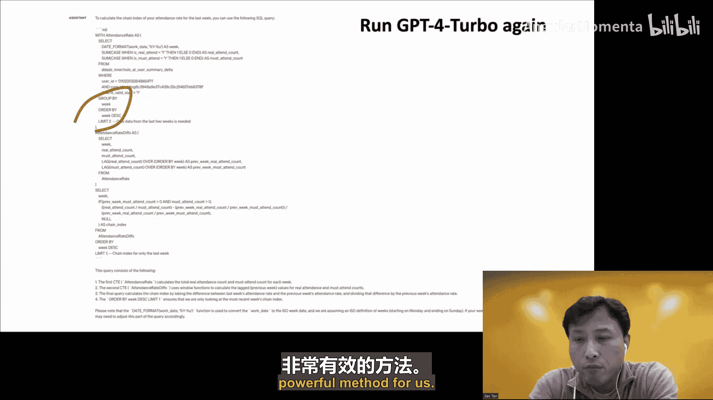

# 【卡内基梅隆大学】机器学习与数据库系列研讨会-｜-ML⇄DB-Seminar-Series-(Fall-2023)-p10-10-阿里巴巴：面向数据库的领域知识增强人工智能--BV1zpiWBHE5k_p10-

🎼The databases for Machine Learning and Machine Learning for Dataases Sear series at Carnegie Mellon University is recorded in front of a live studio audience。

😊，🎼Funding for this program is made possible by。🎼Ggle。🎼And from contributions from viewers like you。

🎼Thank you。Hi guys welcome to another Davis talk here at Carnegie Mellon。

 excited today to have GN10 he is a research scientist and director of the intelligent database team at Alibaba so here's talk about all the interesting MLl stuff they've been doing inside of the various Davis products that Alibaba's in building so as always you have questions for G as' giving a talk please unmute yourself say you are and far away at any time that way he's talking to not talking to himself for an hour on Zoom so G thank you so much for being here the floor is yours go for it Okay hello everyone its super it's exciting for me to be here Andy for inviting me so now let's imagine Andy gave me a title。

And I decided to。Let me。Insert a modifier in front the title。Let's call this intervention。Now。

 the title is。Handcrafted the augmented AI for databases。Almost immediately。

 some red alarms are triggered in the back of our brain。

Isn't that domain knowledge AI is from the first wave of AI。

Now we have almost past second wave using statistical learning and are now in the third wave using a large and deep neural networks。

Are you antit or even worse anti pattern？So in the first wave。

 people deduce principles and summarize best common practice。Risly。

Due to a breakthrough in neural networks， especially transform based based architecture。

 people realize that。Okay， using。General model with less hand engineering。

 when pumped up with large data sets can have some amazing emergent capability， for example。

 the same model can be used by completely different tasks and almost always give the best result。

For example， in spider leaderboard challenge， which is to translate natural language question to S statements。

Currently， almost all the top ranked。Submissions or solutions are based on chatGBT using either some kind of good retrieve methods to augment or。

Some very， well defined prompts。Proms are great。The only issue is that sometimes it may not always follow your instruction。

And for NSQL， I personally think that prompts a little bit too high level。And。

Some low level control will be needed， or here comes today's new message。So。

I think it's possible to insert。Precisely。In a very low level。

 handcrafted interventions are into the system， such it is far more efficient and sometimes even more effective。

 even small models can be effective， can be mighty。Okay， AFDB is a big topic。

 and today I'm going to use two real systems that have been developed from our team。

To explain to you why introducing introducing interventions can be helpful。

The first system is secret bridge on NT Se， second is on Shaplely IQ about Devops root cause analysis。

And就sequ。So the input definitely includes the original question， but that's not enough。

 we also need the schema data information， including table name， color name。

 some other constraints such as type information， join relationship。

 a primary foreign key information， et cea， sometimes you even need to consider SQL dialgs， example。

Q top and limit。That are used by super server and MySQl respectively。

Here is one real example on the right hand side is the SQL statement generated from SQL bridge。

I use this example to illustrate the challenges in deriving a SQL statements。So the question is。

 what's the average life expectancy in the countries where English is not the official language？

At least there are three challenges first we have a in the well cross we have a subry。

 second in the sub， we have a drawing relationship。Third。

 we need to map one phrase from the question which is official language to one of the column that is called is official notice that here is official is of type Boolean so we can only assign value either true or fourth or maybe done as well。

 but here in order to make it to be correct logically correct we have to assign a value true to its official。

And。😊，In the auto query， use a not in operator。When we develop Se bridge。

 one of the most commonly asked questions from my colleagues is。

Since all almost all the top ranked solutions from spider leaderboard are based on chat GT。

 Why not just fine tune a large language model。And optimize your prompts。In order to answer this。

 let me try to compare GPQ with SQL Bridge。Using some examples。

Here I want to emphasize the following examples are used actually are selected。In favor Silbri。

 therefore don't read too much into it， it may be biased but my purpose is to show that even the amazing GP4。

 including the newly released GP4 turbo， can still make mistakes。Okay， the first question。

It's from Spider。 Find the name of the maker。That produced some cars in the year of 1970。Actually。

 the prompts。Is pretty long。 It's actually from the number one ranked solution from Sp before November 2。

The promise consists of two parts。First， you need to provide the data schema information then。

ItThis prompt uses some additional algorithm to find similar problems from some repository。

So these similar problems include the natural question， natural language question。

 as well as corresponding SQ statement。So you can view it as if it's a retriever augmented solution。

However。Here atGT44。Made a mistake in correcting in in finding a generating a wrong column。 Okay。

 this column even doesn't exist in the table。 The correct one should be model， but not no model I D。

This seems to be minor。 Okay， however， even after you correcting this mistake。

 there's another even more tricky problem。Where model and make ID， they cannot be joined。

 there's no joint relationship。Cecerbri always guarantee consistency。Actually。

 this is not a new idea in the literature， there are a lot of work that uses this similar approach。

So we our core engine is a transformer based encode decoder， it will generate some hidden space。Okay。

 and it will use a dedicated module to measure how similar this hidden state respect to the columns that from a table。

 Okay， in other words。We always。Select a column that exists in the table。

The novelty actually comes from how we make this to be principled， which will be explained later。

Okay， own the schema graph。Under the assumption， under assumption that supposes our core engine。

 which is a transformer based network。Gives the right column。

Then we just compute the minimum standard tree on the schemagraph。

 What's the schemagraph iss just a tree where each of the table is represented as the node and is connected by with these associate columns and if two column。

Has a。Join relationship， then they are also connected， okay。

By searching a minimum spend standard tree。Are we guarantee that we always return a valid path。

Which is also at the shortest。This issue， this actually is further illustrated in by the second example。

Here we have only one join， but a GT hole have three joins。There's an even more tricky problem here。

GP4 selected two columns， the first column actually isd by an aggregation aggregation function。

 In other words， this next aggregator will only return a single row， a single element。

 but the second row actually potentially can return multiple rows， which is a set。Now we have a rule。

 right， So we need to insert this rule into the secret generation。

 The only issue is how where and when。Recorded we have an engine， right。

 The engine is based on transformer。 It has its own running mechanism。

 We don't want our insertion to blow up our engine。Talking about the rule。 Here iss another rule。

Suppose we have a group by， then we can only select columns that have already appeared in the group by。

AtO， we have an aggregation function in front of the column。So this is another rule， the climex。

Of this observation is they realize there's only finite number of rules for us to consider。Okay。

 here's another very important example。G4 generate count population for the phrase， How many people。

Which sounds plausible， but actually is wrong。 The correct answer should be sung， because why， why。

 Because population has the inter type。It makes more sense to make sum of all this integer type to compute the total number of people。

 right。嗯。The reason why Silbri happened to make a correct answer in this case is because we actually use a dedicated classification module to handle all the operators。

What's more important？😡，Was more important。We can hand pickick some hand engineered features。

 For example here， we can use the type information to enhance this very simple classification module。

Okay。It turns out this methodology of using dedicated module to handle。Abs concept is very powerful。

Whenever we have concepts that are very difficult to be generated， we have two options， okay， either。

You refund， you， you tune model using some similar samples， which require some manual label。

Labeling work。Or we escalate this concept to be part of the grammar handled by this dedicated classification module。

Yes have question we have a question can you please explain what SequQL bridges here Sequel bridge is just a name it's an internal name for our product。

It's a。I know probably you are talking about another similar work which uses bridge。

 but a single bridge is just a name for our internal usage。

I guess maybe he's asking like what is it actually just like a custom transformer that you guys。

 actually the intention is to bridge so because we want to make a data to be in DB。

This to be in in D M L， It will be part of the our database core engine。

 and it serves as a bridge to serve to provide the interface for the customers so that the customer can directly okay。

 input language model。 For example， it can just select。Ne a bridge。呃等。Within the parentheesis。

 just the。Provide your natural language questions。Then it should automatically generate a secret statement and give you the answer。

So maybe let's is this like athena based？NlP based transformation like not deep neural deep learning or does it use like a neural network okay。

 yeah， this is our core engine our core engine actually is based on transformer architecture。Yeah。

 but it's augmented by a grammar。Structure， we use grammar to introduce to induce some structure to the secret generation progress。

 The only issue is the how to make this to be principled。As I mentioned。

 we don't want to make these interventions to blow up our engine， right？

Because transformer has its own running mechanism that it's a hybrid between having something like is the new is the underlying DN。

 something that is Lama based that you fine tuned or is it something else okay great great question so maybe I can we will explain we will see all the details later but in short it's actually all the novelty comes from the decoder the encodeder is pretrained model we have designed a new complete new decoder。

 but which will be explained later but let's the first talk about this motivations I think this information this examples are very informative they actually give us a direction on and explain why we choose this direction。

Which will be elaborated later。 Okay， so let's see this is another example， as I mentioned。

Based on the feedback from our customer enterprise customers。

 they told me us that the train index is very important， however。

It seems that this training is very easy It's simple， It has a very nice structure。

 it's just defined the value in the current period。

 minus the value in the immediately preceding period and divided by the letter it has a very nice structure however is's super hard to generate it correctly in a complex sentence why because it may be modified by complex proposition of phrases。

 Here is one question， what's the chain index of the total number of stocks dealer Wei Miningzhang had in general last year。

ActuallyGP4。Made a mistake in deriving the correct time。This morning， actually。

 I just checked chapter。GP4 turbo。It turns outG for tu is much better。 It gives the right answer，ng。

I tested another relatively more complex example， partdon me for the small font。

 because this s is pretty long。The question is， what's the chain index of my attendance rate for the last week。

Okay， even though I myself have never asked such a question during my whole throughout my whole career。

 but I know this is a real question from our enterprise customer because it's from enterprise customer。

 so we need some additional information。😊，To recognize， what's the meaning of my attendance。

For example， we need to provide employee ID。And also， the corporation I D。

Those will be provided in the prompts。For ChaBT， for us is provided as a configuration J file。Okay。

 if you look at the button， interestingly， tuurbo4G 4 tubo， even list steps in China thoughts。

The high level。Steps actually are correct。Okay， the high level。Logic flow is correct。

 GT 4 Trbo knows what it should do。 However， it still make low level mistakes。

In deing the correct an。Time as well。 And， and it also even lost one critical information about crop split。

And a secret bridge， okay， it's just our product， it's a name。Internally used。

 internally used so far。嗯。It actually always generates。A structured answer。

Notice that here we didn't forget the corporate split information。And if you read it carefully。

 actually， it even generate。嗯。The time， okay。Internally。

 we are using a dedicated module to generate the time。 So far。

 we have test a number of different cases， including to simple one to complex ones。

 It seems that for single bridge， it always， okay， so far always generate the correct answer for anything related to chain index。

Okay， so far， I I think at least I have convinced you using interventions is at least a feasible solution。

 even though it's not a must， it's a feasible solution。Different people may have different opinions。

Maybe next year， Gu knowsGT5 may solve these problems completely。However， I can still argue。

Our model has only less than 400 million number of parameters。 Its ideal for。low resource setting。

But then you can rebutt。I don't care low resource， I'm rich。

So can you really give me one explanation？Okay。嗯。Here， let me make contempt。😡，So by drawing。

 by drawing an analogy。Do you think is。Professional courage is difficult。

Even though I'm not rich enough to play this game， but I think it must be difficult。

But interesting enough， I found that based on my experience from playing video game。

 I always I can almost always make right judgment on whether I should turn left or right。

 even though I still constantly make mistakes in the low level。

And this two levels seems to be natural now when put into perspective of Chsky grammar hierarchy because natural language is unstricted。

But for SQL， at least the most part。Is context free？

So here's one big assumption that I made only for NU2 SQL tasks。Only for NUT tasks。

 it may not hold for other tasks。It's relatively easy to understand high level meaning because because of the engine。

 I said I mentioned， we use transformer based。Incode deco architecture。

It has a very strong capability to understand the height of a meaning。

And then the long range dependencies。Since we are querying the database for the fact data。

So it seems that there's no need for us to memorize too much world knowledge。

So theoretically speaking is okay to use a relatively small model with the。呃。

Without too many parameters。ok。In other words， a small or relatively small model。

 it seems to at least should work。The only issue is how to precisely insert this low level control。

Okay， without blowing up our engine。 to this end， we introduce a new context freemar。

Which will make the whole generation process be structured。On the high level on the high level。

 we only generate essential information。Which will be assembled by the grammar on the low level。

 since we know。The grammar production rule， we， we know the rule that we are we are we are using so we can actually。

Attach associated actions。For example， here is a question。

At least the contracts that are about to expire when the contract is is selected。

We can automatically attach some other columns to it。

Our system is accurate and runs very fast because it has only less than 400 number of parameters with a very low memory footprint。

Okay， theres so yes， what do you mean， what do you mean by attaching like it's in the output like oh okay。

 attaching means that yeah， you you you in in the adjacent file。

 you can configure whenever this column is selected， we automatically select the other two columns。

For for any action， for any whenever these column is selected from this table。

 so this is just some action that we can easily configure。And this is this is just to like。

Because it's like it's one thing if it's the output and but the customer doesn't ask for it。

 then they get it， but you're saying for like if it's like a bunch of like nested CTEs or nested queries that ends up be no no。

 it's not not it has nothing it has nothing with a nested query。

 it's just for example in the question， it only asks about information about it list contractss。

 so it only lists the contractss。呃，It doesn't ask about the end date or commit information。

So but in order to while in some of the enterprise application， so we have some default setting。

 meaning whenever the customer asks about the contract。

 we only we will always attach the information about end date information as well as who are the comms。

So those are related to the business rule has nothing to do with a subquary is it fair to characterize this as saying there's this body of work in which people this is now eight years ago when people were trying to make it this work they were looking at natural language grammars and then frame to map it to SQL grammars and had semantic layer in between they would look up onologies and stuff like that to try to find matching and there are two things they do they do the suttry stuff for the joint stuff but for all the other column selections and stuff like that they'd use the semantic information most of the kind of work largely for English you are doing something similar except that semantic layer is replaced by this transformer which probably allows you to go multilingual pretty easily but you still have the grammar to grammar mapping is that kind of approximately what happens approximately is correct but the grammar wise so we realized that so first。

Most of the traditional work， it seems that their accuracy is not high。

 there must be a reason second， even though there's a lot of related literature that is gray based on grammar。

 they try to generate all the token in the abstract syntax tree。I think that's not。First。

 it's not efficient。 Second， it's not the right representation。

 Maybe it's not the right representation to generate to order order token。 Therefore。

 we change the grammar。That's why you introduce a new grammar， which is relatively more high level。

 As you can see later， it also allows us to do this passing in parallel。Okay。

 one key observation that you see currently almost all the work only generate one single token from one hidden state so I think I'm understanding it。

 then when you train the transformer， do you train it on S。

 you train it on the grammar that you have internally。Right。

 actually we need to carefully design the training set。

 which requires label to to work human work to label the data， but during training。

 we don't really need grammar。I see。 So you still click on SQL， Got it。 However， yeah， however。

 I think it's implicit。 Why Because now from our decoder Go it。

 all decoder will only generate segmented information。They will only generate segment information。

 They have some implicit meaning。And that will be automatically matched to the grammar Okay so so here is a key difference yeah anyway okay let's see well there are a lot of work because there are so many for us to list on this single slide and since time is limited I mean probably I would just go directly to the fourth category so so in this category there are many。

 many related work。Based on grammar。We learn a lot from them。

But I want to emphasize that we have some unique feature that we think are advantages。 For example。

 we actually instead of consider a subset of the s grammar。

 we actually consider a superet and rely on the post processing to further reduce it。 and then。

More importantly， this grammar allows us to do parallel multit learning。Okay。

 here is a very critical。 Usually one hidden state will only generate one single token， but here。

A single hidden stage。Will be passed into a multi task learning module。

 It will generate multiple tokens， in our case。Therefore。

 our parcel essentially is the is doing a parallel， parallel。 Okay decent par。

And we also introduce a way to introduce to make a long range dependency across multiple queries。

Let me explain。On this slide。This is the high level flow。

Which is what I called a parallel recursive descent parer。

So the whole process will be divided into multiple rounds。 Each round consists of three stages。

 The first stage， okay， is about pre processing。 It will only select。

 will select all the columns that have already been selected from the previous subqueries。Okay。

 so this is our method to introduce long range dependency。Then it goes through the core engine。

 This kind core engine relies on the transformer encode decoder。

 encodeder is just a pre trained model。Specifically， grandpa。

Od novelty actually comes from a decoder。Which I will explain in the on the next slide。

And this decoder will only generate segmented information。

It's up to the grammar to organize information together。And since now。

 this post processing module can look through the， can check the current。

You currently used a production rule。 It can attach associate actions to insert interventions。Okay。

 so let's first take a look at the grandma。But wait a minute。

Ist that grammar SQL already has a very well defined context3 grammar。Why introduce a new one。

The reason is because this new grammar， okay， it's simple I had version listed here。

Its relatively more high level。 It's a superet。 It gives super superet。

 So we rely on the post processing to reduce it。Importantly。

 this grammar actually allows us to do multits learning during training phase。

And in the inference phase， we can run multiple tasks， multiple inference tasks in parallel。

 which is much faster。So we start from a query and this query。

Consists of a unit operation that is called ary。And a query is just a sub queryry。

That doesn't contain necessary。What if it does contain a sub nest subry。

 then we will use a placeholder。Okay， the placeholder will trigger another round。

To generate another sub a。Critically， okay， here is very important。

We introduce a production rule that's called a cat， which is a short name for colon action template。

This。Cat will sequentially be used by select while having group by order by。But not by from， why。

 because catt only select column and from need to use table。Okay。So。Essentially， for secret bridge。

The whole sQel generation process can be viewed as a sequence of cat。

Why introduce smart task learning。So。Cat for cat， this production Who has 7 slots。

They belong to two categories， the first category include including aggregation， distinct keywords。

 operator and sorting order。The key is to observe that there's only fixed number of keywords。

 therefore we use a dedicated classification， very simple classification module。

Out of the transform layer to handle them。But the column and the value。

They have a variable number of items。 We use a ranking algorithm。

 specifically a point network to rank them find the best match。The novelty here is that。

All these multi taskask learning multitask learning are tasks。 actually， there are multiple tasks。

 right， All these tasks are conducted on the same hidden space。So from a CA decoder。

 the CA deco network。It actually contains full level。 It is a full layer transformer。

 followed by this multitask learning module。So the CA decoder will sequentially generate hidden states。

 it will sequentially generate hidden states， but each of the hidden states will be shared by this multitask learning module。

This module will simultaneously generate multiple token。And it's up to the grammar。 Okay。

 to organize them together。 I hope that this answers your question。 So the grammar is think it does。

 Then the follow question to that is。You have to feed this a large amount of fraing data right G4 picks up every sQL if can get and on let last amount of fraing data let me answer the question on the next slide okay I will answer this question but a quick question that for us we just need for us to fine tune just hundreds hundreds or at the most of thousands for Sp youd only have six000 samples and that's what we need。

Actually。Because we have some pre trained model， a bird model that's supposed to understand more knowledge from other samples。

 okay。Okay， here's just one simple example that illustrates the process to generate such a predicate in three rounds。

 and each run there will share the same hidden state。Okay， now。

 I hope that this this picture can answer your question。This is global picture about architecture。

 The encoder is actually just a 24 layer grandpa。 was grandpa is just a a。A fun。

 is's a function version of Bt。With a labeled secretl data啊。嗯。And the。Because it's fine。

 So so even though we did some modification。 even though we did some modification， for example， we。

 we changed a positional embedding and increase some linking embedding。 But that's not important。

 But because the encode essentially， essentially is just a grandpa。

So all the novelty actually comes from the design of the decoder。On the left side。

 we have this cat decoder。Which only selects columns。And on the right hand side。

 we have this from decoder， which select the table in the middle， we have this conjunction network。

 which is just a simple fit forward layer followed by softmax to select set operators。Okay。

 I think this example can further illustrate the whole process。

This example probably can answer some of your question， the confusing part。

So the so the input definitely includes the original question， as well as the database schema。 Okay。

 they are concate together and went through the tokenr。

And the the pre trend encoder will generate a bunch of hidden states as the reference。

 Then the decoder will consume this reference hidden states。Specifically for cat。

 it will generate a number of hidden states sequentially， for example， the first hidden state。

After is generated， it will fade into our multi multitask learning module。

 this multitask learning module will automatically generate average life expectancy。

ThisThis average is just an aggregation if you still remember。

 it comes from the classification module。The life expectancy comes from the ranking module， okay。

Then in the next hidden state， we generate EOS， which means end of sentence。

 it indicates that the select clause is completely finished in the next state we are going to generate well。

 in this case， well actually generated a nest turn token。

 it means that it will trigger another round whole round of the whole process to find a subary。

Notice that here well clause group by having an order。

 Each of the clause contains a E O and a sentence。 It means that all these clause are empty。

Now we have the auto query。We can collect these two columns， and concatenate。To the input。

Repeat the whole process。 we generate the sub query， and then we will use this subque to replace。

The placeholder in the audit query。Now we get the complete query。I hope that this flow。

 this example is。Self explanatory。Yeah， this makes sense so effectively you have an explicit。

Chaen of thought processing style happening inside your network there。Yeah， correct。

If you could get similar results and maybe that's part of what you might be exploring next。

 if you ask GPT with a chain of thought。Reelted prompt where it is to have to think about each of the clauses one at a time does it do better yeah that's a very good point actually this is also the the earliest point Ive made I think especially for if you have many。

 many detailed instructions。诶。At least right now I don't think G4 or G4 turbo can completely follow all your instructions。

 maybe G5 can completely solve it， I don't know， but so far if you make this prompt to even more complicated。

 maybe it will work it but it may miss some of the necessary information this is one point that I make。

But using a grammar， you never miss these rules， right， because it's。

Part of your grammar is part of your procedure。I's neverist。Okay， essentially。

 we are conducting top down BFS breakfast search traveral for for this algorithm。Okay。

 I think time is limited。 Let me jump directly to the。So the experiments。

 we conduct insurance on public test set from Spder note that this table doesn't contain the results on private test data。

 said。For hard and extra hard questions， which means that they contain drawing and nest queries。

 you see Seel Bridge has a clear improvement。In addition to public Se。

 we also asked our collaborators to test on their private data。And here are the results。O。Okay。

 so to now the data sets。Were the literals in the private data set in English or was that some of the language。

 did that matter？Oh， yes。 actually， is in Chinese。Our collaborator。

 they test in their is Chinese G2 G4 seems to doing well on Chinese。

 but probably not as good as English。 However， here the reason you may ask you may wonder why you only test G 3。

5。 actually 3。5 tu。 the reasons because we did test not me our collaborator， they did test G4。

 but somehow it never finish。So they only report this result to us。Okay。Okay。

 now let's talk about a jump to the second topic Devs root course analysis how many minutes maybe before you jump that just on that first part end know your running short of time。

 have you birdbench or are you planning to evaluate this on broadbench？So again wordbench yeah。

 that's a new benchmark comprehensive because I know we are playing around with data chat so happy to exchange notes if you're interested great great I think frankly I think so far in SQbri probably maybe one of the reason why chatGT maybe it's not their main focus I think one challenge is that we don't have a very big training set so far the training set is doing very well and for example spider is very helpful give a lot of guidance but if we have even bigger one that covers different say aspects of the grammar and and across different domains probably that will even better because we do have we do observe a phenomena one year ago we test。

on spider， we channel on spider and some other public available that says front that it has some。

Disistriional shifts to the private data。So if we have more data sets。That will be。Very helpful。

 indeed。Okay。The reason why I picked the second topic is because。It uses so called course analysis。😡。

And where interventions actually widely used for causal analysis。嗯。so。呃。

C database usually uses a so called microservice architecture。For microservice。

 for microservice architecture， in order to do this vertical analysis， iss triggered by。

An entity and KPI indicator。诶。So whenever， for example here it's just a delay。So under the hood。

 we have some kind of anomaly detection algorithm that trigger the root cause analysis。So the goal。

 usually for root course analysis， it requires some domain knowledge to design a cosograph。O。

 request the knowledge to design cograph。So the goal is to quantify the influence of all the factors on this course graph。

And fund wass the most likely。Factor that lead to this abnormalmous KPI。 For example， in this case。

 we have this red box。 pardon me， this is for the for the Chinese character。

 because this is actually copied from a real system that running internally。嗯。

Why why do we care about root course analysis So once upon time， there was a real failure。

On our cloud platform system。我们是。All of a sudden， a lot of the operations stop responding。

And the system generates thousands of normal traces per minute。

 And each trace actually contains hundreds of course。 let alone， we have thousands of machines。

 and each machine can have a number of measures， including CPU memory and a number of awaiting threads。

 So it's important to automate。The diagnosis。Okay， so what's the chograph from a microservice system？

In order to answer that first， we need to define introduce a working definition for context propagation。

 which is just to weave together the measurements， including metrics and logs from individual nodes。

And collect distributedreit traces。By attaching a unique I D to the request。

 when this request traverses。The microservice system。I think this is one real example。

 I think this is a very intuitive and self explanatory。

But the critical part is that to observe that this solid line represents a synchronous call and the the dashed line represents。

An asynchronous call。For example， D1 course database。Followed by Op P1 for post processing。

The the delay actually is equal to the summation of these two periods。However， for1万，1an is the。

Parent span of div D2。They run in parallel。 The delay actually is determined by the critical path。

 which is defined to be1 without the maximum delay。So this is what we call the max plus categoriess。

It turns out that Microsoft system。It's very easy。 we can directly derive the chograph based on the RPC quaqu relationship。

However， it' is not complete。Here we list the six types of issues。

We observed on our cloud data cloud database in addition to。Delay， we also have a utility seat。

Resource utilization。And some additional events。For example， software upgrades。

So it requires the main of expert to add some additional factor into the cosograph。

Because different causal graph can lead to different root causes。

Suppose we decide to add CPU utilization into this cosgraph。

We need a function to characterize the relationship with other with the delay， for example。

One approach is to use domain specific model， for example， QE model here。

 a poly formula is one from a QE theory。Okay。Here's the framework of our sharply IQ。

 It consists of forward pass， and a backward pass。The forward pass evaluate all kinds of counterffes。

 What's the counterffe。Oh， counterffeacty is just a what if question。

What if you change a subsets factor from normal to abnormal， What can you observe。

 So that's the kind of factor。Then in the backward pass。

We collect all these evaluations and make a summary to compute。😡。

A an influence score for each of the factor。 Here， we are using a sharp value with a new splitting insurance action。

Okay。So for the forward pass， we need to define a value function， okay。

 a value function for each subset of the factors。The tail is Wagna dog。So。

The weather function actually is the change of the KPI。

When all the factors in this set change from normal to abnormal。

And all the other factors remain normal。 Okay， here is one example， suppose。批问。Okay。

 changes from two seconds to three seconds。 It increases by one second using the max。Plus， calculus。

 we can compute。Its impact on the energy and delay。Okay， iss actually also equal to one second。

 So that's why the value function V P1 is equal to one。嗯。Similarly， we can derive the。

Val function for P 1， D1 D2 and D1 D2， okay。So。So。The next we go to the back backward pass。

In this step， we need to collect all this evaluation from the folder pass。

 collect all the evaluation。And make a summary。Suppose we are computing the influence of P1。

We need to enumerate all the permutation。For the factors here we have four factors。Then in total。

 we have a 24 number of enumerations。Now， suppose for one of the for each of the computationut。

 suppose we are P1， we are sitting in a line， right？All the guys sitting in front of me。

 let's name it to be said as the marginal change is defined to be the difference。Before and after。

 adding me into this set。For the first line P1 is the first guy right nobody sitting in front with him。

 so the marginal change is equal to v p1 minus vn v v P1 if you still remember is equal to1 from the previous slide。

 vn is naturally defined to be 0， That's why the marginal change for the first line is equal to1。

repeat the whole process for the一 for each of的栏。And then take average， we compute the influence。

For P one。Now we can repeat the whole process for each of the factor。

Here I want to emphasize that this is only an conceptual illustration。Why。

 because this concept illustration has an exponential computation complexity。

We actually have a far more efficient algorithm by exploring posity。Okay， this complex is O N log M。

But let's use this stay with this conceptual illustration。For easy and for easy。

 easy easy understanding。It turns out that the procedure that I described in the last slide exactly gives the sharply value。

Which is unique under the following three famous accents proposed by。Sharpply。

However it's not enough why， because the traditional sharp value only characterize the discrete factors。

 but here we have a span， each span represents a continuous time period and a time period can be further divided into sub subins。

 so we introduce a property that is called splitting invari。In addition。

 we also need to take course of relationship into consideration。In this line of research， actually。

 Shap is the first one that introduce Sha value used for explainable M， but it doesn't。

Consider course relationship。 A follow up work is called asymmetric shape value。

Even though it considers causal effects， but is not invarient on the splitting。

Here's one example that illustrates splitting variants。Sport Op C equals D in a for loop。

On the right hand side， you see the influence keeps decreasing。When you increase the number。F loops。

 okay， but intuitive intuitively， if the total length of the whole span remains constant。

 then we shouldn't。Then it should give the the same influence。AV。

 the ACsymmetric sharp value is not consistent with our intuition。Okay here's the example。

 well it's accurate and it runs very fast， order magnitude faster than neural network based approach okay now let me finish my talk with the concluding remarks。

AI for D B actually indeed is a is a very big topic。 Our team primarily focus on inD BML。

Including N SQL and loadable function。For in D B inference， as well as an ops。

Including scheduling anly detection， root cause， analysis and nobs tuning。I'm sure。

All these details from today's talk will be forgotten， but I hope。

The spirit can can still go through。One of the key messages is that。It's possible。

 even though it's not a must， it's possible。😡，To insert low level controls precisely into the right place at the right moment。

 to make general AI to be far more efficient。And sometimes even more effective。

Small models can be mighty。I personally believe that。This design philosophy。

Has a lot of practical value， especially for low resource setting with。Disusion shifts。Okay。

 so this is the end of my talk， thank you very much。I will applaud on behalf of everyone else。

 Jimmy mesh， it looks like you have questions you want to go for it right away。Yeah。

 why not does Zya have his hand up， no others than just go for it。😊。

I think this is super interesting。Are you focused on a certain class of SQL complexity。

 are the questions that people are asking usually？SQL queries that don't have deep levels of nesting single block queries or have you tried how this works when the resultant query is deeply nested and especially。

You know might the natural form might be a correlated sub query so we actually so first we do generate a sub subry but is not deeply nested usually depends on the I think it depends a lot on your training data if the training data usually is maybe two or three or four levels deep it is very seldom for for the neural work even equipped even even augmented by the grammar to generate a deeper one but you do mention one thing that I think is very good observation for example。

 I think here we have one。Example that shows that。After the correction using in search。

 we actually can maybe attach some very well。Tested rules for rewriting SQL。

To make it from a nest sequel to a join sequel。 right， So this equivalent。

 there are many rules that has been proven to be correct。

 So this can be automatically be incorporated into our system to make it。Not only correct， but also。

Easy to read and runs much more efficient。Great， and one last question then I' hand with a baton to someone else。

What part of SQL does the grammar not cover or is your grammar a superet of SQL Yes。

 a very good question So so this actually involves I think more work so far as I mentioned our grammar is a superet so far we our main focus is to satisfy our customers。

 our enterprise customer which is our collaborators for example。

 we are supporting holo Hollo frankly， is a subset of grammar it doesn't support many of the keywords。

 so that's the priority we are going to support but our because as mentioned it's a superet it gives a loss of flexibility to insert new rules it can be gradually make to be fully flashed。

That's also one of the。A key port that I want to make， for example， here。

 this is from turbo for GP GPGPTGPT4 turbo。For the question that I I showed earlier。

 wass my attendance rate in the past two weeks， right， even though this example is wrong。 Okay。

 the general one answers is， is not correct。There's an even more severe problem with these generations that okay。

 it's actually also the power。 it shows the power of GP 4 turbo。 It uses a lot of knowledge。

 it obtain or learn from others from a lot of other samples。

But it doesn't know that our whole system doesn't support many of these functions。Like like。

 it doesn' Hol system doesn't support it。 So even though we do provide it。

Few short learning example in the prompts。But somehow， G4 didn't only learn from the few shot。

 but also learn from its own previous experience。Okay。

 so this is something that we don't want the G4 or at least a solution to over I think。Great。

 I have one more question if no one has anything else。😊，Go for it。I know we struggle， but。

Nested case statements we don't generate SQL directly in data chat but when we use it for stuff in which that's needed it is challenging do you hit that case it is super hard to make it learn and there are examples but it's not that just a because this mix of declarative and procedural that gets in the way and it's super hard to make that work right I don't know if you guys hit that problem or if you do something to make it work。

Yes， actually you are guiding our direction of the development。Indeed。

 you are talking about exactly the point that we are I mean。

 a key problem that our collaborator are asking us， urging us to solve。So far。

 the solution we provided only provide a single shot。 Okay， is based on a single question。

 There's some easy fix。You you can by using a dedicated or separate algorithm， right。

 I can just combine multiple questions together。And it then't。Make it to be a single sentence。

By doing so， we can still use utilize our tool。 But this is one simple solution。

 but a better solution is。Basically， what the question you're talking about is that we have some。

 maybe some long range dependency across multiple。Questions。

RightSo how to you incorporate all this information together so that you can provide the best guess of the guessing what you are asking for to generate the SQL for the last for the latest question。

So far， we are we have a demo。 It's not a official product。

 but it's a demo internally used by our enterprise customer。 I mean， collaborator。

It's based on large language models。Yeah。And we depend on， in other words。

 short answer is that we depend on different algorithm。To make a summary。God yeah， thank you。

All right， I guess my last question would be like what's the。What's the you know。

 I think you said your accuracy was like roughly 80% for the test you've done like what's the remaining 20% is it SQL features or is it just like weird phraings in the natural language that it can't map to SQL itself like what's the like what's the next big thing for you guys to figure out。

Yeah。So this is a very， very， very good question， it requires some scrutiny on what exactly exactly the mistakes that we made。

Interestingly， we actually found some mistakes in a spider training data set。Yeah。

Even though it still can run， but logically is it's actually the same mistake that mentioned earlier。

 it actually pairs。呃呃。A column prefi prefixed with the aggregation function and a column Some of the query。

 some of the engine do run and return a randomly selected column row。So that's one of the， but。For。

Some of the mistakes that we are still trying to see how to。Improve it using two methods。

 Either we provide a more similar sample to make the to enhance。The part that we weak。

 or we can escalate some of the。Concepts， which are widely used。But are very difficult to generate。

 to be part of our。Clasifier。I think to this escalating concepts into a simple and robust。

그라ification케이션 module。Its a very powerful method for us。

