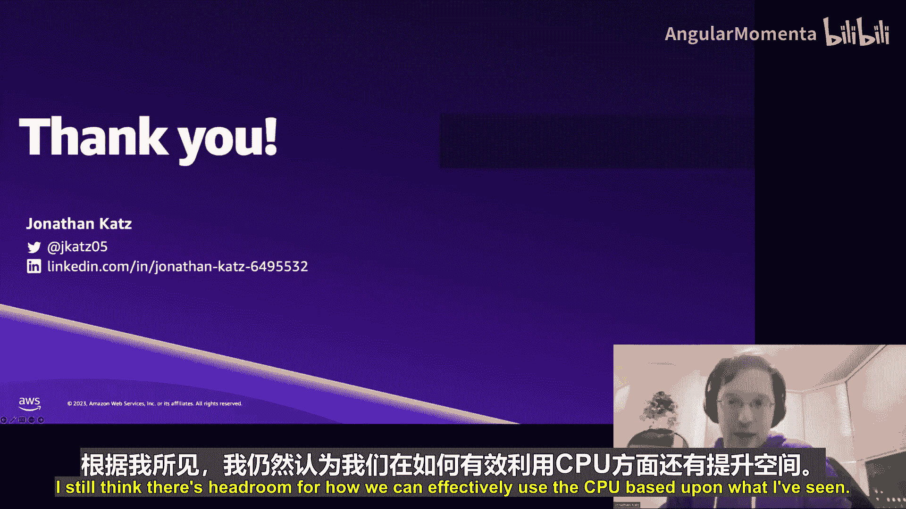

# 【卡内基梅隆大学】机器学习与数据库系列研讨会-｜-ML⇄DB-Seminar-Series-(Fall-2023)-p11-11-pgvector：时尚分层可导航小世界索引--BV1zpiWBHE5k_p11-

🎼The databases for Machine Learning and Machine Learning for Dataases Sear series at Carnegie Mellon University is recorded in front of a live studio audience。

😊，🎼Funding for this program is made possible by。🎼Ggle。🎼And from contributions from viewers like you。

🎼Thank you。All right guys， welcome back to another seminar talk here at Carnegie Mellon University。

 we're super excited today to have Jonathan Katz， he is a principal product manager at Amazon working on Postgres stuff and he's a core team member and a major contributor for Postgres so he definitely knows the internals of Postgres and the reason why we're here he's here because we want him to talk about PG vector where he's the number one no sorry the number two committer on the PG vector project with a staggering for commits。

So as always as Jonathan gives this talk if you have any questions please unmute yourself say who you are and feel free to interrupt any time the way he's not talking to himself for an hour on Zoom and with that Jonathan the floor is yours thank you so much for being here we really appreciate it thank you Andy so and for the record I'm very proud to be number two for P vector because Andrew Ka has done such an excellent job know and again I'm looking for people to like surpass me you know terms of internals are people who know the post internals way more than me。

😊，So the first thing I do want to thank Andy for like this wonderful title of this talk because this is not the。

 you know， the title actually I had given the talk I'm like， okay。

 whatever I'll go with it it it sounds catchy and you know I know Andy's very good at things like that。

But what's really exciting about PG vectors is if you asked me a year ago what PG vector was I probably would have said what are you talking about PG vector and they'd be like why do you need an extension to store vectors and Postgres so you know the world has really changed a lot in the past year particularly with you know the rise of generative AI these large language models and these very big systems。

And then the need to actually be able to store output from these systems and being able to query them you know。

 quite often in rapid detectionion。And allow what's powerful about Postgres is the ability to extend it and add more functionality to it。

 such as what PG vector does。And maybe that's like a good way to know dive into what we'll talk about today。

 which is really an overview of PG vector and the hook being how far it's coming you know even in just six months But first you know let's understand like why do we need these systems I did look at a lot of the talks that have been given during this seminar and I think a lot of them have covered AI but I'd like to at least accept the ground for know why is this important for for databases and then why is Postgreive vectors store Postgres you think relational database I'm just selectstar from pulling up some integers or some random text data stored why do I want to run directqueries in it and then we'll dive know once we understand oh gee like this can be a very good idea。

 we're going dive into Pg vector understand what it does and all sorts of strategies around using it as well as discussing to a degree how the internals work。

And then looking ahead and at the roadmap， because I think there's a lot of exciting things going on。

So let's dive in very high level overview and I think know a lot of the excitement around today is that let's say you have a product。

When I was design this product I was actually in my in-law house in Florida and I was in this like very you know I was in the sun room which is you know very Florida themed and I figured like okay let's say I have a store。

 I have a bunch of like products in the store that are around like you ceramic alligators and whatnot and I want to create this immersive experience where someone comes in and they're asking questions and they can get guided to the correct product。

So you know that's great you know we've seen you know we've definitely like you know seen this you know occur with a lot of the advances in generative AI over the past year。

 but how do we actually do that like how do we take that text information like all this data you have in your database and turn it into this application where you could be interacting with it in real time。

And you know what sets the stage here are these things called foundational models so again just to like level set everything you know a foundational model is basically this you know the way I describe it like this very large you know machine learning AI system that has trained itself on vast amounts of data。

 I mean it could be as big as the internet which you know last I check has a lot of data。

And it's able to look at all this data and build out models where that if you're able to like ask them a question in a natural language。

 it can produce a natural language response。It's looked over， you know a vast array of data。

 but the data is often publicly available。 And if you have data that's specific。

 let's say to your business to your organization， there's a chance that the foundational model has not looked at it。

 So in the case of my Florida theme product catalog， you know。

 it might not have access to know this information I've kept in my Postgres database that I've been storing know completely disconnecte from the Internet。

But that data can still be useful to query。And this is where a technique called Retrieval augmented generation comes in。

Retieval augmented generation or RA is a way to be able to add additional context or a foundational model and you know provide it with information that it might not necessarily have in this case my you know Florida repertoire so the idea is that you know normally let's say you take you know standard foundational model you ask the question like how much is a blueelin vase cost is's probably going to answer like I don't know because you I don't sell you know blueel vases you know I've looked at everything on Wikipedia I can ask you I can answer any question on Wikipedia but you not something that's you know transactional nature like that。

So the idea with RA is that you might have a knowledge base， you know。

 in this case we're going to talk about Postgres， you have you know all your product information in Postgres。

 you know， it contains your catalog， the inventory， the pricing data。

So that when a request comes in to say like hey， how much does a blue El vase cost。

 the foundational model， you augment the response to the foundational model with oh a blue E vase cost about $20 and it's able to return that and that's really cool because basically I mean there's a couple things going on here one it extends what a foundational model can answer but two you can use the information that's already in your database to get that。

So the next question is great， how do I combine the two。

 how do I take the information in my database to be able to augment these foundational models and you know the answer therein lies with something called a vector embedding。

NowAgain， I would first pause and say， you know， from an academic perspective。

 there's many ways to do this， but you know us being database folks。

 we typically want to try the most efficient way of doing it and a vector is a very effective way of doing this。

So vectors you know you know you give me first a flashback to taking real analysis back in college。

 which somehow I did a year of and I loved it， but I mean it's really you know for me it was like understanding how do things work in ndial space and that's exactly what a vector is is that it's a mathematical representation of your data。

In the case of foundational models generative AI， the idea is that you take some kind of information。

 it could be a text chunk， it could be an image， it could be a video。

You put it into your your foundational model or your embeddings generator and what you get is you get its mathematical or representation is a vector you know the way I describe it that's the magic of the the machine learning algorithm and I think you know to describe how that all works is you know likely a seminar in itself。

But the idea is that able by doing this， we're able to create like a common way of representing the information that we can plug either into other foundational models or used to queryrry against other databases to be able to have this work in a retrieval augmented generated its system。

So a brief overview， house is actually used in action。

So the one typical workflow is like let's say I have a bunch of PDF documents and let's say in this case you know。

 in our Florida theme store， we have a bunch of PDF documents about you know all the different products that we have。

And we upload them first we need to chunk the documents。

The way thedding embedding generators work the vector embedding generators work is that they take whatever text you have。

 you're able to give a certain amount of tokens， wordss， whatnot。

 and it's able to turn that into that vectorized structure。

So you put into embeddings model in this case， I use the Amazon headinging embeddings model。

And you can store it in a database， you know in this example I have an of our Postgres database。

 so that's part one for enabling Ra is that you take your raw text data， you turn into vectors。

 you store it in a database next to text junks that you use to augment the model。

Next episode is that you have a user your user comes into your Florida theme store you're looking to buy a blue elephant vase so first they ask a question how much is a blue elephant vase cost well you need to generate an embedding of that question and then use that to query against your database and that's where the vector is going to come in so you're going take the vector that comes that embedding model perform a nearest neighbor query which we're going talk extensively about and so give back an answer and then once you have that answer that's gonna to be the additional context you can give to the question to your large language model and your large language model is then able to generate an answer with the additional context and say your elephant vase cost $20。

So it's a fairly straightforward workflow and yet it's very powerful because basically you're able to apply additional knowledge to these large language models through using this very basic data type of vector。

 I mean that's what's so fascinating too that a lot of this workflow is enabled by doing a vector search or just using a vector which is something you learn in an inductory computer science course。

😊，And yet。I thisI call vectors a nasty data type because even though they're so simple on so many levels。

 trying to work with them， particularly at scale presents many challenges。

The first thing that we need to note is that it takes time to generate vector embeddings if if you have a text chunk and you need to generate a vector embedding。

 you know every single time it has to process it through the machine learning algorithm and that takes time。

So if you can't if you have let's say you have a product catalog this 10000 products for every single query you can't generate the embeddings for all 10。

000 products all at once you need to store that data somewhere and that begets the need for a vector database Okay let's say we're able to store all of that well one of the problems is the size of these embeddings。

When I was in college， if you had a 20 dimensional vector for a machine learning system that was that was a very large a very large vector and today like it blows my mind like I look at some of these LLMs I mean the standard size seems to be around 1536 dimensions today。

But， you know， this somewhere even larger。 And it just blows my mind。

 Like I I still can't even comprehend what a 20 dimensional vector is。

 And I care we're talking about like 1500 dimensional vectors like they're， you know， they're。

 they're going out of style。 but let's， you know， let's go a little bit further。

 So 1500 dimensions of 4 by floats is 6 kiloBte。And that's quite a bit of data that you have to store here so imagine you're storing 10。

000 of these you know that that's a lot and I think you know a million of these I calculate our 5。

7 gigabytes and that's just the raw storage of this information so a million records which is not even that much in a table。

But well these 1500 dimensional vectors are 5。7 gigabytes and this before you even think about any indexing。

 so there's a storage problem here。Now， when you think you start thinking storage problems。

 you start thinking compression like， okay， you know。

 I know you know I'll store this text in my database， but it's okay。

 I'll compress it down or I can store it out of line in Postgreors you know with To tables。

 but this data doesn't compress really well because think about it。

 you have a series of random floating point numbers within a vector。

And it's completely random like you don't necessarily know what they are there's no rhme or reason or pattern to it so they don't really compress in fact when I was doing some benchmarking against one of the PG vector indexes and know really looking into areas we you can you know try to get what's called some microopimizations。

 I actually watch toast try to compress the vectors and in the end kept coming up with larger values because you couldn't really compress the data and you're basically paying for the overhead of the header to be able to compress the information。

So all right， so it takes a while to generate the embeddings， they're very large。

 you can't compress them， I mean it must get better right well？ maybe you can query them quickly。

 but you know forgive you know the million records staying here here。

The key operation when you're comparing vectors is you want to find the distance between them and we'll talk extensively about that but there's no shortcuts to it if you're calulating the distance between two vectors you have to calculate it for every single dimension and you can see how long it took me to click through eight of these dimensions so imagine having to go through 1536 dimensions and granted you CPUU's GPUs are way faster than I can ever click a PowerPoint presentation but if you have to do that a million times against a million records within your database it's going to take some time you it's an O squared problem。

So the recap。There's a lot challenges just working in vector data。

 you know I think you know the one reason I find it so fascinating is because like it's so simple yet it's so challenging and in given you the prevalence of this information out there and the need to be able to retrieve it very efficiently。

 we need to find strategies to be able to query them more quickly。😊。

The good news is for the past 20 years， folks have been。

 you know folks way smarter than me I will add have been working on strategies to do this。

 and they developed this idea of approximate nearest neighbor。

So the typical vector query is exactly its neighborhood。

know let's say I want to find the 10 closest coffee shops to me you know that's 10 nearest neighbors now if i'm using a geospatial application I probably want to find those exactly because I don't want to to you know find out like the the closest coffee shop to me is in you know Pittsburgh not New York。

Approximate nearest neighbor can work in applications such as know for Vi augmentement de generation where you need an answer that's good enough。

 it may not be exact， but you know it's going give you a good enough answer so I'll be able to find a good enough you know blue elephant vase for my Florida collection。

So the idea is that。You know， the reason why it's approximate is that in order to do exactly nearests neighbor you have to search every single vector in in your data set approximately your's neighbor you're trying to get the best answers without having to search for everything so the idea is that you're looking over a reduced data set but more likely than not you're getting the vectors that you want to that you want to see。

The nice thing is that this should be faster than an exact nearest neighbor you know it's much faster to look at say like  a000 vectors than a million vectors and that's going to be able to give you more efficient results so on paper this sounds really good but the key tradeoff this is thing called recall。

Recall is a measurement of expected results and as soon as you get to approximately nearest neighbor。

 you basically need to you're basically having the tradeoff of faster searches。

 but you may not be able to see all the best results。

The way I like to think about recall is let's go back to that 10 nearest neighborhood court like I want to find the 10 closest coffee shops close nearby to me。

Depending on my algorithm， let's say I only return eight of the eight closed coffee shops in two close tea shops for a life a better comparison。

In this case， this is going to be 80% recall that I was expected to see 10 results that were matching my preference I only saw eight of them。

And again， this might be good enough because I might find like eight of the closest coffee shops to me and I'm going to be fairly happy with that answer。

 but there's a risk that I'm again answer that's not favorable to what I'm looking for。Now。

So keep in mind the trade off is that I you know I probably visited a lot less data in my database than had I know decided to do an exact nearest neighbor search。

 but I might have gone all the desired results and I'm hammering on that point because this is going to be the big tradeoff when we look at all the different algorithms you know within PG vector and just in general with vector similarity search is that。

I need to choose do I want my data quickly and around my data you know in the way you know I don't want to say accurately because machine learning folks you know give me death when I call it accuracy。

 but to the user it is accuracy like do I want the results that best suit my search queries。

One last thing before we dive into PG vector， you know， something I've been staring at。

 you know with my with my app developer hat on and maybe you know， Andy。

 maybe the fake background I could given it was that once upon a time I was an app developer。

 which was true， but I've converted very far away from that over the past several years。But you know。

 you， we like to always think about things like at the high end。

 like how do I look at things or how do I get things as quickly as possible。

 but when I'm an app developer， I need to consider like what do I want to do for ultimately you know using data in my application in this case vectors。

The first thing is storage。do I need my results as quickly as possible。

 do I want to be able to keep them in memory or do I have so many results that like I can't pay for enough memory in my system that I need to keep them down at the storage layer。

Because once I understand that I might understand my performance that sure I want I want to get the car that goes as quickly as possible。

 but I may not be willing to pay for that car that goes as quickly as possible。

 you know know skipmming head to like the cost parameter and also in this case there's new there's a new thing and this is like really weird for database people is like this you know this idea of relevancy because know from the relational database world when you write a query。

 of course you get the exact results back like you know why would you ever why would you ever not expect to get that。

And I can tell you personally like when I started playing with PG vector like approximate nearest neighbor was weird to me like I was getting results back。

 you know， I like， you know poor you know recall settings。

 I was getting results back that like made zero sense to me and I'm like what's going on and it's this notion that。

You do need to consider relevancy into your results。

Things like all these things are intention that you need to figure out you know what matters the most to you and again you can like take this box and you can build it out say like everything matters to me I'm going pay for storage and performance and maximum relevancy but likely what's going to happen is that you're going to have to pick and choose that relevancy may be more important to you but you know it's going to come it's going to come out hit to performance and it might end up costing you more you know based upon the system that you run so know a lot of these are the practical considerations that vector storage。

Now I want to get into one of my favorite parts of this。

 which is talk about Postgres as a vector store。And again to me。

 I'll say that a vector ultimately is a data type， which means that you can basically put a vector in anything that has a storage processing system and this is true of Postgres。

And you know one the first question might be， well okay， well why Postgre for one it's open source。

 you know Postgres has been around for over 35 years， actually。

 you know Postgss and I are about the same age at you know you know the rip old age of 37。

And it's not controlled by a single company know this is you know one thing that's had Postscriptres become very popular through the years is that you know it's very community driven I mean even today you know I was involved with a lot of different you know community projects and community work where it's not a single person making decision it's you know folks coming together and know coming towards a consensus on what the best design for you know something it you know might be。

But through the years and you know you know I was fortunate to know really observe this you know particularly first as the Postgres user and then you know Postre contributor at Vietnam on the coding side is the growth of Postgres。

 you know having the features you know in Postgres that helped it to be adopted know as widely as is today I mean and I would actually say it starts in the app developer just the data type support and the implementations of it just make it so much easier to build applications。

One of my favorite data types is the range type once upon a time as a company where the principal thing we did was scheduling and being able to store a range of times within a database and retrieve those very quickly was huge。

 it made it so much simpler to be able to manipulate that kind of data。

And that comes in the indexing support as well that you know， in the case of the range type。

 I could do overlap queries and have them returned in sub millisecond time as opposed to having to concoct my own custom indexing system。

And know these features through the years from Postgres have made it easier to run it both for small and large workloads which is their only help with the adoption。

 but the question becomes you know well why vectors you why now and I think the last piece that is missing on the slide is the extensibility of Postgres that if some things' not there you can add it。

 and one way folks have added things to Postgres through the years is forking in and creating their own database system but even if they don't forget Postgres itself was designed to be extensible back from the original original Berkeley design。

So if you don't like it， you can add the feature and package it as an extension and then you have it consumed by。

 know people on， all sorts of different Postgres。So that's the first thing it's like why you use postcoor vector search as well it's there。

 you can， you know， there is an extension for it， there's Pg vector。

But you know if you look at it from a developer perspective。

 can add in I can just add in PG vector and I don't need to do any additional work really it' you it works with my existing tooling。

 works with my existing drivers， there are some extensions to the existing drivers that can make it more efficient。

 such as being able to support the binary vector format for PG vector。

 but the is that I don't have to do much more work to be able to support in my application。

From a practical standpoint， it might make sense to collocate my data in the same database so I have my transactional oriented data and I have my machine learning data within the same database that allows me to use one of my personal favorite features of Postgres。

 which is the join， but it might also make sense just based upon how my applications interfa with the database。

And meanwhile， you Postgres you know this isn't like a one and done type thing is that you can work with other systems that process data upstream downstream and have Postgres either in the center or you know as part of that transaction because PostCres is the transactional store you might decide you know basically on any requirements that you do need completely inmemory vector processing system but you still want to have a place to store your vectors at the end of the day and maybe you don't need a vector index on top of it but Postgres can be there so you can load all of your vector data back into your endmemory system if there's one thing Postgres has been very good at the year it's storing data and being a reliable store for that。

So you said something about like there's certain client drivers that can operate on vectors more efficiently is that what you said so I'll give an example so Postgres is the JDBC driver so it's the way they can connect Ja apps directly to Postgres and if you go to the PG vector repo there's actually a P on the extension of the JDBC driver that allows you to take the vector stored natively in Java and transmit over the wire to Postgres in the binary format so instead of having to go from something like binary to text to binary you can keep it directly in the binary format and save a transformation。

Got it， okay， thanks。So and I think that's actually a good segue into what is PG vector since you knowve been you know。

 we've been talking about it， but we haven't defined it yet。

Quite simply it's an open source extension that allows you to do vector storage and search and you know some of this is you know I'd say product graising around what it does。

 but it does really break down to like what it is at its core and what I really like about PG vector is that it is very simple and the session what the ethos of the project that it's a vector data type that's really all it is for it's for you know being able to store and process vector data。

But that's the key that you need to be able to search over。

 and this is where the bulk of our talk is going to be for the of the day is that the indexing and searching over it。

You know， there's two index types supported where could get to know them very well。

 there's IVA flat and H andSW。Ovia flat is a cluster based approach towards indexing H andSW is a graph based approach。

 they both you know they both have characteristics that are you know they both have characteristics that are trade offs。

 but again we'll talk all about that。Searching， you know for good news for the database folks is that VISTA support exact nearest neighbor searches in Postgres。

 it also supports approximate nearest neighbor searches and you know again like the whole I tell you personally it took me a while wrap my head around how all of that worked。

I also just pause here too， is that Postgres actually has supported vector searches for a long time。

 actually going back to the Berkeley days and supporting exact nearest neighbor searches。

 Postgres has the array data type and with the array data type you can define a distance operation and be able to find effectively all the arrays that are closest to you。

It just doesn't have indexing support。The cube data type does have indexing support and supports up to 100 dimensions。

 which when it was implemented， I think back in 20002001。

 again like 100 who need more than 100 dimensions for a vector。

And it uses the gist index for it and you can actually do an efficient k nearest neighbor just search for everything that's around you。

But I actually stared at the Q data type quite a bit before embarking on the PG vector journey。

And to be able to extend it beyond 100 dimensions would take some work。And again， you know。

 as we'll see， there's reasons why。Ill also say I personally played around with Gist and trying to see how far we could take just for doing these types of searches and it is a very exhaustive process to be able to enable Canon with gistT so probably a much longer discussion for a separate talk。

Metadata so you can col information with your vector embeddings it could be text chunks it be you know your entire product management system and the nice thing is that there's a choice of distance operators you know you use the secret Postgres code for distance which is the you various Star Wars type you know fighters but the two most popular ones are the one on the left and one in the center which is the Euclidean distance and the cosine distance。

And what does that actually mean so here's a chart i'm actually really excited to start with this group because i've been trying to explain like how the different distance operations work and typically you know what I do is you know I have I often have some props on my desk that my two year old leaves so in this case I have a cat today and a red ball。

So Euclidean distance is line of sight， it's like how far apart are we you know we're looking at each other。

Then there's angular distance which or cosineesis which is angular distance。

 which in this case is measuring near the angle between two objects。

 I guess I have a flashlight too today。The one I've had the hardest time figuring out to how to visualize is the inner product and I've actually I've like you know scoured the web for the best way to visualize inner product and the best I can the best I've being able to come up with is it's kind of an amalgamation of。

The properties of both like a line of sight distance and an angular distance。

 but I've yet to find like a good visualization for how this looks and I'm a little bit concerned what I have here today might end up becoming like visualization because you know again like the inner product know back in back in my college days like all you did or you did you know once you get beyond you know elementary calculus is know everything's an inner product in some way shape or form。

 but you know I kind of cave myself and like stopping to question like how do I visualize this so this is probably more than I'll ever talk about the inner product you know in hopefully my lifetime。

 but given I have this group here was want to anyone have like a better way of know visualizing this。

Probably not or we just asked Chabt well again I've tried like I get back I get back you know like just mathematical answers or。

Or like C Euclidean or you know cosine distance Wait don't ask anything to chat GPT they're trying to figure out who runs open AI right now I'll run stable diffusion nowll see see what it spits out。

Thank you， I appreciate that。Anyway， what's also interesting so the distance operations， by the way。

 are the foundational portion of being able to do similarity search because you're basically trying to figure out how far apart of everything is from each other。

And once you have that， you're able to start indexing it because again。

 if we try to do an exact nearest neighbor search over a million vectors let alone 10 million or a billion it's going to take a very long time。

 I've tried it， it can take a very long time so we need to be able to index it。

And what's cool is it's actually important to understand how Pg vector indexes a vector because basically it does a normalization of。

 of yourer vector。😊，So a normalization is setting your your the magnitude of your vector to 1。

 So your magnitude， I always like to think， you know， when maybe you look at a vector。

 you see like the， you know， the arrow pointing somewhere and the wrong thing to say is the magnitude is your length。

 But， you know， it's simply in my head。 it's， it's the size of your vector。Um， and you the， you know。

 you know， you know， the key property of a vector is that， you know。

 you have a magnitude and you have a direction of it。

If you're able to eliminate the magnitude as an attribute your comparisons。

 then you only have to worry about the direction or ultimately the distance between two or more vectors in space。

So that's what Pg vector does when it's indexing effect。 like first。

 it's good check if it's a valid vector。 So， you know， a valid vector now has certain properties。

 But in this case， you know， for the purposes of indexing needs to have the same dimensions and needs to have magnitude。

 So it needs to have magnitude greater than 0。Then checks if it's normalized so a normalized vector is a magnitude of one and again you know ultimately mathematically you could you know know we could say it to anything right we could say a normalized vector has a magnitude of 10 and then you you compute you know map all the vectors to magnitude of 10 but you know mathematically we're just specific to one。

So we normalize it because what's going to happen is that ultimately when you're doing our index operations。

 we're going to be able to cheat and we're going to be able to take out some of the calculations we normally need to do in some of the distance operations。

 which most noticeable in the cosine distance which has some division operations based upon your magnitude for your magnitude is one you eliminate those operations and that's less CPU cycles need to spend and that's important because if you have to compare 1536 dimensions every single time you do a comparison between two vectors。

 you want to minimize how much time you're spending in the CPU or GPU if you have that privilege。

So this is this is an important， this is one of the things you might also take for granted too when you're using something like PG vectors is that it's doing this work behind the scenes to make sure that you're able to get the most efficient index searches。

Now。Could you vector as two indexing methods as I mentioned。

 IVF flat who stands for I probably I've said that， I know it's like inverted flat index。

 I know the IVF stands there's something else in the IVF that I'm block at right now an HNSW which is hierarchical naical。

 small worlds。Side note。I encourage everyone to read who's interested in listening deep to read the Digital HNS W paper。

 It is a welvetted paper and it is know very fascinating and we'll make another mention about it later on。

So let's compare the two methods， you know as I mentioned know before IVF flat is k mean space。

 so the idea is that when you have your vectors in a vector space is you're going to find a certain number of centers and you're going cluster the vectors around one of those centers H andSW is graph based where the best way to describe HSWs that you' create like this web of you know web of vectors all connected to each other and based upon how you traverse that web you're going to be able to put yourself into a neighborhood that has the most relevant information。

And I think you know that's the that's the key of this next bullet point which I share fast forwarded to is you know this this is how you already organize it IV flat it centers and list。

 you define how many list you want say 100 list and for each vector you put it into one of those lists。

With HNSW， you're going to traverse through the graph and you find vectors that you're most similar to and you're going to create a bunch of links that connect you to that neighborhood the idea being that you're positioned in a position in space that is going to be most relevant to like all the other vectors around here。

What's interesting is that this actually affects how you build these indexes because you need to be able to calculate centers in vector space for IVA flat。

 you need to have data already in the index， you can't start from an empty index。

 you need you know ideally you actually have your index。

 you know you have your table fully populated and you build your index around all those vectors。

You can iterate and add more vectors to an IVA flat index。

 but you need to have that index already built because those that's how you're going to define your centers。

Whereas with H and SW， it's completely iterative， you can start from an empty table。

 no vectors in your table， and then add them one by one by one or probably or if you have a very large AS set like concurrently or in parallel。

And you just iteratively build up that graph over time。So that's very interesting too， you know。

 based upon what you're looking at， but also this gives you some different properties for building out the indexes。

And finally you know if you if you look at insertion time for building the indexes ultimately the insertion time for IVFF is bounded by the number of lists so if you have a00 lists you're going to have to check 100 list to determine which list you go in。

 you have1 thousand00 lists you have to check 1 thousand00 lists。

 10000 lists etc so the insertion time when IVFF can be very quick but it's going to scale up as the number of lists grows。

Whereas with H andSW， the insertion time increases as the graph increases。

 you know kind of similar to what you might see with the Bre index albeit you're probably doing some more computations than you know being within a B tree index。

 So there's different bounding properties。 You know。

 IV flags going to be fixed by the number of lists that's going to affect your insertion time H andSW is just going to grow as your overall index grows。

So which method do you choose？YouThis is， you know。

 you' probably answer this more as we dive deeper but。

the first thing is that if you just need your exactly as neighbors， you don't build an index。

 you don't use an index， you're going to compute this just against doing a sequential scan of your data。

And remember， this is that tension we see between performance and relevancy if you need 100% relevancy。

 if you can't miss any results， don't use an approximate nearest neighbor index。

If your domain requires building indexes very quickly。

 you're going to want to use IVF flat because most of the work in doing the index is done up front is that you have to build the index all at once identify the centers and then it's very easy to add data to the centers IVF Fl well see also has some very nice parallelization today in MPG vector。

If you want to in it's easy to manage， I like to call it set and forget， you have H andSW。

The nice thing about HNSW is that I'd say today the defaults and PG vector are are pretty good。

 they were well tested and you might need to tweak them in terms of building the index。

 but generally very it's a little bit more straightforward with IVA flat is more tuning you need to do both the build portion and the query portion inSW I don't want to say it said and forget like all these different indexes require tuning but its it's a little bit easier to tune and if you're looking for high query performance and recall or basically a very nice performance to recall ratio then go with HNSW because that's really where it's excelling right now is that you're going to spend much more time building the index than IVA flat。

 but when you flip it around you look at query performance particularly query performance and recall HNSW has has been one of the leading algorithms in its class。

So from here on that we're going to deep dive and I'm just trying to be cognizant of time。

 are there any questions so far？I think you're good。哦。All right。

 so I think the best you know the way I like to do this deep dive is going to the you know the best practices because through the best practices we need to explore how these things work and the first thing to keep in mind is actually storage like how do you store these vectors within Postgres an important aspect here is toast the oversized attribute storage technique。

Everything in Postgres is bound by the AQ byte page size， or I should say anything that's bounded。

 everything in Postgres restoring is bounded by the AQL byte page size so long as you havet forked or recomped it to modify the page size。

So if you have a value that exceeds a kilobytes， we're going to have to store it out of line and that's what the toast system does is that it's able it's basically a table that's separate from your he table and it's able to keep pages that isten beyond that8 kilobyte limit they really by default Postgre start sting values over 2 kilobytes and if you have a 1536 dimensional vector Postgre is going to toast that。

And what's interesting is that you this does， you know。

 this will ultimately affect performance in some way。

You know what's good is that you know Postgres I think you know most things in Postgres are configurable and you know and how you store your data in the column。

 you know you can select that， what's interesting is you can't do that create table time。

 you have to do an alter table command to be able to set the storage and that's something I might bring up to the list as I say that out loud。

The two to keep in mind here today are actually the three to keep in mind are the first thing plain extended external。

Currently the default in PG vectors to use extended。

Where both you store your data out of line once it exceeds the toast threshold and you try to compress it。

 but as we know we can compress these vectors I've tried。

 I believe PG vector is actually going to shift to using external in the060 release so it's a default for now but it's going to shift to external the other is to use plane plane is where the data is stored in line with the table so instead of storing your6 kilobyte vector out of line you know in the toast table it's in the you store it in the heat table。

Now， why does this all matter？You knowTically， you know one of the thought processes behind toast is that when you're storing this large data in Postgres。

 it's probably not the hot path of your query， you know， you originally was， you know， well。

I apologize know how you originate because I've talked to Jan We about this but you think about it like you're starting these large text blobs。

 you're probably not querying into them all that often or if you are like it's going be it's not going to be an index right it's going to be you have an index that's going to reduce your data set down to something relatively small and you're doing probably some pattern matching on query or you're just going to be searching like everything anyway but it's going to be a fairly infrequent query so it's okay to store it out of line because it's not on the hot path but your 1500 dimensional vector is in the hot path like you are actually performing those distance operations on it so we have to make a jump to another table the other thing is that you know the Postgres planner you know did not necessarily conceive of a world where you're querying over very large data that's outside of your hot path so let's take you know for example you 120 dimensional vector so this is going to be stored in line in your heat table and we're going to do sequential scan on it and we can see that Postgres is planning。

6ix parallel workers in this case for querying all this data coolol so let's do the same thing on a 1500 dimensional vector and again I don't expect you to know you know paying attention to like all the costing numbers in there because actually that's the key to it。

 but notice how for like the same exact query 1500 dimensional vector only four workers are planned four parallel workers for you know the exact same number of rows of data。

It's because when Postgres is doing its estimate， it's not considering the toast pages that in this query。

 even though these toasted values are the most important part of this query as I'm doing this scan。

I've actually raisedd on the list， it's something that I'm going to try to push a little bit more for us to be better about。

 but know the idea is that in area where postOScus can improve is that if it knows that there's data that's in the hot path that is in toast that needs to be considered that it should be able to get better better costing estimates for it。

 and you can see if you look very closely， the cost is higher for the smaller vectors than the larger vectors。

So by this is one of those gotes that you can run into。

 particularly when you're working with this data。So there are some strategies first you can use plane storage which again you have to run an al table statement on it the one drawback with plane storage is that it limits your vector sizes to 2000 dimensions which is probably okay for like most of the workflow I've been seeing I have heard of some legitimate use cases with vectors going beyond 2000 dimensions so you know is something that you certainly we can get better at all around we'll talk a little bit about that later later in this talk。

There's also a postg parameter min parallel table scan size where you can induce more parallel workers and that's exactly what I did on this 500 dimensional vector query is that I set min parallel table scan size to one and now I have 11 workers which makes a lot more sense because I have you know way more you know these are taking full pages basically and there's going to be way more pages to scan versus the 120 dimensional vector which you know things going be you know squed down to you know you don't need to scan as many pages so that's one way can I ask a question take。

This is Jagnesh Patel andy's colleague so a lot of things that you're talking about kind of this is debate about whether vectors and relational databases makes the ra example that you gave is very much about getting a very low latency search on vectors going so I don't know if you're gonna hit that in the talk I know it does make sense to go and pack some of this together but is it even practical because the latency to just get anything out of Postgres is pretty high and asking for a friend who has tried no my startup has tried and you know we ended up going down a different way because it was just the latency was very hard to meet on anything that's even reasonably large。

😊，Let me jump to the end。Because I say on my slides I have left， so I want to jump to the end。

So here's an example， I'd say fairly。Maybe not anopimized example， but and these is QPS numbers。

 not latency numbers， but these were I think it's 10 million， 1500 dimensional vectors。And you。

 in this case， you know， I was trying to compare， you know， running them on different hardware。

 but you can see， you know， if you look at， if you look closely at the transaction per second numbers。

 you can see the performance I'm getting being able to you know， get。

Yeah the kinds of vectors out of RAG systems you know from Postgres and the key you know this is where the algorithm is most important one of my friends and colleagues Peter Gagan you know says it best you know it's all about the algorithm and how you implement the algorithm that's where you can get the most performance gain and this is where to go back to the talk that the talk title antiate me this is where H andSW you know is very powerful you're going to pay you know where you have to pay is you have to pay on the indexing which you know you know we'll get to but the you know the trailoff is that you're able to get these very low latency queries。

One thing Postgre as you mentioned， you know you I don't want to necessarily say there's a misconception that you know Postgres has higher latency than other systems。

 I think it depends on what you're doing， but one thing that Postgret does very well is looking at things from indexing particularly things that are treelike know know kind of like a B tree but H andSW has similar properties to a B tree in the sense that you know it is you know you know it goes a little bit beyond that it's a graph but it is it's a graph where you're going through a minimal set of information to be able to get you the maximum you the maximum amount of data out of it。

No， I think it sense， do have you done benchmarking against something that specialized that。

 you know， like a quadrant or any of these other engines I think that's。

Would be super interesting and maybe that's part of future work and that's okay。Yeah。

 I would say I'd say I'm not the best person to answer that question at this time。

 I've definitely seen， I've I've definitely run my own benchmarks。 And what I've seen is that。

 you know， Postgres is， you know， has been able to be very favorable， particularly， you know。

 with HSW HNSW implementation。And just like think I of the time I say 15 minutes left， you know。

 maybe maybe you know， I do want to skip ahead and you know， not spend too much time on a。

On exactly the same percentage so you know， let's get to the you the fast stuff。

So I do want to talk about IVF flat really quickly。And， you know， as mentioned， you know。

 it's a clustering algorithm。 So the idea is that you have， you know。

 let's say if you a bunch of vectors in space。You define， you know。

 you basically say how many lists you want， those are going to be your center。

 say I want three lists。And then you know， going through the key means process。

 you're going to be able to find your clusters and you know， and you know。

 this builds out your index。The nice thing about you IV flat。

 there's only two parameters you need to worry about is the number of lists。

 which is good to find how you build the index and then the number of probes。

 which is how many of these lists do you visit during the queryrry。

 the idea being that the fewer lists that you have to visit， the faster your query is going to be。

So the idea is that let's say we try to query just one list that's going be very fast， we find like。

 okay， this is the list I'm closest to and then find me the three。

 you know the three vectors I'm closest to。And note to self。

 I need to change the highlight on this because that might not have been clear。

But these might not actually be the three closest vectors because if you eyeball this。

 I see there's a vector that I'm closer to in the list that's not highlighted。

And this is again where recall is important because you know or relevancy is important because I can get a very fast query here but might not get all the results that I want I just also another misnomer IVF fly I think a lot of people see that IVF flat is slow IV fly can actually be super fast based upon how you define your list but you run a risk of relevancy when you APIF list that are too small and that's what we see here because if I go to two list I actually see I'm closest to these three vectors。

And that's why that probe value is so important。Just briefly about IVA flat。

 you know the key thing about IVA flat is defining your list。That is。

 you know that's ultimately how you could be able to tailor your recall to it。

 at least in a way where you can minimize your number of probes， there's some guidance， you know。

 there's some guidance inG in the PG vector repo for how to choose the number of lists。

 general thumb right there， know less than a million number of vectors divided by 1000 otherwise square root。

What is nice about IVA flat is that it is you know。

 is actually very easy to parallel lies and you know through that and actually through leveraging some things and Postcards you can build these indexes very quickly。

 particularly if you're getting you know the recall that you want。

The other thing I'll mention about recall is that it can often be driven by your the algorithm using to vector your data。

 so it's not just your indexing algorithm， it's also the whatever upstream system you're using。

I feel flat the data can also skew over time if you might need to rebuild and recalculate your centers based upon how the data gets added and if it's particularly skeing the results that you want。

Just real quick。Parallelism in IVF flat。You know when we were looking at IVF flat and seeing know where we can improve the build time。

 we noticed that basically we were doing sequential scan like once we defined our list。

 you know we were basically pulling every vector out one by one and then assigning it to its appropriate list。

 which you know if you have 10 million vectors will take some time but what's cool is Postgres has the ability to do parallel scan so you can read data out in parallel and then assign it to its appropriate list and then you know and then you're good to go。

And we saw that this was a huge improvement at the most。

 you know we saw an index build speeds increased by up to4ex in this random example that I did I was only able to get 2x I think theres a bit of a smaller it was a smaller is it only a million factors because I rushed this one。

But。This is pretty cool and it' you it didn't impact recall at all。

 it just basically made it much faster to build the IVA flat indexes parallel builds are and PG vectors05 and greater and if you're using IV flat indexes。

 you know it's definitely it definitely helps us speedating up the testing of your systems。

The you know I mean the other thing I think know main the main lever you have in IVA flat is the probes that does increase your recall it will impact performance there's some other things too just to keep in mind you know based upon what we discussed about toast toast definitely had a big impact on IVA flat queries and it took a while to get the cost incorrect for them we don't see toast having impact on ASW as much know which we're about to dive into so a lot of you know a lot of these recommendations are more specific to IVA flat。

The one that's universal to both is shared buffers。

 the more the more of your data you can keep in memory， the faster your worries will be。

 I mean I think that's in general for for most systems。

 but you know that is you that's something to keep in mind you as you're dealing with this data and you know the particular toxicity with vector data is that it tends to be very large。

So this gets into HSW。HNSW does take a little bit more work to build both you know because as one additional parameter IVA flat and that the indexing time takes a little bit longer。

 but the payoff you you know basically what you pay in the indexing time you're going to make backup up in the query time and perhaps in a greater way that you key parameters are M which is in your graph you're building links between other vectors around you so a higher M means that you have more links to the vectors around you so this create your neighborhoods in your clusters。

And then E construction， which is essentially your search radius as you're going through as you're going through building the vector。

 the idea is sorry is go through building the index and the idea is that a higher E of construction。

Means that you're looking at a greater set of vectors and you're more likely to get better results。

 meaning better recall。So let's build an HNSW index real quick and in part of this is to showcase the work involved in building one so let's say I have this orange vector I'm going to I'm going to go in and I'm going to start building out my index。

HNSW works in layers， layers go from less dense to a greater density and the original algorithm actually had a single layer。

 it's just navigable small worlds， there was no hierarchy to it and the authors discovered that if they were able to break out the hierarchy they were able to actually get better recall levels you know just from going from a sparse of space to a denser space。

So at the top level we might just link ourselves to you know a single vector that's closest to us。

 we then use that to descend to a lower level where we might start linking to more vectors around us and basically building up a denser tree to finally we get to you know the final layer and at the final layer that's where we're going to create the neighborhood like a dense neighborhood of vectors that are around us。

ultimately when you do the search， that is how we're we're going to search the graph now in a real know in a real HSW index you might have you know more layers。

 you might certainly have a lot more vectors than this。

 but the idea is to give you a sense of how you're traversing。

So it takes a little bit of work because you know， you are looking for like a local。

 you know that local optimum of all the vectors that are around you。

 but you're going to create like this tight knit group that is going to allow you to know。

 do these efficient KNN searches。So as it gets into you know querying and querying。

 there's only one parameter EF search and P vector defaults to 40， the key is that。

The EF search value has to be greater than greater than or equal to your limit because EF search is essentially how many vectors am I keeping you my my search in my search list so if have greater if you have a limit greater than the EF search value you you're going to miss out on some of the vectors。

So how do you query it the sample this query vector is this blue vector and I'm at the top layer。

I'm going to find the vector that I'm closest to I'm going to descend down to the next layer going down that and then I'm going to go around and try to find a vector that I'm closest to in that graph I'm going to find it I'm going to descend down to the final layer and I'm going to see there's all these actually not the final layer yet I'm almost there I'm going to send down to the next layer I'm going to again find the vector I'm closest to to you know descend down that and I'm in the final layer which is going be you know that dense graph that we talked about and I'm going to find again the vector I'm closest to and that's going to be know that's where I'm going to start building out my neighborhood from it。

And as you can see know through this very quick search is that。

You know the idea is that I'm going to be in the vectors that I'm closest to most similar to。

 but I'm not going to do as much work as IVA flat because I'm not list bound。

 I'm more you know there I say tree bound its to be much similar to traversing you know traversing like something like a bee tree that I'm used to where I don't need to touch as many pages to be able to get to the answer that I want。

And if I'm able to build these neighborhoods correctly， you know， at least on disk。You know， I'm。

 you know， I'm also not going be hopping around as much on this because I'm， you know， again。

 I'm in this like dense neighborhood of data that's most similar to me。

So we do more upfront work and construct the index。

 but the payoff is that we don't have to search as many vectors as we're going through it。

 though again I can tune all of that like if I increase EF search。

 then I you know I will be searching more vectors， but based upon you know how well I was able to build the index。

 I might be able to keep that value relatively low you know for the neighborhood that I am looking for。

The other thing is that you know there's different you know there's different ways of implementing H andSW F for example。

 implements version three of the algorithm at least plus I checked Pg vector implements version four of the algorithm and it has to do。

I might mess up the difference between the versions but it has to do。

 I believe with how you're storing the distance within the you know within the index itself you know it's a different optimization and one thing we noticed is when we were testing H andSW against theNN benchmarks originally was that we were getting higher recall for you know the the same parameters versus some of the other implementations。

And again， this gets into the performance we call tradeoff。But you know。

 choosing the correct algorithm or choosing how you implement the algorithm can impact ultimately your recall。

The one thing note， as I said， one of the nice things about HNSW。

 at least P records HSW is that it can't be said and forget that the defaults seem to work pretty well。

 we tested these defaults again against the known A&N benchmark data and you these seem to give the best bang for the book。

Currently with PG vector's HNSW implementation， it doesn't support parallel index builds。

 so we've been recommending starting with an empty index or an empty table and then populating that and using concurrent inserts or concurrent copies to be able to speed up build。

So for example， I took a million 128 dimensional vectors。

 which I know that's a small vector these days， but we can see the impact of concurrend inserts on it that we're able to。

 we were actually able to build the index pretty quickly。

 pushing a lot of clients at it and versus just having preloading all the data and having a single build。

We did test that this method does not impact recall we'd actually we actually did extensive testing on that you know before comming it。

 but it's pretty cool now fast forwarding to the end。

There actually is going to be parallel support for Pe vector in 06 I was committed I believe about 10 days ago。

 so you know some of this advice may not hold or may hold we're actually going to do some comparisons in terms of like when it make sense to use each method。

Csing M and EF construction2 is a little bit of an art in the science。

 but one of the reasons why we chose the defaults that we did was that we saw like diminishing returns once EF construction was above 64 that you could certainly boost recall but by not as much of a factor and it had you know we saw like a big impact on build time like you know I don't want to say it doubled that's I don't think that's fair but we certainly saw a measured increase on it so again it depends on maybe what you want having a higher EF construction means that you'll be able to get better recall with lower EF search and lower EF search is typically faster queries part of that slide that we jumped ahead to。

But again， you might have to test that based upon your data set。

So finally was this one oh so this is M so we found that am increasing M significantly increased build time and it definitely did help with recall particularly for lower values of EF search but at a great cost like we saw a much greater jump in build time and increasing M so the growing advice is if you're trying to boost the recall of your queries first start with EF construction because the indexing time is smaller and then if you're still not seeing the results that you'd like you know certainly try increasing M I call this more like the pragmatic testing advice versus you know necessarily anything theoretical but in part know this is why we experiment。

So jumping ahead， I do want to touch on filtering real quick so filtering the idea of filtering is you I have a wear clause can I use the index The short answer is yes。

 there are some techniques that you do need to。To use for it。

 I'll just dramatic back to that at first。You use a partial index。

 so partial indexes you define a where on your index clause and that's one way to do pre filtering because you're only indexing part of the data。

I know Andy is shaking his head going Andy I got you Yeah wait this No I was like I was things like oh partial index of course yes。

 it's Postgres you already have partial indexes you don't yeah it's great but there's more so you have partitions too so you can partition your data if you have that natural partition key and then just build the index on the partition and I've seen cases with with users who only need to index the subset of their data they can have like a default partition and exactly as neighbor surges are fine there and then you know they can put some indexable data and a partition。

😊，There's one more thing coming though and actually coming very soon that's already up the repo which I I can't wait till the slide to get through I'm excited about it。

 but there's a paper proposed called HQANN， which the idea is that is effectively a multicollum index where you have your vector data and you have a certain set of attributes and you're within an HNSW index。

 but you're basically building appropriate links between vectors that have similar attributes such that you're able to traverse。

The index based upon those attributes。There's a patch for it up in PG vector today in the HQA andN branch and I've had some known users testing it and they're seeing really good results。

So the idea is that you build effectively a multi column vector index where again。

 one columns a vector and you a couple of attributes available for your metadata could be something like a category ID。

And again， you can then just like write。You can then just write like a query like this and like boom it works it pre filters it uses the index and you're getting very high recall I've seen some results of it。

 but because they weren't my own results I can't share them just yet。

 but like the reason I'm like breaking all my talking protocols and talking about it ahead of the slides because I think it's really cool and exciting and I think it's gonna be something that you know at least at least for time being could be unique to PG vector and again the video of Postgres you have multicollumn indexes。

 you can find custom multi columnlumn indexes you have you know and if all else fails and you need something like you know partial indexes are partitioning like it's there。

So real quick so you know I shared this slide you know hardware selection matters briefly like I compare Grviton3s to Grviton3s in this experiment and it wasn't that just the Grviton3s are faster like we expect them to be faster but particularly as we stress the workload and start doing things that involve more CPU particularly higher values of EF search we have to compare more vectorthroughs to each other we really saw speed up with that know beyond just you know the stock speed up you would get from graviton going from the twos to the threes so it matters right if you see you know you might be able to squeeze out some extra performance by upgrading your infrastructure。

So real quick looking ahead， I mentioned I would ignore that that date。

 but it seems like it's trending that way parallel builds HNSW were committed。

 it was actually committed before I wrote these slides it's like oh。

 it's coming soon so it're like oh that's pretty cool。😊，And HQ and A&N I mentioned。

 so finding more ways to pre filter your data on the where clause。

There's more data types there's actually a patch committed and this gets into like can I index values that are greater than 2000 dimensions or can I you know can I store values in plain format greater than 200 dimensions guess you can if they're smaller so being able to support you know F2s or UN8s you know which we see come up。

Again。If your machine learning or whatever vector generation method you're using already spits out flow2s。

 great。This is good work just great for you， but if you're going from a F forward to F2 you may lose information。

 so check with your data scientist before you start reducing your data types。😊。

There is a popular technique this is implemented in a bunch of different systems quantization there's product quantization and scale of quantization scale quantization is actually what I similar way I just described is like I might take a float for map to a UN date the idea being that I'm going to retain some information but I might lose a little bit I might lose a little bit of recall in that way you know it's not going to be you know super dramatic but it's there。

But you product quantization， which I think is like a wild technique， but it works well， it's like。

 hey， how do I take like 128 dimensional vector and then map it effectively to an eight dimensional vector that points to like a bunch of different centers off in space。

A very effective technique at reducing the size of a vector， but it does impact recall。

Originally we actually had those higher up on the PG vector ver map and again might say roadmap it's an open source project so you know you know it's roadmap as is you know anything an open source but。

You know as we saw more people using PG vector you know we leaned you know you we leaned in more on like the active problems like getting H andSW into Pg vector you know supporting know working to support you know enhance filtering so I think quantization will happen know I think know it's a matter it's a matter of one again I think for some reason this is Q12024 I don't know where that came from but know I think it's likely therell be next on the list after we handled these things and then parallel query which interestingly I think HSW has really helped with eliminating some need for Carload query again I think as we see larger H andSW indexes you know it might we might need it more but I've seen you know I've seen H andSW on let's say you know 1 billion you1 billion records like literally I mean first off I wouldn't have done it the way that the test or around which is we put a billion vectors into a single Postgres table and then put an HSW index on top of that table I mean normally you would。

First partition that table before you do it， but we were seeing like we were seeing really good you know queries per second on this you know billing records in a single Postgres table and I don't think i'm allowed to share what those numbers are that you know right now but there you know once I run my own independent test on it I can share something on it but like it's super fast like I was shocked how fast it was。

So I think to conclude， as I know I'm a little bit over time。When you're looking， you know。

 this is actually general guidance， you know this goes beyond just PGva。

 I think it's important because。The first thing， and again， as， you know。

 as a recovering app developer。The thing that I didn't really understand was recall coming into this and the idea that I might be getting results that I don't expect because that's what it is like i'm getting unexpected results like it's not the exact results and that's always be the design decision which is。

I got used between performance and recall and HNSW is a little bit magical that it makes that decision a little bit less dire than some of the other algorithms because you can get both and you can get both pretty well。

 but there are going to be decisions that might help impact it like how much time I want to spend you building the indexes。

And then you also decide like what you want to spend on is that storage is a compute is that your indexing strategy and you know that you know you know these become very practical considerations as you're building out these things。

 the last thing and you know I think you know Andy you know when I was looking through a lot of the other talks in the seminar you know I saw I saw this as well as that。

Everything in this space is rapidly evolving。And even though we have like 20 years of research on how to like。

 how to store and process vectors， I mean， that's new by computer science standards。 You know。

2020 years is nothing。 I Postgs almost 40 years of research on it。 relationlational databases have。

I donI saw your talk in New York， I should I should know that you so off the top of my head。

 but oh risk 60， there we go。I see the death stare on that one。

 but the know what's interesting is like this is still a new field， it's rapidly evolving and。

The interesting thing too is that people are making decisions today about how to go into production at the same time while you know things three months from now may be very different I mean if you look at PG vector back in February you know and you you saw some of the public performance numbers on it you would be like why would I ever adopt this I mean yeah it's in Postgres but you it needs work but guess what work has been done as they say and PG vector is you super quick now it has a lot of know modern you know modern mechanisms in it and it's you know I would say aguably it's innovating it's adding it's adding new things not every day but know very rapidly？

And you know， you， I would say it's mature， I know people running it in production and it's on Postgres and Postgres is a very mature database system。

So it's a little bit you know if you're looking to bring a vector storage system into into what you're doing today。

 there's a bit of plan for day and plan for tomorrow。

 know choose something that you're going to be comfortable running。

 know that this is the spaces that keep changing and evolving H andSW disappear to be a winner but like I know thiss could continue being work on it you know HQA and N is a good example of that。

So with that， I conclude and。This is the thank you slide。

Awesome so I will clap on behalf of everyone else or over time so we have one question for Victor if they want to go for it Yeah。

 thank you for really interesting talk two question I number one is there any benefit running pediatric vector on GPU？

So this has not been tested yet， but I'll discuss the challenge of GPU particularly with databases well first you interested if you're interested in this topic。

 there is a Postgres extension called PGSom which is designed to run workloads in GPU。

The problem with GPU and databases is getting the data to the GPU and that you need to make sure you have the appropriate bus available to be able to get that data both from memory to GPU back into memory back into disk。

 et ce， you know you know that path is optimized for getting to CPUU particularly you as we know for databases for GPU you need to be on the appropriate hardware and that hardware does exist。

But then beyond that then you need to be able to have PG vector， Postgs。

 et cetera work with the GPU as well and again theres an extension that does that today PG Str and if it's something you're interested in definitely dive into that。

The the I'd say you know to date the biggest challenges of PG vector have not been processing related。

 they have been data related in the sense that you know for a while PG vector was memory bound that's where you were seeing the you know a lot of the performance results are on IVA flat because basically you're pulling like a ton of these pages into memory and if you're on a memory constrained system you're swapping them in and out。

EachNW does alleviate that you know quite a bit based upon its different search path， but again。

 like a lot of this data， you know， particularly when you're doing these searches is going to be more memory bound than CPU bound。

 particularly if you're only looking out for like a smaller set of your data。

One thing we've been able to do with HNSW really well is like weve like push it to like high levels of concurrency and we've seen PG vector and Postg scale pretty close to linearly up to like you know a pretty high number of cores because。

And a lot of these searches， particularly for a lower EF search。

 you're not making that many comparisons so you're not using that much CPU。

 so you just have the classic database problem of being able to pull information you know。

 in and out of memory in and out of disk。As you scale up and you start you start getting more cores involved or you increase your EF search。

 you do start stressing the CPU more and that's where a GPU could ultimately kick in。

 but again I haven't seen enough data， I don't think we fully pushed the CPU far enough yet where we even necessarily see the benefit of a GPU。

Now， a year from now， I think it might be a different story， know。

 particularly as we get better with the， you know just the general processing of this data。

But right now， I would say there's still some headroom both on CPU utilization and how we can actually tra the information。

Oh so I think you already sort of answered my second question what difficulty you have for C to support running a GPU so basically I think if I understand correctly you're basically saying it's because the way GPU is being used is kind of accelerated over CPUU that's why getting data back and forth is the problem Yeah yeah and I think you know just maybe to close that thought out I think the biggest benefit of GPU today would be on the excuse me the index building not the searching because the building is where most of the time is spent particularly for H andSW。

Thank for IVF flat that most of the time is spent on the search actually， but for PhSW。

 I think there could be a benefit of GPU。😊，And that's if that would be an error to invest in using GPU。

 well， I would pick that one， I still think there's headroom for how we can effectively use the CPU based upon what I've seen。

Yeah。