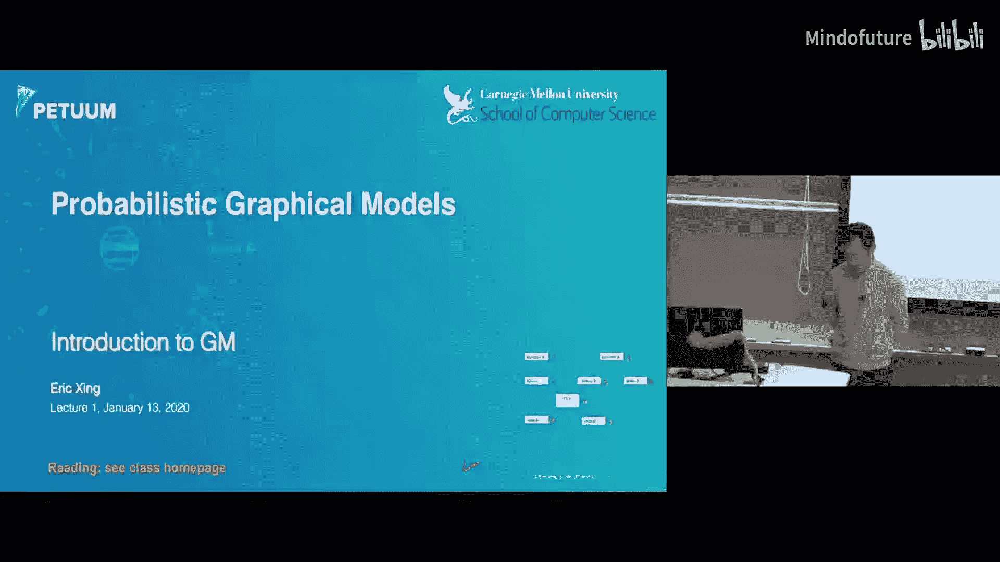
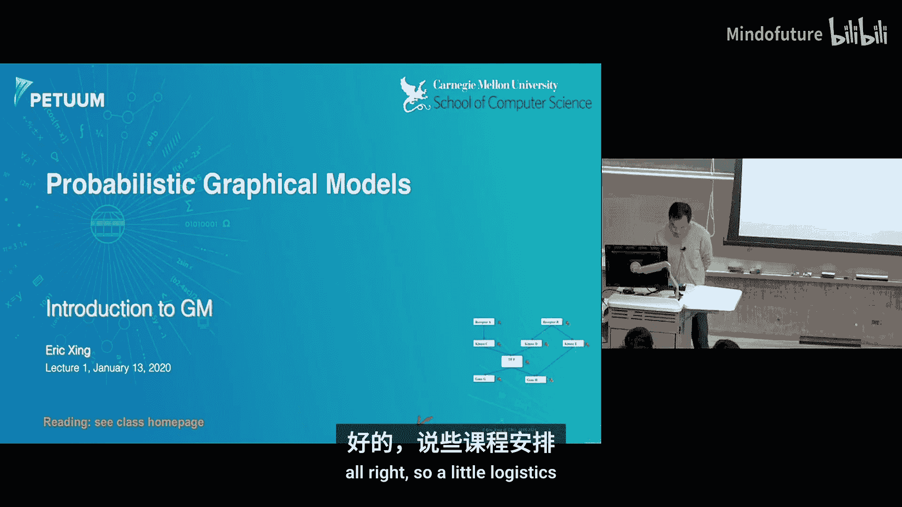
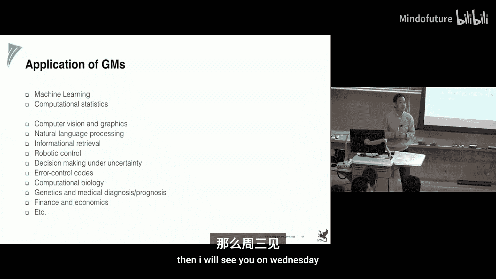

# 【卡耐基梅隆】概率图形模型 ｜ Probabilistic Graphical Models 2020 p01 P01_Lecture_01_导论 -BV1ebpGzhEA9_p1-

So I'm excited to see such a great audience。😊。

🤧。Soorrry， so one is actually one of the most advanced technical courses offered in M L D。

 It was designed originally for a very small audience。

 This is the 15th year anniversary of the class。 and we began by just having about 10 students in the class 50 years ago。

And this year， we have， I believe 1，60 registered and another 50 also on the waiting list。

 So I could imagine 10 or 15 years ago this class become almost like an an elementary intra class。

 but I， I do want to remind you， this is an advance class。 The technical materials has been。

Deemmed challenging in every year。 And I personally got a lot of complaints every year。 you know。

 about the challenge and the difficulties， everything about the class。

 I don't have intention to reduce the difficulty。Just give you a warning。 But on your hand。

 I do intend to make you guys all learn a lot from this class and also to get great。

 grade out of the class。 Okay， there is no examination in the class， no mid term， no final。

 Hopefully， that will make you a little bit less worried about the stress。

There will be a few homeworks。 There will be a major class project。

 which I hope to see a lot of good papers out of you。 You know。

 many of the former students published their first paper in this class。

 and that actually become the main incentive for many students to take this class。Okay。

 now we seems to have a full room。 Let's get the， the， the presentation started。

 This class is also recorded。 So I do encourage you to， you know。

 use that the resource to dive deeper into the material。

 And also we also regularly post additional reading materials for those students who want to do deeper investigations on certain topics。

In a sense， you know， you will find that every lecture could be blown into a semester long class because this is a very。

 very big overarching lecture on everything in machine learning。 So we。

Really want to use this as almost like a， a guideline。 you know， for your own， you know。

 a self guided study down the road， give you pointers and give you a update of the of the state of the art topics and also the foundations behind it。

Alright， so a little logistics。

You should regularly visit this homeage where materials， updates， informations are， are posted。

And people often ask for a textbook。 I was asked to write a textbook for many years， but it's very。

 very challenging to write a textbook for this topic because it's evolving so fast。 So just for。

 you know， maybe some foundational preparation。 I put two textbooks。

 One is officially published by Daphne Kohler and Ne Freeman。 The other is unofficial。

 but widely available online from Michael Jordan。 They give you the statistical theoretical foundation about graphic models。

 and a few， in fact， quite many classical use cases。 I encourage you to get those books。

 as you encyclopedia and on your shelf。 But on your hand， don't find。

 don't try to look for sta R solutions in those books because these are written more than a decade ago。

 but they are still great books。We are going to post papers。

 tutorials and other modern materials online from the class homepage。

 And there is also a discussion forum in Piazza where you guys should feel free to ask questions and carry out class interactions and so forth。

And the， the homework will be submitted to graycope。

I we're fortunate to have quite a few great T As whose names are listed in here。

 I believe most of them are here。 Can you please stand up so that people know。Your face。

 at list all the T S X， Ben， Hao Han。Even Xiang and Junxian。

 I think we have at least four of them today in， in town。Great。

 thank you very much for being the T A。 It's a quite challenging task， even for the T A S， In fact。

 because supervising your class projects and designing andgrading your homeworks will be their major undertaking。

 which is quite demanding。 So I really appreciate all your inputs。😊，And also。

 we have a class assistant， Amy， who is my E A。 If you have logistic questions like how to get registered and how to fill out a auditing form and all that。

 you can go directly contact her。 Yeah， so as I said， auditing is permitted。

 but you need to fill out a form。 and if you are about whether you can clear wait list。

 I believe everyone will be clear at the end of the day。

 But you want to follow with Amy for the logistics。And here is the requirements。

 I say just mentioned。 Home comprises the bulk of the overall grade，50%。

 inner homework will be mixing both theoretical questions and applicational implementational questions and most of the the the the problems will be helping you to grasp the basic materials。

 They will be some， maybe one or two additional questions， which can be counted as bonus。

 that encourage you to dig dig deeper into the advanced materials。

And we want to continue the tradition of ascribe practice every class in every day。

 two of the students in the class will be preparingscribe notes。To be shared by the entire class。

 you will find it extremely useful because all the equations will be typed and all the presentations will be documented。

 You can also use the recording to really polish the thescribe notes so that at the end of the semester。

 we will have literally a book， you know， out of the class for everybody to share and for the community to share as well。

 By the way， this class is literally watched by the community all over the world。

 So I think your contribution will be acknowledged over there as well。😊，Final projects。

 which is 40% of the grade。 here， I wrote some suggestive themes in those projects。 Again。

 it could be a implementational algorithmic application or theoretical in those subjects。

And we strongly encourage you guys to form a team as early as possible。 In fact， you know。

 without exception we we unless exceptional exceptional things happens。

 we do expect you guys to form a team of three people。

Because imagine that if out of the 160 students， each one has a solo project。

 not only the project cannot be very big， but also we will be ending up with1 hundred60 presentations at the end of day。

 which is bigger than the conference that will be impossible for us to even grade right So yeah。

 do form a team right now with a three or four members and then submit your team composition as soon as early as possible to the Ts on the class website。

 we do have milestones and dates。 you know， for different stages of the class of the project preparation。

And for those of you who want to get a plus or for those of you who just missed certain key points and want to bump up your grade。

 you can also take advantage of this bonus mechanism to get some additional credits， which involves。

 you know， your contribution of the P and other form of participation in a class。

 such as showing up in this classroom。😊，And also in the middle of the semester。

 we'll be doing a survey to collect feedback so that we can adjust the style and contents for the rest of the semester。

And I cannot emphasize more how important the class project can be。

I will get your request rate in a second。This is really， you know。

 a a practice or exercise meant for serious investigations。 Don't blow up a homework。

 say I grab a data set and I applied a algorithm downloaded from another marketplace and call it a project。

 Okay， the project really meant is meant to be， you know， a investigation。

 which shows your own kind of understanding of the problem and the problem of your favorite to solve and the value of the solutions and so forth。

 and maybe even analysis and understanding of either positive or negative outcome of your implementation and so forth。

 And as you can see in the past， you know， many， you know， great work was produced from this project。

 You actually see famous names like U La and and cross who are now leading figures in the field。

 there earlier papers were also published in this class。And I imagine that from this year。

 we'll be seeing future leaders getting their first piece of work done。 That's， that's my hope。Yeah。

 by the way， you have a question all there。What is the requirement？

The they recommended the requirements。For auditing。

I would say I don't really have a strict requirements。 You should be officially， you know。

 eligible for the auditity， which means that you are either a C MU student。 Maybe you should。

 you can also be a pit student。 There is a form that you need to fill out to get approval。

 for example， from your advisor and so forth。But， but yeah， you can ask Amy for the。

 for the specific information。Okay， so now let's get started。 Any other questions。

 logistic questions。Okay， so why this class is。Potentially interesting and can be of value to you。

You know， nowadays， you know， more than so than 10 more than 10 years ago or 15 years ago。

 when these classes has started。Right now， we are in， you know， a very。

 very noisy and active field of machine learning where， you know， you see every year， you know。

 hundreds of algorithms and their variations published。 It's very， very hard for people to navigate。

 So here， in fact， this morning， I heard a prep talk from one of my students for his thisis and I found this lies very interesting。

 So I brought it right， you know，10 minutes ago， you know， from， from， from the presentation。

 This is kind of a at the marketplace of algorithms。😊，You know， you， you see， you know， you know。

 different learning crs such as Mexican likelihood， such as reinforcement learning。

 There are different type of knowledge such as you know， you know， rules and constraints。

 there are different styles of the model like the generative models， averial models and all this。

 right， and it is very， very difficult for a non expert。

 maybe even for difficult for an expert to navigate in such a big space。

And it's also very very easy for people to just drop into a Pinghole and stuck， you know。

 in a local mini of their investigation or keep producing incremental results。

 maybe reinventing or repeating some results elsewhere that you just happen not to not。

 not happen to be aware about。Right part of the goal of this class is to try come up with a unified the that at least put all this you know。

 a big pile of market algorithm and model instances into a more organized closet， if not， you know。

 under a unified formula so that people can start at least learning materials more easily。

 if not using them even more systematically， right So this is the view that we want to。

 at least aspire to at the end of the day， that we use a single tree or a couple of trees to unify。

The majority of the algorithmic instances now we are reading or maybe will be emerging in the next few years so that you can basically have a better awareness of where you are in your own investigation。

 which branch you want to go after and how to design your algorithm to be more reusable or more generous。

 you know， over different applications。So that your impact can， can be maximized。Okay。

 so let's see at the end of the semester in May， Are we getting somewhat close to this view versus that view。

 Okay， alright。So to make this happen， we need to start something very basic。 Let's do a very。

 very little recap of the basic published concepts， because。

A majority of the machine learning algorithms， or at least the foundation of those algorithms come from a statistical modeling purposes。

 Okay， nowadays， there are many algorithms who are defined by oracle。

 such as the gun model or such as many of the the optimization based models。

 They may be purely designed。You know， around a algorithmic oracle。

But at the core of the motivation basis of those oracles。

 there is a statistical formulation that tries to model the data in the first place。

 So let's see how do we use probabilistic models to model data， right， For example。

 here I have a data instance， which happens to have8 features。ok。

And how to write down a probabilistic distribution of a data instance with8 features。Let's start。

 In fact， let's call them binary features to make the case even simpler。

I just want to do a very quick review of recap about the basics here。 How do you model that。

In the most straightforward and， and。Generic cases。Yes。

 you could enumerate the combinations and then give the probability that。Yes， perfect。

 So you basically need to create a table like this。Where you。

 you basically put x 1 x to all the way to x 8， and plus a P here。

 and then you enumerate all the possible configurations， right， It could be 1，1，1，1 or 1。

0 and so forth。 And then you put a tiny probability in here。

 That's basically the basic way of doing this modeling of a multi bar data instance。

And why we care about multivari data instances。Or that's probably the。

 the majority of your experience with the real world。

 sayy you have a picture that has a few thousand pixels。 If not more。

 If you want to model a sentence， you have a couple of words very rarely。

 you are dealing with a university event。 You toss a dice。 That's， yeah， you do that。

 But that's not very， very often happening in your life， right。

So this is the foundation of our sta modeling。 But there are a lot of shortcomings。

 I think one of the first shortcoming you probably already realize is what。

Is that this table has to have many， many， many roles， right， because the size of the。

 the number of combinations for， the number of you know， dimensions is exponential。 Therefore。

 you can quickly explore。 and blow up your computer installoring basically such H one distribution。

Then there are a number of other questions involving learning and inferences。

 which I don't want to spend time to dive into you or see that again in later presentations。

 which is that。You need to basically deal with this complexity， not only in designing this table。

 but also in filling the numbers in this table or computing any， you know， quantities out of it。

 which。No， translates to learning and inference practice。 Learn， for example。

 is to learn the probability of you know， each， you know， you know， combinations of events。

That means that you need to really， really account very often。 And many times。 And also。

 you need to have a very， very large data set so that every configuration has to be represented。

 Otherwise， you don't see it。 You cannot just simply put zero there because you may see it in the future。

Inference means that you need to， you know， maybe sum up some of the roles so that the probability of a particular event can be cumulatively calculated。

 But again， that means a lot of computations。So。How we can， you know。

 do something better than just inerrating a table like this。

Let's look at a real possible word because numbers or data instances。You know。

 to maybe a pure mathematician， they are literally just numbers。

 but to a practitioner who want to connect the real world。

 they actually are instances or events from real world。 Let's look at， for example。

 this particular event or or maybe a phenomenon。 Okay。

 it's a problem describing the state of a cellular phenomenon。 You can call that way。 Basically。

 it's a， in the biology world。 they call it a a regulatory pathway or signal transaction pass and so on so forth where you know。

 there are molecules。 You know， on and off。 You know。

 taking signals cascading the signals relaying that and trigger some events。 say， you know。

 a gene gets turned on and off and so forth。So for mathematician to model that。

 we don't call them a English or a Latin name。 We really call them， you know， you know。

 we use a symbol， and we index that。You are still having eight random variables。

But when you turn to a biologist。He or she would give you some additional knowledge。 For example。

 that biologist could point to you that the top  two parameters variables， X 1。

 x 2 belongs to molecules at the surface of the cell。And the middle3 correspond to， you know。

 you know， molecules in the cycle cell inside cell。

 and the bottom two correspond to molecules in the inner compartment of the cell。

 which is called the nucleus。And she may furthermore， give you that kind of diagram。 Okay。

 which tells you which molecule triggers which downstream molecule and so forth。

And she would tell you that it is impossible to imagine that receptor A would directly work with a gene H because they never meet each other in their life cycle。

 right， So that kind of knowledge was from a biologist， now as a mathematician。

Would that be useful for you to improve your model or you just ignore that。

And that's actually the question， which stays at the core of this lecture or this entire class。

You know how to combine you domain knowledge of various form such as this， you know。

 into a mathematical framework so that we can make the mathematical expression of the model。

 more informative， maybe simpler， maybe more actionable。 Okay， so these are all the keywords。

 interpretable actionability simplicity， right， and compability。 These are the outcome。 You know。

 way computer scientists care most about。Other， you know， in addition to the mathematical scientists。

So in a word， this leads to our， you know， presentation of the graphic model。 You already see。

 this is a graph。 And in this part， we have the model。

 and the graph meritries the model becomes graphic models。One thing we care about most is the the。

 the， the intrinsic meaning of a graph model in a rigorous sense。 For example。

 what does it mean by rigorous sense。 If two people see the same data set。

 and if they use their criterion to define a graph model and come up with two different models。

 then that's not very rigorous because you， you lose kind of the。

 the single source of truth and you cannot really translate or extra knowledge，Therefore。

 there should be some rigorous effort and to define， you know， every entity in the graphic model。

 which of course， includes edges and nodes and so forths。And。It is very important， and also。

 it can be easily ambiguous if you are not careful about that。So just to give you one example。

 this is a real example， which was kind of amusing， but hopefully you get a message。

 So this is a graph。Right， and can people see it， They Can you recognize what this graph is。

It's the graph of figures in Bible。ok。And you see Jesus to be the biggest node。

 which is not surprising because so everybody in the Bible probably knows Jesus。

And then there are other disciples like Peter， like Matthew and then other people。Okay。

 so why we arrive at this graph， Why not a different graph。 That's something you can ask。

 Maybe you can guess how this graph was created。 Do you actually。Want to make a guess。What's that。

つては。Frequency of occurrences。But that doesn't give you the edge， right。

 It give you the size of the node， maybe because a occurrence is about every。Single individual。Yeah。

P current。不て下。Okay， yeah， that that's， that's a nice direction to go。 Indeed。

 you can always count currencies of a pair。 You know， yeah， within a sentence。

But why not within the page。Or within a chapter。Right。

I believe this one was counted by the cocur frequency within a a page。Okay， not a paragraph。 So。

 but another person use the same material can draw a different graph just by， you know。

 defining the redefining the scope of that。 So there are ambiguities， in fact。

 even in this definition of the edge。So it looks like very simple。 you know。

 that the edge is defining relationship。 but， you know， underneath that， we need to， you know。

 really dive into what exactly amounts to relationship。

 So I want to open the lecture today by having some discussions on that topic and then。

In the future lectures， we are going to go broader from there。

So relationship between two random variables。You know， can have many aspects of interpretations。

 And here are a few。 already quite many。 For example， we can say there are。

 they are related If X and Y are correlated。 correlationrelation is a very。

 very strict statistical definition with the equation there。Or they are dependent。

Or they are independent。Or they are conditionally related or independent and dependent and so forth。

 Or maybe you can go even further with a human touch。 say， you know， X causes y or y causes X。

 that kind of information。 We can all call them relationship。So how can we really quantitatively。

 you know， you know， you know， determine the presence and absence of these relationships。Right。

 I think one way to go is that we could explore possible one number summary as the measure of the strength of the relationship。

Right， so that's， you know， giving us at least some way to get more rigorous about the graphic model。

So here are some measures。 In fact， you know， there are a lot of measures。

 and here are some examples， which I'm going to explain a bit more in a second to hopefully review their inadequacy or adequacy。

 you know， for the purpose we want， right Pearson correlations， mutual information and H S I C。

 Herberid independence criteria， partial college and so forth forth。嗯。I think， you know。

Picking them is not actually a arbitrary task， but it's actually， very， very interesting to see。

 you know， what's the difference by adopting different cr。In the past。

 in the early days of graphical models， you will often see nature papers in high profile journals like nature。

 where a researcher would just arbitrarily pick up a measure and show you a graph called them gene network or a social network and so forths。

 which are graphically always very appealing。 You can always tell the story all of a graph。 right。

 But when dive down to the statistical definition。 sometimes it is not very， very rigorous。

 It's easily defeatable by some counter examples on the same data and so forth。

 So now let's look deeper into you know， what all these different definitions can give you。

So probabilityba 1 one will already teach your Pearson correlation。 It is one of the very basic。

definition of a cor， correlatedness。啊， so。It defines the linear dependencies between two random variables。

 And there are formulas defining that。But there are two important caveat。 I want to remember。1。

 which is that if X and Y are independent of each other。

Then you are guaranteed to see a zero Pearson correlation。But unfortunately， the reverse is not true。

 Okay， if your piarson correlation becomes 0。It doesn't mean that your X and Y are necessarily independent。

And I invite you to think about a counter example。 And I'm going to take that question from there。

 You can the rest can。Can think about your examples about why。This is not true。 Yeah， your question。

So the， oh， okay。Let me try something， cause I don't want to。touch呃。嗯。Can I touch this。

 These are the screens， I believe。Okay， I didn't find buttons。This room has become very modern。

 Now Everything is remote controlled。 Otherwise， I would just find a button and turn it off。

 But let's see。啊。Unfortunately， I couldn't find a a switch。So I will figure out next time。 Okay。

 so you can watch hopefully the， the， the recording， you know， if you cannot see the whole thing。

Alright， anybody come up with a counter example already。Oh yeah， this may be better。Yes， please。

We you want distribution on an normalboard？Okay， uniform on a。Okay。

So the expectation of ex advice is to you at any point。

But we cannot call distribution of its independent life。诶。I。

 I didn't see the clear definition of what is X and what is y。Mmmm。

The only uniform this you should with。嗯哼。We cannot fix this different on。But the expectation of XY。

Can you express x and Y in terms of a function。Or x。It just。Because if I a random。

 I throw a random die and dart into this pie， I cannot say that X and Y dependent。

But if I agree the distribution of eggs that are given way。Depends on that point。

 because it cannot take。Beyond the name。ふていく。でし。It can integrate to once。はい、はい。The distribution。

Probability of x given by。系呢嗰度は。I'm not sure it can。 So what entails。

As to claim that X and Y are independent。我。It's really about if we can basically write this into。

Right， that one， basically were。Complete the definition of independenceencies。嗯。面命で。実要た。全国シのビ。嗯，哼。

I still don't get why they are not independent。 it looks like a guess。But do you have a expression。呃。

作一关于。自会性はイ。12 or let's say minus121， but if I say y equal to1， only value x1 have one at1 point。

I can see your， your， your way of argument。Maybe I encourage you to show it on paper。

What I will show you is something even simpler。 Okay。

 I basically want to show you that I can still express Y as a function of X。

 which guarantees are that dependent。Right， and I can still show that their peers in correlation is 0。

ok。And I will give you just a hint that you guys can show in on， on， on your proof。

 Maybe how about I put X to be a uniform distribution number in-1 and plus one in that space on a single line。

And I define y to be x squared。So why is dependent on X for sure， right。

And you can calculate the peson correlation and see what it is。

So this is a form of what we call the nonlinear dependencies。

Which very trickyly defeated the Pearson coalition。

 because Pearson coal is really capturing linear dependencies。 Okay， what you said。

 maybe what may I I think what you are trying to say is that maybe x is a cosine function。

 whatever of x。 But， but yeah try to express that。 And you you， you can show it。Okay。Anyway。

 so the point is not about the example。 It means that the point is really Pearson correlation is very weak in terms of capturing independenceencies。

 And therefore， you know， in the early days， many publications of gene networks and social networks based on correlation。

 you know， are problematic， because even though a whole graphics show。

 the meaning of the edge is a very localist definition。

 which only look at a pair of random variables in isolation and only on their linear dependencies。

Okay。And。So we need to have something a little bit stronger。 at least， you know， for a pair。

 we want to strengthen into independence rather than correlation and independence in the sense of non nonlinear as well。

 not only just linear。And as I said， you know， statistically。

 to define two random variables to be independent。This ferization property is enough。In a sense。

 you just want to establish equis between two distributions。

 One is the joint of two random variables， and the other is the product of two unver variables。 Okay。

 and how to establish equivalents。 Well， you can measure distances between this and that。Okay。

And if a distance is 0， then you have independence。Okay， so very， very straightforward reasoning。

 So what could be the reasonable distance for measuring two distributions on the left and the right。

KL divergence。 That's the maybe the only most straightforward distance。 of course。

 we can go after distance and other other divergence。 But this these are special cases， right。

 So K L could be used to measure distances。And。You know， in fact， another in the information theory。

 you know， there is a term called mutual information， which is the K L。

Divergence between two special cases of the distribution。 One is the joint。 The other is the factor。

 the product of the marginals， okay。Alright， so that's a score。

 Mutual information can properly measure the independence between two random variables。ok。So。

 we have a new score。But。This is easy to say， but very difficult to compute。Okay。

 because you can see that the the actual calculation involves integration over a pretty complex density function。

And foring， it's no problem for discrete， it's fine。 But in reality。

 if we have a fancier or maybe multimod or maybe number metrictro distributions。

 computing this can be challenging， right。So， for that。In recent years。

 there has been work developed around kernelizing or embedding distributions。

Based on key sufficient statistics， such as mean， such as a higher order moments。

 But you can use a few numbers， which can be what why numbers are important。

 The reason they are called sufficient statistics because you can obtain those numbers purely from data。

 You don't have to know the anatic form of the distribution。But the。

 the magic is that once you have those numbers， there is a way to mathematically embed the original distribution like this。

 which are very， very irregular into a point in some。you know啊。You know， Hber space。

And then you can compete compute， you know， a distance。Between the two points。 and then you get。

 you know， a information or independence criteria。 Okay， so this work was done， in fact。

 partially done here。 Okay， you know， you know， after Gram was a postdoc here。

 and his coors was also also worked here， including one of my postdocs。

 And they actually developed a pretty rich body of this material。By the way， you know。

 if I interested in this topic， you know， in at the end of semester。

 we actually left three open spots for lectures elected or topics elected by you guys。 So you can。

 you know， you know， cast your vote， you know， at the end of day， telling me。

 you know which part to lecture， including this part。 I could。

 I'm glad to go deeper into this theory。😊，So at the end of the day， you know。

 we can generalize the definition of mutual information to H S I C。And to define independences。

 that's basically allowing you to compute you know， more flexible distributional forms。Yes。

 question there。Re。reverse payL。Its also fine。In fact， you can use any measure。

 but there are different interpretations because first of all， there is a computational issue。

 Re K is not necessarily so easy to compute。Or sometimes it's easier to compute。

But whether that one relates to some well funded likelihood score where you are going to use in the future to learn the global score of the model。

 that is not clear yet。Okay， there are reasons to use this form of K L because it connects very。

 very nicely to some other loss measure we are going to use in the future to learn graphic models。

But in practice， yes， people do use reverse。 Okay， you will see actually at the end of the day。

 we are going to go toward the so called oracle programme models where the mathematical form becomes secondary and the execution become first primary。

 Then you basically just plug in all sorts of micros and functions。 and you compute it。

 You lose some kind of mathematical beauty in terms of convergence and other， you know， probability。

 but you can still make it work。😊，So， but good question。 where were going to save it for later。

All right。So。We have a few measures already。 They are all pairwise。

 So are you not happy with what we have。It looks like we have for now the definition of the nodes。

We also have the definition of the edge。 We are good in a way。

 we can actually build a graphic model already。 So maybe let's move to one。

Here I have a three random variables。 Just three。 Okay， very simple1。 We have an x。

 which is the height of a kid。And we also have maybe why， which is the the vocabulary of a kid。

We also have a Z。Which is the age of a kid。How do you build graphic models？Well， at least for now。

 with the tools you already have， you could collect。 You could， you could do survey of 100 kit。

 for example。And then you can use the， you know， the survey outcome to compute either a personson correlation or mutual information or H S I C between every pair。

 right。And。I bet you will be getting the following。 Okay， you will be getting the following。

 Basically， every pair。Has some correlations or has some are dependent are not independent。

 Maybe this is Edward to say it。Do you believe it。You better believe it or you can try it。 Okay。

 In fact， if you look at this world in isolation， just look at all two people just by looking at their numbers without any other evidence。

 chanceances are they are always dependent。Okay， you can always find a statistical dependencies between them just by chance or whatever。

呃。Well， that that's， sometimes you may still find。 But I guess most of chance you will get some dependencies。

 Then what do you get is this。 So that， does this graphic model really makes you happy。

What's your kind of human model that you would use to model such a phenomenon。

Should should be independent。か。Okay， that's a great piece of prior knowledge。 You know。

 from our experience， we kind of reason that you， I supposedly it's the age that causes vocabulary and high and so forth。

 right， So you may be thinking about something more like this。Right， okay， so yeah。

 I believe I agree with you。 This looks like a much better model。

 at least in terms of informativeness。 or nowadays。

 we are talking about AI being explainable and so forth， this is explainable。 Otherwise。

 if you give that graph to some people， you will probably lose your contract because they don't like to work with you。

 It doesn't make any sense。Right， so， but our current tool doesn't give us this model。Right。Okay。

 so maybe let's look a bit deeper。 What's really happening is that when we are computing the dependencies。

Or correlations of mutual information， so on so forth。 We only look at you know。

 a pair in the marginal sense。 We ignored all the other information that is coexisting in the domain。

Now， there is one more score that comes to rescue， which is called the partial correlation。

 which basically are measuring the correlation between a pair， given some evidence， okay。And again。

 this correlation is capturing the linear dependency 1， just like the Pearson correlation。

 where the definition is actually quite intuitive。 It's really computing the piearson correlation between the residuals。

Okay， the residuals are from the original random variable minus the linear effects from the common cause that you guessed。

O， in fact， if you know domain so well， you could even guess， what is the cause。Then Z is the cause。

 and you can build this。 If you have no idea which one is the cause。

 and you need to try all three combinations together。 And at the end of the， pick one。 But again。

 at least they are quantifiable。So that gives you the conditional piercing correlation or partial correlation like this。

And。Of course， you know， if you have too many random variables。We more than3。

 you will be computing this maybe -1。Theduct seems to be quite scary， right。

 So because I need to condition on the linear effects of all the others。😰，Would， would that be very。

 very challenging。It is， right。 If you don't have any assumption or you have any limitations of those。

 then all this other thing can cause all sort of things。You know， nonlinear accommodations。

 logic logical and so forth。 But remember， this is a linearity。

 And plus an assumption on Ga is going to save your world。

You could actually prove to yourself that if everything is just every dimension is you know。

 marginally a gausing and the whole domain is multiver Gausing that can be captured by a covariance matrix。

Then， the。Impact of all the other random variables on each of this one。

 It's just a linear regression type of form。 It's just， you know， you know， combinations。

 additive linear effects， which can be actually captured by the coefficients in this so called inverse covariance matrix。

Okay， I， I think I'm already losing a few one。 Do you know what is the inverse covariance matrix。

Do you know what is's a covariance matrix。Right， you know what is covariance matrix been saying that if you have a Gaussian distribution。

 Multi Gaussian distribution， and it is， you know， really defined by， you know。

 a min and also a covariance matrix。Right， as a parameter and the inverse。

Coeverance is just the inverse of the sigma。Okay。And it turns out that you can compute the partial correlation just by adopting this formula。

 which is quite， quite simple。 So in a sense， if everything is gausing， you are good。

 you actually could compute a pretty straightforward partial correlation graph。And likewise。

 if you want to compute， you know， you know， the independence。Then if everything is gausing。

 you actually could even establish a equivalence between the partial correlation and also the mutual information。

Okay。Okay， so now we have a pairwise， you know， dependencies or relationships。

In the context of all other random variables， at least in special cases。So that far。

 I want to make a stop so that we see where we are in terms of characterizing the relationship。

 So this single word relationship is already causing us。So much to， to， to navigate。

 So starting from the goal of measuring associations or relationships between two random variables。

You can already adopt a marginal or a non marginal， which assumes presence of other random variables。

 Then down the path of a marginal， you want to capture both linear and non nonlinear。

 And in the case of linear， you have the simplest the piearing correlation。

 in the case of nine linear， you have， you know， most generally， you know。

 the distance measure between two distributions， the joint。Or the product margins。

And then you can plug in K L or the maximum description。

 which is the Huber Smith information independence criteria to compute， you know。

 such distances for arbitrary distribution of form using kernel embedding technique。

 and then K L is equivalent to mutual information。 And this one is so forth。 Okay。

 so that marginal part is all done。 And the non part with look at a little bit already。

Linear and nonlinear can use a partial correlation and condition dependence and so forth。Okay。

So that's where we are。Are we done with the graph models。There are still a lot of other things。

 right， because here， you know， we've been a little bit ambiguous already in terms of the nonlinear。

Which already causes， you know， introduction of more complex models and also the compability is another issue。

 And also， the building strategy is a limited。Basic。

 you test all pairise relationships with or without a context。And if you have a big graphic model。

A big domain with many random variables。 That means what。It means。you know。

a square number n square number of such pairs that you need to determine。And also。

 a power set of dependent context， right， You can depend on 1 to anywhere from-2。So that's a pretty。

 pretty big kind of set that you you compute the， the condition。 So there are a lot of。

 lot of tests for you to build a graphic model from ground up。Y。for the。二十？Yeah， exactly。

 that's what I meant， yeah。It's very。Yeah， that's the whole point。 You， you。

 you want to avoid doing that at all， because once you are checking pairs。

 you just cannot just check this pair， but not that pair。 then there are n square number of pairs。

Right。Do you know what I mean， right？ So you need to basically define a score of x。And why。Or。

 let's call it X 1。And X。X， I and X J。Then I and J are both in the space of what of this a whole set of graph。

 a lot。So this first principle approach is very sound， but its not very operationalizable。

That's what I'm trying to say。Okay。And that's why we still want to have a whole semester worth of graphic models。

 right， The simplest way， of course， is that people just forget about all this calculation。

 Let's draw a graph。And call it the graphic model and define things on top of it。

And then go reverse and say， oh， this graphic model is consistent with a certain set of conditional independences。

 That's one way people do it。 Okay， that's about it's more about the design first graphic model。

And then nowadays， people even forget about conditional independenceencies。 For example。

 in your deep neural network， you draw arbitrary graphs， you know， whenever you see a dependency or。

 whenever you feel like there needs to be a a dependency or coupling。

 you just draw an edge at what time do you even worry about the inencies or whatever。

You you you probably don't。Yeah， so the whole field evolves a lot。

 whether it is carrying a principled statistical meaning or it is just for you to track knowledge。

 or maybe it becomes just a vehicle field you to deploy algorithm We will actually enroll all these stories to at least let you know what you are actually doing Maybe you thought you are tracking statistics。

 But I will tell you maybe you are after all just playing a oracle and carry out a algorithm operation without convergence。

 But's actually a very important insight。 because sometimes people are trying in vain improving the so- called statistical properties of certain operation。

 But if the model wasn't started that way， you better drop apart and focus more on implementation。

Okay， anyway。That gets you to the plan of the future lectures。

 I want to give you a very quick update。So on lecture 2。

 we are going to now study conditional independence graph more。

 more independently and more globally going beyond pair with test。 Okay。

 this type of graphic model has many names。 Mark of networks， for example and and you know。

 mark random fields and direct graphic models and so forth。

 And that's kind of a a picture of what what they look like。

 And we are going to dive into the statistical meaning of that。

 And when you get a correct estimate and when do you not and so forth。 And by the way。

 these type of models are very useful， very， very you know，Generic。

And people use it for all over all sort of purposes。

 And here are just one of my favorite applications。 Okay， in early days。😊，You know。

 people model the game of a goal， for example， and each spot has a white or a black。

In a configuration， and they are dependent locally。 And therefore， I can put a graphic model。

 literally copy this into that and call these random variables and call these dependencies。O。

 this model is known as an e model。Who is is， do you know。It's named after a particular guy。

He was a physicist。Did he win Nobel Prize I forgot。 But at least a piece of work。

 One Nobel Prize that model was used in the 50s to compute， to model the atomic states of a solid。

 solid states or atomic states of a piece of material and was actually playing a pivot role in a calculating you know。

 nuclear energy， atomic bomb， you know， exploding condition and so forth。

 People actually designed a model for， you know， computing those very， very important numbers。

And if you replace all these points with a pixels， then becomes the image model。Okay。

 and and so forth。 So it's very， very interesting model。 We are going to run through a few examples。

 hopefully inspiring you for projects。Lecture 3 will be going toward directed graph model。In here。

 you can see， oh， by the way， so far， we've been talking about， you know。

 mutual in mutual information， Pearson correlation does not offer you directionality， right。

 It's symmetric。And， but the earlier motivating example in biology I used clearly， you know。

 shows a value of directionness。Something costs what。

And that defines a different type of graphic model known as the Beijing networks or directed graphic models。

So we' are going to use a lecture to， to study that。 And， in fact， one of the key， you know。

 maybe a representational conveniences or computational convenienceance out of Bayian network。

 In addition to the interability， the causal inability is that。The。

The retro graph model allows a very important property， known as the factorization。

You can now break the bigger join distribution over all the random variables on the graph into a product of many。

 many little building blocks， which are either marginal distribution of the roots or the conditional distributions of intermediate and live node。

 Okay， and we will see why this is important and why this allows a lot of a composability。

 compositionality nowadays people talking about in machine learning。And again， you know。

 these type of models are obviously very useful to model real world。No。I。

 I bet you saw these kindgraphs。 People used to use a genealogy to define relationships between people。

 And that easily leads to a。Graphic model in a direct sense where every individual has a two copies of your DNA right。

 from your father and mother。 And then they defines yours。

 And then that gets past one of them or a combination of them gets passed to the descendant。

 and then， you know。Tgger， you know， these are whole generations of， of genealogies。Al。

And you can use， you know， this graph as a guidance to write down a fancy joint distribution。

 And then you can do a lot of things。 Nowadays， people are tracing their ancestries to famous guys or to tell a family story。

 And that's actually， you know， where the， the the tech foundation was actually from here。

 One of my students actually joined the company called the。😊，Human longevity。

 or or maybe I forgot which actually are doing this kind of business。 Quite fancy。And after that。

 we are going to use a good number of lectures tentatively to dive deep into inference and learning on graphic models。

😊，You know， here are some typical inference problems where you can compute arbitrary conditional probability of random variables given others。

And， and maybe what's the most likely configurations of subset of states。

And how to draw samples from marginals and conditionals。

 drawing samples these days become very fancy。 For example， we know the deep fake type of。You know。

 applications， right， And that's because they come up with a way to draw random samples from image generation models or text generation models。

 right， So what's the statistical foundation of that。So these topics are non existent 10 years ago。

 but this course has been evolving continuously。 So this semester， we are going to， in fact。

 put these materials into this foundation so that you can see the unified picture。

And then how to learn these models is also a very good problem。 right in the past。

 learning has been very， very narrowly defined on learning from data in。

 in the rigorous supervised learning sense with labels and data points。But as you can see， with。

 you know， the newer graphical model framework that we are going to present。

 you can learn under a lot of rich background knowledge， such as rules。

 such as rewards incentives or maybe co learn with a competing model to compared the comparative advantage。

 which is the core idea behind the generative models。 and all that。 right。

 So this can be all studied under the same umbrella。

And we are going to also use the later part of the lecture。To study a few modern graphical models。

The modern graphic model has been so interesting and so general。

 such that they start to become a unifying umbrella of many， you know， modern techniques。

 including say， reinforcement learning， deep learning， transfer learning， Beijing9 parametrics。

At the end of day， I hope that you don't walk away with100 different equations or pointers to those equations。

 But a few master equations that you can plug in different building blocks。 you know。

 for your specifications。 and that you can go from there to hopefully get your work。You know。

 started， if not finished in a short amount of time。 So that's the purpose of this discourse。And。

 as I mentioned。As a new experiment this year。Again， you know， we only have about the 28 slots。

 you know， for the whole semester。 if we add， if you want to have class in spring break。

 we have two more， but still， it's not enough。 This field has been so big So I want to experiment with this idea。

 instead of I pick all the topics and cover all of that。 I want to save say， you know。

10% to 20% of the lecturing time for you guys to to， to order。From a menu， your favorite dish。Okay。

 and we're going to have votes and those topics that you feel strongly about and to， to。

 to have a deep dive。 We are going to dive into it。

 or you can also order for topics which are survey like everything。 That's also fine。

 because in the past， there has been complaints in opposite directions。

 Some people wants to go deeper into the foundation。 Some people feel， oh。

 this is not relevant to my daily applications。 or maybe what I learned didn't get me a paper and so on and so forth。

Make you， you can feel free to put all your desires into this wish list。

 And then we' are going to poll you Okay and get the last2 or three lectures determined。好大上子。

Or do you want me to just pick for you。As assume。The former， okay， deal。Great， so not too close。呃。

So maybe to get back to the， the， the grounding story question， what， what is graphic models， right？

 I think here is something want to remember。Graphical model is the name of a field or a a name of a well thinking。

 not a name of the model。 Okay， and the download be reviewers， right in the past， you know。

 we review papers， which opens like this。 We solve problem X， Y， Z using graphic models。

So that kind of statement you should， you know， take not so seriously。It's almost like。

 I want to solve a problem using mathematics。It's like saying nothing。 Okay， so the。

 the graphic model is really providing you a language for communicating， you know。

 your domain knowledge， designing the model。And also。

 it gives you a language to arrange and plan and implement computation。 and then， of course。

 give you a language to develop further models。By itself， it is not a model， okay。And also。

 this is not anything new。 In fact， this using the graph， you know。

 to structurally design statistical models。 You know， goes a long way。 and went a long way。

 starting from the 20s。 But Spharter and Lorenzo was。

The the the pair of great statistician who played maybe the most instrumental role in the 1980s in getting the。

 the formulations more explicit。 And， of course， Jud Pe， you know， who is a nobel touring a winner。

 you know， because of his working in cause also played a pivotal role， you know。

 in getting the foundation correct。 So that's where we are right。Okay， so just to wrap up。

If we have a graphic model。There are a lot of advantage。

First is this representational advantage where you can using a very local list。

 but more than pairwise。 This is localist， but more than pairwise construction to build a global model。

You end up saving a lot of parameters because now representing each of these building blocks using you know。

 conditional or marginal probabilities will be more economical than writing down the big， you know。

 table and filling in all the numbers of。Probabilities of configurations。And also。

 because of this rule， you can now find a easier way to do combinations of modules of models。

 For example， that model。 What if this cellular， you know， study。

Biological study was carried out by two labs。 Sa this green part was carried out by a laboratory in C M U。

 And the other one is carried by a collaborating laboratory or maybe non collaborating laboratory。

 you know， in pit。 And then you have two papers publishing different results only as a fraction。

You actually could use the graphic model for to multiply together and build a joint model for that very。

 very easily。And down the road， we are going to study also Beijing inferences， in a sense。

 under the graphic model language， Beijing inferences become an instance of graphic model。 Okay。

 it's about introducing prior knowledges。And defining prior distributions。

 which really translates to just adding more nodes and edges into a existing graphic model。

 So the boundary between Beijing and Nan Beijing in here， at least， is not very explicit。

Computitionally， there's no difference。 Philly， there are some debates。 but I think these days。

 such debates are， dominated by the value， you know。

 of the outcome rather than the philosophical foundations。Okay， and here are some higher level。

 you know。呃， catches。Of what graphic model can offer you and how you take it to your work。

 And these are quotes I， I got from Michael Jordan， who also played an instrumental role， you know。

 in， you know， you know。Advocating， educating graphical models。So I hope， you know， down the road。

 you will find the coursese material enjoyable。We have another 10 minutes。I have a few other。

Materials， which were in the earlier day lectures。 But now I downgrade them to appendix because they are。

Kind of tedious， but I can still go through that because we have another five minutes。

 How about we just see a few graphic models。那这 maybe呃。Useful for your downstream applications。Yeah。

So in a nutshell， PGM， you know， is multiple staistic infrastructure。Okay， in fact。

 now there has been a trend。 I wouldn't say a trend。

 maybe at least way of thinking where you even want to remove P。

 You can just call them G M because not all graphic models have to be probabilistic。Right。

Any examples from you guys。There are plenty， by the way。 They can easily name it， I believe。呃。啊。

It does not have to be probabilistic， but it's meant to be probabilistic if on to inference， right。

Well， anyway， you can choose it not to be probabilistic。

 but the incarnation of that genealogy right now in the literature is probabilistic。

But there are something that is indeed not probabilistic and in active use nowadays。

 I bet you know it。 It's just like。You're just 1" from that， yeah。你 that。我 networks networks哼。Okay。

 I， I can take that if you don't want to be probabilistic。 You can write an network like that。Hey。

 come on， what about deep learning。The whole thing about convolution neural network。Right， and the。

 the R N Ns， are they probabilistic。Right， so there are a lot of graphic models out there。

 which has very little to do with probability。 although I'm going to show you down the road that they rooted from a probabilistic model and gets carried away by approximation。

 and at the end of the day， we forget about population and get the model itself to be the， the the。

 the， the， the vehicle for computation inference。So yeah， so I。

 I prefer maybe to just call it graphic models to be more inviting。

 at least to people who do not practice probability。 but， you know， purely mission driven。

 I think this is a fine view for that。 But still， it means a multivari。

 maybe statistics is not the right thing， but multivariate you know， you know。

 data domain plus structure。And yeah， okay， I， I do have a material。

 So this is basically that non probability6 thing。 It's a multiver objective function。

 I listen to have that。 Okay， to guide the model training plus structure。Okay， let's see。

Let's see a few key models。え。People starting their basic， you know。

 entrance into machine learning and statistics。Probably， you know， know what is a density estimation。

 right， It's just you know， estimating key parameters of a un random variable in many cases。

And Gausing or multinomial。What。Even though it is a single random variable。

 you still can take that as a graphic model with one node。Right。And if。

 and then if you want to be Bay， then you can elevate the parameters。

 say the mean and the variance of that Gaussian distribution to be also itself a random variable。

 That's a typical baesian view。 Then you already have a two not graphical model， right。

And the regression。That's very obvious。 You are having， you know， a input。

 You are going to have a continuous output in the case of a linear regression or a discrete output in terms of a logic regression。

 And that's a two not graphic model。And classification。 Yeah， So that's basically， you know。

A logistic regression regression model。Mixture model like classrooming。

 Then you can have basically a class label and the data。 And depending on which way you connect。

 it could be， you know， supervised or unsupervised classification。

 So these are simple graphic models。But if I do classification multiple times， for example。

 or maybe class multiple times， this is my observation of X。I want to cluster them。 For example。

 I have the audio signal from three individual。Okay， and here I introduce a latent variable。

 which indicates the label of that you know， audio signal。

 Then this is obviously a classroom problem。RightYou can use a K means。

 You can use the E M algorithm to do that。But the audio signal goes， you know， in time， maybe。

10 minutes later， you heard another burst of audio signal。Right， you can， of course。

 do another classroom problem。Which are totally， you know， separate from the first one。

But the modern approach likes to connect together because， you know。

 time continuity seems to suggest that people don't move much。 You know， if they are all， you know。

 from the same location， making phone call chances for them to go to different cities in 10 minutes and making phone call from three sources are very unlikely。

 therefore， the labels tend to continue。 if the source come from label one。

 then with high probability， that source will continue for the second time point。

So how to capture that。Well， there is a dependency between that wire， right。

 And then you can go on and on like this。And many people saw this model before。 What。

 What is this model， It is a graphic model， one of the most typical celebrated graphic models。

Called the HM M， Hi Macov models。So that's basically， you know。

 where you found the graph model to be very， very interesting and unifying。Because， you know。

 this is a graph from my friend Zbin。 you know， he produced this a graph of graphic models。

 You can see all the then famous。 By the way， he draw this graph about 10 years ago。 Okay。

 these then famous graphic models can all be connected， you know。

 as a almost like a plug and play assemblage exercise from building blocks。

 starting from a mixture of gausing。😊，just a gausing and a mixture of Gausing for clustering。

 and then H M M for sequential clustering and dynamic systems。

 linear dynamic systems for common filters， for， you know。

Prediction and filtering and switching between multiple things。

 that do have a different dynamics and so forth。 So it's very， very systematic， you know。

 in understanding machine learning models then。 But even now， of course。

 this graph is maybe 10 times bigger already。 you want to add VE and models and R L models and transfer learning models and so forth。

 but。Chances are we can still use some master equations to describe that。

 So that's what we' are hoping to achieve by the end of the semester。

So this class is none like many other classes taught here and there will dive into one particular technique。

 It is meant to be a unifying class that tie together you know， techniques from all over the place。

 And hopefully， you can use technique you learn from class A to solve problems appeared in class B because of this umbrella。

 you know， you know， mechanisms that we are going to learn。And again。

 here are some other fancy graph models you know， in reinforcement learning， you know， you can。

 you know。Explicitly defined。A。States。Environments and outcomes， rewards in a sequential fashion。

 And these kind of models are the backbone now for autonomous vehicle driving and so forth。

Machine translation is not a big application where， you know。

 the good old topic models that has been famous for a while in the future were used to do contextual sensitive translation that you are translating not just by aligning to sentences from different languages。

 but also to make their。Beyond just verbally aligned。

 but also semanically aligned and how to do that。 Well it is because you have some semantic underpinnings which are driving。

 you know， the contents from a topic again。We are going to dive into the technical part later in terms of how to achieve that。

You saw this already from genealogy。And you saw this easy model for physics and for games， as well。

Okay， so we may be able to touch upon a few applications， even in this lecture。

 But talking about your projects， I encourage you to really let your。

Interest and passion drive you to get some applications from this。Doomains， you know。

 inform form your team， collect your data and use some of the models we taught in the class or from literature。

Okay， I think we are about to wrap up any questions。Regarding logistics and technical content。Great。

 then I will see you on Wednesday。

