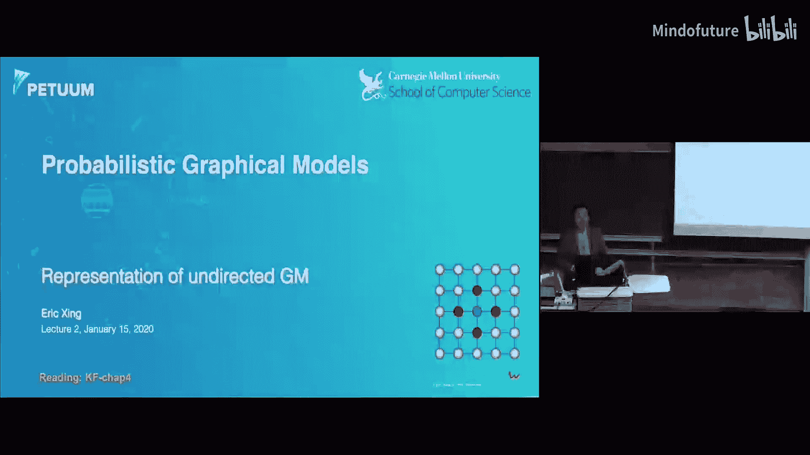
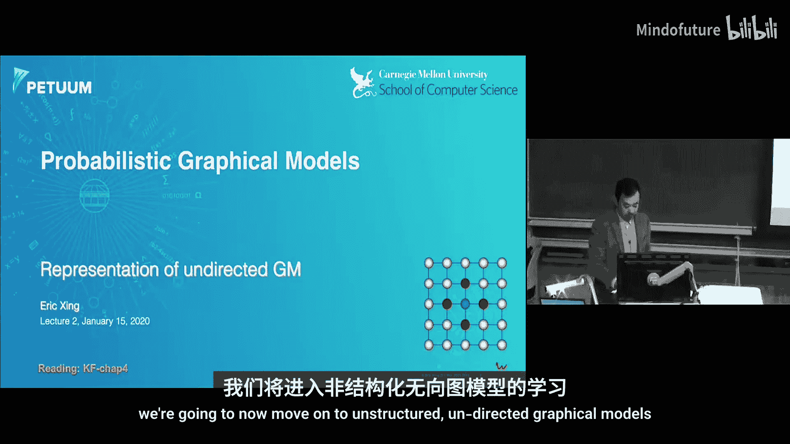
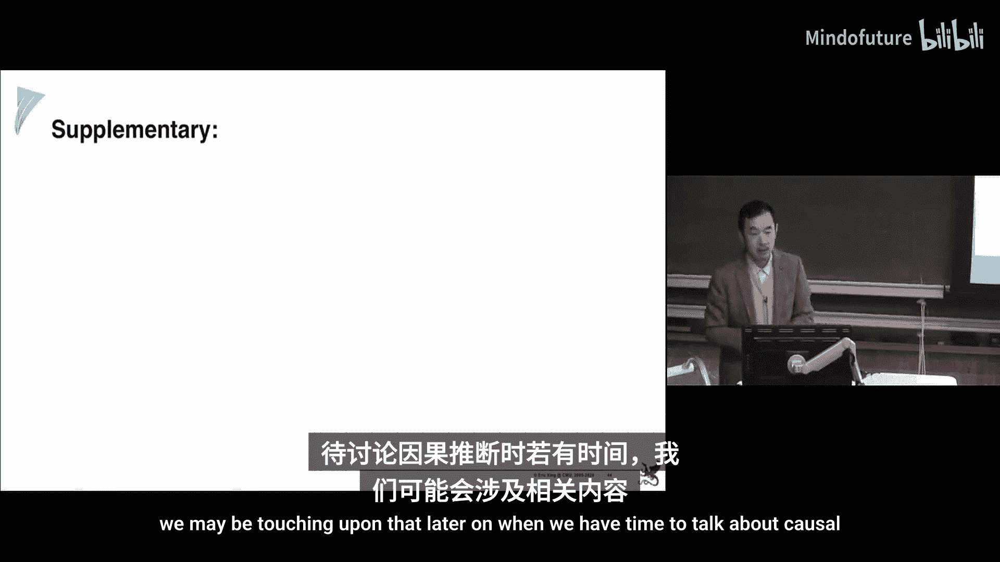

# 【卡耐基梅隆】概率图形模型 ｜ Probabilistic Graphical Models 2020 p02 P02_Lecture_02_无向图模型 -BV1ebpGzhEA9_p2-

I want to get started now。I have these little devices， which is kind of scary。

 It can make some noises。 So I hope you can bear with me if。it suddenly sticks up。

I think it meant to amplify my voice through the the the speaker phone， but I'll try to be less。诶。

Interrupive in here。 Okay， so let's get started。Any questions from last lectures。

Maybe one question I got is that why in the the cover page， we got two logos， you know。

 C M U and Pat。 Okay， I take 30 seconds to explain that because right now。

 I'm jointly affiliated with C M U as a professor。 I'm also the founder and the chairman of company Pat。

 which I founded few years ago。 So I'm still working in the company。 And that's why you know， I。

 I were two heads。 And these two projects are very， very interrelated because what I'm teaching here。

Got built actually also over there， you know， in terms of the products， in terms of the solutions。

And， of course， in the future， if you look for projects and internships and other things。

 feel free to contact us。Alright， so lecture，2， we are going to now move on to。Unstructured。

 undirected graphic models。

So， last time。We talked about the conditional independences。

 correlations and so forth between two random variables。

And we come up with a few tests to determine whether two random variables appear。You know。

 are dependent， correlated and so forth。Right， so we basically were asking。Is this true or not。

And based on that， we can draw a note or draw an edge， right。 And then we also went on and say， well。

 after all， in the real world， you have more than two random variables to worry about。

 You are operating in a motive。V environment。 Therefore， at least I need to care about X and Y。

 given a bunch of others。Right， so what technique we use to test that kind of dependencies。

 independenceencies。Chris one。Do you still remember some keywords。What's the。

Correlation between how to measure correlation between two random variables。

 given a bunch of other things with linear effects。 I'm going to make it very， very limited。

What's that。Peritin correlation。I'm asking。The next level question。

 which is given some other bunch of things。Yes。Partial correlations， right， You measure the residual。

 you know， of the two random variables， you know， subtracting the， the， the。

 the other things using pieson correlation。And then we say that partial correlation or correlation isn't necessarily translates to independenceencies。

You can use mutual information to measure a pair of in pairwise independences。

 But in terms of the correspondent of partial correlations to other things。

 It becomes a more complicated。 and we say a bunch of other conditions like under gausing and mutual in under linear effects。

 You can really build equience between partial correlations and you know， independence and so forth。

 You can go back and carefully read those notes and hopefully get yourself cleared。But nevertheless。

 you know， all we learned last time was not necessarily leading you a graph。 or maybe it is a very。

 very tedious way to get your graph because it basically only worries about a pair。

Imagine you have a graph with a few thousand nodes。

 You literally need to look at every possible pair。

 given every possible combinations of other things， which is a power set。

 You run into an MP hard problem。Therefore， building， you know， a graph like that based on， you know。

 all possible dependencies or independenceencies is not quite feasible。Okay。

 so today we are going to go the other way around。We're going to say， I'm going to draw some graph。

And let's at least tease out， read off all the dependencies， you know， out of there。

And then I may say that， you know， can I establish some kind of con equivalence that establish between。

You know， the kind of top down approach where I just write a graph and build a model versus I started from all bunch of independences and go reverse and generate or create that kind of models。

 okay。And if there is a good equivalent， then you can imagine that you have a simple kind of life now。

 you can really， really rely on， you know， a， you know。

 a graph guided kind of construction of distribution rather than the bottom up test and dis and so forth。

T so ask the plan for today。I want to， again， it is very notoriously known that notation becomes a big issue。

 know in our area In statistics and not machine learning。

 all authors likes to use their own location。 And in fact。

 even in a single paper written by a single author。 The notation can change from page to page。

 that's， you know， I also have that kind of problems from time time。

 So at least let's get some basic notational agreements。 Okay。

 we are going to use a capital you know， character and lower case to indicate random variables。Okay。

 and typically， you know， these are， you know， if， if， if， you know， an non faced， if sometimes。

 you know， you see a。I don't know even how to write it。So a aboutface expression in print。

 that usually means that this random variable is observed。 It associates with a value。But again。

 sometimes people use a matrix。 you know， call this a matrix。 But anyway。

 you at least know that we have variables and its values。

 And index basically means that the I variable in case you have a multiple random variables。And you。

 if you have a soup index， that means this particular variable has many dimensions。

And that basically gives you the index of every dimension， sorry。Okay。诶。

Random variable basically is a value。 is a variable that， you know。

 is associated with a distribution of its values。 Okay， it's srcchastic。And reant vectors， yeah。

Are often also expressed as this。 And sometimes for clarity， people put a vector on top of it。Okay。

 but without further clarification， sometimes we just ex interchangeably use this also as expression of random vectors when it is a self explanatory。

Random matrix， yes， it is again， that aboutface thing， meaning that you have， you know， stacking。

 you know， array of multiple vectors。Proometers， we are going to deal with parameters very often。

 We use instead not you know， Roman characters， but the Greek characters。

 Alpha beta or in their capital form， say a theta like this all this。Okay。

 so that's roughly our notation。 You will see more when we actually get into the deeper presentations。

Now， undirect graph models。 So here you see a graph。Which has a number of。Bubbles。

 notess and a number of lines， which are the edges connecting。A pair of notes。

And there are no errors on the lines。 Therefore， it is undirected， okay。

And undirected graphic model is this。 It is a public distribution over this set of random variables。

Whose parameters are actually defined by G， the graph。Okay， and you will see why I。

 I say it that the way。 Why， what did， what does it mean by defined by G。And from the graph。

 you can already read of some pairise relationships。 I wouldn't say correlation。

 Some relationships is there。 It， It is non causal because there are no the rationality。

And in the future， you will see that， you know， you can use this technique just to write down arbitrary models of that kind of nature。

 When you see a paraise relationship， you could graphically express that。With the kind of the。

 you know， description or definition of the model， This model is defining a distribution of the joint。

 you know， value assignments。But you cannot use this model very easy to sample or to generate examples of instances from this distribution。

 And we will see， why that's the case down the road。So。What is the meaning， you know。

 specific meaning between and of this edges。呃。And what's the impact they have， you know。

 on the node configurations， That's the topic for today。

Let's first look at a few models of this kind so that we can start to appreciate。

 you know what kind of impacts or values we can obtain from such model family。 Okay。

 let's take a real problem。So here is a real problem。

 I want you to work on a computer vision problem。Which is just to classify every pixel。 Okay。

 literally classify every pixel in the image。 This is the foundation of object recognition。

 segmentation and many computation projects or problems。In fact， maybe not classifying every pixel。

 but every patch of pixels。 Okay， so here is a patch。

And I made the problem very simple to make it binary。 It's either air or water。

I want you to classify now。So let me the apo here。Those who believe this patch is the air。

 please raise your hand。Okay， I roughly a quarter of the people。 How about the water。

 Raise your hand。 Wow， why，34。Amazing， I actually don't know yet。

 I haven't seen the bigger picture yet。 Okay， so we have a 1，2，3 breakdown， roughly of this， okay。😊。

So， let me do， do one more thing。How about I do this。Oh，O， did you日。See this lecture before。1 third。

 no three quarters of you are getting things right。 I was surprised。 fact I I didn't know so。

Looks like this patch correspond to the area over there。Why you believe it is water now。

 Or do you think it makes easier， you know， when you see this picture。Well。

 it is on the top of the image。Which makes it more likely to be air。Right。

 but it is also next to the land。And as you'll see even beaches and so forth。Right。

 so that probably give you some clue。 So what those kind of common sense reasoning intail。You know。

 in your formal reasoning。And how do we describe those mathematically so that when two people or with the computer look at this model or this image using the model。

 they will draw the same conclusion。 So that's our question。

So a modern technique is to divide this a whole thing into a grid。

And on every patch resulting from this grid， you define a random variable to indicate its binary classification value。

And what I said， for example， on top of the image or next to some other entities。

Is a concept of adjacency and continuity and so forth。 right， So when you say adjacency continuity。

 you are talking about more than run， more more than one random variable already。

 maybe at least a pair。 right That's why， you know， in this grid， we have a， you know。

 nodes connected by edge， either directionally or undirectally doesn't matter。

 and then you can put some contingency table。 You know。

 over the join configuration of this two random variables。 say x 1 and x 2。

 you can basically put a join configuration。 say they are both one or0 or there are one versus0。

You put a number there。It could be a probabilistic number。 It could be any number。

You could even put negative numbers there。 say in the two adjacent nodes are likely to be labeled the same。

That's probably closer to our common sense。And then you can encourage this And that with a better number。

 right， And if they become opposite， well， you put some other number and showing your belief。

So that is a model。 Okay， it is literally a mathematical model。

 And that's the model you saw in our previous lecture。 as an example。 It is the great model。

 you know， every single pixel， basically you know， all， you know， in other， you know， you know， word。

 say at or go games and so forths， they can configure represent a configuration。

 So this model actually。😊，You know， get invented very naturally from image processing and lattice physics and so forth。

Okay。And in physics， in particularly， you know， that is intuitive to a physicist because， you know。

 here， if you imagine everyone is an atom。We know that， you know， you know， you know。

 magnetics you know， you know， the the fair anti and parallel and the parallel spin of the electrons。

 right in in those little atoms and how to describe that were usually the same orientation of the spin will repel each other。

 and otherwise， they were chat to each other。 So these kind of knowledge gets expressed using this model as well。

We have a few other examples。 Social network or saw it。Prote interaction networks。 You also saw。

 you know， you didn't see it， but it's very popular in computational biology。 Again。

 they kind of models a kind of a mutually symmetric。Relationship between。Proteins。Go， we saw it。

In fact， even in other fancier domain， such as information table， you can use this model to describe。

 you know， a relationship between concepts and also， you know， entities。 For example。

 here this model was invented to model the correlations or alignments between images and texts and how they are aligned where there are some hidden topics。

Which gave rise to， or which correspond to certain words or certain image in configurations。

 you know， in the data。And that leads you to， you know， another type of a graphical model。

We will actually revisit this model very shortly after some technique presentation。Okay。

 now I think we saw a few models。 Let's get down to a formal。Representation of the model。

So we define a graphical undirect model to be the following。 Okay， given a graph。You first， you know。

 can identify all the clicks on the graphic model or under graph。So here are a few clicks。

 For example， this is a click。Right， and。Do you see other clicks。

An edge connecting to node is a click。 right， So anyway。

 we are going to define click in the next page。 But say given clicks already。

 we can define something called a potential functions on top of this click。

What is a potential function you will see actually， very， very soon。

 It's a positive you know function， you know， on configurations of discrete or continuous random variables。

They need to be positive because if you have a negative number here， when they are multiplied。

 they will produce a negative probability， which is you know， you know， invalid， right， and also by。

This product。You know， its basically the multiplication of， you know。

 the potential function defined on all clicks over a particular configuration。Okay。

How to make them to be a probability。You need to normalize it， right。

 because what's the basic probability of a of a probability。They have to be between 0 and1。

 They have to be positive。 They has to be also between 0 and1。 and also all probabilities of。

 you know， all possible configurations over the same set of random variables has to sum to one。Right。

 therefore， when you define。What is known as the partition function。

 which is forcing what I just claim to be true。 Okay， you just literally。

 you can see this is a huge sum， sum over all possible configurations of all random variables that you care about in this case。

 five of them。And it is a sum because it is discrete。 You can enumerate all configurations。

 If it is not， then you need to have， you know， a nested chain of integrations。

But this number is actually very， very important to make this a whole thing whole together to be a probabilistic distribution。

Okay， I'm not going to say too much yet how to compute the。 It is an extremely。

 extremely difficult task， which actually inspire a whole area of research in nowaday called variation inferences。

 but。These models are known as the undirected graph model。 It's also called Markov random fields。

 Markov networks and so forth。And before I move on to the details。

 I want to close by saying here that this potential function is what gives you the power。 Okay。

 it gives you a ability to specify some contingency functions。

That offers bias of one configuration over others。Okay， so if you want to design a model。

 you actually have now a legitimate vehicle to inject your human knowledge。And later on。

 we are going to also discuss how to learn model from data。 Then these are the place holds。 Okay。

 to extract numbers out of the data so that they reflect the bias， you know， in the data。

But they are pretty probabilistic。Okay， we could make it probabilistic， but it's very difficult。

 Sometimes you just say， I want this configuration to be score10 and another con will be score 0 or score 1。

 It's more intuitive for humans to specify。Okay， rather than I need to divide numbers。

 make sure that everything sum to 0 sum to one so forth。 That's why， you know， we。

 the potential functions are the pre probabilistic scores， not probability itself。In fact。

 it is impossible to make it properly itself。 I， I will give you a few counter examples in a second。

Okay， so take a closer look of the clicks。 I suppose you all know what it is already。

 So I'm going to say too much。 Here the most important concepts。1 is called the max click。

 So click basically is a set of notess。Which are all interconnected。Right。

 and the removal of any one edge will make them， make some of them you know， disconnected。

To other nodes。A maxax click is where it's a complete graph where you know， if you。

 max click is basically， you know， you know， a click within a graph。

In the sense that you add any additional notess。On top of this click from the graph。

 you don't see click anymore。that's called max click。

Then sub clickick is something that is within the max click。So here are some examples。 You know。

 you can clearly see that we have two clicks here。And then we have a few sub colleaguess。Okay。

 so why we care about the click。You know， in in the graph。

 why we just not start from the nodes and edges like we did in the early class。

 But now we kind of rise ourselves to the click as a unit。Well in the future， you will realize。

 you know， graphical models， at least from the， you know。

 orthodoxoxical kind of a probabilistic standpoint。Is used to model dependencies and independence。

 and so forth。Within a click。Because they are all interconnected， you need to have a configuration。

 have a design or a， a， a， you know， a model that allows all dependencies to be allowed。Right。

 so you'd better， you know， build your foundation from that because if you built from the。

Sub components within a click。And then make them to assemble a click。

 You may risk losing some of the dependencies that is not obvious from the sub partss。

 but you start from the click。 at least you， you can make sure that you don't miss anything。 Okay。

 within that click。 that's kind of a very higher level statement。And then， you know。

 when you go beyond click I'm above。 Well， that's fine。

 At least that building block is all rich enough to capture everything。

 And then you can start to make assemblage based on the graphic model laws。

That I said earlier at this multiplication law。Okay。

And that basically leads to the natural definition of a distribution。 I just flash here again。

 This distribution was also known as the Gis distribution。 Okay。

 and these are called the potential functions。 Click potentials。

So let's just say a few more words about what this click potential means。 I said earlier。

 they are pre probabilistic。 They are contingency functions， giving you a chance to。

Recover or specify biases on configurations over others。 But why they have to be pre probabilistic。

 Just use the example。We have a very simple graphic model in here。Which has three random variabless。

 And let's write down a joint distribution。 symbolically。 Okay。

 we're not going to put any anatic form on that。And you can basically use a， you know， A。

 A A change rule to， to factorize it。 You can factor it in many different ways。 And here is one way。

ok。And if you look at these are three components。And you want to identify those those units that contain two random variables at a time。

I guess you have maybe two ways of doing that。 One is to。

Kind of a group together the first two elements and save the like next one or the other way around。

 make the first one a standing alone and the next one to be。

You can see even I start from a joint probability and factor them into conditionals or marginals。

When I use the potential language。To define the entity， which potential is defined on clicks。

 you will see that these two potentials carry a different probabilistic meaning already。Right。

 one potential is a marginal。Or a joint of X and Y。 And the other is a conditional of Z given y。

Or if you switch， you know， with another factorization or maybe a combination。

 then you get the first potential to be a conditional and the second potential to be a joint。

You can basically not claim that a potential is either a joint or a conditional。Okay。哦马展龙。

So that basically already imply you the difficulty of， you know。

 attributing a single universal pro definition for the potential function。 And therefore。

 people just forget about it。 Let's forget about the pro interpretations of the potential。

 Let's just go even beyond conditional and marginal。 Just go any positive numbers。 Okay。

 goodness of compatibility， happiness between two people， you name it。

 everything that you feel appropriate to describe two entities can be used here。😊，Okay。

 so let's go down and see a few more examples。 So here。You can graphically see what is a max click。

And then what is the potential on the max click。我。Potential function here is symbolic。

 But if you really want to implement it in a computer。Here you have a three random variables。

Therefore， you need to use a cube， which is a three dimensional table to put numbers for every possible configurations。

 So that's a click function。Okay。And。Therefore， you know。

 your join distribution is basically defined by the product of two potential functions defined on the max click。

Of course。Computing this requires you to sum over all the for confi configuration of the four random variables。

You don't have to only stick with the max click。 You could also do this。

 You can just use the sub clicks。ok。And then you have a different way of specifying。

 You will lose something。 In fact， it is possible that there are some tricky configurations in the triplets that is not necessarily recoverable。

 you know， or at least recover easily from the the， the pairwise potentials。

But this is at least another way of parameterizing the model。And there is also another。

 kind of you know， canonical representation， which allows you to be overcomplete。

Which means that why not defining the joint distribution from all potentials exist or all clicks exist in the graph。

 which includes the triplet clicks。The parawise clicks。And also， the singleton clicks。Okay。

 every individual could also have a。 That gives you the ultimate flexibility。 In a sense。

 you could have placeholders to numerically capture all kind of tendencies and affinities and everything between pairs and triplets and singletons。

Okay。And， of course， computing the potential function becomes a little bit more complicated。

And this one is the most expensive and also the richest form。

 which actually subsum the previous two as， you know， as special cases。When you， of course。

 implement your own model， you， of course， you know need to trade off whether you want to consume lot memory to build a full model or you want to be a little more frugal for for the exchange of efficiency。

O， so that's the， the structure part。 O， and the， the， the representation part。The second part is。

What do you read from the graph or from the model in terms of independence properties。

That's basically the question we asked in the first lecture。I want to start with a few definitions。

 you know， in many cases。The way to， you know，Define a distribution can be， you know。

 as explicit as just in terms of the set of independenceencies between variables。 Okay， therefore。

 we need to first define a family or a placeholder for those dependency properties or statements。ok。

So let's begin with the first definition called the global Markov properties of an directed graphic model。

 which is like this。I stands for the set of independences。

 I of H is basically the set of independences on the graph H。

And this is a set which is defined as the following。It defines it， it can， It includes all the。

 you know， pairwise independenceencies。You know， given the third party。Okay， in the following sense。

 we claim that the X is independent of the， given y， By the way， X， Y， Z now are generalized from a。

Single random variable to variable sets， Okay， which includes random。

 They are conditionally independent， if。They are graphically separated。O， in the H graph。

That is known as the global Markov property。There is a anatic way of proving that。

 which is very trivial。 So I'm not going to show that。

 I may show that in our next lecture for graphic models， which is even more trivial。 Therefore。

 it's easier for me to prove。But the idea is the same。

So graphical model in the address has give you this automatic property already， you can safely。😊。

Extract conditional independences。Between two sets， given the third one。

 if they demonstrate this graphical property that they are graphically set separated in this way。

Okay。Therefore， you know， given a graph， you can obtain a set。You know， by running this micro。

Over all triplets。Now comes to the definition of I map because we want to now establish the relationship between you know。

 a graph and a distribution。 You know， using the conditional independence definitions。

So let's begin by a distribution， arbitrarybit distribution P over x。And we define。

This I of P to be the set of all independences， all independence assertions。You know。

 after the form this。到了后脸辟。ok。And we don't need to know the parameter value。 Basically。

 we assume that as long as the graph is there。Whatever way you prompterize or put numbers into those contingency table or into this potential。

 they should all honor these independences， okay。So we define P to B that set。And then， you know。

 let's define K。And by the way， you know， this one。Right now。

 isn't touching upon the concept of a graph yet。 Okay， Basically， it's a。

 it's almost like symbolic and analytical， which is that give a P。

 Imagine that you can always run proper conditional independence text or text to extract all this。

 How to do that。 Well it is really about does X。喂。Z。Honors， he of。X。

You basically can imagine you can try all numbers in your distribution。

 And as long as they satisfy these equivalentvalence， then this independence is established。Right。

 and you can basically imagine a set can be built like this， which is very difficult。 By the way。

 No one actually want to do it unless you have only 2 or three random variables。

Then I have a graphical parallel exercise， which says that I have a K。On which， you know。

 you can read off the independences using the Macao property like this， right。

 which is the way easier than。You know， building the test like this。ok。

And you can also come up with a set of independenceencies， K， okay。

And what is the relationship between， you know， K and P okay。Okay， so we first define that， you know。

 the concept of I map， we say that， you know， if the independent set over K is a subset of any other given I set I。

 then K is an I map of I。Okay， and then what is I， What， How about Let's call I， you know， I P。

 which is the imaginary set of independences coming from a distribution。Okay， then if this graph K。

You know， defines a I K。 that is a subset of I P。 Then we establish a relationship between a graph and a distribution。

O， K is the im map of P。Okay， this is a little bit more formal。How to establish a graph。You know。

 versus， you know， a distribution。Clear， pure definition， no need to prove。 We just determine to。

Call them that way。And that's making your life sometimes easier without looking at the numbers， okay。

Why， because， you know， for example， let's give an example here。 I used to have a table， but let me。

 let me just write it。 Let's imagine a two。You know， variable distribution， which let's say。No。

I hope I'm doing correct。Am I okay， So this whole thing add up to one。

 So here I define you a distribution。Okay。And now， looking at this。I ask you to say something about。

The join distribution P of X and Y。 What can you say。What's that Oh， the last column is the P。

 This is the configuration。Remember， we always use a choose table。

 a contingency table or probability table to specify discrete distributions。

 And see here is an instance of your simplest two variable distributions。Now， I give you this。

Purely numbers。In fact， you can see that it took me a while to even come up with these numbers。

 just now， I have my way。 I have a little macro here to come up with those numbers。 Now。

 I just give you this number。What do you， What can you say about this joint distribution。

It is a joint of a P， X and Y。I'll give you a try。I put all these numbers very painfully， here。

To make my life a bit easier， because they have some very interesting properties， yes。Okay。

 good guess， why？The total probabilitybil it like the summer。3。啊哈。0。2。Yes。

So you are saying that actually， this particular way of defining the joint allows me to write this into product for P of x and Y。

 And then this P of x actually is a 01。8。2。 And this is also a 。8。2 breakdown， right。Alright， see。

 you look at the numbers very carefully。 You actually discover something very， very intricate。

 They are independent。 If I change the number to be point， you know， the 6，5 and everything become。

Other， you know， then， you know， maybe I will just stay with everything the same。

 And I augment this to be。It's very close to this one。 But then you。

 you fail to discover any independences。 I can do that legitimately， right。

So that's the pain of a numerically expressed graphical model of probabilistic model。

 These are just two variables。 If I give you 10， I bet you cannot really discover any independences。

But if I say， hey， I have a graphic model where。I have this。Or I have another graph model。

 which I have this。And then， then I define distributions。

 I say the distribution is defined on that and that by putting any numbers， any numbers， by the way。

 because here I used to have a 6。0 point64 and point1616。 But I could also put in other number。

 which still make them factorizable。 Then you need to do another calculation。 But in here。

If I already tell Liu that my board， my model was built using the previous definition of potential function multiplication and using this graph。

Then you already know that it is a guarantee to be independent。So that's basically， you know。

 giving you a， hopefully a， hope， maybe a interest on or maybe a conviction on why， you know。

 working with graph is。More convenient than working with numbers。Okay。

 but I need to establish some good equivals between the graph。 For example。

 the graph shouldn't mislead you。 It shouldn't be that I actually claim to have a independence in the graph。

But actually， in my distribution， they are dependent。Even you。

 even though I for the rule of building graphic models， as I just specified earlier。

 which actually has a name called the Hamley Clifford Theem。

So how to establish this this this these equivalents。Okay， so let's go back to our。

 our main track and further study the independences。

So this is the definition of Markco for independenceencies。Which builds on graph separation。

And then all triplets satisfy in graph separation， you know。

 defines the set of a global Maco property on age。Here， we don't see you can see it's purely on age。

 There isn't probability yet， O。And also， there are other forms of independences， such as this one。

 known as local independences。Okay。It's actually very easy to。

 to appreciate because theres another name for it。 It's called what is that。The Markov blanket。

For any random variable or any， let's， okay， maybe we stay away from saying random variable because right now we' are talking purely about graph。

 not distribution yet。For any note or， you know， vertex is in the graph。We can define in。

 its direct neighbors。ok。which are connected to this node by edge。

And then local Mark of independence says that。The node of interest。Is independent of。

Everything other than the neighbors and also the notice self， basically， all this white stuff。

Given the Mac blanket。Okay， so it's very intuitive。 These red guys is like a blanket。

 isolating a particular node in the middle， away from the rest。

And they actually characterize a local mark of independences。 Okay， so you can come up with a set。

 run over every node or every set of node。And the joys Markov blanket。 And you have a pure， you know。

 a more set of you know， independence properties。 I think in a different class。

 I had seen a definition of Markov blankets that included coherence。This is an undirect graph。

 Therefore， you will seek parents in our next lecture。I'm coming with a simpler sequence now。

 I used to talk about coence first， and get people confused。Alright。

 so now we worry about the soundness and completes。

 Now we need to connect the graph with the the distribution。 We say that， you know。

 H is an I map of a distribution。 If I of H is a subset of I P。ok。And the good news is that。

 if we define。The distribution using this formula called the Gis distribution， we I saw before。

 which builds on the product of all potential functions defined on clicks。 Okay。

 they are not arbitrary potential functions。 They are potential functions only on clicks。

And normalize it properly。 Then you have this so called Sunday guarantee， which is that。

You are guaranteed that H is an I map of P。The' nice guarantee。

 at least you are not going to get more independences。 That is not in age。Honored， you know， A and P。

Okay， so these are some。That basically allows you to now go from H to a distribution very easily。

Without， you know， putting up all the tests， you know， on on age to。

Extract or to encode independenceencies。 The independences come as a first citizen from the graph and then gets honored through this equation in the distribution。

Okay， so remember this， this were， actually， we have a subscriber today， right。

 So this is very important。The independent set from a graph is the first citizen。

And then they use this Gi distribution as a vehicle to induce a distribution and then gets all the independence in each honored。

你听。The reverse is a bit tricky， okay。It means that， you know， if I have an H。

Are all the independence and sos included in age。Okay， maybe， maybe。Yeah， that。

 that's basically in the reverse way。It's a little bit tricky here。 I'm。

 I'm going to do some more proof in our next lecture together with the direct graph model。

 But here is just a statement of what you are going to come up with。To live with。

 it's almost reversible， but except a few cases。For example， here is a statement of the completeness。

Theory， which says that。If the triplets。Are not satisfying a， A you know， graph separation property。

Or it's not satisfying global micro property。Which suggest that they they are independent。Okay， then。

You know， if they are not in this， which suggest that they should be dependent。Right。

Because this set is the set of all independences on age。 And we are talking about a few triplets。

 which are not in these sets。So you should believe that they are dependent。 They are not independent。

 O。But there， you can construct a few graphs， which still makes them independent。

So this is almost like a leaky theory。 You expect that if they' are not here。

 then they shouldn't be here。 But， you know， they could be constructed in a way that they're here。

 why。Well， it is because remember our previous way of specifying the conting table of everything。

Right。I put them a joint。And the， the joint of two random variables。

But I can come up with some tricky numbers。Which still makes， you know， the two variable， you know。

 independent under that particular number configuration。 If I change the number a little bit。

 they become dependent again。Yeah， therefore， it doesn't。

 It's not holding true full arbitrary configuration or assignments or of the probabilistic number。

 But you can always engineer a counter example to break those dependencies or independenceencies。

You can basically manufacture， you know， independenceencies just by playing with numbers。

You can also play play tricks by making a particular random variable with probability 0 on certain variables。

 regardless of anything。That's also possible just by building the table that way。But again。

 these are very unnaural cases。 Okay， typically， you know， in the normal way of building， you know。

 you know， a probabilistic distribution from potentials or from other building blocks。

 you don't run into this。 So the reverse is always almost true， yes。

Its always possible to find such a thing。Yeah， it is。 yeah， but still it's some。 You know， you know。

 it's the bigger infinity versus the small infinity。Okay， do you understand， right？ Yeah。

 you can always come up with these numbers。 But unless you really are picking numbers once you shoot random dollar somewhere。

 chances for hitting those numbers are very， very small。To， get what I'm saying。 Yeah， So I， I。

 I'm not saying this is again， in the future when you're doing practice， typically。

 these things are not even useful for you， but just conceptually。

 you want to know that there are no strict equivalents between the graph and the P。

And there are some other Mac properties， which I just want to， you know。

 just want to fly by you can go with yourself。 what。

 what I just described as local and global Mac properties are defined intentionally be very general to focus on arbitrary sets。

Okay， but for convenience， you know， you can always reduce them to any pairwise dependencies， Ins。

 given other things。 So these are， you know， another type of pairwise mark of independences。

So I'm offering you basic a few ways of reading of the independences from a graph on which a distribution can be can be defined。

 So in a sense， if a public distribution。Is constructed from a graphic model approach using the Gi sampling formula。

 Then you can use all these rules to extract independences。Okay。Allright， And then let's conclude。

 you know， with a theorem。 This is called the Hammo Lake Clifford Theem， which says that。You know。

 there is this uniqueness of why we like this form， Because， you know。

 if H is a I map of the distribution， then P。Has to be a distribution or a Gi distribution over age。

Okay， that's the only way you should specify that。If you don't use this way， you choose to specify P。

 Otherwise save example filling in a huge contency table。With arbitrary numbers。

 you are not going to make H A I map of that。Okay。But know who will be doing that。

 The whole point of having the age is to basically utilize all these clickiques to build anyway。

 Therefore， chances for you to go against this very very small。Alright。 lastly。

 I'm going to touch upon this index lecture called Perfect map。 There are sometimes a case where。

 you know， the， the H and the P become totally equivalent。Okay。

 that actually only happens for a small subset of distributions or graphs。

 And we will see examples of that。Okay， so then another practical concern that we want to。

Mention briefly， which is known as the exponential form。As I said， you know。Potential functions。

Over click requires you to provide only positive numbers， over join configurations。This is fine。

 you know， from a numerical mechanical design standpoint。 But it is not very。

 very convenient for practitioners who work with real world， especially say physicists。 You know。

 you have a， you know， the the， the atomic electronic spin orientations， positive and negative。

Y co positive 10 and negative 5。Right why， why not 8 and 4 or why not 10 and1 the de debates。

 The most natural way to call  one plus  one， the other one negative one， right。

 So this kind of kind of flexibility is very useful， you know， in many modeling world。So therefore。

 you need to allow negative numbers。 And that beats basically。

 it's a validity for being a probabilistic component。Therefore， we exp it。 okay。

 so we can basically redefine the potential function to be the exponential of the negative of the little thing called energy function。

 The energy can be positive and negative。 It doesn't matter。 Once it's exponential。

 It gives you a positive number。Okay， so that changed the form of the Gis distribution to be like this。

Okay， it is the sum of exponential of the sum of the little energies， click energies。Okay。

 and this sum is known as the free energy。 Okay， you can see it's very getting very closer to the physics literature。

 Indeed， it was invented by physicist。 It's called the Boman distribution。Okay。In statistics。

 is called log linear models。Because the takelogies on both sides becomes a linear combination of all the potentials。

Okay， so now let's take example。Here is the example of the boss machine。

And let's let the random variable to be taking value from this space， only positive and -1。

If you want it to be continuous， then it could be taking， you know。

 a range between some random variables。 But in here， if it's discrete。

 people usually use plus 1 -1 or 0 and one。And then we are going to define， you know。

 the potential only on pairwise potentials and singleton potentials。 In fact。

 all pairwise relationship between random variables。Okay， therefore。

 you are going to some over all pairs。Okay。And this is called the Bosman distribution。

And you could arrange the， the form to be a little bit cleaner by， you know。

 converting them into this。Ly algebraic expression。 Okay， here you have a vector of x。

Actor it like this。Minus a mu U。ok。And theta is the matrix of little thes， okay， so。So you have。

 literally this， this matrix。Okay。And when you， you know， do the algebra。

 you will see that the bottom line is equivalent to this expression， okay。Okay。

 so this is a Boman distribution。And why it is interesting。 Well， in the in the。

 in the in the future， I'm going to cover some techniques which allow to learn this model to recover the structure of the graph from the data。

 So here we are always saying that we come with the model the graph first and write a distribution。

 And sometimes you actually want to understand the structure among random variables given a data set。

It's very difficult for， you know， arbitrary cases。

 but this is one of the model which allow you to actually go backward and recover the graph。

And in particular， the graphic become interesting if this theta is sparse in the sense that some of the entries are 0。

What does a0 entry mean here to the graph。Are you still with me。These are the potential functions。

Right， over， you know， the click， in this case， over the edge。

And they are basically the weights of the edge。Right， again。

 potential can be defined in any different ways here。

 I just choose the potential very simple to be their weights。 if the weight is 0。难明得死。This edge is。

 is not present。And usually， when a graph has a lot of edge missing。

 it becomes interesting because otherwise， you really don't have any knowledge to say， oh yeah。

 this universe has everything connected。Well then you cannot say too much。

 But if it shows some structure， then you can say that， yeah。

 there are certain preferential you know attachments， certain causality or dependencies and so forth。

 right， So that's why biologists in particular， social scientists also are very interested in recovering this kind of graph among people among molecules to understand their chemistry or their biology。

Alright。 So this is easy Okay， so this is called the Boman distribution or Boman machine。

Easy model we saw earlier for the image modeling is a special case of the boss machine。

 which exactly reflects what I just said。 Some edges are missing now。 Okay。

 the only edges which are left is this。You know， four directionional north。

 southeast and west neighbors of every random ver。Okay， is it great。

So this become interesting because that's how people understand。

 say a certain atomic structure in the metal or maybe in the image。

So this is called easy model after the physicist is。

And then there is also a model called the Pos model。 again， named after a physicist named the pots。

And in this model， the only difference is that， you know， X is no longer a binary node。

Of-1 and plus 1， they can be a finite set of different states。Okay。

 maybe one all the way to C states。And why this is interesting。 Well， if you have a RGB picture。

 you want to model the color。Right， you have， you need to have a three kind of configurations。

And if you want to model sentence or in characters do spelling checking and so forth。

 you know have 26 characters and so forth。 So that's where， you know。

 more complex model become relevant。Okay， now， hopefully we have enough materials and vocabulary to understand a sliding non tri model。

 which has a very， very important historical value， which is known as the the restricted bo machine。

 RBM。RBM is the father， the root of now very popular deep neural networks。 Okay， In fact。

 the solution to RBMs by Hs and and his colleagues and among many others， you know。

 pave the way of all modern deep learning practice theory and and algorithm design。

And I'm going to show you later in a few lectures， you know， what steps people take， you know。

 to get from this very foundational model to all the modern practices。 Some are correct。

 Some are questionable， and you can form your judgment about which one you like to practice。

So a bo machine is defined by an undirect graph model like this。 It's a binary graph。 Okay， very。

 very simple graph。And in this graph， there are two types of nodes。When are the visible units。

 They are actually something that you can view from data。 For example， these are the pixels。O。

 values from a image。And then these notes are are made to be hidden variablesables or hidden units。

So they they are not seen by people。 There are something you need to compute or estimate。

 And we're going to talk about inference algorithm in the lecture as well。

 So what they correspond to， what they may correspond to latent representations， features。

Let me correspond to class labels of your image。 Anything that you imagine are sitting behind the semantics of the image。

 But you don't know you want to derive from data。 So these are the placeholders for those stuff。Okay。

 but the beauty of the graph model is that once you have a placeholder， you can imagine at God。

 you can manufacture the whole world by building relationships。 You can imagine that， oh。

 the way I view a blue， you know， a pixel here is because this guy indicates a sky。 Therefore。

 I'm going to build a connection in here。 You can literally build that。

 Okay from a top down first principle approach。 And then you throw them into a real world and say what's the parameter here。

😊，Right you basically just place a placeholder for relationships to be honored。

And then how the relationship， What's the strength。Can learn them from data。Okay。

 so that leads you to a very， very simple model， literally following our Hamish Clford theorem kind of guideline。

 You are going to introduce what is known as the pairwise potentials。Right， which are here。

And you have these many pairs。 They are bipart graph。 Therefore， only， you know。

 the pairs between two layers are present。And then you can introduce single term potentials or single term energies。

ok。And they give you some intuitive kind of intrinsic properties of every single unit。 For example。

 on a particular location in the image， you may say that the likelihood。 you know。

 the tendency of seeing blue versus seeing red versus seeing green is you know，54，1。

 something like that。 Okay， so that's a， you know， a， a single ten potential。😊。

And also in the hidden part， you also have the single potential。

 You can say that the labels sky and land and and water， for example。

 may have a three way even break down。 you know，3 point33111 over 3 versus  one was and so on and so forth。

 or maybe there's a bias。 So you can design that。 or you can just put placeholder there and learn it from data。

Okay， so that's basically the model。 These weights。A interesting because they are unknown numbers。

 You can also specify it， but you can also make it to be unknown number。

 Then you plug in the real data。 And I'm going to tell you later on how to train it。

 estimate say from data。Again， you know， for any famous model， people compete for credits。 right。

 So not surprisingly， there are multiple names。 You know， for this model。 We know a name called RBM。

Smoinski， you know， actually use this very same architect for his model。

 And it's called harmononic so。Probably don't know that what it is。

 It's a little instrument in the ancient world， which looks like this。

 maybe a small hap or something like that。And then， in fact， I provide a little history here for。

 for your entertainment。 You can， you can， you can read it。

And R PMM actually has some very important mathematical properties that I want to start flash at you so that you can appreciate why。

 you know， people you know， prefer a graph like this versus many other things when they want to get real work done。

First of all。When you are。Removing all the hidden random variables the the you know。

 not hidden variables， but you know， any random variables from the other parthe。Like this。Sorry。

Sorry。😔，ok。You can actually prove to yourself that we are going to prove that later。

Or maybe you don't need proof after we learn more。 these random variables without the other part present。

 become dependent of each other。They are literally all dependent。Therefore。What does it say。

It kind of says you something intuitive in natural world。

 It means that if you don't see evidence in real world， your brain is a mess。

Your brain has all the concepts， comevoluted and connected。

At least statistically in building a model， if you don't have any real data as the input。

 you just purely want to model a set of random variable that hidden as a concept。

 You should assume that they are all independentdependent。Okay。

 kind of a natural philosophical statement， but it is true。But RBM has the nice property， you know。

 due to our mark of independence， you know， structures and so forth forth。

 which allows you to establish the following if。This part is present。

You can actually prove that given the observed the， the orange layer。

 every pair of green nodes become conditionally independent。Okay， so that's a very。

 very nice property。Which means that。This guy， lets okay， let's call this H。 Let's call this V， okay。

And this P of H， which is the set of all hidden random variabless。Given the。The， the。

 the the observation。Oh， okay， I already have name for that。 This is H。 This is called X， good。Okay。

I should read this。 So P of H， given x。Become a product of P of H I， given X。

So that's very important。 You can now literally factor， you know。

 the whole joint of hidden random variables or any set of random variables on this part to be a product of a singleton。

ok。And likewise， you can do the same for of P of X given age。 They all become independent。

So IBM allow this kind of factorization。 Okay， which actually makes a lot of the calculation and sampling easier when you are going toward the calculational part or inference part。

 because you can imagine writing， defining or drawing samples from a univer distribution is way more easier。

Then coming from a big joint distribution of many things。Right。

 and also writing down this little thing is also very easy。You know。

 you can imagine just a simple regression function from all this to here using a linear dependence or other things。

 So design component becomes easier。And that was the original kind of incentive， sorry。

And it enables what the algorithm called the iterative gi sampling。

 which we are going to run into in the future， but。

The idea about this iterative is something exactly comes from the conditional independence properties。

 Okay， which allows you to save some work。 Yeah， so in a sense， people ask you。

 why care about conditional independences， You know。

 whenever use it in your network or in other fancier work Now。

 well they become so invisible in terms of their value because they guarantee you to take simple steps in computation without losing correctness。

ok。F there also， you know， exist some fancier learning algorithms that allows you to get those estimators。

So let's use what I just discussed to come up with a constructive definition of the。RBM model。

 So as I said， we have the hidden layer。 We have the visible layer。And。

The hidden layer now can basically， you know， be factored into a product of a single term conditional distributions。

Okay。Therefore， O define is basically a G function or a potential function on that particular single term。

Okay， and likewise， you can define single potential functions for the the visible layer。And now。

 of course， you need to have a couple of terms which allow both。X and Y to be。Defined。

 and then we do very simple。 We just multiply these two together because you already define important。

 and we can just multiply them。 That's one way defining that。 You can define others。

 but this allows simplicity。So， so this is a constructed definition of the， of the。RBM model。

And then， you know，What， what this is trying to say。What he is trying to say is that。嗯。Yeah。

 this is little bit tricky， but I can say a few words about that。Whenever you define， you know， a。

 say a single term， for example， P of H。Okay。Or P alpha x。You usually pick a very。

 very intuitive distribution。 sayy maybe this is a Gaussian distribution。And therefore。

 it is a N of H given mu and sigma， for example， or maybe this is a multinomial。 Therefore， it is a。

Minnoial of in， I use。Yeah， X。Given some。Frequency of the events， something like that。 right。

 So that's basically how you define a marginal distribution for a particular random variable。

What this。Actually， if bunch of equation is showing is that。

Because of this conditional independences。You are now able to write down the joint distribution of this hidden random variable or the set of observed random variable as a product of a singleton conditioning on the rest of the layer as the evidence。

Okay， in a sense， you are getting closer to just using this as the definition of the single ten。

Distribution in the model， not in isolation。 Okay， but given some evidence。

And what's the impact of those evidence。These equations are trying to say that the impact of those evidence is just to shift these original parameters。

With some values。They just applies the number to some other numbers。

So that's basically the virtue of the graphic model。 Now， you know。

 even though you have a big graphic model of many nodes， you can start from a very。

 very localistic and experience based design for simple models like a one dimensional Gaussin random variable or one dimensional multinoial random variable。

😊，And make these manipulations of shifting the value where the shifts are computed from the inputs of the data。

And get a， you know， a model like this， you know， just by combining and multiplying them together。

And get a complex model。Okay。So this is your first kind of run into the more complex model construction。

 We're going to go through that later a little bit more， but I'm going to stop here。

 And so that we can see a few more such instances。 And then later on。

 we're gonna dive into it more carefully， especially when we talk about graphical neural network models。

I have a few more examples where I even put the context into the model where I call this the text。

 called this the word a topic， called this the word， how to model Ali explicitly using no models。

 But again， we can skip that for now。Another model I want to have a few words is another famous model known as the conditional random fields。

why I I， I， I need to say a few words。 First of all， you know。

 it is a model invented here in CM M U long time ago。 by Professor John Lafferti。

 It it was one of the fundamental kind of a building block now for many of the natural language processing tools。

And also， the image model that you saw before， you know， using you know， the。

 the easy model was actually an instance of this in the two dimensional space。 But here is the， the。

 the， the， the， the CF model。It is a model basically over a sequence of random variables。Okay。

And imagine these sequence of random variabless are what say。

 part of speech tags in the particular sentence。Nos， verbs and other things。

And they want to be dependent。And this model basically offers a very simple way of modeled dependencies。

 given the entire sentence okay。It is built on features like this， which are pairwise。

And sometimes people were at also the singleton features of X I。And why this is very interesting。

 because these building blocks allow the user to inject a lot of domain knowledges。Such as in here。

 okay。For example， here I can literally， what is this about。 Yeah， this is a irrelevant page。

 You will be needing it when we see the next， you know， direct graph model lecture。

 So let's pass that。So here is a blow up of the configuration of the specification of the C I F model。

 And you see there are two types of components。1 is called the H potential。

 and the other is called the the word， the node potential， same way as we see before。 you know。

 But in here， you know， the CF is built on the way it's called the CF conditional random field。

 We have the random field in the past。 Your graphic model is called Man field。

But we are not giving evidence into， you know， the graph conditioning on X。

 which is a full sentence or maybe even more， such as a whole page of text。

So why that is interesting。Because。If you want， if you want to model a long and large entity。

You need to build a big content table for all the random variables in that。Right。

 which makes the cost of modeling very expensive If you want to write a single function product。

And then our trick is to build these local functions， only on edge and nodes。

But if the edge and node are built such that they ignore the global context。

They can be sometimes not very informative。For example， in a sentence。

 whether this particular pair of words appeared at the beginning of the paragraph or at the beginning or maybe whether it is a bold faced or italic or these other features can be also very interesting in determining whether it is a particular trans it carries a particular semantics。

So this kind of properties is based on larger evidence， not just the local information。

So by conditioning on X in here， you have the opportunity to build in large evidences from the to data into the formation of。

 of the， of the local features。Maybe taking the graph as example'm playing here， for example。

 if I condition， you know this note and none of this particular feature with the whole kind of image information。

 say this part is on the top of the image。 or this whole image is about you know。

 a recreational and resort and so forth。 then the way I build features connecting to neighboring areas may be different if I'm model the housing in the desert。

Right， so very weak， but it gives people a lot of flexibilities， you know。

 in incorporating long range and global evidences。So here are some specific explanations of what those little symbols mean in terms of their semantic and statistical meaning。

 But at the end of day， you basically， you know， use the hammer cliffford 7 to combine together edge potential single potential and partition function。

 These are three components inside a conditional random field。 And then you can use it to model many。

 many sequential and you know high dimension data。 In this case for language。

 and in this case for image。So that's our second model of instances of the undirect life model。

We are going to talk about how to learn these parameters and how to infer all these hidden notess。

 you know， given the data in our later lecture。 so stay tuned。So just to sum up。So today。

 I want you to go home and have this take home message。You know。

 one great class of graphic models is known as the undirect graphic model。

And they actually encodes a whole bunch of conditional independences。

 And today we'll talk about the global， local and pair wise。 Remember that。

And then there is a correspondence between a graph entity and a probabilistic distribution。 Okay。

 and the the bridge of this correspondence is called the I map。Okay， so that， you know。

 independences from one set can be honored or reflected in the other set。 And therefore。

 you can choose to work on the simpler side that you prefer， you know。

 to without losing all the powers and the capabilities of the entire space。And remember， you want to。

 you know， calculate names， potentials， clickiques， correlations and so forths in the future。

 it would be very useful， especially this Markov blanket concept。

 Now can you still recognize the mark in this graph。 little bit more irregular than the other one。

The green 1 are the Mac blanket of the yellow  one， and it will make your life extremely easy。

 So I want to conclude with just one equation in the future you can use to save your time。

Under the Maco blanket independence or the local Markov dependencies。

 when you want to define a distribution of x。Okay， given。X minus I。

The entire universe of the random variables， you know， minus the ver of interest。

 which is our typical way of writing on conditional distributions。 Okay， In fact。

 if you go through algorithm called gi sampling， it always asks you to sample a random variable。

 given all the rest。Which can be extremely difficult。With this。

 you can write them down as a P of X I， given P of a Markov blanket of I。

 which is a matter of conditioning on three random variables instead of another 10 random variables。

 Okay， so this property will be used very often in the future for many of our learning and inference protocols。

 And so I want to stop here in the later part， there is a appendix for you to。

Take a look at how people usually learn the structure from data in the simplest case。

 We may be touching upon that later on when we have time to talk about causal inferences。

