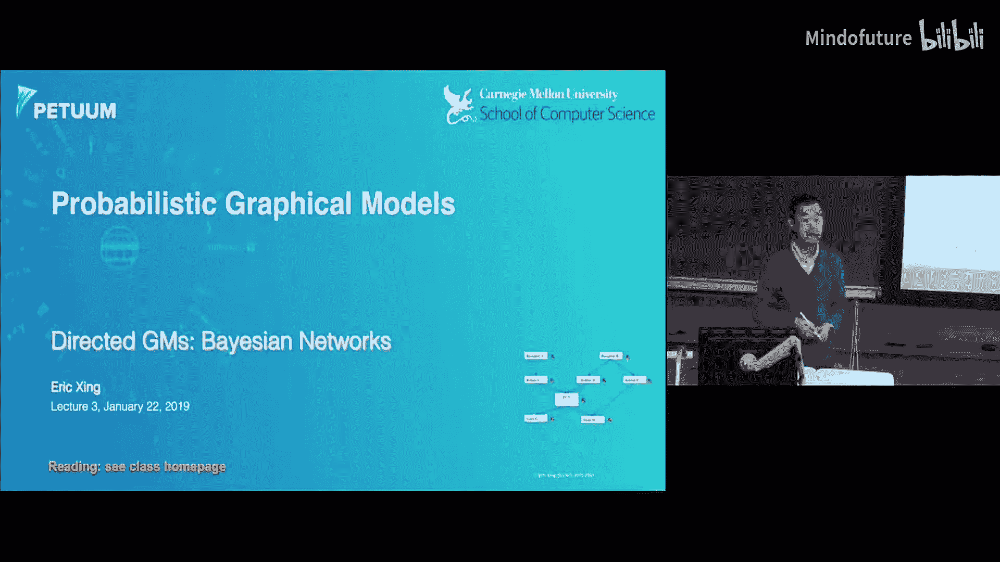
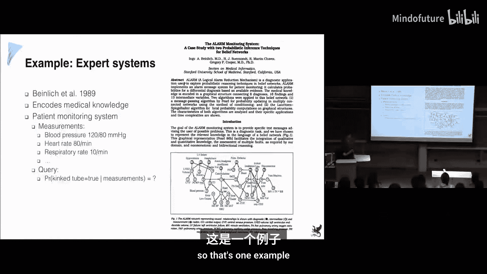
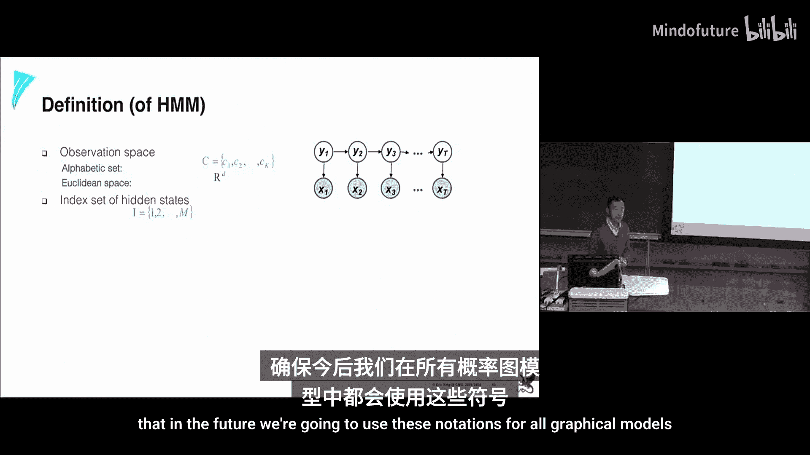

# 【卡耐基梅隆】概率图形模型 ｜ Probabilistic Graphical Models 2020 p03 P03_Lecture_03_有向图模型 -BV1ebpGzhEA9_p3-

Alright， so today we' are going to continue the discussion on graphical model structures。诶。

We' are going to talk about another very big family of graphical models known as Asian networks。

 okay。Oh， by the way， have you guys all already have access to the videos of the class。

WouldI that helpful？Actually， I also wrote my notes， you know。

 sometimes under the slide you want that as well to be posted。Alright， I'm going to， in the future。

 post two versions。 Why is the cleaning version。 The other is the scriptive version， okay。

All right。So， just a recap。Now， we know that there are two types of graphic models。

 Last time we saw this type， which is the undirected graphic models。

It capture some kind of a simple relationships between random variabless。

 which are kind of a associativeness， between pairs。And then， you know， by ways of， you know。

 defining potential functions on clicks。In which every clickique。

Or every potential is able to accommodate all dependencies between random variables in a click。

 That is what the click is meant to be， right， And once you capture all that。And multi together。

 you get a probabilistic distribution， which encapsulates all the dependence。

 conditional independences， you know， within this un directed graph okay。And。

 and we mentioned already a little bit about the， the completeness and soundness of this technique in terms that the dependencies that you can read of from this graph。

 the inencies you can read of this graph using something called a Maco blanket。

 local dependency definition。You know， and also， you can prove or derive the independences from the distributions。

 They are kind of equivalent， right。But the we didn't improve that。Today。

 we' are going to dive a little bit more into the more richer type of graphic models known as the directed graph models。

 where you see how， you know， to， again， capture very rich set of relationship between random variables and then still make sure that the problem distribution and the graph semantics are equivalent。

So here is a directed class model。You know， I put all the edges under the arrows。

This is a graph actually， I show in class 1。And then there is a corresponding， you know。

 way of writing down a factored version of the join distribution。Okay。

 and you actually can probably see something already from here。

 But I'm going to state more clearly about what that factor factorization law is in a few slices。

Okay。So here， you know。We are going to also introduce the concept of knowledge engineering。

 In a sense， you know why in graphic models， automation networks are particularly interesting in in the world of multivari modeling。

 It's because it makes you， it gives you a very， very flexible way of engineer your knowledge to encode your knowledge in very flexible way。

😊，Much more kind of flexible and richer than the and directed graphic models。

We already see this graph。 If you remember， this was a graph kind of expressing a biological story。

 I'm going to show you a few more examples so that you can get a sense about。You know。

 how knowledge engineering or how we take advantage of the directed work model to perform very flexible and expressive knowledge engineering。

 In fact， nowadays， with with the prevalence of you know， deep neural networks， very complex。

 deep models。Without a graph as the kind of the vehicle to。Express and to communicate your knowledge。

 It's very hard to design bigger models like that。 So in a sense。

 graphic model provides the initial vehicle， you know， for people to build very complex models。

So just give you a very historic account。 for I here， you see one graphical model。

Which was published。A long time ago，And， in fact， one of the cosors。Is a Greg Cooper， who is a very。

 very accomplished professor here at UP。 We collaborate a lot。

 He was one of the pioneers in this field， along with quite a few co and colleagues， for example。

 such as。😊，David Heckerman， for example， and Eric Hos， who is not director of Microsoft Research。

 You know， they were actually all pioneers in this field。

And this graph is literally about knowledge engineering。 It's a， a。

 a effort to create an expert system using you know， probabilistic theories。

And each note represents some medical phenomenon， symptoms， causes， consequences and so forths。

And then， you know， because you can see many of the authors。

AM PhDs in the sense that they know both the medical knowledge and also the computer science Sta knowledge。

 They were able to， you know， introduce some probabilistic， you know。

 description or qualifications of those knowledge， such as what is the probability of developing a symptom。

 given some cause。😊，Something like that。But you to a medical doctor。

 they have a much bigger picture about the clinical domain than a， you know， an average individual。

 So they were able to build a large graph。😊，And then synthesize all these knowledges into a coherent。

You know， model， which is what we are going to see。

 a joint product distribution of all these random variables。

And you will see very soon that the Beijingian network of， you know。

 offer such a convenient language to just perform this synthesis。 And as a result。

 by using this graph model， you can ask all sorts of interesting queries such as the conditional probability of a particular。

 you know， event， which is one conditional one particular random variable in this graph。

 given some other events， it could be a subset of random variables in anywhere of this graph。😊。

So this is a problem called inference。And with a graph。

 you will find that inference become a lot easier than just performing， you know。

 a analytical calculation， giving a big table of joint probabilities， okay。So， that's one example。

The second example， I'm going to work through you even more closely so that I can appreciate。

How fun it is， actually， to build a model。 And your project may start exactly from， you know。

 a exercise like this。 You have a bag of knowledge， of a real world phenomenon。😊。

And then you are going to just step by step。Compose， you know， or synsize a model。

And then youre going to land at a pretty big probabilistic knowledge base that allow you to do queries and allow you to do a lot of other things。

ok。So。And I actually also give you the essence of the。Kind of the spirit behind graphic models。

 you know， many people thought graphic models is is a highly theoretical， technical kind of in topic。

 And this class has been viewed as one of the most difficult， theoretically， you know。

 course in in the program。 But the truth is that graphic models from day  one is aimed at solving very practical problems in real world。

 Okay， you really， really want to build a bridge of a complex real world into， you know。

 and also the mathematical expression and vehicle of that。 And then， you know， you can hopefully。

 you know。Provide some rigor and also some convenience into into your practice。

 So let's look at this real world。 It's a quite fun real world， right。

 have you guys go to1 to Atlantic City or Las Vegas during the break。😊，Did you。

At least during the winter break， not did the Martin Luther King break。Well， you can imagine me。

 at least that you go to such a place。You may want to， you know。

 play a few games with a dealer like this。Right， he has a stacks of chips。

And you play a very simple game like a rolled diece and then compare， you know， the points。 Okay。

 as an outcome。And， you know， you shouldn't having too high expectation on the fairness of a casino。

 right， So you probably be prepared for this guy own two type of diocese。 One is a fair。

 which has the equal probability of offices。And the other one is a loaded dye。诶。

He could be loading the guy， the guy in that way that you know6 has a half of the probability and all the others split the other half。

 Okay， just。This is a scenario。In fact， this is part of your knowledge about the domain。

 or someone told you about so。 And then here is the rule of the game。 You can read it。

And I guess bytuition， you want to make sure that， you know， Euro and hero and you want to， you know。

 get more6 as， as many as possible。So that's kind of the possible word。

A disc casino that you are going to enter。Okay， so here are a few puzzles that you may want to establish some formal theory or maybe some reasoning technique。

 you know， to help you win or at least to help you avoid losing。For example， after playing， say。

 you know，50 round， you saw this sequence。You may start ask。

 am I dealing with a fair dealer or a tricky dealer。And the only evidence you have are the outcomes。

Of the 50 roses。What do you conclude。After just pling the results and seeing all that。

I'm training you guys to be a geek。 Okay， a mathematician or a computer scientist rather than an average tourist into the casino。

 So when you see this， what do you feel。Someone want to suggest a。Observation， yes， please。Ser come。

Yeah，6 are super common。 I highlighted them。 You can see that maybe， yeah。

 roughly a half of them math 6， almost right。😊，So this is a little bit counter intuitive because if you have a fair。

 you should see all numbers equally common。Then because we are C M U graduate students。

 we want to be a little bit more quantitative and formal。 Let's ask the following question。What。

 for example， the first question be， how likely this sequence， you know， is， given that， you know。

 we know that how the casino work。 For example， we know that there are， you know。Two type of diese。

And the probability of the outcome and so on and so forth。

Do you want to actually make a mathematical calculation about the joint probability of this whole thing。

So that's a question that you can ask。 And in fact。

 why it's interesting because you can compute the joint probability of all different you know sequences。

 And then you can actually even conclude， which is more likely， which is more unfair。

 So this is known as the evaluation question， which literally amounts to compute this value。

And then if you want to be a little bit more aggressive， you could even， you know。

 start to ask which of these you know， sixes or even other numbers。Pro by a Fad dye。

And which portion are from the loaded dye。Okay， so this is a legitimate question。 You want to really。

You know， you know， kind of a see through， you know， what is happening， you know。

 out of a phenomenon。RightSo this is known as a decoding question。

It's about the conditional probability of， say， you know， let's say X of 20。

 the 20th place in somewhere here。Given， you know， some choice of the dice， right。

Or maybe you can ask the the the reverse。 What is the probability of a y of 20。

 which is the choice of the die over there， given the entire thing。Okay。And then， you know。

 you could be even more aggressive and want to outsmart the dealer so that you can basically choose to bet。

 you know， based on your estimation。😊，Okay， of。Of the。的 events。

In a sense that you want to learn how likely what's the。

 the bias of every dice and what's the tactic that the dealer is using in switching between loaded and unloaded。

 right， So this is about learning some of the numbers behind the probability distribution。

 And this is known as the learning question。So， this is your。Problem and your environment。 You。

 you have a bunch of knowledge。So how do you start， you know， A， a task。Given that you。

 you graduated from the graphic model class， okay。So this is basically giving you a example about how we perform knowledge engineering with the help of graphic models。

First of all。You need to。Pick random variables。Which correspond to the events of interest that you want to say something about。

 So what are the event of interest that you care。嗯哼。😊，Okay。You， you， you， you care already the， the。

 the， the， the the type of diese。 and， but obviously， you also care about the。

 the outcome of the diese， right， So which is the numbers you actually see。 Yeah。

 you can see that there are two type of variables that you already care about。X， which is， you know。

 the faces of all these dis。Right， and also wise。Which correspond to the choice of the diocese。

 right， Let's index them to be I， meaning that you have the I row of that。

And these are random variables。 There are other things。 You know， the location of the casino。

 for example， you can make it even bigger。 But for the sake of in。

 that's focus on the most interesting random variables or events。

And then you can already build some structures into this using your knowledge about the physical world。

 For example， the outcome of the diese is coming out of the choice of the dice。 right， Therefore。

 there should be some kind of a causal structure。 It's not a correlational。Right， it's not that the。

 the outcome kind of and determines the the choice of the， the diet， right， So it's not symmetric。

Alright， and then I try， I'm jumping behind ahead of me already。 I'm not yet ready to pick structure。

 I want to still say something more about that。 So every random variable has to have a， you know。

 a scope and the， the also the possible choices of their values。So what is the the domain of X。Or。

 it should be anywhere，1，2，3，2，6。Right。And why should have a scope as well。

 I should have a domain as well， What is that。We should probably make them fair， and loaded。Right。

 and now， of course， you can put a categorical kind of number， say。

1 or 2 or 0 and one so forth to represent that。So。In a sense， every random variable。

 you have to decide， first of all， or by the way， you observe the X。

 but you actually don't observe the y directly unless someone tell you。 right。

 So we want to make the graphic model a little bit more colorful by distinguishing the two types。

 We shade those nodes or rather variables， which are directly observed。 We call them data。Right。

 and we leave the other one unobserved to be， you know， empty。

And they are also known as latent random variables。Okay。

And then every random variable could be discrete and continues。

 It really depends on what you measure。 In this case。 All the events are discrete。

 but it could be also continuous。For example， if we， it could be continuous between， you know。

 a minus infinity to positive infinity。 if you measure something。I don't know。

The temperature of the universe， something like that。ok。And after you pick the random variables。

 you are going to pick the structure。 And here is one structure。And it could be causal。

It could be generative。It could also be coupling， which is the case for our anddirect graph models。

 In this case， maybe we should call them generative。Rather than causal， right？And in fact。

 you can build more structures in here。 For example， you are not going coming here to roll just once。

 right， Let's say we are going to roll 20 times how to express our structure。 Well。

 maybe we should do this。 Y 1 give rise to X 1。Y 2， give rise to x 2。And y 3。To x 3。

 all the way to Y 20。And X 20。 Okay， so this is a structure。 This is a graphic model。

 Isn't that the graph， you have edges and you have nodes。

Do you want to add something more to that structure。In here， you can see that the wire。

Are independent。Okay， my next choice of the dice。Has something to do with my previous choice。

And also， the outcome of that choice is not dependent on the previous one。What some。

Gump dealers may exactly do that。O， but that doesn't give them a good chance to win。

Well still some because there is， after all， a loaded die。 Once you pick that。

 you are likely to win more。What if you are the tricky dealer。

Do you want to be a little bit more strategic， I think there are two purposes。

 at least for being strategic。 One is that you want to increase your chance to win。But also。

 you don't want to be called out， you know， by the player。 because if you are too aggressive。

 you just don't switch。 You keep using the loaded one。I don't think you can pass 10 games。

 You will be called out。So what's your strategy？Okay， I will suggest one。 Maybe after all。

 my choice of the next I should be at least depending on my choice of this one。 For example。

 I'm going to choose the next。Dy to be the same， you know， waste a high probability。Okay。

 if my current die is a fair one。You know I'm using a fairdise， then with a 0。99， I'm going to again。

 you know a fair dye。And then I'm going to have a very small probability， point01 or。

1 to pick the fair one。So what's the advantage of that。

It's very difficult to catch you because after all， you don't use the loaded one very often。 right。

 So that's actually a knowledge。Okay， so your second one will be dependent on the first one。

 And you can also draw this。You could， of course， be a little bit more sophisticated by saying that my third one depends on not only the second one。

 but also the first one。 you can actually build that as well if you really want。Okay。

 so this is basically the structure of， you know， the random variables。

And then you also need to define， you know， the probabilities。 For example。

 how to express the fact that fair dye has equal probability of all the faces。

WellThat's represented by the conditional probability of x。I， given why I。Right， equals to。

F and P of X， I， Y， I equals 2。Well， these two properties， in fact， for all the eyes。

How to express my policy or my strategy in picking the， the dice。Okay。

 want you guys to get used to the language or the expression of your knowledge using probabilistic language。

 You do this。You basically say my why I plus one， given why I。Is something。Right。

 that basically defines a conditional probability。 And， in fact， you can。

Say I'm going to be stationationary。 That's another word。 Station means that for the entire game。

 I'm going to use the same strategy。 Therefore， this transitional probability is going to be good for all the eyes。

RightYou can also be nons stationary by saying that you know， for every eye。

 I'm going to change my probability。That's going to be very hard to implement because you don't even remember what do you do。

 right， So it's very hard to really be accountable。So anyway。

 so these are just example of knowledge engineering。Okay， at the end of day。

 you have random variables。 You have structures among random variables。

 You have also this local conditional probability of between random variables。

And that leads you to a model。Okay， and this model is known as the very famous hidden markov model。

 right， the underlying sequence， the underlying source are hidden。 And in our previous example。

 they correspond to di choices。But， you know， you can imagine。 and， in fact， the。

 the outcome correspond to the sequence of rows。But。You know， for more valuable applications。

 you can imagine they correspond to maybe a year。A a line of DNA sequences。

And then the hidden variable course correspond to whether you are in the region of a gene encoding region or in the so called junk region where it's such just doing nothing。

 you know， other than supporting the structure， right。You could also make a speech recognition。

 or speech synthesis。Where these guys are the， the phos。

And these guys correspond to the speech signals。Okay。And you name it。 there are many。

 many examples of this。Alright， so once you have the structure。What you achieve， What you can do or。

It helps you to now write down extremely， extremely informative。And also， useful。

Jo distribution of all these random variables useful by mean， I， I mean， by useful， I mean。

 they are more useful than the gigantic table of all these random variables。

Okay without to assuming any structure。Okay， so。Let's see how that can be established。

We have a graphic model now， which is H M M。The structure now become hopefully intuitive and explainable to you。

And also， it's， it's your creation。 Basically， you put the structures like this based on your knowledge。

Then。I'm having。2 sets of data。 One is the， the role outcomes。

 The other is the di choices and the the joint probability of this。Is what。Okay。It turns out that。

Because of the structure that you lay out like this。

 you can write down the joint probability using very， very simple manner， which is to just。

Multiply together all these little terms。 P of y 1， which is a disk guy。P of X 1， given y 1。

 which is a this guy。And P of Y 2， given Y1， which is this guy。And断ですか andですか。

You literally can in a multiply together all these either marginal or local conditional distributions or probabilities by traversing that graph。

In the following sense。You know， every time， you know， you run into a note。

You check whether it is the route without parent or it is a intermediatemittent note with children。

And also， as parent。Then you can， you know， plug in a term， which is the marginal。Okay。

 if it does not have any parent。Or， you can。Plug in another term。

 which is the conditional of this node， given its parent。Okay。

 you only need to have these two pieces and you traverse the entire graph after you visit all node。

 you multiply all these terms。 you get the joint。So this is a factorization rule。

 which is which can be established as a theory。You can rearrange that a little bit。

And then you can also re merge them。 You actually will see that this probability correspond to。

 you know， the bigger factorization， which is this one。

 which is the probability of the hidden random variables and the probability conditional probability of all observed random variables。

 given all hidden random variables。And now， once we have that。

You can now make maybe try to answer some of the， the queries or the puzzles I stated before。

 Remember， one of them is the puzzle called evaluation。

 What is the probability of a sequence of observations， not knowing the hidden random variables。

 not knowing the choices of die。 You just are presented with a sequence。That basically correspond to。

Ege B， the marginal probability of x without y。And based on， you know。

 the basic theory of a probability， what you need to do is that this one is the marginal distribution。

 or marginal probability of X。O， and why。You some out or。

Which means that you need to sum over all these wise。And this part。Just， you know。

 the A break expression of all these conditional propertiesbabilities and marginal propertiesbilities。

Now， let me ask how many sums you have to do in in a naive way。Here， I'm leaving here。

So I ask all these questions again， just to bring you， you know， the。

 the sensibility to computing and to operationaliz ability as a computer scientist。

Statisticians usually start from here。 You know， once I have expression， I'm done， I'm。

 I'm done with my proof。But you have to implement that in the computer。And therefore。

 you have to finish all these steps。So can you answer how many steps it takes to finish this summation。

Size supply。Mmhm。ok。Therefore。Let's say， you know， the size of y1 is O K。key choices， let's say。

Times a K。 Time a K。Right。Which is giving you to。K exponential。Right。

 so it's a exponentially complex。Operation to do all the marginalization。

And if you play the game 100 times。You will get two to the power of 100。How big is that。

To to the power of 10 is already 1000。And then， you can。Do a cube of 1000。

 which is already quite big。 Okay， yeah。That actually gives you a hint about why， you know。

 this graphic model can be useful。 I will tell you very soon that using the graphic model structure。

 you can reduce this quadratic complexity。😊，To actually a linear or to a polynomial complexity。 Okay。

 how about we make it to be。N square， for example， something like that。系。Okay。This is just a。

 just a teaser of a trailer of the entire class down the road。I have another query， you know。

 which is to answer the likelihood or to estimate the hidden sequence， given the entire observation。

And it is called a posterior probability of the hidden random random variables， given evidence。

And here is the， the formula。And you can imagine， you can see that this is a joint。

 And this is the marginal。 In fact， you have to compute this first before you can get this。

 Therefore， it is equally， if not more complex as the previous one。Right。Okay。

 so that's just give you， you know， a very， very quick teaser of knowledge engineering and also the cause of that in a real world problem。

Okay， so now let's get back to our a very fundamental definition of the directed graph models。

 The previous examples are meant to inspire you， you know， for the utility and the future， you know。

 questions that you may ask for this type of formalism。 Now， let's get back to the formalism。So。

 Beijing network is a。Direct graph model， you know whose nodes are representing random variables and the edges are representing direct influences among or between the random variables。

 okay。And the second statement is very crucial。 It is a data structure that provides the skeleton for representing the joint。

Using a systematic factorization way。Okay。And also， you know。

 it gives you compactness because instead of writing down the big joint using a gigantic table。

 all you need to do is now to express every local entity。

1 is called the marginal of some random variables， which do not have the parents。

And others are the conditional probability of some other random variables given their parents。

 They are all small distributions。Small means that the number of random variables have to touch is very small。

Okay， and， of course， operationally， you can use that as a process to sample examples。

 but we can carry out there。Okay， the state more formally。This is how you define a Asian network。

And we， of course， have this issue about consistency。 right， There is a graph。And there is a P。

And the， the connection between them is through factorization law。系。But。

Are there other ways to define a P from a graph。Or are there other ways to extract from the P some graphs。

Are you going to always get the same。 This is what we mean by consistency。 Okay。

 so we are going to be a little bit more rigorous on what entails this consistency in a second。Okay。

 okay， so remember， this definition is very， very handy， very。

 very operationalogniable in terms of defining distributions。 And this is， again， the example。

Alright， so now let's specify is look into how to specify models。Using this principle。

 we already did one for H M M。 And here you have a more kind of you know generic one。 you know。

 in terms of the structure， H M M is a chain。 It， it is particularly simple because every node has only one random variable as a parent。

Right， and also there can be actually a little bit more， for example， there can be。

More companies scenario I will where a node may have multiple parents。

 These are seen in gender models。So to specify a directed graph model， you need to do two things。

 If you have two things。 One is called qualitative specification。

 The other one is called a quantitative one。Qulitative one。Generally refers to the structure。Okay。

 of the graph， which is a part of the expression of the knowledge。

 The quantitative ones are these guys are the local conditional probability tables。

So to have these two pieces in place。Where do they come from？Or the qualitative ones。In a sense。

 had a huge space of origins。RightIt could be the prior knowledge of causal relationship， of。

 you know， other relationships that you know about。 It could be coming from your expert friends。

It could also be learned from data。 We' are going to say a few words about this when we are going to causal graph learning。

Or maybe sometimes it's arbitrary。 You know， it could be just a way I like it。 In fact。

 many of the deep neural networks。Due to， for example。

 why you pick 100 layers rather than 1001 layers。 Well， it's， it's kind of arbitrary。 right，1 not 99。

And also， how wide the graph could be， you know， how many nodes you have。

 you need to have for a particular layer，100 or 1000。There are some arbitraries there。

 although there are some guidelines as well， we can talk about that later。But given all this， I。

 I think there is also a need to be a little bit more rigorous。 We will ask。

 is there a more concise and ambiguous and rigorous， at least meaning once you I give you this graph。

 Can we all agree on some common principles rather than we still walk away with10 different interpretations。

 right that's no good。So on that， we need to go back to our old friend of a conditional independences between random variables。

 because that's where I don't think people have ambiguity in interpreting that。

Something are conditionally independent。It really means that the distributions are factored in a particular way。

 There is no other kind of interpretations of that， right。So let's see whether this is possible。

So let's begin by looking at some local structures， okay。In this graph。

You can see finite number of local structures。 So here is one。

It's called the common parent structure。ok。And which is like， you know。

 one parent giving rights to a couple of children。And that actually correspond to a particular type of conditional independences。

 Okay， It basically says that the P of A and B and， and C， given B。ok。

A and C become independent given B，Which means that the P of A given B。And P of a C， given B。

Can be multiplied。Okay。Okay， so this is guaranteed。

 I'm going to prove that it's guaranteed if you write down your join distribution using graphic models。

 Okay， this graph gives you that kind of this graph mo gives you that kind of independences。

And again， this is a very common natural kind of pattern。Of causality， right。

 a particular gene triggers， for example， multiple downstream genes。The other graph motif。

 such as youll see from here。Is the cascade。Okay， in a cascade。

 you see at least three random variables。Then the conditional independences is that given the middle one。

 if the middle one is already observed， then the previous one and the future one become decoupled。

Okay。I'm going to leave it to you to write down how to express that in probability， okay。P offer。

Because of what。And again， this is， you know， in， in English。

 you can say that the past is the the future is independent of the past， given the present。

Very philosophical， but it's true。The third one is a little bit tricky。It's called the V structure。

 I think you saw it from here。Okay。It says that。The two random variables are originally independent。

 for example， A and B。Are actually independent。 If I have nothing else to。To say about the model。

Okay。However， if A and B。Are given。A piece of new evidence， C。Okay， suddenly。You know， A and B。

Given C are not independent anymore。So this is a very， very interesting phenomenon。

 which is a little tricky to， to， to， to appreciate。So I give you an example。 Okay。

 I'm going to establish two events first。So there is a clock at the back of the wall。

 which says not 1244， okay。And we can qualify that clock to be sharp or inaccurate。Okay。

 so it's a binary event。I can also put another event。

 which is the traffic condition on Highland Park Bridge， which happens to be， you know。

 on my way to school。 Okay， so that's an event。So these two events。

 are clock being sharp or not here。 and the the traffic jam taking place are not on Ha Highland Park Bridge。

 What do you feel about these two events。Are they dependent。Surely they're not， right？

But I give you a third event。Given that， you know， my some knowledge already It is a bridge really。

 you know， on my way to here。 and also here is a clock， which is in here。Now I have a third event。

 which is I show up in classroom on time or not。O， that's a third event。Now。Youll come here。

12 o'clock。And you wait for 10 minutes， and I didn't show up。Okay， now I want to ask。Whether。

 you know， the clock being sharp and the traffic being jammed， are these two events become coupled。

I think it's coupled， right， For example， if， you know， through searching Google Ma， you knew that。

 you know， there is indeed a traffic jam out there。

Then I think your conclusion on the quality of this clock will lean toward the clock。

 maybe it's okay。系。But if you knew that there hasn't been any traffic in the bridge。

 maybe everywhere。Then your suspicion about the clock quality may be changing。

 You may say that the clock has some problem， probably。

So these two events gets competing for the same consequences， which is my absence in the classroom。

 They compete for explain that。 Once you know one part of the explanation for sure， then。You know。

 the assessment of the other piece of the the， the， the， the， the。

 the contribution is going to be changing。Right， so this is called the so called the explain away kind of phenomenon。

And which is， again， a very common phenomenon or pattern of reasoning in real life。

I claim that these three motivets are pretty much enough。

To serve as the building blocks of all our probabil graphic models or direct graphic models， okay。O。

Any questions so far。 So these are nice building blocks。 And just to。Give you a easy way to。

 in terms of how to prove them。 These are very， very easy proof。 for example the the previous one。

 the first one called the the， the common effects。We want to basically establish a P of A and C。

Given。比如。Is equal to P of A and given B。time率。BP alpha a given啊 C given B。

We want to ask that it's true or not。And then what's the the given。

 The given is that my joint of A and B and C follows a graphic model definition。

 Ob network definition， which is that it equals to P of B times P of A given B times P of C given B。

 right， So this is。By definition。Okay， of a graphic model。And can we prove from here to here。Right。

Should be straightforward P of A and C， given B equals to P of ABC divided by P of。毕。Right。

 and again， by definition， the upstairs。Eals to P alpha B times a P alpha a。Given B， P alpha C。

 given B。Divided by P of B， these two turn consoles and trade。

You can imagine that you can apply this very， very tedious exercise to larger graphic models of arbitrary sizes。

Im to guarantee you that all the condition independences can be proved like this once you use the Beijing network or this fedation law。

To define a joint。Okay。Okay， so that gives you a。Now， going back to the I map， remember。

 I map is the， the， the little kind of device we use to establish the relationship between a graph and a distribution。

 And in particular， you know， for a graph， you can always extract， you know。

 all the conditional independences using some， some graph rules， right。

 such as the the three little local， you know， independence rules I just presented。

You can scan a graph like that， and get all that。And then algebraically or analytically。

 you can imagine that there exist a set of independences for an arbitrary。Probabilistic distribution。

And now， let's ask， are they equivalent or not， if my distribution come out of a G， for example。

 are they equivalent or not。And we saw this before。 Let's skip that。 You know， the， the。

 basically the quality of the I app。 It's only going to be meaningful if once you have a I app。

 it's not going to suggest anything。More than basically， that graph should suggest。 So we。

 we ran these examples before already。 Let's pass that。Now， let's。

Let's really ask what is in the M app。Of a directed to graphical models。

So we used this so called local Markov assumptions。 Okay， and let's expand that a little bit， okay。

And it is actually very easy to show you the following， you know。

 local conditional independence assumptions or sets from a graph。

It includes the following collection of independenceencies。

 which is that for every random variable X I， or you can also understood that as every set of random variables。

 But it's easier to start with single term。This guy is going to be independent of its non descendant。

 given their parents。So go look at the graph， identify a note。 and also their parents。

 You can safely claim that X is going to be independent of or It's a non descendant。

Not basically anything up downstream of the graph。Not directly upstream because they are the parents。

 anything else。Its going to be independent of X I given the parents。

You can run this micro or this oracle for autograph and get a set。

 And that's called the I set or I local of G。Okay。Okay， so。That gives you AI。Okay。

It's a little bit inconvenient to use this local markov assumption to extract everything， because。

Sometimes you want to arbitrly choose the three sets。In the graphic model。

To ask for their condition independences， which may not just be parents myself and my non descendant。

 It could be arbitraryrbitly three， right。So for that。

 you are essentially asking a broader global mark of independence problem。

And here we need to use a little bit more trick。Remember， in the in the。Undirect graph model。

 If you remember， what is the， the property of。The global might property。If you still remember。

If I have three sets， X and Y and z。How can we establish X independent of Y， given Z。

 if you still remember。Mmhm。Direct actually。No direct edge。 While I'm asking any arbitrary。3 sets。

 There is a broader definition about the separation。社通话方啦。Mico B is for local， remember。Yeah。Yeah。

IfAny knows that you connect。Yeah， so you're talking something like a graph separation。 right。

 So basically， I have have， I have this set X。 I have this set Y， and there's little  one Z。

 And as long as any pass from X to Y is blocked by Z。This one would would be honored， right。

 So in a sense， you want to want Z to be the graph separator between x and y。

And on undirect graph models， graph separation is very， very trivial。Right。Now。

 we have a direct graph model， which is a little bit tricky。 So we want to do a bit more about that。

It is not no longer called graph separation。 It's called a D separation。Okay， the ratit separation。

And here is the definition about arbitrary sets。When they satisfy a de separationparation statement。

ok。The definition rate like follows。 is's a little bit strange。 Okay， the variables。

 X and the Y are de separated。Or in another word， conditionally independent， given the。

 if they are graphically separated in the moralized ancestral graph。Okay。

 so we walk back into the standard graph separation。 But in a different graph。

 it's called the moralized anncestral graph， which is underdirect。So it is not original graph。

Because we love this separation thing so much。 It's very， very easy to define and unambiguous。

 Therefore， you know， we keep that term as the qualifier。

 but we engineered the graph a little bit so that that term can still be operated。

 What is a ancestral。Moralize the graph。 That's a little bit tricky。 So here is the original graph。

You have all these edges。 You have random variables。 One is given。To be conditioned on。

The ancestral graph， first。Ask you to。Literally， a。Remove。Let's see X， Y， and the z。To。

 to remove to keep only those elements， which are the random variables themselves of interest and their ancestors。

O， that's called anncestral graph。So as a result， this guy is gone because it is not an ancestor of any of this。

It's still a direct graph， but only contain the variables of interest， plus their ancestors。Okay。

And then you do another kind of interesting operation called moralization， two steps。

You drop all the errors of the edges to make them undirected。And then， you marry。The pairs。

 which were originally unconnected。In the original graph。The why is called moral， you know。

 at least in their definition， they believe that if two parents are not married and give rise to a children。

 it's not very moral。 Therefore， they will have to moralize that。Okay。So that's called the ancestral。

Moralize the graph。And then your graph is not converted from this one。To not one。

This is a unted graphical model of unted graph。 And in here。You can apply graph separation。You ask。

 is X and Y still graphically separated by the。Is it or not。In this case。Well， obviously。

 Z fails to graph separate X and Y because there is an H here already。Right。And you know。

 you can kind of almost walk back and see why this is the case。

 because here we are looking at a V structure。Right， the common。

 this one and this one shares a common descendant， which is conditioned。 Therefore。

 this and this become coupled。And because this and this is coupled and this one。

 and this one is coupled。 Therefore， this one， this one is also coupled。 So there is a。

 a transaction， basically of， you know， of influences using this V structure， you know。

 to bridge basically a remote dependencies， okay。In a sense。

 you can use this rule or to implement a little program to scan the graph。

And get all the independences。I can make it a little more easy by， you know。

 proposing a literally a algorithm called baseball。

 which literally just did the same without even asking you to because creating a。

Ancestor moral or less graph is still cumbersome， right。

 What if I still want to just keep saying on the original graph without creating any new one with the baseball egg within this is possible You basically want to run three processes on the graph。

 by imagine that you， you this graph got hand like this， You just hang it vertically。

And you want to pick a origin and know where it stands for your X。 Okay， one of the。

 the set you want to ask independent query， you drop a ball。Into the， the network， okay。And the。

 the ball will be basically will be bouncing back and forth and hopefully move to the other end of the graph。

 And you will see。 you ask whether my ball can reach to why。In the presence of in this case。

 reach to Z。Okay， here， sorry， I there's a notational notation No ambiguity。

 I'm asking the following query。can reach Z given y not。And here is a room。If， you know， you know， Z。

 Y is， you know， in the middle between X and Z。 You know， in this configuration。

 there is an h into Z and a H out of Z。And， and why is observed。

 Then the ball will bounce back and couldn't pass。If why is not observed or not being conditioned。

 then the ball can pass。 Okay， so that's one， one rule。

The other rule is that if why stands as the common parent。Of two ways。Other X and these， Then again。

 it is going to be bouncing like this。And it will let go， if。Why it's not being conditioned now。

You may ask， what if I have something like this， why， and I have a bunch of other things in here。

And the here is x， here is z。Well， in that case， it to be ser because in here you are talking about this rule。

 and in here， you are talking about this rule。 right， So it's a very local operation。

 You just pass a little ball like this。 And every time you run to the next note。

 you ask whether this condition is met or that or this and that。Okay。The third one， which。

Corspond to the restructure is a little bit counterintuitive。If this guy， the common parent， parent。

 is being conditioned on or observed。Actually， let go。Back past double， and otherwise， a will bounce。

Okay， which is the opposite of this。Again， so the， the beauty of this rule is that they are over local。

 Okay， Local means that local means cheap。Right， whenever you do operation。

 you don't have to examine the entire graph。 You just basically look at what you have， you know。

 as of now and decide whether to go a a block。So once you do that。For every triplet in the graph。

You are going to collect this set。And this set is basically the I set。 Okay。

 the eye map of the graph。And this is called the graph of the deep separation。Okay， so。

I meant to do life， you know， about。Getting I G for this graph。

We saw all possible queries that you can ask。But because of the interest time。

 I'm going to leave this to the subscriber today。 Do we have a subscriber today。

I bet some of you will be doing that。 And then， you know， you will be presenting that in the notes。

 and other people can study this okay。Alright， so now let's converge to something a little bit more cleaner and condensed and more formal。

So。We know that the separation properties。Can imply the independence properties about the。

 the variables。So let's look at the the equivalent property。You have a。诶呀。

You cannot now start from a family of all distributions。Which satisfies this。Okay。Basically， a graph。

 you know， by using the baseball rule or other rules， you get a set of independences。

 And you can imagine behind that， there could be a family of distribution satisfying that。

And then the other alternative is that without going through all the Gs or the independences。

 you just directly use the factorization law。To mechanically assemble a distribution like this。

 And again， there is a family。 Why there' is a family， you can have all different numbers you know。

 put into this table， right， So you have many infinite， but there are going to be。Composed together。

 you know， to build this joint。Which one is convenient。Well， certainly， this one is very convenient。

 right， It's also very local。The good news is that these two families are the same。Okay。Basically。

 once you have a graph。You don't have to now， You know。

 there are a whole rich set of conditional independences out there。 And if you need to。

 you can extract one and tell people a story。 But when you are building the distribution。

 you can only use the。Faterization Lu。To do this mechanically。

 they guarantee you that all these independences。Honored。Okay。So it's a very， very remember。

 in the graphical， in the undirect graph mode， we have a counterpart theorem， which is called。

 if you still remember。Which also allow you to start with a graph。Right， and use all the clicks。

 define potentials and then come up with a joint。 And I said that the independence over there are also equivalent to all the independences。

You know， in the graph。我哋杀咯。It's called the Hamishly Claiffer theory。

RightWch guarantees you a Gis distribution form。Which correspond to the multiplication law in here。

 okay。All right。Let's unwind a little bit before coming back， condensed again。

Let's just do some exercise。 Okay， so here I have a graphic model like this。诶。

Let's begin by something simple。 They are all discrete random variables。

How can we build a joint like this。Okay， very simple。 You literally just put the tables like this。

You may wonder， where are these numbers come from。Okay， that's a whole big universe of a topic。

 We can learn them from data， or we can just ask a friend who happened to know the facts。

 know God's rule。 and they will give you those numbers。

And the joint is produced by multiplying together。Equally interesting， if not more。

 is the case of conditional continuous probability distribution。

 where you don't have probability tables anymore。 You probably need to work with density functions。

And here are just examples of how to combine。Continuous distributions。Okay。

And how to define conditional distributions in the continuous space。Given， you。

 parents and given other things。So marginals are very， very easy， right， You have this two。

Continuous random variable， say。We want them to be高。Okay， again， this is by， remember here。

No distribution， you know。Are really true， but they are useful， right？

 So here you choose them to be Gausing。 It's not like they are Gausing。 Okay。

 you model them with Gausing。 just like in this case， you choose them to be discrete。Or。

 or binary beno or multinoial， but。In real life， are there are really like that。 I don't know yet。

Here is a little trick。 If you want a third random variable con continuous one to be dependent on two other continuous random variable。

 How do you form the dependencies。Well here we have a additive dependencies。

 The mean of this guy equals to the sum of the two meanss。Of the previous one。In fact。

 you can also propose to make them the dot product between this two us also fine。

If this is a one dimensional random variable。And there are other ways。 But here comes to the。

Effort of design， you know， your choice。 Okay， the choice can be factual， can be need based。

 also can be computational or limited。And here I have yet。

 yet another random variable continuous one dependent on the previous random variable。

 just single one。Or I can choose to offset the mean by some other constant， another idea。

So at the end of day， you will have a， you know， a joint distribution of multiple random variables。

You may ask， what if。I put yet another random variable， which is discrete。

Have you thought about that。How a continuous random variable depend on a discrete random variable。

Yeah， threshold could be  one， right。 if it is， if Y is 1。

 I chosen to be uniform and random between 0 and 1。 Otherwise。

 it could be uniform random between1 and 2， right， So very arbitrary。

 So this is really part of the engineering。 a common choice in here。 if it is discrete。

Is that it becomes a switching random verb。Okay， I have a multiple gausing models in here。

 I'm going to switch between the three， depending on y equals to  one or2 or 3。 That's another thing。

 This idea has been used for clustering data。Alright， so here is a summary。

 It's an important take home message I'm not going to read， but。I think we we。

 we went pretty in depth。 maybe the。We can ask this question。

Previous ones are pretty straightforward。Now。I'm going to have a A L P。Okay， which say I derived。

Out of。啊。A graph using fraction rule。 Okay， so let's call them P of F given G。

Are you curious about the possibility of additional independences in this in this P。

We're overloaded now with multiple brackets。Does this eye have something more than。The I of G。

 which is。Extracted using my baseball algorithm。What's your， what's your guess？Okay。

 so this is becoming a little bit more interesting。Yeah， so here。

 let's make it a little more formal in terms of the soundness and completeness。 Again。

 for a full account， you can read Daphne Koler's book。

 They have a pretty detailed chapter discussing this whole stuff。

Which I found to be very interesting， but difficult to read。 I have to be honest。

 So here I extracted the， the essence， you know， from that in one or two pages。

 you can at least pretend to be knowledgeable in the future for， for this completeness and soundness。

It turns out that there are some leaky places which prevent them to be totally complete and sum。Well。

 as a matter of fact， the sunness is actually good。

 If you have a distribution P that factorize over the G。Then you are guaranteed that all the I of G。

 all the independences due to the base law or the base wall law you know from the graph。

Is actually honored。They are all alert in the I of P。This part is safe。Okay。

In a sense that the graph isn't going to give you additional explanations。

 additional independences that is not captured in a graph。

 This is very important because you study from a graph， you write a distribution。

 and you tell people usually a story based on graph。

 you never tell a story based on numbers or P to people， right。

 And you want to make sure that I have my faith that when I read a graph and tell all the independences。

 they are all honored in my P already， even though I don't have time to check those numbers in P。

These parties guaranteed。The reverse part is unfortunately， a little bit problematic。

 which says that if I have a P， which comes out of the G using the ferization。Then， if。Nummerically。

 in the P。I extract this conditional again。 So given a P of X and Y and Z。

You can somehow extract or test whether this independence is true or not， just on the numbers， right。

And if you somehow tested that there is a independence like this in P。Do you expect to see the。

De separation of this three in the graph。So I'm going reverse now。

 I said that if you tell the story from graph。They will be always in the P。Now。

 I want to tell a story， although very， very few people do that。 But imagine I can do it， you know。

 by just。Screning the numbers in the P。 Okay， enumerating all possible configuration of P。

 And I get a independence like this。Then can I go back to the graph and say， hey。

 these three sets must be disse。Graphically。It turns out that this is not guaranteed。

Okay not guaranteed for， fortunately。Some fewer special cases。

And the proof of this is actually a very， very tricky。 It's very interesting。

 And here is a proof technique which allows you to just use a counter example rather than just a fool proof to。

 to， to hopefully establish this fact， which is called the counter positiveness。😊，And basically。

 proving something that is。The， the converse of this， equivalent， the complement of this。

Which is that now as because from the graph to the P is usually very easy。

 From the P to the graph is。It requires a lot of enumeration。 So I still come from the pe。

I'm saying that if the。Pear are not de separated in the graph。O， meaning that they are dependent。ok。

And then， you know， are they always， you know， a。Depenent。In the P。In fact， if this is true。

 then that is true。 that are equivalent。Okay， maybe just to give you， a little help。 And here I。

 I just use a graph to to show that。 you know， you。

 you start with a graph and you can use the federation law。To define a set of distribution。

And that fact law basically gives you a set of independenceencies。

And we basically can have the I of F like this， okay。And then here we have the other we。

 the other set of independences， which is directly from the graph coming from the eyes of G through de separationation and then defining the distribution based on。

 you know， the de separationation independences。 So the previous statement in here。

Were really asking。Is this and these two sets。이 equivalent or not。It's a bit harder to ask。

What the contra positiveness is saying that if something is not independent in here。

 not dis separated in here。Okay， are they always not independent in the distribution or not。Okay。

 so I'm not going to dive too deep into that， but you can guess the answer already， right。

It is not always the case。Because even though I can always in in in with example。

A small one previously already， even though that in the graph， you know， you can basically， you know。

 have a absence of independences。 They are not dis separated， for example， like this。Right。

And therefore， meaning that they are dependent。I can still， you know， which actually leads to。

 you know， A P of A and B， which is a P of B given A and P of a， right。 So this is obviously。

 you know， dependent。N。But the counter positiveities are basically saying that if this is the case where two random variables are。

Not dis separated。Are they guaranteed to be dependent in P。My statement that is not。

I can engineer a joint institution， like。These where。

The conditioning on a become a dishonored by saying that if a equals to 1， I have the same table。

And a equals to 0。 I have another same distribution。 Therefore， regardless of your choices of the A。

 my conditional of B， given a remain the same。So this is doable， right。

 I engineer a distribution like this。So numerically， this allows the A and B to be independent。Right。

Therefore， graphically having a。9 de separationation does not always guarantee that you have a dependence in the。

 in the， in the distribution， in the numerical sense。Okay。

 as long as you let the author to be arbitrarily tricky in picking their distributions。

Although this is not very you know， substantial because typically， you know。

 you either learn these numbers from the real data。Or， you know， you。

 you really trust that the users are not trying to waste people's time by engineering some fabricated answers。

 Therefore， you know， the statement now says like this。 They are dependent in some distribution。

But this sum is a very， very small and natural sum。 Okay， in the most natural cases。

 you do have the suns and completeness in both directions。So were still safe， you know。

 in our daily practice， where the independences and the the graph separation or the factorization are all talking about the same thing。

Okay， so。The good news is that。In most cases， we have this。Okay。Okay， so until now。

 I think we kind of established， you know， the equivalence and also the transferness between the graph and the distribution。

 And in the future， will be interchangeably just looking at the the graph， for example。

 without even putting any numbers or distributions for that。

 or sometimes we could go the other way around。Okay， I think that's all。

 We have a few additional slices to talk about the uniqueness， which goes to， you know，You know。

 basically， the different ways of expressing the same independences。

 you can read that for your own leisure， you know， after the class。

And then there are a few examples of composing very traditional graphic models like In air。

 Uniivverate distribution and a few other expressions like plates and so forths。

I think I'm going to stop here， and。And to see you next time。 Here is a。

Workal through of the hidden Mac model in a more detailed fashion。

 The notations here are quite interesting。 I want you to take a look after class to make sure that in the future。

 were going to use these notations for all graphic model。😊。

