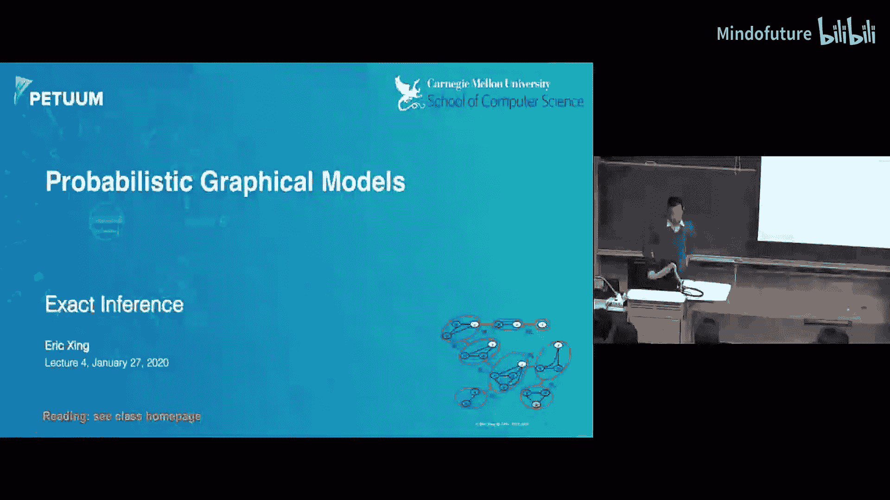
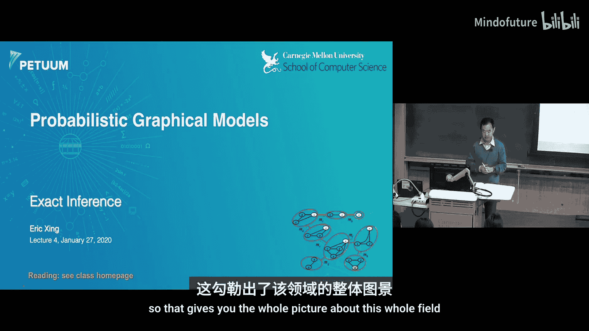
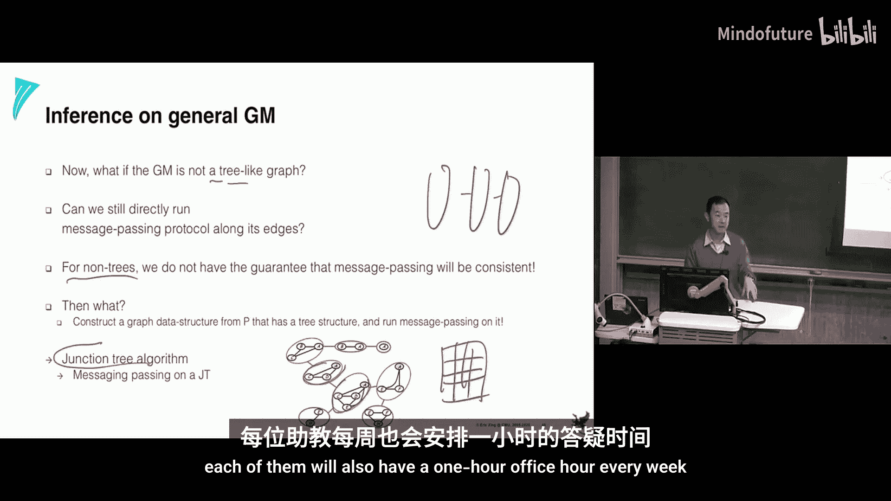

# 【卡耐基梅隆】概率图形模型 ｜ Probabilistic Graphical Models 2020 p04 P04_Lecture_04_精确推断 -BV1ebpGzhEA9_p4-

Okay， so today we're going to start into graphic models and cover the first top inference。

Specifically， exact inference。In a sense， this is a dying topic in the whole field because nowadays。

 with the bigger models in operation for many applications。

 exact inference are likely to be unlikely to be possible yeah。

But think this is still a very important topic that we should be aware about。

 at least to appreciate what is the reference point of many things we do now under the umbrella of approximate inference。

The field of approximate inference is also evolving quite dramatically。

 which I will be covering in the next few lectures。

 The exact inference will be only taking now one lecture， as opposed to in the past three lectures。

 because， again， it is not often practiced。So as a guy who has been working in this field for so many years。

 how what， what how do I describe my feeling about the change of topics。

Imagine that you are say your goal is to build a road to， to Rome， for example。And。

 and then you build a road exactly leading to there。 You can call that as a exact inference。Right。

 but sometimes because。You know， hurdles and buried and so forth。地图。

And you may even choose to deviate from Rome。 Maybe you want to go to another place next to it。

 That could be viewed as approximate inference。 After all。

 you are building a road a road to the empire or something close。But the。

 the whole business can go as far as you may work on the road， so。Card。

To the point that you forgot about going to Rome anymore。

 I'm going to just build the road to somewhere。 It's going to be useful。

 at least for a particular region， say from Mileno to Florence。 Okay。

 that that part of the road is useful， even if you don't get to Rome， right So that's in a sense。

 a episode of approximate inference。And even sometimes， I forgot about the。

Building the road to anywhere。 I just want to polish or upgrade my technique of building the road。

 the engineering part， how to cut stones， how to measure the level and so forth。

 That is also part of the inference or the building process。 And that still also has values。

And at that point， you really， really are very far from going to Rome。 right。

 So that's how the field is evolving right now。 We are in a business where inference becomes。

 you know， a， a cover world for many things people do。

 and many of them are not actually leading to the outcome of inference。 It gets you something。Okay。

 and that's something sometimes become the design principle of another new model。And therefore。

 there are now these many models which does not have a mathematical guarantee or even mathematical clarity。

And， but it's still interesting。Sometimes I call them the so called oracle based kind of algorithm or model。

 The model， you know， does not have any expensive formula。 It's an oracle of executing a few steps。

 and you get something。Okay， and we are going to see， you know。

 how this whole field evolve to that point。 For example， the very， very famous gun model。

 the generative ad model is actually one of these example。 It does not have a very。

 very clear mathematical form overall。 Therefore， it cannot prove。

Where that model is converging to and what distribution it is approaching。 Okay。

 but it's still useful， right， So that gives you the whole picture about， you know， this whole field。

 But exact inference is the basis of many of this recent development。 That's why it is important。

So we ask， what is inference。 Now， we have a model。 In is about computing。 for example。

 this answering some queries on graphic model。And you will see why graphical model graph is very important in this practice。

 But statistically， it is just， you know。Computing the conditional probability of some subset random variables。

 given some others。There is even a broader setup for inference in the classical era。For example。

 you know， how to estimate a plasma model from data。That usually， you know。

 has a special world in computer science in AI， which is learning。 We learn model from。😊，The data。

But you don't find the word learning very often all at all。 You know， from the statistics literature。

 because， you know， parameter as， they call them parameter estimation。

 if you are exating a particular， you know。Value of the parameters。

But if you are a Bayesian where you want to capture the uncertainty of the model itself。

Then what you do is to seek the posterior distribution of the model， given the data。

 And this is no different from that。 It is still a inference problem。And then。

 even in some other cases。You have a models which has a lot of missing value。

 either due to real inability to observe or collect data， or they are just you know。

 little proxies are surrogates， which capture implicit concepts， such as cluster label。

 such as embedding and so forth。 Then you need to also， you know。

 estimate those variables for the sake of learning because one of the E M algorithm known as E M。

 Yeah， with which we are going to discuss very soon。 is about iterating between。

Prometerter estimation in learning。And also， another step where you just plug in some estimate of the hidden variables。

 which again， come out of inference。So inference is a fundamental thing for all of these practices。

So let's look at some examples， one by one。Here。😔，O， somehow呃 the。The。

Older version of the late isn't working。 Look， looks like isn't working very well on the new one。

 Hopefully， we are not missing too much。 how to compute the likelihood of data。Right。

 the likelihood of data involves， you know， marginalizing。You know， the。

 the value of those random variables that you do not care about。 And this is a pretty， you know。

 long sequence of variables that that you have to marginalize over or sum over。

And I think we already touch upon this issue before。What is the complexity of this operation。

 I think I need to have a nested sequence of summ science in here。It is exponential， right， Okay。

 so this is， you know， a inference procedure that is exponentially expensive。

The other query is a conditional probability， which actually is about you know。

 computing the posterior of the evidence of the variable given the evidence where now the value we computed from the previous step is now here。

Right。And so it's equally expensive， at least。And sometimes you may query a subset of X。

 which contains Y and Z。And you only want to compute posterior of the Y， given the evidence。

 not disease。And in that case， you have to now。 So this is basically the X。Right， by the way。

 this is a capital Z equal to little Z， meaning that the Z are somehow observed。

And then what you need do is to what to sum over。All the possible values of the Z。

 in addition to computing this one， which is making the exponential cost even more exponential okay。

So these are examples of。Inferences。And options of inferences。

 which I'm going to just mention very briefly， You know， in the graphal setting。

 you can see if the target of the variable you know， to be inferred is at the， you know。

 downstream of the evidence。Then this is literally solving a prediction problem。

And the word we see this was， to project， for example， the trajectory of aircraft on radar signals。

Okay， you basically observe all these。 And you want to make the next one。 That involves modeling。

 you know， the dynamics of moving objects。And sometimes。You see evidences as the descendants。And。

 the。The variable of interest is upstream。And this is called diagnosis， you know， in medical domain。

 you see， you know， a lot of measurements， you know， bodymetric， you know， you know。

 vitals and images of a patient。 And you want to， you know， infer a course。 right。

 So that's basically in this case。Lot of applications for。Poserior belief。

And here we have another example， which is going a little bit beyond graphical model in the classical sense。

But it's still very relevant。 So here we have a deep belief network。

Were going to leave the math for future lectures。 But this is how the whole thing look like， right。

 It basically has multiple layers of hidden variables。

Which can be densely interconnected across the layers。And。

The back propagation algorithm and all this other really technique is about giving you an estimate of all these late variables。

Right， it correspond to sometimes。You know， what we called features。

Or or latent embeddings of the real data。 And in case of the， the， the deep neural network。

 it becomes particularly interesting because。People empirically discover that， you know。

 at a different level。Of the layers， you have lower level features， such as you know， edges。

And of different orientations。And parts of the， you know， of the， you know， semantics。

 like in this case， parts of the human faces。Right， you know， ears and eyes and noses and so forth。

 And then。Hototypes of different faces， like a women's face and men's face and so forth。

So this is actually， you know， the interesting semantic underpinnings of you know。

 latent in a deep neural network。But just remember。

 it is not just only deep network that has a neural network that has this feature。And there are many。

 many， you know， other models， you know， which gives you the same level of embedding for different applications in collaborative filtering。

 you know， in， you know， motion， capturing and in handwriting digits in text and so forth。

So I just want to emphasize that the application is very， very， very important and useful。Okay， so。

ImNot sure I can survive the whole lecture with all this little thing missing。

 but I will try the the， the， the， the eventual P DF kind of version of the slides。

 I guarantee you will have all the symbols and everything。

But now it become challenging because I need to now improvise and maybe reverse engineer all these little operations that we put。

 I put some time ago。Yeah， so the the last query that I want to just say a few word is you know。

 something beyond just the posterior distribution， but the posterior， the most probable assignments。

 which is one of the most likely configurations。 you know， inside this posterior probability。

 can imagine， you know。Given the possible probability， you can do a agonax and extract that。Right。

And M A P， you know， MP， most probable applications， again， you know。

 just want to mention a few words has some interesting mathematical or algebraricic nuance that I want you to pay attention to。

 Maybe you already know that， right。For example， here， I have， you know。

Poserior probability of X and Y together。Now， depending on how I ask you the query。

 you may find some interesting phenomenon。 For example， I want to ask you， what is the。

 the most probable assignments of X and Y jointly。Just by looking at this table。

 what's your conclusion。Okay， so looks like this one， right？

 And what's the most probable assignment of Y one only。What is that。What。Right。

 because now to marginalize Y2 and collapse you know， one， leave Y one only available。 then you know。

 this P of y1。The margin of P of Y 1 has a property of 06。So what's， what's the model here。

It means that。Depending on the context of your query， you may get you know。

 different answers for a very local configuration。Right， and that's where actually， you know。

 graphic models become particularly important because sometimes when you want to ask for bigger queries。

 you know， you need to， you know， consider this a joint。Corrons。Okay， so before move on。

 let's arrived， first of all， at a very pessimistic， you know conclusion。 right。

 We know that computing。You know， this quantity in general is NP hard， as we just see。

 because these are the amount of complexity you have to deal with。

 It's a choose table of all possible configurations without structure。

 you have to sum over all of that。Then， you know， comes to the technique of inference。

 We want to navigate， you know， over a few。OrMaybe even many special cases where we don't have to run into N harness。

And also， in those truly NP hard problem， how can we still pursue a polynommal complexity with a guaranteed approximation。

 for example， you know， to the truth。So that's basically the topic of。Inference。

Here is a bigger landscape of all。Bigger families of inference technique。

They break down into an exact influence family。And also approximate the inference in inferences。

 you see elimination， message passing and junction tree， okay。

I'm going to cover all of that only today because again， there are a lot of materials。

 If you are interested， you can go read Daphne and Michael's book。 But nowadays。

 it's a well solve problem。 People know it very， very well。 and it is not often used in practice。

 except in a few very good models like H M M and other models， common future to me to name a few。

But bigger models rely on approximate the inference。 And here are the three main techniques。Alright。

 so。Let's begin our appreciation of e algorithm using， you know， a very， very standard and。

Very common example。 So we saw this model already， right， It is called a hidden markov model。

 And because of the graphical structure here， we can write down the joint probability like this。

 I said you all know that。Okay， so， let's try to conduct a inference。Quing， okay， which is the。

Poserior probability of one。Hidden random variable Y I， given the whole observed sequence。

And by the way， so I think I should put a proposalal here。Okay， because there is a。

 a quantity that you need to marginalize over it to to normalize over。

 which is the likelihood of the entire sequence。So。This part。Is。Yeah诶啊。Sequence of marginalizations。

 And if you look carefully in here。This part is the why。I minus1。And this part is why。I plus 1。

 I left out the I。 Okay， that's pretty intuitive， right， You basically need to sum over。

From this equation， all the random variables studies are not interested， which includes。

 which excludes the Y I。 And this part is basically copied from the previous equation。你 so。

If I handed you this。You may become a little bit worried because， indeed， you know， nested， you know。

 a sequence of sums， Each of them will be over the configurations of why。 Therefore。

 it is naturally exponential。 ass a lot。So how can we just play around and make it a little bit more friendly。

 So that's the question。 So here is what I would do。Okay。

 I'm going to now literally look at all these terms。And look at all these summ operations。

And I will try the following。I will probably a。Do why2。And。All the way to。为 t。

And then I'm going to move in y 1 here。ok。Because you are going to do， you know， one after another。

 I choose to start doing why1 first。 And if I look at all these terms in here。Not all the。

Little terms contain even the argument of by one。Right。Therefore。You know。

 when I change the value of y1 in here。You know， those terms that does not contain why one would not be affected。

Right， therefore， I'm going to only， you know， gather all the Y Y term Y one terms in here。

 which you can help me， which I want。I think I have this one。I also have a which one。

Do I have another one。Yout right it here， but you should look more carefully。今外 to品常。Yeah。

The little hidden thing is。Apart。I encourage you carefully。

 these three terms are the only terms that contains an argument Y one， everything else。

You could safely just copy here because they not be affected。Okay。So in a sense。

 I keep everything else constant， and I don't touch it。 I'm going to do this part， only。

And obviously， this will lead me to a term。 right？ How about And once I sum over why already。

 then this new term isn't going to be dependent on y1 anymore。 right。

 So I'm going to give a name for that。 I'm going to call it M。Sup y 1， because that's the y 1 I。

Get read of already。 Okay， and what is insight。Which is still an argument。Obviously， you have one x1。

系。You also have what。百兔。Right。In fact， you could even do a little more and even derive the probabilistic interpretation of that。

 I believe this is the the。放 why。2。啊。And。X1。I believe that's the。Okay， the sequence。

 the the the definition of that。 But it doesn't matter。 This one is less important。

 This one is more important。 It's a term， anyway。So， was that。I basically， you know。

 come to a new kind of a sequence of things。With everything others copied， but now a M of。X 1。

 and y 2。Right， that's basically my new sequence。And what actually happened operationally is that this。

Y1 is not removed， it's eliminated。ok。You can continue to do it。And you can now start from Y 3。Okay。

 all the way to Y T。And。Start to。Take care of why2。And in here。

 you have a M of x1 and Y2 and what else。Anything that contains that Y2。Obviously。

 you should have X2 given by 2。Right， and obviously， we also have a a Y 3 given Y 2。Right。

And you can do this now。And this will give you another。New term。Called M of Y 2。

 which is having the argument of x1 and x 2 and what。Y three。Right， okay， and in that case。

 I remove that already。ok。So you can see this is a trick known as a verbal elimination。

 And graphically， you can see very， very clearly。 it is coming from the left hand side and peeling one node at a time as a graphic operation。

 but。😊，Its really about computing。This term are that term。

And you have how many turns to remove at the end of the day。Capital T。Right。

 because you will just move down and down and take care of until the last one。 you will get all that。

But whether it is capital T or some other number doesn't matter。 But it is now， not。

 the T is not as at the exponential part。 It is as a multiplate of a unit for computing that com。

Okay。Okay， so let me show you another example， in fact。I will do a little bit differently， this time。

I。最週ね。My antenna is on。You don't see the boys。O。So in here， I do something a little different。

I'm going to now keep a why1。All the way to y of capital T-1。 And I save everything， but。的YT。ok。

And in that case， what are the terms that contains the Y capital T。Well， it should be。

P of y capital T condition on capital T-1。And the times P of X T。怀田。Right。Yeah。

And I could also just do this operation， and create a term。This time， I call them。M prime， okay。

 which is a function of a Y T。Which is as a result of removing I T， not a function of Y T anymore。

 by the way， it should be a function of X capital T。And what。Y t minus one。喂。Great。Okay， and in fact。

 this also can be。Interpreted as a P of X T， given Y T1， But it that part isn't very， very relevant。

 very important。 And you can imagine to do the same。 you know， once you have Y T。-2。

 you can do the same here， copying。Right， and this one will give you another term。Which is。

So you can see by just playing the notations and the symbols around。

I'm able to now reduce this a whole kind of， you know， sequence of summations。Into， you know。

 a very systematic。You know， little， you know， a production of what they call the messages。

The messages of the cost of producing each message is quite tiny。

 It's basically a local cost proportional to the size of two random variables or one。

And I'm going to do them three times。And in here， I'm basically peeling from this direction。

So that's just a， a。illustrationlltration about what is happening。 Wow， this one is totally gone。

What is here， Uncle guys？Mmhmm。Okay， I believe I probably it。Okay。What we are doing right now is。

 you know， a。What we call a some product operation。And I believe， you know， what we are trying to。

Do is。Something like this。ok。And。Oh， yeah， okay， sorry。It should be。Samation first。

And the product second Okay， in here， we are going to have a number of factors。

Let's say messages of all these kinds。Okay。And then， you know， this basically contains。You know。

 the terms。That includes。That random variable to be removed。Okay。

 you just collect all of that from the entire equation。 Make them a product。So there are many。

 many terms like this。And they are called the set of factors。And then once you collect that。

 you are going to do a summation to remove that。 And this one will give you to。Another message。

 which has other things。So this is known as a some product operation。

Which would be very helpful for you to define and， and。

 and control the cost of the total operation and also the sequence of the total operation。对。Alright。

 so now let's go back and see what we have done。And again， back into the most general cases。Alright。

 so here we are having a query of the following form。Which contains。Wow， this is really magical。

 I need to know。Back engineer， all these。We want to do this。

And instead of doing it in a trivial way by just you know， enumerating all configurations。

We do the following。 We move all the irrelevant terms outside of the innermost sum。

Then we perform an inner sum， getting a new term。Okay。

 then we insert this new term back into the product。Which now is a shorter list of product。

🎼And you can imagine once we do this on and on on， we will be having a whole stack of new terms。

And then we'll have a very， very short list， maybe to the end one term in that product that allow me to do this very trivial。

Something like that。Okay。Okay， so this is the idea about verbal elimination。

 What you are really doing here is to eliminate。Random variables， one after another。

 but you don't care。Until you only are left with the variables you care about to do posterior inference and also evidence。

So what we just see in H M M is more like a chain type of structure。 You know。

 you remove from head to tail or from tail to one。The ordering is very， very obvious。Now。

 I'm going to try another example， which is a little bit more challenge。

I have a more general Beijing network。In my case， I need to decide a order because there isn't a chain anymore。

Don't ask me how I decided to go with this order。ok。Actually， this is not order。

 This is the list of the whole remember。 I need to go to this order， kind of from bottom to up。

And these are my set of initial factors。Which are the building blocks of the Beijing network。

And in fact， here there are some more nuance because this。

 I want to compute P of a given H and H is observed。 H is not just any random。 It is a observed one。

And I want to be very homogeneous in terms of the operation。 Remember。

 the operation is called some product。Right， you need to have a sum of terms and then a product of terms。

 and then you sum over some random variables。 So in this case， you know。

 how can I treat the the random variable H in the same way， It is already observed。

 What do I mean by sum it over。 Okay， I have this trick。

I'm going to introduce something called a what we call the evident potential。That H is equal to。

 you know， a particular value of H that you observed。And multiply them。With conditional of age。

 given its parents。So。Why do this work， It becomes a some product。The same operation。Okay。

 except that now in this product， I have not only the ingenous terms in my original joint。

 but also another evident term， which is the evidence。

 The deelta function allow you to pick only one of the configurations all of many that is observed。

So this is just for a procedural reason， it makes the sum product operation very universal。Okay。

 so then basically， you know， after this some product step， I have a term called the M of H。

Of E And F。ok step云。And with that， what happened graphically。What， this H is gone。You live in it。

And also， you see something else I happened to the graph。 I put an edge in here。After removing the H。

 why。Look at this。This is a new term。That I generated from the some product operation。

 And in this term， H E and F becomes coupled。Where， I just faithfully document this event。Okay。

So what I'm doing now is side by side to give you the mathematical or edge break operation and also a graphical operation so that you can internalize。

Elimination in both the graphical view and also the edge break view okay。Alright。

 now the next one will be G。 Okay， we're going to now take care of the next one。

And this is our new list。O， this new list has this one gun replaced by this one。

And we look at how many terms has G。 Well， only this one has the G。And we are going to just do that。

Okay。This term is quite trivial。 Youre sum over it。You get a one。 Okay， that she is eliminated。

And now you have a newer list。The new list is this big。This is your beginning list of factors。Now。

 let's look at the F。And we can look at this list， which is the current one。

 And these are terms that contains an F。And we're going to define， again。

 the new some product operation。And。We are going to get this new term。

This new term is corresponding to the following graph operation， if you see here。There is a F。Now。

 F is eliminated。 I got this。 How come there's a new edge between A and E that I just added。Well。

 it's because now， because of the sum， A and E become coupled。Therefore， I join them together。

So we can see my， I'm carefully doing the graph operation in such a way that it captures both the summation step or the marginalization step that some over a random variable to be eliminated。

 and also the new dependencies created in the intermediate terms that I created。😊，ok应达。Or， hopefully。

 with that， no again， my list。God says shrink。From this tool。 And then I add back one new。

So can see in the， I'm really showing you a。Real kind of a program。That you can。

Consider this some product as a subrouting。And then here， I have basically a stack。Okay， of。

 you know， of all the terms， you know， inside the graphical model。

The stack begin like this with all the conditional building blocks。

And then it will be shrink and added， you know， by removing terms and adding back terms。Alright。

 so so much for the eliminations， the last few steps are quite trivial。 Now。

 I'm going to look at the E same thing。 You know， I just keep doing that。Some product。And。

App grow the list。Okay， and take care of the graph。So after a few steps。

 you will be literally just having。啊。you know。There's a last thing left。Okay。

 all the random variables are eliminated。Except the one that you are interested about。

 which is the random variable a。And this random variable a is， you know。

 proportional to the conditional to the query， which is the conditional。Oh， how come I。

 I think it should be this one。 I'm sorry。Then you need to basically do a wrap up step。

 which is the normalization。 You just pick these two things and normalize it。And that's it。

And your graph now has nothing left。 I believe， yeah， this is now an empty part。Alright。

 so that basically the outcome of this elimination， which I want to summarize here。You know。

 you define a set of random variables。And you define a set of factors。And you identify a query。

And you decide the verb was to be eliminated。Okay， and then you want to use you know。

 this some product operation。ok。嗯。And remember that。 these factors。

Does not necessarily correspond to any probability or conditional。 They may or may not。

So this is literally the I J break operation。 And at the end of day using this。

 you can answer any queries of the following form， which is why I given。You know， X。

For all the random variabless。The only thing I left a little bit vague is that once you have to see what order。

Of the random variables， I'm going to use。It turns out this is a very。

 very interesting quantity that we do want to study a little bit。Because。

If that problem is not a problem。 And so far， I've been stating not on any specific model。

 but a general Beijing network， you can imagine that I conquered the MP complete problem already。

So the， the fact that I'm not a touring or winner yet is because I haven't conquered that yet。

And the chances to solving that is not very high， the。Obtainingment the the the the the。The the， the。

 the， the conclusion of a opt ordering actually is， you know， a very， very tricky problem。

 It is not actually a a， a。A easy problem。 Okay， and that's where actually。

 graphical models graph becomes very interesting because you can inspect graph and sometimes draw help from your intuition。

Okay， there are a few you know， clean up on the technicality， such as how to introduce the evidences。

 You will see a better version of the slides， you know， after the class。

And these are the form of the algorithm。 In fact， if you are interested， you could implement that。

 you know， just with a few lines。Which has a few routines， like introducing evidences。

 starting the whole graph。This a little some product terms， and finally， wrap up normalization。Okay。

All right， Any questions so far。I walk you through two examples of elimination。

Which correspond to marginalization on big joint propertiesbil。And elimination。

Gives you some kind of， you know， a trick to reduce the complexity of the computation now。

 pretty dramatically， you know， into a sequence of local computations。In fact。

 you can now quantitatively， you know， compute the complexity of this algorithm， which is shown here。

Okay， this should read like this。Okay。嗯。And this should look like this。By the way。

 this should be product。Yeah。倾。Yeah， okay， I think。Okay， let's see。What is that。

These are the two steps， which is product and sum， okay。And。I already gave it to you， so。

You can actually literally inspect these equations and start getting a sense about how many multiplications and。

 and and and additions that you have to carry out in each of these step。Okay。

Without giving you more explanations， I hope you already figured out。That it is literally， you know。

 in this case， you know， proportional to the product of the cardinality of every random variable。

 Okay， so for example here。If y， if x takes。You know， a K prime， K X number of configurations。

 You need to account for that。And each of the white。Of C， why of C， what does that mean。

It means that the would be in one of the little cliques。Okay， you know， that contains y。

 And remember， clicks can intersect。 Therefore， a single y can be in multiple clicks。Okay。

 why I mention click， clicks are basically our。Factors that we used to describe the joint distribution right in the。

 in the Beijing network case， they are the conditional distributions。

And in our some product operation just now， there are the intermediate terms created。

So they need to be accountable， you know， for each of the appearances。And then， of course。

 there are K such clicks。睇。The numbers will take you a while to figure out， hopefully， back home。

 But the moral of this message is that this is only locally exponential， but not globally。Okay。

 this is the cost of a single term。Which basically only amounts to you know， how many times。

 you know， a particular random variable appeared in the terms。

But if you have a large sequence of all collection of random variables。Then you know。

 you don't have to basically， you know， you know， go with the summation over all such terms。 Okay。

 so。Just this is the key message exponential in the number of randomvers only in the intermediate factor。

 not in the original full equation。And usually the full equation has a， you know。

 a finite number of such inters， usually the size of the graph， for example。

 the the length of the chain and so forth。Therefore， you know， on that， it is just times a length。

 the polynomial cost of that。Originally， it is really about decay K exponential to L。Alright。

 Any questions so far， Did I go too fast。This is the most trivial part of inference。 and。

 but the most kind of fundamental insight behind all inference algorithms in terms of judging its cost and setting up the routine。

 So I want you to really understand in order marginalization or post inference query is about eliminating random variables in certain order。

 Okay， using certain cost management technique In our case， some product operation。Okay， if not。

 let's move on a little bit。 Let's understand a little bit deeper。Here， I put a sequence of a graphs。

If you recall， these are the intermediate graphs。That we actually used in our previous example。

 to track the elimination。RightAnd it has the following interesting operations。 First of all。

 starting from a graphic model， whether it is a Beijing network or it is a and direct graphic model。

 We first moralize it。 Moize meaning that you join。The parents of the any random variable。

So that they become unrated。And then based on a order of variable elimination。

 you are going to just eliminate H， G， F and so forths one after another。 And when you eliminate。

 you join their parents。Okay。You can see I'm going to just play the animation here。ok。

And so on and so on。And for each of these。This elimination， you create a new term。

Which are captured in these factors。Okay， they correspond to a graph entity on on the graph。Okay。

For example， when you eliminate F。You are going to now create， you know。A A to E， H。

Then plus the F being eliminated， you basically are having this little red stuff。and in here。

 you are eliminating which one。二非站铺。O， when E is eliminated。What happens is that the parents of E。

the the neighbors of E C， D and F。And a become a click。 Therefore you get this whole thing。

 which is captured in this。Okay。Why this is interesting。Okay， by the way， here。

 I have all the text expression opera about that the image step。So why this is interesting。

It is interesting because there is this one to one correspondence。Of the。

Actually break elimination to the graph elimination。And also， there is a very。

 very direct way to visualize the computational cost。

Or the storage cost that you have to spend to carry out this operation。 For example， in here。

 which is the most expensive elimination step that you have to do。Just by looking at this sequence。

Let's look at this， first。Which， which step is the most expensive one。阿生。E limit E。Right， this one。

 why。The biggest factor， right， So this factor has。3 arguments。Right， and therefore。

 you need to store basically， you know， a2 to the power of three configurations in that little in that big table right。

Okay， that's great。 So this C actually is a bottlene。 You know， there are no other factors。

 which will be more expensive than this one。Okay。So you only see this after you write down the whole equation and do this。

 If I give you a graphical model， which has like a0 random variable。 Do you run write this down。

 You don't You run all the pages to write this。But if you store the graph model as a graph。

And you have this micro， which carries out elimination on graph and use the rule I just described and create all these intermediate terms。

 Then you can just look at the size of the intermediate terms， which are the clicks。 Okay。

 and determine already a cost。Right， so this one corresponds to this one。

So that's why graph elimination is a very， very practical8 or two companioning to your， you know。

 your implementation， because that gives you an estimate of your cost， you know。

 before you actually even。You know， implement or write the equation。

And this one actually can be connected into a tree。Of clicks， which is like this。

 And the connection is very easy。 You know， just basically connect the one which has shared random variables and so forth。

And what we just did。Where you compute all these messages。

Can be understood as a message passing protocol on top of this graph。Why。

 because it has the following generic forms of the， of the definition of the message。

 The message is defined by a some product operation， as you know already， right， So it is。

 for example， this message。Which is this one， you know， coming out of this click。

 Why it is coming out of。 Well it is after I take care of the things in here。Okay。

 its defined by a sum product， sum over the E of interest。 And here what are these。

These are the two messages。Coming into this click。M G and Mf。And this one。

The factor on the original stack of the joint distributions。 Remember。

 in our original joint distribution， there are all these terms of local conditionals。

 And if I look at this， this is the only term in here that is relevant。Okay， so I'm， you know。

 mechanically， I just look at my， my list， my stock。And I get basically， all the original terms。

And I get other terms which are coming into this。 And I take care of this some step and send out。

 So this is you know， a message passing version of the some product operation。ok。Again。

 which make it very intuitive and also it opens up way to approximate down the road because you can violate certain rules of message passing and still get something done。

 which we're going to talk about later。And here， the complexity definition become very clear。 right。

 It is the size of the biggest。In this a whole thing that's become the bottleneck of the inference。

And we call a tree with。Okay。And as I just mentioned。

 finding the best the threeway is actually depending on your order of elimination。

 Well I'm going to show you an example very quickly。 Why order become depend become important。

 And the search of the best ordering is a NPR problem。

So let me give you a sense about why order become depend important and an under graph again。

 gives you a very， very good way of determining the。Better al。So let's look at a graphic model。

 Let's say， a star graph。Okay， a star graph is basically。A graph that everything connects to。

One node。It can， it can put many。Okay。I have a couple of ideas of doing graph elimination because they are going to create you the elimination click。

 which correspond to the。Intermmediatent terms that you will be running into in doing algebra break elimination。

 right。What if I。Remove from the edge or the the the the leaves or the peripherals。

 I remove this one， for example。What in the medium I'm going to create。

What's the size of the click resulting from this removal。喂。I think I'm going to， do this。Right。

And if I remove any other one will be creating literally a intermediate term of two。And thes。Now。

 what is a very bad choice of the first turn to remove。I will take the heart。I will remove that。

What's the resultant the size of the click。The whole thing， basically， because the rules says。

You know， you need to remove one and join all the rest into a click。ok ， so。

I'm going to run into a gigantic elimination click。

So you can see different e ordering really results in different complexity。 And in this star graph。

 it's very obvious。And a tree。哦。Where do you want to remove。What's the definition of a tree。

Many definitions， right。A single pass between two nodes。

But a particular commitment is that every leave has only at most one parent。Right， therefore。

 if you remove by peeling off the leaves up。You could get just intermediate clicks or terms of two random variables。

 right。And if you go top down， that's slightly problematic。All right。

And now let's look at So these are the easy cases。 by the way。

 These other cases where being really clever and insightful on with the help of the graph。

 you can get。You know， you know， you， you can rescue yourself from a exponential capacity and。

 in fact， enjoy a polynomial。But there are bad cases no matter how hospital smart you are。

 you cannot go around you know exploded complexity。 And here I have one example。

 Go back to the eas model。So how do we eliminate。I want you guys to help me to demonstrate any。

 any your favorite elimination algorithm。Someone want to give me a hint， yes。Start from the corners。

 Let's start from here。I remove this。按卧室来读。Now， let's do very， very robotically。 So remove this one。

What should I do on the graph。Right， okay。What's the max to remove。The one， maybe this one。ok。

Or maybe this one。 We all that the same。 right， So I will remove this one。

 This one has three neighbors。Therefore， I need to connect this and that and that。All right。Well。

 you can choose to go this one。 That's fine。 But sooner or later。

 you will run into something like this。Remove that。And then you will add more to。Well。

 you can kind of guess already， right at the end of day。However， many way you， you remove。

 you are likely to create a click which contain an entire slide of the node。

They will be interconnected。You can， you can try。 You can maybe try remove from the heart。

And it will be no， no better。So this is again， you know， a， by， by the way。

 this is a easy model say for a picture。 That means here。We are having， I don't know。

1 hundred or maybe a few hundreds。 so it's very big。 And if you are talking about atomic physics。

You know， even more， right。And that's actually how people calculate the critical size of a atomic material that is not exploded under certain temperature first。

 In fact， that's exactly why people inventedvent these models， you know。

 in the good old days of atomic physics。So here it says that you really cannot get away from exponential capacity where explain the exponent is。

You know， let's say to， to the power of and and being the size of。Of this。ok。

So that's why here we ran into a case where there is。No possibility ofable exact inference。Okay。

 and the exact inference becomes your reference point。

 But you probably would never get to that exact inference。In a result onsizable models。

In the good old days， people would simulate a easy model。Say of with 10 or 20。

20 probably is the most people can really do exact inferences。

And they would design a approximate inference algorithm to compare against that ground truth and measure the differences and then start competing which inference algorithm is better。

Okay that ground truth is available。This good tradition， unfortunately is lost。 Nowadays。

 for example， in a deep neural network， you have no idea about what ground truth is。

 You are just running a micro into the whole network。 You get some numbers out。

 whether that number is what you， what the model really。

 really settles or what the real description is， You have no idea。 So at the end of the。

 you only look at the downstream application。 say do they class image or or so forth。

So that's giving you a picture about how the fuel they see body。 But at least， you know。

 the principle is quite nice。 you know， where you may be able to in the future。

 bring back some of the rigors in the， in the good literature。Alright。

 I think I'm want to wrap up the elimination part with a summary， okay。I think the， the。

 the big catch is that you can now。You know， you need to really understand what is a some product as a basic atomic step。

 you know， in elimination。Which is locally complex to the size of the， the configuration。

Then you can control the size by choosing the right elevation ordering。And you can， you know， really。

 you know， approach the computational complexity now， using a graph theoretical approach。

 you can do graph。You know， processing。And calculate the size of the clear cancel force， okay。

Alright， let's quickly move on to see where elimination how leads to more modern algorithms。

As I said。You know， you can understood。 You can understand limitationmination as a practice of a message。

Like this。 And why message passing is very important or very interesting。

Because in real applications， you are not going to be only interested in this query。Right。

 what if I'm interested in， for example， P of let's say another random variable， say E。Given。

A or given， you know。Given age or something like that。Right。So in this case， your。

 your query of interest become in here。Okay。And link here you can see the message passing goes like it goes from all the way。

Everywhere in a graph and then goes to that query。You can show to yourself that if youre  query in here。

 that amounts to passing messages this way。It goes back to here。ok。

And then what's more interesting is that you will see that， for example， this message。

 which needs we from here to here， was already computed in our previous query。In fact。

 on every edge in this click tree， you have only two messages to pass。 One is this way。

 the other is sub way。You can actually precomp it。Okay， you can pre compute it and store it。

 And that gives you a probabilistic database that allows you to answer all the queries in the graph。

So that's the virtue of a message passing。 You know， it's not a one time solution。

 It becomes a database of solutions， yes。てま。like。嗯哼，系嗰啲。Oh， you know。

 you can do the same same animation。You ask him why not Why the clicks remain。Okay， okay。

 that's good。 Remember， the clicks is only about。In a dependent on elimination ordering。

It doesn't depend on the query。Right， so I will be choosing one e ordering。

 which give you the graph property， you know， of fundamental building blocks like clicks。Right。

 and as long as there are click tree and your notes is in one of these， you know， you know， clicks。

 you will get the answer anyway。If you look at this alone， you may choose to have a different。

 That's possible。 Okay， and， but it wouldn't give you a different answer in terms of the marginal at the end of the。

ok。But， but in fact， you are， you， you are raising a good point。

 The whole point of message passing is to really now ignore the query part。Okay。

 I'm basically going to just store the necessary information on the， you know， on the graph without。

 you know， worry about a particular query so that they can be reused。Okay。

 for different applications。So this is message passing algorithm。 In fact。

 here I do have an example with you already。And chances， are if you limit just by itself。

 you are very likely to have the same image click anyway。Now， another。

Message passing in the illustration on the trees。And you can see that， you know， this is， again。

 the production of the some product operation， the expression of the some product operation。

 And this is a very important。Kind of a skeleton that you want to remember for the message coming out。

It collects。The messages。Into it。Which are these pieces。 You can see the neighbor of J minus I。

 that's the expression。And then， these are the two terms。Okay。

 which really points you on where the message is going to and all the relevant terms in the original stack。

 In this case， I don't use P anymore because it could be undirected。 It could be directeded。

 I just use Phi， which are the local marginals and local coupling factors。

Or we can call them single potentials and firm pairwise potentials。Do I want to its trivial。

 Well you can equally compute a message coming this way， For example， from J to K using this formula。

 I will leave that as X for you。Okay。And then， you know， build on this insight。

 you can even come up with something called a message passing protocol。Which goes like this。

You just pick， you know， if， it's a tree， it's very simple。 You just pick a note and hang it。Okay。

 then you basically just first generate messages from the leaf。

And collect them all the way to the root。And then the route basically now changes color。

 I got all the messages I could have got。Okay， and I'm going to start making contributions like this。

Okay， once these two passes are done。You are done with a graphic model。

 All the necessary terms that could be generated from message passing on the tree is not produced。

 and you are free to use。You know， any queries to answer any queries。ok。

And I give you a few more examples， in the。This is a message passing on H M M。

 I just actually show you， you know， in handwriting， some examples。And wow。

 this is a little bit tricky。Wow， they are really ugly， so。You kind of see already what I did。 right。

 So I'm coming from here to eliminate one after another。

 or I can go this way and eliminate the other。And the， and the formula I used， you know。You know。

 really the， the the same as what I showing in here。okay forget about it。What I meant to。哦。

What I meant to say is that if you are going to generate a message。Out from H M M。From any note。

What you need to you know， collect are basically， you know， a message。没。Coming from here。And also。

 another message。Coming from below。And then this one is the local conditional probability of P Y given。

I1， and then they go out。Okay， so I think that's pretty much where you'll see these three termss。

Okay。And these three terms， when they got multiplied and taken care of。

They produce a term called alphapha message。Okay， so this is the alpha message。I no， issue be here。

 That goes left word， or right word。And then there is a backward algorithm going that way。

I believe somewhere you will be having what they call a beta message。

That is really creating you this information。We are going to study HM M and CRF。

 more specifically in lecture 6。But， pretty much。You already know from help the algorithm itself already。

 I'm going to give you， you know， more traditional notations in the lecture so that you can get connected。

And if you notice in the previous message passing protocol， I have a。Schedule。

I'm basically saying that I collect from the leaf， and then I pass from the top。 right。

 So that's a schedule。 That gives you the right kind of orthodoxical and guaranteed inference result。

But in practice， you can also go in parallel。And having， you know， you know， this， you know。

 parallel synchronous implementation that you can collect like this。And。And the push out like that。

So this is sometimes known as， you know， a belief propagation。What， what， what does that mean。

 It means that you just every time focus on the edge and also the configurations of the node connected by the edge。

They will be colored to indicate whether they receive a signal or not。Okay。

 and then you're going to compute the local messages on this edge accordingly。Okay， and the pass it。

And this algorithm is known as as message passing or as a Billy proagation。

And it gives you a very localist view of imprinting the B proation at the message passing algorithm。

 especially when you have a large graph。 you don't have to scan every local node， don't have to know。

The situation of another note，100。Steps away from the graph。

And I actually kind of inspired a lot of the approximations on the road。

 One of the approximation is to forget about synchrony。😊，I'm going to just compute， you know。

 the message， no matter what， based on my current version of the。

Of the message coming from my neighbors。That's a heuristic。In fact。

 this message passing is only guaranteed to be correct on trees。I have， I believe， here， a statement。

That you can prove the correctness of the message passing。On tree graphs。

And we will soon see what if there is南 trade。我。Nanree is not giving you this guarantee。

 but it doesn't prevent you from running theproation algorithm on because it is a local algorithm。

 You only look at the edge and you pass algorithm back and forth。And people do that。

And people do that as a iterative program for many iterations， they may or may not converge。

 And that actually leads to another algorithm， which we will talk about in a second。

 called variational inference algorithms。做灰坦普诶。Maybe I will give you a hint as a homework。

 T As are here。If not， I will tell them about today's homework。 It's quite interesting， why。In the南。

You may not have the guarantee of correctness。For message passing。Instead of。You know。

 asking you for a foolproof。I suggest you to just look at this example and try， you know。

 a counter kind of cases， okay。Basically， you can see that you can run message passing， you know。

 from here to here and here。You can also write match passing。F here。And so forth。

And use this some product operation， and。Just compute and write down the formula of the final messages that you received from this direction and from that direction。

And see if they are the same or not。Okay， if on the same graph。Okay。

 by using different directions of message passing， you end up with two different answers。

That means something wrong。In fact， there is a caveat in already。

 You can know between every two nodes， there's only one path。

In a that actually guarantees the correctness of message。Alright， so do this in your homework。

 It's quite fun to enumerate because it's just combination of four messages and a few submissions。😊。

So with that， I want to close with a big summary。Where I ignored a lot of the classical materials because they are not in use anymore。

 but they are still interesting intellectually， okay， so。

We can now directly run message passing algorithm。You know， along its edge。

For tree and even for non tree， like graph。With the cost of losing， in some cases， credit guarantee。

And then for9 trees， in fact， the graph that we actually just ran into was a nu tree。Right。

 you can actually turn it into a tree by doing the graph limitationsminations and identifying the clicks and then tie them into a tree of clicks。

And then you define the messages not on the edge， but on the edge of the click tree。Okay。

 that's the trick。I， as long as this tree is， by the way， called a junction tree。

You want to see the definition。 It will be in the appendix。

As long as you can convert a arbitrary graphic model into a junction tree。

Then you can still run correctly the message passing algorithm on the junction tree。

 where the messages are defined on the tree clicks you have to guarantee。But， of course。

 we know that for a easy model like this。The Zangctionng翠i will be gigantic clicks like this。

Which each piece has， say 100 nodes。That again， you know， iss in principle doable as a junction tree。

 But in practice， you cannot afford that。 So the junction tree expose you the complexity of the whole graph inference cost。

Where the biggest intermediate clicks ever created in the junction tree。

 You know will be the bottleneck。 And that's the insight that you want to want to get into。Nowadays。

 of course， you know， in deep neural network in compounded multi layered graph networks。

 people don't talk about the， the junction tree or click tree or any of that anymore。

Because correctness of the inference become very secondary or not even you know， bothering。

 and if our applications are。On other dimensions。But we can discuss what's the implication of that down the road。

 For example， Interability is an issue。 You know， because there is no ground truth in the hidden nodes。

 You know， how do we interpret outcome related nodes become very， very questionable these days。Okay。

 I think I'm going to stop here。I just told my T A my office hour starting next week will be right after the Monday class。

 So if you have questions， you can come to my office hour。 We have6 Ts。

 Each of them will also have a one hour office hour every week and feel free to visit them if you have questions。

Thanks。