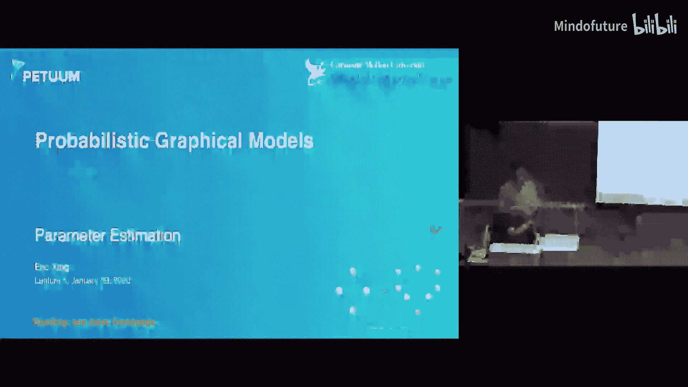
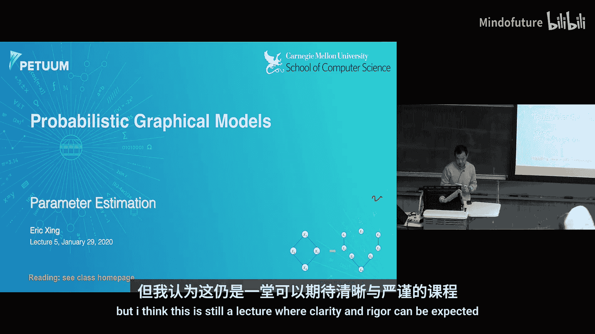
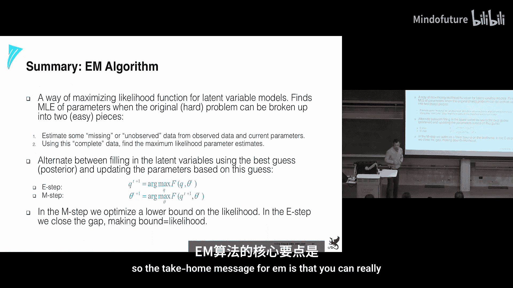
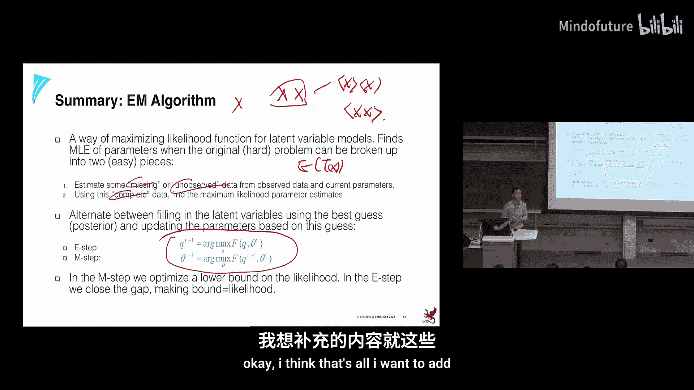

# 【卡耐基梅隆】概率图形模型 ｜ Probabilistic Graphical Models 2020 p05 P05_Lecture_05_参数估计 -BV1ebpGzhEA9_p5-

So we discussed inference last time， just in one lecture， which is on exact inference。

And to keep that kind of simplicity a little bit more forward， I'm going to also。

Discus parameter learning， also known as learning or prompt estimation in the very simplest context。

 just to set the stage in the future， we are going to really get into a much more treacherous and intertwine territory where everything become less。

 less kind of explicit and and and clean。 But I think this is still a lecture where clarity and rigor。

 and it can be expected。

so。Just to recap。When people are talking about learning graphic models。

 usually this is the bigger picture of the story。You are given， you， you。

 you started not from nothing。 Okay， from some knowledge already， For example。

 they give you a set of random variables which are named or indexed already。

 And then you are given some data sets。 That's the simplest setting。 The data sets are， you know。

 assumed to be identically and independently distributedd。And also， in this case。

 they are observed fully。 Every random variable has iniation。

And then the goal for learning in this context is to come up with these two things。 right。

 One is called structure learning。 You need to learn the graph。 although in many cases。

 the graph are specified by people， but in theory， in principle。

 It is also possible to learn the structure directly from graph。

 This is a topic we' are going to touch upon a little bit later in our causal inference vector。

The more common scenario is to use this graph。And also， this data。

 and then come up with these estimations of the parameters。 Okay， In this case。

 the numbers in the conditional probability table in case of an undirect graph model。

 you see the numbers in the potential functions okay。嗯。And there are a lot of scenarios， you know。

 in the umbrella of under umbrella of learning。 And here I name a few。

 the most kind of a simple case， Sst case is called completely observed graphic model。 And again。

 there are cases un directed and undirected。If I interested。

 you can go back to our historical lecture notes and found that even。Up to now。

 learning completely observed and direct work model is already more than trivial。

 You need to somehow call sub routines， which does inferences in the graph。

 I'm not going to say too much about that today。 Maybe in the future， I're going to touch upon that。

And then we are going to see learning partially or unobserved graphic models。 again。

 in directed and un cases。And I'm going to discuss a particular algorithm。 You know。

 were often used for these particular cases today。And then， you know。

Learning actually also could be generalized into many， many different scenarios， not modern scenario。

 but the estimation principles。Typically， you know， in the classical literature。

 when we talk about the learning or parameter estimation， it really means。

Maximmal likelihood based parameter estimation。 You want to estimate the parameters maximize the likelihood。

But， you know， this is actually almost like the default， you know。

 principle in the world of statistical machine learning or know classical statistics。

But modern machine learning actually already went beyond， you know， just M L E， you know。

 for example， at least you can do vision estimation。 conditional likelihood estimation。

 but later on there are you know， different loss functions like margin based loss enpy based loss and so forth。

 Some in the class。 you know， we are going to present a more kind of universal and standardized view of all that so that all the different loss functions can be unified。

 under something like a standard equation。 We are going to see that later in the class。

That actually goes even beyond this list。 For example， in reinforce learning， we sometimes you know。

 depend， you know， rely on a intrinsic or extrin reward。 Okay， this is another type of loss。

And in adversial learning， you also use a auxiliary function to test the truthfulness of the outcome。

 And that kind of adversarial score could also be the thing you maximize。

 So there are a lot of lot of different scenarios in the modern machine learning community。

So we use the word learning， you know， in a very kind of overloaded way to describe the process of estimate parameters for all that。

There are only a very few scenarios people can say very。

 very concily about what is happening or how to characterize the learning outcome。 For example。

 do they give you consistent estimator and so forth， which is the case what I going discuss today。

 But again， in a more modern practical engineering oriented machine learning。

 those characterization may be compromised。Okay， so let's start from the simplest case where we want to do prompter estimation for completely observed。

Graphal models， given the structure。In particular。Beiian networks， direct graph models， okay。

And this is a single page summarizing what's going on。 Okay， in terms of the principle。

You are going to start from a graph that is designed by experts。

 You are going to take the I D assumptions of the data。And then。呃。We begin from。Analytically。

 write down the loss function， which is the likelihood of the data。As a function of the parameters。

And thanks to our definition of the Beijing network。

 we know that the probability can be expressed in a a product of many local terms。ok。

And we use the log of the likelihood as the log function。And as willll see very soon， you know。

 for arbitrarily big graphic models。They all。You know， a built on， you know。

 some smaller building blocks。 In fact， here， you can see these are little building blocks。 Okay。

 and I'm going to just mention two building blocks that I'm going to just， you know。

Goss over the details and you know present， you know。

 just point you some some reading materials at the end of the lecture I can go through， which are。

 you know， very， very specific case by case。 For example。

 one type of graph model is a single turn node。Okay， you have only one random variable。

 This occurred in the graphic model context as the root， for example， in a tree or something。

 where you want to estimate a marginal distribution of that root node。

 You may write into this particular case。And this is known as the density estimation。

And and as I'm going to mention the second， these typical you know distribution families that we use。

 such as a B distribution in this a multi distribution in this case。

 is an instance of the exponential family distributions。And。Classical， traditionally。

 people need to work out all these equations。 Okay， for every distribution family。 For example， here。

 you can see the the definition of the likelihood of a particular outcome。

 which should be expressed in this form。A product of multiple probabilities of the outcome。 Okay。

 selected by this， you know X indicator， which is indicating one of the events will be true。

 others are false。And I'm not going to walk you through all this， you know， but at the end of day。

 you get something very familiar to you。 The frequency of every phase is going to be the。

 the the count， you know， the， the， you know， the frequency the， the。

 the parameter of each probability is the frequency of the， the outcome。

And you can imagine that for different， familying or others。

 you have this kind of work to do to derive all the equations。

 which I give you quite a few examples at the end lecture。 So I'm not going to discuss that now。

 I think it's covered either in 7，0，1 or some other more fundamental statistical courses。

Even for two notographic models like this。Where you use it for graphical for classification clustering。

 again， there are instances that require some modest amount of devational work。

 and you will find that in here。So the purpose of this class is to give you， not just， you know。

 discussions on specific instances， but to give you some kind of a bigger picture about what is the generic rule or the。

 the patterns。Of such estimations。 And then how do you in the future， you know。

 reproduce or reuse this kind of technique for other models。

So that gets us to the exponential family， which is a very。

 very broad family of density functions for different types of random variables or property distributions。

So it's a basic building block。 Again， this class is interest in building blocks rather than specific instances。

 because there is no way to exhaust all the instances。So this is the definition of a expanded family。

It has this a very interesting structure， exponent of Eta as a vector。And times T as another factor。

 T is a function of your random variable X。And T is known as the sufficient statistic。

 and itta is known as the natural properties。And the point of notice， these two terms。

 which are the most important terms in this whole thing。Are interacting as a do product。

 They are linearly dependent on each other， or interacting each other。

And then you have another thing， which is the log normalizer。You have another thing。

 which is the other part of the input variable， which has something to do with the parameters。Okay。

 they just exist， you know， you know， stand alone， okay。And why it is interesting to study this。

 as you will see very soon， the estimation of the parameters Eta。

Well only requires information about this T of X and nothing else。 That's the building。Okay。

 and that give you some kind of a generic kind of process of doing prompt estimation。

And members of this family includes almost all the things that you ever heard about in practical sta of probability or statistical modeling。

 Okay， Bulli， multinoial Gausing， personson， gamma， T and sos。ok。

It would be very hard for you to name something that is not in this family， in fact。Alright。

 so let's just look at example a few examples why， you know。

 for Gausing is a member of the exponential family。 Okay。

 so this is the way we write down Gaussian distributions。 right， It's a， you know， you know。

 it defines on two parameters， which we call them mu and sigma， Ming and covariance。These are。

 by the way， also known as the moment parameter。Previously， we set。

Extended family is defined by canonical parameters。 So these are two different sets of parameters。

 but they are related。 You will see。And we can rewrite it。Okay。And after temporary rewriting。

 you will see this expression of the same distribution。

Which exposes you the so called linear dependencies between。

The between some forms of the random variable， such as。You know， X， X， T transpose and X。

Versus the parameter。Okay。And now， if you take a different view of the parameters rather than calling mu and the sigma to be the parameter。

 But if you do this， you call sigma inverse times mu to be a set of the parameter。

 and this one is another set of parameter， then you can pretty much rewrite。The whole thing。

 you know， back to the canonical form of the exponential distribution。So in here。

 I have a vector of parameters。Okay， eat time。And here is the， the， the， the， the， the。

 the specific composition of the vector。 The first half is a， you know， a。You know， A。

Vector due to this operation。And this one is called the V。 This。 What is that。Well， it is just to。

 you know， linearize this matrix。 Put the， the， the， the rows and columns stack on top of each other。

Okay， make the into vector。 Then you have a gigantic vector in here， which are。N square plus n long。

Okay。And then， here。You have the T， which is a function of the random variable Again。

 this is the x vector itself， and this is the vector form of this outer product of the x vector itself。

So you can hopefully convince yourself that these two guys。

 tea of X and Eer are of the same dimensionality。 They can， actually。

Dot product on top of each other。 Okay， and these are the A's， and these are the H。So by doing so。

 I kind of forced。The the very symmetric and beautifully looking Gausian distribution into something that is more like a E XP of Eta times T plus a and so forth。

8죠。Okay。Just by doing some edge break rearment。You may ask why I do that。 we will see in a second。

One more example， multinial。You know what is multinomial， right。

 It's the probability of describing a discrete event。Okay， and that's how we write down multinomial。

It is。Yeah。You basically just multiply together。 you know， the probability of every event。

Rise the power of the indicator of that event， which cause you to select one of the pies to be the outcome。

 right， You know that trick。Because x is either one or 0。 Therefore， if it is one。

 the pi is selected， If it is 0， the pi is basically exp into one， and therefore it vanishes。

So how do we rewrite。 Well， here is a little bit A kind of a cumbersome way of Iranian it。 Again。

 I'm not going to explain that in detail。 You can work it out if you are curious about。

It basically presents itself in the form of a。Product or a linear combination of all the X and also some form of the parameters。

 It's a little bit weirding here。 You can see that the sum is now from 1 to k -1。

 rather than all the way to K， why。Because the parameters in the multi normalmal distribution is constrained。

 They have to sum to one。Right， if you how to incorporate constraint。

 it's better to just name pi of one all the way to pi K-1。

 and then make the last one to be 1 sum of a pi。奇。I I equals to1 k minus1。Right。

 that basically automatically gives you the way to constrain it。Okay。And then， you know， you can。

 after some rearrangement， you will see that this distribution now is expressed in this way。

They a bit ugly。But。Once you do some cleanup。You defined it to be of this form。

And you define the T to be of this vector。 You recover the exponential family canonical form。Okay。

So why I bothered to。Kind of forgo。 let go this a beautiful expression and go with such a more hairy and sometimes even ugly expression。

 Why that's the case。Well， it because inside the expansion family。的。Data。And also。

 the parameters are now very， very cleanly grouped into two terms。 One is called T X。

 The other is the eat， regardless of what kind of a family you use。Okay， that's actually very。

 very important。One importance is the following。 There is a very standard way to now generate moments for all expand family distributions。

You have the a， which is a function of the parameters of the natural parameters Eta。

 You take a derivative of a， with respect to。2탄。You get the。Such a term。

 The expectation of the sufficient statistic or the T， X。If you take a second。Order derivative。

 you get the variance of that。 So this is called the first order moment。

 This is a second order moment。 In fact， you can get all the way to third order first order or n order moment just by keep taking derivatives of that。

😊，Okay， so there is a standard operator that allows you to get moments。

 That moments are very important。Right。Because in many distributions， the moments correspond exactly。

To those moment parameters like Ming andvari force。Right。

So parameter estimation or moment estimation， you know， can actually analytically be expressed as。

 you know， a standard operator that comes from the derivatives of the log normal function。😊，And also。

 it expose you a clean analytical relationship between。

The natural parameters and the canonical parameters。Okay。In here， you can see。You know。

 this is the expression。Offfer the。Natural at the moment parameters mu。

 which is the expectation of the first order， which is the first order moment。Also， just for free。

 you can also conclude that you know， the a of iter is a Com function because you know。

 it results in the， the second derivative results in you know， a positive number。

 which is a variance。Right。And。You can also work out given specific form of the a and Eta。 You know。

 this precise function that relates the eatta to the， to the meal。 And by the way。

 this relationship is one to one mapping， because it is a conve function。Okay， therefore。

 you can switch back and forth between canonical and moment parameters quite flexibly。听。

And that basically gives you， you know， a， hopefully a unified picture about the M O E estimation。

 maximum likelihood estimation of the expansion family。

 You begin by writing down the likelihood of the data。

Which now uses the exponential family distribution form。

So the only differences between different distribution is your。Precise。

Kind of form of the eater and of the tea， okay。And。And then once you set the first order moment to 0。

 you get the mean parameter estimation。 And otherwise。

 you get second order gives you the variance estimation。

 If your distribution needs a second order moment， such as the Gaussian distribution。So， now。Why。

 you know， again， you know， such a you know， unified view can be interesting and can be practically important and useful。

 Well， the core behind this idea is known as sufficiency。The experiment distribution expose you very。

 very explicitly You know， the relationship between the parameter and the the data， you know。

 in a in the， in， in a linear dependent fashion。 And also， know it。

 it tells you what kind of in a transformation or form of the data， you need to take care of。

For preserving basically the uniqueness and identity of the distribution， do you need to。

 for example， save audit data points。You know， you collect， for example， a million data points。

 If your boss tells you that hey。Collecting these points。

 And my goal is to get the estimation of the natural parameters。

Then you could be smarter in terms of the storage。Okay， for example， story， storing， you know。

 just the sufficient statistic， you know， of those data and ignore everything else。 That's。

 that's doable。So this view is expressed， you know， in this graph。And。

And it gives you a different ways of viewing the dependencies relation between these three quantities。

 So here we have the quantity data。And here we have the quantity called a parameter。

And here we have the sufficient statistic。So， in the patient view。Typically， we say we going to。

Draw a conclusion on the parameter， given the data。 Therefore。

 there is a dependency of the parameters from data in that way。 You always write on posterior。Okay。

And in the frequent view。They view data as generated from a unknown true value of the theta or of the parameter。

 Therefore， you write down P of x， given these two things。 right， And by the way， you know， the date。

 the the theta impacts the X。Only through that。Because after all， your family。

 your distribution is a exponential distribution family。 Therefore。

 the theta alone isn't sufficient to cause to define the distribution。

 You to have that T X together define。 Therefore these two joint define that。

 And the same thing from here， it does not directly define data， but through that as one。

And a view that reconciled these two， you know， to make them both sensible is known as the the Neman's feization theorem。

And that actually exposes the sufficiency and highlight the role of T。

 basicsic T is playing such a role that it dis separates the X from theta。 Okay， in either direction。

Okay， meaning that， you know， for writing down the whole thing。

 you basically need to really know this part and that part。ok。O。A few more examples。O， so now。

At least density explanation for a single random variable。For many different distribution families。

 I hope you can recognize that they can all be taken care of by working on sufficient sta and moment matching using the exponential family distribution family principles。

 Okay， you need to remember one algorithm now。Move on to a little bit bigger graphic model。

 two nodes， as I said in the opening， there are many instances I can work on。 And again。

 I'm not going to work on specific instances。 I'm going to give you again， a general picture of that。

The general picture is known as the generalized linear model。

 which builds on our knowledge of the expansion family distribution。

So here is what happened in many of this。Two node， graphic models， okay。

We know what is a linear regression already， right， Line regression is about Y equals  to。

Say the theta of x。Plus， some noise。Right。We also knew what is a what。

 what could be one of the common discriminative linear classifiers。From your 7，0，1，6，0，1 or other。

Introductory M courses。 Can you name one。A linear。Drimininateator classifier。Whateth what？LDA。

You mean latent de application。Linear discrete analysis。 looking at the name is not already a model。

 right， we don't call model analysis， right。Logistic version。 Yeah。

 I want you to form the habit of being very， very rigorous。 just like in my opening lecture。 I say。

 don't tell people I solve problem。Biographical models。

 because you are offering this code class to a particular problem。 That's not a solution。Okay。

 that's be very explicit。 Yeah， logistic question is one of this。 Can you name another one。

 I just want to be a little bit fun and test you a little bit。😊。

Do you know another linear discmin classifier。S VM is right。 Yes， right， So we can name a few。

 But these two are being the most famous one， right。So let's look at what is logic regression。

 I believe it is about defining the conditional probability of y equals to one given x using some kind of logistic expression。

 right， I believe it is one over one plus e of minus theta T X， something like that。

So these two looks to be very different。The outcome is different。 One is a continuous。

 The other is a discrete， right， And then the function also is different。 One is a linear。 This one。

 Well， it is not linear， right， It is actually taking a strange shape like that。

But why we now call them general linear model， because there is a key component that expose the linear。

 And then the non linear part is taken care by some other blanket function so that we can still use linear technique to work on all this。

 That's the point behind general linear model。 So let's take a deep dive。So for all these models。

 one observation people made is that you can take expectation on why。

It turns out that it's always a function of the linear combination of this。Theta and X。Okay。

 this is the community you， you're going to see to yourself very soon。So， in here。

There are a few things to ask。I'm taking expectation of why。Therefore， implicitly。

 I'm saying there is a distribution on why。Given the X。Right， so it says basically。

 there should be a P of a why given some kind of a。Function of X。So what is that。

 What is the conditional density of that。What。Can you give a guess， What is that。

 What is the conditional density of x。In the most general form， you couldn't belong if you say that。

One minute ago， we just said it。You could introduce a exponential family distribution to be that。O。

 that's exactly what people did。By using one member of the exponential family distribution。

 you are good in covering pretty much all the needs to describe the condition of why。Why given what。

 why given x， but not x itself。 It is the F of X plus something else。

 And this is known as the response function。 Basically， when y， when x enter the system。Okay。

 it has to be。Treated in a certain way。And in this case， it is treated in the linear way。

 just multiply。Dot product weighs a vector all parameters。And in this way。

 it is treated in a logistic functional way。 It is multiplied with a vector。 then， you know。

 a few more steps。But again it is still a function， right。And generate different responses。

 One is a linear response。 The other is a kind of a。Logistic response。That basically gives you the。

 you know， the， the， the， the， the generous leading model， the all the be basic building blocks。Okay。

 so we basically， you know， define the， the conditional mean of x。Okay， which is called mill。

To be equal to the response from the input。Due to the F function。

 So F is known as the response function。Okay， and cassai is the signal。You know， you know。

 due to the input augmented。Or weighted， treated by the theta parameters。

And the observation output Y is now characterized by the exponential family distribution。听。

And then by different choices of the F。And the P， you pretty much covered all the linear distributions。

 the， the， the two node graph models that we run into。 So let's look at example。

 This is the linear regression， right。And。This noise typically assume to be gausing。

 Then your conditional is this。Even that to A。Member of the of the expanded model， right。

And the logistic regression， same thing I already wrote it。So these are just two instances。 In fact。

 we have a lot fancier instances。Like this， you know， you know。Mio friend and Fields。我有东西 white here。

 but就。Obviously， this is a expand family distribution。Right，And if you want to say。

 I want to have a label of why for the whole thing， given this， then that gives you the gl model。

This one is also like that。And this conditional random field is also an instance of that。 Okay。

 And so it's very clear here。I'm the here。Alright， so now what this model really。

 really entails and why it is， again， you know， a excellent template for many， many instantiations。

What you see is a very， very simple modeling principle that you begin from data。And you want to。

 you know， assume a set of parameters。Which， of course， is to be estimated in this class。

And then they interact linearly to form a signal coss。Okay。

And then they're going to be turned into the main parameters。Of。You know， the。

 the conditional of the output using a response function X。Okay。

 and the main parameters and the canonical parameters are related by a peres in function。

 It's a transformer。 It's a inverible function relating mu and U。 And we knew that。Right。

We knew that this is the key where different distribution instances。

 Se Gaussing or multinomial or others can utilize different forms of。 You have a flexible here。

You also have some flexibility of， combining the inputs。And then using the experiment family。

 you get why。Okay， so very， very mechanical way of。Pipelining the。synthesisynthesis of a model。Okay。

 and that's how you will you arrive at the end。O。And as you can imagine that if you work on this form instead of say。

 a multivari gaussing ofian so forths， you are in the land of a very generic universal de。

 And then the rule can be used in many places。 I'm going to show you the rule exactly in a second。

And people， sometimes because of this clear exposure of the response。And also of the making function。

You can imagine that you。 You can cancel it。Right， what if you know。

 F equals to the inverse of the ps。Then， this guy。Kssai is going to be directly the natural parameters in that expander family。

 That will save you a whole lot of burden in overall derivation。😊，Right。

So this is known as the canonical parameter。O， which。

Is a set a that they cancel the impact of the response function。Well， is that good or not。

 I don't know。 but at least analytically， it makes your life a lot easier。

 and sometimes it will still give you a sufficient modeling power。听。Okay。

 so these are a few examples of the response function。And let's look at the result of， you know。

 how to use a natural response。So this is a pretty straightforward result。

 Remember now that originally， I need to have， you know， this Eta times the y。

 And now the Eta is this one。Because the F and。And the passsse cancels each other。 Therefore。

 this linear。No response。Or signal is directly functioning as the natural parameters。O。

 off the expand family distribution。And that helps you a lot in defining， you know。

 a very simplistic， you know， conditional likelihood， you know， of the output given input。

And then what you need to learn amounts to only learning the datata itself。

And you can take a derivative of the likelihood。On top of versus the theta。

 And then what you have is a a simple generic learning rule。 Okay， which is this。

And that give rise to the， you know， online learning algorithm for canonical gl models。 Okay。

 where you use this as a gradientding step and you do basically gradient accent like this with learning rate。

Okay。Any questions so far？Yeah。就是。How do I choose the what。And'm sorry in the previous place。そ。いやかち。

How do I choose these functions， Let's say this function。2타。The size of that。诶。That's a good point。

 You know， you basically。Are given choices already。

 say in know multinomial and Gaing and our kind thing。

 you could also just write your any anatic form。If you want， that's possible。

 which will result in a pretty complex a because that's the normalizer。

 You need to make sure that they wrap holding back to one。 And people don't do that。

 People go the reverse way。 They even don't want to choose the pass at all。 They will just use this。

So that you don't need to choose anything。Okay， that's another point。All right。

So this is a algorithm， which works for any。O， literally any， you know， gl models。That means the the。

 you know， the logic regression， the linear regression and a few other like。C，R M and all that。

 they can all use this。 This is one of this algorithm。

 It is a stochastic algorithm because here you have a sum of n data points here。

 I'm using data points one after another。 Okay， Therefore， it is online learning， incremental， very。

 very easy to implement。Of course， the performance can sometimes be slow。

 The convergence of a stochastic gradient could be slower。

The alternative is to use a batch algorithm。And the batch。

 one of the best batch algorithm is called Newton algorithm。 right， the Newton's descent。 And。

 but in Newton's algorithm， you need to compute the second order derivative， you know。

 of the loss versus the parameter， which is not its has。Okay， and where I derived it already。

And analytically， they look very very nice。Okay， this W is a matrix where you need to fill in the under under diameters。

 the first order derivative。Offer this thing。This is。

Requirering you the knowledge of that five function。 unfortunately。

 that one you have to deal with that。 It cannot cancel anymore。Because it really comes from you know。

 the second order。Come from here。But again， you know， with our current library of， you know。

 remember， we have a library。Here。That gives you different forms already。

 And you can just go look a catalog and still get that。So， it's doable。Okay。

 so this one leads you to a batchche learning algorithm。Just by。Taking。we have hasing already。

 We are going to。Look at the Newton method。 The Newton method requires you to basically， you know。

 utilize the inverse of the hasing and also the Jacob， the the derivative of of the loss function。

And that gives you this form。There are many different names for that。

 One of the names is called the iterative weighted list square。 Now。

 it's becoming a little bit less important to really dive into the essence of these names。Just。

 you know， but it give you some insight about connections to other algorithms。 For example。

 one of the insights is that if you just kind of dissect the equation， you know。

 from this update rule， you actually can see that the it is equivalent to solving this particular problem。

 which is a very， very similar to the original least square loss between output and input。

 But in here， the output Z is actually a related weighted version。

 And this one is also one of the weighting matrix。 so。Just very hairy。

 but that's kind of where the name comes from。But the point here is not about just diving into all these different details。

 It's about again， the spirit of using。Exponial family distribution and gl model to derive something very。

 very generic。Okay， and remember， one node graphic model and two node graph models are the building blocks or bigger ones。

 So therefore， we are having some very， very universal building blocks for learning in this case。

 Okay， for graphic models。Okay， so now let's look at instantiations。 Remember this thing。

 This is our design。Prciple。And this is the model。 And by plugging in our learning rule Or， you know。

 here is there， you know， a relationship between the， Ming and the。

 the moment and natural parameters。 You can actually have not the expression of you know。

 the relationship analytically then。Computing this should be very trivial。 Then you plug in。

 you know， that W like this。Okay。And the linear regression， same thing。In here， in fact。

 the W matrix is kind of a trivial。 It becomes identity。And you can use， you know， again。

 that same algorithm to do the learning。O。So， very， very quick。Quickly， that we already went through。

These two cases。I covered I I， I believe at least the three for four models that you were ever ran into。

And remember， the simple graphic models are building blocks or bigger ones， right。

Here are the bigger ones。And in the bigger ones。Each of them is like these。And the， the。

The wish for thinking is that you probably could just instantiate each instances of that from what we learned earlier as the generic solutions and then get a triple explanation of that。

And here is just a more callographical illustration about what can happen， right。

 once you have this fully observed model， and you're right on the likelihood。

Your log of that what leads you to basically work on this model， that model。

 that model and that model。Right。You may ask， you know。Is this one different from this one。

I is going to be still a gl model， or we need to yet another model to handle。

 We have two parents now。诶。Should I say something about a not。Well， I can say a few words。

 I guess there are maybe two scenarios that this happen。 Tyically， when you have two parents。

They usually could join force and cause a joint effect by additive effects。Right。

 or multi politicaltical effects。In this case， they are no different from generalizing model。

Because add effect literally means that they add to each other。

That pretty much means one more element in the linear effects。If they are multiplicative。

What do you do。You put a log of that They become still additive。Right。The trickier thing， you know。

 let me just put a note here just so that we know what we said， okay。

The trickier thing is what we call a multiplexer。This word isn't novel common because the people nowadays are not interested in defining very。

 very intricate and sophisticated models。 They usually want to have a big end to end and just。

 you know， push forward。 big data into that。 But multiplex used to be very popular， you know。

 in the good old days。 What is that， It means that the two nodes in here are performing。

Different roles。 Asymmetric roles。This is maybe， maybe a few others。

 Let's say we have another 10 of these are the effects。This one is called a multiplexer node。

 which are doing the job of selecting。They will be saying that this look like a gate function。

 a gatekeeper。 They say that which of this is on， depending on the value of that。So this is actually。

 you know， another interesting relationship。I believe I claim that it is also doable in terms of a。

A gl model， right。How do you actually analytically express a selection function。Do you have a sense。

Here is a trick， multiplexer function。I used to have a lot of fun in in in designing this。

 Suppose that I have the K。No2，2 K X。Or maybe from here，3 to K are the effects。

 I'm going to multiply each of them。 X， I I equals to 3 all the way2 K。I have all of that。

And first one， X 2 is a selector。What do I do。I will do this trick。 A delta of x 2。And I。Right。

 if x equals to 3， then。The deelta will be 0 for others。But there will be one for three。

So by doing this， I will basically combine， you know， you know， all the inputs in an asymmetric way。

And you know what。 Now I take a log of that。I still have a clean model where some of the sufficient statistics is a log of X。

 Some of the other sufficient statistics is the X itself。Okay。Alright。

 this is not what I plan to say， but I hope this is kind of interesting。So at the end of the day。

 you are going to， you know， run into again these many local estimations of conditionals。

 And then you can use the same trick， you know， in the gl or in the external family distribution and chances are youre going to get these kind of simple estimators as a mean ests okay。

All right。Here's a summary。We went through a learning single node graphic model and two node graphic model。

 and we agree that B， M。With more nodes。Rely on local operators， which builds off that。

That's just a summary。Alright， so now， I want to jump quickly into the next major part of the learning。

Which is on partially or unobserved graphic models。 I'm going to again。

 give you another algorithm known as the E M algorithm。So we learned when I was already。

 which is the， the the gradient descent or gradient ascent。 okay， which applies to all。

Lock linear models。And in here。Y为 needEMI规则。A different algorithms。So first of all。

 partially observed models are very， very， you know， popular。 and， in fact， maybe more useful。

 practical than the fully observed models。 Here we see examples already in speech。 We use H M M。

 and we use the hidden variable wise to model the， the， the semantics okay。And you。

 what you hear are just say， physical sound waves。In。Biology， you know。

 you only see the present day species and everything that is you know。

 in the history should be modeled as hidden variable。Even for simple task like clustering you know。

 a collection of points。What， what actually is done is that you have to give them some kind of labels。

 Maybe this is one。 This is 2。 This is3， and these are hidden， right。

And let's just focus on this a simpleer model and how people would really mathematically treat it。

And here's a model。 right， So we observe X in terms of their two dimensional coordinates。

We don't observe their label。 and we' are going to instantiate a A， A Z， you know， to indicate that。

And our goal is to now estimate the given x。But our model is more than that。 The model。

 once you have this graphic model， you need to learn what。And to learn P alphapha Z。I。

 and also P of X given。 These are the two things I have to learn。

 Each basically depends on some parameters。But。The fact that is unobserved in make the。

 the learning trickier than than before。呃O呃 so。How would the people。So so far， for example。

 when we are learning model， we use a loss function， which is the likelihood。

So what is the likelihood of the data under a mixture model。The just the like himself。我。

Without just spending too much time to elaborate， this is a simple expression of our likelihood。

 In a second。 In fact， in this slide， you will see where it come from。

 right It come from this complete graphic model with a hidden variable Z and conditioning of X given Z。

 And we use a very simple assumption。 Z is just a multinomial of a discrete options。

And this one is just a very simple。Gauing distribution with a different means and covariance。

 depending on the label。The simplest possible setting。And then when you write down， you know the。

Join Thood。Equals to P of Z times the P of x given z。And。

 but this is just the joint probability of two random variables， one of which is not observed。

 What is your likelihood of data， Your data is only the X。

You need to do a marginalization of the these。Right， and that gives you this one。

It's called a mixture model。 And you can see， and it's very intuitive， right。

 Mi model is not consist of a summation of a weighted。Gauing modalities， okay。

 and each one is weighted by a pie， which is the prior probability of choosing every label。

So we call the mixture proportion and the mixture components。So naively， how do you learn。

 by the way， where these other parameters in the model you have to learn like pi。

 which is the April frequency of the label。AMle and sigma。

 the mean and covers of the component Gauss。How to learn that我。Here's a loss function。

 Maybe the simplest way is to to learn the whole， maybe how about we do this， You know。

 let's say pie meal and sigma K。K equals the one to B K。 This whole set， we call them the。Arc Max。

Of this。So that's basically the most kind of a straightforward。

 kind of a no brainer way of learning that， right。It will be difficult。 as we will see in a second。

And where's the difficulty， Well， when we see all the。Values of the graphic model。

We have this a very nice fertilization。Law that allow us to， you know。

 take a log of the likelihood and then treat it two different sub functions。 One is only about Z。

 The other is about X given Z。Right， and then when you take derivative， for example。

 when you take derivative of the datata。Z， you only need to worry about this part。Otherwise。

 you will worry about this part。 They are not interdependent。It's very， very simple。But now。

 when you have a latent variable。Your likelihood becomes， you know，A some。Of multiple terms。

And therefore， your logarismm has to happen outside of the summation sign。Okay， and therefore。

 here becomes your loss function。Compare this and that， you can see a clear differences。

 This one is more complicated。When you take a derivative of the whole thing with respect to data。

 you are involving that already。Right， and and vice versa。Used to be a big deal。 worry people。

 Nowadays， people are less worried。 But again， we are talking about a historical kind here。

 I still feel this worry needs to be addressed。 So why nowadays it's not worried。Nowadays。

 when you look compute about neural networks， what algorithm do you use。For a back prop， right。

Back prop is an algorithm that couples everything in the graphic models together。

 And whenever you swipe a particular parameter， that impact comes from everywhere in the graph。

 right， So people are not bothered。 it's because it， it's not very useful even if you bothered。

 you can do nothing with that。 Too many parameters are coupled。

 You are not going to prove consistency and identfiability anything for that anyway。In the past。

 people ask you， is your estimation consistent。Is that the really the maximum likelihood estimation。

 Do you proably arrive at a single solution， When you ask that， then those coupling will be very。

 very harmful for you to prove anything。So people like the fully observed scenario better。

And in the fully scenario， you actually can you know， arrive at。There's a little， you know。

 estimations locally based on counting a subset of random variables。And just take one example。

 for example， in here。When things are observed， your calculation of the mining， for example。

 is taking this equation。 So what does this equation mean。Z of K is the label of a particular point。

O， in one of the K options。And therefore， when you sum over that， it will give you only。You know。

 the label in K class。And these are， you know， the number of times the K instances take place。

 Therefore， this equation gives you a mean of those points， which are in class K。Right。

 it's very intuitive。 The mean of the medium or the mean of the points in class K should be defined by this。

 And this is to assume that your Z are observed。What if Z is not observed？

Can we still use this formula。Without going back to that very complex derivation where things are coupled。

 by the way this derivation is is's possible because I assume Z and X are all observed。Okay。

So that goes to a algorithm known as the E M algorithm。 And I want to。

At least achieve the following effects。 When you work home from this today。

 you should know what does Y mean。 Okay， Es expectation， expectation over what。And expectation。

 using what。Okay， that's something I want you to remember。And M means maximizing。 okay。

 maximizing what。And maximizing with respect to what。Okay。

 so these are the two sets of questions that we want to answer today。Anybody play with Kings before。

Raise your hand， if you have。Played with that。Great， that's very， very comforting。Tell you what。

 you know， it did happen to me that we knew certain， you know， very。

 very senior students in our own department M L D who are in their senior years， seniorni PhD years。

Never run P ks before。People are getting too advance already so that they forgot basic。

 And maybe let me ask you another question。 You knowpe Ka means when you input came means any trick that you you use to get to a good answer。

Do you run Ks once。Or three times or10 times。RightSo these are the kind of street fight。

 dirty technique that people。Good old day M L people have fun ways。So heres k meanss， right。

 you basically do something very simple。 You know， you start from an unlabeled bag of data。

 and you are going to guess some kind of cents。 say you have two classes， Then you guess two centers。

 and then you start to， you know， make assignments。Basically， of every point based on those centers。

 depending on。a particular point， which center is， it is the closest。

And then once you made that assignment already， you are going to recompute the centers of every cluster。

 right， so。This is basically the counting function for that。And then the effect would be。

 you started from you know， nothing labeled。You know。

 to two guess point of the center refinement of the center actually。

 assignment of the label based on those first gas。Okay， recomp of the center is on the first guess。

 re assignmentign and recomp and converge。 right， So there is a iterative procedure where you need to get the label。

And also， recomp parameter。RightSo this is K meanss。Now， how about I make it a little bit softer。

Which actually gets you to the E M algorithm。 Many of you probably know already。

I still started from this。 I'm still going to guess the two centers。But in this case。

 I'm not going to just only guess the two centers。 I'm going to call the center to be a。A pair。

Of mean and covariance。Okay， I use the center to define a Gaussian distribution。Okay。

And then I'm going to now look at every points and the compute， the conditional probability。

Of a point under this gausing versus dark gausing。You will never get probability one of 1 point B in1 Gaoing versus the other。

 It will be probably fractional。Maybe say this guy is probability point7 to that and point3 to this。

In that case， I'm going to split that points。Okay， and make assignments of this point。

 partially to here and partially to here。That's the only difference。 Okay， in K meanss。

 the point either go here or goes here in here。 I'm now。

 I'm going to give them the so called soft assignment。Okay。And so the soft alignment is this。

 This is how we use to compute So。 And it's literally the conditional probability of a particular assignment。

Given， you know， the center and the covariance of that particular cluster。Okay。And here。

 literally what do we inference， We are trying to compute the pro probability of a hidden random variable。

 given the observed。Right， that's what we did in last last class。

And this is known as the E step in the mixture Gaussian learning。Okay。Forget about this point。

And where we get this equation is actually not through a random gas or a， A experiment。

 They actually are specifically a consequence of maximizing some other terms。

 but we are going to recover that later。 Just view this as a counterpart of the gaminging step。Okay。

 in our Z assignment， we make a soft assignment。And then once we make the soft diamond。

 we are good to compute all the parameters based on， you know， basically partial counting。 Now。

 your tie becomes a sum over all data points。😊，Over the partial assignments。

Divided by all the numbers。 And likewise， the min and the parameter and covariance will all be computed based on the so called soft diamonds。

This is the M step。So remember， this M step is a completely kind of analog an analog of the fully observed M E right in M E。

 we assume they are observed。 Therefore， all you need to do is to count the mules belonging to that the thes belonging to that cluster in here。

 we pretend that we observed already those these due to our E step。

 And then they become a fully observed problem。 And then we are going to do the weighted counting rather than just a discrete counting。

😊，Okay。Alright， just to summarize comparative and that。 So in Kmins。

What you have is a discrete assignment。And。I think I was kind of sorry。These should be cans。

 and this should be， yeah。O， the k meanss are using the discrete counts。

And the E M I using the soft counts。Okay， so I' have been very slow。

 but now I'm going to move quicker。What is the E M objective。

I can tell you that because we knew this term is very difficult to compute because of this， you know。

 coupling of you know， all the parameters in the summation。What we actually did， you know。

 for the previous algorithm is to optimize my something called a expected complete likelihood。ok。

In here， we take expectation of the complete likelihood。X under z。

Pretending that the X and Z are all observed。But because Z is unobserved， what we do， we。

 we are going to take an expectation of that。 We should try to Z。

Because Z is a hidden random variable。And to achieve this。

 we need to basically compute P of Z given x。Right。And that's our inference step。

 We learned that in graphic models， we can infer any hidden random given evidence。 You know。

 suppose the parameter says no。But here we have a chicken egg problem。 Here。

 we need to assume that the theta is known。And here。

 we need to assume that the theta is given to estimate me theta， Z is given。Now。

 we basically are calling this is a E step and a M step。Okay。Alright。

 so now let's get down to the theory。 You know， why this is legitimate， okay。

Is that a pure trick or a heuristic or what。O， so back to the question。

We don't want to work with this guy because it is causing， you know。

 computational difficulties due to coupling of the terms。Let's start looking at a different term。

 which is known as the complete likelihood， regardless of data being observed or not。

Complete likelihood is factorizable， and the true likelihood is unfeizable。 right。

 So how can we basically take advantage of the complete likelihood。

 even when variables are unobserved。We need to use a few transformations to connect， basically。

This one with that one。How to connect that。 So here maybe is the single slide that require some mathematical insights。

So。To go back to the point。This one has all the nice properties of factorization， and all that。

It is not a legitimate loss function。Why， because it is itself a random variable。

 you can not use a random variable to be a loss function because it has the Z here。Right。

 and how to remove that random part is to apply a expectation to。Basically。

 a clam down you know that random part， Z okay。And it turns out that there is this a beautiful relationship due to the Jenen's inequality。

 So we start from the log of the incomplete likelihood。Okay， the marginal probability of the data。

And up to here， it is an expansion of the marginalization。And。Up to here。

 it's a pure rewriting of the equation。Right， we are basically plugging this and that upstairs and downstairs。

The Johnson's inequality basically says that there exists such a inequality。 You are summing over。

 you know， a the log of the weighted sum of something。

Is always the greater than the sum of the weighted。the， the， the， the。

 the weighted sum of the log of something。Did you get that。So， treat this。As a it target， right。

 So here you have the logararm of the weighted sum of that。

 Why this is weighted sum because this is a， you can view this as a weighting function。OK， P of Z。

Basically， are numbers that is between 0 and1 and or sum to one。Okay， and in optimization。

 we call them a convex combination of different options。 So this basically leads to a。Convex。

Combination of things。The the logarism of the comeve combination of options。

Its going to dominate the convex of combination of the logarithm of that thing。Okay。

 that's Johnson's in。And A Bly， you can see this from the curve。 Okay， this is a log curve。

The log curve is always going to be above。The sum of the points taken under our curve。Okay。

So why this is important， Because if you can do some rearrangement of this term and this one correspond to a sum of two things。

This part times the log of that。Is that expected complete log likelihood。

And this part combines the log of this is the entropy of the Q distribution。哎。ok。And therefore。

 you know， the complete， expected complete likelihood is not a random target of organization。

 It is the lower bound of the true likelihood。So in maximum likelihood。

 imagine that you are pushing up a curve。Okay， by optting the theta。Now。

 I'm saying that you are pushing a lower bound of this curve。

By all theta chances are you are going to still push up the original curve。Okay， therefore。

 you achieve a similar effect of a likelihood as maximum likelihood estimation。

 even though you are working with a surrogate of that， which is this expected complete likelihood。O。

So。In E， M， what is really happen is that you are now instead working on the lower bound of the livehood。

 which is known as the energy function。And the， the two steps， E and M is literally doing this。

 You are going to now maximize the F function。In the space of Q， all possible choices of Q of Z。

 given x。ok。And turns out that you can solve it by trivial make a Q of Z equals to a given x equals to p of Z given x of the current parameter estimation。

And then， in the M step。You clamp that queue。So that no uncertainty is present anymore for the random variables。

 for the hidden random variables， You are going to treat them as a fully observed model。

 And then you do the Q estimation or do the theta estimation。 That's the M step。

 So it's a coordinate designed algorithm。In the space of parameters and in the space of models。

So E M is a corn design algorithm。It's not just a heuristic。O。

 it has the property of conversionverging to the maximum likelihood answer of the model。

So here are some facts。You know， to prove a certain nice property， for example， I said already。

 the choice of the Q of T plus  one being this guy。

Guarants you to actually close the gap between the lower bounds and that。ok。

And it is the optimal choice。うん。And， you know， therefore， you know。

 by plugging in that you effectively are going to you know。

 work with the term that I just mentioned about。And in the M step。

 because you no longer have uncertainty on the。Was said this。

You are going to do the standard parameter estimation， you know， under observed。

 fully observed cases。 And then you will be using all the tricks such as sufficient statistics。

 such as the， the gradient and other technique that I mentioned in a green model and in expand family models。

 okay。So that collapse us back to， firsts of all， I think， partially observed。

 now collapsed to observed。Right， so let's just。Map the thought process through a E M。And observed。

 you know， through the factorization。Those two， you know， basically exponential family and also。

Gly models。Okay， so that's basically how you reduce a kind of nontribal generic learning task for graphic models。

Down to the building blocks that we just used。Okay。All right。So the take home message for E M。

Is that。You can。Really， you know。

Take care of those， you know， troubling conditions like a missing， like incomplete。

 unobserved and all that。With a replacement of the expectation of their sufficient statistic。

Anything that is missing。You will just plug in with their expectation of the sufficient statistic。

Okay， and where to get that what you need to use the inference technique from previous class to plug in that。

And then you are going back to the fully observed cases。

And you are going to do maximum likelihood menu for the fully observed data。

Like what we did in the first half of the class。 Okay， so that's basically where。We get this。

That's the end。 Any， any questions。Any questions？ This is a little bit dense today。 So I I。

 I want to make sure that you。You really have a chance to。Maybe。

 maybe one question I want to remind you。Many trivial superficial understanding of the E。

 M tends to say the following。E M is about really replacing the missing value。

 with their expectations。So that I will be working with a fully observed data。

This statement is dangerously wrong。 Okay， because when you are replacing the data with their expectation。

 you may run into， you know， the cases where you compute missing value of this form。

 a product or some other transformation。When you replace the data itself with the expectation。

 you will get to something like a。And that is not right。 You have to do this。

Because this guy is the sufficient statistic。 The X itself may not be the sufficient statistic。

Right first why， you know， the exponential family distribution kind of concept is very important。

 The way data interacts with the parameter is through the form of the sufficient statistic。

 not the data itself。And when， you know， you know， such data are missing。

 it is there sufficient statistic that you need to recreate or replace with a surrogate。

 not the data itself。Okay， so this is very insightful。

 You will be seeing examples of that in our presentation of the hidden markov model。

 where you see both you know， the singleton and pairs of sufficient have to be estimated and expected。

😊，Okay， I think that's all I want to add。

