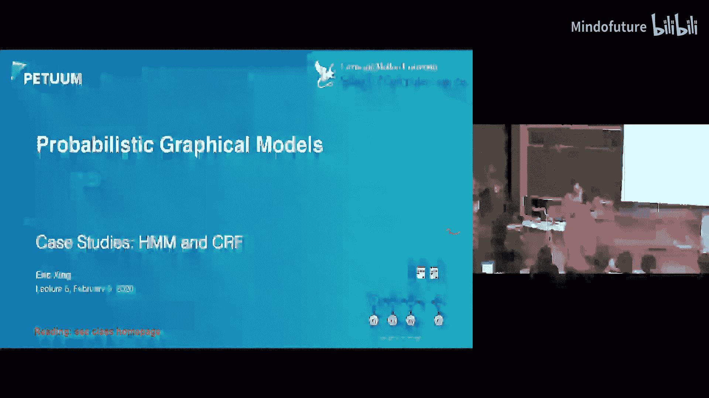
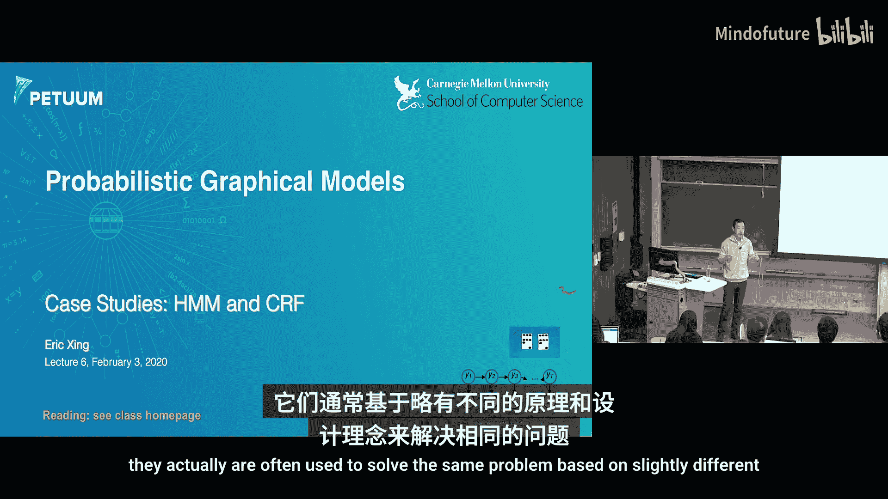
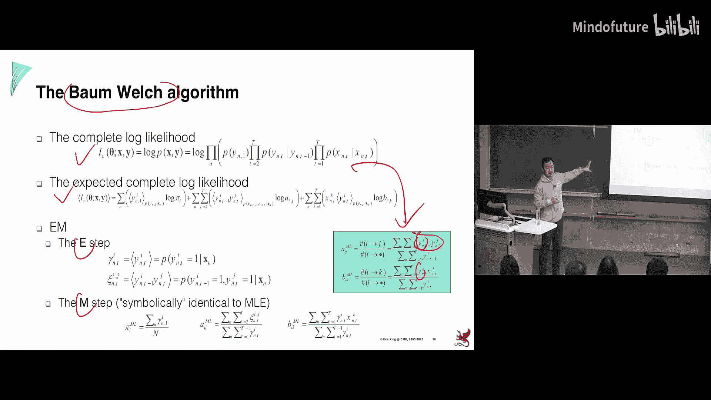
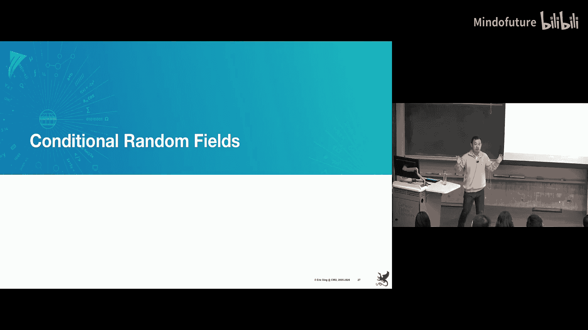
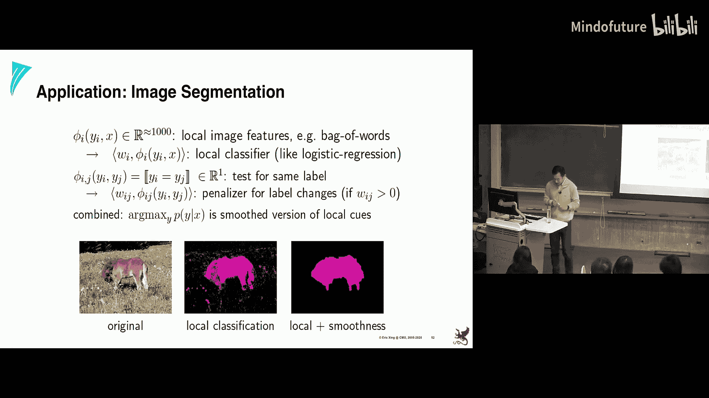

# 【卡耐基梅隆】概率图形模型 ｜ Probabilistic Graphical Models 2020 p06 P06_Lecture_06_案例研究-隐马尔可夫模型和条件随机场 -BV1ebpGzhEA9_p6-

Okay， let's get started。Right， so。So we've spent a couple of classes already on basic formalisms of graphic models directed and and directed。

 and we know how to do exactly inference。 And also。

 we know how to do maximum learning ways or without observation。 Okay。

 so these are all weve learned so far。 So today， and maybe next lecture。 I'm going to。

Converge a bit and give you a few use cases。Starting from the very fundamental and the basic and famous one。

 And then to some modern cases。And today's lecture will be kind of dense because youll be seeing everything that we talked about so far。

 not converging together。 Okay， for a single problem。And your source， in fact， both of these models。

 you've seen that before。 But in a very fragmented way。 today， you are going to see the whole piece。

T M and the CRF。And these two models are actually hands in hand。 Okay。

 they actually are often used to solve the same problem based on slightly different principles and design philosophy。

And let's see how to conceive the model and how to actually carry through。So again， you know。

 every model is connected， and we start from the very basic。 We know this model already， right。

 This is a model we seen in the E， M algorithm for classroom。You have a point cloud。Which， you know。

 may fall into a few clusters。And the coordinates of all these are actually represented by the observed variable X。

And then you indicate you， you assign a indicating variable Y to indicate which class they belong to。

 Okay， now， this is the standard use cases for a classroom problem。 I give you all the data points。

 at one time， you are going to class them。I can turn the problem a little bit around。

 just the same problem。 I give you points，1 by one。So now you a modeler or you are a problem solvers。

 say you want to do financial applications to predict。You know。

 this does it belongs to finance or in or maybe I T industry or you know， share economy and so forth。

And I give you stock points 1 by one， every maybe 1 point per day。

Do you use the same algorithm or do you change。Now actually is a a test for the。

 the kind of the experience or the sadness of you know， a modeler。 You know。

 if you go to a industry to pick a job， how to impress your boss。You will say， O， out of my pocket。

 I have not only just the E M algorithm for cluster or maybe a K。 I have another magnet。

Maybe this is a model。Because data are presented to you one after another。

It is at least not harmful to assume that the way you are presenting the data you are presented。

 the data can be rhythmic or can be from certain patterns。For example， suppose these are just。

 you know， locations， you know， in a city。And， you know， when I give you one data point。

The next point are maybe more likely to become from nearby rather than from a far apart place， right。

 different corner of the city。 I just fetch all over the place。 give you random locations。 Well。

 that's possible。 But at least the one scenario could be， I want to stay here。Like。

 I'm in Oakland for， for a while。 and I sampled a few people。

 Then I drive downtown and sampled a few people。 Then I drive other places。 right， That's a natural。

Assumption is to make。If that's assumption， then how is that assumption reflected in the model。

 that's kind of the art of modeling。And that's where we could assume a hidden markov model where you assume that the label or the cluster of the points have some temporal dependencies。

Okay， maybe we have a simple temper dependencies where you have a cell transitioning where with a high probability。

 I'm going to stay within the cluster with a small probability。

 I'm going to move to the other cluster。 So that kind of dependencies。 right。

 So just with that piece of additional information， youve now， in a sense， unroll this model。

 which is a stack of independent。You know， observations to a sequence of dependent observations。

So in a sense， H M M is just a temporal unfolding of a deck of independent data points。

And the way they get connected is through the hidden variable wise。 That's the error means， okay。

And you see these examples already。For example， I give you this example earlier in speech， right。

 your utterance。You know， it's temporal dependent。 It is very hard even physically to pronounce two words。

 which are completely very different。Right， so the way you speak kind of have a pattern。 And you can。

 and also our linguistic knowledge， our， you know， language， you know， background。

Can dictate us to speak in a certain way。You know， a verb follows a norm and so forth。 right。

 So that basically leads you to a model like this。So this is called a hidden markov model。

 And it is one of the earliest。You know， so called graphical models or multi bird models people use to infer many problems。

 In fact， I believe early applications could appear in the 60s or even 50s。

 although they never publish because it's in， you know， cryptic。Ec cryive applications like finance。

But later on， when scientific data become more and more public available and the need applications is in biology。

 You know， remember the， you know， I think one of the great events in the 90s and yeah。

 is the publication of the human genome。Now， probably you can， you don't take that。

 You take that for granted already。 like6 sequence human genome will cost maybe a couple hundred dollars。

 And you get a day。 You can basically get a shipment from 23 and me。 and I got a sequence。

But in the 90s， it's a huge project。 It involves international collaboration of many labs。

And they basically dump into a center storage， you know， the sequences。

I was actually somehow involved in one of this project in Santa Cruz。 you know。

 Professor David Husler was one of the two leaders leading the public efforts， you know。

 for human genome project。 And theres also a private efforts。 Okay， and running in parallel。

 There was a bitter rivalry between these two。 But put that aside， It turns out that in the end。

 they turn to the same technique to deco sequences， which is to really， you know。

 the whole sequence of characters are just AGCT， right， It doesn't mean anything。

 but some may encode a gene。 Some maybe the background sequences。

 So how to decode that people actually use the H M M as well。

 the HM M states can represent within gene outside of gene or other functional elements like promoters and so forths。

 right So this event actually popularize a great deal about the application of H M M。

 There was a book called the biological sequence analysis by Drban also。In the 90s。

 it become very famous。 The whole book is written about H M M and all its variations。Okay。

So now let's take， you know， a more rigorous look about what the H man look like。 It's a review。

 We actually talk about that before in my scripting。 But now I pipe it， okay。Here is a H M M。

 and the basic ingredients。You need to have a observation。Which is a sequence。

And the sequence has to live in a stay a space。 And in here。

 you can have an alphabetical s or youuc in space。Which you know。

 depends on whether the observation is a discrete， categorical or real， right， So you have a space。

You need to have a hidden state。Usually， it's a discrete index state or index sets 12 M。

 You can give names and attributes to each of the index， you know， being different cluster names。

Loations or functions inside the gym or anything that you can attribute to。

And then you define the transition probability from here to here， from here to here。

And typically here， there are some， you know， convenient assumptions。For example。

 the first state is kind of transition is kind of unique。Actually， no， no， I'm not I'm。

 I'm talking about the transition。 Actually， let's talk about the first second in the in the in the next step。

 So this is the transition from So that's the index。

 You can see this random variable Y has a subscript T， which indicates its position in the sequence。

And the soup script。J， which or I， which index its the choice of states。 and from I to J at  time T。

You know， its taking place at a probability alpha I， okay。And because， you know。

 all the transitional events going out of J has to be， you know， sum to one。 Therefore。

 this whole thing follows a multin probability distribution， right。

And then there is also a starting probability。 What's the state of the first， Y1。That's another。

 its like in graphic we have the root marginal。Okay。

 it could also take a multinomial with these probabilities。

And then there is also something called a emission probability。

 which defines the conditional probability of the observation， given the hidden states。

And in this case， it could be a discrete observation like the coin tossing， right。But also。

 it could be this could be real。 like in the cluster example。

 you have the coordinates of the random variable。 and then it could be， you know。

 a say galaxy or other continuous distribution indexed by the variable sets I， which。

K of suggest it is coming from cluster I。Right， so this is the whole thing。 Basically。

 you need to define a hidden lack of model。There is one caveat。 I'd want to remind you in here。

I said it is。 Maybe I forgot one thing。It should be saying for all the teeths。O。

 for all the different time points， I'm going to use the same multinomial to define the transition。

 This is called stationary narrativeity。It could also be nons stationctionary if every time you change your mind and use a different model。

Then it will be a little bit harder to learn， okay。And we also knew this already。

 It's all about the review。 I was want putting together。

 You saw these illustrations before in different places already。 So here how to write down the joint。

The probability of a Pariss， and also the states。Okay， you just follow the graphical model。

 and the F return law tells you to multiply each little pieces。 And that's how you multiply。 right。

 So you should know that already。 the review。And then once you do that。

 we need to worry about the inference。And one of inference is about the posterior of a state， given。

 you know， the whole observation。 Okay， and this is proportional to。Really。

 the posterior of the Y or the joint of the Y， I and also the sequence。Right。And we。

Remember this thing that we walked through。You can do this by arranging the summation sign。

To get rid of all the otherwise you don't care about， except the one you want to keep。

And in doing so， we apply a technique known as elimination， right。

 And you eliminate following some order。 In this case， you eliminate from left to right。

And youre going to basically get rid of Y 1， then Y 2， and so forth。And hopefully。

 you still recall in each of the e step。 I'm going to be able to generate an intermediate term。Okay。

 in this case， it's M Y1。 In this case， it's M Y 2。And in fact。

 each term could give you this quantity， which is the probability of a subence plus a state。Right。

 and once you reach all the way to the end， you will get this property。Okay。

So this is a elimination from left to right。 We also knew how to unit from the reverse direction。

 right。So these actually are two kind of very raw cases of。To very one on algorithm。

 which are now written in a much more prettier and maybe cleaner way， okay。

Here is a famous algorithm in H M M known as the forward algorithm。

 And the goal is to compute the marginal of the x。And then the way to do that is to define a intermediate term。

 which is called alpha。And look at the alpha， what it stands。 is stands this guy。

 The probability of a partial sequence up to time T ended with a state at K。ok。And this guy。

After some derivation。Follows a recursive function， which is alpha at time T。

 Okay for state K equals to the multiplication of three things。ok。This guy。And this guy and that guy。

What is this guy。This guy is the transition probability of。为 t。AndY t-1。Okay。From I to J， I to K。

 something like that。You walk through a bit more carefully。

 You will notice that this term is actually。Exactly。You know， the e term we get earlier from where。

From here。Okay， I told you earlier that there is a deep connection between elimination and message passing。

And the forward is actually a message passing algorithm。 It tells you to follow。

 It's a some product rule。 Okay， which is telling you how to compute a message coming out of here。

 which is alpha T plus 1。O， using message coming into here， which is alpha T。And the alpha T plus 1。

Roughly takes a form， which is， you know， three terms。You know that。The previous message。

 alpha T times。The transition from here to here。T 2 T plus  one， and also。The emission P of X T。W。

 something like that。And now why this sum is this way is taken out。

 because this why isn't affected by the sum sign。 We can take it out。你听。

So you remember this definition of the some product where the message outgoing is going to be the sum of product of all the messages coming in。

 plus the local terms。 Okay， so this is basically this forward algorithm is just， you know。

 an instance of the message passing algorithm on H M M。

And the beauty of this message that after you done enough。Until you reach the end alpha capital T。

 then what you really have is basically this guy。O， at time T。

And then the joint only needs you to sum over all the last states。Over K。

 And then you get the marginal。Okay， so message passing all the way to the end gets you to the marginal because all the hidden variables are eliminated。

Okay。Likewise， the backward algorithm can be directly used to compute this guy。Okay。

And you can see that here I'm writing it in a slightly different way。To。Single out。 There a Y T of K。

And you can rearrange turn a bit。 You can see that this guy breaks down to the product of this and that。

ok。What is this guy。If you stare clearly， more closely。Do you recognize it？嗯哼。😊，It is alpha T， K。

Right， the probability of a half sequence。At T plus one state。Right。

And this guy looks a little bit more complicated， conditional the。

 the probability of the later half of the sequence。

 conditioning on the earlier part and also the state。What do we need all these。

 If you look at a graphical model， It is about the conditional of this part。For this part。

 and this part。Right。On this part。So the truth is that if you knew all this already。

All this doesn't matter because it's irrelevant。 You have this mark of de separationation property。

 Therefore， all these can be cross。Okay， that's again。 The nice thing about the graphical models。

 you can you can visually see it and simplify your equation。😊，And this term。Actually， defines。

You know， actually， it's very similar to the message we created in our backward emination。

 If you go back a few pages。 and in fact， in the future， it has a name called the beta。

 probably a beta term， the backward。Okay， and this backward message also has a recursive term like this。

 because it follows basically the generic message passing definition。

 If you have a message coming this way。Then you use a message from here and here and the local。

 which exactly are the these three terms， the， the previous message。Okay， and the transition。

And also， the emission。Okay， don't get wrong。 This is not alpha。 This is a。

 the transition probability between the two states， okay。So。What do we get now。

 So we basically are saying that the earlier examples of elimination， you know。

 is more elegantly and generally defined as message passing on a tree of autograph。

And they are recursively defined by the some product formula。And in fact。

 if you go even bigger and back， remember that for arbitrary graphic model。

 we can turn them into junction  tree。Which we didn't cover。

 But just to show you in the case of H M M， the Zhang Shengi look like the same as the H M M。

 except that now I put all these little terms more explicitly in here。So that you can。You know。

 work on how to put them together and the right word passage message passing。You know。

 in this formula， you know， this is the local fragment。 I just kind of circled。

 Now it made more formal。 This message coming out of here。

Is due to the multiplication of this message， that message plus this loor。Okay。

 so that's exactly the sum product algorithm。And when you do rearrangement。

 they look the same as the forward algorithm。 So all these techniques with all these different names actually are the same。

 okay。At least on H M M。But you can take this idea here。

 which is not limited to only element any junction tree algorithm in in。

 in the case that you have a bigger graphic model down the road。 backward algorithm， likewise。

So this is like review so that， you know， everything we talked so far now come together in the case of H M M。

How， so just to， conclude here in the summary， the forward algorithm is a message passing。You know。

 right word。And it is also equivalent to elimination from head to tail。

 Back is a message passing in the reverse direction。 It's also equivalent to a elimination。

 from reverse direction。Once you have all this， you can do a lot of cool things。 Okay。

 you can do a lot of things。 In fact， even real time。 for example， this thing。The arbitrary。

 you know， you know， conditional probability of any states， hidden states。

 given the whole sequence is really equivalent to。The product of a alpha message and a beta message met at time T。

Okay， so in practice， when you want to do， you know， you know， a inference of this Y T state。

 you literally to collect message up to here and up to here from either direction。 Once they meet。

 you already solve the problem。But if you bother to take the message all the way to the end and all the way to that end。

 what you get is basically this a gamma tea of I for all the teeths and all the eyes。

That's also good。 It becomes a public database that answers you all the queries in the sequence。Okay。

Now。A slightly trickier question。 What if I want to ask P of a Y T I and Y T plus one。即。

Given the whole sequence。The joint of a pair。Do you have an idea。

I guess you wouldn't say that I'm going to just multiply this twice， right， because that doesn't。

That's assuming that two states are independent。 Then you can jointly multiply them。

 They are dependent。 So you need to do a little bit more work and come up with slightly model variations。

It turns out that its still。A message passing， but with more terms。ok。I'm not going to work it out。

 but you can kind of figure out。 in a sense， it's becoming a larger message。 you know， in here。

 T and Y P plus one。 And then coming in， coming in and coming up。

 You can just collect all these messages and normalized。 That's the kind of rough， rough idea。

 And hopefully you can find out this equation is doing exactly that for you。Okay。

 so now I want to just say one last word in practice when you write your program。In fact。

 if I'm the engineer if I'm the engineer manager in a AI company。

 I probably will give you a quiz in if you apply for a job and ask you to write a H M M。ok。

And if you happen to write a H M M， there are few catches that I kind of can test you how well you exactly know this model and how you are really coming out of a book knowledge or you have a pragmatic knowledge。

You know， how I I can， I can literally test that。Okay， and here is one such test。You know。

 in my lab or in many languages， writing many loops arem very， very difficult， right， For example。

 here， you are you need to loop over T。 You need to over over K and double loop over I and J and so forths。

Right， but you also know that in any language， doing matrix multiplication and manipulation are much cheaper than looping。

 You don't have to address everything。 right， This whole thing actually can be written down in the complete matrix language。

 because what is beta beta， basically for all the T is basically a slice。 Let's call beta T。

 for example， It's basically。A list an array of the beta T at all the little states。

 and are for same thing。 it is a vector。Okay， you actually could easily achieve， you know。

 the vector in one operation。 if you do the math right。 And here are basically， you know。

 the formula。 For example， in here， how to get the vector alpha。 it is equal to this a matrix。

Transpose A is the transition matrix。 Remember the whole thing。And the multily。

 right multiplied with the the alpha vector from the previous time point。Okay。

 so this whole thing will give you what a vector， right， matrixtri multiplied。

 right multiplied by you air。You know， A a vector。 So that's a vector。And then， you are going to。

Go what。ok。You are going to now again。嗯。Is the B matrix。 B is the emission matrix。

 You are going to then collapse with that， as well。Okay， to get basically another vector。

And likewise， for the beta and this this。 Lisa are， In fact， this dot thing is very interesting。

 It's not a dot product。 It is an element wise multiplication。 For example。

 you can literally mirror what's happening here to what is happening here here for one state。

 you have a。You know， elementized product of our find beta message for stay K。

 And here you just do it as a whole vector of。You know， element was production or multiplication。

 You get a whole vectors。So this is a one caveat where the whole H M M inference， in fact。

 can be written less than 10 lines of code， maybe  five lines。Okay。

 just to get the entire sequence of states taken care of。

So there's another caveat I'm going to mention a little bit later。

 but I want to touch upon a few more subjects before I get that point。

So I want to say a few more words about posterior decoding。

So we knew how to now write down the posterior of a single state， given the whole sequence already。

 right using the alpha beta algorithm。And by taking the arc max。

 you can also derive what is the most probable state at a particular sequence。

 a particular time point。So this is the MP of single hidden state。

And how to get the MP of a pair of states。Do we just do two rounds of Y T and two rounds of y another round of one T plus one and get the T state and T plus one star。

 Do we do that。I wanted to write very quickly， right。To get a sense about worthy。

 what is a joint assessment， What is the isolated assessment。So it is correct， not。

If I want to have the。Okay， it is not right， because we already have an example before。 For example。

 here， when we ask for the joint state estimation， it is very different from asking every state individually。

 right， So what we need to do is to compute basically P of Y T T plus one， given the whole thing。

 And then you can。Pick out the joint configuration of a pair jointly。

So what if I want you to ask to answer the joint estimation of the whole sequence。

That's a little bit tricky， right， because that means you need to now write down the whole thing。

Do you want to do that。Do you think this is the right to do it， Because no naturally。

 we do this already， This is not right。 And this is right。 Then this must be right。てう度です。

Please speak up。嗯。We need to be very quick in here， just like a jeopardy， for example。

 I what I I close this course， you got 30 seconds。我屌度。Or maybe if you do this， what， what。

 what trouble you are going to run into。So think as a computer scientist， you know。

 our formal chair in here， Jeanette W used to say that we need to do computational thinking。O。

 not a human brain thinking。Okay， computational thinking means that you need to register into some memory。

 Pick it out and then do some kind of you know operators on of on each of the register and piece together the puzzles and so forths now。

Where do you store this。It's a whole posterior of a long sequence， given the whole observation。

Have you thought about that here， it looks like an equation。 But in computer， it has to be stored。

 How do you store that。So that's defining the differences between a statistician and a computer scientist。

 We do computational thinking。 Every number has to be stored。Or has to be retrievable。And therefore。

 this algorithm isn't working because you cannot store it。 It's too expensive。

 It's exponentially expensive to store this whole thing， right。

And that comes to the billion dollar invention， known as the Vi algorithm， okay。

Which is clever enough。 I'm not going to walk you through the server treatment not derive it once you know that some product and elimination sos。

 But the key idea comes to the point that。They start to。Discover a recursion。 Okay， first of all。

 a partial answer。Okay， the partial answer basically is， you know。Let's see。Is this。

The probability of the most likely sequence of states， ending at somewhere。Okay， I basically。

 you know， begin by having a partial answer up to here。And also， you know， giving the choices。

 you know， for the last time point。Over all the possible case。Okay， so that means one sequence。Plusス。

You know， the tail to be having K options。ok。And this partial sequence can grow from sequence 1。

 just having one state to 2。 and the。Genius part is that it turns out there is an interesting recursion。

 okay。The longer， the bigger partial sequence。ok。Probty is， you know， a function of。

That partial sequence， just one kind of position shot。Multiplied by this and this plus a operator。嗯。

So this recursion is called by Tuby。 basically allows you to do this。

I'm going to now settle from supposeupp that I'm in the middle of this problem already。

 I already knew。Up to now， up to 3， the best partial sequence is this part。 this guy，3，3，3。 Okay。

 then I need to determine what is my fourth position is。To be the best。 And also。

 I you guarantee that when I choose this already， then there's no regret when I finish the whole thing。

 that is still the best state。Okay， that's the whole point。

And it turns out out there are all these different choices。 I'm going to say to， to a， to a pick。

And I'm going to pick a coin to this。 Okay， basically， all these potential options given in here。

Multiplily by the transition， multily by the emission。 I'm going to pick one。Of the best。

 out of that。And then I can grow one step further。 Okay， maybe here。 and then I go all this again。

I can see every time I grow， I keep a partial sequence， I leave myself K options。

 It is a polynommal algorithm。Not exponential。Okay。

 it is polynomial in the sense that it is a K times n。Rather than n to the power of K。Right。

 so it's not compatorial。So this is called virbic algorithm。 And the the key is this。Iteration。

 which is very similar to the alpha and beta iterations we saw before。

 Except now the summation sign is replaced by a max。So go home and stay at it for a while。

 And then hopefully you can appreciate the clever。 Theres a derivation in here。😊，Very。

 very simple derivation。 But I'm not going to work through that today。 You can actually。

 if you are curious， you can。Show it to yourself。 It's literally a single one page derivation。

And once you reach to the end of this whole thing， once you have， you know， the ver of T of K。

 then it's very easy， right， You just pick， you know， out of that K options one time again。

 you get a whole thing。This algorithm is you know。University of Southern California has a。

Their College of Engineering is called the Bartubi College of Engineering， right。

And it is name after this guy。 This guy was the co foundunder of Korkcom， made a good fortune and。

 and donate a， a， you know， a whole engineering school。

And this guy was also somehow connect to myself because he was the high school classmate of my PhD。

 one of my PhD mentors， Prossor Richard Kp。Becauseuse they were high school colleagues。Very。

 very interesting。I don't know which one， which life you prefer，1， become a tu or winner。

 the other become a billionaire and founding a， a college of engineeringing。

 I don't know which one you're going to go。 Maybe both。Well， you know。

 David Patterson actually achieved both won the touring award and also， you know。

 become very rich and influential industry。 So these are doable。

 I think that's the privilege of being a computer scientist。So， now。Without。

 with all the job going away， there's another catch I want to teach you so that you show very nicely to your interviewers to start your entrepreneur dream。

 okay。If you implement this whole thing， for example， this table needs to be stored。

And you may notice that。You know， the thing that is stored， you know， this message。

Probabilically or mathematically correspond to this guy。

 It's a multiplication of a whole bunch of things。ok。

And there you will actually see that when you implement this， you run into some trouble。

 you will run into very quickly a data underflow issue。 Once you apply， you know。

 multiply something that is between 0 and1， and you multiply 800 times that number vanishes。

You never get it。O， but it's still number。 Okay， you you have， you don't you cannot assume it with 0。

And you need to reuse it at some point to compare basically which one is bigger in know to pick got the best sequence。

And that number usually is 10 to the power of-10， something like that。 Therefore。

 if you really store them in a floating numbers， you don't really get into the position。

So the trick is that instead of defining this message。

 you need to take a log of that to make them the sum of the log of the message。

 rather than the product of the original numbers。ok。

So that matrix matrix application multiplication we need to be augment limited to put the log there to turn some of the product into a summation。

 So that's the other trick that you guys want to figure out。 Maybe in one of our homeworks。

 now will guarantee you to pass that examination。诶。For a probably a interesting M engineer position。

All right。Any questions so far。So we very， very quickly run through， you know， H M M and inference。

例えば。嗯哼。Yeah嗯。别拿上。嗯哼。Yeah。What's the question。be a lot。嗯嗯。HGood question。That's probably true。有。

Because this V is already the log of that。Okay。Yeah， but anyway， you know， this little。

 little edgebreak thing could be a good teaser or homework that you guys can stare at it we we， we。

 unless it's becoming serious， we hopefully don't need to resolve that here because I myself may get confused。

 Just a quick excuse here。 Okay， so now let's move on。

 I think this one doesn't have to be going through。

 we already know that some product algorithm is polynomial。

 So you can now stare at all this iterations and hopefully convince yourself that for each of that。

 the complexity is this much。In fact， I have two complexities。 One is time complexity。

 The number of multiplication sums you have to do， which usually is quadratic to the。

To the states and linear to the length sub sequence。 Then there is also a space complexity。

 How much space you need to take to store the whole thing。 And in this case。

 you only need to store the alpha vector， the beta vector， which are K length long。 And that's it。

Okay， very， very easy。Okay， so very quickly。诶。Let's look at the learning and just learning very。

 we have all the ingredients already。 So we literally don't need to work too much。

On the learning part。Supervised learning， meaning that you have X and Y all observed。And here。

 let's take a few assumptions to make the learning even less painful。

One assumption is known as a parameter sharing。 Remember that this guy requires a probability。

The initial probability and transitions need a probability。

 And by applying the assumption of a stationity， I say that the a transition matrix will apply to all the steps。

 okay。And if that's the case。You know， you， again， you write down the whole thing and then you take a maximum likelihood estimation that give you something very trivial。

 which tells you that the the transition is just the rate。 Okay， occurring between the two states。

 over all the。Transitions you can， you can see， you know， in every time stamp。

 So it's becoming a count counting exercise。We Im going to say a little bit more about some smoothing technique。

 For example， what if you see no transition between two states。You know。

 in your limited sequence of observations。And here is an equation at which I'm going to explain in a second。

The previous one only think about the a transition matrix， which is the markov model only。

 and now we have a hidden markov model， meaning that you kind if not only this。But also， this part。

Which means that you both the transition matrix and also the emission matrix。 samee thing。 It's very。

 very easy Once you are all observed here， the transition is just the accounting between the state transitions between two wayss。

Divided by all the transitions out of， you know， the Y。

 And here you are using the y as a delta function to pick the observation X。Coming from that state。

And then you are going to divide by the total number of transitions or states in Y。

 And I give you the frequency of observing。The， the X observation coming out of a particular Y state。

So these are just the different ways of counting your numbers。 Okay， and it's a frequency estimation。

And now， supervised learning has some。Kind of the deficiency， which is known as overfitting。

 Suppose that， for example， you are learning a spelling model。Okay， the transitions between all the。

 you know， the 26 characters。Right， and if you just see， you know， say100 word in your。

 in your training set。Chances for you to see a。Z  to Z transition may be very small， maybe 0。

 You don't see that just because you don't count enough words yet。

Then what is the probability estimation of a P of Z to Z。0。Right， and that means that in the future。

 when you see something like a dazzling whatever， you know， double Z spelling。

 you will all conduct as a error。 that's probably not smart。Right。

So this technique is known to be troubleworth， troublesome。 And therefore people invent a few tricks。

 One of the trick is called has a good name called zerodo counts。You know。

 here is another example in our casino example。 You see all the Fs there there are no fair thats。

 Then you again have a。Wrong estimation。 So the zero con space says that I'm going to， you know。

 plug in。Some imaginary numbers， maybe one only just to avoid the zero probability， no matter what。

 everything is possible， albeit with sometimes a very small probability。 So that's called zero count。

And this doesn't sound like very nice。 People， you know， sometimes say， no， okay， why not2。

 why not 3。 And or maybe this whole business is just a hack。

 let's justify pseudo accounts and so forth。I I bet you notice already already in our 701 or other classes。

 right， So zero con can be， you know。More kind of polished and theoretically defended using a Bayesian theory where you basically introduce a prior of your numbers。

Okay， the prior， you know， puts some， you know， imaginary counts on any event。

 And then the posterior is a combination of the prior and the data。 If the data become very dominant。

 then the effect of the prior will be eliminated。Otherwise， you rely on the prior to rescue you。

 So these are the stories I don't plan to cover here， but you should know it。

So after you have all that， then you can basically， you know， put down， you know， the estimation。

 you know， using the zero counts。Which I believe is， you know， just。Giving you， you know。

 some additional extra weights， okay。Where the， the augmentation can be。Computed in this equation。

Again， very quickly， I do't want to finish quickly to run into the other very interesting model。

 The un learning。E M algorithm。Someone want to give me a hint about what that is about。

When you have the Y sequence unobserv， what do you do。Just now when I to contain。

 I assume whys I know X I know everything is known right in here， if y is not known， what do you do。

Just give you a reminder。 So even in our general， you know， graphic accommodation network inferences。

 when everything is known， you just do counting。What if my wife are not known。Give me a try。对子啊。会長先臣。

好30。それでき。我要。嗯。I see we are getting。 You are helping the class to kind of reinventing this whole theory about。

You know， doing expected。Complete likelihood。And then do all the revisions。 Remember。

 at the end of day， what we get， we have a E M step， right， in the E step， we。

 we replace the sufficient statistic of everything。

 if there's a hidden variable with your expectation。Right， and in the M。

 we just treat everything best assume to be observed。Right， so that's the exact expect。

 The result of moving some out of log and taking lower bounds and all that， right。

So that actually leads to a very， very simple operation。 Again。

 there's a name for that B Welsh algorithm。It is like this。 So， again。Yeah， just to recap。

In the supervised case， we have all that。In the un case， where why is missing。

 we do that as the loss。 But these math are kind of hairy。 Maybe you don't even to derive that。

 But now let's look at what it leads to。 In the supervised case， we have all these。Okay。

 in the an cases， these are missing。 These are missing， and this whole pair are missing。Fine。

 we just replace them with all that。Okay， this， this you know， you know triangular bracket is。

 you know， the phyicist way of expressing an expectation。

 And that requires to compute the posterior of a one hidden state or a pair of hidden states。

 given the whole sequence because the expectation is taken over the posterior。And what is this。

We studied that before。 our forward backward algorithm。

 our evation algorithm are giving us this inference results。So now you see the E M part。

 The E basically take the inference as a subroutine。Okay。

 and replaced unknown with their expectation。And then they become known， therefore。

 in the originally fully observed M L E cases。These terms are not replaced， with their。Expectations。

 in this case， that gamma， in this case， like。Right， then you get this alpha and A and B。

 which are the transition emission probabilities。remember， just like in the K meanss。

 it is not a one time kind of deal because you have this parameter estimate now your。

Estimation of the per change。 Now。 it's a， it's a newer model。 You to not re estimate this。

 then re estimate this and do the E M iteratively until they converge。Just like in the。

 in the mix of Gauss model， E M， right， So this is the E step。 This is the M step。

So this algorithm is known as the bond Welsh algorithm。

So you can see they all have these names But algorithm Bo Welsh forward and backward。

 They were all independently or independently invented by all different folks during different time。

 And that's the the cost you pay before people adopt this graphic model generic formalism。

 and now this species is gone。 Okay， don waste the graph。

 No one ever need to invent any new algorithm。 They are all the same algorithm it was in the future。

Alright， so I have 20 minutes。 I think that should be good to present you， at least， you know。

 another interesting model。 So we are good with H M M， hopefully， right。😊，We know the inference。

 We know the semantics， We know the learning， and we know the application。

 Aplication is about modeling sequential data， making predictions on hidden sequences。So are we done。

 you know， are there， are people happy with that。

Well， I will give you an example where people are not very happy。 Okay。

 there are some caveats with this model。So people listed at least these two shortcomings of H M M already。

 And there are along the way， there are intermediate inventions called the main model。

 maximum entropy model and sos， which is partial addressing that。 but not quite。 So I， I。

 I just want to ignore that and direct jump to。One of the best solutions， answering all this。

So in here， one of the first question is this lack of ability to capture global knowledge。

For example， you know。These transitions。And these emissions。Are all very local。You know。

 it's really about， hey， I saw a word a。In the previous word。

 And then I want to predict the next word， I'm going to only see that。Right， I don't see the context。

Okay， someone say， oh yeah。 maybe the problem because youre using a first order markov。

 How about are you second order， Maybe making the dependency like that。 You know。

 your word next will be on now the present word and one step before， that kind of thing。Maybe okay。

 but it again， makes the cost bigger because the joint states of a pair will be you know quadratic。

 right。So that's not quite a solution。 And people even ask more。

 The global isn't necessarily just the words。 What if I saw this a whole paragraph， italic。

Or inner princesses about faced and so forths。 You know， N P， you know， you know， you know。

 applications are quite nuanced。 There are a lot of implications you read， you know。

 outside of the words。And they could also impact the way you do reasoning。

 especially emotional sentimental analysis and all that depends a lot of things like this。

 So there is a inability for H M M。Sysmaticically capture such a non local knowledge。

 because that's one， one you know， issue。The other issue is more kind of philosophical。

 It may or may not be truly impactful， but it is an issue。 Okay， in H M M。

 what we are trying to learn。Is either to maximize the joint of X and Y。

 if you see the holy observed sequence。Right， and or if you don't see the whole sequence。

 you maximize the P of x， the observations。Right。But when you use H M M。

 what you want to do is to try to make predictions out of a Y given X。

So this thing is different from what you actually use for learning。Okay， it's kind of a detour。

 It's like a。How should I say， you want to go to D C。Now。

 you take a train to New York and then take a train back to D。 C。 That that kind of story。

Rather than you directly go to D C。So people are bothered by， by by this。

This is the a debate happening earlier in the history on whether we use discscriptminative model like this or generative model like this。

 If your task is discriminative， do I care about model in the joint and all these debates。So。

 that was the issue。But these are philosophical。 Then people actually come up with a real kind of challenging example for the H M M people to embarrass them。

 okay。I remember this example was very good。 was was written in this very famous Johnang Lafferti and Angel McCarn paper。

 which was written here， by the way， at CM M U。 At that time， I was a student at Berkeley。😊。

And my group spent a week reading that paper and got quite confused and read many times。

 do all the derivations on the board together with Michael Jordan and student， David B。

 and and so forth as well all together and doing all this reading。😊，And then finally， we figure out。

 oh， this is really a ingenious model。 It was so clean and powerful。

 So why this example was so interesting。 So it's called the labeling bias problem。😊。

So let's look at this problem。 It looks like very harmless。

 but there are some bigger issue that bothers the linguist。 John Lafferti was not only a MO person。

 He is also an NOP person。 So he actually knew the application， not as just a shallow data set。

 He actually knew knew the the semantics and the principles behind it。

So imagine we have this problem of space where you have a bunch of hidden states。Okay。

 and you have a bunch of observations。And every hidden state has a transition probability out。Right。

 they need to go to the next state。For example， in this state， A， it goes to the two next states。

With a dis probability breakdown。What do we see， Well。

 it seems to be always preferring to go to the next state， go to the second state。Okay。

And then the next state， state 2 also has some probability going out。Instead of going to two states。

 it goes to five states。 And with the all breakdown。In here。

 it has an equal probability of going to all five。And in the next step， I don't know。Yeah。

 it has a slightly higher probability of staying at 2 and some probability of going to one and so forth。

Okay， so this is just a model。In fact， in language， people always see that。 For example。

 if you begin with a character R。You go to some other states。 If you begin with a character I。

 you go to some other states。 If you begin with a very unpopular state like Z。

 you go to fewer states， right， So things like that。Now， what's the implication， you know。

 by using all these local numbers。Okay， so here are some high level summary。

 State  one always prefers to go to state 2， almost always。And state to， almost always。

Prefer to stay the sequence  to。 Okay， that's the high level observation。And a A。Human。

 a individual who look at all this。W have a synthesis process to get knowledge。 O okay。

 This maybe correspond to real character。 This other correspond to common character。

 When I do spelling check and so forth。 I will see this whole thing。 Okay， in my mind。But now。

 it turns out that if you use a H M M model， something strange can happen。

The H M model is about computing the joint probability of a whole sequence。 right。 So let's look at。

You know， under H M M， what's the probability of a path。Okay， so here the probabilitybable path of 1。

1，1，1。 you can calculate it。It's a 。09。Okay。And the。So， we put it there。And pass 2，2，2，2。 okay。

 you can also calculate it。And， this is  point01 or02。 Okay， a bit smaller， quite smaller， in fact。

And let's try a few other things。 maybe 1，2，1，2。You can also compute， and it gives you06。

And maybe you can try one more，1，1，2，2。Okay， point066。 Okay， so so many。

You can try a bunch of other things。 You will actually convince yourself that after all。

 the pass probability has its maximum value at。😊，1，1，1，1。

 It will never gets you to other combinations。So isn't that a bit strange that my intuition says that when I'm in state 1。

 I have a bigger property moving over2， but and also when I am in state 2。

 I have a bigger property of staying2。 But somehow when I compute the whole thing。

 I never get to state 2 anymore。 I will stuck myself in state 1。Is that mysterious。

 So a very puzzling example。 It only happens when you put the numbers there。

 But when you stare at the formula， you don't actually see those。 Okay， it's not very intuitive。

 So this is called the very famous labeling bias problem。

 And you can kind of get a sense about what implies to in that paper。

 They say when you do spelling check， there is a word called rip。 and there is a word called Rob。

 and you will find that once your second one is in I in in rip。 you， you， you never get all of it。

 You will always conclude that the rib is more pro than Rob。 even though we imagine Rob is a much。

 much more common。Term， at least in。Natural text。Because it's a human， It's a person's name。

So what is the reason behind it， right， So that's the the point。It's because of the locality issue。

 the localness。Okay， of the。Probability elements is making you surprisingly biased。

So where is the localness in state 2， Stay 2 is kind of a， you can imagine this is a eccentric guy。

 you know， intrinsic guy。 You know， who just don't talk to people too much。 He has only two friends。

Okay， therefore， this two neighbor has to share or split all the probabilities of its engagement。

 Therefore， you know， even for state 1， which is not very popular， it gets a share of a point04。

 a point4。 And the next one gets point6。 So I'm talking about here。ok。So it makes， you know。

 state 1 sound very popular。 In fact， you know， point。4 is not a small number。

 even though it is smaller than the next option， but it is still a big number compared to all these other things。

The state，2， which is a popular guy who wants to talk to many people。 Well he spend with， you know。

 with any particular guy。You know， it's inevitably smaller。 Okay， he likes， you know。

 going to two most， but still only has。Pot02 or02003 probably。

RightAnd you can imagine that if I compare now this number with that number， this03 with this。

 it looks like this state actually is less likely， even though this is my best friend。Okay。

 I still see less tendency of going to that person， you know， you know， compared to state  one。

In a sense， you are comparing， you know， the， the chicken to know， maybe apple to orange。

 you are comparing the stickiness of a eccentric guy to a person to the stickiness of an eccentric person to a particular guy。

 these two things shouldn't be even compared。RightThere should be a global definition of the friendship that。

 you know， how friendly you are and how， you know， likable and how sociable you are and so forth。

 is these numbers should be globally defined rather than locally defined。 But in here。

 the H M M only allows a local definition。So by doing H M M。

 you cannot escape from that because in H M M， the way you define a model is always about P of X。

 P of X given y， and all that， they have to be locally normalized。ok。Now。

The solution is the following。Instead of。You know， adopting a local。Kind of a probability definition。

 which is due to normalization of all the locals。 Basically。

 local normalization means that this number and this number have to no have to norm to one。

 Otherwise， they cannot be called probability。So alternatively， I will just use a global definition。

 which I call potential。 Okay， then I will say that， yes， you know。

 here I have a potential of 20 and 30 here， I have all these other potentials and so forth。 Okay。

 therefore， at least here I have a 30 and here have a 30。 They are comparable。Okay， even though。

 you know， in a local normalization way， they actually， you know。

 have the other kind of relative skills。 But in here， they become really comparable。

And then I'm going to now define the probability of this whole thing。Globally。

 using some kind of partition function that we used before。

So that's actually achieved only when you are willing to turn a model into an anddirect graphic model。

So that actually leads to this a new model known as the conditional random field。 So I copy it。

 you can probably that this morning。 actually change the slice quite a bit。

 just to give you visual aid to contrast the definition in here。

 my older definition of H M M is based on the factorization rule。

 The factorization is over local conditionals and local marginal。 And in here。

I directly define the conditional。 That's one already advantage。 I can directly define conditional。

 And then the way I define conditional is to use a whole bunch of potential functions。 Okay。

 weighted potential functions。Okay， and I don't worry about their local normalability。

 I just care about the numbers of potential。 And then this Z is going to take care of all the potential normalization。

Just to give you a little more flavoring here， these potential functions can be defined in remember。

 on clicks。😊，Right in a graph。 And need here what are the clicks。 Well， we have the pairwise click。

 We have the no click。And remember that all this click should remember。

 should include the observations， which are no longer random variable that just features。Right。

 so therefore， for every pairwise potential， every single potential。

I make them as a function of the X。So what's good about that。What。

 the good thing that the X is the whole text。 you really can define。 Oh。

 if there is two paragraphs of boldface text。I need to， you know。

 define a dependency in a certain way and so on so forth。

 You can be very flexible in putting the potential functions。Using both local， which is this to this。

 This is local。 This is local， but also the global information。ok。

And then you don't worry about the normalability on every local term。Okay。

 and then this becoming you know， a very， very nicely feature based model。

 Sometimes people call it a feature based model。Okay。It， it allows to very powerful compositionality。

 you know， for model creation。Alright， so that' the model。 Okay。

 just walking away from the local conditionals and marginals into local features， pairwise features。

 sometimes called edge features and no features。 And then， of course， two sets of weights。Okay。

Alright。 And now you have a model。 you have a model which defines you now P of a Y given x。

And we can same ask the question， how do we do inference， You know， for example。

 what is the maximum sequence of a y。我。That part， I want to borrow our earlier knowledge。

 We have a almost identical algorithm as vertubi to do。Posster decoding。

Which I'm not going to put in here。Inference， basically， you know， on， on， on this is you， remember。

When I， when， when we talk about the message passing， when we talk about junction treei。

 we didn't actually specify whether it is directed or undirect。 right It's a tree。

And the message will pass all the way around。 And this one。It's a tree。It's the same as H M M。

 Therefore， you just do message passing on this as well。 Now the message is the local potentials。

So we have the inference algorithm， the same alpha and beta algorithm and turbic algorithm in H M M can apply to here。

 No change。Learning is a little tricky。 That's something I want to say a few words。

This is a fully observed learning problem。 Let's assume for simplicity。

 Let's say these are wholly observed。😊，And my learning task is to。Estimate lambmbda and meal。

 maximizing the conditional likelihood。ok。Now。If we remember the supervised learning， by the way。

 this is supervised learning， because everything is observed。 The Y sequence are given。

 the X are already known。It looks like we can do maximum likelihood approximation with a single one shot。

 right， just count frequency and so forth。What。Unfortunately， that's not going to working for CF。

So remember， I I， I bra about all the advantage of C I F being advantages over H M M， you know。

 for non local features for non local normal ability and so。Remember。

 there is no free lunch in the world。 You have to pay a cost。 Okay， something has to happen to。

Offset those conveniences。It turns out that learning is one of this cave。That。You know。

 count based M E algorithm isn't going to work where， you know， in M E for fully observed。

 you don't need to do inference， right， to just one shot maximum likelihood estimation in here。

 it turns out that when you take this as a loss function and you take a derivative over all this。

 you get this。The gradient of the loss， with respect to your parameters。

 has this a very interesting expression。Here is the。Value of your feature or your potential。

 which actually can be counted from your data。 right， These are literally your， your。

 your data frequency of the feature。But in here， you have an expectation of the same thing。 Now。

 you assume that these vices are not observed and you need to take an expectation of all the wise。

Okay， so counting and also expectation， the differences between them defines the gradient。Therefore。

 even when you observe all the already in one of these step。

 you need to still pretend they are not observed and need do expectation。So supervised learning in C。

 RF or in undirect life model in general requires you to do inference。O。No matter what， Okay。

 so that's actually the cost you need to pay。But is this really hard doing this inference。Well。

 it turns out it's not a heart， right， We already knew that we have the some product algorithm。And。

 and this is just to rework you with the eliation technique of arranging the sums。 It turns out that。

 you know， this， you know， you know， this expectation of a pair of random variable over the entire hidden sequence is just equivalent to the expectation of this。

You know， over the marginal， you know， posterior of a pair， given the whole thing。 This is， remember。

The cossign message that we computed before in H MM。Right， and in C F。

 the inference is the same as H M M in terms of the。

 the some product or the message passing protocol。Okay， therefore， this is tractable。

 It is not a exponential algorithm。 It is a polyormmal algorithm。Therefore， what you do is to very。

 very。Strangely。Running an E M A now， even for the observer cases where you infer。You know， disease。

You know， and the the， the， the， the the， the lambda and the meal based on our current gradient。Okay。

 which is the differences between。The feature and the expected features。Right。

 and the expected features can be computed from this alpha。

Message passing algorithm we actually show you example。 This is the same as in H M。And then， you can。

 basically。Use this to compute this gradient。I believe it is in here， yeah。听。So。

 this part and this part。Okay， so this is essentially a decent algorithm。 but now taking the。

 the process like a E M procedure。And you are going to。Keep iterating until convergence。

 And there is a learning rate that you can play with to control the rate of convergence。

 That's not something we are going to discuss in here。 So very， very。Heuristic。O。

And there are few other ideas to augment it。Which I'm not going to cover。

Because they are just algorithmmic tricks。Alright， so I think that's all about today。 You know。

 you may wonder， after all this work， do you really get something out of it， You know。

 is C R F after all so powerful or or so forth， Well。

 at least the early papers are somewhat disappointing。 This is a graph I copied from the early paper。

 You can see that they are almost comparable。 Okay for a different problem。 Well。

 the argument is that maybe they are slightly better， In fact， they are sometimes slightly worse。

The error， okay， these are synthetic examples where you know。

 you assume that there are local dependencies and stickiness between words and so forth。

 that kind of labeling bias scenarios are now synthesized into the training cases。

 And that's the cases where H M M are doing a little bit better。

 And here they are doing even worse than H M M。I bet you。

 if you show a graph like this now in your similar submission。

 your paper will be rejected no matter what。Okay， that reminds me of the good golden days of research like 15 or 20 years ago。

 where people are paying a lot more attention to the mathematical beauty and not to the clarity and to the potential of the model。

 rather than a benchmark。Performance， nowadays， people are really running all things against the benchmark and get a higher。

 higher number only to lead to one more paper。 and then no one else can repeat it。

 or they cannot apply to other problems。 This H M M and this C F actually are still right now。

 the backbone， you know， of many machine algorithms。 if not most。You know。

 that's why I gave you all these other examples about two dimensional H M M for image。

3 dimensional H M M for many other things。Okay， so if you look at the early paper。

 the first paper was a disaster。 It was， it was very hard to understand， first of all。

 And it doesn't give you good numbers。So what's that catch。I don't know。

 I think people need to publish paper nowadays。 but hopefully， at least for this class。

 to pass the class project to get a good score。 I don't look for good numbers。 Okay。

 I look for good formulation， clear design and also understanding of what are doing。

 not for those benchmark numbers。 So don't worry if you don't get a good experimental results okay。

Alright， with that， I want to close and see you on Wednesday。

