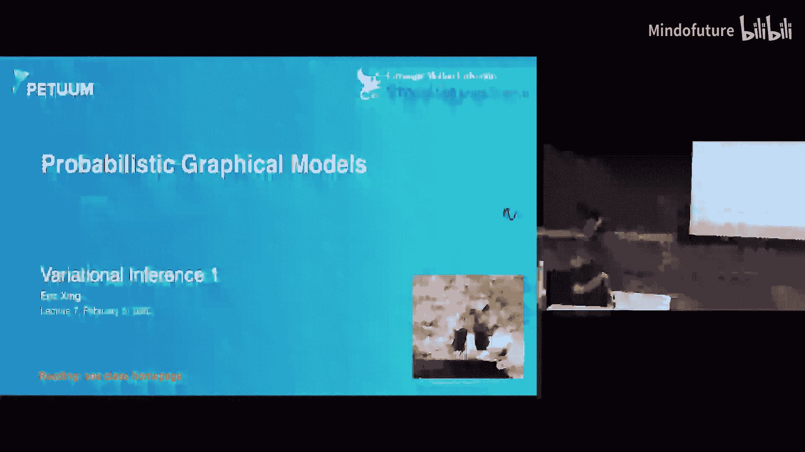
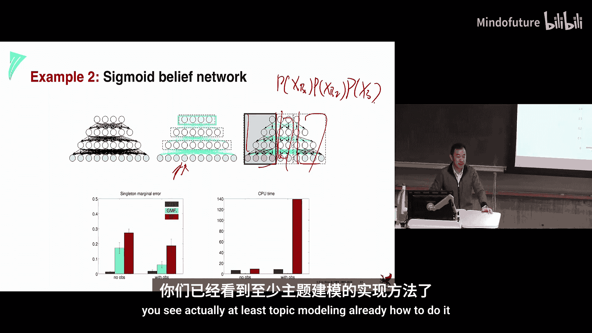

# 【卡耐基梅隆】概率图形模型 ｜ Probabilistic Graphical Models 2020 p07 P07_Lecture_07_变分推断_1 -BV1ebpGzhEA9_p7-

Okay， let's get started。So。I think today， the， the topic was becoming even more interesting now。

 So the time I， in fact， I I organized the material， partly in terms of the complexity。

Freshness and partly also is there is a chronicle order of that。 For example。

 last time I talk about H M M and C RF， They were invented roughly 30 years ago，20 years ago。

And today， we're going to learn some technique and also dive into a model which was invented roughly 15 or 14 years ago。

 Okay， when I just graduate from grad school， I was part part involved in working on that model。

 And down the road， you will see some model maybe invented yesterday presented in the in the class。

 That's actually the fun part of preparing a teaching material。

 I always want to bring in the the new materials。Put them in the context of older ones and see how things evolve。

So we' are going to talk about variational inference， which is a big deal。

15 years ago in this whole field。 It's just like deep learning nowadays。

 You will go to nips and see a third of maybe half of the papers are version inference。 Now。

 of course， you see very few because the problems are more or less。Understood。And。

 and also having some legitimate solutions。 But also。

 this technique of variational inferences have been tremendously evolved and maybe even abused nowadays to do a lot of things that is not supposed to do。

 But well see why that's the case。So just go back to the bigger topic of inference in graphic models。

Let's just do a recap。 So we begin with a graphical model。 In this case。

 I use a undirect graphical model as the general representation。

 because you can imagine that each of this part could just be a local conditional or a marginal and the Z becomes one。

 and then it is actually same as Beijing network or the right graphic models right。

 and quantity of interest in this case are a little bit more intriguing than the Beijing network。

 because not only you need to compute the marginals of subset random variables by summing out the ones that they don't care like this。

 But also in the case of a undirected graphic model， you need to also compute。😊。

The partition function， which is。Very difficult。 This is just like you compute the total likelihood of。

Data， you know， under a hidden variable setting。And we went through exact inference。

Up to last lecture， where by assuming the graph to be a tree structure。

And also by assuming that the scope of the variables is finite and discrete or maybe infinite。

 but in， but with a known technique for integration like Gausing， you could， you know， both。

 you know， computationally， and A Bly， you know， make the exact inference happen。Now。

 what if we ran into a case where none of this。Or some of these are not， are not hold。You know。

 it could be as trivial as you have a simple graphic model。

 but you just don't know how to do integral。Okay， there are some strange distributions where the form is rather irregular。

Or you have a big graphic model， which is just too big。 too many configurations for you to sum over。

 right， So I guess we know at least one example already， like this example， right。

 we knew that you can still organize them into a tree of clicks。Like mega clicks of this。

 But the click size is how much。If you remember， we do the elimination algorithm。 We you know。

 come to the realization that the ele click can be what can be as big as a slide。

Right in the whole thing。 So basically， this whole thing becomes a clickique。 And that's very big。

So how to do exact inference， Well exact inference graphically correspond to making the graph simpler。

Okay， and A Bkeley， we are going to study appating families and so forth。 But graphically。

 you can imagine that how about I。I kind of turn this graph into a graph， like this。

Where node are totally independent。Okay。You can you may ask how this is how these are two different graphs。

 Yes， that's why we approximate。 If that' the same， then it's not approximation， right。

 We want to make a graph out of this one。But measuring their distances by maybe a K。

 L to make them as close as possible。 But having a entire different structure， an infrastructure。

You may appreciate what advantage you may get。The advantage you get is that suddenly this called a Q of X suddenly becomes the product。

Of。Little Q of X， I， I being every node。 It's a simple product of all singleton marginals。

And what's good about singles。But the good thing is that there are no overlapping between any two componenting here。

 Therefore， when you do summarization， let's say we do the marginalization。

You have a separate operations rather than compounded one。 So that's the intuition behind it。

 Let's see how it work out。Though this is the bigger landscape of approximate inference。A big deal。

 a big family we are going to talk about today。 And next lecture is called variational。

 And there are a few subfami of that。 In fact， from a graphical setting， you know。

 what I just talk about by reducing the graph into， you know。

 some kind of simpler sub graph is known as min field。Okay， so。Simler。Subgraph。

And the other technique is called a loopy B prorogation。Which is that， no。

 I'm not going to do anything on the graph。ok。But I'm going to ignore basically many of the restrictions and disciplines I'm supposed to use on the graph。

 I can pass message， for example。On edge， no matter what， whether it is loopy， whether it is cyclic。

 I don't care。 I just pass message and I pass on and on until I run off time。 or they converge。

So this is actuallyrupee propagation。That actually brings up to the concept about oracle defined or process defined models。

Okay， people don't call it that way， but that's my， my own kind of a coined word。 In a sense。

 you run some program on it。 You run into something that you can use to describe a phenomenon like a marginal。

 And you don't actually know the bigger picture what the whole distribution is。

 but you don't need to know that because after all， you only care about the query。

 Then this whole process as an oracle can define some implicive distributions。Okay， so that's loopy。

 and Kauchci and so forth are just bigger loopy。 Okay。

 you are going to do some kind of organization of the， of the at the bigger meanfield。

 You do not singleton kind of you know， sub graph， but cluster subgraphs。 Okay。

 you still remove a few edges， but not all the edges。And E P is another variation。

 You change the loss function a bit。 Okay， and then we are going to study sampling algorithm。

 which I'm going to say more later on。 There are a couple of subcases。

So now let's look at what is a variational method。I think version technique was a very old thing。

 It was invented either by Leibiz or Newton or。Some of their descendants。

But at least it's 300 years old， okay。And it basically tells you the following。You know。

 it's a fancy way of describing any optimization based formulations。对。There are many quantities。

 mathematical many quantities that you care about can be re expressed。

As a solution to a optimization problem。For example， you know。Here， I have two examples。

 maybe the simplest， most basic one。 The eigenvalue of a matrix。Okay。

 there are zillions of ways of describing what is a eigenvalue。

 But here is a way that is known as the variational expression。

 It is the solution to the following optimization problem。Okay。

And maybe you didn't know other ways of solving。 Maybe that's the only way so fine。

 But there are other systems like solving a linear system where you have this。And it is a very。

 very intuitive and clear。A a break expression of solving a linear system， right。

 So X is inverse right multiply to B。Okay。But even this can be expressed as a solution to the。

You know， to the automation problem。Okay， x equals to the argument of this quadratic form。

And this and that are equivalent。It's very interesting， right。Now， why can someone name to me why。

 for example， I prefer this over that。Yes。Okay give the send on second one。Mhm。😊，说是。希こです。Great。Right。

 so this one is N cubic。 if you invert matrix。And this one。

 if you take a gradient approach to this loss function。It's n square。

Because you need to only compute in every step of gradient， a matrix times a。Time is the A of vector。

Right， and you can do many iterations。 And hopefully， the convergence wouldn't take 1000 step。

 maybe 10 steps。 then youre save。😊，So these are the trick people use to reformte a problem。

 and variational methods is this a bigger umbrella kind of name in the four techniques of this kind。

And in our case， what is our query in our x。L X is this。 We care about how to solve this。Right， the。

 the marginal or maybe the conditional。Of that。And typically， we analytically do integration。

 summation and so forth。But now I tell you that you can also do that by solving a operation problem using ingredient gradient。

Okay， so at a high level， we begin from a。Original distribution P， which can be very， very complex。

 can be arbitrly complex。 And we want to answer queries。 And yeah。

 we know that the challenge is that it is often intractable。And。So how to track that。We make it a。

Oization problem and how to formulate that。 Well， let's start from P。 P is intractable。

 How about we make it tractable。 We want to project this P。Into queue。ok。And， but， of course。

 you cannot do arbitrary projection。 There are two things。

 One is that into what space you project into。Okay， the space of all simple distributions。

But with a free problem， that's one way。 right， For example， I quote Q Q。 Q is basically， you know。

Reprompterized with a。You know， you know， you know， apha。So here， the Q family needs to be defined。

 which I used this a little shape to describe the family。And then how to get the optimum alpha。 Well。

 you need to project such that because this is a family space。

 you can project here to here to here or here。 They are all kind of instances of the Q family。

Which one is better， Well， I measure a distance。O， between two distributions so that they are minimized。

Okay， so remember， there is a space。There is a distance。O， all need to be defined。

And then you basically can work only on the Q star。

And then maybe the Q star is easy enough that you can do query like a P of X I in a very easy way。

 Maybe P of X I is proximating by approximate by Q of I。

 And the Q of X I is just this a little Q of X I because you have the factored way of representing that。

 So here， for example， I prefer to define Q to be the product of all the singleton marginals。

Probleterized by some alphapha。Okay， so that's the technique。And there are long history about。

Why it is called a M field。And。And， and so forth， for example， maybe in next lecture。

 I'm going to give you some historical account the the theoretical account about what's happening here。

 the actual。Distributional family for in the discrete case for P is usually known as a marginal polytop。

 I'm going to define that。 Just the name。 This is called the marginal。

Polytopic can see it's a complex core of some kind of extreme points。

And this meanfield approximation， as I said， across， you know， basically correspond to， you know。

 a space of subfami of distributions。Actually， looks like this。

 It's the inner approximation of this Comx hall。We can mathematically characterize that。Okay。

And then， you know， what's happening in here where you want to minimize the K， L。

Is actually leading you to the following solution of Q。

 which is equal to the argument of expectation of the energy。Of the P。And， the， actually， minus。

The entropy of of the Q。 So why that's the case。I can work you on a single， simple mass。

 So if we know K L of a Q of P equals to what equals to。Lo of P。Right。

 that's the definition of the K L。 right， Therefore， it is becoming。Right。And this equals to the Q。

 the entropy of Q。 This equals to the excitation of the P under Q， I said。Okay。

 so that's basically why people use this formula。By the way。

 why is called E E is the exponent of the。 remember our Gis distribution Gis distribution as the representation of the under models。

 They basically are using exponential of the potentials， right， So which is called energy。

 So this is the energy。So it should be P expectation of E。Okay。

 so we' are going to walk through that more systematically in next lecture。

 But here just give you a heads up。So this business used to require a bit of edge break skill to to derive many of the equations needed。

 And today， I'm going to work through you a example。

 which in my opinion is one of the most interesting examples that we can ever run into。

 because it's more interesting than drawing a network， deep network。

 because there are a lot of stories。 you know， connecting you to the very design process of a model。

😊，Okay， so now let's walk back a little bit and look at what our problem is， okay。

So we're going to talk about public topic models today as a vehicle to present a meanfield approximation in versional inference。

 So what is a topic model。Why people design topic models。ok。Well， I think， the， the， the。

 the world was really inspired by a real world challenge。

 It was the time when I was a graduate student， David Blyigh was my colleague。😊，In the same office。

 And at that time， we were reading a lot of， you know。

 NP textbooks to understand how to process text。And a typical problem that I was like 2003 or 2004 or something。

 Google was just basically become available and just become popular。 at that time， you know。

 lot of word documents， you know， are。Remaining to be browsable and visualizable。 Okay。

 that was the good old day。 And okay， imagine this lady are kind of a buriedt in such a sea of papers。

So let's see。 how do we start a new model task。We began from the real task。 We ask more formally。

 you know， what is， you know， the definition of the empirical problem in a mathematical sense。

 For example， do we do classification of the documents， which was very common practice those days。

 Do we do embedding。Well， embedding means that this a whole article of different length should be represented by a point in some kind of a Euclidean or some other semantic space。

 that's called embedding or maybe extraction of topics and so forth。 right， So you decide that。

 And then after that， you need to work through this a whole list of you the issues like how to represent your data。

 you are given a document， maybe with all H TM L headers and everything。

How to represent that to be the input， the uniform input of data of model。 Then what model use。

 how to do inference learning and even how to evaluate。I think at least once in a while。

 I encourage you to walk through this a whole thing from top to bottom to game a design experience。

 Okay， because many of the choices become interrelated。😊。

You may choose a extremely fancy model that models everything， but you cannot end up computing it。

Or you sacrifice the model for compability。 You get something that is exactly inible and learnable。

 But this model is too trivial to capture anything that's possible。 Therefore。

 there are a lot of lot of arts。 You know， for you to kind of do experiments to try the best balance。

 And here is a outcome of one of these best balance。 When this paper was published。

 there were a lot of controversy about Oh it is two trivial to simple， Why， you know。

 we need to award PhD to the inventor of this model and so forth。

 there there were literally such debates。 Okay in the committee。😊。

But now you can see it becomes one of the cornerstone。 Okay， in information retrieval。

 a topic model becomes almost a default kind of application。 you know。

 when people study large copies of text， right。And there is a reason。Okay， so now let's the first。

 hopefully agree on the task。I think we want to do the following task。

 Instead of looking at this whole stack of papers， we want to look at a point cloud so that they will be represented as a coordinate as。

 as as a point， you know， in some space。So what does space should be。Well。

 maybe the most trivial way is to just represent them in a word space。Okay。

 every dimension is a word。And then your coordinate are defined by the frequency of the word in the article。

 So that sounds like a good idea。What's the problem of that idea。系队咪啲。Yeah， in English。

 you may write into a vocaby of a million words。And then your article is like 200 words long。Right。

 so you have an extremely high dimensional problem with sparse data。 Therefore。

 it is not very economical and not also not very informative because everything will look very different from each other。

so。OhI used to have a little， little anyway。 Don't worry。So， and then， of course， there are other。

 you know， more ambitious tasks， such as I want to summarize the data。You know。

 I want to summarize basic using topics， for example， maybe a sports article， a political article。

 and how do we define topics， right。And one way to define topic is to use the high frequency word used in every topic。

If you see Trump and Pelosi and Obama and so forth， you may recognize it is a political topic， right。

 And if you see this kind of stuff like Beijing and influence。 and you may be， you know， you know。

 recognizing it as a academic topic in Beijing influence。And also。

 we may want to argue or maybe describe how the topic， how the world of physics evolve over time。

Well， that's actually an interesting observation or application that if you look at the documents in the。

 in， in the early day of the century。Of the last century or present day， even the world physics。

 the topic of physics can evolve over time， right， from nuclear physics to string theory。

 black holes and so forths。And， of course， in in the， in the industry。

 you may want to even describe a person by， you know。

 their preferences over different topics so that you can do， you know， precision。

 advertisements and so forth。Okay， so that's a task。 We have a whole bunch。

 And it seems that a number of tasks may converge to the same kind of， you know。

 desire to understand topics， okay。And then the second thing to ask is that， okay。

 I'm going to build a model that extract topics。 but I need to make some assumption on data。Right。

 and how the data look like the data in its raw form look like this。 This is the whole thing。

Which has awards。Has a sequence， ordering and so forth。

And people found that this is a little bit difficult to capture。 You need to remember。

 basically the relative position of every word。 And then two articles made of different length。

 It's very hard to compare。 So then people use a reduction， which is known as the back of word model。

About model。Where you just throw all the words into a back， ignore their sequence first。

They' are ordering first。And then just remember their frequency。Okay。

 that actually allows you to do the first embedding into the world space。

 But as one of you mentioned， the word space is very high dimensional。 Okay。

 it could be as high as every dimensional。 that's still not very good。😊，So what's next。

 It's not very easy for browsing and for many other， you know， comparisons， right。So。At that point。

 people say maybe this word is a too superficial。 let alone is's very cumbersome。

 How about we describe the article with its semantics。So what exactly is semantics。

So here is an example of the semantics。 Now， if you have a good site and you can read this article。

And I ask you， what is this about。Okay， I was actually a half an hour ago having a interview with some candidates。

 We have a half an hour， and I asked them to describe their whole research for the past many years。

How to achieve that， You cannot just read a paper in front of me。 right， It's too too long。

So people will say， well， my research is about machine translation。

And I also do some syntactic study。 I also do some learning study。 That's probably， you know。

 a smart candidate would answer me anyway， right， And maybe he could be a little bit more explicit。

 And you know， justify， you know， in their statement， what do I mean by M syntax and all that。

 or at least in me， I could also form my mental picture about what M T is。 typicallyy。

 the simplest way is to reflect on these keywords。😊，If I see something like in this article。

 there are words like blue scores， S M T alignments。

I'm reasonably confident that it is about machine translation。If I also see the world like E。

 M parameters and arcms and sos， Well， I will say there are something about learning in there。 right。

 So that's very， very natural way of human reasoning。To be a little bit more quantitative。

 I could even say， hey， this article is maybe 60% about machine learning a machine translation。

1% about learning and point3% about syntax。So how to achieve that。Well， how to achieve is one thing。

 but how。To interpret or how to make use of that is another thing。 At least now， we are achieving a。

Result where this whole article can be comfortably。Not。Not adequately， but at least comfortably。

 you know， replaced by a vector of three numbers。Right。

 so that's good because you may read another article。

 which is of different length written by a different author。

 I can still use the same vector to describe that， although the numbers may be different。😊。

So this is the idea， you know， behind the original topic model， design。Here， you know。

 the representation of our topic。Can be as simple as a unigram。

And we call them call every unique grammar topic。Okay。

And this ungram is very different from the typical text modeling where， you know。

 we just use a bag of word。 Here， the unigram is a topic specific。 Okay。

 you have a different word frequency。You know， under different topics， In fact。

 the same word can appear in different topics。ok。And you will see a few examples later on the same word on different topics with different frequency can give you different meanings。

 And then this is what people call a mixing proportion that I can describe the contribution from each topic。

So these are very， very kind of intuitive， hopefully。

 a natural thought process before you even write down any equation。 you can already get this point。

And， of course， you want to be convinced that it is useful。There is， you know， a。

 phenomenon in our community that sometimes people worry about usefulness less than worry about publishing paper。

 Maybe sometimes would you often see that， hey， I want to prove a theorem。Okay， I this。

 this is my beginning goal。 Okay， this model seems to be too hard to prove a theoryem。

 Let's simplify it。 I remove this assumption。 Oh， I add this assumption。 I remove that noise。

 and I take that out of the out of the environment。 Therefore。

 the theory of the equation becomes so clean。To be proven for a result。 Then I prove something。

 But then people say， oh， yeah， it is converging at the rate of an one over square T。

 but you never see that situation。 Therefore， it is not useful。

 So that's usually the fate of those paper。 Therefore， you see many of them， but very。

 very little cited。You here。Direction come from the other way around。 being the author ask。

 can we use this for anything， The conclusion is that， yeah。

 you can do a lot of other cool things I just described。 Now， let's see how to work it out。😊。

So just recap， Here is the bigger picture of the thought process。

 Youll start with a unstretched collection。And you want to discover topics out of it。 Okay。

 and these discover topics， sports， politics， arts， education can be used as the pillar or the axis。

To define a new space， Okay， which is called the topic simplex。 By the way。

 I'm going to say more about why it is a simplex。Well I can say now。

 because if you see the previous like you know， slides where when I say M T， when I see learning。

 when I see syntax， I basically say point6 point23 and point1， they actually sum to one。

Or that makes all the different vectors comparable。 They awesome to one。

 It is a norm one vector of a probabilistic kind of fraction over different options。And you。

 the space of these vectors are called a simplex。Okay， so this is called a copy simple。

What it is useful， Well it is useful in doing the so called dimensionality reduction。

 because originally without those， what you have from the documents are just the keywords。

 are just the words。You can trily embed every document into this word synax。But as I said。

 it's too high dimensional in a topical simplex， you're not only。You are actually in control。

 You can define。 I want to use the top 10 topics with on point So。 Then it's， you know。

 a lower dimension space， easy to visualize and to compute。And then in that case。

 we have a lot of capability as a byproduct to capture certain linguistic phenomenon。 For example。

 how to capture word in in in context。Right。Sonyms， for example， when， when you say I have a shot。

It could be this shot。It could be this。 and that。And this， right。 So altogether， four topics。

All carry the world， or probably having chances to see the word shot。But you can basically， you know。

 put short in different topics with a different frequency to roughly capture their context。Seat。

 you know。比萨的 seats。Even in visual domain， you also can see， you know， different parts， you know。

 of the image can form you know a visual vocabulary， which could again， appear in different context。

So traditionally， how people do that。There was actually a technique。

 which is very similar to what I'm talking about today。

 which is called the L S I latent semantic indexing， which was invented in the 70s。

And and they achieve something very similar to what I just mentioned in a edgegy break way。

 So we start from this word document。Collection。Every vector here is a long vector of a document embedded in workspace。

And then you can do a a single value decomposition。To。Decompose them into the following。3 matrix。

Here is the word topic matrix。Basically， word， you know。

 in the embedded in a different can appear in different columns。Which has different numbers。

But you can call every column roughly a topic。 And then there is a， you know， a diagonal matrix。

 you know， giving you the weights。 And then this is a document to document to topic matrix where every document now becomes a shorter vector compared to this one。

This word topic was not used in the literature of L I until the invention of topic models。

 But it was a retrospect。 People recognized that this one was not too much different from the topic models that I'm going to describe today。

 where。You still begin from a war document。You know， data set。

You are doing a probabilistic conversation， rather than a。Iject break decomposition。

 And here you are going to have， you know。The topic vectors of a war frequency I just described。

 where here， every column of， of topic。Consist of。You know， numbers， which sum to one。

And also between 0 and 1， it's basically the multi probability of every word occurrences under a particular context。

And sometimes the topic can be mislea because Bly。You know。

 they are just different vectors of numbers。Whether it is called sports or politics or something that was attributed by human。

 Okay， the machine doesn't automatically label them to be topics and sports and so forth。

 But when you stare at the world frequency， you can give that kind of characterization。

And then in here， you are going to have also the shorter vectors that gives you， you know。

 a combination of the topics， you know， to， to underline the the documents。Okay。

 so let's kind of bigger page。 Let's see how exactly happens。Actually， before I move on。

 I want to clear a， a early misunderstanding。 You know。

 many people get confused about what is a topic model。呃。For example， you know。

 what is the difference between， you know。The top model is a mixture model。

One thing people used to do when giving a huge document。

A copper of document is to run a k meanss or E M to cluster them。

And we use something called a mix from that。Right， the mixture model allows you to have， you know。

 a label for every document。And also， the label can be fractional if you do E M A。

 There is a posteror probability of Z， given the entire document。

Which seems to be giving you the kind of similar interpretation of what I got out of the topic。

 where you can have a fraction of  a。6 of in topic 1 and so forth。 here。

 the label can also have a fraction of probability of in different clusters。Right。

 so people often get confused。 What's the difference between them。

Or what's the additional advantage youll get out of it。Are you， are you still with me。Okay。

 at least you understand the question already， right， So here I have a P of a Z。

 which is a cluster label。Which is the a vector？And then in the topic model， we also have a theta。

 Okay， which is， you know， also a vector of a topic breakdown。

 So what is the difference between these two。Cool。It turns out that in the classical domain of statistics。

 in fact， was interesting story。By the time the topic model was invented， you know， at U C Berkeley。

 in ways David Bigh and Mike Jordan and so forths。 in our world computer science。

 we thought it's a new invention。Then， the paper got published。It turns out that after a few months。

 we discover that in the world of genetics， there was， in fact， not even a low profile paper。

 Theres a high profile paper， published in nature。4 years ago， four years before that。

 which uses exactly the same model。 In fact， a little bit even more fancy than the one published in computer science。

 Okay， and that model is called a ad mixture model by Matthew Stevens， now a professor at at Chicago。

😊，So in a sense， these two instances were independently invented in in the stories like these two authors become very good friend in the NS SO force。

 That's the other thing。 But it's interesting that people who come from different problems can go to the same solution。

So what is the ad model， It's more general。It basically says that。Instead of describing， you know。

 a entity， say a document to have a label of the。I look into the entity and see is composition。

 For example， here is an entity。Which has， many words。

And Matthew Stevens look into human DNA and look at the sequence characters。

And it also have different meanings， Right， So here， the goal is that for every word。Okay。

 I'm going to assume that it is coming from a mixture model。 For example， every word。Has now A Z。

You can see this is very different from this one。 Here is a whole collection of words。

Shahared the same label。And here。Every different world has its own label。

And the label is coming out of multiple different choices。Okay， it could be a sports shot。

 It could be a， you know， a medical shot。 It could be other shots。

 So the same word can even come from。Different topics。 in this case， you have no such option。 Okay。

 the same word， you know， have no way to be labeled differently。

And then when you produce the entire documents。You are allowed to draw such a label for every word。

Okay， and this drawing is coming from the theta， which is a mixing proportion。Okay， you can see the。

 the， the cluster or the mixture components like I wrote in here。 are used in a very different way。

 They are used repitively to generate elements inside a object。 In this case， the words。

 In the biological case， the DNAs， the characters in the DNAs。😊。

And it allows you a much richer mechanism to mix the source。Okay。

 you have different topics which really gets you know， you know，Draw， you know。

 sarcastically to compose， you know， a outcome。 This is， in a sense。

 more natural because when we are writing a document。I don't be， think we， you know。

 are using one topic or we just using a probability and choose one of the possible topics。

And then your inference is reflecting my uncertainty。Instead， we actually do have three topics。

 and we consciously use the mixing proportion to select words out of it。

 That's a more natural way of symthesizing complex object， at least from the designs perspective。

 right， Therefore， these are the status。Which are coming from this kind of graphic model rather than this graphic model。

Okay， so that's the difference。 This is called the A mixture model。And now， I think it's time to。

Regroup and look at the model。 how look like。 So here is exactly how the model look like。 It uses。

 you know， the same kind of rational address just described。 You know。

 here's a box which has N D number of words。 And for each other the word。

 we have a latent indicator Z and the Z are draw from a theta。

 which is the document specific kind of a proportion of mixing。Okay。

 and then here we have the topic specific What frequency， you have K topics。 therefore。

 depending on whether Z equals to one of the case。This one， beta will be activated。

And produce a word into this collection。 Therefore， you can see the word are defined by two inputs。

The frequency under a particular topic， the choice of a topic。Okay。And here is， in fact。

 this even becomes the way to describe a model。Okay。And here， I've been weak。As a bassian， you know。

 one of the advantage is to allow people choose different priors。

 And if you re remember what is taught in 7，0，1 or other intro probability course。

 typically people like a concate prior。Right， for example， this is a multinomial。

 What is a conjugate prior for。For bin noium。D， right， So that's why。

The model is called the latent de of allocation， LDA model。

But it doesn't mean that you can only choose dish。 In fact， very， very soon。

 there was a model proposed by the same author called Lo normal prior。

 There are certain advantage over dishlet。 for example。

 thelet is not able to model correlations between topics。

Because the prior assume that every dimension is independent of each other。 If you look at the form。

 for example， what's the form of thelet， if you remember。Theta of alpha尔 minus。Time of that， right。

 and some kind of a gama function to normalize it。So it is sometimes less desirable because the inability of modeling correlations between two theta。

Seta I and theta I prime。Then logistic normal goes like follows。

It is going to assume that I'm sampling this topic frequency。From a normal distribution。

 a multivari normal distribution parameterized by a mean of mu and a covariance of theta。

The covarience matrix can naturally model correlations between two dimensions。

But it come with a cost。 once you sample a gamma from a mu and sigma defined multivari Gausing。

Is Gamma still a multinoial variable。What is the sample from a multivariga distribution。

It's a natural vector of any number， from negative infinity to positive infinity。Right， but the。

 it's basically algebra。 we say it's not living in a simple， but the multi parameters。

 which are the thes has to sum to  one。 and every theta I is between 0 and 1。RightHow to set that。

 So there's a transformation that is needed to turn theta or gamma into theta。So。Unfortunately。

 all the translations are lost， but there is a way basically to， you know。

 normalize this gamma vector。Okay， and then you base， you know， basically， you take， you know， the。

 the， the， the gamma can be exponential into this。Right。

And then you can normalize it by some overall exponential of gamma I。 And that becomes your theta I。

Okay， that's called the logistic normal transformation。

And that leads to a legitimate Gausing distribution LDA distribution。O。

 so these are the algebra thats we can forego for now。 If I interest。

 you can look at the notes more carefully。Now， let's go back and see what's next。

 We have a task defined。 We have a representation determined。 We designed a model。

 The next is to do inference。Right。In a sense， that's the key of today's topic。

 So here is a common way of joining the graphic model of LDA or the topic model。 you can see。

W as the only observation， which are the words。And every word has a Z indicator of their topic source。

Z come from theta。 The theta is outside of。You know， the， the， the word frequency。

 meaning that it is shared across different documents with the same topic。topic weight， mixing。

And then there are beta over there。 These are unshaded nodes。 These are all frequencies or， or。

 or random variables。Therefore， the。The， the inference task is to figure out all of this unshaded random variable。

 right， for example。If you figure out all these。Then you have now topic assignments for every word。

If you figure out the theta， you know basically the topic proportion of this whole article。

And if you figure out the beta， you get the unigram of every topics。

Right so these are the interesting inference task。So how to do this inference。Just for。You know， for。

 you know， the。Completeness。We write down the whole model， Age Bly。 This is the whole model。And。

Again， this is to review our Beijingesian network graphic model， semantics。And for factorization。

 right， you work from the top of the no the graph to the bottom， and you put in local conditionals。

 And these are basically all the terms that you are putting together。There are a lot of， you know。

 multiplications。 You know， here， N means n words per document。This means D documents。

And here it means the K topics。 So by the way， this a plate with a capital letter here is a a shorthand for you to avoid drawing you know。

 n copies of such variables， okay。And we are interested basically in computing the posterior。

 which are disguise。How to do that。Oh， I lost all the interesting funds in here。

 It's becoming challenging。嗯。Maybe like this。Maybe we can go。 So basically。

 let's say we want to compute the posteror of a Z， given the document。Okay。

 and it is going to be very， very difficult。 Why， because you need to now use this equation。

 which needs you to， to compute the likelihood of the entire data sets。And how to compute that。

 it literally means that you need sum over。A lot of， lot of stuff。All the these。

 all the beta and all the the the theta。 In fact， the only the these are summable。

And here it should be integrated by integration because their are continuous numbers。系。

And you could work out by yourself how many terms that you need to compute this value。

 which is what we call super exponentially complex。And also， learning is。

Even more difficult because you to figure out the hidden variable first and then make them subrtine inside a E M algorithm。

Right， so that's where we start with approximate inference。 So I。

 I kind of throw at you one of the most difficult inference task that you can run into。

 And now I argue for the approach for variational inferences。Allright， so。Versal inference。

 I already went through that。 It's to turn the inference problem into a opt problem。

By introducing some auxiliary。Proxy， okay， which in this case， a Q。Okay， so here。

 Q of Z represents a proxy。To P of Z。 And Z is just a general reference to all the hidden render in this case。

And we want to get a Z， A A Q of Z such that it is， you know， hopefully maximizing the likelihood。

 And from the E M lecture， we learned that using Jenen's inequality。

 we can define a lower bound of the likelihood， which leads us to a alternative objective function called free energy。

Right if you still remember that。And that was the vehicle first to justify the E M algorithm。

 And in the E M algorithm， we know that in the E step， it's about you know。

 optimizing the lower bound， the free energy which respect to the five。

W whichhich is the parameter of the Q distribution。

And we also knew that if we want to do a close form where the queue is unrestricted for any family。

 then it's basically the same as the posterior。 It's， this is basically。The posteror officer given。X。

Right。And then in the M， we are going to keep this fixed and estimate data。So if you do this。

 then we we， we were solving nothing， why， because。We want to avoid working on this。

 And now it tells me that in one other the step， your proxy is just the same as that thing I want to avoid。

 So that's no good。So variation of inference is now to。

 not use this and try to basically reformulate the cube。

In a much simpler space so that it become tractable。Okay， true serum is no good。 and we。

Want to make it tract。And here is a tractable queue where instead of using that whole original kind of formula where everything is coupled。

 we are going to now assume the fully factor distribution where， you know。

 every kind of a beta theta and Z becomes a independent random variable。

Prometerterized by some numbers。ok。So we can see this。 And what's， what's good about that Now。

 if you want to。Compute a Q of beta I， for example。

 you literally can pick one of this item out and forget about all the others。

So that's meaningfield approximation。And I didn't say that each of this is actually parameterurized by some other additional so called variational random variables。

 I think it's here。 Yeah， so this one now becomes。Prompurized by。蓝的。And this one promptized by gamma。

 And this one is promptized by5hi。 These are the new parameters only present in the queue。

 the variational distribution。 There are no numbers。Okay。

 if you recall asset set to achieve variation of approximation。You need to do two things。

 One is to find a simple enough family for the appropriate distribution。Okay。

 now the family becomes a cute。Equals to。Q， I， that's the family， fully affected family。

And then within that family， there are still many， many choices of distribution。 For example。

 the family is scoutusing they make many ga distributions。 I need to define the parameters。

Inside the family。 And these are the parameters known as the variational parameters。

And how to estimate the numbers of those parameters were I use a of routine where I got this using a K R minim thing。

 which minimizes。This Q versus that P。Okay， so that's the， the， the， the rationale。And then。

 you know， you need to do some， some hard work。In terms of the edge brick erivation， okay。

So here is a generic form of how that posterior。Building block， look like。And in LD A。

 you can actually。Plug in some of these terms。ok。Which you know， in the， I think this is the。

The topic proportion distribution， which is a。This is the word the the word label frequency distribution。

 which comes from a multinomial。And then this whole thing， basically。

 the posterior of the weights or the topic weights in the variational is just a combination of these two。

And you can show yourself that this Q eventually takes the form of alet with re weighted numbers。

Okay， so that part requires a little bit of algebra。 You can combine this to renmalize it。

 I will leave you to， to work it out。Okay。So we have a Q of theta。Which takes care of this guy。Okay。

And we also need to have a Q of a Z， given the variational parameter。Okay。

 it turns out that you can also make some A break， you know， arrangements and derivation。

 And in the at the end of day， convince yourself that this is a reproized。

Reprompterize the multiple distribution。Okay。And likewise， for the word frequency。

 you also have a similar kind of ways of estimating that。Okay。So where do you get this again。

 you know。You literally can。Just。Work on this equation and plug in basically your assumptions in here and then take the derivative of lambmbda。

 gamma and Phi。 And I guarantee you that you will get this。ok。收。With that。

 we basically have not three equations for the inference step， for the E step， where， you know。

 the marginals the marginals of this guy and that guy and that guy are independently take care of by this singleton。

Approximations。ok。And that gives you， you know， a， a， a algorithm， you know， in distance， you know。

 for solving L D， you initialize each of the quantity of interest with some random numbers。

And then you just keep updating the， you know， all these different quantities。Okay。

 and they you converge。Are you still with me。On the inference part。Okay。

 if you don't like the algebra part， it's okay。 But the key message is that you start from a P。

 which is really， really， really hard。And you introduce a queue， which is hopefully easier。

 I'm trying to put the happy face here。Okay， and this Q is to be factorized by little cus of I。

 where you need to introduce some free parameters of I。

And then you are going to just estimate the E I， you know， using a agon max。

For argument in this case of a K L between Q and P。That's the whole story。O。

 everything else is just a little algebra。 It's very technical。Okay， and then you'll converge。Now。

 that's the inference part。Very often， the， the lecture ends here。

When I walk through the notes this morning， I feel a little bit too abrupt to end here。

 I think there is this other piece we didn't even mention in the past。 It's inference。

 So where' is learning。we are talking about the E M algorithm。

 How about what why only the E step was taken care of the M step somehow was was ignored or not。

 In fact， many papers ignore that。 Now， give you a little bit bigger picture。

What we just did is actually known as the variational E step。Okay， where we keep the theta。

 the original model parameters fixed。And we are going to optimize， you know， the file， which is the。

 the variational S part。 And here are all our variational parameters。

 We are going to do exactly what I just。Did。But now there are additional parameters in the M step。

 because we actually want to know those theta and beta parameters， right， in many cases。Why in here。

 there is no such a thing。Well， the truth is that many people don't worry about that。

 from a computational perspective。Because。As a Beijingian。

 you are not supposed to even care about the parameters。 They are random variables。

 They will be integrated out。Therefore， the theta and beta would never bother to appear in your computation。

 They are integrated out。 You know， you get， for example， if you have a duration parameter sample。

And leading to a multinomial parameter sample， leading to a discrete label， then this part。

Can be integrated out。 And you can write down the Z。Directly。Given the alpha。As a thresholdlet。

Of what of the count plus the parameters， right， That's usually how people like it。 Therefore。

 theres no business for theta。So that's why the M step was often ignored。But if you really。

 really want to have an estimate of the beta。You can actually still tease it out。

 You can write on the P of theta given Z and alpha。That's doable。

 And then you can do either a Bayesian estimation or a map estimation of that。O， this is doable。

So in that case， you need to now fix those aal parameters。Okay。

 they are the surrogates of the alpha and other things。 And then you just， you know。

 combine those counts。And， and you can write down this。O， I'm not going to put equation here。

 but it's just very similar to what you do in the E step。

Sometimes people even want to learn the number of alpha and the Eta。

 which are known as the hyperparmeters。Okay， usually specified people。

But if you want to learn them from real data， it's also possible。 You can integrate out again。

 the alpha the theta and the Z and beta。And then you can basically maximize the alpha and eat against this whole thing。

 That's also doable。So I want to say a few words like this just to remind you that if desired。

 all these are doable， but many people just。Don't bother to do it， because。In the E step。

 what you already get are the theses。ok。Which is， you know， in fact， not this， but the frequency。

 In fact， the， the frequency behind these and also the frequency behind the theta， these are。

You know， if you are going back to the exponential of the linear the exponential family distribution and the general linear model。

 these are the sufficient statistics for all these other parameters that you care about。 So in a。

 you already have the information in case you to use it。诶。Let's see。

Maybe I can walk you through one of this equation。 Let's see whether it's interesting to work it out or not。

有。It's interesting to actually， look at this。So the lambda gives you a variational parameter。Of。

Underlying the word frequency。Of a particular topic， came。Okay， so lambda of K of J。

Is about the Jas word。Underlying topic K。 and what is its frequency。ok。And how to estimate me that。

You need to basically know the count inside context。 You cannot simply just count the word J。

 say shots inside the entire article。 You need to basically say that when the Js word is under topic K。

How many times it occurs。Right， and now you can see that this particular indication is exactly a combination of that。

This indicator function indicates the。D for， but the n for in document D equals to J。

 meaning that there's a trigger of word J occurred。Okay。

 and then it is weighted by this particular N word being under the topic K。

And this combination gives you a weighted account of that occurrence， under a specific topic。Right。

And then this is what this is the hyperparmeter， the prior0 accounts。Of that word。Under any topic。

So you can see the rationale between all these， right。

 You count over every word and every document in your copper。 But， you know。

 this topic and world currencies are augmented in terms of their topical context。

So that's why I say when you estimate these hyperparmeter， Lada。And the， and the， the filess。

And also， the garments。Which is the output of the variational E step。

You pretty much have the entire thing already。You know， in case you want to download。

 estimate the beta and the theta and all that。Okay， these sufficient decisions are given already。

So that's about variational。Inference technique。I still have another 10 minutes。

 Maybe any questions at this point before I move on。Yep。How you even design the space of topics。

Very subject。诶你我 topic。It's very subjective， and also， it is very objective。

Because when you do this topic decomposition， for example。

 when you get this topic specific world frequency beta。It's all driven by data。Right， but。

What I think what you meant by subjective is that what this give you a bunch of numbers。

And maybe here is a house。This is the white。This is Obama。All this。And there is a number。

Vctor corresponding to these words。 That's it。 It's very， very。Objective。Now。

 calling this whole thing a political topic is very subjective。 You are free to call it sports。Right。

 so sometimes， you know， for a uninformed user， they say， oh。

 can your machine automatically derive a topic， The answer is mixed。Many people say， oh， yes。

 we can automatically direct topics。But then they say， okay， then we don't need human anymore， right。

 we will get automatically politics and and sports and arts。 The truth is not。

 The automatic part is about getting these numbers。And also， getting these award lists。

But how to call them， how to give them a human touch to。Communicate story。Is the human。 Okay。

 we need to basically look at these numbers and give it。 So I would say， come on。 I I。

 I'm not the believer of AI replacing people at all and driving people all of it。

 That's where human part is important。 You know， you， even even two people see the same color。

 blue will describe it differently， right， or wine tasting。

So that's where some suggestive is interesting because they understand the user taste or deeds。

 and they can put their input there。 But that does result in ambiguity。 In fact。

 that kind of comes to my next argument， how to evaluate。Because of this subjectiveness。

 evaluation in top model is really， really a problematic thing。 You know， you， you。

 you really cannot say one。Moel is better than the other。

 especially when you introduce the approximate inference， the approximation also has a quality issue。

 whether it is good or not。And then sometimes the evaluation become intertwined。 You know， you know。

 your error may because of the model fl or maybe because of the inaccuracy of your inference procedure or process of data。

 All this could be convol。Now that's actually a big criticism of our business。So here， in fact。

 I do want to surface you to maybe a legitimate way of evaluating that， which is a lot of art。

 Nowadays， people don't do it very often。So。I have a few slice in here。Usually， you know。

Evaluation should be measured against ground truth。Right， but for article。

 you don't have a ground truth。 I give you article， you know。

 you already can debate whether it is  point5% politics or  point6% politics。 We don't know that。

All right。And therefore， when people in the old days compare models， they basically say， yeah。

 you know， I run topic models。 and then I run， you know。

 classifiers so that I class the topic vector。 and I can give every document label。 that's very。

 very poorly informative about what you do with the whole project。

 whether your model is good or whether you inference engine is good as， for example。

 people can use sampling algorithm， which gives you maybe some different results。

So here is one work I did as as an experiment。We do a simulation。You have this topic model， right。

You can simulate， you know， you can define maybe a vocabulary of an 40 short word。

The war doesn't have any semantic meaning， but they are just words。And I can have three topics。

And the topics are basically of these many words， and of different frequencies。Okay。

And then you can use them to generate whole a few hundred or few thousand documents。

 The document doesn't have any meaning because they are just numbers and tokens。

And then you can throw them back to your inference engine。And ask them to recover。

The topic vector of every documents Here are 4000 or 400 documents and compare basically your recovery from the ground truth that you use to synthesize。

In fact， here， you can already see I was comparing two algorithms。 This one that one。 right。

 And this was the ground truth。 And you can kind of see。You know。

 which approximate inference gets you a better result， Which one less。Right。

 you can actually compute， you know， you know， curves， you know， on， you know， the， the。

 the error of a topic vector estimation based on different number of topics。

 different number of size vocabulary sizes and and so forths。So this this is one way of evaluation。

 It's purely objective。Very， very numerical。 Okay， at least it gives you a conclusion about which approximation algorithm。

 you know， is more accurate in recovering the truth。And， of course。

 you can have empirical things like a computing perplexity。You know。You know， of your results。

Or computing the class label， you know。Us。So this is the more kind of generic。

 You can download documents from some data sets for different topics。A different categories。

 And you can kind of cluster classify， you know， this you know。

 documents based on your infer topic vector。 and they give you a different accuracy estimation。

 So that's another way。 It's very empirical。But again。

 it's an open topic in terms of how to precisely compare。 And nowadays， I believe in deep learning。

These kind of exercise are rarely conducted。Okay， at the end of day， it's about。

It's almost like I teach a kid from year 5， from age 5。Mss， piano， baseball， everything。

And then at year 20， I ask， did he go to CMU or not。Okay， and he， he did。

 Is that because he learned math or piano or baseball。Honestly， there is no， no idea。

So deep learning is like this。 You are competing comparing the end result of classifying a image or making a translation。

 right， But is's a whole middle ground of latent layers， whether the inference was done correctly。

 whether the design of the layers having the right number。

 whether you have the right number of notes， It is very very unknown。

 That's why we say tuning the deep neural network。 Auto tuning become a big business because there isn't a great common ground for people to compare other than the end result。

Other questions。Takeing message today is that you want to know the variational inference principle。

 in particular， the mean field principle。 meanfield is a very powerful tool。 It in principle。

 can solve arbitrly complex model。 Okay， you can have a model with whatever structure and whatever number of nodes。

 by assuming mean field， you are literally removing all the nodes or all the edges。

 It becomes a product a multiplication of all the singleton。And therefore， you can compute a K， L。

 you know， to draw the closest distances between every kind of between the proxy and the true distribution。

 And then， you know， you can basically come up with approximation。And in fact。

 I just want to show this graph。This was an experiment I did， In fact。

 as a graduate student about 15 years ago， Look at that。 In't this a neural network。

This is a neural network。 It is a sigma network of of course， four layers。At that time。

 things were very rigorous for layers because we can compute exactly the value of the hidden nodes just by enumeration。

Okay， then we compared the。Back propagation algorithm with the Mfield approximation and with some other twist of Mfield。

And you can actually see already the back propag algorithm is terrible in terms of the accuracy of recovering the truth of the latent variables。

Some people knew it， it's not a very good algorithm。In terms of accuracy。

But it's very very straightforward as input。And the mean field is a bit better。

 And there's a structure mean field where you just cut some nodes， but not all the nodes。

 You can get better accuracy like this。So this is just an insight。

 whether it leads to better classification without at the end of the day。 I don't know。

 but at least it gives you a faithful estimation of the latent variables。

So you can see from this graph， the main future isn't just as simple as cutting all the edges like in here Here。

 I cut only the edges between three boxes。Make them basically a product of X。Block 1 and product of。

Box 2。Okay， so this is approximation。So this is actually known as the Kauchci I just mentioned earlier。

 which was also invented in physics because in physics， you need to really assume， you know。

 different granularity of molecular coupling。 And therefore， people you know， try one at， two atoms。

3s and so forths，Okay， I think that's about Mfield approximation invarial next lecture。I will see。

 I'm thinking about presenting something even more hardcore on the math site or something very dirty and and practical on the application side。

 Which way will prefer， actually， let me ask。Applications， you guys are not okay。

 Let me think about that。 I can come up with something like that。😊，Hopefully。

 today is an instance of application。 right， You see actually at least topic modeling already。

 how to do it。

