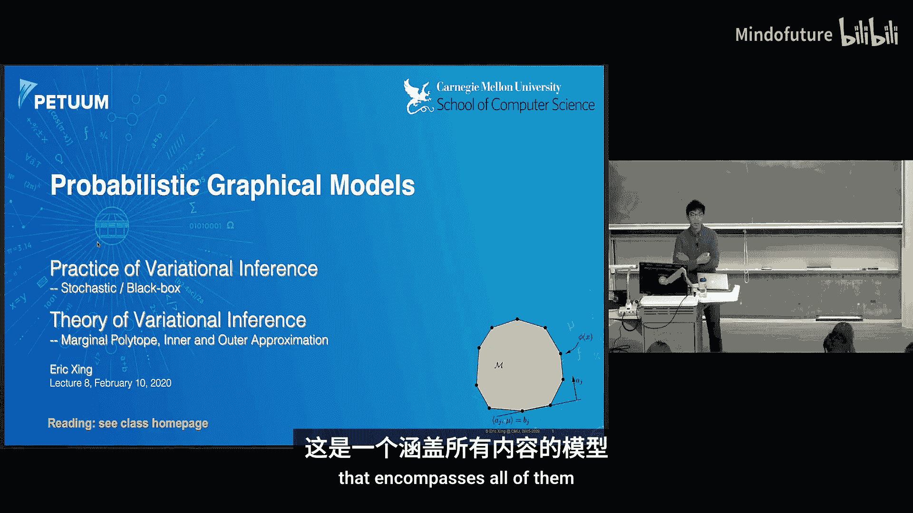
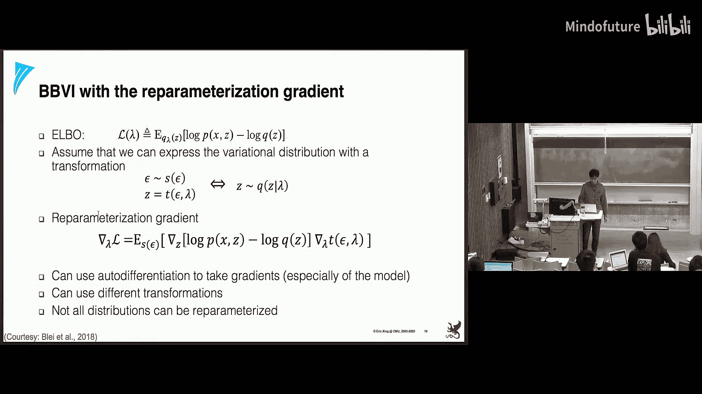
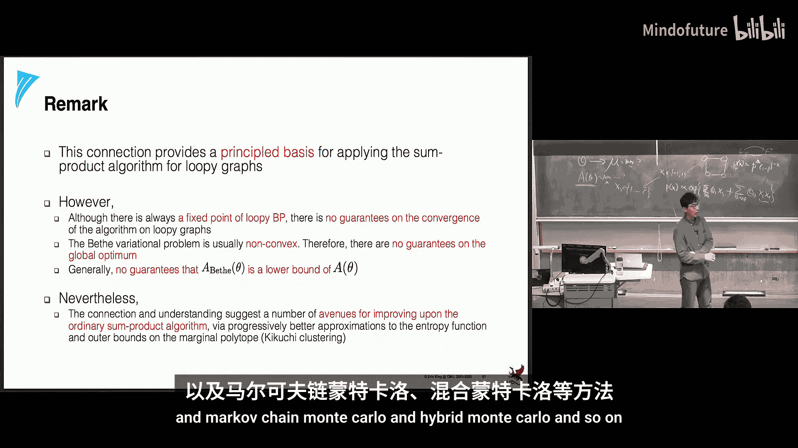

# 【卡耐基梅隆】概率图形模型 ｜ Probabilistic Graphical Models 2020 p08 P08_Lecture_08_变分推断_2 -BV1ebpGzhEA9_p8-

So yeah， just couple announcements。 So Eric's flag got delayed。

 So I'm the guest lecturer last minute guest lecturer， so。😊，Aologies in advance。

 cause these slides are made by Eric。 and any mistakes in the slides are Eric's fault， not me。呃。

And homework  one is due this week， right？ And remember， there's no。So the deadline is strict。

 So submit anything you have at that point。 Don't wait until you have a perfect solution。呃。

No more announcements。So let's get started。 So today's lecture will be on variation of inference。

 So we talked about the basics of variation of inference last time and then covered some of the。

applicationsplication in latent allocation model。 And we're gonna see a little bit more advanced variation inference technique today also apply to latent allocation model。

 but it generals to other models as well。So those are the stochastic version inference。

 And also later on talk about the black box version inference。 And then after that。

 well talk a little bit about the theories behind variation inference。So we're gonna discuss what。

Actually， does the meanfield method or other belief propagation methods do in a higher level。

 And there's a unifying theory that encompasses all of them。

Okay， so last time we talked about top models are models of collections of documents。

 and then where the word we ignore completely the word sequence information。

 And then we just do a kind of mixture model， but mixture on top of mixtures again for the words。

 So this model as specified is very nice。 But the inference， of course， is pretty hard， as always。

 the case for many latent variable models。 So we cannot do exact inference。

 So the method we take last time was to do approximate inference and specifically variation inference。

Okay， so and specific more， even more specifically， we took mean field version inference。

 which corresponds to the right hand side diagram over there。Okay， and。

If you just optimize the evidence lower bound you derived from meanfield variation inference。

 it'll just be coordinate descent over meanfield variation of approximation parameters。

 So you you fix all the other parameters。 and you choose one parameter to optimize。

 and then you do this over all the parameters。 So in automation， that's called coordinate descent。

 And here it's the same thing。 So you do iterate over the whole parameter set many。

 many times and until convergence。Okay。嗯。There。Usually in latent variable models or in as as well in latent de allocation。

 there are two types of parameters associated。 One is per data point parameters。

 And then the other is a global parameter。 So in latent allocation。

 there's a global topic parameters beta that's affecting all the different documents and all the different words。

 And there is also local per data point parameters theta and the variation parameters of theta that's acting only on a particular。

Document or a particular word。 So those are the per data point parameters。 So if you。

Abstract that out if if you just look at what's the difference between global update equation for the global parameters and the local parameters it kind of looks like this。

 So you first iterate over all the data points and then update their own associated local parameters。

 And then after that， you use all the sufficient statistics you collected before to update the global parameters。

 But， of course， this is not。Very viable。 If the number of documents D is very large。

 Like if you have millions of billions of documents in the Internet company。

 then you don't wanna use do the inner loop for a very long time and then only update out the loop once after like 10 minutes。

 right， So you wanna update your model frequently enough to capture the to to to make the model better at any point。

So。What you can do is to use some kind of idea similar to stochastic gradient descent。

 So you can first separate out the loss function into two terms so you can separate out the global con parameter part and then the local parameter part。

And so the resulting decomposed loss function looks like something in below。

 So the F lambda is the global loss loss function for the global parameter。

 And then G I is the loss function for the local parameters。 And I is the index for the data points。

So what you would do is you would first maximize or optimize for the local parameters first。

 because the F of lambda doesn't depend on I at all。

 So you can just push the maximization in and then do the local maximization first。And typically。

 this will have a closed form solution， or it's very easy to solve because it's just related to one data point。

 And it's usually considered very cheap operation。And then let's say the maximum value or the a max really should。

 you see a mistake over there already。 So it's not my fault。 again。

 so that should be the a max of that is a fee star。 And let's plug in P star。

 And then take the gradient for the global P Lada。 And thatll have the form of some gradient plus sum a。

Average or sum of n items， right？ And this is the the same situation we encounter in gradient descent versus stochastic gradient descent。

 So we can do the stochastic approximation for the second term and read and obtain an unbiased estimator of the gradient。

 So that's the basic idea of stochastic gradient descent stochastic variation inference。Okay。

 so in hindight， that should be very clear， right。And if we do stochastic updates for Lada。

 then we might as well just optimize for one local parameter。

 let's say fee of I and then do the stochastic update for Lada and then do a second choose the second data point fee of J and then do the global parameter update for Lada again。

 So that way， we can update the model frequently enough to。To make the conversions faster。

So that's what we meant by what we mean by online here。There is something orthogonal to this issue。

 which is natural brilliant。 So let's see。When we're using when we are doing variation inference。

 we are optimizing a evidence lower bound or were optimizing some quantity related to a distribution。

 But the thing we're optimizing is。Minimize or maximize over meters theta。

ADri parameterized by theta or some function of this， right。The issue with here is， sometimes。

The distance between distributions is different from distance between parameters。What I mean by that。

Recall gradient descent is gradient descent for function F。

Of theta is motivated by some first order or second order approximation。

 So we expand this function at theta 0， and plus。啊。First， other term。Right。

 and then there's a second other term。啊。Okay， this is what gradient descent does。

 And then essentially to optimize a function like this。At， let's say Theta。 And then at this point。

This is theta 0。 We are currently at theta 0。 What it does is it forms a。Local quadratic。

 So this is a local quadratic approximation given by the Taylor expansion。

 And we choose the minimum of that local quadratic and call this to be our next update。

 So this is how gradient decent is motivated， right。

What it essentially does is it there should be a second order term here， right。

What gradient design essentially does is treating this as。1 over T times identity。So， it uses the。

One of times identity as they， as a proxy for the second order term。But now。

 what I'm saying is this approximation may not be very good for distributions， because。For example。

 let's say。Their。2 Gaussians like this。Let say， this is。Two distance apart。

 two units of distance apart。There is a very sharp Gaussian distribution。

They are also two distance apart。 The their are mean are two distance apart。

 but their variants are very different。嗯。In terms of parameters。

Let's say the variance term is fixed in terms of parameters。 we are only left with mean parameters。

 right， The distance between these two Gaussian。The distance between the mean of these two Gaussians are the same as the distance of mean of these two optionsusss。

 right。But their K L divergence is very different from their these， these K L divergence。

So the distance between parameters are very different from distance between distributions。

 So this is what we should take care of when we're optimizing some objective function related to a distribution。

R to a parameter of a distribution。Right， and so even crazier example would be。

 we know a Gaussian is， let's say a mean0 Gaussian can be parameterized by。Experance， right。But。

It can be also parameterized by the inverse variance term。

So there could be totally two different kind of。Pmeterters for a distribution that follow very different scales。

 like variance  one and variance2 are one apart。 but inverse variance of one and 2 are not the same as variance of one and 2 right。

 So their different， their distance should be calculated very differently。

 even though they represent the same thing in the distribution space。

So one sentence summary would be distance between distributions are different from distance distance between parametersers and the naive。

Euclideian geometry for the parameters is not the best to do when。

 when we are trying to optimize the parameters of the distributions。Okay。

So that's where how this thing called natural gradient is invented。 So the natural。

 what natural gradient does is essentially， we don't use this term。 But instead， we use the。

Fisher information matrix。Which is negative of。Hasian of。Lg likelihood。

So it's essentially using this as the second order approximation。 And then once you plug in and。

sort it out。 It'll become something similar to has。Newton methods for the。Euclideian geometry update。

 So it'll be something like。The big capital G here is the featureer matrix feature information matrix。

 So it's， it's gonna be like the second order term inverse times the original gradient。

So it's taking into account the local curvature information。Okay， so that's。The natural gradient。

And yeah， so this is just， you plug in natural gradient into stochastic variation inference。

 Then you get some even better algorithm。So not that important。Okay。Any questions？Until且呢。Okay。

 so there's then I'm gonna talk about a different set of very recent。

II don't know if it's appropriate to call it recent。 It's invented in 2014， 2015 is。

 So these type of variation inference methods are called black box version inference。

They are mainly motivated to。Upon for the situation where your model is not con not conjuate。

 So if we remember in the LDA case or in if you apply for many other classic examples like mixture Gaussian mixture models and so on the。

Good old variation inference relies a lot on the controversy between the likelihood and the prior function prior distribution。

 So， for example， if I choose likelihood to be multinomial。

 then my very convenient choice for the prior is deary because those are conju。

 So my posterior also follows a deary distribution。And if I choose， for example。

 Gaussian and that my， my prior for the mean would be another Gaussian。

 And those two multiply together is another Gaussian， things like this。 But of course， there are men。

Conjuacy is just one convenient choice that makes a calculation easier。 There's no motivation。

Well there's very little motivation for whether， whether it's a meaningful choice or not， so。

Oftentimes， you want to use some specific prior that's not conjugate to your likelihood。

 Then what do you do And， and， and all the machinery we have developed so far sort of breaks down。

 so。But now we can use a black box version inference to mitigate this problem。

So the big idea is to have a black box。 nowadays， black box is just neural network， let's say。

And then if you give any forward model， like if you give， it gives the。

 the generative logic of a aing model。Then， and if you throw the data in it， then it'll。

I'll put the variation distribution。 So it's kind of it， it might kind of sound crazy。

But let's see how it goes。 So what it does is it。Whatever model you specify。

 it'll use the neural network to translate to， to output the evaluation of your variation upon。

啊 data。The evaluation of your variation of distribution。

And this queue is parameterized by a big neural network that are very， that's very flexible。So。

There are mainly two types of。呃。Black box variation inference I can talk about today。

One is called score function， score gradient， and the other is called repromaturization。So， suppose。

We have the evidence lower bound。Defined as。The expectation of。lock。Jo。Log of。P right。

 this is just the same as before。 right now we're talking about a general abstract latent variable model where X is the observation And Z is the latent variable。

 And then we， by specifying a generating model， we specified how this looks like。Okay。

 now and then were in a versional distribution Q parameter by lambda for Z。

 And our goal is to make in do influence on Q。Okay。Now， in order to update to。

 to optimize for this queue， we need to find the gradient with respect to Lambda， right， so。

We you to do this。Okay， so， so now that's where these two distinction comes from。

 There are two general ways to derive the， to represent this gradient of elbow respect to Lada。

So the first thing we can notice is， let's see。Can you say what's this。Any， you get a bonus point。

Or it is just two of composition， right。So use chain rule。Okay， so if I use chain rule for log。

 then it will be one over。です。Okay， and then what's inside。In is just gonna be。Thats right。Okay。

Make sense。Now， the second thing we need to know is。So this thing is called the score function。

In statistics。 And so in words， it's just the average。Log like a gradient is always0。

 This is a very neat proof。 I'm not going to cover that。

 You can find this pretty much in any statistics， textbook。Okay， so with these two in mind。

 let's see what it looks like， so。It's a few on the。Is it right？sorry。Okay。Now。

 I need to take derivative。 So you can just， because Lada and Z are not dependent。

 you can push this in。So。What's the derivative for this？This term doesn't depend on Lada at all。

 right， so it's constant。And were just take derivative respect to this so。Okay。That's the first term。

 And the second term is。This， so what is this， It's just。Times this。And the second term is。

The derivative of this， right。 So we have it over there。Okay， and everything will easy。

So far so good。Okay， now let's notice this thing has this term in it。 This also has this in it。

 and this also has this in it。 But we already see this term cancels out。So。If we kick this out， then。

Is it going to be minus。Okay。Now， this still looks kind of mysterious cause it's an integral of a gradient looking thing and something else。

 A bunch of things。Now， let's plug in this。Okay， we know this part， right。

 So if multiply this to the left hand side， then what's this。this is equal to that， right。

Because of this identity。We just multiply this Q of Z to both sides。Then that's why we obtain this。

Then a bunch of things。In the bracket。But also， there's an annoying -1。 Let's look at -1， so。

Something， -1。DZ， right。Okay， so now it， do you， do you notice something。

 So this is a distribution of a bunch of something else。

 integral of multiply distribution multiplied by something else。

 So this is in the form of a expectation of Q。So， this term is equal to。A bunch of terms， -1。第 see咧？

Blink your eyes if you see it。ok。But we're still off by -1， right？ So where does -1 go。Yup， right。

 So who's， who， who， who was that， Okay， let me know your Android I D to the class。

 You get the bonus fine。Okay， so because core function is 0。

 then this -1 term is just is 0 in the so。It goes away， okay。So now that's how we arrived at that。

 So what we do so what what we did so far is to represent this good。As they expected of something。

See this expectation。 You should notice we can use Monte Carlo approximation or。To to。

 to do a approximation of the whole integral of the whole expectation。

 So that's essentially what this original B B B I paper does with stock score gradient。稍到。O。不得行。

So this is also in reinforcement learning。 This thing is also called the reinforced gradient estimate。

Just so you know， it has， it goes by different names。Yeah， but the only drawback is this estimate。

 if you do multi coloror estimation of this expectation， then it'll usually be of high variance。

 there are some proofs in it。 It's not very rigorous。

 but you can sort of show so there has been a lot of work since then to reduce the variance like to do raw blackization or at control variance and so on。

So I talked about two， there are two general ways to estimate this gradient。

 right This score function gradient is one thing。And the second thing would be re as gradient。

 I think I don't know if I should go into that。Maybe you should go into that in the V AE lecture， so。

This is essentially the， the core idea behind the variation of auto encoder。

 So in terms of variation inference， you should just notice that this different kind of gradient estimator different from score gradient estimate。

Okay， so it just relies on some representing the variation of distribution as some transformation of random simple random variables and then make use of the differentiability of the transformation to perform a gradient an estimation。

Okay。So I think that's the first part of today。 Any questions， Let me know。佢你几多位。哦呃。Sorry。

There should be。This。Multiped by this thing in the square bracket。

So one is just gonna be expectation of this。Okay， then that's 0。Okay。어 good。

So we're gonna talk a little bit about how meanfield and other type of variation inference methods coming in。

Come under a umbrella theory that unifies the view for all of them。I don't think we covered loop P P。

 right in the class。No， okay。 So we only talked about B P and then B P for juction trees and not loop B P。

 Okay， loop B P in one sentence is just。Applying B P， no matter what you have。

 So we know B P only gives you exact solution when correct solution when the graph is a tree graph。

 right。As an example， the homework problem on H MM is a tree graph， right， HMM is a tree， right。

 So that's why you can use the belief propag algorithm。 But when it's when the graph is not a tree。

 can we still apply B P no matter what。 So that's the intuition behind loop P B P。

 So if the graph isn't a tree。 It means the graph has a cycle。

 So B P is not gonna and finish in finite amount of time。

 it's gonna keep sending messages for along the cycle。 but people found this often works。

 they didn't know why for a long time。 And later on。

 some people provided some theories and this is gonna be one of them。Okay。

 so last time we've seen this。The version method is a general term in appear everywhere。

 when if you have something that's intractable how to get。

 you can re express it as optimization problem。 And then try to solve that optimization problem instead。

 sometimes it makes problem easier， for example， like getting the top eigenvalue of a matrix。

 you can just solve this reient and solving linear systems equations。

 you can also instead of inverting the matrix， you can formulate as the optimization problem and solve it iteratively。

So， yeah， let's do a little bit of recap， so。Let's think about undirected graphical models because in the inference setting。

 B Ns are basically equivalent as a Mac network once you convert it to chograph。

 So let's consider macro random field for now。 And then the quantity of interest often in the inference setting is the marginal distributions like on one dimension。

 or sometimes we have to to influence on the pairwise。Distributions like in H M M。

 we are acquiring one single ten marginals and then pairwise marginals， right。

And we sometimes also need to get the normalization constant or sometimes called the partition function Z in H M M。

 we are also performing this normalization function as computation。That's what you're doing。

But to represent this， these two queries， that the marginal distribution or the pairwise distribution and the normal constant as a variation problem or automation problem。

 We need some vehicles like the today's vehicles is gonna be exponential families and conve of analysis。

So let's recall exponential families。 So for a M variable M dimensional distribution。

N dimension of random variable， its distribution is follows a exponential family。

 If the density function can be written like this， expectation of a linear function minus some normalization constant。

So theta here is called the can parameters， or sometimes called the natural parameters。

 doesn't depend on x。 And the only part that depends on x is in the sufficient statistical function。

 So you can think there are like D functions。 So the fee of X is actually a collection of D functions。

 P1， P2， P3 all the way to P D and correspondingly， Theta has also has D dimensions， right。

And A As role is basically just to make things normalized。

 So you can view it as a log normalization constant。

 Sometimes it's also called the log partition function。 In the latent variable model case。

 it's also equivalent to the data likelihood。Okay， and one important thing in expansion families is whatever expansion family distribution you have。

 the log partition function， A is gonna be convex function。

You can prove this by looking at its Hassian。 Its Hassian is gonna look like a covariance matrix。

 And， you know， covariance matrixes are positive definition。 So this function is convex。And。

There's a set of omega that contain all the v parameters。

 V can parameters that make things interverable。Okay。

 now let's connect exponential family with Markov networks。 So we know Markov networks。

 we usually write it as one over Z and a bunch of potential functions multiplly together， right。

 And this is essentially essentially in an exponential family form。

 So if you push everything inside a exponential and then parameterized the log of potential function as a linear function。

 Then it's just a exponential function。😊，For example， in the Gaussian MRF。

Also appeared in homework 1。We can just rewrite Gausian and MF as an exponential form。

 And we know this is a valid Mark random field， because。

Of because of the hammermoly cl forest theorem。 and in the homework。

 we prove that the inverse covariance matrix is the specialty pattern of the inverse covariance matrix under the gaussianity assumption represents the conditional independence within the distribution。

 right， So and that。Along with the Ham K theorem says the distribution should factorize over this graph represented by the inverse covari matrix。

Okay， and if we write it as， if we write the density as an exponential form。

 then it's just gonna be some exponential。 And then the big theta matrix multiplied by some X X transpose。

Here， the X X transpose is gonna be our sufficient statistics。

 and the big theta matrix is gonna to be the canonical parameter。And anyone know what a is。

Is the low partition function， so。呃。In one， on one hand。

 it's gonna be the integral of the Gaussian P F the， the。Exponential thing in in the Gaussian。

 So it's a Gaussian integral。 If you write it out， it's gonna be something like the log determinant of the sigma or something。

O， there's another example。Actually， there's even simpler example。Let's consider a icing model。

Like this。 And each variable here is just。us1。Pa one。Then。We can write。It's。Dty as some kind of。

marginalgi。Margiinnal potentials， and then pairwise potentials。Now。

 because these are positive and positive or negative ones。 And depending on what your model says。

 you can sometimes say if they are equal in sign， then I give a one score and if they are differ。

 if there are signs are different， then I give a negative one in the score。

 So this is one of the one way to express icing model in the。Exial family form。

 And the slide here is just a multivariate version。 So what if instead of this， we have。1，2， R。

Then we can use indicator variables or in the modern language Its called the1 hot vector。

 So the same thing， you can still represent everything in in the exponential family form。

 The inside term is is all linear in the natural parameter and the sufficient statistics。

 So the indicators won are gonna be the sufficient statistics。

And we said we want to learn we want to infer what we want to infer in inference task is oftentimes the mean the。

 the singleton marginals or the pairwise marginals or the partition function。

 And those the reason why we are interested in representing distributions or Mar network into expansion family is because in expansion family。

 these things are very nicely represented。 So in expansion family， first of all。

 the marginal parameter the the marginal distributions can be written as the mean parameter。

So it's just in expectation of the indicator。And then same thing for the pairwise distribution。

 And if you take the expectation over the indicators or the sufficient statistics。

 then it just gives you the mean parameters。So。呃。A background knowledge that you might need for this is exponential family distribution have different ways of parameterizing one thing。

 So one parameter， one specific parameterization is the canonical parameters and the other is the mean parameters。

 So these are dual to each other。 They can represent。They can if you know one。

 you can convert to the other one that represent the same distribution and。

In the context of exponential families， if you convert。Theta canical parameter to the mean parameter。

 This process is essentially performing the marginal inference， or the pairwise inference。Okay。

 and also， second thing we know is we。Try to compute this log partition function。

 It's also very widely used in widely used inference task and in。In the expansion family。

 that just represents the log partition function， right。Let's look at an example， so。

The simplest possible probability probability distribution is a Bernoulli。 and we can。

 and coincidentally， this is also representable in the exponential exponential family form。 If you。

 you， you might be familiar with this P D F， right。p of one。X and1 minus。

When this is for parameter by little P。But it can be equivalently represented as the expansion family。

 So P here is gonna be the mean parameter， and theta is gonna be the canon parameter in this case。So。

If you worked it out， then the link between the can parameter and the main parameter are gonna be something like the。

The thing over there，1，1 plus E to the theta over theta。But in the beerno case。

 because everything is one dimensional and the function form is very simple。

 You can work this out very easily。 But in more complicated models， we this process of given a theta。

 We want to find a corresponding new is a very challenging task。

 And that's essentially the thing we want to use variational representation。 So we want to give a。

Write this mu as a。Makes magic of something。Or will， if we want to know this。

 want to write this as maximization of something。 Let's solve this right hand side instead of directly trying to get this meal or A。

For that， we need to know something called。Congress conjugate。So the， this is a very。

Important cornerstone in convex analysis sometimes called the financial conjugate or financial deal or conjugate deal。

 whatever you call it。嗯。Given any function F， you can come up with a dual function， a conju function。

 F star related to the original function in this way。So the function form may look a bit mysterious。

 but what it does is essentially。哦。If you look at the first thing， it threeta multiplied by muu。

For a given meal on the left hand side， we giving this fixed meal， right， For a given meal。

 the first function in one dimension is just a。linear line that goes across the origin， right。And mu。

 the value of mu determines the， the slope of this line。Okay， and then on the left hand side。

 we are subtracting on the right hand side， we are subing the value of F at Cta。

 So we're essentially measuring as the measuring the distance between this line and the curve F。

 So we're maximizing the distance。 So we're looking at。We're looking at。This distance。 And then。

 for example， at this point， we're looking at this distance。 and we are going to。

 we are looking at what is the maximum distance this can take。 So in this example， it's going be。

Somewhere around here， right， and equivalently。If you translate this a little bit here。

 then it's gonna be the value of F con。Okay， and one nice property of conjugate function is whatever F you give it。

 the conjugate of F is gonna be a convex function to see it。

 you just need to know it's a point1 premium of a convex function or essentially a linear function of mu。

 So it's a convex function。Another useful thing is。

If the original function F is convex and satisfy some mild conditions like lower semi continuous。

 then the conjugate of conjugate is itself。 So you get。Something like。F。You get a conjugate。

 You arrive at at star and you conjugate again。 you arrive back at original function。

 So that's a very nice property。 And we know now， if we come back to the exponential family。

We know this log partition function is convex， right。So we might as well plug this a function in F。

Then we have is a variation representation。 We've expressed the log partition function A as a optimization problem。

 And then when we are trying to solve get a， we try to solve this right hand side optimization problem。

 supre of something。And we'll later see that the maximum value attained at this right hand side。

 So the a arc loop or a max of mu is gonna be the main parameter。 So we're。呃。

Getting two birds at one stone。 So were both getting new and。A， at the same time。

So let's see how it works， because we don't know what a star is， right， we don't know what the。

Contrigate of A is。 we already don't know A。 And we， how do we know about a star。

 So that's the problem。 So let's look at work through some examples。It's gonna be Bnoulli， again。

So for Bulli， we are kind of cheating because we already know what its a A theta is。

 But let's just for the sake of exercise。 Let's plug in the form of a。

 And then that's gonna be the representation for the a star function。And if you look at。

 try to solve the right hand side of a star and write down the stationary condition for theta。

 the optimal theta and the optimal theta is gonna satisfy this stationary condition。

 mu is equal to something。And then now we， if we want to come up with a close form of a star。

 then we need to plug this theta into the right hand side of a star， right。

So we need to invert this relation a little bit， so。So essentially。

 the sensor condition says something like this。 And then we need to invert this so that we know Fita star is。

This。Right。And then we can plug this theta star in the。A star mu is equal to。Here， right。

 So let's plug this into Cta star here。 And that's how we get this dual function。

But we need to be careful because we can't just blindly plug this mu in and， and then call this。

Do function， because what， what can break down。Can this mu function here。

 Can this mu take value of 2， for example。Yes， no。For any value of theta。

Can this value of mu take something like2。No， why reason。啊。Yeah， so so okay， you're the same person。

 right。You you get 1。5 additional points then。嗯。Yeah。

 so it's obvious that Mi has to satisfy some range。

 so we can't define a star for the entire real values。 A star is defined on a restricted value。 So a。

 A star should only be defined on a very small region compared to the entire real line。

So that's what here what we say here。 So Mi has to be between 0 and1。 And then otherwise。

 we lift everything to infinity。 And that's effectively restricting the domain of a star to be on 0 and one。

Then once we got this a star， then we can plug this a star in the versional form of the problem here。

 So we restrict a mu to B this and then plug this form。

 We have this closed form here and plug in here。Now， we can try to solve for a。And。

Am of mu there in the lower problem is gonna be our mean parameter。 and it checks out。Easily。

 in this case。So we've been， we've been through a very long journey。

 very indirect journey of first looking at the conjugate function and then try to write down this station condition and then try to identify the region of mu and then write down this A as the max problem restricted to that region and then plug this dual function in。

 And that's the final variational representation we're gonna solve。 By the way。

 this is by no means practical。 So we're just going through this conceptually and try to unify different group of thoughts。

 school of thoughts。Nobody is gonna go through this practically， right， It is for understanding。

Purpose。So in the last line， we've seen for Bnodi。 But in general， the process is， as I said。

 we try to write down the dual function。 And then in order to represent the dual function。

 we the optimal theta should satisfy this stationary condition and then。

And then this station condition， if you've written out differently， it's just gonna be this mean。

Constraint。So， if you。Right down this right hand station condition of right hand side。

 Then what is it gonna be。So。Sorry，Okay， if we take derivative respect to theta。

 it' just gonna be new， right， And then we know a gradient， if we write down gradient of a。

 it's just gonna look something like this。 And this is。Essentially， the mean parameter。

Of the expansion family。So it's taking the mean of the sufficient statistics。

 So that's the definition of the mean parameters in exponential family。

So that's how that's why we say the argumentsgonax here。

 An argumentsgons of mu is the mean parameter。 So we can get two things at once。Still。

 we need to be careful because not all meal is realizable。 So we the meal。

 the set of meal that are realizable is the set of meal that's。

Supported by this constraint station constraint。 So we need to be careful what mu。

 what range of mu we are working with。 As in the B case， we have to work with 0 and1 between 0 and 1。

So for now， for this moment， let's ignore that。 And suppose we've identified that good region of mu。

 And then let's plug this mu in。Let's look at what a star is going be look like。

So if you plug this in。Then the meal is just gonna be expectation of log P。

An expectation of log P is just the negative of the entropy of the distribution。

So we have a intermediate answer。 It's that。嗯。That's where is this。So our goal。

 let's recap a little bit。 Our goal is to get new or。你思噶。And variational form is to represent。

A theta as a su。呃没有。Is to solve this variation of problem。 And then we need to know what a start。

And we have an intermediate answer there， the。Negative entropy of distribution of this。

Of this exponential of exponential of family distribution。Okay。So let's re recap a little bit。嗯。

So we wanted to solve for this。 And so we can write down this automation problem and the right hand and and we know this is equal to the negative entropy。

 But in order to solve for this， we need to be careful。 this new has to also be in some range。

 and this getting this range can be tricky。 And also evaluating this negative。

Entropy is also a tricky part。So。As I said。Evaluating this is essentially trying to。

Get the canonical parameter supported by this mean parameter。 So we go through that。

By the mean of sufficient statistics mapping。 And then once we get this can parameter supported by this mu。

 we can plug this into the negative entropy and then evaluate this。Do我 function。

Now it's the time to really consider what set of meals are supported。

 So what set of meals here are valid to define a finite dual function A。And in the context here。

 it's called the marginal polytope。 So let's look at why it's called marginal of polytop or。

 especially， Why is it a polytope。So recall our definition。 we， we know Mi has to satisfy this。Right。

But if you expand this expectation。It's just gonna be a bunch of weighted average of fee functions。

And then we know weighted the average of a bunch of functions， a bunch of terms form a convex hall。

 So let's say。This is our P1 of x。This is our V，2 of x。This is our。F3backs。

Then what are the sets of mules that are represented by this。It's just gonna be。Everything in here。

 it's the weighted average of all these three points。That's what's represented in the top right。

So that's by definition， a marginal poly a polytop。 And yeah， we have here。 So it's a convex hall of。

The sufficient statistics。 and we are treating these points as the extreme points and then feeling a forming a convex polytope。

 a convex hole。And the theorem says if you have a finite non empty con political。

 you can represent this as a finite set of linear inequalities。 So what this is saying is。

This set here is a marginal polytope。 And then this marginal polytope is a convex set。

 And you can represent this as a finite number of linear inequal。So one question is。

This problem here。It lookss con， right。It's constraint to a convicy。And then on the right hand side。

 you have something nice， linear times linear plus convex。

But why do we bother with doing all this approximate inference。もあ。When we have a convex problem。

 we can solve。Any guesses。It's because I only said。It's a finite collection of linear inequalities。

But finite is a very vague term。 It could be exponentially many。

 So the number of linear inequalities really matter。

 And once you go beyond like two node graph or three node graph。

 the number of in inequalities you to take care of is gonna look crazy。

 So that's why we essentially this problem is essentially intractable。Yeah， in two variable case。

 everything is simple。 Your sufficient statistic is just the marginal variables and then a pairwise term。

 And there's only like four configurations that can satisfy this。 If it put 0 and 0。

 then the third term is definitely gonna be 0， right。So if you write those down， then the end point。

 the extreme points are gonna look something like that。

 And the the realizable mean parameters of this two variable icing model is just gonna be。

The gray thing down there。 And it can be represented as four linear inequalities。

But here we have four， right， and twos。 we had four for three。 We immediately have 16。

 and this number grows very fast。 So the number of half planes or linear inequalityities is are also sometimes called facet complexity growth super linearly。

 I think exponentially。 But only for tree graph this grows in linearly。 So that's why we can。

 that's one of the underlying reasons very deep reasons that we can perform inference on efficiently on tree graphs is because the facet complexity is linear in the tree。

But for general graphs， we don't know how， it's very hard to characterize this marginal polytope。

 So that's where this versional。Princiipple comes in， so。As I said， we define this con function。

 and then we write this our very our quantity of interest into a version form。

 and we write down this marginal polytope。And in the two two variable icing model。

This negative entropy has a closed form。Like this。And we can just plug this closed form in。

 in the original variational problem。Then once we solve this newer lower version version problem。

 then we essentially obtained a optimal mean mean parameter。Okay。

 so here's what the two different methods I mentioned earlier。 One is meanfield method。

 and the other is the loopy beef propagation differs。 So we have this。Unifying view of。

Inference problems as this variation equation。 So we want to get a。

 and we try to express this as a version problem。And what Mifield does。Is。To replace this。

Margiial point of M with something called inner approximation。 So if the marginal positive of。

Look something like this。 And what meanfield does is it tries to form a。Inner optimization problem。

 inner set。 So let's call this。And hat。Me， what meanfield is is doing is essentially replacing M with M hat。

And then what loop P P P corresponds to is to replace this M with something upper。Upper bound。

 this marginal polytope。And then， use a。Some corresponding。Entropy approximation for a star。Okay。

 let's briefly discuss the meanfield approximation。 I think we still have like，7 minutes。

So what Mefield does is a。It has this original graph in the middle。

 And then one thing you can do is you ignore， just basically ignore all the edges and come up with a different graph with all the nodes。

 and none， none of the nodes are connected to each other。In in terms of canonical parameter。

 it means we are setting all the edge pairwise canonical parameters to 0。

 So the set of canical parameters we consider are much smaller now。Or on the other hand。

 we can also form a tree graph。And we know the inference on exact inference on tree graph is efficient。

So， these are two options。Okay， so now for a new set of chemical parameters。

 because we've reduced from original。Sigma to something smaller。What is they called here， Sigma F。

Okay。Then what is gonna happen for the mean parameters。

Is the set of M F gonna be become larger or smaller。an you。Remember， the set of the， the。

 the contrain set M is a all is the set of realizable mean parameters。And I realize what I mean。

For parameter for distributions parameterized by these thes in this set。So the reasoning is gonna be。

 if we form a smaller canonical parent set。The set of distributions parameter like this is also gonna be smaller。

 right， So the set of distributions we consider are gonna be less flexible。

There are less distributions we can play with。 So the mean though， of those distributions。

Are also smaller。 are also fewer。 So we' are considering fewer distributions。

 So there are fewer mean parameters we can realize。

 So the set of M of F is gonna be a subset of the original margin polytope。

 And that's why we are calling this a inner approximation。So essentially。

 the mean field solves a relaxed problem where we just replace the original constraint set M with the inner approximation constraint。

So one example is just a naive field。 So given the icing model。 and if we ignore all the edges。

 like we don't preserve any edges or any trees。 we just do the variables alone。

 then the resulting graph is gonna look something like below。

 And we can go through the same process again and form the marginal polytope this time。

 the marginal polytope is gonna be much simpler。 So the deal and。

 and also under this approximation family， because the distributions don't have any interaction terms。

 the negative entropy is just gonna be a multiplication of individual marginal terms。

 So the that's what the final lines as the deal。The recall the deal is just a negative entropy。

 So the du decomposes if you take the log then it decomposes into a bunch of sums of individual terms。

Okay， so if you work this out， then you arrive at this live mean field update for icing model。

 You can come up with this algorithm from a completely different path。

 But this is the unifying way of looking at everything。 And so it's very nice。😊，And also。

 because we said this is an inner approximation。 So the optimization problem here。

 we are con we are restricting it to a smaller set， right。

 So this is gonna the approximate answer we get is gonna always be smaller than the true answer。

 So that's why we our lower bounding。 The log partition function here。Okay， as I said， the。

Geometry of meanfield is just a inner approximation。 It's preserving all the extreme points， because。

You can always realize the， the extreme points and。By。

 by realizing a distribution with only one one positive one。Indicator and all the others are 0。嗯。

And you can also prove that there are some， these two sets are different。

 So there should be some points non empty the regions between these two sets。

 So that's why the inner approximation is definitely gonna be nonconvex。I think we won't have time。

 So let's skip loop P P。 So， but same principle applies。

 And this is just some different kind of approximation for the constraint constraintst that M and the dual function or the negative entropy term。

And once you work it out， then the messages or the B P updates you derive are gonna be the laggrian variable of this optimization problem。

 which is very neat。 So the alpha beta messages you derived in the homework。

 actually can be interpreted as the laggrian variable of the optimization problem there。

 So this is very nice link。Conceptually。And the B， P approximation is。

 as opposed to the mefield is gonna be a outer approximation。Okay。So yeah。

 so the second part of the lecture， we covered the unifying principles behind variation inference。

 and we talked about we represented the exact inference problem as an automation problem。

 And then we looked at why it's hard to solve。 And in what cases， it's easy to solve。

 And what we do when it's hard to solve。 And there are basically two ways you can do when it's hard to solve one is to form a inner approximation。

 which corresponds to the mean field approximation。 and one is to call form a outer approximation。

 which corresponds to the loop P P P。Okay， I think that's it。 The next lecture。

 we're gonna move into sampling methods like Monte， simple Monte Carlo to important sampling and。

Marco Cha Monte Carlo and Hyd Monte Carlo and so on。 Okay， thanks so much。

