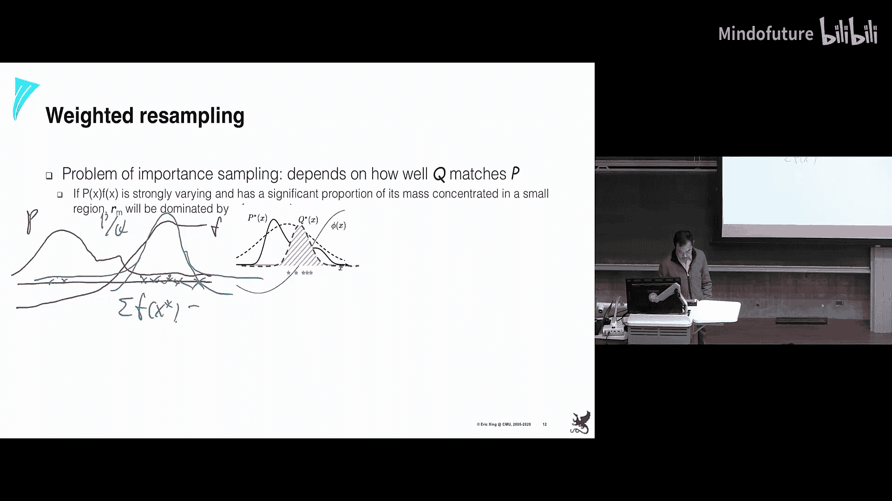
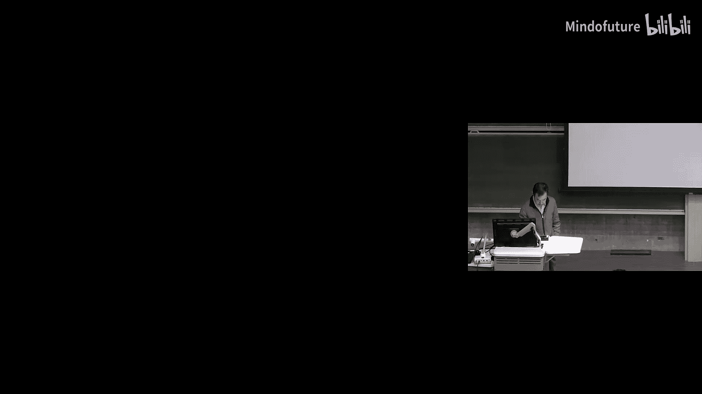
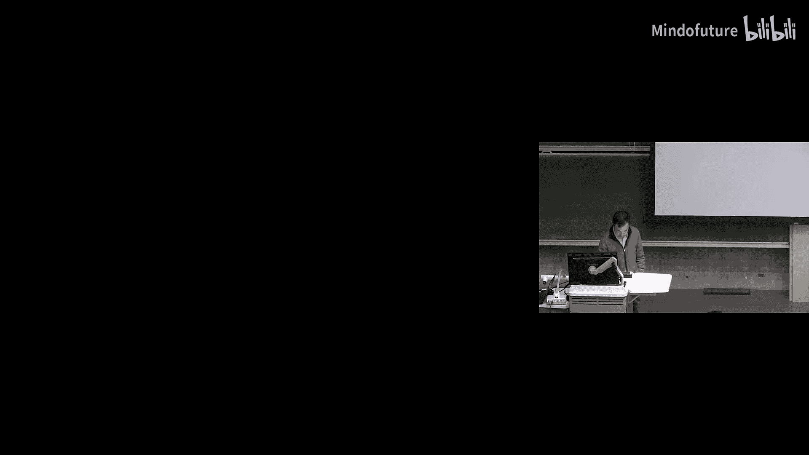
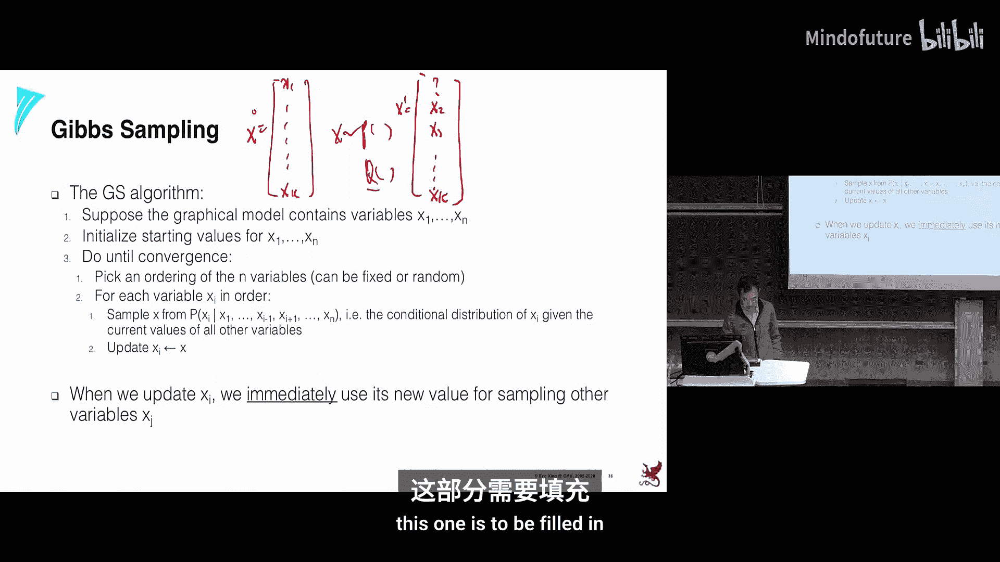
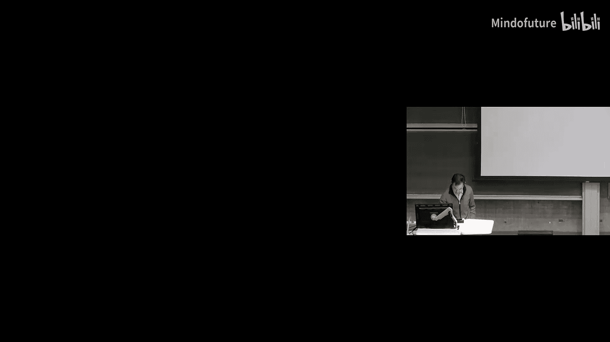
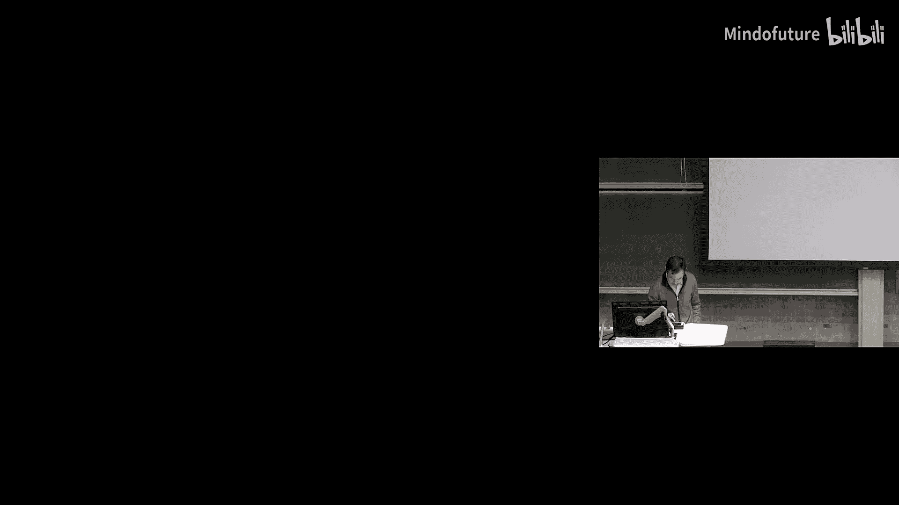
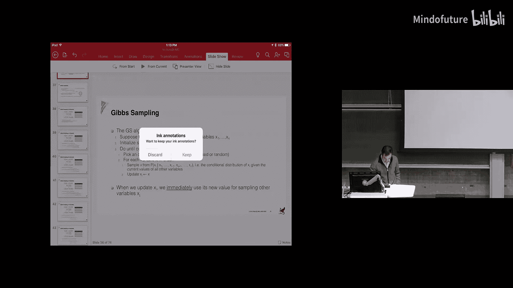
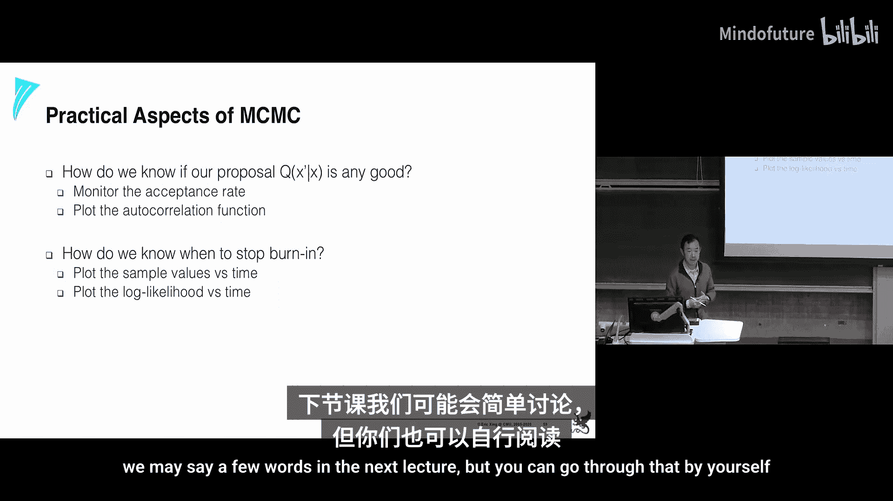

# 【卡耐基梅隆】概率图形模型 ｜ Probabilistic Graphical Models 2020 p09 P09_Lecture_09_蒙特卡洛方法 -BV1ebpGzhEA9_p9-

We are going to talk about。Moon Carlo methods today。 So just to give you the context。

We are still in the space of。Working on variation or on， on inference in graphic models。And。

The bigger picture is that given you a graphical model， you know， you， if it is of a good complexity。

 say with a small trip with and or can be represented by a size， you know。

 a manageable junction tree。 Then you do exact inference。

 And here are a few exact inference algorithm， right。And then， and if the graph become too big。

 too complex。There are a couple of variational inference methods。And until now， we are here。

 We went through two version inference methods。 One is known as the Ming field。

 The other is the loop B， P， right。They were each。诶。

Methd to approximatex to turn the inference approach into a method problem， into a operation problem。

Can anybody。Remin us of what is essentially the key idea in Mingfield and in Lu P， P P。

If you get a elevator pitch with 10 seconds， maybe 5 seconds。What's the key thing in meanfield。

A product Q is a product of what。嗯哼。啊。Of individual marginals。 Yeah。

 we call it single term marginals。 right， So let's call this。

So I would keep reminding you like this with a little key wordss。 And， you know， catch sentences。

 that you kind of get the gist of what a complex whole business is about。呃，What is鲁PBP。Again。

 one sentence is possible。Yeah， you have板。the belief pro。So that way。Yeah。嗯哼。You're almost there。

 You mentioned about belief propagation or message passing， right。

 And we knew that message passing is correct on trees because there's only one pass between two nodes。

 Therefore， you get consistency。Then。Lopy， B， P is about you， you ignore whether it's a tree or not。

 You just do't match splash on any graph。Become a local operation on the edge。

 You pass this and pass that。 That's it， right。So。This is about the MP on。Any。Graph， okay。

 that's the one sentence idea behind these two。Then I want to be a little more mathematical in here。

We know that， you know， you know， inference can be understood as a solving， you know。

 a opt medicine problem inside the space of marginal polytope。 right。

 That's that was kind of the key idea from last lecture。 Unfortunately。

 I wasn't able to give it to the T A hopefully experiment clearly marginal polytope are basically the convex hall of all marginal。

 you know， distributions of yeah， marginal probabilities。And it is a polytope。

And then Mingfield is about what is about seeking a the estimation of the marginal lobe in the space of the inner space of the marginal particle。

Right， if you remember， it's defined by basically all the distributions that are factored。

 As you said， the product of marginals。Right， and， and that's basically。

Deeffins a subspace of all valid distributions。Right， okay， let me just try to do this key equals to。

 right， and also。This is， basically。Is one and Q I K is a。So something like that。

 That's basically why it's called single terms。 right， And therefore， it is。A subspace on that。

Because only at the corner， at the extreme point， the marginal are correct。And elsewhere。

 I don't know。 But you can guess it must be inside the distribution because this whole convex hall is the proper space of all distributions。

Then here， it is a subset of the distributions。 Therefore， it must be inside。Right， so that's the。

 the intuition I want to develop。And then the loopy B， P。

 is's a little bit abstract because you never see that。Qu， explicitly。Right， you don't see that。

 All care is really just singleton， which we called alpha I and pairwise， which are called beta I J。

Right， and also there are the local consistency constraint。Right， which means that。

 so let's divide this。 And in here it's about the alpha being。

And there's a normal action constraint about RF K。Equals to this。Eals to one。And then also。

 the beta of。Over I J over all the J equals to alpha I。Right， that's the so called local consistency。

 You know， your pair of marginals。We marginalized over one of the pairs。You get the single marginal。

 right。 So this， again， defines a constraint on the marginals。But you want to now estimate are these。

 What's the space of that。 So this defines a space。Right。

 this also defines the space of a mean field。 For example， this defines a loop P P， P。 What is M。

 L look like。Comparing to the marginal polytope。It turns out that it is the alter approximation。Okay。

 it's something like that。And why well， it takes some intuition because again。

 they are they are consistent on the extreme point。

 But here you don't actually have the proper distribution Q explicitly defined。

 There may some weird construct where when you gone down to a pair or a singleton。

 they are proper marginal。 But when you multiply them together。

 They don't actually form the true distribution。 They you form something that is probably not a proper distribution。

 So there are instances， which may be outside。And also， in fact， you know。

 you can use another mathematical justification。 This whole thing is called a Minovky subspace or。

 you know， some kind of you know， you know， comeback space。 Okay， therefore， it is， you know。

 the outer space of that。Okay， so there is a guarantee for convergence。

 but it is not necessarily in the。Proper distribution， something like that。 Anyway。

 So I'm not going to say too much repeat。 It's a little bit deep。 And there is a reading chapter。

 you know， if you are interested in digging into the theory into that。Now I was actually， you know。

 again， representing one of the most elegant piece in graphic model study where a heuristic。

 you know， invented some years ago later were proven to be a elegant， you know。

 mathematical program where we know the properties and so forth。Today。

 I'm going to cover another beautiful piece of inference in graphic models。

 which also has a lot of theory and guarantees behind it。

 We soon we going to navigate out of the beautiful space and into more chatrous places。So。The other。

 you know， you can already see and， you know， the， the variation of inference methods， you know。

 require some mathematical technique， some skill。 Okay， you need to really， really design you know。

 some， you know， you know， practice some algebra to basically infer or derive the equations。

In the domain of statistics。We have some additional ideas that people used。

To do specific inference problem。 For example， here is an inference problem。Okay。And， you know。

 you need to basically be able to do integrations over a distribution of arbitrary form。

But here it's very easy。 You have a Gaussian distribution， and you know how to do the integration。

 hopefully。Right。But what if you have a distribution like this， It's very。

 very weird of arbitrary form， okay。And how do you， you know， define， you know， a a mean of function。

Whose sample are coming from here。So the sample based representation says the following。

 You can draw samples from all this from this institution。

 We use this representation T of P X to do that。And N can be from one to capital n。And then。You can。

Use this approximation。That's it。You just plug in that sample into the F function。

 and then you sum together all the instances， and you take an average。Okay。

 this is a sample based representation。 Therefore， instead of。Manipulating this function P。

 you actually are keeping， you know， such a collection of samples。Okay。

 as the representation of the distribution， It's not explicit。 It is implicit。Okay。

 no analytical forms。And nowadays， the idea about a implicit distribution gets a little bit extrapolated and extended to broad definition。

 For example， in the space of we are going to learn about gun models。

 the the generative networks where the distribution at the top of the gun model it not actually a P that is well known。

 know as form， it is also by some samples。 So this is a valid thing in in the domain。

 the samples are draw from a natural example。 know your data collection。

 but in here you can also simulate the samples from distribution。 So that's the key idea。

So now let's see how we can。Maybe just walk through an example to see what issue you may run into。

 So here I have a distribution of fiber。And how to sample Well， it should be not to be difficult。

 You just walk through the network。 Remember， directly graph models has the advantage of being easy to sample。

 you sample from say E， This one is your first。 This one your second。

 You just draw basically from this local marginal。Here you can see that there is a low probability of earthquake。

Point0，02。 You draw a sample。 You get a instance of a no earthquake。

And for the second random variable burglary， it's also low probability。

 You draw a sample and which reflects that probability。

 And then given this E and B are now instantiate it。

 you can conditioning on that and draw the sample alarm， which actually give use this table。

So which sample are more likely to be drawn。If you were to draw a conditioning on B and E。

WhatWhat I going to have？You need to pick the right role in this table， right。Which is now 0 and 0。

 meaning fourth and fourth。 that's here。Right， and then you做 a sample。Okay。

 so that's basically how you work through the graphic model and draw an entire slice。

 So we call this X 1。Okay， the x is a vector in this case with a five random variables。

 So this is a random vector and the。And you joy this。You can go on and draw 10 roles like this。

10 examples like this。 all the way to， Do we have 10， yeah。Okay。

And then you are going to now do your inference。 Sa this query is about the conditional probability of John makes a call conditioning on the alarm is off。

Okay。So how do you do that？Well， by definition， it is the。The， you know。

 the joint of J and a 0 divided by the the， the marginal of P of a of 0。

Then what you do is to just look at all these samples。 Okay， How many rows where a equals to 0。

So I have this， this， this， this， this， this， this，80 examples。 I been no。Oh， actually。

 nine examples， okay。And then out of this nine examples。

 how many rows John equals to one and how many John equals to 0， right， so。

That gives you a this kind of breakdown。 Okay， so very easy。

 So inference becomes just counting numbers and then do some normalizations， right。Now。

 I changed my query。I still use the same example。 Now， my query is about。

Conditionally on the event of a equals to one。Okay。So in that case， we have only one such role exist。

And then， you know， computing this conditional probability of J given a equals to one become little bit tricky because one of the events。

Zhang equal to 0 doesn't even exist。 It has a zero probability。 The other has 100% probability。

So this already says you something， right， There are not enough samples。 You need to draw many。

 many examples so that some rare events can exist。 So this is naive sampling。It's very easy。

Good parties are just imprint this algorithm extremely easy。But we。

 we've got to these a few challenges， okay。How to draw samples， you know， in the previous case。

 it's easy。 but there are some distributions which， for example， have this weird analyticallytic。

 you know， irregular form， but you may be harder to draw example。

Then how to make better use of the example， Not all samples are actually useful。 You know。

 you will see， for example， in the previous cases， we have9 cases for some events。

 We have one cases for other events。 out of these9 cases or maybe you only are many， right。

 but out of this one sample， there are not enough for certain events。And also。

 how do you draw enough examples， So these are the questions。Mo the color methods is basically。

 you know， a a discipline like studies。The kind of methods I set。And it begins from theasse。

 we saw it。 It is not used very often other than pedagogical reason。

 We are going to study a few more kind of effective methods today。

And we are going to look to reject sampling more carefully。 And then M。

 M C is the major dominating method people are using these days。O。

 now let's begin with a rejection somebody。So。Suppose one to sample from this distribution pie。Okay。

And there are a number of difficulties we just mentioned。

 Let's say the first difficulty will be that pie itself。Maybe too difficult to sample from。 In fact。

 how many。Distributions that you actually know how to sample from。

Have you used libraries like a man labb or R， you know。

 And have you practiced or played with drawing samples host from distributions。

What distribution did you typically use。Maybe the most frequent one is the uniform distribution between 0 and one。

 right。And though other than that， which what's next。嗯hm。😊，But Gaus in distribution。

 And you know how to draw Gausing right， There is a formula there。

 You actually draw from the uniform， and then you twist it with a transformation and so on。

And I used to implement a few more because I wasn't happy with that very limited library。 Therefore。

 you can sample from a distribution， multi distribution， T distribution。

 There are a few you can name it。 It's very hard to name beyond 10， basically。But in natural war。

 you have a lot more distribution that you worry about。And then there is another difficulty。

 which is that， for example， in the case of a Mark government field。You know。

 you actually cannot really even evaluate the likelihood of sample in that because the random field has this nominary constant。

 which can be very difficult to compute。So，What the idea behind something is to use a auxiliary method queue。

 which could be a gaing， for example， could be something very simple。And then here is the procedure。

 You draw this one from a easy distribution queue。And then you are going to have a second step。

 which is to determine whether X star is to be accepted or not using this formula。This is。P prime。

 which is the unmalized part of distribution。 that address you the problem of， you know。

 evaluation of probability under a complex distribution being difficult here。

 You don't have to go through that。 You only go through the explicit analytical part， not the Z。

And then here you have the。Probability of the sample under Q， which is an easy distribution。

 You can do it。 But you also need to make sure that it defines you a proper probability of being accepted。

 Therefore， this whole thing has to be。Restricted between0 and1。Right。

 they are for you to skill it with a K。Okay， which essentially look make the whole thing look like this。

 You have this guy， which is irregularly shaped， representing the unmalized part of the target distribution。

 And then your Q times K should always be dominating the other one， okay。And so， and I guarantee you。

 I can prove to you that once you draw sample of x like this， it gets you to a point where， you know。

 all the X actually comes from P of x or pi of x originally。How to prove that。

You probably already see that It's on my， on my slides already。

 But just for the sake of having the idea more clearly， you know。

 you need to now really prove the probability of a P of X star。Right。That's quite P。 Okay。

 And this come from a Q of x。And then here I have a second probability。

 which is pi star pi prime divided by K of Q of x。And this is the unmalized part of the new distribution。

 I need to divide them by the normalized part。Right， and this part， this part cancels， this part。

 this part consoles。And then at the end we need to have a K K also cancels from out。

 though you have what， you have a K prime。Right， which is exactly。Al。Right。

So very very easy to prove that the correctness of that。Now。

This is our first more than trivial sample algorithm。 What's the pitfall of that。嗯hm。😊，Me for what？

You know it。Why dont why， why don'tt know。 You know， you you， you already have a pile of prime。

 which is easy evaluate。 You can find the extreme of that。 And then you said the， you。

 you can compute it。本。0 in some parts。I can choose 1。 that is not 0。

Why why for for example it's not yes。It's not， not， not a big deal。

 What's the true difficulty of that。Right， how much？The shaded area。 Yes。

 this whole thing is going to be。 And this is not the worst case。 Okay， I will。

 I will write you a very， very bad case， for example， I have a distribution like this。

And then your cure should be like that。And therefore， this whole thing will be rejected right。

 and it can be as bad as beyond what you can imagine。 Okay， so here is a extreme example。

 just for thought experiment。 I'm going to use a Q of Gausing to sample another Gaus。

 You may say why you do that。 I can sample directly。 But just for the sake of big argument。

 This is our true Gausing that you want to sample from。

 I use another Gausing which use a different variance to sample from。 Okay。

 and then my approximating Q is going to be different from the true P by just1%。Okay。

 so this is you know， just how I chose the， the， the queue。And you can verify to yourself， because。

 you know， Gaussian distribution。It takes a form of。Whatever。That is。

 And time is exponentialonal or whatever。And it turns out that even for such a tiny you know， very。

 very slightly different target and proposal， the K turns out to be one over 20，20 K。

That means a huge white space they exist or the shady space exist photo reject samples。

So the idea the， the， the argument here on make is that you know， in high dimensional space here。

 why it is becoming so extreme， is because the dimensionality is 10 in high dimension space。

 even the target and the true distribution can be very similar already by looking。 okay， but still。

 the volume of this two distribution can be very， very different。

 And you end up with a lot of samples。And there are some ideas about the doing adaptive rejection。

 For example， I can do a piecewise you know， kind of a distribution like this to just closely envelope the target。

 but these are very cons。So。In a nutshell， reject sampling is O， but it is not very efficient。

The next idea is known as important sampling。 There are two versions of that。

beging with the un normalizedmalized version。 Again。

 let's assume that suppose sample from P is very hard。 But for the time being。

 let's assume that it is still easy to evaluate。 if I plug in a X。It is。

 you can calculate the probability， not worry about normalization constant for now。

And we want to use a cube in a simpler case。Here， I'm going to use a slightly different formula。

 I want to make an assumption。Where， which is easy to satisfy， which is called the dominance。

 I choose a Q such that， you know， a Q has a 90 mass whenever。You know。

 the original target distribution is 90。Then we can assume this new sampling skin。

 which has the following form。 I sample， the X from a Q。I'm going to compute something like a weight。

 which is the， the ratio of a probability of P X under P and X under Q。For the Ms， example。Okay。

And then I'm going to basically use the X M。And the weight M。As a pair。O， to， do whatever operation。

For example， computing to me okay。And this equation shows you the correctness as well。 Basically。

 if you want to approximate this integration with sample。

 and what I do is to plug in this queue upstairs and downstairs so that you can see this explicit form of the ratio。

 And this is。Basically。The。The， the W， right， And from here to here， you know。

 I replace the integration with now samples。So that there's some。

 And then you can see that I have this weighted sum of the examples。Okay， so。

That's a new algorithm where every example is now used。They are weighted。 Therefore。

 you don't throw them away。 Very trivial， Right， Of course， you know， it's quite intuitive。

 And what's the problem in this。つな？ok。Yeah， you are talking about the value of air sample。 Yeah。

 but at least we are getting closer getting a little bit Or some sample has a zero value。

 Now it has some value。 Okay， not too bad。 So let's worry about that little later。 But remember。

 I still have this computability under P。 that is not taken care of right for my government field this doesn't work。

So the next step is about how to get this incomputability part taken care of。So in this case。

 we rewrite you the distribution。P。To be p prime divided by alpha， Al is the nomination constant。

It turns out that this alpha can be obtained。From the samples as well。 Okay。

 And here is how here the formula。 You can see that once you define the ratio to be the ratio of the unweighted part。

Versus the， the probability under Q。 Okay， this， remember， this R is different from the previous W。

 Okay， for a reason， W is the true。Ratial of probability。 And here the R is the anormalized。

Probity divided by the true probability under proposal， okay。And you take expectation of the R。

 And through this de， you can see that actually equals to the alpha to the nomination constant。

 Therefore， you do have the no constant。So what you need to do is to now。You know。

 a slightly changed formula， right， the computation of this expectation now， you know。

 are making use of the anized。ratioio。And， and。Pull out the nomination constanting here。

 which we know how to compute。ok。Yeah， and then， you know， after some rearrangement。

 you get down to this equation， Okay， which ask you to not only do weighted sum of the original function for sample。

 but also you need to do another round of normalization。Therefore， this part。

Becomes the normalized importance。ok。So procedurally。

 you need to do something a little bit differently。 In the previous one。

 the Analous part is a typical online algorithm because every of this weight is available。

 The moment you sample the example already。Right， but this a normalization constant。

Its going to be available only when you sample enough。And decide to use them as nomination。

 Therefore， you first choose the N， which is the number of samples that you want to use。

And then you are going to sample the X。All the way to X， N。And then you also have the R。

All the way to R， N。And then， you compute the alpha。Okay， with the sum of R I。

 And then you compute the weight， which is R， I divided by that。And then， you know。

 you are going to have these weighted samples and then you the sum。That's a procedure。 It's not。

 it's a batch algorithm rather than an online algorithm。

 but you can have this a rolling kind of batch using a sliding window technique。Right。

 after you finish the first 1000， you start to， you know， have the first window。

 and then you move the， the， the rolling window。 say every 10 new samples， you recompute that。

 That's doable， okay。Alright， so now we have a few algorithms。

 which at least make use of every examples already。

And evaluable under complex distributional forms already。然后。To address your question， you know。

And why it becomes concern。 Why， for example， a low weights。

he he correctly points out that some samples may have low weights。 Some may have high weights。

But what's wrong with example having lowestways。 it means that it doesn't It's not important， right。

 So an important example is having lowest weight is justified。 We want that to be head that way。

 So what's wrong with that。So， here I have a。Kind of a weird example， where exposes the risk。

So basically， you know， one of the major kind of practical need for sample language like this is that you need to know because it's。

 it's the sample can go continuously forever， right。

 You need to know when to stop and you need to have a crer to determine that hey。

 I'm doing good enough so that I need to stop。So what does it mean by good enough， practically。So。

 for example， you， you do this。Sampling scheme。You sample to character an until a million already。

 How do you decide you don't want to do another anymore。What's your heuristic？他为你说这个。On is worth。

Whatever online offline you name it， you know， I I've just asking very very high level question。

 When do you stop。Just like running your E M algorithms and running your K meanss algorithms。

 And when do you stop。Because the algorithm itself doesn't ask you to stop。Dsta of change。Right。

 you need to kind of set some internalle monitor that if something keep changing。

 you need to keep doing it。 But if something stop to change。

Then you know that doing it more doesn't cause any difference。 It doesn't stop， right， So here。

 because you are computing this guy。 And if this guy。

 after you have more and more and more and more example， it doesn't change anymore then you stop。

 right。 So what does it mean by it doesn't change。It means that the new samples are contributing very low variances of that。

Right， okay， so let's see what can happen if you have what the the sampling in skin we told before。

 For example， let's say you have a okay， maybe this graph is too clean。 I will draw another example。

 So I have， you know， some kind of weird distribution like that。Okay， it is P。

And I have a function that I want to estimate。 Maybe this is， you know， a curve， something like that。

 F。I have a proposal distribution queue。 And for for because I don't see the true distribution。

 Remember， it's a high dimensional distribution， which is not plaable， right， I need to have a guess。

 unfortunately， I guess a queue。I will choose another color， I guess。Does it allow me to truth。Okay。

So let's say I have a situation like that。Okay。And then what you have， you know。

 I have a low mass in here and in here。Then you will be drawing a lot of samples from here。Right。

 and some samples from it here。Lots from here。Yeah， a lot from here。

 they will all have a low weight because， you know， we are， we are talking about the。P over Q。

 And this P here is very low。 and occasionally， we have a few one in here。

 which will have high weight。 But because， you know， it's so rare。

 it's very hard for you to draw samples from here。So you can imagine a scenario where you draw a lot of samples。

Mostly from here。And then the estimation of F of X I or X stars will stop changing。

 because they're tired of seeing best on。 They don't just， you know。

 move anymore because they are all the same。So you are going to get into a low variance kind of estimation。

 even though you know， your sample are not coming from the right distribution area。

So that's actually a， a， a real risk。That people practically observed。

 It can happen very often in head space。In a sense。

 you're stucked into a local kind of estimation and not going out。Okay。That's where， you know。

 we need to do something a little bit differently。

I'm sorry。😔。

sorryrry， I shouldn't go from the start。

Okay。Alright， so this is the argument I just made。Solution is the following。We have two solutions。

 One is， of course， to use a a habit queue。 for example you， Why don't you choose a queue like this。

Then I goes to the problem of having a lot of know， wasted samples， right。

The other idea is about the weighted reling idea。Remember that we have these weights。Right。

 and these weights are used to evaluate every examples。In the past。But here I could have a new idea。

I'm going to now stop using all the previous examples。O， weighted by the weights I just got。

I'm going to do another round of a re。Ok， I'm going to reample from here。Here。

 I have a discrete kind of set。 And I am to just keep sample from here。

You can imagine that if I draw samples from this sample， draw samples out of samples。 Okay。

 and if some samples have a a higher weight。Okay， just by luck， they have a higher weight。

 maybe you know， in the case here， you know， you happen to have an example in here once。Okay。

 by waiting globally， they will be， you know， a suppressed。

 But now I'm taking special attention to its weights and every sample based on its weight。

 I have a chance of having a better weight having the draw again。So in a sense。

 I began from this originally weird distribution， and I draw some posts like this each with weight。

 The weights are like this。Okay， it turns out that here we have a high weight reason。 here。

 I have a low weight region。And then I'm going to read examples。Okay。

 and then this example were high probability of heavy money draws。

 And these examples will have a probability of low draws。 Therefore， this is a low probability area。

Will get you now suppressed， even though originally， I have many samples。

 but it will be having a small chance to be regional。Okay， and that kind of I reshaped the， the， the。

 the algorithm。 So this is called weighted resembling algorithm。Okay。Alright。So。

That's all about what I want to say in Monte Carlo。 There are a few other methods。

 which I put in the supplementary， but they are kind of similar to each other。

 And the main issue is about， you know， how to sample easily， how to you know。

 make more effective use samples and so forth。And， you know。

 there are some fundamental issues People are still not happy about。So。

The the weighted reseling is kind of letting you to。You know， rate shape。

Kind of the proposal a little bit。But remember， it is a， not a online a。Okay。

 you have to basically keep， say， a million examples。In your storage。And read samples from there。

 which may give you 10 million。And you store it。 and then you compute。

 And then you see how good it is。 And if no good， you need to do it again。 In fact。

 you have to do it again because you need to see whether the trend is conversion or not。

 So offline equation is not very， very handy。 Okay， for in practice。

But unlike we have the nice property of that。 you， you know， you don't have to remember examples。

 You can throw them away。 So therefore， there is no storage cost。

 And also you have this a rolling estimation that every time we can monitor the converence real time。

 So there are some advantage of that。 The only problem is that we don't like the the the queue。

 which cause a lot of problems。So， and part of the reason the queue is awkward is because it's a fixed proposal that you cannot change situationally。

If you happen to have a very good sample， for example， you know just by pure luck and note。

 for example， if in this queue。You have a good sample coming out of here。

 which matches the P very nicely。You don't have a big chance to see the good luck again。 you know。

 in your next 10 or 20 examples。 right， But if you are willing to now move this queue into this to center the here。

 then you are better off right。 So this is called a adaptive proposal。

 which suggests idea about kind of using a changing queue。 So here is basically the big idea behind。

What is known as the Markov Chimon Carlo。Okay， so suppose that you know， you know， we， you know。

 here is basically the important sample or related whatsoever with a fixed queue。

Which you can see the， the， the problem， right， In this case。

 it's kind of almost hopeless because it's too kind of extreme in terms of this match。 Therefore。

 however， you reweight it and re it and so forth。 It's very hard to cover this part。The MC。

M C is more like a， you know， adaptive。Even if you get a sample in here。

 which is still kind of the value in the P。 But you were able to move the queue a little bit so that it's a tail start to cover this part。

 Okay， and then you can， hopefully， you know a。Move input right direction more quickly。So。

Let's see how to realize this idea more formally。 Okay。

 the first algorithm is known as the metropolis hassting algorithm。Metro two scientists。

 I believe in Los Alamos or some nuclear weapon lab。 And their goal was to compute again。 You know。

 the， the， the energy discharged out of explosion， something like that， okay， and you know。

 computing the energy states of a nuclear material is very difficult。 as we see from the easy model。

 Therefore， they want to use sampling algorithm to do that。

I believe one of the person is a real scientist。 The other is a manager。

 So good to be a manager to lead a few scientists。 Put me an name on that。So here is the idea。

 You are going to use a moving distribution queue， which is defined as the conditional probability of the sample。

 given the immediate previous example， your draw。And then you are going to accept this a new example with a。

You know， a upsetance function， which is defined as this。ok。

It's the minimum between one and also a ratio， which is。In a sense， you know。

 it is the ratio defined by two types of importance。

The this importance P of prime P of x prime divided by Q of X prime given x is the importance。

 No the， the， the old kind of definition of importance using this Q of X prime given x as a proposal。

Right， in a sense， you are moving the importance of moving from x to x prime。

And here you have a reverse。Inverse， you know， importance， which is the importance。

 If you move back from the new example to the old example。Kind of intuitive， right， you know。

 you go forward or you go back。And then， you know。If， you know。

 this part gives you a number of less than one。You basically are going to be， you know。

Accepting a new example based on that。 If it is greater than one， you just accept that。Okay。ok。

And it turns out that this algorithm， you know， will ensure the following nice property。

After you sufficiently sample many draws， then eventually your x will be coming from the true distribution。

Here， we don't have a proof yet because in our important sample improve and reject sample proof。

 it's very easy。 You plug in the queue and， you know。

 and then somehow they magically cancel each other and you get a payback。In here。

 the queue is moving。 It's changing in every sample。 Therefore， that technique doesn't work。

But we still need to have some guarantees。 and we'll see in the second。

 So this is just algorithm that you can implement for any distributions of Q of P。

 And here is kind of a simulation about how。The behavior look like。Okay， so remember。

 we have this acceptance ratio defined like this。And you initialize from somewhere。 Okay。

 you start also with a very bad cube， Okay， which is， you know， covering just one of the modes。

 you know， inside a complex target。And now， you have x 0。You are going to draw x1， condition on x 0。

Using this distribution。Thisus is basically， you know， you know。You， again， you know。

 a very bad kind of distribution centered on one of the modes。

 And your second example come your first new example come from here。You accept it。 Okay。

 And because this number turns out to be very good。And then youre going to anchor yourself in here。

And you draw from this distribution， the second example。And with some good luck。

 you get an example in here， which gives you a low probability under the proposal。

 but high in the original。And let's see you accept a not。 Well through a test， you actually。

Accepted already。 Okay， through some formula in here。

And then you are going to not conditioning on the X 2。 Okay， I define this a new proposal here。

And you are going to use this as the proposal。 You draw X 3。Okay， and this X 3。

 you draw a new X prime， not it's not qualified to be X 3 yet because we haven't decided it's accepted or rejected。

 So X prime。 X prime is in here。Well， in here is a tricky position。

 It is a high under the original probability under the proposal， but low under the original。

 So it was rejected。Not always rejected， but at least by chance， by a bigger chance。

 it's rejected you doing this。 Then what you do is to now， you know。

 reuse the previous example to make it X ray。You have two instances of this， okay， so。ok。And。Then。

 you know， you are going to， you know， use this proposal again because， you know。

 you are not really making progress in the pre example。 Therefore， the proposal distribution Q。

 dependent on the pre example， didn't move。But this time you have some better luck。

 You start to find a sample from the tail in here。 Well， you， you may ask， why not here， Yeah。

 it's possible as well。 if it's in here， then just move on and sample more。 right。

 So now it's in here and in here， it has a low probability under the proposal and high under the target。

 it gets accepted。Okay。And in that case， you were able to make a big leap。You know。

 of moving the proposal that start to cover。More into the new mode in the higher distribution， okay。

And。That's basically how it works。 You know， eventually。

 this a Q of P prime Q of X prime given X is moving back and forth to swap。You know。

 it's like almost like a radar kind of swiper， you know。

 for all the you know modalities in a complex proposal。

 And you are hoping that eventually it will leads you to X coming from the true X。

 I have a kind of a chance of covering everywhere。Okay， so that's how it works。

So let's think about a few theoretical issues in here。First of all， from a practical point of view。

 people always do the following。 For example， there is a period called the burn in period。

 which is the first couple of thousand examples or samples you draw， and people typically discard。喂。

Well kind of intuitive because we already see。The early examples are usually bad examples。

 They are not coming from a true distribution， right， only when you reach enough kind of samples。

 they start to move back and forth very nicely and in a balanced way。And therefore。

 it's more likely to harm from the true distribution。 Okay， so basically。

 this means that these examples of N。Too small are not coming from P of X， in a sense， right of。

 although this exact threshold isn't known， but you can make a guess。And why， you know。

 this procedure is guaranteed to converge to P， X。We need to study art。And what。

 what's the connection between Monkalo and X， what， that's actually。

 the connection is that you need that kind of concept to prove。The convergence property。

 So let's look at what is Markoff chain， right。A Markov chain basically is a sequence。

 is's a property underlying a sequence of a stochastic， you know， instances。 right。

 And in particular， first of Markovlving is giving you this property of the present。

Is independent of the past， given that the future is independent of the past， given the present。

 Therefore， this long。Conditional distribution， conditioning on the whole history is going to be only conditioning on the immediate past。

Okay， so we actually knew that from our graphic model of H M M already。So， let's call this。

Conditional probability of the next example， giving the immediate press one to be the transition kernel。

Okay。And also， remember that here， when I say X。This guy can be a singleton。

 It could also be a vector of random variables。 That is the entire set of drawers from a total a whole graphic model okay。

So it could be something like this。And let's make also another convenient assumption。

 which is called the homogeneous M C property。 meaning that every time this conditional distribution。

 the formula didn't change。Okay， of course， the， the， the actual， you know。

 number changes because you are going to plug in different examples， but the the form isn't changing。

 okay。In a sense， the way the future depend on the past isn't changing， okay。

So to make that more explicit， I introduced this notation called kernel。

 which is also known as the transition kernel。ok。And then let's define a few concepts。呃。

We need to define。A distribution over a state。Okay， at time T， because now at every time point。

 we are not just worried about the value， the correctness of that sample。

 We're actually concerned about whether that sample is coming from the correct distribution。Okay。

 in M C， remember， by counseling Q and so forth， we know that every example come from that distribution。

 target distribution， right， But in here， you don't have that guarantee the change K Q is movie。

 You cannot be canceled。 Therefore， you want to monitor at what time the sample come from the right distribution。

 So therefore， we define a time dependent distribution of the states pi of X at T。Okay。And then。

 you know， we need to define how such distribution can change over time。Because of our procedure。

 the procedure is that you draw a sample from， you know。

 a distribution and then you transition using a kernel。 So in a sense， you start from distribution。

 you draw a sample from， you make a transition into the next step。

 And what is the next distribution look like。 What here is how it look like。Okay。

You basically are going to marginalize out the previous step。Step previous states。Because you。

 you shouldn't assume， basically， it depends on a particular position in the previous time to move to the next。

 It should be coming from any position。Right， therefore， you measure them out。 And then after this。

 you time a transition probability。 What's the next state。

 So that gives you the equation for transitioning from one distribution to another distribution。

And we are hoping that this pi of one pi of T and hopefully pi of capital T will be close to P of X。

 That's the hope。Now， let's see。 Can we establish that， not。

Then there is an important concept called the stationary distribution。

Station distribution is you know， a intrinsic property of。The transition kernel。Okay。

 meaning that there may be a point or there may be a distribution。 Okay， in which， you know。

 you have this property that the same distribution。Transitioning through the kernel。

Gives you back the same distribution。O， this is called stationary。And in the。

Mathematical edge break form。 This is a vector。And this is， you know。

This one can be represented as what。诶。Thatt product。

 a alter left product of a matrix versus a vector， right， Because here， if， if X is discrete。

 for example， then this transition is just a matrix。Right， so what does this look like。Right。

 so in linear algebra， this kind of correspond to the eigenvectors of， you know， a matrix。

And some matrix， some good matrix have eigenvectors。 Not all matrix have eigenvectors。

 You know all that， right。So that gives you the hint about how to prove the existence of the distribution of the stationary。

Okay， and therefore， that suggest not all the transition kernels leads you to to stationary。

 But if you choose the right transition， you may have a stationary。

 and stationary is important because you can kind of guess if， you know， a convergence or a。

 you know， to the right happens。It has to be the stationary because once you are in the right distribution。

 You want， you don't want them to move out。 right， It's almost like you are slippering from the wrong distribution to begin with。

 Once you are locking in the right distribution， you will stay there。 Therefore。

 the target distribution ideally should be that stationary distribution。And therefore。

 you need to engineer a transition kernel that allows such a station distribution。Okay。

 so with all that， you can start to kind of connect dots。

 Let's review a few important concepts which says something about how this T look like。

One thing is called the irreducibility。Meaning that from any state X。

You can move to any other states with a 90 probability in a finite step。Okay。

 that kind of says a property of the transition kernel。Okay。

 somehow you can kind of navigate through all states and move from anywhere to anywhere else。

And that actually is good because you now have no un reachable parts in the state space。

 You can cover that。 like give you the safety of having， you know。

 you are able to achieve any target distribution。 You know。

 that even you don't know because it allows at least zero property of anywhere。

The other one is called a periodicity。It says that the M C， the Maha chain， is a periodic。

If you can go out of states and come back。Okay， at any time。

It basically also says that you don't have to go through some kind of circle to come back。

 You can directly come back in one step。So that also says something of a T transition matrix。

 It's kind of a。You know， in the symmetric kind of entry for I to J， J to I， there should be all 9，0。

Right。And then，ic aity。A M C is aic if it is irreducible and also a periodic。 Okay。

 so this two property combined alone is known as agoic。

And algorithmity is very important because it tells you that you actually can reach to the station distribution。

 no matter what initial distribution you actually have。Okay。Okay， so that's pretty much in the， the。

The key properties that you need。For the transition kernel to allow。Starting from anywhere。

And converging into the distribution or the station distribution。 Okay。

 it doesn't say which stationary， whether the stationary is your target not。

 But at least it tells you that in this Mark chain。

 you can start from anywhere and converge to somewhere and then stay there without any change。

And that's guaranteed by the T itself。How to prove that。的。

Here is a very simple proof using the property known as detail balance。

The detail balance is actually guaranteed by the aity。 Okay， and in detail balance。

 you have the following property， which is that you can establish this balance。Okay。

 from one state and another state， you can transition it back and forth。Okay。

 the probability of x prime to x is the same as the probability of x to x prime。

Based on a transition kernel。And you can show very。

 very easily to yourself that once a detailed balance。Exist， you know， for a for a Markov chain。

 Then they will always have a。Stational distribution。Okay。I'm not going to walk through the proof。

 It's pretty explicit。So， then。What， what， what what do you have， Basically。

 it amounts to constructing the right key。Okay， so that it has a detailed balanced property。

And then you are going to converge somewhere。 And hopefully， you can establish， you know。

 through the formation or design of the T that it conge to some distribution like P that you actually like it to converge to。

So that's why you get this a very interesting metro hasting algorithm where the transition kernel is defined by the proposal and also the acceptance formula that we just talked about。

Right， remember， a is defined as the minimum。Of one and also the ratio of importance。Right。And the。

You can show that in this proof， which I don't think I need to go through it's pretty in triviale that when detailed balance is established。

Your equilibrium distribution is actually the target distribution。

So the idea is that you basically want to design a T。And， you know。

 using what the T must use a A queue， which is our proposal。And also， a a。Right， and in a。

 you fold in the proposal of the target distribution P in certain way。 In our case。

 it is the minimum of one and also the ratio of importance， which contain。That component of P。

And then all of a sudden， your detail balance is realized。On P。It's kind of magical。Very。

 very easy mathematics。 But that means you can start from anywhere。X0， using the transition kernel。

Okay， as designed。In here。And then you are guaranteed to converge to P。At the end。

So that's basically the theory behind M，M C。So it， it's called Markov chain on Carlo。

 It is a mark of chain， because you are keep drawing samples。

 it is a on the carlo because you keep drawing samplesos。

 but it is a markov chain on carlo because your way of you know。

 selecting or designing the proposal and also picking the acceptance is using the markov chain property。

 Okay， among all these samples。Okay， so。Again， every algorithm has some caveats。 And here， you know。

 I mentioned a few。 there is a art，30 art involved in how long you burn。啊。And then also。

 there is some。Kind of a cost of computing the a of X。Which is a little bit tedious。

 And it costs you。Very often rejection as well， People don't like it。

So I'm going to show you with the remaining 10 minutes， Another algorithm called Gib sampling。

 which overcome some of this idea。Again， it's a very， very easy algorithm。

Remember that when we assume our sample X。It's actually a， in most cases。

 a random vector right of a whole graphic model。 So it's basically about。X 1 all the way to x。

Capital K， let's， for example。 And imagine that these K are the nodes in a graphic model like LDA model or hiddenmanov model or whatever。

So our goal is to draw this X。放屁。And we know that in image hassting。

 we' are going to use a proposal of Q， which allows you to draw a slice and then do the test of the whole thing。

So here Gi is a little more kind of nuanced idea， which talks about a particular queue。

So here's what I'm going to do。 I'm going to start my first example， by。Leaving this open。And I copy。

Okay， this is my basically next to be example after this。 So let's call this x 0 and call this x 1。

This one is to be filled in。 Okay， So I use another color。

Oops， sorry。

Yeah。So I need to fill in basically， this X of。X of one time1 and dimension1。 What is that。

And一 to卓打 some。So I assume that I'm going draw that from a conditional distribution of P of x1。

 given x not one。ok。And because these examples are all observed already。From the pre example。

 I'm gonna keep that and move them to here to be conditioned on。 And I draw this new dimension。

 So Ive plugged in with X。Wen。And。です。And these are all0。I那 send what I mean。Basically。

 my new example is all the same as the previous one， except one dimension。Okay。

 and that one dimension is draw from a conditional of the remaining dimensions from the previous example。

Okay。Now， I'm going to draw X 2。And I'm going to now， just， basically。Take this out。

And make it a new example。Okay， and all the remaining guys。Are still0。And X， Y is what。

Its from time 1， right， Because I already got it in here。 It's copied from here。

So you can see theres a tiny difference now。 suddenly， two dimensions now， you know。

 superscript by one。Okay， and the remaining ones are super super 0。

So you can imagine that after some。K steps， I'm going to get to a vector where， you know， X。

 you know。1 and X， K all have a super index 1。 So I finished basically the whole。

Kind of slice or vector。So this is basic sampling。 Every time you are going to make use of the pre example in such a way that you swap one dimension。

And the other dimensions are all copied。Okay。You know。

 this is just a special form of the T of X prime given X， right， which is super， super you know。

 redundant in a sense， you know， in using the early examples。ok。

And that brings us to some additional technique to make this process easy。

 Remember that we need to use this。On and on， to draw next example。Right。And in our graphic model。

 we know that， you know， one random variable in a graphic model。

 given the rest can be simplified with the Mac blanket。Right， therefore。

 if this one becomes this one。Therefore， in Gi sampling， typically。

 it is very easy to draw an example using the Marcolan idea。So that's one convenience。 You know。

 keep sampling It's very easy to sample from。And while I have a few examples， I guess。

For the same of time， let's skip that。 You can walk through yourself。

How to practice this micro blanketlan trick。Did I actually。I meant to say a few one more thing。Yeah。

 I will say it later。I think somewhere there is a proof of the acceptance rate。

 Maybe it's later in the slide。 was。So。This is another example。 the， the LDA。

 Remember last time we used variational inferences。Which I don't know。 how do you feel。

That was the first version of pro inference for this model。 It's kind of complicated， right， If I。

 if I didn't tell you the equations of all this variation approximation。

 it may take you a while to derive that。Okay， so Tom Griffs。And Mark Star。

 they actually had a different idea。About the same year。

 which called which is called collapse skip sampling。 So basically。

 they identified that the only interesting thing in this whole model maybe is only this Z。

 As sample that， I can get the estimate of that。 Then I can recreate the pis and betas just by playing with because Z is basically the counts of a label under a topic。

 right， once you collect this indicator for all the documents。

 you can compute the frequency of topic， the frequency of words， the words under topic and so forth。

So they decide sample to estimate only Z。And then for pi and， and， and， and beta， the word frequency。

 you know， you know， for every document， it's not known。 But remember。

 this whole distribution is con。 You can integrate them out。Okay， therefore。

 it is actually easy to just express。The conditional of Z。

 given all the other Z's and words using a analytic form。With the beta and alpha all integrated out。

 And this is basically the form look like it's actually very， very intuitive。

 You can see these are the the document topic term。 which basically， you know， remember。

 this is the hyper prior of the topic prior topic weight prior。 And this are the number of times。

 you know， a particular document appeared in a particular topic。

 And this is the the weighted normalizer。 And in here， you know， the betas are the prior。

 the hyper priors。 You know， the are the the duration prior for the word frequency under particular topic。

Right， and here are accounts of the word frequency。Under a particular topic。

 And here are the normalizer。 So all these Ns can be actually computed from the these。

That we have so far， plus， the words。Right， so this is a very， very easy equation。

 And then once you have this， what you can do is just to go very robotically the following。You just。

 you know， keep this tally of the Z indicators for every work in every document。 Okay。

 and then every time you pick one of them to be sampled from conditioning on you using this formula。

 conditioning on everything remaining， all the other count。Okay。And therefore， you draw a new number。

 and then you pick another indicator， which is a word and document specific。

 And then you use the other accounts， which includes the old count here。

 plus one new account you just sample from and draw that。And then you just keep doing this。

Right usings this formula is environment。 You can just， you know。

 the only thing changing is the ns been changing。So at the end of day。

 you can basically run through iteration。 And these are basically the so called topic word indicators。

So it's a very， very trivial algorithm。 It's beautiful。 You know， really。

 really important to implement。And that's give sampling。

 It's one of the best examples of G sampling in solving， you know。

 a otherwise very challenging problem。Okay， so I have one minute left。I have a good piece of news。

 you know， to conclude， if you plug in。You know， this transition kernel。

 which is the conditional of a single random variable， given the rest。 Okay， in the graphic model。

 it turns out that your transition probability A or your， your acceptance rate of a becomes one。

Every example that you produced will be accepted。 That's another very， very good news。

 So you have really now double down the whole case， right。

 You have a very easy proposal to sample from using the Mac blanket idea。

And then you have a100% acceptance rate of all samples。

And that gives you basically the nice skip sampling algorithm。Okay， I think it's good time to stop。

 You know， in the remaining few slides， I talk about some practical issues about MM C。

 such as how to diagnose convergence， how to assess the quality of examples。

 we may say a few words in the next lecture。 But you can go through that by yourself。

 It's pretty straightforward。

